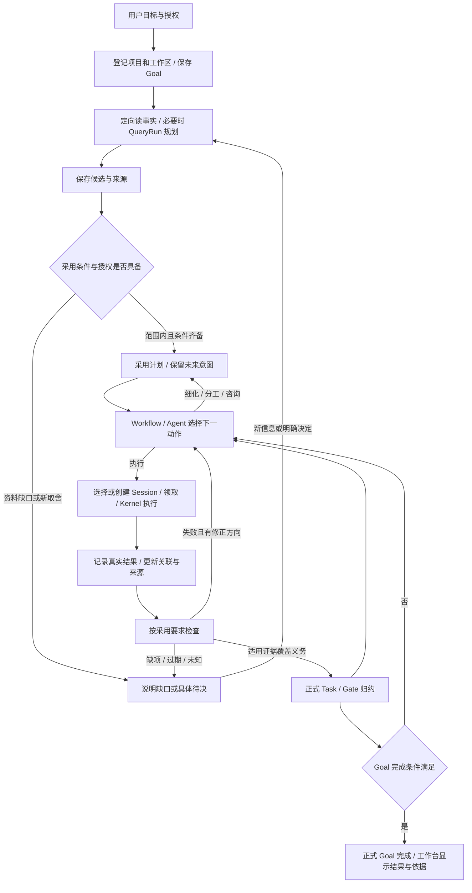

# MVP 产品行为与端到端验收

更新：2026-10-13。状态：当前产品目标的行为细化，依据 [HANDOFF 决定 1–57](refactor/HANDOFF.md)；**不是实现完成报告**。本仓库根就是施工工程，旧路径按[根 AGENTS](../AGENTS.md)第 2 条读取。

本文把 [PRODUCT](PRODUCT.md) 的承诺组织成可执行、可观察、可验收的用户路径。接口与状态字段仍归[模块文档](refactor/modules/README.md)、[共同契约](refactor/skeleton/CONTRACTS.md)及具体批次；本文不新建协议、调度器或业务状态库。当前状态、缺口和下一步看 [STATUS](refactor/STATUS.md)，源码和证据入口看[能力索引](refactor/IMPLEMENTED-CAPABILITIES.md)；[实施计划](refactor/IMPLEMENTATION-PLAN.md)是历史，不能从行为设计或旧计划推断已交付。

## 1. 依据与范围裁决

| 依据 | 本文采用的行为 |
| --- | --- |
| [历史 PRODUCT §8](history/before-2026-09-22/PRODUCT.md#8-mvp-必须证明)、[当前 PRODUCT §9–10](PRODUCT.md#9-当前范围与后续方向) | 单用户单机、多项目作用域、连续推进、真实完成、控制恢复、换手和统一界面；历史有效承诺不因归档或本次拆批撤销 |
| [原话 DLG-029/037/044](refactor/intent/ORIGINAL-DIALOGUE.md#dlg-037-用户) | 当前/历史文件与 Session 相互关联；两图提供定位和操作；工具结果反向维护相关结构 |
| [编号原话 01、02、09、12、13、14](agent-platform-user-replies-numbered.md) | 工作由 Session 承载；角色可复用；Kernel 管执行与历史；无 baseline 可以开始调查和形成草案；知识库不是当前交付门槛 |
| [并行与白板纠偏](refactor/intent/2026-09-23-PARALLEL-AND-PRODUCT.md)、[未来意图与校验边界](refactor/intent/INTENT-AND-DECISIONS.md#2026-09-26-补充未来意图节点与校验边界) | 同工作区并行；任务关系不一律阻塞；未来节点可缺验收和分配，但不能从未完成说明中消失 |
| [本次引用讨论](chatgpt-conversation://6ab750c3-53d4-83ec-a03b-38f50a73ccd1) | 以纵向用户路径组织文档；骨架测试须区分失败来源和未执行断言。讨论中的完成百分比、四个断点和串行示意是助手判断，不是源码证据或缩减产品范围的决定 |
| [HANDOFF 决定 10、13、15、17、18、21–23、25、30、33、35、37–39、42、43、45、49](refactor/HANDOFF.md)、[编排设计书](refactor/design/orchestration-2026-10/DESIGN.md) §1–5、§8.2 | B11–B20 补齐决定闭环、自治级别、目标顺序和冲突提示、工作线活动状态、独立审阅、持久等待和超时转交、A.2 后的真实模型重跑、归档前处置责任、agent 派工与建成员、直接干预；B07 补图工具，B09 保留记忆核心；压缩不算 MVP 门槛 |

采用两个验收层次，避免把施工顺序误写成产品裁剪：

- **E2E 首通**：用户在真实入口给出 Goal，无预置 Plan，经调查/规划、正式采用、执行、真实检查、Task/Goal 完成，最终在工作台查看产物与依据。先选一条窄而真实的 coding 路径，允许该样例顺序执行；它不证明全部 MVP 已完成。
- **产品 MVP**：首通之外，还通过本文的并行、失败返工、控制恢复、换手、变更、双图追溯和项目隔离路径；记忆核心与 B11–B20 的新增行为也属于 MVP（[HANDOFF 决定 13、15、23、49](refactor/HANDOFF.md)）。界面可以朴素，但不能用手工 seed、脚本代改数据库或假成功填补用户路径。

首版仍是单用户、单机、coding-first，多 Project/Workspace，一个 Goal 绑定一个 Workspace。不建设跨机器共识、多租户、完整 IDE、通用工作流 DSL 或长期专家知识库；原生 compact 按真实能力显示 unsupported。压缩不算 MVP 门槛，在支持以前用换手接续（[HANDOFF 决定 39](refactor/HANDOFF.md)；[STATUS](refactor/STATUS.md)“缺口”）。已有生命周期、并行与恢复承诺不能以“最小化”为理由永久后置。

## 2. 用户入口与结果

布局、视觉与控件规范见[工作台 UI 设计 §0](UI-WORKBENCH.md#ui-decisions-2026-10)和[冻结原型](ui-reference/workbench-2026-10/README.md)。左栏按职责分组列出工作线（卡片），“成员”只是推导出的视图；工作中、待命、已归档按工作线计数。点工作线，中间切到它的对话，可「问一问」或「直接干预」。主对话是交互面，目标栏切换显示内容，不等于一个 Session。右侧辅助区可收起，用多页签承载双图、文件、命令和 Diff；节点详情、任务过程和原历史按需展开（[HANDOFF 决定 15、17、25、33、35、37](refactor/HANDOFF.md)，替换早先主对话只按传统 Session 展示的说法）。

用户在同一工作台选择或创建 Project/Workspace，输入目标、约束与已有授权。工作台至少提供主对话、任务图、架构图和统一详情入口；图和列表可以简化布局，但两种结构必须真实可查看。

| 用户动作 | 应看到的结果 |
| --- | --- |
| 输入“修复问题并验证”或“实现这个功能” | 原目标被保存；系统说明正在调查、规划、执行或等待什么。授权内细化和验证自主推进 |
| 查看任务图 | 未来意图、当前工作、历史尝试同时可找；展示 required/optional、延期/取消/替代和缺项，不能只列 ready 节点 |
| 查看架构图或点名工作者 | 区分正式结构与源码观测，定位文件、职责、关联 Session 和历史；归档不删历史 |
| 查看任务详情 | 当前计划/义务、负责人和 Session、Run/Attempt、变更、检查、证据、阻塞原因与下一触发条件 |
| 查询状态、打开文件或历史 | 直接读已有事实，不因展开/分页启动模型；解释需求才使用必要的 QueryRun |
| 暂停、继续、取消或追加要求 | 显示受理回执、作用范围和实际生效状态；未支持、拒绝、未知分别可见 |
| 查看最终结果 | 产物位置、修改摘要、当前有效验收证据、未完成/排除事项；能追到原始结果和来源版本 |
| 关闭后重开 | 找回原目标、计划、执行与控制状态；不要求重述项目，不凭 UI 缓存重建正式状态 |

“已受理”“已进入执行”“执行结束”“检查通过”“Task satisfied”“Goal COMPLETED”分别表达。下文中文阶段是用户语义，不新增全局状态枚举；具体映射遵守[状态机](refactor/ORCHESTRATION-STATE-MACHINES.md)。

## 3. 主路径与模块责任

此图是有反馈的业务流程，不是源码依赖 DAG，也不要求所有任务串行经过同一常驻模型。主路径有变化才推进，无新依据时等待明确条件。

| 责任方 | 本路径负责什么 | 不得替代什么 |
| --- | --- | --- |
| Host/UI | 真实作用域、配置、交互、局部刷新、持久待办唤醒和展示 | 不自行置 Task/Goal 完成，不把浏览器状态当正式事实 |
| Workflow / 角色 Skill | 规划、采用授权判断、Session 选择、并行安排、检查/返工与待决选择 | 不复制图算法、事务、完成归约或模型循环 |
| WorkGraph | Goal/Plan/Task、Session 关联与占用、Query/消息/证据的正式操作和完成归约 | 不调用模型或 shell，不证明未来语义无冲突 |
| AgentRuntime / Kernel | 实际执行、只读查询执行、检查执行适配、控制与恢复、原历史观察 | 不凭模型结束宣布产品完成，不另建一套 Kernel 日志 |
| WorkspaceTools | 文件、来源版本、捕获、比较与结构观测 | 不自动采用架构或授予执行权限 |
| RecordStore | 条件提交、正文、事件与索引持久化 | 不决定业务方案 |

目标仍为[五模块八条允许边](refactor/module-dag.md)。运行结果回到 WorkGraph 后，由外层 Workflow/Host 消费变化，不引入 WorkGraph → Runtime/Workflow 反向依赖。

## 4. 行为契约

### B01：从空状态建立真实项目

**触发**：用户选择已有目录或要求在授权位置创建项目，提交目标。

Host 提供真实目录映射、存储与 Kernel 配置；经正式 Project/Workspace、Goal writer 保存引用。目录创建、登记、文件可访问是不同事实；不存在或无权访问时显示准确原因，不静默换到别的目录。空目录是合法观察。

没有 Plan、正式架构 baseline 或 CompletionPolicy 不阻止调查、回答和候选保存。正式采用才检查实际治理前提；首次架构通过已有初始采用能力登记真实候选，不能塞空 baseline 或测试 policy 冒充初始化。相关角色、政策与授权来自明确配置和正式 writer。

**结果/失败**：成功后能重开同一项目和 Goal；重复同一创建请求返回原回执。初始化中断仅续办未完成步骤，保留已经成功的登记，不盲目重建 Goal。

### B02：无 Plan 调查、规划与采用

**触发**：Goal 存在但尚无采用计划，或用户要求解释/修订现有方案。

主对话写明请求交给了哪个秘书。秘书先给 2–3 个思路，用户选一个后继续在对话中迭代，每轮说明改了什么；目标卡和第一个方案由用户确认后才推进。同一目标可以有多个请求，候选方案按请求分开；采用一个后，其他基于旧计划的候选显示过期（[HANDOFF 决定 15、37、42](refactor/HANDOFF.md)；[编排设计书](refactor/design/orchestration-2026-10/DESIGN.md) §1.1）。

优先读已有目标、文件、图和材料；需要模型判断时使用真实 QueryJob/QueryRun。Query 不伪装 Task/Attempt，不借 Work Run 权限；与其他执行共用 Session 占用和唯一 Kernel 循环。只读规划不获得文件编辑权限；后续初始化写入通过已授权写路径。

模型回答经真实来源提取和边界解析成为候选，保留 Goal/Workspace/回答及来源版本。候选中允许未来 `plan_only` 节点暂缺分配和验收；不沿用“所有节点必须立即可执行”的假设。解释旧方案复用原版本与理由，不能每次追问重新生成计划。

已有授权覆盖的细化可直接正式采用；缺治理或来源过期时说明具体对象并修复。实质改变目标、验收或越权时才展示可审阅差异和待决选项。用户确认绑定具体候选版本；过期确认不批准新版本。模型来源不能伪装 Host 来源绕过采用。

**结果/失败**：采用通过原 Plan writer 切换版本和关系；拒绝不部分修改活动计划。回答超时或结果未知先查询原 Query，不通过另建一次规划掩盖不确定状态。详细生产链见 [R5b](refactor/tasks/R5b-query-planning-skeleton.md)。

### B03：从白板选择行动并保留长程方向

**触发**：计划采用、执行/检查结果到达、消息有实际业务响应、控制/条件变化或用户补充。

Workflow 读取触发涉及的对象及当前计划，选择细化、分配、咨询、执行、检查、返工或等待。ready 是候选提示；分配不等于激活，激活不等于领取，领取不等于 Kernel 已开始。具体执行资格使用当前正式契约。

无 ready 时同时查看未来意图、未完成 required 工作、缺分配/说明/义务、实际输入缺口、忙碌 Session、检查与未知执行。能在授权内补足的继续细化；需要外部信息的保存原因和唤醒条件；不能宣布完成或无变化地重复调用模型。

预期依赖、架构相关和计划显示顺序不自动成为硬前置。明确采用的具体产物消费条件在真正需要该输入时检查；生产者 Task 尚未整体完成，但所需产物已合法可用时，不机械等待整个 Task。

**结果/失败**：每次行动可定位依据与结果。未来 required 意图不会因暂不可执行而从 Goal 未完成解释消失；一次局部失败不撤销其他独立工作。

### B04：真实执行、连续 Session 与结果回流

**触发**：选择了可执行工作和当前有效分配。

按任务/模块关联寻找合适 Session，核对角色、范围、健康和占用；相关工作优先延续，独立调查/审阅或并行使用独立 Session。创建 Session 本身不启动模型；创建成功后领取失败保留合法闲置 Session。

领取正式写入 Task/Session、Attempt/Run 与待执行项。Runtime 准备真实角色/Skill/工具及必要材料，经新鲜执行准入进入 Kernel。相同领取重放只能读原执行，不再次启动。Session ID 相同不足以证明连续性：后续模型输入必须真正包含必要前文与增量要求。

工具和执行结果带真实身份、来源及历史引用入账，局部更新相关图或标明尚待刷新。Run 结束释放匹配代次的占用，保留历史与工作关联；不归档 Session、不自动完成 Task。失败有具体修正方向才能开新 Attempt；未知先核对。

### B05：同工作区并行与协调

**触发**：存在可独立推进的多项工作。

Workflow/Agent 根据规范、架构和白板分工；允许同一目录中多个独立 Session 同时工作。不要求事前完整未来读写范围证明，不把模块、Workspace 或所有传递依赖加成一把锁。实际工具操作仍执行适用权限、文件版本和必要资源约束；同一 Session 保持一个对话修改占用。

发现冲突时返回真实对象、来源和已知影响，由 Agent 调整共享步骤、协调、等待或采用已有隔离能力。保留无冲突成果；不自动推翻两个分支全部工作，也不假称尚未实现的三方合并已经可用。通信的已读、回复、正式输入满足和任务完成分别表达。

**结果/失败**：独立工作继续，冲突只阻塞相关步骤。涉及新的产品/架构取舍才向人提交方案；普通文件协调不增加同义审批。并行结果经实际检查与整合后才能用于完成。

### B06：检查、返工与 Task/Goal 完成

**触发**：真实执行产生待验收结果，或已有检查需要补齐。

按已采用义务冻结本轮检查要求和实际来源；使用真实命令、只读报告见证及要求中明确存在的独立审阅。没有独立审阅要求时不强加 Reviewer。报告、正文材料、Evidence、检查轮次和正式完成是不同事实。

- 缺验收定义、required requirement 或有效证据时返回具体缺项，不利用空集合得到 PASS；允许此前合法调查已发生。
- FAIL 保留原轮次和证据；义务不变时返工保留 Task、新增 Attempt/Run，优先延续合适 Session。义务变化走正式计划演进，不偷改已经执行的定义。
- 缺项、INCONCLUSIVE、过期、执行中断或未知副作用均不完成；检查曾通过只证明对应来源版本。仍适用的结果可复用，不为补报告重复未知命令。
- WorkGraph 完成归约核对当前义务、覆盖、来源和局部版本，正式提交 Task satisfied；gate 只归约证据，不派发伪 Work Run。
- Goal 单独归约：无活动计划、空完成要求、required 尚未解决、相关未知执行均不能 COMPLETED。optional、延期、取消和被替代事项明确列出；required 取消不能自动算完成。明确接受部分结果记录 ACCEPTED_PARTIAL 与取舍依据。

**结果**：用户可从 Goal 完成进入每项义务、适用证据、原检查和文件版本。Run 成功、exit=0、模型说“完成”、消息回复或 ready 为空都不能替代此链。实现边界见 [R3e](refactor/tasks/R3e-completion-skeleton.md)。

### B07：查询、解释与统一导航

已知路径或引用可以直接读，不强制全图扫描。图用于缩小检索范围并关联模块、任务、Session、产物和历史；查询与分页不改状态、不 ack 消息、不启动模型。缺失、未授权、不支持、历史版本与当前结果分别返回。

agent 用两张图共用的“看、找、记”：看节点或路径，得到可下钻的紧凑文本卡片；按文字或路径找节点；给节点记一段话，由平台补来源、版本和类型，返回收下、待审或拒绝及原因。读图不必先装入全图，记注记不代替正式状态写入（[HANDOFF 决定 18、22](refactor/HANDOFF.md)；[编排设计书](refactor/design/orchestration-2026-10/DESIGN.md) §5.3）。

用户追问理由时使用已保存的明确决定、选项与依据，不要求保存模型隐含思维过程。需要咨询才向适合的 Session 发消息或建立 Query；忙碌、离线或归档不妨碍读取已有事实，不冒充原工作者作答。

UI 用提交回执和读取水位刷新相关视图。投影延迟保留带版本旧视图或显示待刷新，不把已提交动作显示为未发生；节点、名册与对话定位到同一详情。

### B08：暂停、继续与取消

用户或授权策略发起作用域明确的控制，平台先持久记录期望，并停止相关新派发；Runtime 经真实 Kernel 能力投递并观察。控制请求、信号送达、安全点生效和终态分别展示；迟到旧 ack 不覆盖新控制。

继续需读取原控制、Session/Run/Turn、占用及恢复能力，按正式恢复入口处理；不能把重复 start 或创建新 Session 当作原 Run 恢复。取消不撤销已写文件或删除历史。终态后晚到控制按真实回执说明，不把已经结束的工作改写成“取消成功”。

部分 Run 仍未知或能力不支持时显示各自原因，不显示整个 Goal 已停；确认原写入停止或正式交接后才允许相交接管。R4.1 意图持久化、R4.2 安全点与后续投递/恢复必须共同贯通，不能单凭其中一项开启完整 capability。

### B09：目标/架构变更与安全换手

目标变更先保存要求并定位受影响任务、结构、Session 与证据；候选不立即作废现行计划。已有授权的变化按正式操作采用，新增取舍展示具体差异。停止受影响旧后续派发，运行中的相关操作按 B08 控制，无关任务继续。

正式架构与源码观测分别保存。发现漂移后能定位版本、相关文件和工作者，解释影响并进入修复或正式架构变更；不得自动把观测 imports 当作已采用职责，也不得隐藏观测环。拒绝、延期和过期决定不偷偷推进采用。

换手保存目标、当前义务、有效决定、未决项、未验证假设、文件变化和历史引用。接任者仅靠持久材料就能按需接续；责任切换前核对原写入和交接状态。交接失败不丢旧义务；归档保留全部历史，重新启用与另建接续如实区分。

**交接与归档时的当前理解**（用户 2026-10-05 决定：记忆核心进 MVP，见 [HANDOFF](refactor/HANDOFF.md) 顶部决定 23）：
- 目标和阶段节点上保存一段“当前理解”：跨计划版本的取舍、试过什么、定了什么、还没定什么。
- 事实用指向固定版本的引用给出（代码路径与提交、计划版本的改动原因、检查结果、原始历史区段）；理解写成有大小上限的文字，不只放指针。
- 任务结束、采用新方案、返工、Session 归档或重组时更新。接任者和下一个在那里工作的 agent，不必重读全部历史就能拿到。
- 所引代码或计划版本变了，条目标为“需复查”，不当作仍然成立。
- 两张图的节点还可保存注记，带来源、版本和复查状态。用户可看、改、撤下；历史仍保留，注记不能代替授权或完成状态（[HANDOFF 决定 20、23、35](refactor/HANDOFF.md)；[编排设计书](refactor/design/orchestration-2026-10/DESIGN.md) §1.7）。
- 查找工具按明确字段和固定规则读取，工具内部不调用模型；相同输入、权限、数据和规则版本得到同一结果。关键词全文查找提前到第 4 片，注记只加一个全文索引；这替换决定 23 原来放在 MVP 之后的排期（[HANDOFF 决定 49](refactor/HANDOFF.md)；[编排设计书](refactor/design/orchestration-2026-10/DESIGN.md) §3.1）。
- 检索排序调优、真实 bug 效果评估仍放 MVP 之后；长期知识库更后（[HANDOFF 决定 23、49](refactor/HANDOFF.md)）。

### B10：中断、重启与无进展

| 可达中断/重复窗口 | 必须采取的行为 |
| --- | --- |
| 受理响应丢失 | 用原请求身份查询回执；同输入回放，改输入冲突，不再写一份候选/执行 |
| 已领取但确证未进入 Kernel | 续办原持久待执行项，不重新规划或领取 |
| 可能已进入，结果未知 | 保留身份与占用，核对原 Kernel 记录；日志暂缺/超时不能证明未执行 |
| 工具已发生，平台入账失败 | 依据原结果补账，不能重新执行工具取得“另一份结果” |
| 检查后文件或计划改变 | 保留历史证据；只在当前适用性成立时复用，缺口明确列出 |
| 同输入、同版本、同动作重复失败 | 没有新信息则换方法或等待具体条件，不无限增加 Attempt/模型调用 |
| Host 重开 | 先恢复持久待办、映射与未决观察，再允许相关新执行；Kernel 恢复自身日志，平台恢复关联 |

不增加另一个恢复引擎或承诺外部副作用恰好一次。不根据直接改坏内部记录构造不存在的运行时 Role 热切换生命周期；反例来自公开入口、真实并发与可达故障窗口。

### B11：「需要你决定」的闭环

**触发**：出现需要用户选择的事项，或有工作结果需要用户知悉（[HANDOFF 决定 13、15、37、42](refactor/HANDOFF.md)；[编排设计书](refactor/design/orchestration-2026-10/DESIGN.md) §1.4）。

全局队列分“要决定”和“请知悉”，目标栏显示计数。主对话中的卡与队列是同一项，处理一次，两处同步。秘书、参谋、书记可请用户决定；执行者和审阅者只发“请知悉”，需要用户选择时由参谋转成决定卡。

每张卡可以先问秘书，再选项、写自己的话或给对象加批注；只写话也能答复。拒绝、延期也是答复，不需后续落实。其余已答复而未落实的卡移到“已答复、待落实”，不再算待答；发卡的线归档了也不能丢掉它。落实后能看到改了哪个对象、哪一版；落实没记上时显示“已答复，落实未记”，可补记。

**结果/失败**：对象已经变了，旧答复不能批准新版本；暂停目标可以答卡，但修改工作等继续后重核版本。“请知悉”只把实际展示过的条目算作看过，不能因看了一页就漏掉其他通知。队列完整分页，待答和待落实项不因时间久而丢弃（决定 42、[决定 49 第 14、28 项](refactor/HANDOFF.md)；设计书 §1.4、§1.6、§6）。

### B12：按 Goal 设置自治级别

**触发**：用户确认目标和首个方案，或调整该 Goal 的自治级别（[HANDOFF 决定 15、21、35、37、42、49](refactor/HANDOFF.md)；[编排设计书](refactor/design/orchestration-2026-10/DESIGN.md) §1.3、§1.6、§2.7、§4.10）。

默认「方案确认后自动」：范围内细化、返工和重新检查自动推进，返工受上限约束；小的语义修补随工作生效，秘书的“请动手”“请回答”自动发出，短期线自动换手并进“请知悉”。结构性修补，改目标、验收或范围，超预算及上报，长期线换手或换职责，两档都进「需要你决定」。「每步确认」下，范围内细化、返工、重新检查、小的语义修补、秘书派出的“请动手”“请回答”、短期线换手、干预新建的小任务和创建成员，都先等用户确认。秘书因太长换手是例外，两档都自动换手并进“请知悉”；目标卡和第一个方案在两档下都由用户确认。

**结果/失败**：不同 Goal 按各自级别推进。改级别只影响之后的动作，不中断已在做的工作，也不自动发出原先待放行的消息。自动返工要让用户和秘书知道，不能悄悄反复重试（决定 42；[UI-WORKBENCH §0](UI-WORKBENCH.md#ui-decisions-2026-10)“自动返工的通知”）。

### B13：Goal 顺序与冲突提示

**触发**：项目有多个 Goal，用户调整顺序，或目标之间可能共享文件、模块（[HANDOFF 决定 15、17、35、42](refactor/HANDOFF.md)；[编排设计书](refactor/design/orchestration-2026-10/DESIGN.md) §1.2）。

目标顺序可见、可调整；争用同一个成员时，排前的先用。冲突提示说明依据，只作建议，不自动阻止领取或执行。“等前一个目标 / 调整顺序 / 接受风险并行”并列，不默认推荐等待；没提示也不代表已经证明无冲突。

用户选“等前一个”后，后一个 Goal 不开始新的修改工作；已在做的和只读问答、查找、出方案照常。等的是选择当时的前一个 Goal，后来调顺序不换等待对象；它完成或取消后解除等待。

**结果/失败**：接受并行风险后能查到针对哪两个 Goal、哪两版计划；任一计划变化且仍有冲突时重新提示。调顺序不停止正在做的工作，也不把已接受风险当作永久授权。

### B14：成员活动状态与可用动作

**触发**：用户查看工作线卡片、悬停信息卡或工作线详情（[HANDOFF 决定 13、25、30、33、35、38、45、49](refactor/HANDOFF.md)；[编排设计书](refactor/design/orchestration-2026-10/DESIGN.md) §1.5、§4.8）。

活动状态说明它正在做什么，不能只用“可用”代替。工作中、等回复、待命、已暂停、待核对、启动中分别显示；停止请求发出而尚未停下时带“停止中”。线自己的状态和需要关注的原因一起显示，三处一致；暂停不能盖掉待决定，退役不能盖掉结果待核对。

“已做完”表示还能接新任务；“已退役”表示不能再执行，原历史仍可读，也可以从保存记录派生「问一问」。工作中、待命、已归档按工作线计数，不与职责配置数或正在运行的模型数混用。计数里的“待命”包括没有正在工作的未归档线，不只包括状态词为“待命”的线（设计书 §1.5“计数”；[UI-WORKBENCH §1](UI-WORKBENCH.md)）。

**结果/失败**：点工作线切到它的对话，显示实际可用动作；已归档或已退役的线只读。已做完的线可以直接干预，内容作为新任务，不重开已验收任务；所属 Goal 已完成时，先请用户确认成新 Goal。退役、没有接续且执行结果未知时，自动维护先保留待核对，用户认定后才归档（决定 38、45、[决定 49 第 21 项](refactor/HANDOFF.md)；设计书 §1.6）。

### B15：按采用要求独立审阅

**触发**：采用的计划要求独立审阅；没有这个要求时不强加审阅者（[HANDOFF 决定 13、35](refactor/HANDOFF.md)；[编排设计书](refactor/design/orchestration-2026-10/DESIGN.md) §2.9，承接 B06）。

审阅者在独立上下文里看当前代码、被审任务和执行事实、改动与检查结果，以及对应执行的原历史片段。被审成员忙碌或已归档，不妨碍在授权范围内读取这些已有记录；来源缺失或不可读时明确说明，不靠执行者自述代替。

**结果/失败**：审阅结论带依据；怎样进入 B06 的检查证据仍是设计提议（设计书 §2.9、J13）。缺少要求的审阅或证据过期不能算通过。独立审阅的一轮只出结果，不替被审成员返工或修改计划（[HANDOFF 决定 49](refactor/HANDOFF.md)；设计书 §2.9“审阅与工作权限”）。

### B16：持久等待、超时与转交

**触发**：成员请求答复并等待，等待到期，或等待中的工作需要换手、归档（[HANDOFF 决定 13、35、42、49](refactor/HANDOFF.md)；[编排设计书](refactor/design/orchestration-2026-10/DESIGN.md) §1.9、§4.6）。

等待保留问题、收信人和期限。项目设置默认答复时限，发信成员可以另给；重启后继续核对原等待。到期告诉发信成员，由它决定再问、换人或不等；同一问题的追问链第二次实际到期进“请知悉”。重复读取不重复算到期，超时本身不证明原执行已停下。

同一处理点已经有回复，不再按到期未答处理。到期处理后才来的回复照常保存，在下一个安全点作为新输入送达，不重开旧等待。已让出、等回复的 Session 收到用户新输入时，在安全点优先处理，原等待默认保留，并通知相关委托者；新指令不冒充旧问题的答复（决定 49 第 17–20 项）。

归档仍在等待的普通工作线前，先取消等待，或转给用户选的另一条线，问题和期限不变。秘书的等待跟着请求交给接任者；退役线归档不用先选等待去向，结果未知时仍按 B14 等用户认定。发到退役线的回复保留为未送达，提示用户选择转交，不能自动换收信人。

**结果/失败**：用户可查到原问题、回复、到期或转交的经过。通信确实断开时，等待方、发送方和用户能知道原因与接管情况；暂停或结果待核对时，输入可以排队，但不能据此启动修改（决定 49；设计书 §1.6、§4.6）。

### B17：A.2 之后用真实模型重跑编排验收

**触发**：A.2 及后续编排能力完成，准备验收 MVP 的编排路径（[HANDOFF 决定 13](refactor/HANDOFF.md)；[编排设计书](refactor/design/orchestration-2026-10/DESIGN.md) §8.2 第 9 片）。

经用户授权调用真实模型，从正式入口重跑 E05、E06、E08、E09、E12，以及方案迭代、直接干预和等待。用户能看到实际并行与冲突处置、换手后的连续工作、变更落实、原历史与证据，并能沿记录核对结果。脚本模型、单项工具成功和旧版本的成功记录都不能代替这次验收。

**结果/失败**：逐场景记录通过、失败与未覆盖范围；未跑的不能标通过。当前进度见 [STATUS](refactor/STATUS.md)“缺口”；完成本项也不能代替其余 MVP 行为和新界面验收。

### B18：归档前处置责任

**触发**：用户归档一条工作线，或平台准备自动归档（[HANDOFF 决定 13、35 · Q1、42 第 1 条、43、45](refactor/HANDOFF.md)；[编排设计书](refactor/design/orchestration-2026-10/DESIGN.md) §1.8、§4.5）。

任务已完成、已取消或已被替代，负责关系自动结束。还有没做完的任务时，当场选择“交给…”或“放下”；放下后任务仍在，只是暂时没人负责，等重新派工。等待的处置见 [B16](#b16持久等待超时与转交)。

有工作执行在跑时，先请求停止；停下前显示“归档中 · 停止中”，不能转移负责关系或完成归档。结果未知时须由用户认定，平台不能自行当作已停下。退役、没有接续且结果未知的线，自动维护先保留“已退役”和“待核对”，等用户认定（决定 45）。认定以后，Kernel Turn 还开着的线由维护关闭悬空 Turn、回到可用，不归档；关闭不了才归档（决定 51）。

异常锚点按 lead 的做法处理，设计书 §1.8、§4.5 仍标为【提议】：平台在任务及所属 Goal 上记录谁、在做什么、为何中断、改过哪些文件和结果尚未核对；拿不到改动就写“改动未知”，可能混有别的执行的改动也要说明。改动留在工作区，不撤销，也不算通过；任务显示“中断，待核对”，接手执行带上锚点。原来暂停的任务仍等用户点“继续”。

**结果/失败**：任务重新派工时，先复用合适的其他 Session，没有才新建；「方案确认后自动」下自动再派，「每步确认」下先确认。归档或退役中断不算失败、不占返工上限，是决定 43 下 lead 的做法，设计书仍标为【提议】。归档中途失败时，已经完成的处置保留，并说明“处置已完成，归档没成功”；归档不删除历史。

### B19：agent 派工与建成员

**触发**：agent 要挑选工作者、派工，或现有工作线不适合、需要创建成员（[HANDOFF 决定 13、35 · Q19、49 第 16、22 项](refactor/HANDOFF.md)；[编排设计书](refactor/design/orchestration-2026-10/DESIGN.md) §2.5 的 J1、J2，§2.11、§4.10“创建权限”）。

平台先按事实排序，agent 可以改派；先复用合适的成员。J1 提议的默认次序是：和任务有关联、和任务的模块有关联、做过同一目标、职责相符、最近活动；这个具体次序仍是设计提议。普通派工只从可用的线里挑，排除只读副本、等回复、退役和归档中的线，不按显示名猜责任。

所有有权派工者发“请动手”前，都核对活动计划版本、当前理解指针版本和目标派工序号；首次允许明确表示“尚无当前理解”。自动模式下过期就退回重读；「每步确认」下在放行时核对，过期则重出或不发。成功重试回原回执，不重复派工；“请回答”不做这三项核对。

参谋、具明确委托权限的执行者可在职责内创建成员，说明职责、范围和理由；「每步确认」下创建前先批准。固定工人、秘书、书记和独立审阅轮不继承创建权限，秘书、书记需要时请参谋；平台挑选或新开秘书仍属请求分配。

**结果/失败**：能查到派给了谁、依据哪版计划；过期派工不能发出，无创建权限不能自行建成员。优先并行文件、模块不重叠的任务；有重叠先由参谋等定接口约定。版本检查不证明语义相容，实际冲突仍由正式检查和返工处理。

### B20：直接干预

**触发**：用户在工作线对话里选择“问一问”或“直接干预”（[HANDOFF 决定 10、35 · Q18、38、49 第 21 项](refactor/HANDOFF.md)；[编排设计书](refactor/design/orchestration-2026-10/DESIGN.md) §1.6）。

“问一问”从保存的记录派生只读副本，不打扰原线的工作。“直接干预”把消息发给原成员，在下一个安全点送达，分别显示已排队、已送达、已生效或被拒绝。

空闲线手上有没做完的任务，就带着消息继续；没有就建一个小任务，正常领取执行。已做完的执行者线也可这样接新任务，已验收的任务不动。新建小任务会多一个计划版本：「方案确认后自动」下自动采用，「每步确认」下先确认，见 B12。

**结果/失败**：所属 Goal 已完成时，先请用户确认成新 Goal，再建小任务并正常采用计划；原 Goal 的完成事实保留。已归档或已退役的线只能“问一问”。目标暂停、取消或执行结果待核对时，干预保留排队及原因，不能代替继续或认定；恢复或核对完成后重读版本，取消目标须先复制成新目标。

## 5. 最小验收矩阵

以下是待实施的行为标准，当前不标 PASS。单个场景可以覆盖多个行为；复用已有底层测试，不为每一层复制同一事务矩阵。

[09-27 真实模型接入](refactor/reviews/evidence/standalone-2026-09-27/e01-live-deepseek/result.json)和 [09-29 正常 UI 冷启动](refactor/reviews/evidence/goal-cold-start-2026-09-29/README.md)已有隔离小项目的限定证据，覆盖调查/规划、两个 Work 复用同一 Session、真实文件修改、正式检查与 Goal 完成，以及各自报告中的浏览器核对；它们早于 A.2 和编排各片，不代表整个 MVP 通过（[HANDOFF 历史](refactor/HANDOFF.md)；[STATUS](refactor/STATUS.md)“缺口”）。

| 编号 / 层次 | 起点与动作 | 必须观察到的证据 / 反例 |
| --- | --- | --- |
| E01 首通 | 空平台库、真实目录，用户只给 Goal 和范围，无 seed Plan，经 UI 推进 | 正式初始化 → 真实 Query 回答/候选 → 正式采用 → Kernel 修改文件 → 实际检查 → Task/Goal 完成 → UI 原引用可追溯；全过程无需人代填状态 |
| E02 首通 | 已有小型项目，任务至少有后续工作；一次执行结束 | Workflow 消费真实结果继续检查/下一动作，无手工调用内部接口；ready 为空但 required 待细化时仍未完成 |
| E03 首通 | 检查 FAIL 后修正；另有缺项或来源变化 | 旧失败保留，同 Task 新 Attempt；后半段断言实际执行；FAIL/缺项/过期/空义务都不能完成 |
| E04 首通 | 刷新、关闭重开、重复提交原用户请求 | 原 Goal/Plan/Run/回执与产物可查询；重复请求不增加实际启动；普通读取模型调用数不增加 |
| E05 MVP | 同 Workspace 两独立 Session 工作，加入一个实际共享冲突 | 独立执行时间重叠，冲突返回具体对象，独立成果保留；同 Session 竞争只有一个有效占用 |
| E06 MVP | 相关工作继续，随后有理由换手 | 实际后续输入包含必要历史；接任者从持久材料取得义务/理由/前沿，无需用户重述；归档后可查历史 |
| E07 MVP | 运行中暂停、继续、取消以及迟到控制观察 | UI 请求/实际分开，安全点与恢复真实生效；未确认停止不转交冲突写入，取消后文件事实仍保留 |
| E08 MVP | 采用前/执行中修改目标或验收 | 具体版本与授权可核对；受影响工作切换，无关工作继续；旧证据不完成新义务，required 取消不变全绿 |
| E09 MVP | 两个工作包提前提出接口/架构冲突，另观察到源码漂移 | 工具/消息 → 参谋解释 → 需要时人的具体决定 → 正式版本 → 受影响上下文；拒绝/延期/过期不采用；漂移有修复或待决路径 |
| E10 MVP | 在启动前、启动结果未知、结果入账前中断并重启 | 分别续办、核对、补账；记录实际 Kernel/命令调用次数，未知不猜成功/失败、不重复副作用 |
| E11 MVP | 多 Project/Workspace 切换，尝试使用另一作用域引用 | 合法项目可各自打开；越界材料/执行被拒，不能借相同 Role 或 Session 名称继承权限 |
| E12 MVP | 从双图查看文件、历史、消息与完成证据，重启后发起相关新工作 | 路径和版本可回指；查询不触发模型/已读/状态写；可复用历史但过期前提不会升级为当前事实 |
| E13 MVP（B11） | 从主对话和队列处理同一张决定卡，含自由答复、批注、对象过期和落实补记 | 两处是同一项；待答与待落实分开，归档不丢卡；过期不采用，补记可追到实际变更；分页不漏待办（决定 13、37、42、49） |
| E14 MVP（B12） | 两个 Goal 设不同自治级别，再切换级别 | 各按本目标设置推进；目标卡和首方案都须确认；已在做的不中断，旧待放行消息不自动发出，自动返工可见（决定 15、35、37、42） |
| E15 MVP（B13） | 目标冲突时分别选择等待、调整顺序、接受风险并行 | 提示不自动拦工作；等待只挡新修改，调序不偷换等待对象；计划变化后风险重新提示（决定 17、35、42） |
| E16 MVP（B14） | 查看启动、等待、暂停、未知结果、做完、退役和归档的工作线 | 卡片、悬停和详情状态一致；活动与关注原因分清，工作中、待命、已归档均按工作线计数，“成员”只是推导视图；已完成 Goal 加工作先确认新 Goal（决定 13、25、30、38、45、49） |
| E17 MVP（B15） | 计划要求独立审阅，分别读取忙碌和已归档成员的被审记录 | 授权内读取代码、事实和原历史；审阅只出结果，证据可追溯；无要求不强加，缺项或过期不通过（决定 13、35、49） |
| E18 MVP（B16） | 等回复时重启、到期、收到迟回和用户干预，再转交等待 | 原问题和期限保留；不重复到期、不重开旧等待；用户输入优先且保留等待、通知委托者；未送达不自动换人（决定 13、35、42、49） |
| E19 MVP（B17） | A.2 和编排各片后，经授权用真实模型重跑指定场景 | 保存本次正式入口、实际调用、产物和检查记录，列清失败与未覆盖；旧限定证据不代替重跑（决定 13；设计书 §8.2） |
| E20 MVP（B18） | 归档仍有任务、正在执行或结果未知的线，分别交给其他线或放下；另观察退役线的自动维护 | 停止前不转移责任、不完成归档；放下不取消任务；异常锚点及接手说明按 lead 提议可追溯，改动不撤销也不算通过；未知结果等用户认定，中途失败说明已做的处置（决定 13、35、42、43、45） |
| E21 MVP（B19） | 按事实挑成员、agent 改派，派工前版本变化；有权和无权的角色分别尝试建成员 | 先复用合适成员；过期派工退回重读，重试不重复发出；参谋、获明确委托权限的执行者可建，其他角色不继承权限；每步确认建前批准（决定 13、35、49 第 16、22 项） |
| E22 MVP（B20） | 对工作中、空闲和已做完的线分别问一问、直接干预，再向已完成 Goal 加工作 | 只读副本不打扰原线；干预在安全点送达，有任务就接着做、没有就新建小任务；每步确认先批准；已完成 Goal 先确认成新 Goal，不改原完成事实；暂停、取消或结果未知时只排队（决定 10、35、38、49 第 21 项） |

E01–E04 通过只报告“首条 E2E 已贯通”。产品 MVP 还须覆盖 E05–E22，并在[当前 PRODUCT §10](PRODUCT.md#10-验收与成功标准)约定的本项目与一个外部维护项目上保留真实任务证据。新增项的依据见 B11–B20 和 [HANDOFF 决定 10、13、15、17、18、21–23、25、30、33、35、37–39、42、43、45、49](refactor/HANDOFF.md)。项目与样本在验收时选择；不把尚未运行的场景写成结果，也不强加大型模型对照实验。

每份验收报告记录：代码/文档版本、环境和真实配置、目标/授权、初始文件版本与必要未提交快照、实际入口操作、对象引用链、产物/检查/证据版本、最终状态、故障与恢复结果，以及明确未覆盖项。模型和命令调用次数用于证明查询/重放没有额外执行；性能或成本提升另需同输入实测。

## 6. 骨架测试与实现验收的交接

本节将引用讨论中的失败来源问题落实到现有[两阶段施工方式](refactor/DSH-WORKFLOW.md)，不启动本次文档任务之外的源码施工。

1. 每个行为测试标出本文行为/场景编号、真实目标入口和关键用户结果。夹具通过公开生命周期建立必要前置；纯单元测试可隔离依赖，但不宣称它证明生产链。
2. 骨架红测须报告实际到达的未实现入口、失败类型及调用路径。fixture 缺字段、依赖注入错误、无解释超时不计为有效红灯，应先修测试环境或定位问题。
3. 逐项区分已执行断言、被未实现入口阻断的后续断言、尚未有用例的行为。首行抛 NotImplemented 不能证明后续持久化、历史、覆盖或完成已经受测。
4. 中审核对后续断言能识别“返回空对象”“只改 UI”“把 Run ended 当 Task 完成”“seed PASS 绕过真实检查”等假实现；不只断言 defined/status 字符串。必要时用针对性错误实现验证测试敏感性，不要求每批建设通用变异测试系统。
5. 冻结接口与测试后再实现；最终重跑确认后续断言实际到达、无跳过，并从真实生产者→正式记录→消费者→用户结果核查接线。测试 fake、类型检查和总测试数不替代 E2E。
6. 按既定独立副本流程验收，记录目标能力和限制。校验遵守真实可达生命周期；不引入全账本屏障、未来完整语义证明或已授权动作的额外审批。

## 7. 与当前施工的连接

当前状态见 [STATUS](refactor/STATUS.md)，施工归属见[编排分片目录](refactor/design/orchestration-2026-10/slices/README.md)；2026-09-26 的骨架任务映射移到文末[历史](#历史)，不作为当前排期。

## 8. 历史文档同步记录（2026-09-26）

- [状态机 T2/T4/T9 与 A2/A3](refactor/ORCHESTRATION-STATE-MACHINES.md)：原表格仍用“前置任务满足、资源范围整体重核、后继不可领取”等早期措辞，与该页纠偏及用户白板意图冲突；本次改为具体输入条件、当前领取事实和实际操作约束。
- [Workflow §7](refactor/modules/business/workflow.md)：补无 ready 时的未来意图处理，去除把 `assessParallelism` 和预测范围理解为每次领取前置的歧义；不把目标接口当已有能力。
- [模块 DAG](refactor/module-dag.md)：仅澄清边标签中的可选范围分析，五模块八边不变。
- PRODUCT、文档索引及既有端到端骨架增加本页入口。原始对话和历史原稿保持原文；旧验收结果不因本页重写。

## 历史

### 2026-09-26 施工快照（原 §7，原文保留）

下表是截至本次阅读的文档/源码快照导航，不是本轮重新运行的验收。已抽查 Workflow 仍返回 unsupported；其余既有能力依据索引和批次报告。正在施工的骨架不计完成，后续状态统一更新原能力索引。

| 用户路径 | 直接复用 | 仍需贯通 / 原任务归属 |
| --- | --- | --- |
| B01 项目初始化 | R5a Project/Workspace/CompletionPolicy、Goal、初始架构、Role writer | Host 真实目录/配置/UI；模型采用所需 CoordinationPolicy 正式治理缺口 |
| B02 无 Plan 规划 | 原 Session、Kernel 循环、材料/source、Plan proposal/apply | [R5b](refactor/tasks/R5b-query-planning-skeleton.md)：正式 Query 受理→权限/执行→回答→来源绑定候选与采用；只完成 submit 不关闭规划 |
| B03–B05 自动推进/并行 | W2/C2 白板工具、B2 Runtime、C1 消息、关联与 claim | R5 Workflow/角色业务消费者、事件唤醒、实际分工/冲突处理；不重建上述服务 |
| B06 完成 | 义务/来源/材料/Run 终态与既有纯规则 | [R3e](refactor/tasks/R3e-completion-skeleton.md) 检查 producer、证据、Task/Gate/Goal 归约及 Workflow 返工消费者 |
| B07 用户入口 | 已有图/Session/文件/消息/有界历史端口 | R6 与 [Host/UI 骨架](refactor/skeleton/END-TO-END.md)；薄浏览工作台通过不等于 Goal 自主执行已通 |
| B08/B10 控制恢复 | B2 执行身份和观察、R4.2 Kernel 安全点 | [R4 控制恢复](refactor/tasks/R4-control-recovery-skeleton.md) 意图、投递/ack、取消历史消费、预算/恢复与 UI；不只交 R4.1 |
| B09 演进与换手 | 初始架构、observed 图、Session/WorkLink、W1/W2 未来修订 | R3d 正式架构演进、完整授权计划变更、R4 维护/交接及 R6 解释入口 |
| 版本与产物追溯 | 当前来源捕获/比较、材料来源与原历史 | Git 固定版本等 R2 尾项按真实消费者接入；不要求全部语言 provider 完成才开始首个支持语言样例 |

首通集成依赖 B01/B02、真实执行、B06、Workflow 推进与 Host/UI 共同完成。各批可按接口独立施工，但不能把“四个断点”误读成其余产品义务消失。未知/恢复规则从首通开始保持真实，完整控制与故障场景再按矩阵验收。旧消费者切换和最终退役仍按实施计划单独关闭。
