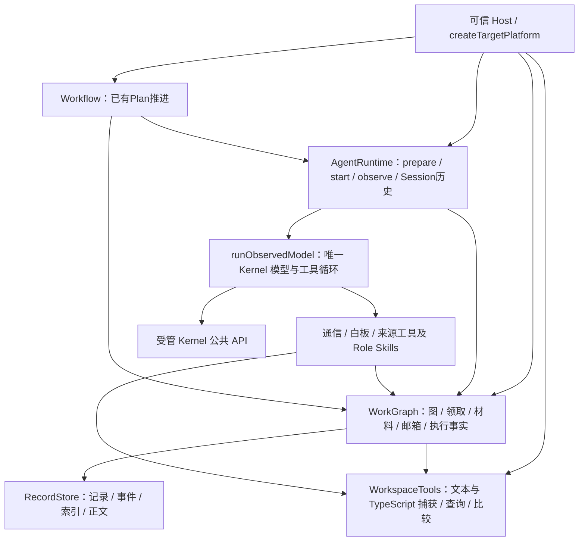

# 当前已实现能力与复用入口

**2026-10-16 注记查找提速第一轮（已合入，决定 66）：** 全文端口改成两个后端共用的内存扫描（SQLite 存紧凑表、打开时换掉 4B 的 FTS5 表），读模型带范围的查找只在范围内找、已读的头交给核对，SQLite 的语句缓存和字面量 LIMIT、记录类型。接口不变，WG53 的文件随之更新。没有新路由，没有调用真实模型。证据：[提速第一轮](reviews/evidence/orchestration-note-speed-1-2026-10-16/README.md)。

**2026-10-16 4B（已合入）：** 注记的查找和新鲜度：全文端口（两个后端）、核对端口、六种读法、两个版本列表，挂在平台的 `notes` 上。新能力列在 §3 的 WG53。只有后端，没有新路由，没有调用真实模型。证据：[4B](reviews/evidence/orchestration-slice-4B-2026-10-16/README.md)。

**2026-10-16 4A（已合入）：** 注记的核心：写入、处置、当前理解的现行指针、书记范围和按范围计数，平台上的 `notes` 持有者。新能力列在 §3 的 WG52。只有后端，没有新路由，没有调用真实模型。证据：[4A](reviews/evidence/orchestration-slice-4A-2026-10-16/README.md)。

**2026-10-16 资源上限片（已合入）：** 沙箱命令的内存和进程数上限：每条命令套一个 systemd 用户 scope，看门进程和闸门保证上限生效后才放行，结束后报碰没碰到上限；机器不支持时照旧跑并写明原因；设置页的读写；检查撞上内存上限时自动返工的“请知悉”带“调高上限”。新能力列在 §3 的 WG51。Kernel 补丁（`process-sandbox`、`shell-tool`、`public-api`）经 `build-kernel-patch.mjs` 生成，没有调用真实模型。证据：[资源上限片](reviews/evidence/orchestration-slice-RL-2026-10-16/README.md)。

**2026-10-16 2C（已合入）：** 工作线的状态词和左栏（读时算、不存）、活跃线一次返回、已归档的线分页、单条线和它的分节、置顶、悬停卡数据和节点详情；Kernel 存储删掉或弄坏的线怎么退役（SES-19a）、人归档 RUN-24 退役的线时写异常锚点、复用的 Session 领取时也开负责关系（SES-02）。新能力列在 §3 的 WG50。只有后端，新路由 7 个，没有调用真实模型。证据：[2C](reviews/evidence/orchestration-slice-2C-2026-10-15/README.md)。

**2026-10-15 2B（已合入）：** 执行结束时存每 15 分钟的计数（`RunActivity`），旧的由补算补；活动日历、每个执行的活动、轨道上的横条、按时间读任务状态；“执行改过的文件”换掉第 5 片的桩。新能力列在 §3 的 WG49。只有后端，新路由 5 个，没有调用真实模型。证据：[2B](reviews/evidence/orchestration-slice-2B-2026-10-15/README.md)。

**2026-10-15 2A（已合入）：** 决定队列、任务卡、计划问题和“请知悉”只读要用的条目，不因数量多报 `capacity`，按页读到底；RecordStore 加按顺序查找 `lookupOrdered`（两个后端；SQLite 的续读在索引上定位）。新能力列在 §3 的 WG48，WG44 加了补注。只有后端，没有新路由，没有调用真实模型。证据：[2A](reviews/evidence/orchestration-slice-2A-2026-10-14/README.md)。

**2026-10-14 接线包 2 和 K 片 A、B（已合入）：** 接线包 2（bb924854）把第 5 片留下的四处接上：I-2 的职责改由正式职责读、I-4 的自治级别进上下文、I-5 的未送达回复到“请知悉”、I-6 的待决事项进上下文；并给 Session 加 `unavailableSince`、回复加 `responseSince`，未送达按 `max(R, P)` 排序。K 片 B（9881a2ae）加只读命令 `run_readonly_command`（Kernel 只读沙箱、Host 开关、结果整体不超过 128 KiB）；K 片 A（cfe35550）关闭悬空 Turn、留在原 Session。新能力列在 §3 的 WG45–WG47。2A 规格已冻结（163ada27）、还没施工。都只有后端，没有新路由，没有调用真实模型。证据：[接线包 2](reviews/evidence/orchestration-wiring-2-2026-10-13/README.md)、[K 片 B](reviews/evidence/orchestration-slice-K-2026-10-13/partB/lead-acceptance.md)、[K 片 A](reviews/evidence/orchestration-slice-K-2026-10-13/partA/lead-acceptance.md)。

**2026-10-09 夜 编排第 5 片（已合入 a7cafccc）：** 目标设置与决定，按决定 47、48 又做了两轮后验收。新能力列在 §3 的“编排第 5 片增量能力”表（WG38–WG44）、§6 表的 RT17 和 §7 的“编排第 5 片的 Workflow 增量”。都只有后端，旧界面不显示；新路由 12 个（`goals/settings`、`goals/settings/set`、`goals/reorder`、`goals/conflicts`、`plans/request-candidate`、`plans/abandon`、`decisions/queue`、`decisions/card`、`decisions/answer`、`decisions/application`、`decisions/notices/seen`、`messages/user-send`），五个平台 port 是不可枚举的内部 owner（和第 1、3 片的规则相同）。WG24 的自动重新入队、WG25 的自动重新检查现在先查目标的自治级别（§7）。下面两段说“第 5 片没有合入、不算已实现”，是当时的情况。没做的：回答了“缺初始架构 / 缺完成标准”的卡在初始化采纳后关闭（决定 48 移到第 6 片）；接线 I-2、I-4、I-5、I-6。证据见 [第 5 片](reviews/evidence/orchestration-slice-5-2026-10-08/README.md)。

**2026-10-09 晚 接线包 1（已合入 6180adfc；第 5 片仍没有合入）：** 决定 47 的四件事：I-1（Session 的职责改按第 3 片的规则判断）、I-3（装配器的提醒段接上异常锚点）、改目标说明的检查、普通接续的交接。新能力列在 §3 的 WG36、WG37；RT14、RT16、WG33 和 §7 的“编排第 1 片的 Workflow 增量”各加了补注。都只有后端，没有新路由。第 5 片按决定 47 又做了一轮，仍没有验收，不算已实现（决定 48 再给一轮）。证据见 [接线包 1](reviews/evidence/orchestration-wiring-1-2026-10-09/README.md)。

**2026-10-09 编排第 0、1、3 片（已合入；第 5 片没有合入）：** 新能力另列在 §3 的“编排第 1、3 片增量能力”表（WG29–WG35）、§6 表的 RT14–RT16 和 §7 的“编排第 1 片的 Workflow 增量”；都只有后端，旧界面不显示（新路由在 `core-routes.ts`：第 1 片 11 个，第 3 片 `graph/look`、`graph/find`）。第 0 片（21a99915）修了注意力边的字符串：依赖条件按“种类:标签”写进边，不再是 `[object Object]`，依赖条件变了也算图变了。下文 WG4 说的“精确输入读取已删除”仍是事实（旧的读法删了），消费时的新读法见 WG34；STATUS“缺口”里“硬依赖只用于显示”“精确输入没人读”“agent 没有读图的工具”几条已按这些能力改写。第 5 片（目标设置与决定）实现完但没有验收，不算已实现，见 [第 5 片证据](reviews/evidence/orchestration-slice-5-2026-10-08/README.md)。

**2026-10-07 第 7 步（A.2 第 5、6 步与简化之后）：** 本页已按当前代码逐行核对。过期的说法在原行里加“2026-10-07 补注（第 7 步）”，原句保留：WG2、WG3、WG5、WG6、WG11、WG16、WG20、WG22、WG23、RT1、RT6、RT10、RT11，工作区读取表的验证读取器一行，§2、§3、§6、§7 的说明段，以及 §8 表里的四行。第 5 步新增的能力另列在 §3 的“A.2 第 5 步增量能力”表（WG24 重新入队、WG25 重新检查、WG26 Goal 控制与显示、WG27 启动核对与人工认定、WG28 状态机）和 RT13 接续说明；Workflow 的自动返工和启动重驱写在 §7。第 6 步只加测试，途中修了 5 处生产问题，收尾另修 2 处（cb7ece47、9c7ff9c7），写在对应行里。Goal 控制按 HANDOFF 决定 29 要求带 GoalPhase 版本号，这条第 7 步同时在改代码，收尾时再核对。（2026-10-07 补注（第 7 步，决定 29）：代码已实现（e070284b，审阅修正 45f2c012），WG26 一行已对照最终代码核对。）第 5 步只做后端，新路由旧界面都不显示。A.2 之后仍在的缺口见 §8 末尾“§16 的剩余缺口”。**本批和整个 MVP 都没有完成。**

**2026-10-05 可靠性批次进行中（未完成）：** 本页只按设计核对点名的过期处更正了两条：RT6 的能力上报、WG14 的架构目录修订，各自在表格行内写明“2026-10-05 更正”。其它条目第 7 步统一更新，未更新的清单见 [STATUS](STATUS.md)“缺口”。（2026-10-07 补注（第 7 步）：这些条目已在第 7 步统一更新，见上一段。）另有一处过期边界：下文 2026-09-28 边界段里的“架构初始化仍需人工审阅 JSON”是当时的情况，原句按历史保留。9-29 冷启动接线后，主对话的“采用并执行”可以一键采用模型给出的初始架构；设置页的“采用初始架构”（本机资料）和“高级：粘贴/导入已审阅的初始架构 JSON”仍保留，用于人工设置。

**2026-10-07 简化（决定 31、34）：** 删掉的能力已在各自的行里标注：WG4、WG5、WG7、WG8、WG16、WG18、WS4、工作区读取表，以及 R6 一段。行里没写到、也一起删了的有：证据 port 的 `submitEvidence`（连同检查状态机的 VR-08 行）；旧的计划命令 `ApplyPlanRevision` 和它的校验（计划一直经 `applyPlanChange` 采用）；36 种本仓库从不存储的记录 ref；改名后留下的 `N0…`、`Runtime…` 别名；几个没人读的常量，例如每个 Task 的证据上限 512（从没有代码检查过它，见 [STATUS](STATUS.md)“缺口”）。状态机里多处判定的同一条规则合成了一份；按规范 JSON 比较的 `sameJson` 放在 `src/contracts/fingerprint.ts`。生产可达检查的允许清单（`tests/architecture/production-reach-allowlist.json`）从 276 条减到 142 条；有意保留、还没接线的代码用原因 `kept-for`，写明以后由编排设计的哪一片接上（角色规格、架构目录修订、比较与影响分析、source pin 两个文件）。2026-10-08 收尾审查后，source pin 两个文件和只给它们用的两个契约类型也删了（设计书 §2.8 定了第 3 片不用它们，见 WG18），允许清单减到 120 条；同次删了准备阶段一处不可能失败的检查和预算校验一个没人传的参数（[收尾审查证据](reviews/evidence/batch-wrapup-2026-10-08/README.md)）。

**2026-09-29 文件资源管理器修复：** 普通目录浏览改用既有 Kernel 路径枚举，不再依赖完整文本 capture；二进制/大文件不阻断文件名展示。每次本地显示100项、可输入子目录、明确加载/错误/部分结果。13项、类型、构建、边界及真实ROS目录只读浏览/文件打开通过；未写项目文件、未调用模型。当前44797终端Host PID379878；未提交推送。[本批证据](reviews/evidence/ui-directory-inventory-2026-09-29/README.md)。

**2026-09-29 正常 UI 冷启动与双图纠偏：** 隔离新项目已从主对话目标、只读调查、候选审阅和明确采用，进入两个同 Session Work；唯一预期源码变更、三轮正式检查 PASS、GoalPhase COMPLETED。双图恢复稀疏节点/真实连线、下方独立滚动详情、按需展开及固定，未来节点保留。检查恢复不重开模型、不把已 finalized 非 PASS 当成无结果。按工作区保存显示选择及两标签页切换/刷新恢复已通过浏览器复验；取消/失败后新 Attempt 等缺口仍保留，不能宣告整个 MVP。产品模型 10 次，曾有 2 次沙箱工具失败；正常终端 Host 保留沙箱后检查通过，用户级服务已停止。 [本批证据与边界](reviews/evidence/goal-cold-start-2026-09-29/README.md)。

**历史核对（2026-09-29，本批冷启动接线之前）：当时仍有产品接线缺口。** 用户追问成员与双图后，只读核对 slam6_navigation (test) 当前项目：1 Goal（activePlanRevision=null）、1 active/available Session、3 QueryJob/QueryRun、1 Answer；无 Plan、Task 或正式架构 baseline。浏览器双图入口仍在，但分别返回“该 Goal 还没有已采用的 Plan”和“没有已采用的架构 baseline”。普通发送采用 semantic_query，回答后不进入 planning_answer；规划仍在更多菜单，初始架构仍依赖设置页材料/JSON采用，未形成调查结果→架构候选/采用→任务规划→按需分工的连续冷启动体验。主对话与 local-workbench 成员可指向同一 Session，不是两个 Agent。现有执行/通信闭环验收不能替代此缺口；不能用原型示例节点或固定增开四个成员掩盖。此次仅核对并记录，未启动规划/模型或更改真实项目状态。

**Session 交互与思考配置更新（2026-09-29）：本批限定验收完成。** 对照 DSH 提炼正文主线、动作摘要及按需展开；同身份相邻活动分组，外层显示读取/搜索等动作和文件名，展开直接读工具结果，技术事件、参数和完整原记录继续可查。新增代码复制/换行、稳定展开与最新尾页读取，缩窄对话仍固定页面和输入框。原 72 条历史顺序/唯一性、read 输出、原文、复制粘贴、浅色/窄栏已实际操作；主审 28 项、独审另一重合集合 30 项及 AG6 3 项通过，构建/边界通过。用户指出 think 不可见后，查到当前模型配置为 thinking=disabled，已在本机设置改为 enabled，并删除实时 observer 裁剪 reasoningContent 的旧行；旧历史没有保存的思考不能补齐，新思考输出尚未发起模型调用验证。本批新增产品模型调用 0，工作台 44797（PID 3233874）已加载更新；未改真实项目、未提交推送，不宣告整个 MVP 完成。详见[本批证据](reviews/evidence/ui-progressive-session-2026-09-29/README.md)。

**目标创建与对话恢复更新（2026-09-29）：本批限定验收通过。** 首次发送创建 Goal 后直接开始调查；未配置模型时保留 Goal/草稿并引导设置，设置保存不调用模型；已 claimed/prepared 的原 Query 可显式继续准备。草稿仅在原内容未变化时清理，成员目录与 Session 状态刷新。根集成 4 文件 29 项检查、类型、构建与边界通过；受控浏览器 4 calls / 3 Goal / 4 Session / 4 Job / 4 Run（含 1 个 HTTP 构造前态）。最终真实调查复用原 Goal/Session，2 次 provider 调用、4 次工具成功、0 失败，answered/settled 且占用释放；历史分页 50→72，Markdown 与原始记录入口正常。Query null 累计预算不限但 deadline 仍传入 Kernel，Work 预算未改；仅当前真实 scope 显式配置官方支持的 1M context，其他默认仍 128K，非自动容量发现。工作台 44797（PID 243350）继续运行；未提交推送、未写用户项目，不宣称流式或完整 MVP 完成。详见[本批证据](reviews/evidence/goal-conversation-start-2026-09-29/README.md)。

**本机设置接线（2026-09-29）：本批集成、浏览器与常用启动器核验完成。** 左下角“设置”提供工作区与模型两类操作：空 Host 可打开第一个本机目录；选择新项目或向已有项目添加工作区，默认只读，文件写入与命令执行需显式勾选。模型支持新增、编辑和按工作区选择；API key 留空保留，输入的密钥只保存在本机私有配置，不返回 UI、不进入仓库，未另设密钥时可沿用 provider 原环境来源。新选择用于后续新运行，已开始的 Run 保持其固定配置；切换工作区保留各自草稿与 Session。设置保存不调用模型，本批未重测真实模型连接。根类型、构建与 2 文件 15 项检查通过；浏览器已验证 2 项目 3 工作区、草稿保留、模型选择隔离及重启恢复。常用 44797 已替换为正常启动器并复验，沿用原配置与数据库，没有验收调用上限或请求记录包装；本批实际模型调用为 0，未提交、未推送。操作与验收边界见[本批记录](reviews/evidence/host-settings-2026-09-29/README.md)；以下较早批次的“只能预配置目录”等限制保留其当时含义，不作为本批验收结论。

**Session 渲染更新（2026-09-29）：本批限定实现与浏览器验收完成。** 保留原型布局，既有历史支持本地 Markdown、易读工具与计划、长输入/技术事件折叠及完整原文展开；历史分页从 50 条追加至 85 条，前缀保留且身份唯一。类型、构建与必要检查通过，详见[本批证据](reviews/evidence/session-rendering-2026-09-29/README.md)。没有新增产品模型调用或写入用户项目；既有模型输出不算本轮新执行。不含逐 token 流式或语法高亮；界面打开任意本机目录仍未实现，当前仅 Host 预配置绑定。本结果不等于整个 MVP 完成。

**原型 UI 纠偏更新（2026-09-28）：已按原会话完成本批返修及实际浏览器核对。** 前批误将原型降格为风格参考，重组了项目导航、持续对话、辅助页和图交互；该交付口径已撤回。现恢复项目树、统一输入、项目共享辅助页、独立对话草稿、节点下方详情、双击固定/右键新页及 Task 图内连续纵向焦点。复用正式后端数据，未复制原型示例或新建业务机制；无时间 gate/未来节点仍在图上。四个前端文件及一处既有 UI 测试断言更新，类型、构建、2 文件 16 项检查通过。浏览器核对范围与限制见[纠偏记录](reviews/evidence/ui-prototype-correction-2026-09-28/README.md)；本批未触发模型执行，不宣告整个 MVP 或任意规模 UI 验收完成。工作台仍为 http://127.0.0.1:44797/workbench/ ，用户级服务继续运行；未提交、未推送。

**此前 UI 后端接线验收（2026-09-28，保留原范围）：** 工作台使用真实 owner/Kernel 接口，已确认原型是界面与交互验收基线，示例数据不复制。FUGeXf 隔离 retry 工程沿原 Goal 与数据库，在 stage scope 修复后由界面点击“采用并执行”，最终正式 `complete_goal / COMPLETED`；Work、stage 与 Goal 三项 satisfied，三轮正式检查均 exit 0 / PASS，详见 [live-final](reviews/evidence/mvp-ui-2026-09-28/live-final.json)。

最终验收轮 14 次模型调用（本批较早失败轮次另计，见证据），provider/transport 错误为 0；有 1 次模型猜错另一项目收件人的语义工具错误，后续已修正，不能写成零工具错误。普通读取、重开及继续 gate 未增加模型调用；此前失败保留。浏览器已核对文件保存与 CAS 冲突、命令隐藏保留/运行/取消、Git↔working tree 行级 diff、未保存选区进入真实请求并返回 marker、成员原 Session 咨询答复、双图节点/固定/新页、Task→Run→原历史，以及固定高度/调宽。[本批验收与失败记录](reviews/evidence/mvp-ui-2026-09-28/README.md)。

边界：命令页无 PTY/stdin；架构初始化仍需人工审阅 JSON；Host 内存句柄不代表任意崩溃自动恢复；本次使用隔离 retry 工程，未修改三个候选真实仓库。无默认四 Agent 或 AG 专用生产流程。DSH 已停止，未提交或推送。临时工作台 [查看当前界面](http://127.0.0.1:44797/workbench/)（PID 2247899）保留运行供查看，启动本身不调用模型；这是临时地址，不承诺长期可用。

以下较早条目保留各自当时范围，不覆盖上述最新状态。

**2026-09-28 当前落点：共同机制已导入并通过本轮统一验收。** 100 个候选文件精确导入，后续必要修正后共 102 个代码/测试/资源/生成物路径。 DSH 已停止，主审与子代理已完成候选修正、独立复核和导入；不再等待候选导入。实现复用原 owner、Runtime 与 Kernel，包括隔离 A′、真实 yield 后同 Task/Session 新 Run 接续、Work 控制、同 Goal 独立 Task 推进、显式机械通知及生命周期入口。没有默认启动四个 Agent，也没有按 AG 场景划分的专用生产流程。

**本轮限定验收通过。** 相关 15 文件/134 项检查中 3 项旧 AG2 fixture 迁移后通过，导入后 driver 与目录参数修正的必要复验、类型和构建通过。最终浏览器启动的 DeepSeek 链为 14 次请求、两次真实让出/回复/原 Session 新 Run 接续、实际改文件、Work 与 Goal gate 两次正式检查 PASS，Goal COMPLETED；网络、provider、工具错误均为 0。刷新和原历史展开未新增模型请求，临时 Host 已关闭；此前失败保留并记录根因。详见[统一验收记录](reviews/evidence/orchestration-2026-09-28/README.md)。通用决定提交、原生 compact、Query 公开控制及整个 MVP 未宣告完成。

当前机制与能力边界详见[状态机 §0.3–0.7](ORCHESTRATION-STATE-MACHINES.md#shared-mechanism-review)。

## 历史限定交付证据（不是当前实现缺口清单）

**AG2b 原 Run 持续通信（2026-09-28）已导入并通过限定真实模型验收。** 显式 `send_session_message(replyMode: 'wait')` 经原 Run outbox 触发已有咨询消费者，B 在原收件 Session 产生正式 Answer，回复作为原 Kernel 工具结果让 A 继续并可再次咨询。Host 持有推进句柄，工作台查询状态与请求停止；普通消息不自动派发，busy/归档对象不被抢占或换成新 Session。正式 cancel 与原运行排空沿已有 owner 执行，queued 或未确认取消保留原因，不自行释放占用。

隔离工程成功轮次13次 DeepSeek 调用，两轮回复均进入同一 A Run 后续请求，B 保持同一 Session；真实文件编辑、Work/gate 两个正式检查轮次 PASS、Goal COMPLETED，当前轮 transport/provider/tool errors 均为0。[AG2b 证据](reviews/evidence/agent-behavior-2026-09-28/ag2b/README.md)保留此前两次连接失败及一次模型调用前的 Node 环境失败，不以成功轮次抹掉这些记录。该结果只证明存活 Host 内的限定往返与执行链，不保证语义可靠，不包含 Host 崩溃、Run ended/pause 后自动续跑；重开读取持久事实不等于自动恢复执行。AG3、Reviewer/返工、并行、治理、完整恢复及整体 UI/真实项目验收继续，**不是整个 MVP 完成**。

本批相关11文件/105项、Node/UI类型、边界及构建通过。实际浏览器启动后刷新读回相同flow，看到两条回复、正式Goal完成和可展开原历史；普通读取未新增模型。测试Host已正常关闭，未提交/推送。

**显式咨询消费者 AG2a（2026-09-28）：** [consultation.ts](../../src/business/workflow/consultation.ts)由原 Workflow 暴露 `consumeConsultation`，经 `workflow/consultation` 和统一工作台消息详情可实际处理一次咨询。原消息/确定性 Query 身份、首次 claim 的收件 Session、正式 Answer 与回复来源由现有 owner 绑定；Query 只读，Host 仅机械关联真实答案，不能自填答复身份/内容。普通读取无模型；busy 等待，重复处理与已保存答案补挂不另建 Query。12 文件/115 项、类型/边界/构建通过；[证据与限定范围](reviews/evidence/agent-behavior-2026-09-28/ag2/README.md)。AG2a 本身未完成自动感知、原发信 Work 续接或完整多 Agent 调度；后续 AG2b 的原 Run 限定续接见上方。 真实模型与浏览器终验已通过限定接线：共7次模型调用，首条4次含2次参数错误后修正，浏览器第二条3次/2次成功工具/0失败；重放、重开和普通读取均无新增模型。该结果不保证语义可靠，也不宣称零工具错误。

**Agent 行为装配 AG6（2026-09-28）：** [Host 配置](../../src/app/runtime-configuration.ts)已接受 `grant.skills = { bundle: 'platform', behaviors: [...] }`，解析为原 Runtime 的资源根/Skill ID。共同 `platform-work` 加按需秘书、参谋、书记、审查指令；数组为空只加载共同指令，原 `enabledIds: []` 仍是不加载指令。Work/Query 共用装配入口，Kernel 原有多 Skill 加载和模型循环直接复用，工具/写范围不变，选择行为不会创建或唤醒 Agent。统一 UI 按成员查看，不增加职责专属入口。[使用示例](../../README.md#按需装配-agent-行为)、[行为表](AGENT-ROLE-ACTIONS.md)、[验收与限制](reviews/evidence/agent-behavior-2026-09-28/ag6/README.md)。19 项及类型/边界/构建通过，提示词修正后 8 项与资产摘要复验通过；两轮共 8 次真实模型调用机械完成，但语义样本仍有推断过强等问题，不声明回答质量全面通过。AG2 回复/执行、正式 Reviewer 结果消费者、自动调度与原生压缩没有因此实现。

**Agent 行为消费者 AG1（2026-09-27）：** 新增两个只读工具按现有 Task/Module/WorkContext 的当前开放关联查找 Session，并读取卡片；真实 Work Run 可据返回事实选择收件人，经原 mailbox 发送咨询。新工具须同时进入既有 Host/Role 有效工具集合，Skill 本身不授予能力。目录仅放开绑定 Work Run 的同工作区读取，创建/生命周期写仍 Host-only；没有重查每次工具的整条执行准入链。两阶段实现与独立6文件/42项、Node/UI类型、边界已通过，见[行为计划](AGENT-BEHAVIOR-PLAN.md)、[AG1证据](reviews/evidence/agent-behavior-2026-09-27/ag1/verification.json)。目标发现仍基于open links；消息入箱不代表回复、唤醒或委托执行，Query未因此开放邮箱写入。 [真实DeepSeek](reviews/evidence/agent-behavior-2026-09-27/ag1/live-result.json)随后完成4次模型/3次成功工具调用，接收者仍待命，读回不新增模型调用。

**最新增量（2026-09-27）：用户已授权有界清理，首批同次准入角色解析复用已导入。** WorkGraph 将本次已检查的 Role resolution 传给组合根，Host 配置回调使用其副本，原权限检查与提交 guards 保留。已有正常执行/冷观察用例中的组合根重复解析从 4 次降为 0；相关 4 文件 / 41 项、Node/UI 类型、模块边界及构建通过。生产源码净行数不变，尚未提交或推送；见[任务与取舍](tasks/CLEANUP-role-admission-2026-09-27.md)及[本批证据](reviews/evidence/cleanup-2026-09-27/role-admission/verification.json)。下文“停止施工”描述此前模型接入验收轮次，旧全量快照不作为本次增量的验证证据；其它 MVP 余项未自动恢复施工。

**最新独立仓库验收：124 文件 / 1,102 项通过（exit0）。** 本次包含最终 graph/history UI 和独立目录构建脚本；Kernel 补丁再生、边界、Node/UI 类型、构建、编译入口和受 token 保护的 Host smoke 均通过。[独立验收记录](reviews/evidence/standalone-2026-09-27/verification.json)。本轮[有界 completion audit](reviews/completion-audit-2026-09-27.md)已完成：仍有真实实现阻塞与验收缺证；下方较早报告保留其当时范围。

> 独立仓库说明（2026-09-27）：本仓库根即原 `coding-platform/next`，文档位于 `docs/`；当时的继续入口见[旧恢复提示](archive/2026-10-13-old-entry/CONTINUE.md)与根 `AGENTS.md`。旧证据、任务书中的绝对路径和 scope 只描述当时工作区，不能直接执行。用户已从独立 main 恢复并完成有界审计；本轮真实模型接入的非语义错误修复已验收并停止，尚未宣告整个 MVP 完成。

**当前状态（2026-09-27）：本轮真实模型接入验收已通过，按用户要求停止施工。** [有界审计](reviews/completion-audit-2026-09-27.md)之后，[R5b 输出契约](tasks/R5b-live-model-response-contract.md)已完成两阶段 DSH、中审及两文件导入；独立相关 4 文件 / 4 项、类型与构建通过。[最终真实 DeepSeek 验收](reviews/evidence/standalone-2026-09-27/e01-live-deepseek/result.json)完成 12 次模型调用、12 次工具完成，模型/工具错误均为 0；两个 Work 复用同一 Session 实际改文件，三次检查 PASS，正式 Goal COMPLETED。真实浏览器展开完成回执并读取 Query 原历史后，模型调用数仍为 12。本限定路径没有再出现“非语义”错误；不继续其它模块，也不据此撤销既定 MVP 余项或宣告整个 MVP 完成。

[受控 coding 路径](reviews/evidence/standalone-2026-09-27/e01-controlled-coding/result.json)已补证：原生产入口完成两次真实文件编辑、三次实际行为检查及正式 Goal COMPLETED。该证据使用受控 provider，初始化经正式 HTTP owner 完成，不代表真实模型、完整 UI bootstrap 或完整 MVP。

独立根 runner 已实际运行 [Work-control Stage1](tasks/R6-work-control-consumer-skeleton.md)，骨架中审未发现必须返修项；候选仍只在独立 lane，未导入、未进入 Stage2，因本轮范围收窄保持 STOP。其余返工、控制/恢复、并行、换手、变更/治理和完整项目隔离缺口按原审计保留；A1 旧 lane 不导入，R3g 不自动派发。

更新：2026-09-27；源码核对范围：本独立仓库根 `src/`。B2 正式 prepare/start/observe、C1 邮箱、M1 授权与真实来源（授权 2026-10-07 已删除，来源保留未接线，见 WG18）、M2 材料事实（2026-10-07 已删除）、W2 Agent 白板及未来意图、C2 Runtime 工具/材料/委托装配已合入。R5a 正式 Project/Workspace 登记及 CompletionPolicy 安装/启用已合入，空 SQLite 可经公开端口建立 Goal、初始架构并采用 Plan。三项职责 Skill 已有真实加载与 Kernel 工具轮次；完整产品自动推进尚未交付。前序R5a/R4.2的[102文件/1,007项隔离快照](reviews/evidence/next-b2-2026-09-26/r5a-r4-isolated-result.json)保留为历史来源。其后R4.1持久受理三生产实现已独审合入；Git固定commit读取/比较已独审合入（12文件112项/types）；R3e注册检查五文件与Query受理两文件实现已独审导入（分别3文件10项/types、2文件11项/types）；R6初始六生产实现、R3e.3五生产实现（2文件3项/types）及R5c Workflow推进实现（2文件3项/types）已独审导入；Query execution八生产与R6 Session/mailbox四生产实现已独审导入；初始Plan消费者、UI布局、R4.3a/R4.3b与R6限定一键执行链均已导入。当前独立 main 的完整工程验收见顶部 standalone；下方提取前快照不含后续 graph/history，不能互换。

**提取前隔离历史：124 文件 / 1,102 项通过（exit0）。** 该副本包含R4.3b与R6执行入口最终导入，以及[W2一行机械调用次数断言删除](reviews/evidence/next-b2-2026-09-26/r4-r6-w2-fixture-amendment.json)；Node/UI types、构建、7/8边界、7源/28产物逐字再生、编译composition与真实token保护Host smoke均通过。见[结果](reviews/evidence/next-b2-2026-09-26/r4-r6-isolated-result.json)、[通过日志](reviews/evidence/next-b2-2026-09-26/r4-r6-isolated-recheck.log)及保留的[首次失败日志](reviews/evidence/next-b2-2026-09-26/r4-r6-isolated-final.log)。快照不含其后的graph/history骨架与实现，不能据此证明当前全部源码整体通过；本轮未重做旧8,827文件全hash比较，不沿用旧快照结论。

证据入口：[本批审阅](reviews/next-b2-c1-middle-review-2026-09-26.md)、[未来意图合入](reviews/evidence/next-b2-2026-09-26/w2-future-intent-implementation-20260926-import.json)、[C2 合入](reviews/evidence/next-b2-2026-09-26/c2-runtime-platform-tools-implementation-20260926-import.json)。上一隔离快照为 [94 文件 / 948 项](reviews/evidence/next-b2-2026-09-26/b2-c1-w2-isolated-result.json)，只描述该历史子集；更早 [B1/W1](reviews/next-b1-w1-2026-09-25.md)、[A1](reviews/next-a1-graph-session-2026-09-25.md)、[R4c 历史范围](reviews/next-r4c-history-and-source-2026-09-25.md)与[精确执行读取](reviews/next-r4c-execution-reads-2026-09-25.md)保留为来源，不再代表当前限制。

R5a 当前证据：[独立专项 4 文件 / 26 项](reviews/evidence/next-b2-2026-09-26/r5a-repair-final-tests.log)、[最终两文件导入](reviews/evidence/next-b2-2026-09-26/r5a-final-implementation-import.json)；[实现交付报告](../../.toolchain/dsh-refactor-runs/r5a-project-bootstrap-implementation-20260926/attempt-1790396802156038161/final.md)另记录邻接合并 13 文件 / 85 项。R5a当时已纳入历史隔离，[原完整日志](reviews/evidence/next-b2-2026-09-26/r5a-r4-isolated.log)可追溯；R4.2 的 Kernel 工具组子能力见 RT10；R4.1持久控制受理见WG20，R4.3a实际停止与ack已独审导入，R4.3b取消历史消费已导入，fresh resume/冷恢复继续。R4.1证据为[三文件导入](reviews/evidence/next-b2-2026-09-26/control-intent-implementation-import.json)、[7文件50项](reviews/evidence/next-b2-2026-09-26/control-intent-final-tests.log)、[最终2文件20项](reviews/evidence/next-b2-2026-09-26/control-intent-replay-final-tests.log)及[types](reviews/evidence/next-b2-2026-09-26/control-intent-replay-final-types.log)。

本页是实现导航，不是另一套架构、完整 API 规范或运行时注册中心。后续批次更新受影响条目及证据；未列出的函数先检索源码，不能据此认定不存在。

当前施工证据与调度：

- [R5b Query执行](tasks/R5b-query-execution-implementation.md)：pending受理与十九文件骨架后，八生产范围（七改变）完成[独审导入](reviews/evidence/next-b2-2026-09-26/r5b-query-execution-implementation-import.json)。固定4文件/13项及types通过；公开无Plan Goal→Query→真实Session claim→有界prepare→原Kernel readonly源码工具/模型轮次→持久Answer/Job/Run→同generation释放、原回执及SQLite重开已经贯通。一次有界返修落实原expected/请求指纹与回执恢复、新动作当前占用、完整scope/初次Role、manifest有效预算及原输入来源pins；不增加运行中换Role防御。Answer→初始Plan已由后续消费者批次贯通；外部材料grant、多轮/高级恢复继续；本轮限定Host执行消费者已由R6接通。
- [R6.1a Host工作台](tasks/R6-host-workbench-implementation.md)：六生产实现及最终三项UI修正已[独审导入](reviews/evidence/next-b2-2026-09-26/r6-host-workbench-implementation-import.json)，固定[2文件/15项](reviews/evidence/next-b2-2026-09-26/r6-final-host-tests.log)、Node/UI types与构建通过。修正前真实浏览器已走空库初始化→Plan→采用/观察结构与任务图、文件分页/捕获版本读取、第二scope无策略Goal与原请求replay；最终修正核实异步响应写原scope、文本失焦不全页重绘及技术详情折叠。最终版本同SQLite无review配置[HTTP重开](reviews/evidence/next-b2-2026-09-26/r6-reopen-http.json)可读Goal/TaskGraph；最终[真实浏览器复验](reviews/evidence/next-b2-2026-09-26/r6-final-browser.json)及[截图](reviews/evidence/next-b2-2026-09-26/r6-final-browser.png)已完成：现成Chromium Headless保留原sandbox、临时独立profile，经原生DevTools输入连接真实Host/SQLite；Goal ID输入后Tab保留下一框焦点，无review重开可读Goal/TaskGraph，capture响应延迟700ms时切B不受A响应污染，切回A已capture ready。 本轮main核心/Host集成[13文件47项串行通过](reviews/evidence/next-b2-2026-09-26/cohort-core-host-integration-tests-serial.log)，[types](reviews/evidence/next-b2-2026-09-26/cohort-core-host-integration-types.log)及[7/8允许边界](reviews/evidence/next-b2-2026-09-26/cohort-core-host-integration-architecture.log)通过；[首轮并发超时日志](reviews/evidence/next-b2-2026-09-26/cohort-core-host-integration-tests.log)保留。该专项是当时的局部结果；最近完整隔离范围见顶部124文件/1,102项快照；Session/mailbox后续交付见下。
- [R3e.1注册检查](tasks/R3e-completion-implementation.md)：五生产文件完成受限返修并已[独审导入](reviews/evidence/next-b2-2026-09-26/r3e-evidence-implementation-import.json)，含Goal gate真实普通producer分支；固定[3文件/10项](reviews/evidence/next-b2-2026-09-26/r3e-final-tests.log)及[types](reviews/evidence/next-b2-2026-09-26/r3e-final-types.log)通过。原回执、局部读集、当前来源适用性、执行根与晚取消事实收尾已修复。注册检查/Evidence子链已接通，不代表Task/Goal完成或Reviewer已交付。
- [R3e.3正式Task/Goal完成](tasks/R3e-task-goal-completion-implementation.md)：五生产实现已[独审导入](reviews/evidence/next-b2-2026-09-26/r3e-completion-implementation-import.json)，最终2文件/3项及types通过；一次纯policy修复保留optional已有真实Run/Lease的活动副作用阻塞，无执行的optional意图仍不阻塞。公开普通work与独立Goal gate检查→completeTask→completeGoal→TaskGraph→SQLite重开/原回执已接通；Reviewer生产、正式重开/supersession和完整Workflow仍未交付。
- [R5c.1 Workflow](tasks/R5-workflow-advancement-implementation.md)：原七文件骨架后，workflow.ts实现已[独审导入](reviews/evidence/next-b2-2026-09-26/r5c-workflow-implementation-import.json)，独立2文件/3项及types通过。真实已有Plan→两个普通work复用同Session的新Kernel Turn→实际checks→工作完成→独立Goal gate→正式Goal COMPLETED已接通，optional future仍保留；每次有限owner调用沿原完整请求/回执，无第二状态库。后续initial-plan批次已实现`handleGoalInput`与初始采用；复杂调度/Reviewer及其余Host消费者继续；限定一键执行链见R6。

- [R6.1b Session/mailbox](tasks/R6-session-mailbox-implementation.md)：四生产实现已[独审导入](reviews/evidence/next-b2-2026-09-26/r6-session-mailbox-implementation-import.json)，原2文件/17项、Node/UI types及最终物理构建通过。实际浏览器从空库创建两个Session、Host发信/正文/原历史读取，并在无review配置的同SQLite/Kernel重开后保留；读取仍pending。发送后继捕获原scope/recipient、新草稿保留，以及[切Session正文归属](reviews/evidence/next-b2-2026-09-26/r6-session-selection-repair-import.json)已修正，最终[浏览器复验](reviews/evidence/next-b2-2026-09-26/r6-session-browser.json)通过。Query/Workflow执行与布局已由后续批次接通；材料/完整控制与其余UI范围继续，不将本批当完整R6。

- [R5b初始Plan消费者](tasks/R5b-initial-plan-implementation.md)：12路径骨架后四算法已[独审导入](reviews/evidence/next-b2-2026-09-26/r5b-initial-plan-implementation-import.json)，固定6文件/10项、types及architecture/import通过。真实Query Answer→候选→采用→原Workflow→正式Goal COMPLETED贯通，optional未来意图保留；原请求完整指纹/回执优先及共同提交局部guards已收敛。原同case仅将source与SQLite/Kernel存储目录分开，避免检查读取自己的数据库写入；没有扩大测试矩阵。Host限定执行入口已由R6接通，见下方当前批次。
- [R6 UI布局与已有事实](tasks/R6-ui-layout-implementation.md)：四生产实现已[独审导入](reviews/evidence/next-b2-2026-09-26/r6-ui-layout-implementation-import.json)，19项、Node/UI types与物理构建通过。三栏/页签、目录与文件页分离、对话与文件草稿及按需展开完整原始历史已接已有真实事实。三文件[浏览器窄修](reviews/evidence/next-b2-2026-09-26/r6-ui-browser-repair-import.json)已导入；[最终真实浏览器](reviews/evidence/next-b2-2026-09-26/r6-layout-final-browser.json)确认同层分列、单击详情/双击及右键固定、拖宽/放大恢复、文件草稿/选区引用与完整原文展开；1440×960外页稳定。完整图关联及最终视觉整理后续接续。原新增历史测试已按用户纠偏撤销永久字段过滤；不加测试矩阵，不宣称完整R6完成。

- [R3d目录修订与明确包含](tasks/R3d-architecture-evolution-implementation.md)：五路径骨架后catalog-service单文件实现已[独审导入](reviews/evidence/next-b2-2026-09-26/r3d-architecture-evolution-implementation-import.json)，固定2文件/33项及types通过；局部同请求竞争恢复收敛。真实初始目录→新增Module/显式包含→新current/旧history→Session关联新Module→SQLite重开/原回执贯通。包含与依赖独立，旧无包含关系仍为unknown，不反推树；完整decision/gate治理及UI包含消费者继续。

R4.3a 八生产控制投递/观察已[独审导入](reviews/evidence/next-b2-2026-09-26/r4-control-runtime-implementation-import.json)，R4.3b 六生产取消历史消费者也已[精确导入](reviews/evidence/next-b2-2026-09-26/r4-terminal-history-implementation-import.json)：固定15项、types与28产物再生通过。共享 `projectTerminalTranscript` 仅在副本省略没有结果的 abandoned 声明及过滤后全空消息壳，原历史、已有推理和实际结果保留；真实取消释放后，同 Session 第二个正式 Task 经 claim→prepare→start 消费前缀已通过。未知结果仍不释放，fresh resume/冷恢复及完整控制 UI 仍属后续范围。

R6 调查/规划执行入口六生产实现已[最终导入](reviews/evidence/next-b2-2026-09-26/r6-execution-entry-implementation-import.json)，固定22项、Node/UI types与物理构建通过；[最终真实 CUA 浏览器验收](reviews/evidence/next-b2-2026-09-26/r6-execution-entry-browser-final.json)一键贯通 Query→Answer→初始 Plan 采用→两个 Work→实际 checks/独立 Goal gate→正式 Goal COMPLETED。完整回答默认收起且可主动展开，任务图直接显示原 `TaskGraph.completion`，optional 无验收未来节点继续保留。该链使用原受控4回复及真实 Host/Runtime/Kernel/SQLite，不代表外部真实模型网络、完整 MVP/UI 或全生命周期已验收。

[Task本次执行到原Session/历史](tasks/R6-graph-history-consumer-implementation.md)的两UI实现及辅助历史重复渲染窄修已[精确导入](reviews/evidence/next-b2-2026-09-26/r6-graph-history-consumer-implementation-import.json)，[固定22项、Node/UI types与构建通过](reviews/evidence/next-b2-2026-09-26/r6-graph-history-browser-repair-review.json)。[初轮真实CUA](reviews/evidence/next-b2-2026-09-26/r6-graph-history-browser-initial.json)已核Task→两个不同Run→同一claim Session、各原窗口2–6/7–11、完整Session顺序1–10→11、Run页切回保留、原文默认折叠可展开及中心/辅助分页独立；[最终只读复验](reviews/evidence/next-b2-2026-09-26/r6-graph-history-browser-final.json)确认辅助页仅呈现一次10条原记录，可展开position5实际正文，模型调用0。该消费者只导航当前TaskRow已知Run，不代表全部attempt枚举；本批未纳入提取前124文件/1102项副本，但已纳入顶部 standalone 独立提交验收。架构包含UI、文件保存、diff/终端、完整控制/恢复、Reviewer/返工、治理及最终消费者切换继续保留；恢复后的实际阻塞与下一批以顶部审计和 HANDOFF 为准。

正常公开路径和实际权限/副作用边界是本轮gate，不为覆盖完备再扩大矩阵；当前独立 main 的完整隔离证据见顶部 standalone，包含最终 graph/history；它不代替 MVP 行为验收。

## 1. 怎样使用本页

先读本节和所涉模块，再沿链接读**实际接口 → 实现及其直接依赖 → 组合根消费者 → 对应正反例**。阅读可以跨模块，写范围仍以当批 scope 为准；不要只看函数名、类型定义或一份通过报告便重写能力。完整签名以链接的源码为准，本页不复制类型正文。

| 标记 | 准确含义 |
| --- | --- |
| **已接通** | `createTargetPlatform` 返回的端口有真实实现；仍需满足表中的身份、配置和事实前提，并不保证任意请求成功 |
| **内部已用** | 已被现有生产组件调用，可以在原 owner 内复用；不是任意模块都能导入的公共业务端口 |
| **组件已有** | 有真实实现与限定范围测试，但完整平台业务链未接通；后续接线复用它，不能宣称产品已支持 |
| **未实现** | 只有设计、类型或明确 unsupported；不能用 fixture、默认值或另造身份填成成功 |

“原子能力”包含两个层次：确定性的查询/转换工具，以及维护一致性的原子写操作。并非所有工具都在一个数据库事务里，更不表示文件操作、Kernel 执行与平台入账已经成为跨系统事务。

**文档分工：** [PRODUCT](../PRODUCT.md)与[用户意图](intent/INTENT-AND-DECISIONS.md)决定目标；[ARCHITECTURE](ARCHITECTURE.md)、[模块文档](modules/README.md)定义职责与协议；本页指出已经有什么；[HANDOFF](HANDOFF.md)及批次报告记录验收范围。原 `coding-platform/src` 只作只读对照，不从 next 导入旧服务。

## 2. 装配总览

[createTargetPlatform](../../src/composition/create-platform.ts) 装配 `projects/completionPolicies/goals/plans/claims/executions/controls/sessions/materials/messages/roles/architecture/queries/evidence/checks/workspace/runtime/workflow` 与 `close`。配置真实 Runtime Host 后，正式 TaskClaim 可 prepare→fresh authorize/begin→Kernel→原历史观察→同代次终态释放；无 Runtime Host 时仍可使用领域、邮箱与 Session/历史接口，执行方法明确 unsupported。Workflow.advanceWork 已接已有Plan的有限推进至正式Goal完成；handleGoalInput已接初始规划采用。（2026-10-07 补注（第 7 步）：A.2 第 5 步另装配 `reconcile`（启动核对的写入口，WG27）、`resolveUnknownRun/resolveUnknownQueryRun`（人工认定，须持实例租约）和 `automationPolicy/registerAutomationPolicy`（Host 设置 `automation`）；`claims.requeueTask`、`goals.setGoalControl`、`plans.queryGoalDisplay`、`evidence.reverifyRound`、`runtime.readContinuationBrief` 加在原有端口上。）

组合根复用唯一 RecordStore/body store、Workspace access、Role service、Plan service 与 execution reader。材料授权（M1 grant 写入、读取侧的 resolver）和 M2 facts 2026-10-07 已删除（决定 34）；Workspace source provider 保留但不再构造，留给编排设计第 3 片（2026-10-08 收尾时删除，见 WG18）。B2 四个 fresh 屏障里的材料准入同日随精确输入删除（lead 决定 LA-11）。W2 delegatedWrites 与 C1 runtimeAdmission 共用 Host 配置授权，Runtime 使用同一 Plan/邮箱实例装配工具。公开 Project/Workspace 登记、政策安装/启用、控制受理/读取、Runtime、邮箱、材料存取等异步调用纳入 trackedCall/close，内部调用保留 raw service，避免关闭开始后拒绝在途收尾。

图中实线表示该局部调用已存在。Store、正文库和 Kernel 数据库路径不向模型开放；Skill 和工具调用不是权限来源，正式领域操作仍核可信身份及局部事实。Query执行、持久控制/恢复、Reviewer/正式重开及完整Workflow/HostUI产品路径仍见后文剩余清单；公开初始化、R3e.3正式完成、已有Plan的Workflow推进与R6初始工作台已有。（2026-10-07 补注（第 7 步）：Query 执行早已由 R5b 接通；控制投递与 ack（R4.3a，见 RT11）、没进入 Run 的当场控制（WG20）、Goal 控制（WG26）、启动核对（WG27）、重新检查（WG25）和 Workflow 自动返工（§7）已交付。仍缺独立 Reviewer、原 Turn 的 fresh resume、已满足 Task 的正式重开（要走正式计划演进）、定时调度和完整界面，见 §8 末尾“§16 的剩余缺口”。）

## 3. WorkGraph

| 能力 / 状态 | 真实入口与操作 | 复用前提、结果及限制 | 现有行为依据 |
| --- | --- | --- | --- |
| WG1 Goal，**已接通** | [task-service.ts](../../src/core/work-graph/tasks/task-service.ts)：`createGoalService` → `platform.goals.createGoal`；[接口](../../src/core/work-graph/model/task-contracts.ts) | 消费已有 Project/Workspace 与版本 pin；`GraphWrite<CreateGoalInput>` 返回正式 Goal。幂等重放恢复原 GoalCreated 事件，不以当前 Goal 代替；内部复用已有 compiler/repository，不在 Workflow 重写 Goal 事务。Project/Workspace 前置已由 WG19 正式生产，R6初始Host/UI已消费公开初始化 | [Goal](../../tests/work-graph/goal-independent.test.ts)、[重放边界](../../tests/work-graph/R3a-goal-replay-boundaries.test.ts) |
| WG2 Plan，**初始采用、Host/Agent 未来修订与意图节点已接通** | [plan-service.ts](../../src/core/work-graph/tasks/plan-service.ts)：`createPlanService` → `platform.plans.queryGoal/readPlanProposal/proposePlan/applyPlanChange`；[接口](../../src/core/work-graph/model/plan-contracts.ts) | v2 显式 plan_only 可无分配/验收/gate 入图；首次分配仍不自动激活，显式 request_execution 配合法分配可首次 claim，缺验收继续作为诊断。未来修订保留旧义务与已执行定义，可补新义务/gate；仅新增义务按源 Plan 精确政策 pin 校验，普通 apply 不读当前 active 政策。Agent 委托绑定正式原 Run/Session、同 Goal 与本次工具许可；原回执不被后来撤权破坏，Host/Agent 共用修订编排与局部 CAS。完整授权变更、自动推进另属后续。2026-10-07 补注（第 7 步）：A.2 5.10 起，未来修订也能改**已有执行痕迹**的 Task 的处置（延后、恢复、取消、替换，用户决定 C7，规格 TASK-19）：只改处置，执行定义、basis、原 Run、轮次、证据和重新入队记录都保留；要求它的 Run 都已结束、Lease 已释放、Task 未满足，并列在 `reason.affectedTaskIds`；人停下的 Task 只有操作者能改，自动化或 Agent 不能给人停下的义务另加并行载体（LA-3）。改动记在新 Plan 的 `dispositionRecord`，TaskRow 显示为 `dispositionChange`；判定在 [plan-machine.ts](../../src/core/work-graph/state/plan-machine.ts) 的 `tracedDispositionChangeProblem/parallelCarrierFenceProblem` | [W1](../../tests/work-graph/W1-future-plan.test.ts)、[处置修改](../../tests/work-graph/A2-disposition-change.test.ts)、[替换失败的 Task](../../tests/scenarios/C7-supersede-failed-task.test.ts)、[Agent 委托](../../tests/work-graph/W2-agent-whiteboard.test.ts)、[未来意图](../../tests/work-graph/W2-future-intent.test.ts)、[真实组合与工具](../../tests/composition/W2-future-intent-platform.test.ts)、[C2 装配](../../tests/composition/C2-runtime-platform.test.ts) |
| WG3 Task 图/候选与统一归约，**已接通 / 内部已用** | `platform.plans.queryTaskGraph/queryReadyTasks`；[plan-readers.ts](../../src/core/work-graph/tasks/plan-readers.ts)：`readCanonicalTaskFacts`；[plan-task-basis.ts](../../src/core/work-graph/tasks/plan-task-basis.ts)；[eligibility.ts](../../src/core/work-graph/tasks/eligibility.ts)：`evaluateEligibility` | Plan + Run + Lease + Reduction 形成 task_state，定向与整图共用 fold。W1 按 basis/实际来源 Plan 保留未改任务状态，批读唯一 Plan、共享定义 Map；旧图排除后续 Run 及其全局 Lease，历史读取不产生当前许可。提示关系/展示层级不改 basis、不阻止启动。plan_only 在图中保留并给出缺项/未完成诊断，不进入可领取候选，也不因已有分配变成可执行或完成。候选不授执行权；输入 not_checked、旧依赖 legacy_unverifiable 保留，缺失/损坏依据不猜成 pending/free。原整图一致读策略仍保留。2026-10-07 补注（第 7 步）：A.2 起 TaskRow 另带只读的 `phaseCause`、`failure`（失败事实和自动化判定 `requeue/reverify/claim_requeued/stopped`）、`rework`、`requeueRef/requeueBudget`、`dispositionChange`。有轮次时 Task 按它的检查主体轮次链的链头投影（5.3）；被重新入队的 Task 投影为 `pending/requeued`（P4，5.4）；暂停中被 Host 重启打断的是 `blocked/paused_interrupted`，不是失败（P19，5.6）。投影和判定在 [task-machine.ts](../../src/core/work-graph/state/task-machine.ts)、[task-failure.ts](../../src/core/work-graph/state/task-failure.ts) | [W1 跨版反例](../../tests/work-graph/W1-future-plan.test.ts)、[canonical state](../../tests/work-graph/R3c-canonical-task-state.test.ts)、[关系](../../tests/work-graph/R3c-task-relations.test.ts)、[定向读取一致性](../../tests/work-graph/R4c-task-claim-concurrency.test.ts) |
| WG4 精确输入读取，**已删除（2026-10-07）** | 原 `platform.plans.readTaskInput`、准备阶段的读取和入口的材料准入都已删除（决定 34，lead 决定 LA-11） | 计划的 `inputRequirements` 字段、校验和显示保留，但没有执行路径读它。写了精确输入的 Task 照常启动，不带这份输入，agent 也不知道有这份输入（以前会停在等待）。“消费时检查精确输入”仍是未完成的 MVP 项（决定 11），由编排设计第 3 片重建 | 字段与显示：[task relations](../../tests/work-graph/R3c-task-relations.test.ts)、[边界](../../tests/work-graph/R3c-task-relations-boundaries.test.ts) |
| WG5 Task 领取，**已接通** | [claim-service.ts](../../src/core/work-graph/tasks/claim-service.ts)：`createTaskClaimService` → `platform.claims.claimTask`（2026-10-07：`readTaskClaim` 没有调用方，按决定 34 删除；claim 由 `claimTask` 返回，执行读取 `executions/read` 也带出它）；[接口](../../src/core/work-graph/model/claim-contracts.ts) | Goal/Plan/Task、已映射 Session、roleBinding、budget；expected 恰为 Goal/Workspace/Session，Plan 另读守卫。一事务写 Lease/Attempt/starting Run/pending outbox/Session 占用；`generation === sessionRevision`。同 Task 或 Session 竞争只一个新领取成功，不同 Task/Session 可并行。重放返回原 IDs/游标。当前只支持首次领取：Task 已有任意 Plan 的 Run（即使 ended 且无 Lease）也不能再次首次领取，重入队未实现；不启动、不授执行权、不准备材料、不自动释放。2026-10-07 补注（第 7 步）：上句“只支持首次领取……重入队未实现”已过期。领取现在有三种：首次领取（Task 已有 Run 时仍答 `busy`）；带 `consumedWait` 的接续领取（AG2b，接原 Run 的让出等待）；带 `requeueRef` 的重新入队领取（A.2 5.4，b67111d），必须是覆盖所选 Run 的那条 TaskRequeue，预算取它钉住的预算，并重新持有已释放的 Lease 记录（TASK-03）。重新入队本身见 WG24。Goal 不是 active 时拒绝领取（5.5，I-9） | [领取](../../tests/work-graph/R4c-task-claim.test.ts)、[边界](../../tests/work-graph/R4c-task-claim-boundaries.test.ts)、[并发](../../tests/work-graph/R4c-task-claim-concurrency.test.ts) |
| WG6 Session 操作与目录，**已接通** | [session-directory.ts](../../src/core/work-graph/sessions/session-directory.ts)：`createSessionDirectory` → `platform.sessions.admitSessionCreation/recordSessionCreated/getSessionOperation/readSession/findSessions`；[接口](../../src/core/work-graph/model/session-contracts.ts) | 持久 creation operation、真实 Kernel 映射、初始 WorkLink、SessionCard。Task link 与 WG15 共用正式 Plan 成员核验；Module link 复用 WG14；WorkContext 新增/激活 unsupported，既有关系仍可经 WG15 关闭。无初始关联的创建不要求 baseline。target 查询沿目标+关系复合索引的三路有序流分页，不扫描工作区候选；仅当前 until=null 关联参与发现，includeArchived 独立控制生命周期。查询各读取须同一水位；Kernel 副作用交 RT1，不由查询处置生命周期。2026-10-07 补注（第 7 步）：A.2 5.6 起 Session 另有 `healthConclusion`（`missing`、`damaged`、`kernel_turn_open`），health 有两处写入：启动核对的探针（[session-health.ts](../../src/core/work-graph/sessions/session-health.ts)，见 WG27），以及 Run 结束的同一提交：Kernel Turn 没有终态时把领取 Session 记为 `unavailable/kernel_turn_open`（LA-1）；QueryRun 被启动核对或人工认定收束时同样这样写（SES-09、SES-10）。这个 Session 不再执行，但原历史仍可读（决定 8），接续在新 Session 里进行（RT13） | [目录](../../tests/work-graph/R4b-session-directory.test.ts)、[边界](../../tests/work-graph/R4b-session-boundaries.test.ts)、[目标分页](../../tests/work-graph/A1-session-discovery.test.ts)、[独立反例](../../tests/work-graph/A1-session-independent.test.ts) |
| WG7 材料准入与正文读取，**已接通** | [material-service.ts](../../src/core/work-graph/materials/material-service.ts)：`createMaterialService` → `platform.materials.storeArtifact/openArtifact`；[接口](../../src/core/work-graph/model/material-contracts.ts) | 保存正文及出处；读取区分 current 与 historical_explanation，复用来源规则。正文去重不继承权限；Host 历史读取核作用域，裸 Host current 明确 source_stale；正式 Run 读别的 Run 的材料原来靠 M1 grant/source 与 M2/B2 接通，2026-10-07 授权的写入和读取都已删除（决定 34）：Run 只能读自己的材料，且不能按 current 读，读别的 Run 的材料一律拒绝。不能绕过该层直接从正文库给 Agent 取材；C1 只在消息资格核验后以内可信 Host 读取该消息固定正文，不给收件人任意 Artifact 权限 | [材料行为](../../tests/data/R3b-materials-contract.test.ts)、[准入边界](../../tests/data/R3b-material-admission-boundaries.test.ts) |
| WG8 正式材料事实与适用性，**内部已用**（授权候选索引 2026-10-07 已删除） | [record-readers.ts](../../src/core/work-graph/materials/record-readers.ts)：`createMaterialRecordReaders`；[applicability.ts](../../src/core/work-graph/materials/applicability.ts)：`createMaterialApplicability` | 精确读 Goal/Workspace/Run/QueryRun 正式事实；Host 历史读取按项目和工作区核 owner，Run 只能读自己的材料。缺 schema、损坏与缺读不当作不存在。WG13 适配同一 `authority.load`。2026-10-07 删除（决定 34）：授权记录的格式、按读者找授权的两个索引、授权 resolver（含 LA-2 的判断），以及 M2 材料事实服务。旧数据库里可能留着这两个索引，没有用，也无害；没有数据库存过授权，因为从来没有写入方 | [readers](../../tests/work-graph/material-readers.test.ts)、[适用性](../../tests/work-graph/R3b-material-applicability.test.ts) |
| WG9 Role，**内部已用；四个公开操作已实现、未接线**（2026-10-08 按代码更正，原标“已接通 / 内部已用”） | [role-memory-service.ts](../../src/core/work-graph/configuration/role-memory-service.ts)：`createRoleConfigurationService` → `platform.roles.installRoleSpec/activateRoleSpec/readRoleSpec/resolveRoleBinding`；[接口](../../src/core/work-graph/model/configuration-contracts.ts) | 核 installed spec、active pin、current policy matrix；只有确证无 matrix 才 absent。内部 `resolveRoleBindingFacts` 返回同一结果与精确 guards，供 Claim CAS；不复制解析器。resolved/declaredPermissions 不等于执行许可；文件名含 memory 不表示 Memory 已实现。2026-10-08 注：生产在用的只有内部 `resolveRoleBindingFacts`（领取、执行入口、执行准备、执行驱动和查询执行都调它）；四个公开操作没有路由、Workflow 或脚本调用，只有测试用，在生产可达检查的允许清单里（`kept-for`，编排设计第 3 片“职责角色配置”接上） | [role spec](../../tests/work-graph/R3g-role-spec.test.ts)、WG5 并发测试 |
| WG10 observed 架构，**已接通的观测子集** | [architecture-service.ts](../../src/core/work-graph/architecture/architecture-service.ts)：`createObservedArchitecture` → `platform.architecture.captureSourceChanges/queryArchitecture/compareArchitecture/queryImpact`；[接口](../../src/core/work-graph/architecture/contracts.ts) | 当前可信 Host TypeScript 配置路线；复用 WS 捕获/映射/verify，持久正文与 observation/current 指针。显式历史 ref 可重启后读，仍核路径授权。邻域、反向影响、差异及 SCC 分别复用 [graph-index.ts](../../src/core/work-graph/architecture/graph-index.ts) 的 `buildObservedNeighborhood/buildObservedImpact` 与 [architecture-delta.ts](../../src/core/work-graph/architecture/architecture-delta.ts) 的 `compareObservedGraphs`。`noVerdict:true`，不是正式 baseline/架构采用/语义无冲突证明。2026-10-08 注：接通的是 `captureSourceChanges/queryArchitecture`；`compareArchitecture/queryImpact` 组合根发布了，但没有路由、Workflow 或 agent 工具调用，只有测试用，在允许清单里（`kept-for`，编排设计第 8 片接上，和 WG14 的目录修订一样） | [observed](../../tests/work-graph/R3d-observed-architecture.test.ts)、[integrity](../../tests/work-graph/R3d-record-integrity.test.ts)、[重开装配](../../tests/composition/R3d-R3g-platform.test.ts) |
| WG11 执行精确事实，**已接通** | [run-state-service.ts](../../src/core/work-graph/tasks/run-state-service.ts)：`createRunStateReader` → `platform.executions.readExecution`；[接口](../../src/core/work-graph/model/execution-read-contracts.ts) | 可信 Host 按 RunRef 查正式 Run/Attempt/outbox/Plan/Session 与当前 Lease；复用原 codecs，三次精确读键数 1/1/6，最终同窗口；不扫整图、不写入、无关提交不逼重试。返回完整 Plan 的处理成本仍随其大小增长。缺失/未交代/损坏分开；当前占用变化不隐藏历史，不授进入权、不支持 QueryRun。2026-10-07 补注（第 7 步）：`readExecution` 不变；同文件另有 `readContinuationBasis`（A.2 5.4），只供接续说明（RT13）读上一 Run 的持久事实 | [精确读及边界](../../tests/work-graph/R4c-execution-read.test.ts)、[真实装配及关闭排空](../../tests/composition/R3c-R4b-platform.test.ts) |
| WG12 执行原历史区间维护，**已接通** | [execution-history-service.ts](../../src/core/work-graph/tasks/execution-history-service.ts)：`createExecutionHistoryService` → `platform.executions.recordExecutionHistory`；[写接口](../../src/core/work-graph/model/execution-history-contracts.ts)、[区间类型](../../src/contracts/core/execution-history.ts)、[codec](../../src/core/work-graph/persistence/execution-history-codecs.ts) | 在既有 Run 上维护可选 `executionHistory`：Claim 的 SessionRef、固定 Kernel adapter/Session/run/turn、`startPosition/observedThroughPosition/endPosition`（进行中为 null）。可信 Host 提交实际证据；expected 恰为 Run revision，复用 WG11 关系核验、RecordStore CAS/唯一身份槽/原事件重放；固定身份与 start，水位不回退，已记 end 不改写。starting 也可保存真实历史，但不写 entered、不改 Run 状态、Claim 或 Session cursor；B2 observation 已消费该 writer 维护真实定位；本方法自身不承担 entered/result 归约 | [区间写入及并发/重放](../../tests/work-graph/R4c-execution-history-index.test.ts)；[组合根重开与排空](../../tests/composition/R4c-history-platform.test.ts)已通过本轮验收 |
| WG13 Source 精确事实读取，**Work Runtime 已消费** | [source-authority-reader.ts](../../src/core/work-graph/source-authority-reader.ts)：`createSourceAuthorityReader({authority})` → `SourceSnapshotReads.load`；[接口](../../src/core/work-graph/source-authority-ports.ts) | 复用已装配的 WG8 `MaterialAuthorityReads`：Workspace/Run/QueryRun 每次一次 `load`、一个完整键的 `readMany`，无新 DB/codec/缓存/events。完整引用与返回副本隔离；真实缺失 not_found，坏输入/不可读/异常 unavailable；ReviewWork/QueryJob 无 provider，unsupported 且零读取。starting/envelope=null 是可读事实，不能推导源码读取授权；QueryRun 可读也不等于 Query 原发起者链接通 | [真实 Memory/SQLite 精确读取](../../tests/work-graph/R4c-source-authority-reader.test.ts)、[消费者拒绝及真实 Workspace 串联](../../tests/runtime/R4c-source-authority-guards.test.ts) |

**Source 剩余边界：** WG13 只提供已支持种类的精确事实读取，不带 `events`。RT4 的 Work 消费面可复用 `SourceSnapshotReads`；Query 原发起者路径仍要求完整 [SourceAuthorityReads](../../src/core/work-graph/source-authority-ports.ts) 和真实事件来源，Query现从正式submission locator读取原请求事件与actor，已由Query受理/执行链贯通；ReviewWork provider仍缺；不能以空 events、固定 actor 或测试 seed 补足。正式 Work 的 prepare/entry/model-call 已另由 B2 接通；该 reader 自身仍不授予执行权限。

| A1 新能力 / 状态 | 真实入口与操作 | 复用前提、结果及限制 | 现有行为依据 |
| --- | --- | --- | --- |
| WG14 初始正式架构目录，**初始采用与读取已接通；修订只有服务** | [catalog-service.ts](../../src/core/work-graph/architecture/catalog-service.ts)：`createArchitectureCatalogService` → `platform.architecture.adoptInitialArchitecture/readArchitectureRevision`；[接口](../../src/core/work-graph/architecture/catalog-contracts.ts) | 精确 Project/Workspace pin；同事务保存不可变 baseline、catalog、唯一 active 指针和事件。初始采用不覆盖已有 active。2026-10-05 更正：同一服务另有 `reviseArchitectureCatalog`，以当前精确 baseline 为基础写新版本，但没有路由、Workflow 或脚本调用它，只有测试使用；生产路径能到达的仍只有初始采用和读取。用户 2026-10-05 决定在 A.2 之后接线。共享 `readCatalogModuleFacts` 为 WG6/WG15 核正式 Module 与精确 CAS guards；不以 observed 图猜目录。历史 baseline 无 catalog 返回 null，不冒充空目录；生产路径上还没有后续架构演进，也不做旧数据自动升级 | [初始采用](../../tests/work-graph/A1-architecture-catalog.test.ts)、[并发独立反例](../../tests/work-graph/A1-catalog-independent.test.ts)、[真实装配](../../tests/composition/A1-graph-session-platform.test.ts) |
| WG15 Session 关联和显式生命周期，**已接通的子集** | [session-lifecycle.ts](../../src/core/work-graph/sessions/session-lifecycle.ts)：`createSessionLifecycleService` → `platform.sessions.linkSessionWork/archiveSession/reactivateSession`；[接口](../../src/core/work-graph/sessions/lifecycle-contracts.ts) | 复用 Session/SessionWorkLink 与 Store 原子提交、原事件幂等重放。Task/Module 关联开闭与 Session revision 一起 CAS；关闭旧关联不要求目标仍属当前 Plan。archive 拒绝占用和未交接的 active responsible Task/Work，保留 Module 关联/Kernel 历史；reactivate 只恢复 lifecycle，不清除 health、不重建 Kernel 或启动模型。不是暂停/恢复执行、重组或自动生命周期策略 | [生命周期](../../tests/work-graph/A1-session-lifecycle.test.ts)、[独立回归](../../tests/work-graph/A1-independent-review.test.ts)、[重放竞争](../../tests/work-graph/A1-session-independent.test.ts)、[真实重启](../../tests/composition/A1-graph-session-platform.test.ts) |

| B2/C1/M1 增量能力 | 真实入口与操作 | 复用前提、结果及限制 | 现有行为依据 |
| --- | --- | --- | --- |
| WG16 正式执行准入与结果，**Runtime 内部已用** | [execution-entry-service.ts](../../src/core/work-graph/tasks/execution-entry-service.ts)：authorizeRuntimeEntry/beginRuntimeEntry/recordExecutionEntered/recordRunResult；[model-call-service.ts](../../src/core/work-graph/tasks/model-call-service.ts)：authorizeModelRequest/recordModelRequestAttempt | 真实 Claim/Run/Session/Lease、manifest、Host/Role 局部 guards（材料 facts guards 2026-10-07 随精确输入删除，lead 决定 LA-11；M2 材料事实服务本身同日删除，决定 34）；四个 fresh 屏障与单次 model permit 消费。原回执先恢复；已发生 entered/terminal 不因后来新动作撤权丢失。真实终态写 Run/Attempt/outbox 并仅释放匹配占用；Run 结束不等于 Task/Goal 完成。2026-10-07 补注（第 7 步）：A.2 起，Task 的有效 basis 和冻结定义在活动计划里没变时，钉在旧计划上的领取仍可授权进入（C6，5.4b，[entry-plan-reader.ts](../../src/core/work-graph/tasks/entry-plan-reader.ts)）；Goal 不是 active 时不授权（5.5）；重新入队的 Run 授权时同时写 `inputBinding.continuationBriefDigest`（5.4，I-19）；已知结果与有界的 `terminalPayload` 同一提交写一次（C1）；`recordRunResult` 另接启动核对读到的 Kernel 终态（5.6）；Run 结束时 Kernel Turn 没有终态，领取 Session 同一提交记为 `kernel_turn_open`（LA-1）。没进入 Kernel 的 Run 的暂停、取消由控制直接生效，见 WG20 | [entry](../../tests/work-graph/B2-execution-entry.test.ts)、[result](../../tests/work-graph/B2-execution-result.test.ts)、[model request](../../tests/work-graph/B2-model-request.test.ts) |
| WG17 Session 邮箱，**领域及 Runtime 工具已接通** | [mailbox-service.ts](../../src/core/work-graph/communication/mailbox-service.ts)：`createSessionMailbox` → `platform.messages.sendMessage/readMessage/readMessageBody/readInbox/ackMessage/respondMessage` | 沿 SessionRef 定址、持久 pending/read/responded、索引分页、原消息单一回复槽；可信 Host/work_run 身份。fresh 写核本次配置/正式执行，历史读与原回执走窄边界；同请求并发恢复原 receipt。正文复用 Artifact 固定引用，消息读取不授权任意材料。busy/archived 可收件但不唤醒、不抢占；pending 不阻止归档，消息不是任务义务；正式 wait/订阅协议未实现 | [邮箱](../../tests/work-graph/C1-session-mailbox.test.ts)、[工具](../../tests/runtime/C1-communication-tools.test.ts)、[C2 准入与竞争](../../tests/work-graph/C2-mailbox-admission.test.ts)、[真实模型通信](../../tests/runtime/C2-runtime-platform-tools.test.ts) |
| WG18 材料 grant/source，**授权的写入和读取 2026-10-07 已删除（决定 34）；source provider 2026-10-08 也已删除** | 原 `materials/grant-service.ts`（`platform.materials.grantMaterialAccess/revokeMaterialAccess`）没有路由、Workflow 步骤或脚本调用，已删除；读取侧只为授权存在的分支同日删除。原 `core/workspace/material-source-provider.ts`（`createMaterialSourceProvider`）和 `source-applicability.ts`（`WorkspaceSourceApplicability/materialSourcePinIsCurrent`），连同只给它们用的契约类型 `MaterialSourceCaptureResult`、`SourceApplicabilityPort`，2026-10-08 收尾时删除（7e0b7f56） | 原来：可信 Host 正式写 grant/revoke，核实际 Artifact owner、同项目/工作区/Goal reader Run、Plan basis、当前真实 source pin 与局部 CAS。现在不写也不读授权。2026-10-07 保留 source provider 的理由是“消费时检查精确输入”（决定 11）可能要用已核实的当前 source pin，允许清单原因 `kept-for`，写明“第 3 片定下不需要就删”。设计书 §2.8 已定（AMB-37，决定 42 所列）：第 3 片按“历史说明 + 记下版本”读上游产物，不接已核实的来源版本，所以收尾时删了，允许清单的 22 条同时去掉。记下的 `MaterialSourcePinV1` 格式和校验保留（执行入口和查询反馈仍读）；Host 按“当前”读材料仍如实拒绝（`source_stale`）。Query/跨域/owner-Agent 授权未交付；独立审阅者以后要另想办法读材料 | 测试随代码删除（`tests/data/M1-material-source-provider.test.ts` 整个文件、R3b 的 source pin 用例）；只读自己材料的规则见 [R3b](../../tests/work-graph/R3b-material-applicability.test.ts) |
| WG19 项目与政策初始化，**公开空库链已接通** | [project-bootstrap-service.ts](../../src/core/work-graph/configuration/project-bootstrap-service.ts)：`platform.projects.createProject/registerWorkspace`、`platform.completionPolicies.installCompletionPolicy/activateCompletionPolicy`；[接口](../../src/core/work-graph/configuration/project-bootstrap-contracts.ts) | 可信 Host 从空库创建 Project/Workspace@1，局部完整 ref/expected CAS；不要求全库为空、不打开目录，领域 Workspace revision 与 Host permissionRevision 分开。政策内容 revision 不等于 immutable 行 revision=1，摘要复用原算法；安装不启用、不造 baseline，启用只推进项目默认指针，已接受 Plan 保留原精确 pin。同请求恢复原事件 value/cursor，真实提交失联须找到 receipt/event 才确认，未知保持 unavailable；读取期间取消零提交。Query pending受理、已有Plan的Workflow推进与R6初始化已接；Query执行/初始规划与R6限定执行入口已交付；CoordinationPolicy writer及完整执行UI仍待交付 | [四操作与真实响应窗口](../../tests/work-graph/R5a-project-bootstrap.test.ts)、[空 SQLite→Goal→政策→初始架构→Plan、重开](../../tests/composition/R5a-project-bootstrap-platform.test.ts)、[独立专项](reviews/evidence/next-b2-2026-09-26/r5a-repair-final-tests.log) |
| WG20 持久控制意图，**受理与读取已接通** | [control-service.ts](../../src/core/work-graph/tasks/control-service.ts)：`createRunControlService` → `platform.controls.submitControl/readControl`；[codec](../../src/core/work-graph/persistence/control-record-codecs.ts) | 可信Host提交queued pause/cancel，ControlIntent与Run指针同事务CAS；原identity回执优先，lookup miss后真实并发与提交失联可恢复，eventAt不可读保持unavailable未知。四个fresh准入屏障消费控制事实；entered/terminal/history保留实际事实。不投递信号、不释放占用、不宣称物理停止或resume。2026-10-07 补注（第 7 步）：控制有 pause、cancel、resume、steer 四种（resume、steer 自 2026-09-29 c7df2576 起已有，上句“pause/cancel”那时已过期）。A.2 5.1 起，对没进入 Kernel 的 Run，平台当场生效（D-7，5.1，4fa117b）：意图写成 applied，cancel 在同一提交结束 Run 并释放 Attempt、Outbox、Lease 和 Session 占用；对已进入的 Run 仍是 queued，由 RT11 投递。新的指针意图取代仍 queued 的旧意图（D-8）；Run 结束时，它身上仍 queued 的意图随结束结算（5.1）。Goal 级扇出给每个控制加 Goal 版本守卫（5.5，见 WG26）；Host 崩溃留下的排队意图由启动核对结算（WG27） | [领域反例](../../tests/work-graph/R4-control-intent.test.ts)、[组合重开/排空](../../tests/composition/R4-control-platform.test.ts)、[独审导入](reviews/evidence/next-b2-2026-09-26/control-intent-implementation-import.json) |
| WG21 Query pending受理，**已接通** | [query-job-service.ts](../../src/core/work-graph/queries/query-job-service.ts)：`platform.queries.submitQueryJob/readQueryJob` | 可信Host从无Plan Goal原子提交pending Job/Run，保留原actor和submission locator、恢复原事件回执；精确读取、SQLite重开可用。不选择Session、不调用模型，不产answer/Plan | [2文件11项](reviews/evidence/next-b2-2026-09-26/r5b-implementation-tests.log)、[实现导入](reviews/evidence/next-b2-2026-09-26/r5b-query-job-implementation-import.json) |
| WG22 注册检查/Evidence，**首批已接通** | [evidence-service.ts](../../src/core/work-graph/evidence/evidence-service.ts)：`platform.evidence`；[check-execution.ts](../../src/core/agent-runtime/check-execution.ts)：`platform.checks.runRegisteredCheck` | 正式Round/begin/观察/正文/finalize使用同一Store/Material/source，真实ProcessSandbox执行固定注册命令；原receipt优先、source变化保留历史并标缺口、unknown不重跑。Goal gate使用同Goal已ended普通producer，独立subject/证据；无supersession，不等于Task/Goal正式完成。2026-10-07 补注（第 7 步）：A.2 5.3 起每个检查主体（work 的 Run，或 gate 自己）只有一条轮次链：同一 Run 第二次 `openVerification` 答 `busy` 并给出链头，Task 按链头投影（`queryRoundChainHead`，VD-14）；没通过的链头只能经 WG25 的后继轮次再查。上句“无supersession”已过期：后继轮次在同一提交取代前驱的证据。Goal 不是 active 时不开轮、不开始检查（VD-9）；运行中被中断的检查在下次启动时由核对记为中断（VR-04，`interruptCheck`），runner 证明未开始的记为放弃（VR-05，`abandonCheck`）。执行者自报证据的 `submitEvidence` 已按决定 34 删除 | [3文件10项](reviews/evidence/next-b2-2026-09-26/r3e-final-tests.log)、[实现导入](reviews/evidence/next-b2-2026-09-26/r3e-evidence-implementation-import.json) |
| WG23 正式Task/Goal完成，**已接通** | [completion.ts](../../src/core/work-graph/tasks/completion.ts)：`platform.goals.completeTask/completeGoal`；TaskGraph读取正式归约 | 复用真实注册检查/Evidence、采用Plan与政策；普通work和独立Goal gate各自产生正式完成，SQLite重开与原回执可恢复。optional无执行意图不阻塞，但已有活动Run/Lease的副作用不能忽略；Reviewer生产、正式重开/supersession仍未交付。2026-10-07 补注（第 7 步）：A.2 起完成读轮次链的链头（5.3），只有链头是干净的 PASS 才完成；没满足的失败 Task 可经 WG24 重新入队，没通过的轮次经 WG25 再查，后继轮次取代前驱证据；已满足的 Task 仍不重开。采用新 Plan 后 Workflow 再次完成 Goal 时，钉住读到的 GoalPhase 版本（第 6 步修正 b65666a6，GOAL-08）。独立 Reviewer 仍未交付（规格 GAP-01） | [五生产导入、2文件3项/types](reviews/evidence/next-b2-2026-09-26/r3e-completion-implementation-import.json) |

| A.2 第 5 步增量能力（2026-10-07 第 7 步补列） | 真实入口与操作 | 复用前提、结果及限制 | 现有行为依据 |
| --- | --- | --- | --- |
| WG24 Task 重新入队，**已接通；只有后端，旧界面不显示** | [requeue-service.ts](../../src/core/work-graph/tasks/requeue-service.ts)：`createTaskRequeueService` → `platform.claims.requeueTask`，路由 `tasks/requeue`；[接口](../../src/core/work-graph/model/claim-contracts.ts) 的 `RequeueTaskInput` | 让所选 Run 已结束、没满足的 work Task 开新的 Attempt（5.4，b67111d）。一次提交只写一样：不可变的 TaskRequeue@1（Task 投影为 `pending/requeued`，下次领取必须带它，WG5），或政策拒绝 TaskReworkRefusal@k；权限、状态和临时问题都是不提交的拒绝，同一请求重发得到原回执。操作者可以是人、Workflow 自动化或 Agent（类别由 `reworkActorClassOf` 判定；Agent 的工具还没开放，规格 GAP-46）。依次核对：Goal 为 active；失败类别与操作者的矩阵（人停下的只由人重新开始）；新依据；预算；自动返工上限；再用只取 digest 的源码捕获算无进展键，和这个 Task 以前所有的键比较（LA-5，规格 §13），没有新依据拒绝为 `no_new_basis`。gate 不重新入队，走 WG25；已改处置的 Task 答 `task_not_active`。新 Run 带接续说明（RT13） | [服务](../../tests/work-graph/A2-requeue-service.test.ts)、[真实组合](../../tests/composition/A2-requeue-platform.test.ts)、[路由](../../tests/app/A2-requeue-route.test.ts)、[无进展场景](../../tests/scenarios/A11-no-progress.test.ts) |
| WG25 重新检查（后继轮次），**已接通；只有后端，旧界面不显示** | [evidence-service.ts](../../src/core/work-graph/evidence/evidence-service.ts)：`reverifyRound` → `platform.evidence.reverifyRound`，路由 `verification/reverify`；[接口](../../src/core/work-graph/model/evidence-contracts.ts) 的 `ReverifyRoundInput` | 链头已结束且不是干净 PASS 时，在同一 Run（或 gate 自己的链）上开后继轮次，记 `predecessorRoundRef`，同一提交取代前驱证据，不再调用模型（5.9，928f68e）；不能再查时记政策拒绝（operation `reverify`）。受链长上限（`ROUND_CHAIN_MAX` 32）、自动返工上限和规格 §13.7 的防空转守卫约束。gate 的 FAIL 只在源码自该轮之后变了才自动重新验收（`onlyIfSourceChanged`），否则 Goal 显示需要你决定（`gate_needs_fix`），由人或 Agent 加修复 Task（规格 GAP-56：没有自动提出修复 Task 的角色）。后继轮次重跑全部检查（GAP-53）；开轮和重新检查仍用完整源码捕获，改动超过 64 个文件时 `unavailable`（GAP-54） | [真实组合](../../tests/composition/A2-reverify-platform.test.ts)、[路由](../../tests/app/A2-reverify-route.test.ts)、[领域](../../tests/work-graph/R3e-reverify.test.ts)、[gate 修复场景](../../tests/scenarios/C5-gate-fix.test.ts) |
| WG26 Goal 控制与显示，**已接通；只有后端，旧界面不显示** | [goal-control.ts](../../src/core/work-graph/tasks/goal-control.ts)：`setGoalControl` → `platform.goals.setGoalControl`，路由 `goals/control`；扇出 [goal-fan-out-driver.ts](../../src/app/goal-fan-out-driver.ts)；显示 `platform.plans.queryGoalDisplay`（[plan-service.ts](../../src/core/work-graph/tasks/plan-service.ts)），路由 `goals/display` | 可信 Host 记下 Goal 的期望状态（pause、resume、cancel，可带原因，5.5，d5ad9d5）。`meta.expected` 必须钉住 Goal 和 GoalPhase 两个版本（没有 GoalPhase 记录时为 0），不带 GoalPhase 版本的请求被拒（HANDOFF 决定 29，第 7 步实施，e070284b）：`invalid`，在查回执之前判定，不写入、不留回执。暂停、取消比对 GoalPhase 版本，过期为 `revision_conflict`；恢复带着它但不比对（GOAL-05）。指纹里两个版本按 Goal、GoalPhase 的固定顺序，只换了先后的重发仍得到原回执（45f2c012）。这一提交立即停止新的领取、进入和检查进程（I-9、VD-9），不改任何 Run；随后 Host 扇出驱动给每个受影响的 Run 各提交一个控制（带 Goal 版本守卫），重试不会多出意图。人暂停的 Goal 只能由人恢复（LA-7）；恢复只带动 Goal 扇出暂停的 Run，人自己暂停的不动；Goal 暂停时被重启打断的 Run 在恢复 Goal 时接续（GOAL-29）。显示按每个 Run 的实际状态列出（`runStops`），不写“全部已停”；自动化停下时 Goal 显示需要你决定并带原因码（GOAL-30）。只有持实例租约的 Host 扇出（规格 GAP-20）；Query Run 不在扇出集合里（GAP-41） | [领域](../../tests/work-graph/A2-goal-control.test.ts)、[控制场景](../../tests/scenarios/A7-control.test.ts)、[恢复 Goal 带动接续](../../tests/scenarios/A7-control-goal29.test.ts) |
| WG27 启动核对与人工认定，**已接通；只有后端，旧界面不显示** | [startup-reconcile.ts](../../src/app/startup-reconcile.ts)：`runStartupReconcile`，报告经路由 `host/reconcile-report`；实例租约 [host-instance-lease.ts](../../src/app/host-instance-lease.ts)；Kernel 分类 [run-reconcile.ts](../../src/core/agent-runtime/run-reconcile.ts)；写入 [run-reconcile-service.ts](../../src/core/work-graph/tasks/run-reconcile-service.ts) 的 `reconcileRun/resolveUnknownRun/reconcileRunControls` 与 [session-health.ts](../../src/core/work-graph/sessions/session-health.ts)；人工认定路由 `executions/resolve-unknown`、`queries/resolve-unknown` | 每次 Host 启动跑一次，只在持有实例租约的 Host 上、任何执行驱动之前（5.6，cf22f5a）；租约是 SQLite 目录旁的锁文件，单机，不是分布式锁。依次：探 Session 的 Kernel 映射并写 health → 按 Kernel 记录结算 `Entering`/`Running` 和结果未知的 Run（Kernel 终态照记；证明没进入的撤销这次进入，由同一领取再驱动；干净中断记为失败类别 `interrupted`；暂停中的记为 paused-interrupted；排队 cancel 加干净 Turn 记为 cancelled）→ 收束未结束的 QueryRun → 把运行中的检查记为中断 → 结算 Run 身上仍排队的控制 → 重驱 Goal 扇出 → 选出要启动重驱的 Goal（LA-6，见 §7）。只读 Kernel 和平台记录、只记结论：不开 Kernel Turn、不重跑工具或检查、不重发消息；证明不了的记为未知，保留 Session 和 Lease，等持租约 Host 上的人工认定（同一请求重试得到原回执，第 6 步 LA-8）。没有租约的 Host 不核对、不启动执行驱动，普通读取和 owner 写入照常。只在启动时跑一次（规格 GAP-23） | [重启场景](../../tests/scenarios/A8-host-restart.test.ts)、[暂停中重启](../../tests/scenarios/A8-host-restart-paused.test.ts)、[未进入的 Run](../../tests/scenarios/A8-host-restart-entry.test.ts)、[租约](../../tests/app/A2-host-instance-lease.test.ts)、[人工认定](../../tests/scenarios/A8-host-restart-attestation.test.ts)、[Runtime 分类](../../tests/runtime/A2-reconcile-runtime.test.ts) |
| WG28 纯状态机，**内部已用** | [state/](../../src/core/work-graph/state/)：每类对象一个 `transition*`（Goal、Plan、Task、Attempt、Run、ControlIntent、Session、消息、检查、QueryRun 收束等），共用 [transition.ts](../../src/core/work-graph/state/transition.ts) 的 `Transition<S,E,X>` | A.2 第 2–4 步起，WorkGraph 服务读当前记录、问状态机、再一次提交 `next` 和翻译后的 effects；生命周期字段只能由 `state/` 的记录构造函数写出（规格 §14，决定 20）。`state/` 只依赖 `src/contracts`，不读存储、时钟或 id。简化（决定 31）把多处判定的同一条规则合成一份。新的状态判断写进对应的状态机，不在服务里另写一份 | [状态写入检查](../../tests/architecture/state-writes.test.ts)、[Run 状态机](../../tests/state/run-machine.test.ts)、[跨对象不变量](../../tests/state/invariants.test.ts)、[随机操作序列](../../tests/state/invariants-fuzz.test.ts) |

| 编排第 1、3 片增量能力（2026-10-09 补列） | 真实入口与操作 | 复用前提、结果及限制 | 现有行为依据 |
| --- | --- | --- | --- |
| WG29 Session 来历与事实，**已接通；只有后端，旧界面不显示** | [session-facts.ts](../../src/core/work-graph/tasks/session-facts.ts)：`createSessionFactsService` 的 `readSessionFacts`、`listSessionExecutions`、`listSessionQueries`、`findSessionSuccessors`、`readResponsibilityBasis`；旧 Session 的来历 [session-provenance-facts.ts](../../src/core/work-graph/tasks/session-provenance-facts.ts)；路由 `sessions/facts`、`sessions/successors`、`sessions/executions`、`sessions/queries` | 编排第 1 片（327ec020）。Session 记录多一个 `provenance`（新开、接续谁、哪条消息的只读副本），创建时一次写好（S1-SES-01）；旧 Session 只在有唯一可靠依据时补一次（S1-SES-02），依据冲突读作 `incomplete`，不猜。加了按前任、按执行、按回复接手者的索引，读取都分页、有上限；没读全就是 `incomplete`，不当成“没有”。平台对象上的 `sessionFacts` 是内部 port（不可枚举，路由按属性读） | [事实](../../tests/work-graph/S1-session-facts.test.ts)、[来历](../../tests/work-graph/S1-provenance.test.ts)、[编解码与索引](../../tests/work-graph/S1-codecs-indexes.test.ts) |
| WG30 负责关系转移与放下，**已接通；只有后端** | [session-responsibility-service.ts](../../src/core/work-graph/sessions/session-responsibility-service.ts)：`transferSessionResponsibility`（路由 `sessions/transfer-responsibility`）、`disposeArchiveResponsibility`、`closeTerminalResponsibility`；纯规则 [session-responsibility.ts](../../src/core/work-graph/state/session-responsibility.ts) | 第 1 片。把一个 Task 的负责关系从 Session S 交给 D，或放下（S1-LINK-01、02）。S 上这个 Task 的旧写入者必须已停；跨作用域 `forbidden`；目标是退役、只读副本或正在归档的 Session 时 `unavailable`；两边的关联和 Session 在一次提交里改。放下不改 Task 的状态 | [状态](../../tests/state/S1-responsibility.test.ts)、[owner](../../tests/work-graph/S1-responsibility.test.ts) |
| WG31 归档组合动作与异常锚点，**已接通；只有后端，按钮等新界面** | Workflow [session-archive.ts](../../src/business/workflow/session-archive.ts) 的 `archiveLine`、`continueArchiveLine`（路由 `sessions/archive-line`、`sessions/archive-continue`）；owner [session-lifecycle.ts](../../src/core/work-graph/sessions/session-lifecycle.ts) 的 `requestSessionArchive`、`finishSessionArchive`、`releaseSessionArchiveRequest`（路由 `sessions/archive-release`）；锚点 [session-anomaly-service.ts](../../src/core/work-graph/tasks/session-anomaly-service.ts) 的 `readTaskArchiveState`（路由 `tasks/archive-state`）、`listSessionAnomalies`（路由 `anomalies/list`） | 第 1 片。归档一条线时，任务、等待、正在跑的执行分开处理，一步一个提交：先把归档请求记在 Session 上（S1-SES-03），停下正在跑的执行，写异常锚点（S1-ANCHOR-01、02，一个 Run 至多一条），任务读作“中断，待核对”（S1-TASK-02），以你的名义重新入队（`archiveOrigin`，不算自动返工次数，S1-TASK-01），处置完负责关系和等待再归档（S1-SES-04）。中途某一步失败时返回 `partial`：已提交的步骤留着各自的回执，归档请求留在 Session 上，用同一请求再来（Host 重启后也一样）时接着做剩下的步。退役 Session 不能重新启用（S1-SES-05）。执行结果未知、没人认定时跳过（HANDOFF 决定 45，IT34）。接续说明多一段“异常锚点”（见 RT14） | [owner](../../tests/work-graph/S1-archive-owner.test.ts)、[锚点](../../tests/work-graph/S1-anomaly-owner.test.ts)、[重新入队](../../tests/work-graph/S1-requeue.test.ts)、[组合动作](../../tests/business/S1-archive-flow.test.ts)、[重启](../../tests/scenarios/S1-archive-restart.test.ts) |
| WG32 归档时的等待处置与迟到回复，**已接通；只有后端** | [mailbox-service.ts](../../src/core/work-graph/communication/mailbox-service.ts) 的 `disposeArchiveWait`、`readRoutedReplies`、`readUndeliveredReplies`（路由 `messages/undelivered-replies`） | 第 1 片。在等回复的线归档前，等待要么转给另一个 Session 接（消息加“回复改由谁接”，S1-MSG-01），要么取消（S1-MSG-02）；不改消息原来的状态和回复。接手的 Session 运行时从“转来的回复”一页读到它。退役线上迟到、没送到的回复能读出来，第 5 片的“请知悉”以后接它（接线 I-5） | [等待处置](../../tests/work-graph/S1-wait-disposal.test.ts)、[转来的回复](../../tests/runtime/S1-routed-replies.test.ts)、[场景](../../tests/scenarios/S1-wait-copy-retirement.test.ts) |
| WG33 派工排除、Session 维护与按依赖软排序，**已接通** | 领取的守卫在 [claim-service.ts](../../src/core/work-graph/tasks/claim-service.ts) 和 [query-execution.ts](../../src/core/work-graph/queries/query-execution.ts)；维护 [session-maintenance.ts](../../src/business/workflow/session-maintenance.ts) 的 `maintainSessions`；软排序 [task-order.ts](../../src/business/workflow/task-order.ts) 的 `orderTasksByDependency` | 第 1 片。只读副本、在等回复的、正在归档的 Session 不再被派别的活（S1-DISPATCH-01、02；同一条等待被精确消费的例外保留）；在等的 Session 不跑查询。维护在 Host 启动（启动核对第 6c 步）和 Workflow 每次推进时跑一页：执行者的短期线任务都结束满 1 天、不在等、没有未完的负责关系时自动归档（Host 选项 `sessionArchivePolicy` 可改阈值）；退役、没有接续的线马上归档；答完的只读副本归档。Workflow 选下一个任务时按依赖先后排序，依赖不是领取条件。2026-10-09 补注（接线包 1）：退役、有接续的线，没有开放的 task/work 负责关系时以 `handoff_complete` 归档（原来一直挂着，见 WG36）；“是不是执行者”改由 [session-duty.ts](../../src/composition/session-duty.ts) 的 `createSessionDutyResolver` 按第 3 片的职责规则判断（I-1）：Role 或 legacy 模板定的职责优先，都没有时只有 Work 绑定里用到的角色算执行者，否则 `'unknown'`、不自动归档 | [派工](../../tests/state/S1-dispatch.test.ts)、[领取守卫](../../tests/work-graph/S1-dispatch-guards.test.ts)、[维护](../../tests/business/S1-session-maintenance.test.ts)、[排序](../../tests/business/S1-task-order.test.ts) |
| WG34 精确输入的消费时检查，**已接通** | [context-input-service.ts](../../src/core/work-graph/tasks/context-input-service.ts) 的 `readTaskInputs`、`readTaskInputPage`；纯规则 [context-input.ts](../../src/core/work-graph/state/context-input.ts) 的 `contextAssemblyProblem`、`declaredInputProblem`、`effectivePlatformDuty`；入口守卫在 [execution-entry-service.ts](../../src/core/work-graph/tasks/execution-entry-service.ts) 和 Query 的 `bindPrepared` | 编排第 3 片（ccecc016）。计划声明的输入按“历史说明 + 记下版本”读（设计书 §2.8，决定 11）：每个声明读作已选、缺、有歧义或读不到，选中的版本记进执行清单；缺输入不挡领取，也不改 Task 状态。三条已有的准入转换补了守卫 CTX-01..03（G-CTX 校验装配好的上下文，G-INPUT 校验输入的选择）。2026-10-07 LA-11 的那个缺口（写了精确输入的 Task 照常启动、不带这份输入）由此补上 | [纯规则](../../tests/state/context-input.test.ts)、[输入](../../tests/work-graph/S3-context-inputs.test.ts)、[准入](../../tests/work-graph/S3-prepared-context-admission.test.ts) |
| WG35 给 agent 的图读取（看、找），**已接通** | [graph-context-reader.ts](../../src/core/work-graph/views/graph-context-reader.ts)（`views` 子模块的第一个文件）：`readContextFacts`、`lookGraph`、`findGraph`、`readAttentionFacts`；路由 `graph/look`、`graph/find` | 第 3 片。从已存的事实拼出节点卡片：任务、它的上下游、执行、轮次、Session，可下钻、分页、有上限。注意力扫描改读它，只发变化。平台对象上的 `graphContext`、`taskInputs` 是内部 port（不可枚举）。`findGraph` 只列被选中的 Run，较早的 Run 要经 look 或执行列表（第 3 片证据“没做完的”） | [图读取](../../tests/work-graph/S3-graph-context.test.ts)、[路由](../../tests/app/S3-graph-routes.test.ts)、[注意力](../../tests/app/S3-attention-context.test.ts) |
| WG36 普通接续的交接，**已接通；只有后端**（2026-10-09 接线包 1 补列） | Workflow [workflow.ts](../../src/business/workflow/workflow.ts) 的两个新步 `transfer_responsibility`（调 WG30 的 `transferSessionResponsibility`）、`archive_predecessor`（调 WG31 的 `archiveLineInternal`）；维护 [session-maintenance.ts](../../src/business/workflow/session-maintenance.ts) 的退役分支 | 接线包 1（6180adfc），第 1 片规格 §4.1 的后半。普通接续（暂停后 Host 重启、人点“继续”；人认定已停；角色不符；被等待排除的前任）建好新 Session 之后、领取之前，把这个任务的负责关系交给新 Session（领取的 Session 版本在交接之后现读）。前一条线手上只有这个任务、活着、空闲、不在等：一步“带转交的归档”（模式 `handoff_complete`）；退役的只转交，维护随后归档；手上还有别的事的只转交、保留，以后按已有规则归档。不写异常锚点、不重新入队、不动消息。交接失败不挡领取：冲突回到 `select_work` 重算；别的故障时新旧两条线会同时显示“负责中”，直到任务下一次被领取（规格 L13，决定 48 确认）。建好新 Session 后崩溃，下一次推进照样先交接（W1-HO-04）。没装负责关系 port 的窄 Workflow 照旧 | [交接](../../tests/business/WP1-continuation-handover.test.ts)、[场景](../../tests/scenarios/WP1-wiring.test.ts) |
| WG37 改目标说明的检查，**已接通；今天还触发不了** | 摘要 [graph-context.ts](../../src/contracts/graph-context.ts) 的 `goalContextContentV1`、`goalContextDigestV1`；比较 [context-input.ts](../../src/core/work-graph/state/context-input.ts) 的 `contextGoalContentProblem`；入口 [execution-entry-service.ts](../../src/core/work-graph/tasks/execution-entry-service.ts)；Workflow 的 `start` 分支 | 接线包 1。替换 e48218a5 去掉的 Goal 版本钉：Work 的执行清单绑定里记下上下文展示的 Goal 内容（目标 id、目标文字、工作区 id）的摘要，入口按当前 Goal 重算，变了就拒为 `revision_conflict`（`context_goal_changed:`），Workflow 对同一个 Run 重新准备上下文。不钉 Goal 版本，所以不相关的计划采用照旧不拦（C6）。再授权、没有摘要的旧清单照旧通过；Query 不改。生产代码里还没有改目标文字的写入方，要等 I-4 或第 6 片才会真的拦下一次进入；那时按规格 L3 把新显示的内容加进摘要 | [纯函数](../../tests/state/WP1-goal-content.test.ts)、[入口](../../tests/work-graph/WP1-goal-content-entry.test.ts)、[装配](../../tests/runtime/WP1-context-assembly.test.ts)、[启动被拒](../../tests/business/WP1-start-refusal.test.ts)、[C6](../../tests/scenarios/C6-unrelated-adoption.test.ts) |

| 编排第 5 片增量能力（2026-10-09 夜补列） | 真实入口与操作 | 复用前提、结果及限制 | 现有行为依据 |
| --- | --- | --- | --- |
| WG38 目标设置（自治级别、顺序、等前一个、已接受并行风险），**已接通；只有后端** | [goal-settings-service.ts](../../src/core/work-graph/tasks/goal-settings-service.ts) 的 `createGoalSettingsService`：`readGoalSettings`、`setGoalSettings`、`reorderGoals`、`resolveGoalConflict`（路由 `goals/settings`、`goals/settings/set`、`goals/reorder`）；纯规则 [goal-settings-machine.ts](../../src/core/work-graph/state/goal-settings-machine.ts)；领取、进入的等待守卫在 [claim-service.ts](../../src/core/work-graph/tasks/claim-service.ts)、[execution-entry-service.ts](../../src/core/work-graph/tasks/execution-entry-service.ts) | 第 5 片。Goal 记录多 `settings`，没有时读作默认（自治级别「方案确认后自动」、顺序 0、不等、没有接受的风险）。只有配置的操作者能写；写入只改设置和 Goal 版本，不停已在跑的执行，不放行积压的消息。“等前一个”记下等的是哪个目标；前一个取消、或按它当前的活动计划正式完成，都算等完（LZ1）；之前挡住所有会开始改东西的事（领取、进入、新接续、小任务、派工），只读查询、出方案、已有执行接着跑不挡。冲突的答复在目标暂停、继续以后，只要只差控制字段就按当前版本应用（记下 `basisRebases`，不用重答）。重试先查原回执再读当前事实（第 5 片第三轮的区域 3）。取消的 Goal 拒绝写设置 | [单元](../../tests/state/S5-goal-settings.test.ts)、[owner](../../tests/work-graph/S5-goal-settings.test.ts)、[冲突答复的重试](../../tests/business/S5R2-settings-replay.test.ts) |
| WG39 发给用户的消息和“请你决定”，**已接通；只有后端** | [mailbox-service.ts](../../src/core/work-graph/communication/mailbox-service.ts) 的 `sendUserMessage`（路由 `messages/user-send`）；职责的过渡映射 [message-duties-adapter.ts](../../src/core/work-graph/configuration/message-duties-adapter.ts)；纯规则 [decision-policy.ts](../../src/core/work-graph/state/decision-policy.ts) 的 `canSendUserMessage` | 收件方是用户，不是 Session，不进 Session 收件箱，也不进咨询的消费者。`decision_request` 只有秘书、参谋、书记能发；`notify` 五种职责都能发；只读副本和独立审阅不能发。职责从可信的映射读，不信请求里自报的；没有映射回 `unsupported`。现在用的是过渡映射，接线 I-2 改读第 3 片的职责（RT16）。旧的 `messages/send` 不变。2026-10-14 补注（接线包 2）：I-2 已接（bb924854），改读第 3 片的正式职责，见 WG45 | [owner](../../tests/work-graph/S5-user-messages.test.ts)、[规则](../../tests/state/S5-decision-policy.test.ts) |
| WG40 答复与落实补记，**已接通；只有后端** | [decision-service.ts](../../src/core/work-graph/communication/decision-service.ts) 的 `createDecisionMessageService`：`answerDecision`、`readDecisionAnswer`、`recordDecisionApplication`（路由 `decisions/application`）；来源核实 [decision-source-facts.ts](../../src/core/work-graph/communication/decision-source-facts.ts)；回执证明 [decision-application.ts](../../src/core/work-graph/communication/decision-application.ts)；Workflow 的组合 [decision-actions.ts](../../src/business/workflow/decision-actions.ts) 的 `resolveDecision`（路由 `decisions/answer`） | 只有配置的操作者能答，Agent 不能答。答复带选项、你的话和批注；只写话不选项记为“其他”。不是消息的卡（目标上的原因、自动化确认卡、候选、冲突、规划问题）答复时新建一条你发的消息，直接是已答；一个来源只有一条答复。目标暂停时照样能答，落实等继续（`awaiting_resume`）；取消的目标卡只读。答了不会自动开始改动：结构化的冲突选择（等前一个、调顺序、并行）由 `resolveDecision` 接着改设置；采用候选走原来的 `plans/apply`，带 `acknowledgementRef`。改完用正式回执补记，补记只认真实修改者或操作者，只支持设置改动和计划采纳两种（初始化采用的补记在第 6 片）。三步各一个提交；答复提交以后的失败照实返回进度（如 `application_not_recorded`），不装作没答过。重试按原回执重放（设置一侧先查回执；Agent 的补记工具读失败时重放，T-R2-1c） | [owner](../../tests/work-graph/S5-decision-application.test.ts)、[状态行](../../tests/state/S5-message-decision.test.ts)、[场景](../../tests/scenarios/S5-two-request-decisions.test.ts) |
| WG41 「需要你决定」队列和读卡，**已接通；只有后端** | [decision-read-model.ts](../../src/core/work-graph/views/decision-read-model.ts) 的 `createDecisionReadModel`：`queryDecisionQueue`、`readDecisionCard`（路由 `decisions/queue`、`decisions/card`）；目标原因 [goal-decision-reader.ts](../../src/core/work-graph/tasks/goal-decision-reader.ts)；规划问题 [planning-question-reader.ts](../../src/core/work-graph/tasks/planning-question-reader.ts) | 七种来源：发给你的决定请求；目标上的原因（含缺初始架构、缺完成标准，以及“每步确认”下的自动化确认卡，目标暂停后照样在）；候选计划（每个请求一张，过期的写明）；规划问题；目标冲突。注记那种第 4 片加，秘书待放行那种第 7 片加，现在如实读作不可用。分“待你答”“已答复，待落实”“历史”几栏和计数；主对话和队列用同一个卡 key。已关闭请求的历史取最后一条链的末端（T-R2-2）。只读：不标已读、不答、不落实。超量回 `capacity`：不按目标过滤时 Workspace 超过 200 个 Goal，或任一来源的一次索引窗口超过 25 页或 5,000 项（T-R2-3）；用得久的 Workspace 迟早会碰到（见 [STATUS](STATUS.md)“缺口”） | [队列](../../tests/work-graph/S5-decision-queue.test.ts)、[历史和超量](../../tests/work-graph/S5R2-queue-history.test.ts)、[自动化确认卡](../../tests/business/S5R2-automation-cards.test.ts)、[路由](../../tests/app/S5-decision-routes.test.ts) |
| WG42 候选计划按请求分开，**已接通；只有后端** | [plan-service.ts](../../src/core/work-graph/tasks/plan-service.ts)：提议多 `requestRef`、`replaces`；`createRequestCandidateService` 的 `readRequestCandidate`、`abandonPlanProposal`（路由 `plans/request-candidate`、`plans/abandon`）；读取 [plan-readers.ts](../../src/core/work-graph/tasks/plan-readers.ts) | 候选记上属于哪个请求（第一轮的根查询）；每个请求只有一个当前候选（唯一槽），迭代只换同一请求的上一版，旧的记“未采用（被替换）”；采用一个以后，别的请求的候选读作“已过期”，卡还在；放弃也记“未采用”。没有请求的候选照旧各自独立。旧候选照旧解码，不回写 | [状态行](../../tests/state/S5-request-candidate.test.ts)、[owner](../../tests/work-graph/S5-request-candidates.test.ts) |
| WG43 目标冲突提示（只做建议），**已接通；执行改过的文件还读不到** | [goal-conflicts.ts](../../src/core/work-graph/views/goal-conflicts.ts) 的 `createGoalConflictAssembler`，经 `decisions.queryGoalConflicts`（路由 `goals/conflicts`）；纯算法 `goalConflictFacts`（goal-settings-machine.ts） | 按足迹算两个目标的活动计划是否碰同一个模块或文件（文件先归到模块再比），出一张三选一的卡（等前一个、调顺序、接受风险并行），不做闸门。接受风险以后两个目标上都有标签，换了任一边的计划就失效、重新出卡。执行改过的文件要第 2 片，现在用 `executed-files-stub.ts` 如实读作 `not_available`，提示可能不全（`possiblyIncomplete`） | [单元 GS11–GS13](../../tests/state/S5-goal-settings.test.ts)、[场景](../../tests/scenarios/S5-goal-conflict-rework.test.ts) |
| WG44 “请知悉”和已读位置，**已接通；只有后端** | 自动返工的来源 [automatic-rework-notices.ts](../../src/core/work-graph/views/automatic-rework-notices.ts)；位置比较 [notice-position.ts](../../src/core/work-graph/views/notice-position.ts)；显示页 token [notice-display-token.ts](../../src/core/work-graph/views/notice-display-token.ts)；[decision-settings-service.ts](../../src/core/work-graph/configuration/decision-settings-service.ts) 的 `markNoticesSeen`（路由 `decisions/notices/seen`） | 每一类一个已读位置，存在 Workspace 的 `decisionSettings` 上；按事实的创建提交排序（新记录带 `since`），不按最后一次更新。界面只报真正显示过的最后一条：token 绑定这一页（Host 进程内的随机密钥，重启后要重新读页），位置只往前挪。自动返工（系统、agent 发起的和自动重新检查）每次一条。未送达回复那一类等接线 I-5。窗口超量回 `capacity`（LR4）。2026-10-14 补注（接线包 2）：I-5 已接（bb924854），未送达回复按 `max(R, P)` 出新提醒，见 WG45。2026-10-15 补注（2A）：窗口不再因数量多回 `capacity`，按页读到底，见 WG48 | [owner](../../tests/work-graph/S5-notices.test.ts)、[状态行](../../tests/state/S5-notice-settings.test.ts) |

| 接线包 2、K 片增量能力（2026-10-14 补列；规格：[wiring-2-SPEC](design/orchestration-2026-10/slices/wiring-2-SPEC.md)、[slice-K-SPEC](design/orchestration-2026-10/slices/slice-K-SPEC.md)） | 真实入口与操作 | 复用前提、结果及限制 | 现有行为依据 |
| --- | --- | --- | --- |
| WG45 接线包 2（I-2、I-4、I-5、I-6），**已接通；只有后端** | I-2 [message-duties-adapter.ts](../../src/core/work-graph/configuration/message-duties-adapter.ts)；I-4/I-6 [context-extensions.ts](../../src/core/work-graph/views/context-extensions.ts) → [context-assembler.ts](../../src/core/agent-runtime/context-assembler.ts)；I-5 [undelivered-reply-notices.ts](../../src/core/work-graph/views/undelivered-reply-notices.ts) → [decision-read-model.ts](../../src/core/work-graph/views/decision-read-model.ts)；位置写入 [session-health.ts](../../src/core/work-graph/sessions/session-health.ts)、[mailbox-service.ts](../../src/core/work-graph/communication/mailbox-service.ts) | 接线包 2（bb924854）。把第 5 片留下的四处接上：I-2 的职责改由正式规则读，secretary/adviser/scribe 能发决定请求、executor/reviewer 只 notify；I-4 把自治级别读进准备好的上下文；I-5 给 Session 加 `unavailableSince`、回复加 `responseSince`，未送达回复两条进入路径都按 `max(R, P)` 出新提醒；I-6 只把本次读到的待答索引带进上下文。不改 Goal 内容摘要 G。已知限定见 [wiring-2-SPEC §9.1](design/orchestration-2026-10/slices/wiring-2-SPEC.md) 和[证据](reviews/evidence/orchestration-wiring-2-2026-10-13/README.md) | [I-2](../../tests/work-graph/WP2-message-duties.test.ts)、[I-4/I-6](../../tests/work-graph/WP2-context-extensions.test.ts)、[I-5](../../tests/work-graph/WP2-undelivered-notices.test.ts)、[位置](../../tests/state/WP2-positions.test.ts) |
| WG46 K 片 B：只读命令 `run_readonly_command`，**已接通；只有后端** | Kernel 只读沙箱 [process-sandbox.ts](../../vendor/coding-agent/patches/sandbox/process/process-sandbox.ts)（`workspaceMode: 'read_only'`）；平台工具 [readonly-command-tool.ts](../../src/core/agent-runtime/readonly-command-tool.ts)；Host 开关 `allowReadonlyCommands` | K 片 B（9881a2ae），规格 §1.2。Query 和写范围为空的只读 Work 可以在只读沙箱里跑命令：工作区根 `--ro-bind-fd`，受保护目录 tmpfs 后 `--remount-ro`，工作区里的 FIFO 和 Unix socket 遮住；结果整体不超过 128 KiB。只读执行的授权和工具注册按原准入，Host 可以整个关掉。受保护路径按路径遮盖等已知限制见 [partB/lead-acceptance.md](reviews/evidence/orchestration-slice-K-2026-10-13/partB/lead-acceptance.md) | [沙箱](../../tests/kernel/K-readonly-sandbox.test.ts)、[工具](../../tests/runtime/K-readonly-command.test.ts) |
| WG47 K 片 A：关闭悬空 Turn、留在原 Session，**已接通；只有后端** | Kernel [sqlite-stores.ts](../../vendor/coding-agent/patches/storage/adapters/sqlite/sqlite-stores.ts) 的 `closeOpenTurn`、`readTurnBounds`；Runtime [runtime.ts](../../src/core/agent-runtime/runtime.ts) 的 `closeOpenTurn`；Workflow [workflow.ts](../../src/business/workflow/workflow.ts) 的新步 `close_open_turn`；维护 [session-maintenance.ts](../../src/business/workflow/session-maintenance.ts)；接续说明 [continuation-brief-assembly.ts](../../src/core/agent-runtime/continuation-brief-assembly.ts) | K 片 A（cfe35550），规格 §1.1。没结束的 Turn 关成 `interrupted`（写 `run.interrupted`），同一个 Session 接着做；关不了时退到关联原 Session 的新 Session。接续说明按 Kernel 身份读被中断那一轮。Query 线仍不关（规格 §1.3）。规格的限定和已知限制见 [partA/lead-acceptance.md](reviews/evidence/orchestration-slice-K-2026-10-13/partA/lead-acceptance.md) | [关闭与接续](../../tests/composition/K-R-close-open-turn.test.ts)、[上一轮边界](../../tests/composition/K-R-previous-turn-bounds.test.ts)、[被中断的接续说明](../../tests/scenarios/K-R-interrupted-brief.test.ts)、[维护](../../tests/scenarios/K-W-maintenance.test.ts) |
| WG48 2A：决定队列只读要用的、不因数量多拒绝、能翻到底，**已接通；只有后端** | 按顺序查找 [lookup-ports.ts](../../src/core/record-store/lookup-ports.ts) 的 `RecordOrderedLookupPort`（[lookup-index.ts](../../src/core/record-store/lookup-index.ts)、[in-memory-record-store.ts](../../src/core/record-store/in-memory-record-store.ts)、[sqlite-record-store.ts](../../src/core/record-store/sqlite-record-store.ts)）；队列 [decision-read-model.ts](../../src/core/work-graph/views/decision-read-model.ts)、[goal-conflicts.ts](../../src/core/work-graph/views/goal-conflicts.ts)、[plan-readers.ts](../../src/core/work-graph/tasks/plan-readers.ts)、[planning-question-reader.ts](../../src/core/work-graph/tasks/planning-question-reader.ts)、[context-extensions.ts](../../src/core/work-graph/views/context-extensions.ts)；请知悉 [automatic-rework-notices.ts](../../src/core/work-graph/views/automatic-rework-notices.ts)、[undelivered-reply-notices.ts](../../src/core/work-graph/views/undelivered-reply-notices.ts) | 2A 片，规格 L1–L11 和 §10。按顺序查找：等值前缀加一个排序路径（`text` 或 `integer`），正序或倒序，下界和续读取交集；SQLite 排序列上只放一个下界和至多一个上界，按索引前缀查找、不另排序。队列和请知悉各来源去掉了数量上限（规格 §0.4 的“去”），整个窗口最多试 4 次；自动返工按已看位置之后的提交位置读；旧式（没有 `since`）的记录走旧式组。已知限制：2A 的两个专门排序索引被 SQLite 选的旧式组索引替代、只多写入开销；5,001 条规模的测试让全量变慢（约 25 分钟）。见 [lead-acceptance.md](reviews/evidence/orchestration-slice-2A-2026-10-14/lead-acceptance.md) | [按顺序查找](../../tests/record-store/S2A-ordered-lookup.test.ts)、[队列窗口](../../tests/work-graph/S2A-queue-window.test.ts)、[队列上限](../../tests/work-graph/S2A-queue-bounds.test.ts)、[自动返工](../../tests/work-graph/S2A-notices-rework.test.ts)、[路由](../../tests/app/S2A-decision-routes.test.ts) |
| WG49 2B：执行计数、补算、活动日历、按时间读任务状态，**已接通；只有后端** | 计数 [run-activity-tally.ts](../../src/core/agent-runtime/run-activity-tally.ts)、读窗口 [run-activity-reader.ts](../../src/core/agent-runtime/run-activity-reader.ts)、观察者 [execution-observation.ts](../../src/core/agent-runtime/execution-observation.ts)；记录 [run-activity-service.ts](../../src/core/work-graph/tasks/run-activity-service.ts)、编解码 [persistence/run-activity-codecs.ts](../../src/core/work-graph/persistence/run-activity-codecs.ts)；补算 [activity-backfill.ts](../../src/business/workflow/activity-backfill.ts)；读取 [activity-read-model.ts](../../src/core/work-graph/views/activity-read-model.ts)、[track-read-model.ts](../../src/core/work-graph/views/track-read-model.ts)、[task-state-timeline.ts](../../src/core/work-graph/views/task-state-timeline.ts)；执行改过的文件 [goal-executed-files-reader.ts](../../src/core/work-graph/tasks/goal-executed-files-reader.ts) | 2B 片，规格 L1–L17、§10、§11。执行结束时在同一次提交里存 `RunActivity`（每 15 分钟的步骤、编辑、未知编辑、改过的文件、用量），算不出来写未知、不写 0；补算自动补最近 14 天、更早的由人点；四个读取和五个路由（`activity/calendar`、`activity/runs`、`activity/track`、`tasks/timeline`、`activity/backfill`，后者只认人、要实例租约）；读取核对调用方的工作区，读的上限报 `capacity`，不截断。第 5 片的冲突提示改读真实的执行改过的文件。已知限制见 [lead-acceptance.md](reviews/evidence/orchestration-slice-2B-2026-10-15/lead-acceptance.md) | [计数](../../tests/runtime/S2B-tally.test.ts)、[结束时记下](../../tests/composition/S2B-be1-five-tools.test.ts)、[真实命令](../../tests/composition/S2B-be1s-shell.test.ts)、[补算](../../tests/app/S2B-r2-backfill-real-kernel.test.ts)、[日历](../../tests/work-graph/S2B-activity-calendar.test.ts)、[横条](../../tests/work-graph/S2B-30-track-bars.test.ts)、[时间竖条](../../tests/work-graph/S2B-31-task-timeline-main.test.ts)、[路由](../../tests/app/S2B-35-activity-routes.test.ts) |
| WG50 2C：工作线的状态词、左栏、置顶、悬停卡数据、节点详情，**已接通；只有后端** | 状态词 [state/line-status.ts](../../src/core/work-graph/state/line-status.ts)、置顶 [state/line-pin-machine.ts](../../src/core/work-graph/state/line-pin-machine.ts)、[configuration/line-settings-service.ts](../../src/core/work-graph/configuration/line-settings-service.ts)、[persistence/line-settings-codecs.ts](../../src/core/work-graph/persistence/line-settings-codecs.ts)；读取 [views/work-line-reader.ts](../../src/core/work-graph/views/work-line-reader.ts)、[views/node-detail-reader.ts](../../src/core/work-graph/views/node-detail-reader.ts)、对话分节 [work-line-conversation.ts](../../src/composition/work-line-conversation.ts)；契约 [contracts/work-line.ts](../../src/contracts/work-line.ts)、[model/work-line-contracts.ts](../../src/core/work-graph/model/work-line-contracts.ts)；存储的计数读口 `RecordCountPort`（两个后端） | 2C 片，规格 L1–L17、§3、§15、§16。线的状态词（含已做完、已退役和归档后的标签）、左栏的词和三个计数，读时算、不存；活跃线一次全部返回、已排好序，已归档的线分页；单条线和它的分节（参与、消息、副本、执行、对话）；置顶存在工作区记录上；七个路由（`lines/list`、`lines/archived`、`lines/read`、`lines/page`、`lines/pin`、`graph/hover`、`graph/detail`）；每行读预算 100。改了三处已有行为：SES-19a（Workflow 维护里的 Turn 关闭读不了 Kernel 时把 `kernel_turn_open` 换成 `missing`/`damaged`）、人归档 RUN-24 退役的线时写异常锚点、复用的 Session 领取时开负责关系；关不了悬空 Turn 而仍负责被中断任务的 Work 线由维护马上归档，接手走普通派工（规格 §16）。已知限制见 [lead-acceptance.md](reviews/evidence/orchestration-slice-2C-2026-10-15/lead-acceptance.md) | [状态词](../../tests/state/S2C-line-status.test.ts)、[路由](../../tests/app/S2C-line-routes.test.ts)、[识别线](../../tests/work-graph/S2C-lines-identification.test.ts)、[规模](../../tests/work-graph/S2C-lines-scale.test.ts)、[置顶](../../tests/work-graph/S2C-pins.test.ts)、[节点详情](../../tests/work-graph/S2C-node-detail-task.test.ts)、[悬停](../../tests/work-graph/S2C-node-detail-hover.test.ts)、[归档标签](../../tests/scenarios/S2C-K-archive-tags-checks.test.ts)、[退役线](../../tests/scenarios/S2C-K-retired.test.ts)、[计数读口](../../tests/record-store/S2C-count-lookup.test.ts) |
| WG51 资源上限片：沙箱命令的内存和进程数上限，**已接通；只有后端** | Kernel 补丁源 `vendor/coding-agent/patches/sandbox/process/process-sandbox.ts`（探测 `probeResourceCaps`、`resourceCapStatus`，套上限的执行、看门进程和闸门、`settleExecution`）、`patches/tools/builtin/shell/shell-tool.ts`（结果末尾的固定句）、`patches/public-api.ts`；契约 [contracts/resource-caps.ts](../../src/contracts/resource-caps.ts)；Host 设置 [host-settings.ts](../../src/app/host-settings.ts)；检查 [check-execution.ts](../../src/core/agent-runtime/check-execution.ts)、只读命令 [readonly-command-tool.ts](../../src/core/agent-runtime/readonly-command-tool.ts)；L16 [evidence-service.ts](../../src/core/work-graph/evidence/evidence-service.ts)、[automatic-rework-notices.ts](../../src/core/work-graph/views/automatic-rework-notices.ts) | RL 片，规格 L1–L16、§9。每条命令套 `systemd-run --user --scope`（内存上限、进程数上限、关掉交换、`OOMPolicy=continue`），看门进程和闸门（fd 4、5）保证上限生效后才放行，放行前出问题当作没开始、不重跑；结束后等静止、读计数，报 `cap_hit`/`none_observed`/`uncertain`；机器不支持时照今天跑并报“没有资源上限：原因”；探测按 Host 进程缓存，最多 10 秒。默认 6 GiB（本机取一半和 6 GiB 中较小）、512 个进程，设置页可改、存下的值越界启动失败。检查撞上内存上限：检查轮次的快照记 `resourceCapHit`，自动返工的请知悉带 `actions: [{ kind: 'raise_memory_cap' }]`（决定 55）。实测每条命令多花约 9.5 毫秒。已知限制见 [lead-acceptance.md](reviews/evidence/orchestration-slice-RL-2026-10-16/lead-acceptance.md) | [归因](../../tests/kernel/RL-20-resource-cap-attribution.test.ts)、[结算](../../tests/kernel/RL-22-settlement.test.ts)、真机 [上限生效](../../tests/kernel/RL-01-02-caps-effect.test.ts)、[OOM 和进程数](../../tests/kernel/RL-03-05-oom-pids.test.ts)、[停止](../../tests/kernel/RL-06-11-stop.test.ts)、[机器条件](../../tests/kernel/RL-12-15-conditions.test.ts)、[shell](../../tests/runtime/RL-30-shell-resource-caps.test.ts)、[检查](../../tests/runtime/RL-32-check-resource-caps.test.ts)、[请知悉](../../tests/work-graph/RL-32b-rework-notice-memory-cap.test.ts)、[设置](../../tests/app/RL-40-43-resource-cap-settings.test.ts) |
| WG52 4A：注记的写入和处置，**已接通；只有后端** | [notes/note-service.ts](../../src/core/work-graph/notes/note-service.ts)、[notes/note-anchors.ts](../../src/core/work-graph/notes/note-anchors.ts)、[notes/note-anchor-facts.ts](../../src/core/work-graph/notes/note-anchor-facts.ts)、[notes/note-read-model.ts](../../src/core/work-graph/notes/note-read-model.ts)、[notes/scribe-scope.ts](../../src/core/work-graph/notes/scribe-scope.ts)；状态机 [state/note-machine.ts](../../src/core/work-graph/state/note-machine.ts)；编解码 [persistence/note-record-codecs.ts](../../src/core/work-graph/persistence/note-record-codecs.ts)；契约 [contracts/note.ts](../../src/contracts/note.ts)、[model/note-contracts.ts](../../src/core/work-graph/model/note-contracts.ts) | 第 4 片 4A，规格 L1–L8、L2a、L14 写入这一半、L18、§9。八种注记、头和不可变版本、当前理解的现行指针（只按版本挪）；写入：可信来源、锚点三类校验、依据文件摘要、符号定位、同题目、取代/并存/矛盾、两种配额（软上限）、待审原因、原样重放；处置：收下（要原因）、拒绝、审成已审、撤回（作者是 Session）；书记范围（区域、项目）和按范围计数；`platform.notes` 持有者（不可枚举）。没有路由（4C）。已知限制见 [lead-acceptance.md](reviews/evidence/orchestration-slice-4A-2026-10-16/lead-acceptance.md) | [写入](../../tests/work-graph/S4A-note-write.test.ts)、[历史和重放](../../tests/work-graph/S4A-note-history.test.ts)、[并发](../../tests/work-graph/S4A-note-concurrency.test.ts)、[书记范围](../../tests/work-graph/S4A-note-scope.test.ts)、[读失败](../../tests/work-graph/S4A-note-failures.test.ts)、[读到底](../../tests/work-graph/S4A-note-caps.test.ts)、[符号](../../tests/work-graph/S4A-note-symbol.test.ts) |
| WG53 4B：注记的查找和新鲜度，**已接通；只有后端** | 全文端口 [record-store/lookup-ports.ts](../../src/core/record-store/lookup-ports.ts)、[lookup-index.ts](../../src/core/record-store/lookup-index.ts)、[text-scan.ts](../../src/core/record-store/text-scan.ts)、[sqlite-text-scan.ts](../../src/core/record-store/sqlite-text-scan.ts)（提速第一轮，替换 4B 的 `sqlite-text-search.ts`）；核对 [views/note-views.ts](../../src/core/work-graph/views/note-views.ts)；读法 [notes/note-read-model.ts](../../src/core/work-graph/notes/note-read-model.ts)；版本列表 [notes/note-version-lists.ts](../../src/core/work-graph/notes/note-version-lists.ts)；契约 [model/note-contracts.ts](../../src/core/work-graph/model/note-contracts.ts) | 第 4 片 4B，规格 L9–L12、L19、L22、L23、§10。全文：规范化；提速第一轮起两个后端同一套内存扫描（SQLite 存紧凑表和代号、打开时重建并删掉 4B 的 FTS5 表、读时按代际追上别的连接），`unsupported` 只剩没登记的索引；核对：新鲜度、来源不可用、作废、冲突、事实解析、锚点状态和符号重解、第 5 类提示、相近注记，一页一份文件预算；读法：`lookup`、`neighbors`、`history`、`conflicts`、`find`（`all` 按 refKey 分页，`any` 算分和部分排序）、`stale`，游标、48 KiB、正文分页，锚点不存在带候选；版本列表：计划（带原因）、目录（原因和时间等 8A）。`updateDue` 在 4C。已知限制见 [lead-acceptance.md](reviews/evidence/orchestration-slice-4B-2026-10-16/lead-acceptance.md) | [全文](../../tests/record-store/S4B-text-search.test.ts)、提速第一轮的 `tests/record-store/SP-*.test.ts`、`tests/work-graph/SP-*.test.ts`、`tests/work-graph/S4B-*.test.ts`（30 个文件：新鲜度、定义、事实、符号重解、提示、冲突、读法、分页、排序、相近注记、版本列表、读失败） |

**尚未完成的领域能力：** 超出 future-only 范围的完整授权 Plan 变更、后续正式架构演进/decision、完整Review/正式完成归约、生产 coordination policy 受理、Query 执行/answer/规划采用、实际控制投递/ack与恢复、重入队/重组/自动推进。W2 新增验收声明和 gate 节点不等于 gate 执行/完成归约。Memory/知识库保留后续方向，不作当前门禁；不得用新管理器重造已接通的邮箱、委托或执行事务。（2026-10-07 补注（第 7 步）：其中重入队（WG24）、自动推进里的自动返工（§7）、控制投递/ack（RT11）与启动核对（WG27）已交付，Query 执行/answer/规划采用早前已由 R5b 接通；仍未完成的有重组、原 Turn 的 fresh resume、独立 Reviewer 等，见 §8 末尾“§16 的剩余缺口”。）

## 4. RecordStore

| 能力 / 状态 | 真实入口与操作 | 复用前提、结果及限制 | 现有行为依据 |
| --- | --- | --- | --- |
| RS1 记录/事件/条件事务，**内部已用** | [ports.ts](../../src/core/record-store/ports.ts)：`GoalRecordTransactionPort/PreparedCommit`；[Memory](../../src/core/record-store/in-memory-record-store.ts)：`createInMemoryRecordBackend`；[SQLite](../../src/core/record-store/sqlite-record-store.ts)：`createSqliteRecordBackend` | `records.readMany/lookupCommit/commit/eventAt`。完整 key/revision CAS、原回执幂等、schema 校验、records/events/idempotency 同事务；先 replay 再看当前 guards。领域规则由 WG 编译，不给业务裸 SQL，不重复包事务/回滚实现 | [事务边界](../../tests/record-store/R3a-transaction-boundaries.test.ts)、[扩展](../../tests/record-store/transaction-extensions.test.ts) |
| RS2 精确索引，**内部已用** | [lookup-ports.ts](../../src/core/record-store/lookup-ports.ts)：`RecordLookupPort.lookup/RecordLookupIndex` | schema 注册的字段精确匹配、完整 ref key 顺序分页、records/next/readThrough；索引与写入/回滚同步。消费者仍复查领域资格，不重新全表扫描代替已有 lookup。非空 indexGuards/indexChanges 尚不支持，不等于通用 readIndex/范围预占系统 | [lookup](../../tests/record-store/lookup.test.ts)及 WG3/WG5/WG6 |
| RS3 精确唯一占用与游标写入，**内部能力已有** | RS1 的 `claims/ledgerHorizon/commitCursorBindings`；约束由 [ports.ts](../../src/core/record-store/ports.ts)及两后端实现 | 支持精确 owner CAS、可选 horizon、注册字段的提交 cursor 绑定；调用者只用实际需要的守卫。**有全局 horizon 能力不等于每次都要使用**；R4c.1 使用 TaskLease/Session guards，不另建重复 unique slot，也不锁全局 | [transaction extensions](../../tests/record-store/transaction-extensions.test.ts)、WG5 无关提交并发反例 |
| RS4 内容寻址正文，**内部已用** | [body-ports.ts](../../src/core/record-store/body-ports.ts)：`RawArtifactStorePort.put/read`；[body-store.ts](../../src/core/record-store/body-store.ts)：`RawArtifactBodyStore`；[sqlite-body-store.ts](../../src/core/record-store/sqlite-body-store.ts)：`createSqliteRawArtifactStore` | body/contentType/sourceRefs/origin → ref；first-writer-wins 保留最初出处，读时核 digest/size/owner。正文保存不授材料权限；ledger.sqlite 与 artifacts.sqlite 是两个库，**不是跨库原子提交** | [正文边界](../../tests/data/R3b-body-boundaries.test.ts)、[跨进程竞争](../../tests/record-store/R3b-body-concurrency.test.ts) |

组合根已用这些后端装配领域服务，不把 `backend.records/bodies` 直接返回给模型。`GoalRecordTransactionPort` 的历史命名不表示只能存 Goal；注册的 Plan/Session/Claim/材料/角色/observed 记录都已有消费者。通用事件分页、范围 claim 等仍未实现，不能因 `eventAt` 存在就声称已有全套日志查询协议。

## 5. WorkspaceTools

| 能力 / 状态 | 真实入口与操作 | 复用前提、结果及限制 | 现有行为依据 |
| --- | --- | --- | --- |
| WS1 真实路径与权限，**内部已用** | [access.ts](../../src/core/workspace/access.ts)：`createWorkspaceAccessFactory`、`WorkspaceHostBindings` | Host 提供 resolveRoot/authorize；委托冻结 Kernel WorkspaceSandbox/PermissionPolicy，并核 Host allowsRead。路径、权限 revision、根身份归该能力维护，不在各业务复制前缀规则或直接文件读取绕过它 | [访问边界](../../tests/data/workspace-capture-access.test.ts)、[路径边界](../../tests/data/workspace-path-boundary.test.ts) |
| WS2 冻结捕获与分页，**已接通** | [workspace-tools.ts](../../src/core/workspace/workspace-tools.ts)：`createWorkspaceTools` → `platform.workspace.captureSourceChanges/querySource/exportCapture/verifyCapture/releaseCapture`；[ports.ts](../../src/core/workspace/ports.ts)、[CaptureRegistry](../../src/core/workspace/capture.ts) | 当前 capture provider 仅 text/typescript。一次冻结后多页查询，共用缓存与绑定 cursor；query 返回 captured_source/not_rechecked，verify 才重新观测。每次访问仍核授权。容量超限不截断后冒称 complete；捕获有界、进程内，不跨重启持久化。changedPaths 目前只校验，不代表增量分析已实现 | [capture](../../tests/data/workspace-capture.test.ts)、[访问](../../tests/data/workspace-capture-access.test.ts) |
| WS3 文件读取与实际差异，**已接通的文本子集** | `platform.workspace.readWorkspace/compareWorkspace`；[workspace-read.ts](../../src/core/workspace/workspace-read.ts)：`readWorkingTreeFile/readCapturedFile/diffContent/compareCapturedFiles` | working_tree 精确单文件或 capture 冻结正文；比较同范围 capture 的实际增删改，严格满足摘要唯一等条件才判 renamed。Git固定commit版本见WS7；不提供三方 merge/hunk 冲突裁决。两个差异集合可组合分析，不能冒称共同基线已证明 | [text operations](../../tests/data/workspace-text-operations.test.ts)、[文本边界](../../tests/data/R2e-text-boundaries.test.ts) |
| WS4 源码结构映射，**已接通** | `platform.workspace.captureArchitectureSource` → `CaptureRegistry.architectureSource` → [architecture-source.ts](../../src/core/workspace/architecture-source.ts) 的 `mapArchitectureSource` | 消费同一次 TS capture 的完整 imports 与显式 mappings，供 WG10 持久 observed；分页不能重复捕获/重建 TS 服务。text 没有语义分析，不能拿空图冒称完整架构。同文件原有的旧 ProjectSourceIndex 辅助入口 `captureArchitectureSource` 没有生产调用方，2026-10-07 已删除（决定 34），架构源码只走这条平台捕获链 | [capture architecture](../../tests/data/workspace-capture-architecture.test.ts)、[TS 复用](../../tests/data/typescript-source-reuse.test.ts) |
| WS5 分析器，**内部已用 / 组件已有** | [source-index.ts](../../src/core/workspace/source-index.ts)：`SourceIndex`；[project-source-index.ts](../../src/core/workspace/project-source-index.ts)：`ProjectSourceIndex`；[typescript-source-query.ts](../../src/core/workspace/typescript-source-query.ts)：`TypeScriptSourceAnalyzer`；[project-source-snapshot.ts](../../src/core/workspace/project-source-snapshot.ts)：`captureProjectSource` | WS2 直接复用 `captureProjectSource/TypeScriptSourceAnalyzer`；`SourceIndex/ProjectSourceIndex` 属于 exploration tools 等已有组件调用链，不能混写成同一条捕获链。不要为新的图消费者再建 parser 或全仓关系扫描。覆盖范围、未解析关系与适用性由原结果保留，不能将 observed 依赖当完整运行时调用图 | [query](../../tests/data/typescript-source-query.test.ts)、[snapshot](../../tests/data/project-source-snapshot.test.ts)、[index](../../tests/data/project-source-index.test.ts) |
| WS6 Python/C++，**组件已有** | [python-source-index.ts](../../src/core/workspace/python-source-index.ts)：`PythonSourceIndex`；[cpp-source-index.ts](../../src/core/workspace/cpp-source-index.ts)：`CppSourceIndex`；RT4 的 exploration tools 调用 | Python 复用冻结 helper/Jedi/Parso；C++ 需要宿主 Python/libclang 与明确编译配置，缺失按原结果拒绝。虽在 SourceProvider 类型中出现，**尚未接入 WS2 CaptureRegistry**，不可推断 platform.workspace 已能用它们捕获 | [Python](../../tests/data/python-source-index.test.ts)、[C++](../../tests/data/cpp-source-index.test.ts) |
| WS7 Git固定版本读取与比较，**已接通** | `platform.workspace.readWorkspace/compareWorkspace` → [git-read.ts](../../src/core/workspace/git-read.ts)，Runtime `project_source`复用同一入口 | 接受完整commit OID，固定argv，经真实Host根与权限边界读取历史UTF-8正文或比较两commit的路径/OID/mode；保留原字节摘要、U+FEFF文件名身份，支持binary/mode-only差异。取消等待实际child/root handle清理。git↔working_tree普通文本raw摘要/mode比较已追加（单次有界观察，15/2+types）；Git/capture、mixed binary、Git写版本、三方merge/hunk及语言provider扩展仍未实现；未声称partial/promisor仓库夹具覆盖 | [真实Git](../../tests/data/R2e-git-operations.test.ts)、[B2/Kernel三轮消费者](../../tests/runtime/R2e-git-source-loop.test.ts)、[12文件112项与导入](reviews/evidence/next-b2-2026-09-26/git-read-implementation-import.json) |

已有用途 reader **不是另一套新增服务的理由**，但也不都已装配到平台入口。接后续消费者前读取相关实现：

| 现有组件 | 用途与不可混淆的边界 | 测试入口 |
| --- | --- | --- |
| [role-source-reader.ts](../../src/core/workspace/role-source-reader.ts)：`WorkspaceSourceIndexReader.readSourceIndex`（原 `source-workspace-reader.ts` 的 `ProjectArchitectureSourceReader/workspaceProjectIndex` 没有生产调用方，2026-10-07 已删除，决定 34；架构源码只走 WS4） | 角色有界文件/片段读取，受 declaredTools 控制。当前 next 组合根没有它的直接消费者；角色规格保留、暂不接线（决定 6） | [角色 reader 路径边界](../../tests/data/workspace-path-boundary.test.ts)；后续新消费者仍须定向验证 |
| [candidate-workspace-reader.ts](../../src/core/workspace/candidate-workspace-reader.ts)：`CandidateWorkspaceReader.snapshot`（只有测试用的 `digest` 2026-10-07 已删除，摘要取 `snapshot().digest`）；[verification-workspace-reader.ts](../../src/core/workspace/verification-workspace-reader.ts)：`VerificationWorkspaceReader.capture` | 前者按其明确排除集算候选摘要；后者包含当前源码与可用 Git 信息，但 `runBaselineKnown:false`，不是 Run 前后差异证明。2026-10-07 补注（第 7 步）：后者另有只取 digest 的 `captureDigest`（A.2 5.4，LA-5），供重新入队的无进展键和接续说明的源码检查点用，不受 64 个改动文件的上限；开轮和重新检查仍用完整的 `capture`（规格 GAP-54） | [candidate](../../tests/data/candidate-workspace-reader.test.ts)、[verification](../../tests/context/verification-workspace-reader.test.ts) |
| [reviewer-source-reader.ts](../../src/core/workspace/reviewer-source-reader.ts)：`reviewerSourcePathAllowed`。原 `readonly-read-witness-reader.ts`（`ReadonlyReadWitnessReader.assertCurrent`）、同文件的 `readReviewerSource`、`query-workspace-source-reader.ts`（`QueryWorkspaceSourceReader.sourceRevision`）从没有生产调用方，2026-10-07 已删除（决定 34） | `reviewerSourcePathAllowed` 按 Candidate 排除集限制审阅来源路径，Runtime 的审阅来源绑定（`source-capture-access.ts`）在用。只读报告见证（MVP 项）仍未完成，以后另做，不建在删掉的 reader 上 | [Reviewer 工具链](../../tests/app/reviewer-source-tools.test.ts)为相关证据 |
| 原 `source-applicability.ts`：`WorkspaceSourceApplicability/materialSourcePinIsCurrent`（2026-10-07 起保留、未接线，留给编排设计第 3 片；2026-10-08 收尾时删除，见 WG18）。原 `verification-source-applicability.ts`（`VerificationSourceApplicability`）和 `exploration-source.ts`（`ExplorationSourceApplicability/explorationSourceDigest`）没有生产调用方，2026-10-07 已删除（决定 34） | 原来：source pin 覆盖显式选定路径里 Host 允许读的全部文件。现在仓库里没有取得已核实来源版本的代码；以后真要（例如整树、Candidate 排除集），按各自语义另做，不能为共享代码错误统一摘要算法 | 测试随代码删除 |

WS2 的冻结查询不是“每页仍反映最新源码”，WG10 的持久 observed 也不是 WS2 的内存 capture 跨进程存活；两种生命周期需要区分。普通文件/图查询不需要先创建 Run 或让模型证明未来并行安全。

## 6. AgentRuntime 与冻结 Kernel

| 能力 / 状态 | 真实入口与操作 | 复用前提、结果及限制 | 现有行为依据 |
| --- | --- | --- | --- |
| RT1 Session 创建与原历史，**已接通** | [session-operations.ts](../../src/core/agent-runtime/session-operations.ts)：`createSessionOperations` → `platform.runtime.createSession/readSessionHistory`；[Kernel 读取补丁](../../vendor/coding-agent/patches/storage/adapters/sqlite/sqlite-stores.ts)：`SqliteStores.read` | Host 登记 Store，持久受理后创建并映射 Session；历史可按固定 adapter/Session 与原位置 range 读取。Kernel 复用现有 `(session_id,position)` 主键，在同一只读快照读 header/tail/page，校验页内连续性、schema/checksum 与行键；`lastPosition` 为真实尾键，非 COUNT/revision。361 条 Session 末 3 条的单次 Kernel read 实测取回 5 行（header 1、tail 1、page 3）；不代表整个平台调用总 I/O 或 append/replay 成本，后两者完整校验保留。2026-10-07 补注（第 7 步）：A.2 5.6 起同一 owner 另有 `probe`（`SessionHistoryCursorOwner.probe`），供启动核对探 Session 的 Kernel 映射（WG27）；`kernel_turn_open` 的 Session 不再执行，但历史仍可读（决定 8） | [Kernel range](../../tests/runtime/R4c-kernel-history-range.test.ts)：20 项通过；[创建与历史](../../tests/runtime/R4b-session-operations.test.ts)、[恢复与游标](../../tests/runtime/R4b-session-recovery.test.ts)、[输入边界](../../tests/runtime/R4b-session-input-boundaries.test.ts) |
| RT2 Store 定位，**内部已用** | [kernel-store-locator.ts](../../src/core/agent-runtime/kernel-store-locator.ts)：`createKernelStoreRegistry`；`forWorkspace/byAdapterId/withStore/withLegacyReader` | Host 启动配置固定 workspace、adapterId、storeKey、数据库路径；拒绝身份/路径别名重复。回调负责范围内使用，registry 关闭自己打开的句柄；不由模型指定数据库，不为每个新 Run 随机开库 | RT1 测试及 [真实装配](../../tests/composition/R3c-R4b-platform.test.ts) |
| RT3 共享模型/工具循环，**正式 Runtime 已消费** | [observed-model-run.ts](../../src/core/agent-runtime/observed-model-run.ts)：`runObservedModel(ObservedModelRunOptions)` | 消费绑定的 model client、Session/数据库、预算、允许工具和来源能力；复用冻结 `runCodingAgent`，处理取消、最终请求计量和资源清理。已透传 `sessionContext/executionIdentity` 及受信 Host `skills/controlHooks`；首次 await 前快照 Skill 可变字段、Hook 元数据与 execute 引用，显式空 skills 不回落 coding-safety，未传保留旧缺省。B2 已接 Role/Skill 解析、正式 prepare/start，awaited before_model 先以真实 Turn 事实记录 entered，再允许 provider；observation 负责原日志归约与匹配释放，不在平台另拼原 Session 历史。R4.2 已补 Kernel 实际工具组安全点（RT10），平台持久控制/投递由R4.3a接通，不以 before_model 代替组屏障 | [B1 真实 Kernel 接缝](../../tests/runtime/B1-kernel-assembly.test.ts)、[连续历史](../../tests/runtime/R4c-session-continuity.test.ts)、[工具资源生命周期](../../tests/runtime/source-tool-lifecycle.test.ts)；[联合隔离验收](reviews/next-b1-w1-2026-09-25.md)。[正式 Runtime](../../tests/runtime/B2-runtime-execution.test.ts)、[C2 真实工具轮次](../../tests/runtime/C2-runtime-platform-tools.test.ts) |
| RT4 来源绑定和工具，**Work Runtime 已接通** | [source-capture-access.ts](../../src/core/agent-runtime/source-capture-access.ts)：`createSourceCaptureAccess/createRuntimeSourceCaptureFactory/createQuerySourceCaptureFactory`；[project-source-tool.ts](../../src/core/agent-runtime/project-source-tool.ts)：`createProjectSourceTool`；[exploration-tools.ts](../../src/core/agent-runtime/exploration-tools.ts)：`createExplorationTools` | Work 事实读取复用 WG13；仍核当前身份、role、Run 资格、read grant、Host mount 与路径，损坏许可在文件 I/O 前拒绝。RT3 frozen `openOn:first_use` 已把注册与打开分开：参数/路径/当前性及取消检查后才解析 access，同 Run 共用一次 factory Promise，同步/异步失败缓存，不重试、不回落 live；先排空工具组，再等待在途打开并关闭实际 access 一次。无 read、未用工具或首次 before_model 暂停不打开；缺省 before_run 保留。Query 仍用完整 authority/events，未迁 provider 不伪造。正式 B2 已使用同一 Host workspace 权限；builtin read、search/source_excerpt 与 project_source 均受真实路径约束，Query 专用执行链已由R5b接通 | [正式源码权限](../../tests/runtime/B2-runtime-execution.test.ts)、[C2 无来源授权](../../tests/runtime/C2-runtime-platform-tools.test.ts)、[B1 真实 Kernel 接缝](../../tests/runtime/B1-kernel-assembly.test.ts)及[联合隔离验收](reviews/next-b1-w1-2026-09-25.md)；[Source 守卫及真实串联](../../tests/runtime/R4c-source-authority-guards.test.ts)、[来源绑定](../../tests/runtime/source-binding-migration.test.ts)、[文本工具循环](../../tests/runtime/source-text-loop-migration.test.ts)、[分页工具](../../tests/app/project-source-tool.test.ts) |
| RT5 预算与 Kernel limits，**正式 Runtime 已用，冷恢复未完** | [model-budget.ts](../../src/core/agent-runtime/model-budget.ts)：`ModelBudget.wrap/totals`；[run-limits.ts](../../src/core/agent-runtime/run-limits.ts)：`kernelRunLimits` | 对实际最终请求计量，输出预留与实际 usage 分开；`null` 不变成隐藏累计预算。B2 已核最终请求容量、TaskBudget/绝对 deadline 和 Host 上限；model permit 单次消费与实际 provider 对齐。meter entries 的跨进程预留恢复尚未实现，driver persist 不构成正式预算恢复账目；不重复造计量器 | RT3 连续历史/工具循环测试；完整计量边界以已有实现及当批新增消费者测试核对，不用笼统 PASS 覆盖新持久策略 |
| RT6 正式 prepare/start/observe，**已接通；启动核对已有，原 Turn 的 fresh resume 不做**（2026-10-07 更新，原为“已接通；冷恢复未完”） | [runtime.ts](../../src/core/agent-runtime/runtime.ts)：`createAgentRuntime` → `platform.runtime.prepareExecution/startRun/observeRun`；[接口](../../src/core/agent-runtime/ports.ts)、[preparation](../../src/core/agent-runtime/execution-preparation.ts)、[driver](../../src/core/agent-runtime/execution-driver.ts)、[observation](../../src/core/agent-runtime/execution-observation.ts) | 真实依赖下准备固定 manifest/inputBinding、核 Host/Role/Task 权限交集，仅 fresh begin 启动 Kernel；已 begun/entered 的 start 重放只观察，不重启 provider。observe 定向读原 Turn、核工具配对与真实终态，再同代次写结果/释放；提交失败保留稳定重试依据，unknown 不释放。无依赖 factory 仍 unsupported。本地Work控制与取消后同Session新Turn消费见RT11/RT12。2026-10-05 更正：自 A.2 第 5.2 步（eef6e1e）起，组合根能力上报把 continueHistory、safePointPause、cancel 标为支持，每项写明当前成立的边界（[create-platform.ts](../../src/composition/create-platform.ts) 的 `workspaceRuntimeCapabilities`）：接续是新 Run，不是恢复原 Turn；重新入队产生的 Run 带接续说明（5.4）；上一 Turn 没有 Kernel 终态时不提供接续；暂停中的 Run 在 Host 重启后不核对；Query 不能暂停或取消。recoverRun（5.7 才改）、nativeCompact、scopedWorkspaceWrites 仍为不支持，原 Turn 的 fresh resume 不在范围内。上报只是声明，单个 Run 的实际结果仍以控制意图和观察为准；第 5 步只做后端，界面还不显示这些 reason。2026-10-07 补注（第 7 步）：上句“recoverRun（5.7 才改）……仍为不支持”已过期。A.2 5.7（4498774）起 `recoverRun` 报为支持，reason 写明它只是启动核对（WG27），从不恢复原 Turn（D-17）；5.6 给三项 reason 补了接续 Session、重启后的暂停与取消，5.8、5.9 补了自动重新入队干净中断和启动重驱的条件；Host 关掉 `automation.resumeOnStartup` 时 reason 末尾说明。nativeCompact、scopedWorkspaceWrites 仍为不支持。prepare：重新入队的 Run 先装配接续说明并把摘要写入 `inputBinding`（5.4，RT13）；接续 Session 由 `TaskRequeue.historySource` 填 `sessionBasis`，带入原 Session 已完成的历史（5.6，LA-1）。start：本进程没有活句柄时不沿原 Turn 重入，答 `busy`（RUN-14，5.6）。observe：读到结果未知的 Run 时，按新到的 Kernel 终态补记（RUN-21，5.6）。测试见 [能力上报](../../tests/app/A2-runtime-capabilities.test.ts) | [Runtime 行为](../../tests/runtime/B2-runtime-execution.test.ts)、[真实组合](../../tests/composition/B2-runtime-platform.test.ts)、[C2 组合](../../tests/composition/C2-runtime-platform.test.ts) |
| RT7 定向原始执行历史，**已接通** | [observation-recovery.ts](../../src/core/agent-runtime/observation-recovery.ts)：`createExecutionHistoryReader` → `platform.runtime.readExecutionHistory`；[接口](../../src/core/agent-runtime/execution-history-contracts.ts) | 每次组合 RT1 一页，以 Kernel runId+turnId 精确筛选，保留原证据/来源/basis；零命中仍推进，不凑满。可选 `range` 绑定 adapter/Kernel Session/start/through，由原 owner 从 `startPosition-1` 定位读取；无 range 保留原 Session 分页语义。nextCursor 绑定执行与区间，`scannedCount` 仅为原页条数，物理读取见 RT1。Host 给定身份不证明平台 Run 关联，不归约进入/完成 | [真实 Kernel 与分页/损坏/取消](../../tests/runtime/R4c-execution-history.test.ts)、[区间链路](../../tests/runtime/R4c-graph-history.test.ts) |
| RT8 沿 TaskGraph 定位执行历史，**已接通** | [graph-execution-history.ts](../../src/core/agent-runtime/graph-execution-history.ts)：`createGraphExecutionHistoryReader` → `platform.runtime.readTaskExecutionHistory(ctx,{runRef,afterCursor,limit})`；[接口](../../src/core/agent-runtime/execution-history-contracts.ts) | 一次 WG11 取 Run 的 WG12 定位，再一次 RT7→RT1 读取原区间；不重写 Kernel 解析/筛选，不从 Claim 猜 run/turn。缺 locator 为 unsupported，不回退 Session 头部。首读取 `endPosition ?? observedThroughPosition`，续页固定 upper 并重新核图身份/start/有效范围；水位增长不扩旧页、终点收缩导致旧 upper 无效时拒绝。查询不授执行权，也不自动维护定位 | [图定位/区间/游标边界](../../tests/runtime/R4c-graph-history.test.ts)、[真实组合根与关闭排空](../../tests/composition/R4c-history-platform.test.ts) |
| RT9 平台工具与三职责 Skill，**正式模型链已接通** | [communication-tools.ts](../../src/core/agent-runtime/communication-tools.ts)：`createSessionMailboxTools`；[whiteboard-tools.ts](../../src/core/agent-runtime/whiteboard-tools.ts)：`createWhiteboardTools`；[adviser](../../resources/skills/platform-adviser/content.md)、[secretary](../../resources/skills/platform-secretary/content.md)、[scribe](../../resources/skills/platform-scribe/content.md) | C1 六项邮箱工具、W2 四项白板工具由 driver 从已接受 manifest 工具交集装配，固定 work_run context/Session/Goal/request identity，经原 coordinationTools→Kernel；只读工具不靠伪写权限放行，返回完整领域 Read/WriteResult（2026-10-08 按代码更正：白板工具成功时返回完整的 Read/WriteResult；邮箱的读取工具成功时只返回其中的 `value`，邮箱写入成功时返回完整 WriteResult；失败和取消都带原结果）。FileSkillLoader 真实加载职责资源与基础 Skill；Skills 指导咨询、记录与未来白板提议，不授权限、不凭关键词产生智能，也不代替 Workflow 调度 | [工具与 Skill](../../tests/runtime/W2-role-skills.test.ts)、[白板工具](../../tests/runtime/W2-whiteboard-tools.test.ts)、[真实 C2 模型轮次](../../tests/runtime/C2-runtime-platform-tools.test.ts) |
| RT10 Kernel 工具组安全点，**R4.3a已接平台控制** | [受管 runtime-runner.ts](../../vendor/coding-agent/patches/core/runtime/loop/runtime-runner.ts)：可选 `toolGroupBarrier`，经原公共 run/resume 装配透传 | 唯一 Kernel 循环在实际组启动前及全部工具结算、必要结果持久化后的边界 await continue/pause；保留既有分组并发和 before_model entered 时序。run.paused 由 required sink 落盘，原 Turn 恢复不重跑已结算工具；取消/unknown 保持原语义。Runtime已通过R4.3a消费durable intent并投递/记录ack，复用本地live handle分别证明Kernel退出与资源清理。无本地owner时不猜已停止；fresh resume/recoverRun尚未实现。2026-10-07 补注（第 7 步）：上句要分开看。`recoverRun` 自 A.2 5.7 起报为支持，但只是启动核对（WG27）：Host 停止时处于暂停的 Run，重启后记为 paused-interrupted（不算失败），只由人或恢复 Goal 带动，在新 Session 的新 Run 里接续（LA-1、GOAL-29）；只有持有活句柄的本进程才沿原 Turn 恢复（RUN-14）。原 Turn 的 fresh resume 仍不做（D-17，规格 GAP-05） | [真实 Kernel 六组测试](../../tests/kernel/R4-tool-group-barrier.test.ts)、[独立邻接 5 文件 / 68 项](reviews/evidence/next-b2-2026-09-26/r4-tool-group-final-tests.log)、[最终导入](reviews/evidence/next-b2-2026-09-26/r4-tool-group-final-implementation-import.json) |
| RT11 平台控制投递与观察，**本地公开链已接通** | [execution-control.ts](../../src/core/agent-runtime/execution-control.ts)、原execution-driver/observation与control-service；`runtime.deliverControl`复用同一raw controls | 完整Run绑定的本地handle在真实组安全点消费当前intent；Kernel退出/资源清理独立记录，cleanup前保存原terminal请求/边界，首次实际停止原因不被迟到请求覆盖。原观察器记录真实paused/cancelled/unknown，unknown保持占用，原回执重放；取消后abandoned transcript已由RT12消费；fresh resume/冷恢复仍待R4.4。2026-10-07 补注（第 7 步）：A.2 5.6 起有启动核对（WG27），按 Kernel 记录结算 Host 崩溃留下的暂停、取消和未知结果：排队的 cancel 加干净 Turn 记为 cancelled（RUN-23，不论 Kernel 是否已暂停，LA-7）；暂停中的记为 paused-interrupted（RUN-24）；证明不了的记为未知，等人工认定。已暂停在安全点的 Run 再收到 cancel，按活句柄的退出证明结束。原 Turn 的 fresh resume 仍不做（D-17）。没进入 Kernel 的 Run 的控制由平台当场生效（WG20） | [四条真实流程](../../tests/runtime/R4-control-runtime.test.ts)、[组合入口](../../tests/composition/R4-control-runtime-platform.test.ts)、[8生产导入](reviews/evidence/next-b2-2026-09-26/r4-control-runtime-implementation-import.json) |
| RT12 终态历史消费投影，**同Session取消后继已接通** | [受管 session-history.ts](../../vendor/coding-agent/patches/core/ports/session_store/session-history.ts)：公共 `projectTerminalTranscript`，由原 `restoreSessionHistory` 与 Runtime observer共用 | 每个terminal拒绝真实unknown/未决动作；仅返回副本省略reducer-proven abandoned无结果声明及过滤后全空assistant壳。原历史、reasoning与真实结果保留，消费仍经严格配对；真实取消释放→同Session第二Task claim/prepare/start已通过，不能据此宣称未结束Run恢复已实现 | [Kernel正常链](../../tests/kernel/R4-terminal-history.test.ts)、[Runtime后继与真实unknown](../../tests/runtime/R4-control-runtime.test.ts)、[六文件导入](reviews/evidence/next-b2-2026-09-26/r4-terminal-history-implementation-import.json) |
| RT13 接续说明与接续 Session，**已接通；只有后端，旧界面不显示**（2026-10-07 第 7 步补列） | [continuation-brief-assembly.ts](../../src/core/agent-runtime/continuation-brief-assembly.ts)：`readPreviousTurn/assembleContinuationBrief`，由 [preparation](../../src/core/agent-runtime/execution-preparation.ts) 调用；读取 `platform.runtime.readContinuationBrief`，路由 `executions/brief` | 重新入队产生的 Run 开始时带一份平台装配的有界接续说明（5.4，C3）：只取持久事实，不调用模型；内容是上一 Run 的工具调用与结果、失败的检查、新的依据（发到别的 Session 的回复内联正文，超长标明截断；发回本 Run 自己 Session 的不内联）、各持久检查点之间源码 digest 是否变化（`changed/unchanged/unknown`），以及上一 Run 结束到第一个检查点之间没观察到的区间，明写出来，不说“没有变化”（规格 GAP-49）。说明的摘要在授权时写入 Run（I-19），重复读取得到同一份。上一 Turn 有 Kernel 终态时在同一 Session 接续；没有时在一个关联原 Session 的新 Session 里接续，种子是原 Session 已完成的历史，只到达这个 Session 的第一个 Run（LA-1、LA-9，规格 GAP-50）。afterRun 没进入 Kernel 时，检查与检查点取它依据的那个 Run 的轮次和结束时间（LA-10，第 6 步修正 cb7ece47、9c7ff9c7） | [源码变化](../../tests/scenarios/C3-workspace-changed.test.ts)、[回复](../../tests/scenarios/C3-reply-other-session.test.ts)、[未进入链](../../tests/scenarios/C3-not-entered-chain.test.ts)、[暂停后继续](../../tests/scenarios/C3-paused-continue-brief.test.ts)、[时间线](../../tests/runtime/C3-brief-timeline.test.ts) |
| RT14 上下文装配器，**已接通**（2026-10-09 补列） | [context-assembler.ts](../../src/core/agent-runtime/context-assembler.ts)：Work 的 [preparation](../../src/core/agent-runtime/execution-preparation.ts) 和 [Query 的 preparation](../../src/core/agent-runtime/query-preparation.ts) 都经它装配 | 编排第 3 片。一个装配器出 Work、Query 和接续说明的输入：段落顺序固定，必须的段不裁，预算只管足迹、注记索引、提醒、精确输入；装配结果（段的字节区间、来源版本）作为 `contextAssembly` 记进执行清单，入口按 G-CTX 核对。合入第 1 片时，接续说明的“异常锚点”一段、归档来源不带历史种子、超大时拒为 `capacity` 都搬进了这里。2026-10-09 补注（接线包 1）：生产组合里提醒段接上了异常锚点（I-3，[context-extensions.ts](../../src/core/work-graph/views/context-extensions.ts)）：这个目标里还没被接手的锚点每条一行 `anomaly:<refkey>`，读不到就整次读取失败；另外四个扩展（注记、足迹、自治级别、待决事项）仍是 `not_implemented`。Work 的绑定里 Goal 来源带上内容摘要（WG37），输入文字不变。2026-10-14 补注（接线包 2）：自治级别、待决事项两个已接（bb924854），注记、足迹仍是 `not_implemented`，见 WG45 | [装配器](../../tests/runtime/S3-context-assembler.test.ts)、[接续说明里的锚点和文件](../../tests/runtime/S1-archive-files-brief.test.ts) |
| RT15 图工具 `look_graph`、`find_graph`，**已接通** | [graph-tools.ts](../../src/core/agent-runtime/graph-tools.ts)；Work 经 [execution-driver.ts](../../src/core/agent-runtime/execution-driver.ts) 的协作工具接缝注册，Query 在 [query-execution.ts](../../src/core/agent-runtime/query-execution.ts) 里注册 | 第 3 片。只读；授权里点名了才给；Query 只多这两个只读名字，不因职责拿到写工具 | [工具](../../tests/runtime/S3-graph-tools.test.ts)、[场景](../../tests/scenarios/S3-query-graph.test.ts) |
| RT16 职责角色配置，**已接通** | `RoleSpecContentV1.platformDuty`（[role-spec.ts](../../src/contracts/role-spec.ts)，校验在 [validation/role.ts](../../src/contracts/validation/role.ts)）；[role-profiles.ts](../../src/core/agent-runtime/role-profiles.ts) 的 `platformRoleProfile`；共用类型 [platform-duty.ts](../../src/contracts/platform-duty.ts) | 第 3 片。五种职责（执行者、秘书、参谋、书记、审阅者）。生效的职责：Role 定的，否则 Host 授权的，否则 Session 的版本化模板（`platform-<duty>@s3.1`），否则执行者；Host 和模板不一致时拒绝。第 1 片的职责读法还没改读它（接线 I-1）。2026-10-09 补注：I-1 已接（6180adfc，见 WG33 的补注）；Session 维护判断职责时不读 Host 授权里的职责，证据不足读作 `'unknown'`，不用“否则执行者”这一条。2026-10-14 补注（接线包 2）：消息职责不再走过渡映射，改读这里的正式职责（I-2，bb924854，见 WG45） | [角色配置](../../tests/work-graph/S3-role-profiles.test.ts) |
| RT17 给 agent 的用户消息工具和采纳计划的出处，**已接通**（2026-10-09 夜补列） | [communication-tools.ts](../../src/core/agent-runtime/communication-tools.ts)：有 `decisionMessages` 依赖时多 `send_user_message`、`read_user_decision`、`record_decision_application` 三个工具；[whiteboard-tools.ts](../../src/core/agent-runtime/whiteboard-tools.ts) 的 `apply_future_plan` 多一个可选的 `acknowledgementRef`；接线经 [execution-driver.ts](../../src/core/agent-runtime/execution-driver.ts) 和 `create-platform.ts` | 第 5 片。模型给的参数里没有 actor、职责、操作者、requestId。发信成功后 `waitAfterSend` 照原机制登记等待；你的答复以“用户答复”加规范 JSON 的固定文字送进模型输入（带选项、原文和批注），只确认一次。问的一方即使候选已被采用，也读得到原答复。Agent 采纳计划带 `acknowledgementRef` 时，owner 自己读这条答复里保存的来源记出处（不信模型自报），工具结果带 `applicationReceipt`，Agent 拿它补记（T-R2-1）；不带时结果和以前逐字节相同。补记工具重试时读消息失败，按原回执重放（T-R2-1c）。不给 agent 回答决定、标已读的工具 | [工具](../../tests/runtime/S5-user-message-tools.test.ts)、[Agent 采纳和补记](../../tests/runtime/S5R2-agent-application.test.ts) |

**Kernel 是显式冻结依赖。** 从 [public-api.d.ts](../../vendor/coding-agent/dist/public-api.d.ts)及其公开再导出 [m5-public-api.d.ts](../../vendor/coding-agent/dist/m5-public-api.d.ts)使用 `runCodingAgent/resumeCodingAgent/SqliteStores`、`SessionContextMode/ExecutionIdentity`。其模型循环、Session 日志、上下文历史装配、工具执行与已有恢复不在平台重写；平台负责合法调用、绑定身份和接收事实。不要导入 Kernel 私有内部投影，也不要直接改冻结 dist 来修产品接线。

当前受管 [Kernel 源码补丁](../../vendor/coding-agent/patches/README.md) 包含 SqliteStores 范围读取、public-api 的既有配对校验导出及 control-hooks 的 before_tool 原生 block 接缝；同一 [build-kernel-patch.mjs](../../scripts/build-kernel-patch.mjs) 生成并校验七源二十八份产物，包含 R4.2工具组安全点与R4.3b共享终态历史投影；[逐字再生证据](reviews/evidence/next-b2-2026-09-26/r4-terminal-history-implementation-final-repro.json)。可再生不替代行为验收，也不表示其余历史读写路径均已优化。

[R4a 冻结公共能力测试](../../tests/kernel/R4a-frozen-public.test.ts)覆盖固定历史边界、稳定身份重放、暂停恢复时预算/沙箱约束保留等。**终态身份重放**与**未结束执行恢复**不同；“数据库暂时查不到”也不证明外部动作从未发生。native compact 等未支持能力不得从导出名或 checkpoint 存在推断。

RT3 的 `publish` 是 best_effort 通知；B2 observation 已按原 Kernel 历史定向归约并写入 WG12/正式结果，不依赖通知完整性。terminal 提交失败可重试原事实，observe/start 重放不重新调用模型；paused/unknown 保留占用。本地live Work的pause/cancel ack与退出/清理证明已由R4.3a接通；entering 冷恢复及跨进程旧 owner 证明仍待 R4，不能把 callback 成功当正式停止证明。（2026-10-07 补注（第 7 步）：A.2 5.6 起，持有实例租约的 Host 在启动时核对 `Entering` 和 `Running` 的 Run：接管实例租约就是旧进程已经不在的证明（D-6），没有在途工具时才据此结束；证明没进入的撤销这次进入、由同一领取再驱动；证明不了的记为未知，保留占用。见 WG27。这只是单机锁，不跨主机。）

## 7. Workflow 与公共契约

- **Workflow已有Plan推进已接通：** [workflow.ts](../../src/business/workflow/workflow.ts) 的 `createWorkflow.advanceWork` 每次消费一个正式owner，并返回完整next请求或waiting/completed；已验证两个普通work复用同Session的新Kernel Turn、真实checks、独立Goal gate及正式Goal COMPLETED，optional future保留。后续initial-plan已实现`handleGoalInput`与初始采用；受信Host有限续传已接；复杂并行/咨询、返工、Reviewer及其余续传策略继续，复用核心事务与唯一Kernel。见[实现导入与2文件/3项独立验收](reviews/evidence/next-b2-2026-09-26/r5c-workflow-implementation-import.json)。
- **Workflow 自动返工与启动重驱（2026-10-07 补注（第 7 步））：** 上条里“返工……继续”已过期。A.2 第 5 步起 `advanceWork` 按每个 Task 的自动化判定行动（5.8 482436b、ecde0e9，5.9 a901922）：一轮检查没通过或 Run 以已知失败结束时，不再停在等待，而是回到 `select_work`；判定为 `requeue` 时以平台自动化身份 `WORKFLOW_AUTOMATION_ACTOR` 执行 `requeue_task`（WG24），`reverify` 时执行 `reverify_round`（WG25），`claim_requeued` 时带 `requeueRef` 领取（优先原领取 Session，它是 `kernel_turn_open` 时新建 Session），`stopped` 时这个 Task 不再返工，其它 Task 照常推进；停下原因在 TaskRow 的自动化判定和 Goal 显示里（需要你决定，规格 GOAL-30）；gate 停下时等待文本以停下原因开头（如 `gate_needs_fix:`）。人取消的 Run 也交回选择，但按“尊重人的停止”不自动返工。自动返工次数受 Host 设置 `automation.autoReworkLimit` 限制（默认 3，最多 10；设置路由 `automation/save`，[host-settings.ts](../../src/app/host-settings.ts)），干净的中断不计数。Host 启动核对后，为有待返工或有未进入 Run 待重驱的 active Goal 启动协作驱动（启动重驱，`automation.resumeOnStartup`，默认开启，LA-6）；没有定时调度（规格 GAP-48）。计划改动后，Workflow 不再运行也不等待已取消、已替换的 Task，只剩延后的必需 Task 时以 `required_task_deferred:` 等待（5.10）。见 [workflow.ts](../../src/business/workflow/workflow.ts) 的 `automaticRequeue/automaticReverify/claimRequeued`，测试 [自动返工](../../tests/business/A2-workflow-auto-rework.test.ts)、[自动重新检查](../../tests/business/A2-workflow-reverify.test.ts)、[上限](../../tests/scenarios/C8-auto-rework-cap.test.ts)、[尊重人的停止](../../tests/scenarios/C8-human-stop-respected.test.ts)、[设置](../../tests/app/A2-settings-automation.test.ts)。
- **编排第 1 片的 Workflow 增量（2026-10-09 补注）：** `advanceWork` 在 `select_work` 之前跑一页 Session 维护，`perform` 之后再跑一页（这一步的 owner 重放了回执时不跑）；选下一个任务按依赖软排序（WG33）。Workflow 新增 `archiveLine`、`continueArchiveLine`、`maintainSessions`（WG31、WG33），可选依赖 `records`（关闭事件的读取）、`now`（注入的时钟）、`responsibilityBasis`、`legacyProvenance`。咨询的只读副本答完后归档。普通接续（C3 中断、角色不符）写了 `continuation` 来历，但还不转走负责关系、不归档前任（第 1 片证据“没做完的”）。2026-10-09 补注（接线包 1，6180adfc）：上一句已过期，普通接续现在会交接（WG36），Workflow 多了 `transfer_responsibility`、`archive_predecessor` 两个步，可选依赖 `responsibilities`（没装时一切照旧）；`start` 因改了目标说明被拒（`context_goal_changed:`）时，下一步是对同一个 Run 重新 `prepare`，不再等待（WG37）。
- **编排第 5 片的 Workflow 增量（2026-10-09 夜补注，a7cafccc）：** `select_work` 和 `perform` 在自动重新入队、自动重新检查之前读目标当前的自治级别；「每步确认」下不做，回 `waiting`，`reason` 写 `automation_confirmation_required:<动作>`，结果里多一个 `decisionCause`（目标上的原因，来源带目标的内容基础 `goalBases`）。回答这张卡不会自动开始工作；已开始的检查和执行不按新设置追溯停止；已提交的 `requeue_task` 原样重试拿原回执（LZ4）。目标暂停时，工作任务和 gate 的这张卡都照样在、能答（第三轮区域 1）。新增 `resolveDecision`（答复 → 冲突的设置改动 → 补记，三个提交，WG40）和 `orderGoalAdvances`（按目标顺序、Goal key、flowId/taskId 稳定排序）。Host 的协作驱动（[collaboration-driver.ts](../../src/app/collaboration-driver.ts)）只在领取、创建选择这个安全点，把同一轮排着的推进交给它排序再逐个调用；钉在同一个任务上的观察步不经过安全点；排序被拒或抛异常时按到达顺序；已领取的不被抢；停下时不等别的目标的调用（LC1、LC2）。不新建调度器或队列。
- **契约不等于能力：** [src/contracts](../../src/contracts) 中有 Session、Run、Query、控制、授权等类型与纯判据；必须找到真实写入/读取服务和消费者，才能标为已接通。fixture 中能 seed 某种记录，不表示产品已经提供受理入口。
- **纯函数按原 owner 复用：** 例如 [plan.ts](../../src/contracts/plan.ts) 的 `revisionAssignments`、既有 ref/codec/digest/role 判据。索引不将内部 helper 自动升级为新的公共 Port；需要跨边界时先用已有窄 Port，确有缺口再在原模块补最小能力。

R6真实入口为 [app/host.ts](../../src/app/host.ts) 的 `createLocalWorkbenchHost` 和 [app/main.ts](../../src/app/main.ts) 的显式JSON启动配置；原17条核心路由已接原公开Port；另10条Session/mailbox路由已实现并通过真实浏览器创建/发信/历史/重开验收，临时token由同源HTML传给原生DOM工作台，不增认证系统。`ui/main.ts/views.ts` 展示初始化、计划、双图/任务、文件与原请求回执；已通过受信启动Runtime配置接通调查/规划与有限Workflow续传页面，真实CUA一键到正式Goal COMPLETED；回答默认收起可展开、TaskGraph.completion直接展示。模型回复受控，外部模型网络未据此验收；Task→当前Run→原claim Session与各原窗口/完整Session历史导航已导入并经零模型调用的真实浏览器验收；全部attempt枚举和完整控制UI仍在后续范围。见[六文件导入与验收边界](reviews/evidence/next-b2-2026-09-26/r6-host-workbench-implementation-import.json)。（2026-10-07 补注，决定 34：`src/ui` 里 16 个从没被调用的旧展示函数已删除，连同 1 个没人用的类型和 2 张只有这些函数用的文字表，共 19 处（简化 G4）。这些函数是启动摘要、通用路由回执和“上次结果”行、旧标签条和布局工厂、双图并排、来源查询列表、角色选择、会话创建回执和创建状态、收件箱列表、旧原历史页、Runtime 能力列表、手工“处理咨询”框、规划缺治理的提示。页面实际显示的内容没有变。其中三项行为随新界面（E3）重做：能力列表对 supported 项也显示原因；规划因缺初始架构或完成标准而等待时，显示为“需要你决定”；“创建处理中”还不是会话。）（2026-10-07 补注（第 7 步）：A.2 第 5 步另加了 8 条核心路由：`tasks/requeue`、`executions/brief`、`goals/control`、`goals/display`、`executions/resolve-unknown`、`queries/resolve-unknown`、`host/reconcile-report`、`verification/reverify`（[core-routes.ts](../../src/app/core-routes.ts)），以及设置路由 `automation/save`。第 5 步只做后端（用户 2026-10-04 决定），旧界面都不显示它们，也会把一部分第 5 步的语义显示错；这些界面项随新界面（E3）做，见 [STATUS](STATUS.md)“缺口”。）

## 8. 后续批次应复用的已接点与真实剩余范围

[完整实施计划](IMPLEMENTATION-PLAN.md)中的 Work 执行、定向通信、Agent 白板、Role Skill 已有真实消费者（当前 TaskInput 的读取 2026-10-07 已删除，lead 决定 LA-11）；不再将这些列作待从零接线。以下仍是产品工作，不能由本轮专项或旧类型自动推定完成。

| 后续行为 | 已有复用入口 | 仍须交付的部分 |
| --- | --- | --- |
| 初始化与可用项目 | WG19 正式 Project/Workspace/CompletionPolicy、WG1 Goal、WG9 Role、WG14 初始架构、RT1 Session | R6已消费公开初始化与无Plan调查/规划/有限Workflow续传；CoordinationPolicy正式writer和其余初始化策略继续，不伪造正式架构采用 |
| Query | WG21正式pending受理/读取、WG13精确事实、Workspace来源组件、唯一Kernel循环 | 正式Query执行/answer/同generation释放已独审导入（13/4+types），复用原Kernel且不强转Task Run；initial-plan消费者已贯通至正式Goal完成；Query材料授权、多轮/高级恢复仍待交付。2026-10-07 补注（第 7 步）：Host 崩溃留下的 QueryRun 由启动核对收束，结果未知的可人工认定（A.2 5.6，WG27）；材料授权已按决定 34 删除，Query 读别人的材料以后另想办法；Query 的公开暂停与关闭仍没有（规格 GAP-06） |
| 控制与恢复 | WG20正式queued控制受理/读取、B2四个fresh屏障、RT10 Kernel实际工具组安全点、原历史 | Runtime消费持久intent并投递、物理停止与ack、旧owner停止证明、预算恢复、原Session/Run/Turn fresh resume；R4.3a投递/观察与本地停止证明已导入，R4.3b取消后同Session新Turn消费已导入；R4.1受理和start重放均不能替代实际停止/恢复许可。2026-10-07 补注（第 7 步）：A.2 第 5 步又交付了没进入 Run 的当场控制（WG20）、Goal 级控制（WG26）、启动核对与人工认定（WG27，旧 owner 停止靠接管实例租约证明）；原 Session/Run/Turn 的 fresh resume 仍不做（D-17），预算的跨进程恢复仍缺（规格 GAP-03） |
| 证据、验证和完成 | WG7 材料与来源（M1 授权、M2 材料事实 2026-10-07 已删除）、Run terminal、Plan 义务/gate、既有纯判据 | R3e.1注册检查/Evidence真实producer已导入；R3e.3正式Task/Goal完成五生产实现已独审导入（2文件3项/types），保留optional活动执行阻塞。Review/完成/失败反馈及重入队继续，Run completed不等于工作完成。2026-10-07 补注（第 7 步）：失败反馈（TaskRow 的失败事实与自动化判定，WG3）、重新入队（WG24）和重新检查（WG25）已在 A.2 第 5 步交付；独立 Reviewer 仍缺（规格 GAP-01） |
| 业务编排与 Host/UI | 已接 claims/runtime/messages/plans/roles/architecture/workspace | Workflow已有Plan正常推进实现已导入（2文件3项/types），handleGoalInput已接初始规划采用；Query/Session-mailbox实现已独审导入，R6受信Host一键Query→Plan→两Work→checks→正式Goal完成已真实浏览器验收；复杂Session分配/并行协作与重组、返工策略继续（2026-10-07 补注（第 7 步）：返工策略已在 A.2 第 5 步交付，见 §7；Session 分配、并行协作与重组留给编排设计）。R6初始Host/UI六生产实现已独审导入（15项/types/build，真实浏览器正常链、最终重开/焦点/延迟切scope复验均完成），不再造mailbox、Plan服务或模型循环 |
| 图与来源扩展 | A1 初始目录、observed 图、W2 future-only、WS2/WS3/WS7 | R3d目录修订/明确包含已接；完整架构决策/治理、授权Plan变更及UI包含消费者继续；Git固定commit读取/比较已有，写版本仍缺；普通文本mixed比较已接；Python/C++冻结provider、Git/capture及GUI历史预览继续 |
| 通用材料工具 | WG7 材料读取（M1 材料授权、M2 材料事实、正式 TaskInput 的 prepare/start 读取与 fresh 准入 2026-10-07 都已删除，决定 34、lead 决定 LA-11） | driver 尚未透传通用 materialTools/read_material 工厂；模型没有发现或读取材料的通用工具 |
| 通信后续 | C1/C2 持久定向消息、单槽回复、真实工具消费 | 正式 wait/subscription、调度唤醒和需交接的业务义务；普通 pending 邮箱不自动形成任务依赖或归档阻碍 |

**§16 的剩余缺口（2026-10-07，第 7 步）：** A.2 之后仍在的缺口以[规格](STATE-MACHINES-SPEC.md) §16 和 [STATUS](STATUS.md)“缺口”为准，本页不重抄。和上表最相关的几条：原 Turn 的 fresh resume 不做，接续在新 Session 里进行，并有三个代价（GAP-05、GAP-50，LA-9）；没有定时调度（GAP-48）；agent 可调用的返工工具没开放（GAP-46），也没有自动提出修复 Task 的角色（GAP-56）；独立 Reviewer（GAP-01）；Query 的公开暂停与关闭（GAP-06）；模型预算的跨进程恢复（GAP-03）；来源版本是整个工作区的 digest，无关改动也算新依据（GAP-30）。另外，第 5 步的人工操作（继续、Goal 控制、重新检查、重新入队、自动化设置）还没有界面入口，计划的精确输入现在没人读（LA-11，决定 11）。

普通读取、历史说明及原回执保持各自窄授权边界；只有新动作核本次执行事实和局部 CAS。进行中/未知记录不按超时猜成从未执行，也不以创建新 Session 绕过。后续范围见 [R4 控制恢复](tasks/R4-control-recovery-skeleton.md)、[R5 Query](tasks/R5b-query-planning-skeleton.md)、[R2e Git](tasks/R2e-2-git-read-compare-skeleton.md)；这些任务书不是已实现能力证据。

## 9. 阅读、审核与维护

派发流程统一见 [DSH-WORKFLOW §3](DSH-WORKFLOW.md#3-每批提示词的必要约束)，中间审核仍不可省略。每批 prompt 指定本页相关能力与代码路径，DSH 在**现有交付报告**中简短列出“需求 → 复用的符号 → 新接线/缺口 → 验证”，不另造施工包或完整阅读日志。未读到提供者实现时标明未知并定向查找，不用默认状态代替。

主审审核骨架时核对：是否重复了已有 parser/fold/角色解析/事务/模型循环，是否把只读依赖当不存在，是否保留正确输入身份与失败语义，以及测试是否经过真实提供者而非只测新 mock。确需另写同类能力，必须解释具体语义/性能/所有权差异，不以“旧代码风格不同”单独作为重写理由。

更新责任：主 Agent 在每批验收和真实集成后更新受影响条目的状态、符号、前提、限制及测试/报告链接；DSH 可报告差异，不能自行把“自检通过”升级为已验收。删除/重命名同步改本页；新快照前确认本页已进入只读 docs 副本；继续旧 lane 时由主审显式刷新本页及相关只读文件并记录 manifest，不偷偷改变冻结测试。

检查入口来自 [check.py](../../tools/dsh-refactor/check.py) 的实际注册名：`next-tool-group-barrier`、`next-bootstrap`、`next-store`、`next-store-extensions`、`next-material-readers`、`next-plan`、`next-task-relations`、`next-task-claim`、`next-session-directory`、`next-session-runtime`、`next-session-continuity`、`next-execution-reads`、`next-execution-history`、`next-history-index`、`next-history-range`、`next-graph-history`、`next-source-authority`、`next-roles`、`next-observed`、`next-catalog`、`next-graph-agent`、`next-kernel-assembly`、`next-future-plan`、`next-future-intent`、`next-agent-whiteboard`、`next-whiteboard-tools`、`next-execution-state`、`next-runtime-execution`、`next-session-mailbox`、`next-runtime-platform-tools`、`next-b2-composition`；类型/边界用 `next-types/next-architecture`。按当批范围选用，可合并集合并按文件去重后运行；最终由主审执行 [next/package.json](../../package.json) 的 `verify:isolated`。本页不固定未来测试总数，也不新增另一套测试 runner。
