# 运行可靠性状态机规格（可执行版）

> **状态：草案。⏸ 等待用户确认（任务 A.1）。确认前不进入 A.2 实现。** 2026-10-03，分支 `feat/reliability-and-structure`。
>
> 本文把 [ORCHESTRATION-STATE-MACHINES](ORCHESTRATION-STATE-MACHINES.md) 的 §2、§3.1、§4–§9、§11 转写成可以直接编码、逐条测试的表格。不重新设计，也不重命名存量状态（该文 §1 第 3 条）。设计依据、协作主图和用户已认可的范围以原文为准。本文的每一行都标明原文编号，以及今天的代码是否已经这样做：`已有`、`改造` 或 `新增`。

## 0. 一页摘要

### 0.1 覆盖范围

- **对象：** Goal（展示归约）、PlanProposal/PlanRevision、Task（投影）、TaskAttempt（含 TaskLease、DispatchOutbox）、Run（含进入子状态与控制指针）、ControlIntent、Session（lifecycle × health × occupancy → availability）、VerificationRound（轮次与单项检查）、Message。QueryRun 只覆盖崩溃恢复与 Session 释放。
- **迁移行：** 共 180 行（GOAL 28、PLAN 9、TASK 25、ATT 37、RUN 23、CTL 10、SES 19、QRR 6、VR 13、MSG 10）。每行写明守卫、同事务副作用、幂等处理、原文编号、现状，以及实现位置和测试（各节 N.6）。
- **其余内容：** 15 条跨状态机不变量（§11）；55 行崩溃恢复矩阵（§12），覆盖 A8 的三个崩溃点、QueryRun、执行中的检查、遗留的控制意图、Session health、Goal 扇出和两个 Host 同时打开；无进展防护（§13）；“状态只经 `state/` 写入”的自动检查（§14）；A.2 的实现顺序与逐行对照（§15）；45 项剩余缺口（§16）。

### 0.2 读代码确认的问题（为什么要改）

1. **Task 没有存储的 phase，只有投影。** 今天任何结束的 Run（yielded 除外）都投影为 `blocked`，`verifying` 和 `failed` 永远不会出现（`plan-readers.ts:1150-1154`）。
2. **只能首次领取。** 只要 Task 有过 Run，领取就返回 `busy`（`claim-service.ts:639-641`），没有 `requeueTask`。取消、失败或检查 FAIL 之后，这个 Task 再也无法推进（T7）。
3. **检查结论。** 检查 FAIL 时轮次结论是 INCONCLUSIVE，轮次 FAIL 从不产生（`evidence-service.ts:1007`）。检查执行中 Host 崩溃，单项永远停在 `executing`，这一轮永远无法 finalize（V6）。
4. **未知结果。** Run 的 outcome `outcome_unknown` 和 `failed` 从不写入。遇到未知时，Run 停在 `running`。
5. **重启后无法收尾。** 终态入账依赖内存里的清理证明（`execution-observation.ts:671-673`）。Host 重启后，即使 Kernel 早已结束，Run 也永远无法入账，Session 和 Lease 永久占用。Host 启动时没有任何核对（S8、A8）。
6. **未进入的执行停不下来。** 尚未进入 Kernel 的 Run 收到 cancel 后，一直停在 `starting` 并占用 Session（R1/R2“排队项可直接暂停”没有实现）。只领取、未开始的 Query 同样没有出口。
7. **能力上报失真。** 组合根把实际可用的 continueHistory、safePointPause、cancel 报为不支持（`create-platform.ts:561-567`）。
8. **没有 Goal 级控制。** Goal 只有 `active`，无法暂停或取消（G7）。
9. **状态写入分散。** Session 占用由四个服务分别写，代际规则重复实现。没有单一判定点，也没有自动检查。

### 0.3 本规格的做法

- **状态机模块。** `src/core/work-graph/state/` 中的纯函数状态机（§1.1）。服务读出当前状态，调用 `transition*`，再在同一事务里写入结果；类型感知的架构测试禁止在 `state/` 之外构造这些状态字段（§14）。
- **补齐行为。**
  - Task 投影细化（U-1）；`requeueTask` 让同一 Task 开新的 Attempt，旧记录保留（U-3）；
  - 未知结果落盘为 `outcome_unknown`，保留占用（U-4）；
  - Host 实例租约与启动核对，绝不盲目重启（U-5、U-6）；
  - 未进入的 Run 由平台直接停止（U-7）；新的控制意图在同一提交中取代旧的，迟到 ack 只作历史（D-8）；
  - Goal 暂停与取消，逐 Run 显示实际状态（U-8）；
  - 检查中断与轮次 FAIL（U-2、U-15）；无进展防护（§13）；能力上报如实（D-15）。
- **测试。** 全部使用 fake 或回放的 Kernel：每个状态机做 (state, event) 穷尽测试；带种子的随机事件序列检查不变量；场景测试覆盖 A1、A4、A7、A8（三个崩溃点，关闭并重建 Host 与 SQLite）、A10、A11（§15）。

### 0.4 需要你确认的决定

各项的说明、选项和影响的行号见附录 A。可以直接回复“全部按 lead 推荐”，也可以逐项指出要改的。

| 编号 | 决定 | lead 推荐 |
| --- | --- | --- |
| U-1 | Task 投影细化：完成待检查为 `verifying`；失败、取消或检查 FAIL 为 `failed`；未知、INCONCLUSIVE 或中断为 `blocked`（带原因）；让出等待上的 pause/cancel 进入投影 | 采纳 |
| U-2 | 有适用的检查 FAIL 时，轮次结论为 `FAIL`（今天为 INCONCLUSIVE） | 采纳 |
| U-3 | 新增 `requeueTask`（不可变 TaskRequeue 事实），之后可以开新的 Attempt。操作者：人（界面或路由）现在开放；system 等 U-13；agent 不开放 | 采纳 |
| U-4 | `outcome_unknown` 真实落盘并保留占用；只有 Kernel 新证据或人工认定 `resolveUnknownRun` 能离开 | 采纳两条出口 |
| U-5 | Host 实例租约（锁文件）；重启时授权为 `entering` 且 Kernel 中没有该 Turn，判为未进入，同一 claim 重新授权 | 采纳 |
| U-6 | 重启时 Kernel 有 Turn 但没有终态：全部工具都有结果记为 `crashed` 并释放；有在途工具记为未知 | 采纳 |
| U-7 | 未进入 Kernel 的 Run 由平台直接 cancel、pause 或 resume | 采纳 |
| U-8 | Goal `desiredState` 增加 `paused`/`cancelled`，先阻止新领取，再逐 Run 扇出控制；未知结果在 Goal 上显示为 `NEEDS_DECISION` | 采纳；“待决初始候选也显示为 NEEDS_DECISION”暂不采纳 |
| U-9 | 重启时处于安全点暂停的 Run：(a) 记为 `crashed`，之后可重新入队；(b) 保持运行中、只能取消 | (a) |
| U-10 | 失败 gate 的出口（今天没有出口，因为 W16 不允许修改 gate） | 本批接受，以后放宽 W16 |
| U-11 | 一次无关的计划采用让已领取、未授权的 Run 卡住：(a) 保持今天的行为，经取消 + 重新入队；(b) 任务定义未变时接受旧计划上的 claim | 默认 (a) |
| U-12 | 有执行痕迹的 Task 修改 disposition | 暂缓 |
| U-13 | 可选：独立 Reviewer 与 Workflow 自动重新入队 | 暂缓，先用界面人工重新入队 |
| U-14 | 任务书的不变量措辞改为与代码一致：Attempt `claimed`↔Run `starting`，`started`↔`running` | 采纳 |
| U-15 | 中断的检查在同一轮次中不重跑，重新入队之后才开新轮次 | 采纳 |

lead 已裁定的实现层决定（L-1..L-16），以及 brief 中没有单独编号的决定（D-8、D-10、D-11、D-13、D-15、D-17），见附录 A 的 B–D 节和附录 B。你不同意哪一条，指出后再改。

### 0.5 怎么审

- **建议只读三处：** 本页、附录 A 中你关心的 U 项、§12 崩溃恢复矩阵。其余表格主要供实现和测试逐行对照。
- **本文很长**，约 52 万字符。逐行表格就是任务书要求的“每一行迁移对应实现位置和测试”，没有为了缩短而合并。
- **行号以 2026-10-02 的工作树为准**，A.2 动手前会重新核对。

### 0.6 章节导航

§1 通用约定｜§2 Goal｜§3 PlanProposal/PlanRevision｜§4 Task｜§5 TaskAttempt｜§6 Run｜§7 ControlIntent｜§8 Session（含 QueryRun 恢复）｜§9 VerificationRound｜§10 Message｜§11 跨状态机不变量｜§12 崩溃恢复矩阵｜§13 无进展防护｜§14 自动检查｜§15 实现顺序与对照汇总｜§16 剩余缺口｜附录 A 待确认决定全文｜附录 B lead 决定｜附录 C 设计决定 D-1..D-18（文中的“brief”）


## 1. 通用约定

### 1.1 统一的状态机形态

A.2 在 `src/core/work-graph/state/` 中按对象各建一个文件，全部是纯函数：不做 IO，只依赖 `src/contracts`（§14 有自动检查）。统一形态：

```ts
type Transition<S, E, X> =
  | { ok: true; next: S; effects: readonly X[] }
  | { ok: false; reason: 'illegal' | 'guard_failed' | 'duplicate' | 'stale'; detail: string; code: CoreError };

export function transitionTask(state: TaskMachineState, event: TaskEvent, ctx: TaskGuardContext): Transition<TaskMachineState, TaskEvent, TaskEffect>;
// 同形：transitionAttempt / transitionRun / transitionControl / transitionSession / transitionRound / transitionCheck
//       transitionMessage / transitionGoal / transitionProposal；投影：projectTaskPhase / deriveAvailability / reduceGoalDisplay
```

- 表驱动实现，事件与状态的 `switch` 用 `never` 做穷尽检查：新增状态或事件而没有处理时编译失败。
- 无状态变化的合法事件（例如 Task 对 Run 事件只做重投影）返回 `ok:true, effects:[]`（lead 决定 L-8 采纳的 SD-1）。
- 服务的固定写法：**回执查找优先**（命中即重放，不再调用状态机）→ 读取当前记录、构造 `state` 与 `ctx` → 调用 `transition*` → 把 `next` 与 `effects` 翻译成**同一个** RecordStore 提交里的记录和事件（CAS guard 与今日一致）。状态机不读存储、不生成 id、不取时间；时间、id、版本钉都由服务放进 `ctx` 或事件载荷。

### 1.2 拒绝原因与对外 CoreError

| `reason` | 含义 | 默认对外 CoreError | 例外原则 |
| --- | --- | --- | --- |
| `illegal` | 从该状态出发，本事件在表里根本不存在 | `invalid` | 今日服务对同一情形已返回别的码（如“已有 Run 不能首次领取”为 `busy`）时**保持今日的码**，表中逐行注明 |
| `guard_failed` | 迁移存在，但守卫不满足（资格、占用、控制指针、授权、无进展防护等） | 按行：`busy` / `forbidden` / `dependency_blocked` / `unsupported` / `incomplete` / `unavailable` | 同上 |
| `duplicate` | 同一操作身份重复到达 | 同身份同内容：**重放原回执**；同身份异内容：`idempotency_conflict` | 回执查找在服务里先于状态机完成，状态机只在“记录已处于目标状态且载荷一致”时返回 `duplicate` |
| `stale` | 依据已过期：旧版本钉、旧事件序号（`event.sequence ≤ lastEventSeq`）、迟到的旧 ack、被替代的 intent | `revision_conflict` | 迟到观察可以作为历史保存，但不改变当前状态（R5、D-8） |

`code` 必须保留今日对外可见的码，因为已有测试断言这些码。CoreError 的闭集见 `src/contracts/core/results.ts:17-49`（`CORE-DATA-OPERATIONS.md` §2）。

### 1.3 事件来源

| 记号 | 来源 | 例子 |
| --- | --- | --- |
| U | 用户或有权操作者的意图 | 采用计划、pause/cancel/resume、重新入队、Goal 暂停 |
| K | Kernel 的真实观察 | `entered_observed`、`terminal_observed` |
| C | 检查结果 | `check_result_recorded`、`round_finalized` |
| T | 超时或截止时间 | 准入截止（今日只在入口守卫中出现，不单独驱动迁移） |
| R | Host 启动时的重启核对（reconcile，§12） | `reconcile_not_entered`、`reconcile_unknown`、`check_interrupted` |
| P | 平台内部的确定性提交 | `claim_committed`、`entry_authorized`、未进入时的直接停止 |

### 1.4 表格约定

- 每个对象一节，固定六个小节：N.1 持久位置与状态枚举；N.2 事件；N.3 迁移表；N.4 明确禁止的迁移；N.5 mermaid 状态图；N.6 实现对照。
- 迁移表列固定为 `# | from | event | guard | to | effects | 幂等/重复事件 | 原文编号 | 现状`。`#` 是稳定 id（如 `RUN-07`），不表示顺序。
- `原文编号` 引用 `ORCHESTRATION-STATE-MACHINES.md` 的 G1–G7、T1–T10、S1–S8、R1–R5、V1–V6、M1–M5、A1–A12；填补缺口的行写 `新增` 并说明对应缺口。
- `现状` 只取三值之一：`已有 <file:line>`（今日行为就是这样）、`改造 <file:line>`（今日有但要改）、`新增`（今日没有代码）。行号以 2026-10-02 的工作树为准，实现时重新核对。
- 实现对照表的“计划新增测试”是 A.2 的测试清单；穷尽测试另外覆盖每个 (state, event) 组合（§15）。

### 1.5 状态的持久位置一览

| 对象 | 状态存放在哪里 | 本规格的处理 |
| --- | --- | --- |
| Goal | `GoalSnapshot.desiredState`（今日只能是 `active`）+ `activePlanRevision`；`GoalPhaseSnapshot.phase`（只有 `COMPLETED`） | D-9 增加 `paused`/`cancelled`；展示 phase 由 `reduceGoalDisplay` 归约（§2） |
| PlanProposal / PlanRevision | 提案 `status`；PlanRevision 不可变，“采用/被替代”由 Goal 指针体现 | §3 |
| Task | **没有存储的 phase**；由 Run、Attempt、Lease、Reduction、轮次、TaskRequeue 投影 | D-1：`projectTaskPhase`（§4） |
| TaskAttempt / TaskLease / DispatchOutbox | `TaskAttemptSnapshot.status`；租约 `release` 戳；outbox `status` | §5 |
| Run | `RunSnapshot.status/outcome` + 进入子状态 `executionAuthorization`（V2）+ 控制指针 `controlState` | §6 |
| ControlIntent | `ControlIntentSnapshotV1.status` + observation | §7 |
| Session | `lifecycle` × `health` × `occupancy`，`availability` 只派生 | §8 |
| VerificationRound | 轮次 `status/outcome` + 单项 `phase/outcome` | §9 |
| Message | `SessionMessage.status` + `acceptedInputs` | §10 |
| QueryRun（只涉及恢复与占用） | `executionState.phase` + `QueryRun/QueryJob.status` | §8（QRR 行）、§12 |

### 1.6 共享事件词表

跨节引用时使用以下名字（各节 N.2 给出载荷和来源）。

- Run：`claim_committed`、`entry_authorized`、`entry_begun`、`entered_observed`、`terminal_observed`、`history_recorded`、`stop_not_entered`、`pause_not_entered`、`resume_not_entered`、`stop_paused`、`reconcile_not_entered`、`reconcile_terminal`、`reconcile_interrupted_clean`、`reconcile_unknown`、`late_evidence`、`unknown_attested`
- Attempt：`attempt_claimed`、`attempt_started`、`attempt_ended`、`attempt_resolved`
- Task（投影）：`plan_adopted`、`task_claimed`、`run_ended`、`control_submitted`、`round_finalized`、`task_completed`、`task_requeued`、`disposition_changed`
- ControlIntent：`control_submitted`、`control_superseded_by_newer`、`control_applied_not_entered`、`control_applied_paused_stop`、`control_observed`、`control_reconciled`
- Session：`session_created`、`occupancy_acquired`、`occupancy_released`、`session_archived`、`session_reactivated`、`health_observed`、`work_linked`
- QueryRun（恢复）：`query_terminal_observed` 及 §8 QRR 行列出的 `query_*` 事件
- VerificationRound：`round_opened`、`check_begun`、`check_result_recorded`、`check_interrupted`、`check_abandoned`、`check_report_booked`、`evidence_submitted`、`round_finalized`
- Message：`message_sent`、`message_read`、`message_responded`、`input_accepted`、`consultation_derived`
- Goal：`goal_created`、`plan_adopted`、`goal_pause_requested`、`goal_resume_requested`、`goal_cancel_requested`、`goal_completed`
- PlanProposal：`proposal_recorded`、`proposal_accepted`、`proposal_stale`（派生）、`proposal_rejected`（声明但无写者）


## 2. Goal（持久期望 + 展示归约）

Goal 由三个相互独立的持久事实组成：期望状态 `desiredState`（D-9，另带记录最近一次变化所在 Goal 版本的 `desiredStateRevision`）、活动计划指针 `activePlanRevision`、正式完成记录 `GoalPhase`。设计 §2 的十个 Goal 名字只是一个**纯展示归约** `reduceGoalDisplay(facts)` 的输出，不落库，也不是执行命令（ORCHESTRATION §2「Goal phase 不是执行命令」）。G7 的目标级暂停/取消先提交期望状态（立即阻止新领取）；提交成功**之后**，再由 Host 扇出驱动对每个受影响 Run 各做一笔独立提交（不在 Goal 的同一事务里）。每个 Run 的实际状态单独显示，Goal 层不汇总成「全部已停」。D-9 本身待用户确认（U-8，lead 建议采纳，见 §16.3 GAP-19）。

本节只写期望状态的变化，使用新操作 `setGoalControl{goalRef, control: 'pause'|'resume'|'cancel', reason}`。`updateGoalIntent` 的已文档签名只改目标正文（`docs/refactor/modules/core/work-graph.md:362`，`docs/refactor/CORE-DATA-OPERATIONS.md:294`），属于 G5 的另一半，不在本规格范围，也不借用这个名字。

### 2.1 持久位置与状态枚举

| 维度 | 记录.字段（位置） | 今天的代码枚举 | 本规格目标 | 写入点 |
| --- | --- | --- | --- | --- |
| 期望状态 | `GoalSnapshot.desiredState`（`src/contracts/ledger.ts:59`） | 字面量 `"active"`；解码拒绝其它值（`src/core/work-graph/persistence/record-codecs.ts:229`），解码结果写死为 `"active"`（`:404`） | `'active' \| 'paused' \| 'cancelled'`（D-9）。`GoalCreated` 事件载荷仍只能是 `active`（`src/contracts/command-event.ts:68`，`record-codecs.ts:284`） | 创建：`persistence/commit-compiler.ts:108,117`；变化：新增 `setGoalControl` |
| 期望状态版本 | `GoalSnapshot.desiredStateRevision`（新增字段） | 无 | 期望状态最近一次变化时的 Goal revision，创建时为 1；计划采用不改它。扇出用它作 epoch：生成确定性 requestId，并判断扇出是否过期（2.3） | `setGoalControl`；已由 lead 采纳（L-8，属于 D-9 的记录形状改动） |
| 活动计划指针 | `GoalSnapshot.activePlanRevision`（`ledger.ts:61`） | `PlanRevisionRef \| null` | 不变；只单调前移（见 §3） | `tasks/plan-commit-compiler.ts:144`（初次）、`:293`（future-only），两处都用 `{...goal}` 展开，保留期望状态字段 |
| 版本 | `GoalSnapshot.revision`（`ledger.ts:63`） | ≥1 | 期望状态或指针每次变化都 +1；claim、授权、采用、完成都对它做 CAS | 同上 |
| 完成记录 | `GoalPhaseSnapshot.phase`（`src/contracts/goal-phase.ts:28`） | 仅 `'COMPLETED'`；codec `tasks/completion-record-codecs.ts:181` | 不变（仍只写 COMPLETED） | `tasks/completion.ts:572-582` |
| 完成是否对应活动计划 | `GoalCompletionView.selectedPlanMatches`（`tasks/plan-contracts.ts:96-98`） | 派生 | 展示归约的输入 | `plan-service.ts:1456-1459` |
| 十个展示名 | 无（`goal-phase.ts:13-21` 注明旧十状态控制器未迁移） | 无 | `reduceGoalDisplay` 纯函数输出（D-9） | 不写入 |

**设计名对照与展示归约**（`reduceGoalDisplay`，纯函数，不产生持久迁移，所以不放在 2.3）。按优先级取第一个命中的行作为 `phase`；所有命中的行都进入 `causes`，避免次要事实被主状态掩盖。

| # | 优先级 | 条件（全部来自正式记录） | 输出 phase / cause | 输入事实（来源） | 原文编号 | 现状 |
| --- | --- | --- | --- | --- | --- | --- |
| GOAL-17 | 1 | `desiredState='cancelled'` | `CANCELLED`，附 `runStops` | `GoalSnapshot.desiredState`（`ledger.ts:59`） | G7 | 新增 |
| GOAL-18 | 2 | completion 为 `recorded`，且 `selectedPlanMatches` | `COMPLETED` | `GoalCompletionView`（`plan-contracts.ts:96-98`，`plan-service.ts:1456-1459`） | G6 | 新增（输入已有 `plan-service.ts:1456-1459`） |
| GOAL-19 | 3 | `partialAcceptance≠null` | `ACCEPTED_PARTIAL` | 输入类型恒为 `null`，归约永不产出 | G6 | 新增（只声明，无写入者，D-9） |
| GOAL-20 | 4 | `desiredState='paused'` | `PAUSED`，附 `runStops` | 同 GOAL-17 | G7 | 新增 |
| GOAL-21 | 5 | 指针为 null，且有待决的初始候选（`basedOn=null`） | `NEEDS_DECISION` / `initial_plan_pending` | `findPendingProposal`（`tasks/plan-readers.ts:441-495`） | §2 Goal、G2–G4 | 新增（扩展旧语义，待用户确认 U-8；lead 建议暂不采纳，见表后说明） |
| GOAL-22 | 6 | 指针为 null | `PLANNING` | `GoalSnapshot.activePlanRevision` | §2 Goal、G1 | 新增（与旧归约「no active plan → PLANNING」一致） |
| GOAL-23 | 7 | 任一 Run 为 `ended`+`outcome_unknown`，或带未核对的 reconciliation / 授权 | `NEEDS_DECISION` / `unknown_outcome` | `runsByTaskId`（`plan-readers.ts:1167-1171`）；判据同 `runBlocker`（`completion-policy.ts:64-81`） | §2 Goal、A8、R5 | 新增（依赖 D-4；沿用旧归约的映射） |
| GOAL-24 | 8 | 没有 `starting\|running` 的 Run，且某个 required、`active` 的 Task 投影为 `failed` | `FAILED` / `task_failed` | `projectTaskPhase`（D-1，§4） | G6、T7 | 新增 |
| GOAL-25 | 9 | 没有 `starting\|running` 的 Run，且满足下列之一：某个 required、`active` 的 work Task 投影为 `blocked`；或 required 未全部满足，却没有可领取的 work Task、没有 `verifying` 的 Task，也没有处于 `awaiting_gate` 的 gate | `BLOCKED` / `task_blocked` 或 `no_dispatchable_work` | 投影 phase、`eligibility`（`plan-service.ts:632-658`）、`goalPlanningView`（`:610-631`） | G6、T8 | 新增 |
| GOAL-26 | 10 | 有 `basedOn=活动计划` 的待决候选 | `CHANGE_PENDING` | `findPendingProposal` | G5 | 新增 |
| GOAL-27 | 11 | 其它情况（有活动计划） | `RUNNING`；cause 可含 `awaiting_gate` | `awaiting_gate`：某个 required、`active` 的 gate 仍为 `pending`，且其覆盖范围（goal/stage/module）内的 required work Task 都已 `satisfied`。gate 本身永远不可领取（`eligibility.ts:41-44`），所以它不计入 GOAL-25 的「无可推进工作」 | §2 Goal、G6 | 新增 |

说明：

- 先报告 FAILED/BLOCKED、后报告 CHANGE_PENDING，原因是候选不改变当前工作（G5「候选阶段不能偷偷使旧计划失效」）；待决候选仍会出现在 `causes` 里。只要还有活动 Run，失败只作为 cause 出现，headline 仍是 RUNNING。
- **NEEDS_DECISION 的语义（待用户确认）。** 设计要求复用已有的十名归约（ORCHESTRATION §2「复用…的归约展示」）。旧归约的测试证据 `docs/refactor/reviews/evidence/r3a-r4a-2026-09-23/platform-scoped.json` 中有两条：「P1-05 goal reducer (Control) same facts + unreconciled outcome_unknown -> NEEDS_DECISION」和「no active plan -> PLANNING」。所以 GOAL-23 沿用 `NEEDS_DECISION`，不改成 BLOCKED。这也与 D-4 一致：离开 `outcome_unknown` 需要核对证据或人工确认（`resolveUnknownRun`）。GOAL-21 把「指针为 null 且有待决初始候选」也归为 `NEEDS_DECISION`，这是对旧语义的扩展，旧证据里没有对应项；不扩展的话，这种情况归为 `PLANNING`，cause 为 `initial_plan_pending`。lead 建议（U-8，仍待用户确认）：GOAL-23 的映射随 D-9 一起采纳；GOAL-21 的扩展暂不采纳，即按 GOAL-22 归为 `PLANNING`，cause 为 `initial_plan_pending`。
- **gate 失败不可见（待用户决定 U-10，对应附录 VD-11，§16 GAP-09/10）。** gate 没有 Run，它的轮次结果不进入 Task 投影。因此 gate 轮次最终不是 PASS 时，GOAL-24 看不到失败，Goal 会一直显示 `RUNNING/awaiting_gate`。§3 已核实：今天 W16 也不能取消或替代 source gate（`plan-validation.ts:415-434`）。「gate 轮次显示 + gate 出口」的选项：(a) 放宽 W16，允许无痕 gate 改处置；(b) 以 §9 VD-1 的后继轮次作为 gate 重验；(c) 本批接受这条死路。lead 建议本批取 (c)，之后再做 (a)。

`runStops`（`projectGoalRunStop(run, pointedIntent, fanOutIntentRef, capability)`，只在 `desiredState≠active` 时输出）按下面顺序给出每个 Run 的实际状态：

| 顺序 | 条件 | 输出 |
| --- | --- | --- |
| 1 | Run 以已知 outcome 结束 | `ended:<outcome>` |
| 2 | Run 为 `ended`+`outcome_unknown` | `unknown_outcome`（D-4「待核对」） |
| 3 | 该 Run 类型或适配器对这种控制的能力为 unsupported | `unsupported`，附原因。来源是能力报告（D-15，`src/composition/create-platform.ts:566-567`），或投递返回 `unsupported`（`src/app/core-routes.ts:326`，由驱动作为非持久显示输入传入） |
| 4 | 指针是本 epoch 的扇出意图，且为 `queued` | `stop_requested` |
| 5 | 指针是本 epoch 的扇出意图，且为 `applied`，observation 为 `paused`/`cancelled` | `paused` / `cancelled` |
| 6 | 指针是本 epoch 的扇出意图，且为 `outcome_unknown` | `stop_unknown` |
| 7 | 指针是其它意图（例如用户单独提交） | `other_intent`，并显示该意图 |
| 8 | 还没有本 epoch 的扇出意图 | `not_delivered`（驱动会重试） |

这满足 G7 和 MVP-BEHAVIOR B08（`docs/MVP-BEHAVIOR.md:165`）「能力不支持时显示各自原因」。

**展示读取。** `queryGoal` 与 `queryTaskGraph` 提供不了上述输入：`TaskGraph` 只带选定 Run 的 ref（`plan-contracts.ts:99-103`），而且两者是不同水位的独立读取（`plan-service.ts:1335-1354`、`:1377-1462`）。因此新增专用读取 `readGoalDisplayFacts`，在同一水位窗口内依次读取：`readGoalPlanWindow`（`plan-readers.ts:698`）、`findPendingProposal`、`readCanonicalTaskFacts`（`:996`，取 `byTaskId` 和 `runsByTaskId`）、`readGoalPhase`（`:1183`）。水位确认沿用 `queryTaskGraph` 的做法（`plan-service.ts:1418-1440`）。各 Run 的 `controlState.intentRef` 指向的 ControlIntent 在窗口之后读取，允许它比 Run 快照新：`runStops` 只用意图自身的状态（按 D-8 单调），从不据此推断 Run 的状态。

### 2.2 事件

| 事件名 | 来源 | 载荷要点 | 对应原文编号 |
| --- | --- | --- | --- |
| `goal_created` | U | goalId、workspace、objective、requestId、Project/Workspace pin | G1 |
| `plan_adopted` | U（Host `applyPlanChange`）/ P（已授权 Agent `apply_future_plan`） | proposalRef、basedOn、目标 planRef；与 §3 的 `proposal_accepted` 是同一提交 | G4、G5 |
| `goal_pause_requested` | U | goalRef、Goal pin、GoalPhase pin、reason、requestId；只接受 Host 可信上下文（`setGoalControl`） | G7 |
| `goal_resume_requested` | U | 同上 | G7（对应 R3） |
| `goal_cancel_requested` | U | 同上 | G7 |
| `goal_completed` | P（Host/Workflow 调 `completeGoal`，依据由 C 类检查结论形成的 TaskReduction） | goalRef；pin 恰为 Goal + GoalPhase（首次为 0） | G6 |
| 扇出与显示输入（不是 Goal 事件） | K / C / R | `control_submitted`、`control_applied_not_entered`、`control_observed`、`control_reconciled`、`terminal_observed`、`round_finalized`、`task_completed` 等，只改变展示归约的输入；R 指重启核对按 2.3 的重驱协议补交扇出 | G7「每个 Run 的实际状态随确认更新」 |

### 2.3 迁移表

**持久迁移**（`transitionGoal`，写 Goal / GoalPhase）：

| # | from | event | guard（守卫） | to | effects（同事务副作用意图） | 幂等/重复事件 | 原文编号 | 现状 |
| --- | --- | --- | --- | --- | --- | --- | --- | --- |
| GOAL-01 | ∅ | `goal_created` | Host 可信上下文；Project/Workspace pin 与读到的一致；Goal 不存在（CAS Goal ∅，`commit-compiler.ts:126`） | `active`，指针 null，`desiredStateRevision` 1，rev 1 | 写 Goal@1；事件 `GoalCreated` | 同身份同内容→原回执（`task-service.ts:186-194`）；同身份异内容→`idempotency_conflict` | G1 | 已有 `task-service.ts:154-257`；`commit-compiler.ts:85-133` |
| GOAL-02 | `active`/`paused`，指针 null | `plan_adopted`（basedOn null） | PLAN-04 全部通过；Goal pin；不是 `cancelled` | 指针=P1，期望状态与 `desiredStateRevision` 不变，rev+1 | 与 PLAN-04 同一提交：PlanRevision@1、proposal→accepted、事件 `PlanRevisionAccepted` | 回执重放；拒绝后按同身份复查（`plan-service.ts:1120-1138,1225-1229`） | G4 | 已有 `plan-commit-compiler.ts:144`；`paused` 下采用依赖 D-9 |
| GOAL-03 | `active`/`paused`，指针 Pk | `plan_adopted`（basedOn Pk） | PLAN-05 通过（source==Pk，目标 Pk+1） | 指针=Pk+1，rev+1 | 同一提交：PlanRevision Pk+1（带 `taskStateBasis`）、proposal→accepted | 同上 | G4、G5 | 已有 `plan-commit-compiler.ts:293`；`plan-service.ts:1676-1816` |
| GOAL-04 | `active`，GoalPhase 不对应活动计划 | `goal_pause_requested` | Host 可信上下文；Goal pin 等于当前 rev；GoalPhase pin 等于读到的值（∅ 或 @r） | `paused`，`desiredStateRevision`=rev+1，rev+1 | 写 Goal；事件 `GoalDesiredStateChanged{from,to,control:'pause',desiredStateRevision,reason}`；CAS Goal@rev，以及 GoalPhase ∅/@r（只读守卫，防止并发 `completeGoal` 落成 paused+COMPLETED） | 同身份同内容→原回执；同身份异内容→`idempotency_conflict`；新身份重复暂停见 2.4 | G7 | 新增（缺口 G9） |
| GOAL-05 | `paused` | `goal_resume_requested` | Host 可信上下文；Goal pin 等于当前 rev | `active`，`desiredStateRevision`=rev+1，rev+1 | 写 Goal；事件 `GoalDesiredStateChanged{control:'resume',pausedEpoch}`；CAS Goal@rev | 同上 | G7、R3 | 新增 |
| GOAL-06 | `active`/`paused`，GoalPhase 不对应活动计划 | `goal_cancel_requested` | 同 GOAL-04 | `cancelled`（终态），`desiredStateRevision`=rev+1，rev+1 | 写 Goal；事件 `GoalDesiredStateChanged{control:'cancel'}`；CAS 同 GOAL-04。不撤销文件，不删除历史 | 同上 | G7 | 新增 |
| GOAL-07 | `active`，指针 P，无 GoalPhase | `goal_completed` | Goal pin、GoalPhase pin=0；`desiredState=active`（新增）；`evaluateGoalCompletion` 满足（`completion-policy.ts:209-279`：required work、gate、义务均已正式满足，没有 `runBlocker`，没有 leased） | GoalPhase `COMPLETED@1`，planRef=P | 写 GoalPhase；事件 `GoalCompleted`；CAS Goal@rev（只读）、GoalPhase（`completion.ts:584-590`） | 同身份→原回执（`completion.ts:507-513`） | G6 | 改造 `completion.ts:481-614`（加期望状态守卫） |
| GOAL-08 | `active`，指针 P′，GoalPhase `COMPLETED@r` 但 planRef≠P′（之后采用了新计划） | `goal_completed` | 同 GOAL-07；GoalPhase pin==r | `COMPLETED@r+1`，planRef=P′ | 同上 | 同上 | G6 | 已有 `completion.ts:539-582`（pin 守卫）。D-17：采用新计划不会让旧 COMPLETED 失效，只由 `selectedPlanMatches` 在显示上区分 |

**扇出不是 GOAL-04…06 的同事务副作用。** 期望状态提交成功后，Host 扇出驱动依据 `GoalDesiredStateChanged`（重启后依据核对，§12）派生后续工作。每个 Run 一笔独立提交，合法性由 §6 Run 和 §7 ControlIntent 的状态机判定。

GOAL-04…06 自身不对受影响 Run 做 CAS，因为运行中的 Run 会因历史写入频繁增版本，整笔提交会反复冲突。受影响集合由驱动在 Goal 提交之后读取：`readCanonicalTaskFacts(...).runsByTaskId` 中状态为 `starting|running` 的 Run，底层是 `r3c-run-by-goal` 索引（`plan-readers.ts:50`）。这个集合是完整的：任何 claim（含 yielded 续接）都对 Goal 做 CAS（`claim-service.ts:725`），所以期望状态提交之后不会再出现新 Run（I-9）。

**扇出身份与重驱协议**：

- **身份。** `requestId = goalFanOutRequestId(goalRef, desiredStateRevision, runRef, control)`。actor 是稳定的 Host 系统 actor，reason 是确定性文本 `goal:<goalId>:<control>@<desiredStateRevision>`。因此同一 epoch、同一 Run 的扇出总得到同一个 `intentId = identityDigest(actor, project, workspace, requestId)`（`control-service.ts:104-108,346`）。
- **为什么不能直接重交。** 确定性 requestId 本身不足以让重驱拿回原回执：`submitControl` 的 fingerprint 包含 Run pin（`control-service.ts:348-350`），而第一次提交本身会让 Run revision +1（`:412`）。同身份带新 pin 重交，会在 `lookupCommit` 得到 `idempotency_conflict`（`sqlite-record-store.ts:507-508`，`in-memory-record-store.ts:414-415`），而不是原回执。
- **重驱步骤。**
  1. 驱动先用 control-service 新导出的 `controlIntentRefFor` 算出确定性 intentRef，调 `readControl`（`control-service.ts:439`）。读到 → 已提交，跳过，按意图状态显示；`not_found` → 进入第 2 步。
  2. 读 Goal 与 Run。若 Goal 的 `desiredState` 或 `desiredStateRevision` 已不是本 epoch 的值，放弃（过期扇出）。
  3. 用当前 Run pin 和 Goal fence 提交。Goal fence 是 Goal@读到的 rev，只作 CAS 守卫，不写 Goal（改造 `control-service.ts:421-424`）。
  4. 提交返回 `idempotency_conflict`：说明并发的同身份提交已落库，回到第 1 步读取意图。返回 `revision_conflict`：重读 Goal；epoch 未变（例如中途有计划采用）就回到第 1 步重试，epoch 已变就放弃。

**G7 扇出：逐 Run 动作与实际状态**（epoch e = 本次 `desiredStateRevision`）：

| # | from | event | guard（守卫） | to | effects（同事务副作用意图） | 幂等/重复事件 | 原文编号 | 现状 |
| --- | --- | --- | --- | --- | --- | --- | --- | --- |
| GOAL-09 | Goal `paused`@e；Run `starting`，entry∈{none, authorized, revoked}，指针不是 paused/cancelled | `control_submitted(pause)` → `pause_not_entered` + `control_applied_not_entered` | Run 未进入（D-7，§6 RUN-10）；Goal fence 有效 | Run 仍为 `starting`，指针 paused；intent `applied`（observation paused，source `platform_not_entered`）；显示「已暂停（未进入）」 | 见 §6 RUN-10、§7 CTL-02；另加 Goal fence 只读 CAS | 按重驱协议：确定性 intentRef 已存在则跳过 | G7、R1 | 新增（D-7） |
| GOAL-10 | Goal `cancelled`@e；Run `starting`，entry∈{none, authorized, revoked}，指针≠cancelled | `control_submitted(cancel)` → `stop_not_entered` | 同上（§6 RUN-09） | Run `ended/cancelled`（auth：authorized→revoked，none/revoked 不变），Attempt ended，lease 与 Session 释放；intent `applied`；显示「已取消（未进入）」 | 见 §6 RUN-09；Goal fence | 同上 | G7、R2 | 新增（D-7） |
| GOAL-11 | Run entry 为 `entering`/`entered` 或状态 `running`，Host 持有 live handle | `control_submitted(pause\|cancel)` → `control_observed`（取消也可能经 `terminal_observed` 结束） | `freshSubmitControlProblem` 通过（`control-service.ts:125-140`）；Goal fence 有效 | intent `queued` → 到安全点为 `applied` 或 `outcome_unknown`；显示「请求中」→「已暂停/已取消/已完成/未知」 | 提交见 `control-service.ts:405-427`；投递 `controls/deliver`（`src/app/core-routes.ts:155`） | 同上 | G7、R1、R2 | 改造 `control-service.ts:421-424`（逐 Run 提交已有；Goal fence 与扇出驱动为新增） |
| GOAL-12 | Run 指针已是 `cancelled` | （不提交） | — | 不变；显示该 cancel 意图的实际状态 | 跳过（否则得到 busy，`control-service.ts:128-130`） | — | G7 | 新增（守卫已有 `control-service.ts:128-130`；驱动跳过为新增） |
| GOAL-13 | Run 指针是用户此前单独提交的 `paused` | Goal 暂停：不提交；Goal 取消：`control_submitted(cancel)` + `control_superseded_by_newer` | 取消路径同 GOAL-10/11 | 暂停：不变；取消：cancel 入列，旧的 queued pause 在同一提交中变为 `superseded`（D-8） | 见 §7 CTL-04 | 同上 | G7、R2 | 新增（D-8） |
| GOAL-14 | Goal 已恢复为 `active`@e′；Run 指针是本 Goal 上一个暂停 epoch 的扇出意图 | `control_submitted(resume)` → `resume_not_entered`（未进入，§6 RUN-11）/ `control_observed`（已进入，R3） | 暂停意图为 `applied` 且 observation 为 `paused`（`control-service.ts:393-397`），否则得到 busy，驱动等观察到达后重试；Goal fence 有效 | 未进入：可继续授权/进入；已进入：恢复原 Run；显示「恢复请求中」→「运行」 | 见 §7 | 同上 | G7、R3 | 新增（守卫已有 `control-service.ts:393-397`；扇出驱动新增） |
| GOAL-15 | Run 已 ended（任何已知 outcome，含 yielded 等待），或为 ended+`outcome_unknown` | （不在扇出集合） | — | 不变；yielded 续接 claim 被期望状态拒绝（`claim-service.ts:514`）；`outcome_unknown` 显示「待核对」（D-4） | 无 | — | G7 | 新增（claim 守卫已有 `claim-service.ts:514`；显示新增） |
| GOAL-16 | Goal≠active@e；某受影响 Run 没有本 epoch 的扇出意图（崩溃发生在 Goal 提交之后），或扇出已落库但未确认，或 Run 已进入但没有 live handle | 重启核对重驱：`control_submitted` / `control_reconciled` | 持有 Host 实例租约（D-18）；按重驱协议执行 | 意图已存在 → 跳过（不重交，避免 Run pin 变化导致 `idempotency_conflict`）；不存在 → 补交；已进入但无句柄的，intent 保持 `queued`，按 D-5/D-6 核对后为 `control_reconciled`；显示「请求中/待核对」 | 见 §12 | 每个 epoch、每个 Run 至多一个扇出意图 | G7、S8 | 新增 |
| GOAL-28 | Goal 已恢复为 `active`；Run 指针是本 Goal 暂停扇出意图，而该意图为 `outcome_unknown` | （不提交 resume） | resume 守卫不成立（`control-service.ts:393-397` 返回 busy） | 不变；等 reconcile 依据证据把意图结算为 `applied` 或 `superseded`（D-8）后，再按 GOAL-14 重试；`runStops` 显示 `stop_unknown` | 无 | 驱动在核对结果出来后重试 | G7、R5、D-8 | 新增 |

QueryRun 不在扇出集合：Query 没有公开暂停（D-11，能力报告为 unsupported）。今天也没有按 Goal 读取 QueryRun 的索引，所以 Goal 显示不枚举 Query。lead 决定 L-7：列为剩余缺口，并入 D-17 列表（§16.2 GAP-41）。

第二个 Host（启动时另一个存活的 Host 持有实例租约，§12.8 HL-02/HL-04）按 lead 决定 L-10 不运行扇出驱动，也不做 GOAL-16 的重驱；经它的 HTTP 提交的 `setGoalControl` 仍然有效，并立即阻止新领取（I-9）。逐 Run 扇出只由持有租约的 Host 执行，本规格只保证它在重启核对时按 GOAL-16 补交（§16.4 GAP-20）。

### 2.4 明确禁止的迁移

| from | event/目标 | 拒绝原因 | 对外 CoreError | 说明 |
| --- | --- | --- | --- | --- |
| `cancelled` | `goal_cancel_requested`（新身份） | guard_failed | `busy` | 重复取消。与 Run 指针已是 cancelled 时的 `busy` 一致（`control-service.ts:128-130`）；新增 |
| `cancelled` | `goal_pause_requested` / `goal_resume_requested` | illegal | `invalid` | `cancelled` 是终态（D-9），暂停和恢复都没有意义；新增 |
| `cancelled` | `plan_adopted`、`proposal_recorded` | illegal | `invalid` | 已终止的目标不再记录或采用计划；新增 |
| `paused` 或 `cancelled` | `goal_completed` | guard_failed | `busy` | 非 active 不归约完成，与 `claim-service.ts:514` 同码；新增 |
| `paused` | `goal_pause_requested`（新身份） | guard_failed | `busy` | 已经暂停；对齐 `control-service.ts:131-133` |
| `active` | `goal_resume_requested` | guard_failed | `busy` | 没有暂停；对齐 `control-service.ts:136-138` |
| GoalPhase 对应活动计划 | `goal_pause_requested` / `goal_cancel_requested` | illegal | `invalid` | 已完成的目标没有可停的工作；新增 |
| 任意 | `goal_pause_requested` / `goal_cancel_requested` 提交时，GoalPhase 已被并发的 `completeGoal` 改变 | stale | `revision_conflict` | GOAL-04/06 的 GoalPhase CAS；`completeGoal` 只写 GoalPhase、对 Goal 只做只读守卫（`completion.ts:584-597`），没有这条 CAS 就会出现 paused+COMPLETED；新增 |
| GoalPhase 对应活动计划 | `goal_completed`（新身份） | guard_failed | `busy` | G6「归约重复无重复完成事件」。今天只有 CAS，会写 `@r+1`（`completion.ts:539-582`）；改造 |
| 指针 null | `goal_completed` | guard_failed | `incomplete` | 已有 `completion.ts:527` |
| 任意 | `goal_completed`，归约未满足 | guard_failed | `incomplete` | 已有 `completion.ts:548-555` |
| Goal 已存在 | `goal_created`（新身份） | stale | `revision_conflict` | 保留现有码：pin 比较（`task-service.ts:211-222`）或提交时 Goal ∅ 守卫失败（`commit-compiler.ts:126` → `task-service.ts:249-251`） |
| 任意 | 任何写入时 Goal/GoalPhase pin 过期 | stale | `revision_conflict` | 已有 `completion.ts:523-546`；claim 的 CAS 在 `claim-service.ts:725` |
| 任意 | 同身份异内容 | duplicate | `idempotency_conflict` | 已有（各服务先查回执） |
| `desiredState≠active` | Task `task_claimed`（含 yielded 续接） | guard_failed | `busy` | 已有 `claim-service.ts:514`，CAS 在 `:725`（I-9） |
| `desiredState≠active` | Run `entry_authorized` | guard_failed | `busy` | 已有 `execution-entry-service.ts:939`，CAS 在 `:988` |
| `desiredState≠active` | Verification `round_opened` / `check_begun` | guard_failed | `busy` | VD-9（§9）；结果入账、reconcile、finalize 仍允许。改造：`evidence/evidence-service.ts:337-441`（`openVerification`）和 `:640-726`（`beginCheck`）今天不读 `desiredState` |
| 扇出提交 | Goal fence 过期（Goal.revision≠驱动读到的值） | stale | `revision_conflict` | 驱动重读 Goal：epoch 未变就用新 pin 重试，epoch 已变就丢弃，由新 epoch 的扇出接手。这样慢到的暂停扇出不会落在已恢复的 Goal 上，过期的恢复扇出也不会落在再次暂停的 Goal 上；新增 |
| `desiredState≠active` | 针对单个 Run 的 `control_submitted(resume)` 或 `resume_not_entered` | guard_failed | `busy` | 已由 lead 纳入 D-9（D-9 本身待用户确认，U-8）：§6 RUN-11、RUN-14 与 §7 CTL-01/02 守卫 Goal `desiredState=active`；`submitControl` 读取 Goal 并加 Goal@rev 守卫（§6.6）；§11 I-9 覆盖 |
| work_run 调用者 | `goal_*_requested` | guard_failed | `forbidden` | 首版只接受 Host 可信上下文 |
| 展示 | 把 `PAUSED`/`CANCELLED` 解释成「全部 Run 已停」 | — | — | 显示约束（MVP-BEHAVIOR B08，`docs/MVP-BEHAVIOR.md:165`）：headline 只表示期望，逐 Run 状态单独列出 |

**`entry_begun` 不检查 Goal（lead 决定 L-6，§16.4 GAP-15）。** `desiredState≠active` 时 Run `entry_begun` 不被拒绝，因此不在上表。§6 RUN-04（W4，`execution-entry-service.ts:1113-1122`）不读 Goal、不加 Goal CAS：claim（`claim-service.ts:514`，CAS 在 `:725`）与授权（`execution-entry-service.ts:939`，CAS 在 `:988`）的期望状态守卫加上 I-9 已经足够。代价是已授权的 Run 可以在扇出落地前进入 Kernel：未进入扇出（GOAL-09/10）与 W4 的 Run CAS 冲突后，驱动重读并改走 GOAL-11 的安全点控制，结果仍然正确。

### 2.5 状态图

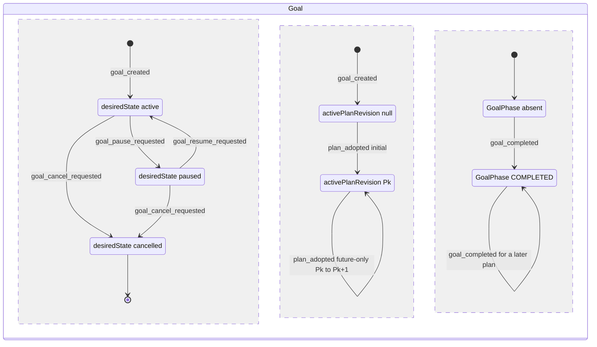

三个并行区域是相互独立的持久事实。十个展示名由 2.1 的 GOAL-17…27 从这三个区域加上 Task、Run 和 ControlIntent 事实归约而来，图里不画。扇出（GOAL-09…16、GOAL-28）是 Run/ControlIntent 上的独立提交，也不画在这里。

### 2.6 实现对照

目标文件：`src/core/work-graph/state/goal-machine.ts`（与其它节的 `*-machine.ts` 命名一致，不与 `src/contracts/goal-phase.ts` 撞名）。

- 状态机：导出 `transitionGoal(state, event, ctx)`。state 为 `{desiredState, desiredStateRevision, activePlanRef, completion: 'none'|'for_active'|'for_other'}`；ctx 含调用者类别、pin 比较结果、`GoalCompletionEvaluation`。
- 展示与扇出：导出 `reduceGoalDisplay`、`projectGoalRunStop`、`goalFanOutRequestId`。
- 记录构造函数：`newGoalSnapshot`、`nextGoalPointer`、`nextGoalDesiredState`、`buildGoalPhaseSnapshot`。按 §14，它们只能从 `state/` 导出。

| 行号 | 状态机函数（目标：`src/core/work-graph/state/<file>.ts` 中的导出） | 调用服务（file） | 已有测试（file） | 计划新增测试（描述） |
| --- | --- | --- | --- | --- |
| GOAL-01 | `goal-machine.ts`: `transitionGoal`、`newGoalSnapshot` | `tasks/task-service.ts:154-257` → `persistence/commit-compiler.ts:85-133` | `tests/work-graph/goal-independent.test.ts:38`；`tests/work-graph/R3a-goal-replay-boundaries.test.ts:41,64` | 对已存在的 Goal 用新身份发 `goal_created` → stale / `revision_conflict`（保留现有码） |
| GOAL-02、03 | `transitionGoal(plan_adopted)`、`nextGoalPointer` | `tasks/plan-service.ts:1155-1215,1676-1816` → `tasks/plan-commit-compiler.ts:144,293` | `tests/work-graph/R3c-plan-adoption.test.ts:98`；`tests/work-graph/W1-future-plan.test.ts:363,462,485`；`tests/work-graph/W2-agent-whiteboard.test.ts:189` | `paused` 下采用后仍为 `paused`，`desiredStateRevision` 不变；`cancelled` 下采用 → `invalid` |
| GOAL-04…06 | `transitionGoal`、`nextGoalDesiredState` | 新增 `GoalTaskPort.setGoalControl`（在 `tasks/task-service.ts:415-425` 的 `tasks` 对象中注册）；Host 路由 `goals/control`（加在 `src/app/core-routes.ts:162` 旁） | 无 | 期望状态 3×3 事件穷尽，`cancelled` 下 cancel → `busy`，pause/resume → `invalid`；暂停提交后 claim 得到 `busy`，并发 claim 因 Goal CAS 冲突（I-9）；暂停与 `completeGoal` 并发时只有一方成功，不出现「paused + 对应活动计划的 COMPLETED」 |
| GOAL-07、08 | `transitionGoal(goal_completed)`、`buildGoalPhaseSnapshot` | `tasks/completion.ts:481-614` | `tests/work-graph/R3e-completion.test.ts:87,166`；`tests/composition/R3e-completion-platform.test.ts:117` | `paused` → `busy`，`cancelled` → `busy`；同一计划重复完成不产生新事件；采用新计划后可再次完成（@r+1） |
| GOAL-09…16、28 | `projectGoalRunStop`（显示）、`goalFanOutRequestId`；逐 Run 合法性由 `transitionControlIntent` / `transitionRun` 判定 | Host 扇出驱动（`src/app/`，新增）→ `tasks/control-service.ts:325-432`（`submitControl`）、`:439`（`readControl`）、`controls/deliver`；重启核对（§12） | `tests/work-graph/R4-control-intent.test.ts`；`tests/composition/R4-control-platform.test.ts`（逐 Run 守卫） | A7 的 Goal 版：两个 Run（一个未进入、一个已进入）同时暂停、再恢复、再取消，逐 Run 实际状态各自显示。扇出已落库但未确认时关闭并重建 Host 与 SQLite：重驱按确定性 intentRef 读到原意图并跳过，intent 数不增加，不出现 `idempotency_conflict`。暂停扇出在 Goal 已恢复后才到达 → fence 过期被丢弃，Run 不被暂停。扇出途中插入一次计划采用 → 同 epoch 重试成功。暂停意图为 `outcome_unknown` 时，恢复等待核对（GOAL-28） |
| GOAL-17…27 | `reduceGoalDisplay`、`projectGoalRunStop` | 新增 `readGoalDisplayFacts`（`tasks/plan-service.ts`，复用 `plan-readers.ts:441-495,698,996,1183`，见 2.1）；`src/ui/views.ts:450-466` 展示 | 无 | 优先级表每行一例；全部 work 已满足、只剩 gate 待轮次 → `RUNNING/awaiting_gate`，不是 BLOCKED；`outcome_unknown` → `NEEDS_DECISION`；能力为 unsupported 的 Run 显示 `unsupported`；带种子的随机事实组合断言输出唯一且符合优先级；`ACCEPTED_PARTIAL` 永不产出 |

D-9 波及的其它位置（A.2 需要同步改造）：

| 位置 | 今天 | 改造 |
| --- | --- | --- |
| `src/contracts/ledger.ts:59`；解码 `persistence/record-codecs.ts:229,404` | 字面量 `active`，解码结果写死 | 扩成三值，加 `desiredStateRevision`；按存储值解码（codec 在豁免名单中，只反序列化） |
| `src/contracts/command-event.ts:52-71`（`GoalCreatedEvent`）；事件编解码与重放 | 只有创建事件；回执重放用 `goalSnapshotFromCreatedEvent`（`record-codecs.ts:447-460`） | 新增 `GoalDesiredStateChanged` 事件类型和编码/解码；`setGoalControl` 的回执重放从该事件恢复原快照（做法同 `:447-460`）；`GoalCreated` 载荷保持 `active` |
| `tasks/eligibility.ts:9`；`plan-service.ts:637`；`claim-service.ts:568` | 以字面量 `goalDesiredState: 'active'` 传入 | 类型扩宽。`taskRow` 必须传入真实期望状态，否则暂停后 ready 列表仍显示 eligible。claim 已在 `:514` 拒绝非 active，`:568` 只需随类型扩宽 |
| `evidence/evidence-service.ts:337-441`（`openVerification`）、`:640-726`（`beginCheck`） | 不读 `desiredState` | `openVerification` 已在 `:392` 读取 Goal，加 `desiredState≠active` → `busy`；`beginCheck` 新增 Goal 读取和 CAS（VD-9） |
| `tasks/control-service.ts:104-108,421-424` | 守卫只有 Run@rev 和 intent ∅；`identityDigest` 是模块私有函数 | 系统扇出提交可以带 Goal fence（只读 CAS）；resume（含未进入的 resume）读取 Goal 并守卫 `desiredState=active`（§6 RUN-11、RUN-14）；新导出 `controlIntentRefFor` 供驱动计算确定性 intentRef |
| `tasks/execution-entry-service.ts:1113-1122`（W4） | 不读 Goal | 不改造（lead 决定 L-6，见 2.4 表后说明） |
| `src/business/workflow/workflow.ts:609` | 只判断指针是否为 null | `desiredState≠active` → `waiting`，不再尝试 claim |
| `src/ui/views.ts:460` | 显示原始 `desiredState` | 显示 `reduceGoalDisplay` 的结果和 `runStops` |


## 3. PlanProposal / PlanRevision

计划由两种记录组成：状态可变的候选 `PlanProposal`，以及不可变的 `PlanRevision`（`revision` 恒为 1）。「采用」不是 PlanRevision 上的字段，而是同一笔提交里的三件事：候选从 `candidate` 变为 `accepted`，写入新的 PlanRevision@1，Goal 指针前移（GOAL-02/03）。「被替代」与「过期候选」都由 Goal 指针派生，不写入记录。计划里每个 Task 存储的 `phase`/`disposition` 是定义；运行时的 phase 由 D-1 的 `projectTaskPhase` 投影得到，存储的 phase 只作为 `planPhaseGuardReasons` 的输入。

### 3.1 持久位置与状态枚举

| 对象.字段 | 位置 | 代码枚举 | 说明 |
| --- | --- | --- | --- |
| `PlanProposal.status`（`candidate_v2`） | `src/core/work-graph/tasks/plan-contracts.ts:41-50`（`:44`） | `'candidate' \| 'accepted' \| 'rejected'`；codec 三个值都接受（`plan-record-codecs.ts:553-555`） | `rejected` **只声明，无写入者**（D-17） |
| `PlanProposal`（`legacy_v1`） | `plan-contracts.ts:48-50` | 恒为 `'candidate'`（解码见 `plan-record-codecs.ts:752`） | 只读；采用时返回 `unsupported` |
| 派生 `stale` | 无字段 | `status='candidate'` 且 `basedOn≠Goal.activePlanRevision`；`findPendingProposal` 会跳过它（`plan-readers.ts:483,487`） | 是否可逆取决于 `basedOn` 指向什么。`basedOn` 为 null（指针已非空之后），或指向本 Goal 已存在、非活动的版本时，不可逆：指针只前移，W16 还要求目标键 ∅。`basedOn` 指向尚不存在的 planId 时，可逆：Host `proposePlan` 只检查形状（`plan-service.ts:1015-1017`），之后若另一候选以该 planId 被采用（`:1724-1733`），它会重新成为待决。lead 决定 L-11：A.2 不给 PLAN-01 加「`basedOn` 必须为 null 或本 Goal 已有的 PlanRevision」守卫，列为剩余缺口（§16.4 GAP-14） |
| `PlanRevisionSnapshot` | `src/contracts/plan.ts:228-255`；`revision: 1`（`:233`） | 不可变；提交时对目标键做 ∅ 守卫（`plan-commit-compiler.ts:167,315`） | 没有候选、拒绝或替代字段 |
| 派生 `adopted` / `superseded` | 无字段；以 `GoalSnapshot.activePlanRevision`（`ledger.ts:61`）为准 | 指针指向它 = adopted；指针已移到更后的版本 = superseded | 与 Task 的 `disposition: 'superseded'` 不是一回事 |
| `taskStateBasis`（schema 2，可选） | `plan.ts:97-100` | 未改变的任务指向来源计划，改变或新增的任务指向目标计划（`buildTargetTaskBasis`，`plan-task-basis.ts:107-140`）；字段缺省时每个任务指向本计划（`buildEffectiveTaskBasis`，`:89-103`，回退在 `:101`） | 决定哪些 Run/Reduction 适用于该任务 |
| 任务定义 `phase`/`disposition` | `RuntimeTask`（`plan.ts:35-65`） | phase 七个值，disposition 四个值 | 存储的 phase 不参与运行时 phase 投影（`plan-readers.ts:1150-1154`） |
| 旧决定结果 | `UserDecisionOutcome`（`src/contracts/goal-change.ts:153`） | accept/reject/defer | 无写入者；所有采用路径的 `decisionRefs` 都必须为空 |

与设计 §2 的对应关系：「候选」= `candidate`；「采用」= `accepted` + PlanRevision + 指针移动；「拒绝」= `rejected`（无写入者）；「被后续版本替代」= PlanRevision `superseded`（派生）；G3 所说的过期候选 = `stale`（派生）。

### 3.2 事件

| 事件名 | 来源 | 载荷要点 | 对应原文编号 |
| --- | --- | --- | --- |
| `proposal_recorded` | U（Host `proposePlan`）/ P（Agent `propose_future_plan`；初始规划答案 `proposeInitialPlanFromAnswer`） | goalRef、basedOn、draft、reason；Agent 版另带 `submittedBy` | G2、G3 |
| `proposal_accepted` | U（Host `applyPlanChange`）/ P（Agent `apply_future_plan`，只能采用本 Run 自己提交的候选） | proposalRef、`expectedProposalRevision`、`decisionRefs=[]`；同一提交里 Goal 发生 `plan_adopted` | G4、G5 |
| `proposal_stale`（派生） | P（Goal 指针移动后，在读取时派生） | `basedOn≠activePlanRevision` | G3「过期反馈可记录，采用前重新核对」 |
| `proposal_rejected` | U（只声明） | 无写入者（D-17） | §2 Plan「拒绝」 |
| `plan_adopted` | 与 `proposal_accepted` 同一提交 | PlanRevision：∅→adopted；前一版本→superseded | G4 |

初始规划答案为 `needs_decision` 时不产生事件：不写候选、不写决定，只返回问题（`plan-service.ts:1318-1321`；`plan-contracts.ts:108-118`）。

### 3.3 迁移表

**PlanProposal 与 PlanRevision**：

| # | from | event | guard（守卫） | to | effects（同事务副作用意图） | 幂等/重复事件 | 原文编号 | 现状 |
| --- | --- | --- | --- | --- | --- | --- | --- | --- |
| PLAN-01 | ∅ | `proposal_recorded`（Host） | Host 可信上下文；Goal 存在且属于同一 workspace；调用方 pin 与读到的一致（`plan-service.ts:953-961`）；draft 形状合法；Goal 不是 `cancelled`（新增）。**不**检查 `basedOn` 是否存在，也不检查是否等于活动计划 | `candidate@1`（带 `validatePlanDraft` 的 issues） | 写候选；事件 `PlanProposalRecorded`；CAS Project、Workspace、Goal@rev、proposal ∅（`:980-986`） | 先查回执（`:942-951`） | G2、G3 | 已有 `plan-service.ts:923-1055`。候选可以一写入就过期，`W1-future-plan.test.ts:471-473` 依赖这一点 |
| PLAN-02 | ∅ | `proposal_recorded`（Agent） | `authorizePlanWrite`：Run 为 `running`，auth/outbox 为 `entered`，Session 由本代际占用，持有 lease（`plan-write-admission.ts:285-324`）；draft schema 2；`basedOn` 非空且等于活动计划（`plan-service.ts:1954-1970`）；Goal 不是 `cancelled`（新增） | `candidate@1` + `submittedBy` | 同 PLAN-01；CAS 另含来源计划@1 和准入守卫（`:1985-1992`） | 先查回执；Agent 身份按 Run 区分 | G3、G5 | 已有 `plan-service.ts:1886-2011` |
| PLAN-03 | ∅ | `proposal_recorded`（初始规划答案） | QueryJob/QueryRun 为 `answered`，executionState 为 `settled`（`:793-807`）；答案 kind 为 `plan`；`basedOn` 恒为 null | `candidate@1` | 同 PLAN-01，另加 Answer/Job/QueryRun 守卫（`:1325-1329`） | 同 PLAN-01 | G2 | 已有 `plan-service.ts:1244-1333` |
| PLAN-04 | `candidate`，`basedOn=null` | `proposal_accepted`（初次） | `candidate_v2`，status 为 `candidate`，revision 等于预期（`:1144-1149`）；`decisionRefs` 为空（`:1165`）；Goal 指针为 null（`:1166-1170`）；来源核验与治理（`:1171-1179`）；`validatePlanDraft`、`validatePlanAssignments`、`planPhaseGuardReasons`（`:1180-1185`）；Goal 不是 `cancelled`（新增） | `accepted`，rev+1 | 写 PlanRevision@1（draft 任务原样写入，`plan-commit-compiler.ts:59`）；Goal 指针 null→P（GOAL-02）；事件 `PlanRevisionAccepted`；CAS 来源、Project、Workspace、Goal、proposal@rev、治理、PlanRevision ∅ | 回执重放；拒绝后按同身份复查（`:1120-1138,1225-1229`） | G4 | 已有 `plan-service.ts:1140-1215`；`plan-commit-compiler.ts:135-181` |
| PLAN-05 | `candidate`，`basedOn=Pk`（等于活动计划） | `proposal_accepted`（future-only，Host 或 Agent） | draft schema 2，`decisionRefs` 为空（`:1695-1705`）；source 等于活动计划（`:1712-1717`）；draft goalId 与 planId 合法（`:1718-1726`）；`planRevision=source+1`，目标 planId 未被使用（`:1721-1733`）；`deriveFuturePlanDelta` 不删任务（`:1737-1738`）；义务覆盖与冻结规则（`validateFutureObligationCoverage`，`plan-validation.ts:363-511`，拒绝映射为 `invalid`，`plan-service.ts:1740-1745`，见下方任务定义守卫表）；`planPhaseGuardReasons`（`:1766-1767`）；**无痕规则**（`:1769-1771`）。Agent 版另要求 status 为 `candidate`、`submittedBy` 等于写入者、`basedOn` 非空（`:2069-2087`）；Goal 不是 `cancelled`（新增） | `accepted` | 写 PlanRevision Pk+1：未改变的任务取自 source，改变或新增的任务取自候选，带 `taskStateBasis`（`plan-commit-compiler.ts:253-292`）；Goal 指针 Pk→Pk+1（GOAL-03）。对每个改变的任务，若 source.disposition≠target.disposition，发 Task `disposition_changed`（这类任务必然无痕）；新增任务以新的 `pending` 定义进入。CAS 含每个被改任务的 Lease ∅ / Reduction ∅（`plan-service.ts:1773-1782`）以及目标 ∅ | 同 PLAN-04；Agent 走 `recheckAgentApply` | G4、G5 | 已有 `plan-service.ts:1676-1816`；`plan-commit-compiler.ts:241-328` |
| PLAN-06 | `candidate` | `proposal_stale` | Goal 指针≠`basedOn` | 存储仍为 `candidate`，读取时视为 `stale` | 无写入。`findPendingProposal` 不返回它；采用时得到 `revision_conflict` | — | G3 | 已有 `plan-readers.ts:487`（派生）；采用拒绝见 `plan-service.ts:1166-1170,1712-1717` |
| PLAN-07 | `candidate` | `proposal_rejected` | — | （`rejected`） | — | — | §2 Plan | 新增（状态机返回 illegal；写入者见 D-17） |
| PLAN-08 | PlanRevision ∅ | `plan_adopted` | 与 PLAN-04/05 同一提交 | PlanRevision@1，派生为 adopted | 写 PlanRevision（CAS ∅） | 同 PLAN-04 | G4 | 已有 `plan-commit-compiler.ts:167,315` |
| PLAN-09 | PlanRevision Pk（adopted） | `plan_adopted`（Pk+1） | 指针单调前移（source 等于活动计划，target 为 source+1 且不存在） | Pk 派生为 superseded；记录本身不变 | 不写 Pk | — | G4、G5 | 已有 `plan-commit-compiler.ts:293`（指针前移；superseded 由此派生） |

**初次采用与 future-only 采用的区别**（W13–W16）：

| 项 | 初次（W15，PLAN-04） | future-only（W16，PLAN-05） |
| --- | --- | --- |
| 入口 | Host `applyPlanChange`，`basedOn=null`（`plan-service.ts:1155` 分支之前） | Host `applyPlanChange`，`basedOn≠null`（`:1155-1163`）；Agent `applyPlanChangeAsAgent`（`:2019-2106`） |
| 指针前提 | 必须为 null | 必须等于 `basedOn` |
| draft | schema 1 或 2 | 只接受 schema 2；schema 1 → `incomplete`/`unsupported`（`:1695-1700`） |
| 任务来源 | 全部取自 draft | 未改变的取自 source，改变或新增的取自候选 |
| 任务存储 phase | `planPhaseGuardReasons` | 同左，另要求新增任务 phase 为 `pending`（`plan-validation.ts:472-477`） |
| 有执行痕迹的任务 | 不适用（还没有 Run） | 无痕规则：改变或新增的任务不得有 Run/Lease/Reduction |
| 处置变化 | — | 只有这里能改 disposition（active→deferred/cancelled/superseded），且只对**非 gate**、无痕的任务生效。无痕规则见 `plan-service.ts:1769-1771` → `plan-readers.ts:1269-1297`；source gate 的定义冻结见 `plan-validation.ts:415-434`；required 义务还必须保留 active、required 的载体（`:402-412`） |
| Agent 可用 | 否 | 是（`decisionRefs` 由平台置空，`whiteboard-tools.ts:299`） |

**任务定义守卫**：

| 守卫 | 内容 | 拒绝码 | 位置 |
| --- | --- | --- | --- |
| `planPhaseGuardReasons` | 存储 phase 为 `satisfied/running/verifying/failed` 时拒绝；允许 `pending/ready/blocked` | `incomplete` | `plan-validation.ts:234-244`；调用于 `plan-service.ts:1184-1185,1766-1767` |
| 新增任务从 `pending` 开始 | future-only 新增的任务必须是 `pending` | `invalid` | `plan-validation.ts:472-477`，映射于 `plan-service.ts:1742-1744` |
| 不得物理删除任务 | 必须保留 taskId，改用 disposition 表达 | `unsupported` | `plan-validation.ts:318-321`，映射于 `plan-service.ts:1737-1738` |
| source gate 定义冻结 | source 中每个 gate 的冻结定义（完整 `RuntimeTask`，含 phase、disposition，以及所承载的义务）必须不变 | `invalid`（`gate_definition_changed`） | `plan-validation.ts:415-434`，映射于 `plan-service.ts:1742-1744` |
| 义务语义不变 | source 的每个义务都必须保留，title、强度、验证要求都不变 | `invalid`（`obligation_semantics_changed`） | `plan-validation.ts:390-401` |
| required 义务保留载体 | 每个 required 义务至少有一个 active、required 的 work 或 gate 载体 | `invalid`（`obligation_task_mapping`） | `plan-validation.ts:402-412` |
| 计划级与执行意图冻结 | reviewAdmissionProtocol、origin 不变；已声明的 executionIntent 不能省略；新增 gate 不带 executionIntent，且至少承载一个新义务 | `invalid` | `plan-validation.ts:379-388,440-448,458-470` |
| 角色分配冻结 | 既有任务的 role 不能改，分配不能删；新增分配只能用 source 已授权的 role（显式带 executionIntent 的新增节点除外） | `invalid` | `plan-validation.ts:484-509` |
| 无痕规则 | 改变或新增的任务没有 Run、TaskLease、TaskReduction | `revision_conflict` | `plan-readers.ts:1238-1301`（拒绝在 `:1276,1286,1294`） |

存储的 phase 在 D-1 下仍只是定义：允许写入 `ready`/`blocked`，但 `projectTaskPhase` 不读它。改变 phase 或 disposition 也算「改变的任务」，因为冻结定义比较的是完整的 `RuntimeTask`（`plan-task-basis.ts:49-54,168-170`）。

由此得出：**W16 不能取消或替代 source gate**。gate 的处置一变，就会触发 `gate_definition_changed`。§9 VD-11 和附录所说的「失败 gate 只能经 G5 由 W16 改为 superseded/cancelled」这个出口，今天并不存在。待用户决定（U-10，§16.3 GAP-09/10）：(a) 放宽 W16 的 gate 规则（只允许无痕 gate 改处置，同时加替代 gate 承载同一义务）；(b) 以 §9 VD-1 的后继轮次作为 gate 重验；(c) 本批接受这条死路。lead 建议本批取 (c)，之后再做 (a)。未确认前 A.2 保持今天的 gate 冻结规则。

**无痕规则与 D-3 重新领取的交互**：

1. 一旦任务有过 Run（包括已 ended 的），它的定义、phase 和处置（取消、延后、替代）在之后任何计划版本里都不能再改（`plan-readers.ts:1269-1297`）。D-3 的返工只能在义务不变的前提下进行：`requeueTask` 写入 TaskRequeue 事实，再用新的 Attempt/Run 重新领取（MVP-BEHAVIOR B06）。
2. `requeueTask` 不写 PlanRevision，也不移动 Goal 指针。TaskRequeue 一定发生在某个 ended Run 之后，而 Run 痕迹本身已经会让 W16 拒绝改这个任务，所以无痕规则不需要另读 TaskRequeue 的键。并发时的结果是不对称的：W16 不读也不钉 TaskRequeue，所以 **W16 不会因 requeue 失败**；而 requeue 按 §4 钉 Goal@rev（TASK-16 的提交守卫），W16 又会让 Goal revision +1（`plan-commit-compiler.ts:293`），所以 **W16 先提交时，并发的 requeue 得到 `revision_conflict`**，重读后重试即可。
3. 重新领取钉住的是当前活动计划（`claim-service.ts:515-517`）。未改变任务的 basis 不会因 W16 改变，所以旧 Run 和新 Run 共用同一个有效 basis，`originVerdict` 对两者都接受（`plan-readers.ts:900-938`）。任务的执行历史因此可以跨计划版本连续。
4. **D-13 键的计划分量（lead 决定 L-4）。** D-13 键中的「plan revision」取该任务的有效 basis 计划（`buildEffectiveTaskBasis`，`plan-task-basis.ts:89-103`），而不是 `Goal.activePlanRevision`。理由是：有痕任务的 basis 已被无痕规则冻结；如果用活动计划版本，一次与该任务无关的 W16 采用就会被当成「新依据」，从而绕过无进展防护。§13.1 的 `plan` 分量与用例 #6 按此修改：只有改变了该任务有效 basis 的采用才算新依据。
5. **待用户决定（U-11，§16.3 GAP-13）：无关的 W16 会让已领取未授权的 Run 卡住。** 现状是：W16 之后，已领取但尚未授权、仍钉在旧计划上的 Run 会在 W3 被拒（`execution-entry-service.ts:940-942`，要求指针完全相等，返回 `revision_conflict`），即使它的任务没有改变。这个 Run 停在 `starting`，继续占用 Session 和 lease。两种处理：
   - **(a) 按现状。** 出路是 D-7 未进入取消（`stop_not_entered`）→ D-1 投影为 `failed` → `requeueTask` → 在新计划下重新 claim。代价有三：与 G5「未受影响工作可以继续」及 MVP-BEHAVIOR B09「无关任务继续」（`docs/MVP-BEHAVIOR.md:169`）相悖；一次无关的采用会让 Goal headline 变成 FAILED（GOAL-24）；还会占用一次 requeue 的 D-13 键。
   - **(b) 备选。** W3 允许 `claim.planRef` 不是活动计划，前提是该任务在活动计划中的有效 basis 和冻结定义都没变（`originVerdict` 为 accepted）。这样不需要取消，也不需要 requeue（改造 `execution-entry-service.ts:940-942`）。
   - **lead 建议：** 默认 (a)；只有测试证实这种卡住确实发生时才采用 (b)。用户确认前 A.2 按 (a)。
6. **缺口：有痕任务没有改义务的出口（不在 D-17 列表中，§16.3 GAP-12）。** 有痕任务如果需要改变义务或范围，W16 拒绝改它，而 `CORE-DATA-OPERATIONS.md:285` 要求的「取消/替换显式处置」又没有实现。这样的任务只能留在 `failed/blocked`；Goal 只能取消，`ACCEPTED_PARTIAL` 也没有写入者。放开「有痕任务只改处置」的提议以 §4 TASK-19（「放宽」，待用户决定 U-12）为唯一版本，本节不另立一份；lead 建议暂缓。

### 3.4 明确禁止的迁移

| from | event/目标 | 拒绝原因 | 对外 CoreError | 说明 |
| --- | --- | --- | --- | --- |
| `accepted` / `rejected` | `proposal_accepted` | illegal | `invalid` | 保留现有码：「is not a pending candidate」（`plan-service.ts:1145,2070`） |
| `accepted` | 回到 `candidate`，或改为 `rejected` | illegal | `invalid` | `accepted` 是终态，没有回退的写入入口 |
| `legacy_v1` | `proposal_accepted` | illegal | `unsupported` | 保留现有码（`:1144,2069`） |
| `candidate`，revision≠预期 | `proposal_accepted` | stale | `revision_conflict` | `:1146-1149`、`:2071-2073` |
| `candidate`，`basedOn=null` 但指针非空 | `proposal_accepted` | stale | `revision_conflict` | 指针已移动；`:1166-1170` |
| `candidate`，`basedOn≠活动计划` | `proposal_accepted` | stale | `revision_conflict` | 指针已移动；`:1712-1717`；`W1-future-plan.test.ts:462` |
| `candidate` | `proposal_accepted`，`planRevision≠source+1` 或目标已存在 | stale | `revision_conflict` | `:1721-1723`、`:1728-1732` |
| `candidate` | `proposal_accepted`，draft 的 goalId 不是本 Goal，或目标 planId 等于 source | illegal | `invalid` | 保留现有码（`:1718-1720`、`:1724-1726`） |
| `candidate` | `proposal_accepted`，source 计划属于别的 Goal | illegal | `not_found` | 保留现有码（`:1709-1711`） |
| `candidate` | `proposal_accepted`，改变或新增的任务有 Run/Lease/Reduction（含 requeue 之后） | guard_failed | `revision_conflict` | 无痕规则，保留现有码（`plan-service.ts:1769-1771` → `plan-readers.ts:1269-1297`）；拒绝原因与 §4.4 一致 |
| `candidate` | `proposal_accepted`，source gate 的定义（含 phase、disposition、所承载的义务）改变 | guard_failed | `invalid` | `plan-validation.ts:415-434`，映射于 `plan-service.ts:1742-1744`。W16 因此不能取消或替代 gate（见 3.3） |
| `candidate` | `proposal_accepted`，source 义务缺失或语义改变 | guard_failed | `invalid` | `plan-validation.ts:390-401` |
| `candidate` | `proposal_accepted`，required 义务没有 active、required 的载体 | guard_failed | `invalid` | `plan-validation.ts:402-412` |
| `candidate` | `proposal_accepted`，改变 reviewAdmissionProtocol/origin，省略已声明的 executionIntent，新增 gate 不合规，或改变/删除既有 role 分配、使用未授权 role | guard_failed | `invalid` | `plan-validation.ts:379-388,440-448,458-470,484-509` |
| `candidate` | `proposal_accepted`，draft 任务 phase 为 `satisfied/running/verifying/failed` | guard_failed | `incomplete` | `plan-validation.ts:234-244` |
| `candidate` | `proposal_accepted`，新增任务 phase 不是 `pending` | guard_failed | `invalid` | `plan-validation.ts:472-477` |
| `candidate` | `proposal_accepted`，删除了任务 | guard_failed | `unsupported` | `plan-validation.ts:318-321` |
| `candidate` | `proposal_accepted`，`decisionRefs` 非空 | guard_failed | 初次 `invalid`（`:1165`）；future `unsupported`（`:1704`）；Agent `forbidden`（`:2035`） | 保留现有码；通用决定提交尚未接通 |
| `candidate`，future 且 draft 为 schema 1 | `proposal_accepted` | guard_failed | `incomplete` | `:1695-1698` |
| `candidate` | Agent `proposal_accepted`，没有 `submittedBy`，或不是本 Run 提交的 | guard_failed | `forbidden` | `:2075-2082` |
| ∅ | Agent `proposal_recorded`，draft schema≠2 | guard_failed | `unsupported` | `:1954-1956`；`W2-agent-whiteboard.test.ts:239`（v1 变体） |
| ∅ | Agent `proposal_recorded`，`basedOn=null` | guard_failed | `forbidden` | `:1957-1958` |
| ∅ | Agent `proposal_recorded`，source 属于别的 Goal | illegal | `not_found` | 保留现有码（`:1963-1965`；`W2-agent-whiteboard.test.ts:239`） |
| ∅ | Agent `proposal_recorded`，`basedOn≠活动计划` | stale | `revision_conflict` | `:1966-1970` |
| ∅ / `candidate` | Agent 写入准入失败：没有 V2 授权或授权不在 `entered`，或 dispatch 代际与授权不一致 | guard_failed | `forbidden` | `plan-write-admission.ts:287-288,298-304`；已结束的 Run 落在这一行（`W2-agent-whiteboard.test.ts:229`） |
| ∅ / `candidate` | Agent 写入准入失败：Run 不是 `running`；outbox 不在 `entered`；Session 已归档、不可用或不再由本代际占用；lease 缺失、已释放或被别人持有 | guard_failed | `busy` | `plan-write-admission.ts:289,295-297,307-323` |
| ∅ / `candidate` | Agent 写入在准入之后、提交之前，Run 正式结束 | stale | `revision_conflict` | 准入守卫进入同一提交（`plan-service.ts:1985-1986`）；`W2-agent-whiteboard.test.ts:339` |
| ∅ | Host 或 Agent `proposal_recorded`，调用方 pin 与读到的不一致 | stale | `revision_conflict` | `:956-961`、`:1944-1950` |
| ∅ / `candidate` | Goal 为 `cancelled` 时 `proposal_recorded` / `proposal_accepted` | illegal | `invalid` | 新增（D-9） |
| `candidate` | `proposal_rejected` | illegal | `unsupported` | 偏离默认的 `invalid`：拒绝写入者属于 D-17 范围外、尚未实现的功能，对外按能力缺失报 `unsupported`（与 `legacy_v1` 采用的码一致）；新增 |
| PlanRevision（任意） | 改写 tasks/phase/disposition | illegal | `invalid` | 没有改写入口；`revision` 恒为 1（`plan.ts:233`）。提交层还有目标键 ∅ 守卫（`plan-commit-compiler.ts:167,315`），绕过时报 `revision_conflict` |
| PlanRevision Pk（superseded） | 重新成为活动计划 | stale | `revision_conflict` | 指针只前移：采用要求 source 等于活动计划，且目标键不存在（`plan-service.ts:1712-1717,1728-1732`）；保留现有码 |

### 3.5 状态图

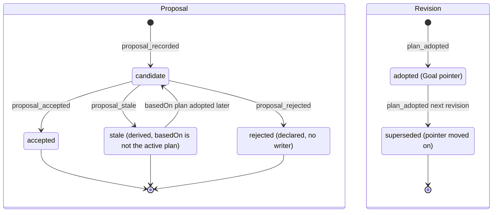

`Candidate → Accepted` 与 `[*] → Adopted`（以及前一版本的 `Adopted → Superseded`）是同一笔提交。`Stale` 只在读取时派生，存储的 status 仍是 `candidate`。`Stale → Candidate` 只发生在 `basedOn` 指向尚不存在的 planId、而该 planId 之后被采用的情况（见 3.1）；`basedOn` 为 null 或指向已存在的非活动版本时，过期不可逆。

### 3.6 实现对照

目标文件：`src/core/work-graph/state/plan-machine.ts`。

- 状态机与派生：导出 `transitionPlanProposal(state, event, ctx)`、`derivePlanProposalStatus`（candidate/stale/accepted）、`derivePlanRevisionStatus`（adopted/superseded）。
- 无痕判定：导出 `futureChangeTraceProblem`，纯函数，输入是 `readFutureChangeTaskFacts` 读到的事实。
- 记录构造函数：`newCandidateProposal`、`acceptProposalRecord`。按 §14，它们只能从 `state/` 导出；`plan-commit-compiler.ts:145-149,294-298` 改为调用它们。
- 保留在原处：`planPhaseGuardReasons` 与 `validateFutureObligationCoverage` 留在 `plan-validation.ts`，由状态机的守卫调用。

| 行号 | 状态机函数（目标：`src/core/work-graph/state/<file>.ts` 中的导出） | 调用服务（file） | 已有测试（file） | 计划新增测试（描述） |
| --- | --- | --- | --- | --- |
| PLAN-01 | `plan-machine.ts`: `transitionPlanProposal(∅, proposal_recorded)`、`newCandidateProposal` | `tasks/plan-service.ts:923-1055` | `tests/work-graph/R3c-plan-adoption.test.ts:98`；`tests/work-graph/W1-future-plan.test.ts:462`（候选一写入就过期仍可提交） | Goal 为 `cancelled` 时拒绝；issues 不阻止记录；`basedOn` 指向尚不存在的 planId 时，候选先为 stale，该 planId 被采用后成为待决 |
| PLAN-02 | 同上（ctx 为 Agent 写入者） | `plan-service.ts:1886-2011`；`tasks/plan-write-admission.ts:247-324` | `tests/work-graph/W2-agent-whiteboard.test.ts:171,229,239,261,279,339` | `basedOn=null` → `forbidden`；非活动计划 → `revision_conflict`；schema 1 → `unsupported`；Run 不在 `running` → `busy` |
| PLAN-03 | 同上 | `plan-service.ts:1244-1333` | `tests/work-graph/R5b-initial-plan.test.ts:178` | `needs_decision` 不产生迁移，也不写记录 |
| PLAN-04 | `transitionPlanProposal(candidate, proposal_accepted)`、`acceptProposalRecord`；Goal 侧 GOAL-02 | `plan-service.ts:1140-1215` → `plan-commit-compiler.ts:135-181` | `tests/work-graph/R3c-plan-adoption.test.ts:98`（含重放与 `idempotency_conflict`）；`tests/work-graph/R5b-initial-plan.test.ts:316`（phase 守卫） | 每个守卫一例：status、revision、`decisionRefs`、指针非空、phase |
| PLAN-05 | 同上 + `futureChangeTraceProblem`；Goal 侧 GOAL-03 | `plan-service.ts:1676-1816` → `plan-commit-compiler.ts:241-328` | `tests/work-graph/W1-future-plan.test.ts:363,485,534,600,663`；`tests/work-graph/W2-future-intent.test.ts:350,382,483`；`tests/work-graph/W2-agent-whiteboard.test.ts:189,208,383` | 有痕任务（含 requeue 之后）改变 → `revision_conflict`；source gate 改处置 → `invalid`；无痕非 gate 任务只改处置 → 只对处置真正改变的任务发 Task `disposition_changed`，只改 title 的不发；requeue 与 W16 并发：W16 总能成功，W16 先提交时 requeue 得到 `revision_conflict`，重读后重试成功 |
| PLAN-06 | `derivePlanProposalStatus` | `plan-readers.ts:441-495`（`findPendingProposal`）；`plan-service.ts:1335-1354` | `tests/work-graph/W1-future-plan.test.ts:462`；`tests/work-graph/R3c-plan-adoption.test.ts:400-425` | 指针前移后，`basedOn=null` 或指向已存在旧版本的候选永远是 `stale` |
| PLAN-07 | `transitionPlanProposal(candidate, proposal_rejected)` → illegal | — | — | 断言拒绝，且没有任何写入 |
| PLAN-08、09 | `derivePlanRevisionStatus` | `plan-service.ts:1377-1462`（`queryTaskGraph` 可按显式 planRef 读历史版本） | `tests/work-graph/W1-future-plan.test.ts:663` | 指针单调；superseded 版本不能再被指回 |


## 4. Task（投影 phase + disposition）

Task 没有可写的存储 phase（D-1）。`effectivePhase` 是对 Run（含控制指针）、TaskAttempt、TaskLease、TaskReduction、本 Run 的原始 VerificationRound 和新增 TaskRequeue 的纯投影，由 `projectTaskPhase(facts)` 计算。所有影响 Task 的写入都先经 `transitionTask` 判定合法性，并返回投影后的下一 phase。这些写入是：领取、重入队、完成、处置变更。

`disposition` 是独立维度（ORCHESTRATION §2 `:268`），不并入 phase。本节依赖 D-1、D-2、D-3、D-13。其中 D-1、D-2、D-3 分别是待用户确认的 U-1、U-2、U-3（lead 建议均采纳）；D-13 的无进展守卫只作用于重入队，随 U-3 一起生效，其计划分量按 lead 决定 L-4 取 Task 的有效 basis 计划（§13）。

本节在 brief 之外补充的决定（逐条标明状态：lead 已定的标 L-n；仍待用户确认的标 U-n，并附 lead 建议）：

- **TD-1 投影原因码统一（已由 lead 采纳，L-8）**：`phaseCause.code` 使用下表 `TaskPhaseCauseCode`，§9 的轮次投影原因按此命名。INCONCLUSIVE 轮次（含遗留的 PASS 带 gaps）的唯一原因码是 `round_inconclusive`；brief §2a 示例中的旧原因名不再使用。
- **TD-2 重入队必须让旧证据退出完成折叠（lead 决定 L-3：存储）**：`TaskRequeue.supersededEvidenceIds` 在重入队提交时一次写定被超越轮次的全部证据 id，之后不变（显式、不可变，完成时少一次读取）。`completeTask` 在折叠前排除该 Task 全部 TaskRequeue 的这些 id 的并集。§9 VD-5、VR-09 读取这个存储的列表，不再由 `afterRoundRef` 推导；brief D-3 的记录形状据此增加该字段。理由与完成侧规则见 4.3 末“缺口”。TD-2 随 D-3（U-3）一起实施。
- **TD-3 领取显式携带 `requeueRef`**（D-3 的领取侧，随 U-3）：重入队后的领取必须在输入中带 `requeueRef`，与 `consumedWait` 互斥。新 Run 和新 Attempt 记录这个引用，把新 Attempt 链接到原失败和改变依据（ORCHESTRATION §9 `:414`）。
- **TD-4 已有执行痕迹的 Task 可改 disposition（U-12，待用户确认；lead 建议暂缓）**：TASK-19 放宽 W16 的“无任何痕迹”限制。未确认前保持今日规则。
- **TD-5 让出等待上的控制指针进入投影（属 U-1，待用户确认；lead 建议采纳）**：选定 Run 为 `YieldedWait`（§6）且指针为 `cancelled` 时投影 `failed/continuation_cancelled`，可重入队；指针为 `paused` 时投影 `blocked/continuation_paused`，经 §6 RUN-14 resume 回到 `ready`。这偏离 D-1“yielded 且有 continuation → ready（不变）”。理由：续接领取对这两种指针恒返回 `busy`（`claim-service.ts:606-611`），协作驱动也会取消让出等待（`collaboration-driver.ts:668-673`），不投影就是永久死路（§7 7.3“不支持或不投递的情形”第 6 项的请求）。未确认前保持今日投影 `ready`（P5）。
- **TD-6 重入队的公开入口（属 U-3，待用户确认；lead 建议采纳）**：新增 core 路由 `tasks/requeue` 与界面“重新入队”动作；允许的操作者见 4.3“`requeueTask` 服务”。lead 建议：人类经界面或路由现在开放；`system` 只在 D-16（U-13）确认后开放；`agent` 不开放。

本节列出但 A.2 默认不实现的待决事项：

- **gate 轮次的显示与 gate 重验/重入队**：gate 轮次不进入任何 D-1 投影（见 4.1），非 PASS 的 gate 只能经 G5 替换（§9 VD-11）。是否显示 gate 轮次结论、是否提供 gate 重验或重入队，待用户确认。失败 gate 的出口是 U-10：lead 建议本批选 (c) 暂时接受死路，之后再考虑 (a) 为无痕迹的 gate 放宽 W16。

### 4.1 持久位置与状态枚举

| 维度 | 持久位置 | 代码枚举（原样） | 与设计名 / 说明 |
| --- | --- | --- | --- |
| 计划定义 phase | `RuntimeTask.phase`（`src/contracts/plan.ts:42`，类型 `:8`），在不可变 `PlanRevisionSnapshot` 中 | `pending`/`ready`/`running`/`verifying`/`blocked`/`satisfied`/`failed` | 与 ORCHESTRATION §2 同名。投影不读这个值。它出现在：<br>• 采用守卫（`plan-validation.ts:234-244`）；<br>• 新增任务必须为 `pending`（`:472-477`）；<br>• future-only 的冻结定义比较，比较整个 `RuntimeTask`，phase 也算改变（`plan-task-basis.ts:49-54`、`:74-84`）；<br>• 界面在没有任务图行时的回退显示（`src/ui/views.ts:1750-1753`） |
| 投影 phase | 不持久化。`CanonicalTaskState.effectivePhase`（`plan-readers.ts:726-733`），折叠在 `:1145-1154` | 同上 7 值 | 目标：移入 `state/task-machine.ts` 的 `projectTaskPhase` |
| 投影原因 | 今日无此字段 | `TaskPhaseCauseCode`（见下） | D-1“blocked 带明确原因”；T8。字段扩展见下方契约列表 |
| 正式归约 phase | `TaskReductionSnapshot.phase`（`src/contracts/reduction.ts:25`、`:64`） | `verifying`/`blocked`/`failed`/`satisfied` | 唯一写者是 `completeTask`，实际只写 `satisfied`（`completion.ts:392-395`）。保持不变 |
| disposition | `RuntimeTask.disposition`（`plan.ts:7`、`:41`） | `active`/`deferred`/`cancelled`/`superseded` | 唯一改变点：W16 `applyFutureRevision`（`plan-service.ts:1769-1771`） |
| 重入队事实 | 新增 `TaskRequeueSnapshotV1`（字段见下表） | 不可变，revision 恒为 1 | D-3（U-3）；记录形状按 L-3 增加 `supersededEvidenceIds`；对应 `requeueTask`（`CORE-DATA-OPERATIONS.md:288`、`modules/core/work-graph.md:371`） |
| 投影输入 | Run（§6，含 `controlState.desiredState`）；TaskAttempt、TaskLease（§5）；本 Run 的原始轮次（§9），按 `VERIFICATION_ROUND_ORIGINAL_LOOKUP` 读取（`evidence-record-codecs.ts:446`）；TaskRequeue | — | 选定 Run 的规则不变，按以下顺序（`plan-readers.ts:1111-1125`、`:790-799`）：<br>1. 租约持有者；<br>2. 活动的 Run 优先于已结束的；<br>3. `endedAt ?? startedAt` 较新者；<br>4. revision 较高者 |

**投影规则（D-1）。** 按表中行序从上到下匹配，第一条命中即生效。id 是稳定编号，不表示顺序：P17、P18 是新增行，排在 P5 之前；P10 排在 P7 之前，因为 P7–P9 只对“唯一轮次”有定义。“今日”一列取自 `plan-readers.ts:1150-1154`。“目标值”与“今日值”不同的行（含 TD-5 的 P17、P18）属于 U-1，待用户确认，lead 建议采纳；未确认前按“今日值”实现（§15 第 2 步）。P7 的 FAIL 另依赖 U-2（D-2），P4 依赖 U-3（D-3）。

| id | 输入条件 | 今日值 | 目标值 | 目标 `phaseCause.code` | 依据 |
| --- | --- | --- | --- | --- | --- |
| P1 | 有适用的 TaskReduction：同 basis、同 taskKind、同 planRevision（`:1126-1141`） | `reduction.phase`，实际为 `satisfied` | 不变 | — | T9 |
| P2 | 选定 Run 为 `starting` 或 `running` | `running` | 不变 | — | T2、T3 |
| P3 | 选定 Run 为 `ended`，outcome 为 `outcome_unknown` | 今日不落盘：Run 停在 `running`（`execution-observation.ts:578-594`），投影为 `running` | `blocked` | `run_outcome_unknown` | D-4、T8 |
| P4 | 最新 TaskRequeue 的 `afterRunRef` 等于选定 Run | 无此事实，投影为 `blocked` | `pending` | `requeued`（同时显示 `requeueRef`） | D-3、T7 |
| P17 | 选定 Run 为 `ended/yielded`，有 `continuation`，且 `controlState.desiredState='cancelled'` | `ready`，但领取恒为 `busy`（`claim-service.ts:606-611`） | `failed` | `continuation_cancelled` | TD-5、R2 |
| P18 | 同 P17，但 `desiredState='paused'` | 同上 | `blocked` | `continuation_paused` | TD-5、R1 |
| P5 | 选定 Run 为 `ended/yielded`，有 `continuation`（指针不是 paused/cancelled） | `ready` | 不变 | — | 续接 W2 |
| P6 | 选定 Run 为 `ended`，outcome 为 `crashed`、`cancelled`、`budget_exhausted` 或 `failed` | `blocked` | `failed` | `run_failed`（detail 带 outcome；RUN-19 合成终态时另带 error `host_interrupted` 或 `host_interrupted_while_paused`，后者即 §6 RD-6 的“已暂停经重启变为失败”；RD-6 属 U-9，待用户确认，lead 建议采纳） | D-1、T5、§6 RD-6 |
| P10 | outcome 为 `completed`，同一 Run 有多于一个轮次 | `blocked` | `blocked` | `round_ambiguous` | `evidence-service.ts:623-625` 拒绝猜测 |
| P7 | outcome 为 `completed`，本 Run 唯一轮次为 `finalized` 且 `FAIL` | `blocked`（今日轮次不会出 FAIL，`evidence-service.ts:1007`） | `failed` | `check_failed`（detail 带失败的 checkId） | D-1、D-2、V4 |
| P8 | outcome 为 `completed`，轮次为 `finalized` 且 `INCONCLUSIVE`，或为 VD-4 之前遗留的 `PASS` 且 `gaps` 非空 | `blocked` | `blocked` | `round_inconclusive`（detail 带 gap codes） | D-1、V4、§9 VD-4 |
| P9 | outcome 为 `completed`，轮次为 `open`，没有 `pending` 也没有 `executing` 单项，且至少一个单项为 `interrupted` | `blocked` | `blocked` | `check_interrupted`（下一步 finalize） | D-12、V6、brief §2a |
| P11 | outcome 为 `completed`，尚无轮次 | `blocked` | `verifying` | `awaiting_verification` | D-1、T5 |
| P12 | outcome 为 `completed`，轮次 `open`，且没有 `interrupted` 单项，或仍有 `pending`/`executing` 单项 | `blocked` | `verifying` | `verification_running`（有 interrupted 时 detail 列出其 checkId） | T6、brief §2a |
| P13 | outcome 为 `completed`，轮次 `finalized PASS` 且 `gaps=[]`，但没有适用的 TaskReduction | `blocked` | `verifying` | `awaiting_completion` | V5 |
| P14 | outcome 为 `yielded` 但没有 `continuation` | `blocked` | `blocked` | `run_failed` | 防御项。W6 拒绝写入这种结果（`execution-entry-service.ts:1373-1381`），实际不可达 |
| P15 | 无选定 Run，但有来源 Plan 不可解析的 Run 或 Reduction（`:1117`、`:1131`） | `blocked` | 不变 | `origin_unresolvable` | T8 |
| P16 | 没有 Run | `pending` | 不变 | — | T1 |

**同一轮次内投影单调（brief §2a）。** 轮次 `open` 时，只要还有 `pending` 或 `executing` 单项，就投影 `verifying`（P12），即使已有单项 `interrupted`。只有没有 `pending`/`executing` 且有 `interrupted` 时，才投影 `blocked/check_interrupted`（P9）。finalize 后转为 `failed`（P7）或 `blocked/round_inconclusive`（P8）。因此一个轮次的投影只沿 `verifying` → `blocked/check_interrupted` → `failed` 或 `blocked/round_inconclusive` 前进，不会在 `blocked` 与 `verifying` 之间来回跳。

- 轮次读取失败（lookup 出错、记录损坏）不对应任何 phase。整个读取返回 `unavailable`，与 `readCanonicalTaskFacts` 现有的读失败语义一致，不猜成 `verifying`。
- gate 轮次不影响任何 D-1 投影。投影按选定 Run 读取轮次，而 gate 没有自己的 Run（`RUN_BY_TASK_INDEX` 按 `task.taskId` 建索引，`plan-readers.ts:265`）。所以 gate 一直按 P16 显示 `pending`，直到它的 TaskReduction 使 P1 命中。gate 轮次也不进入 producer 的投影（§9 9.3）。显示与 gate 重验列为待决事项（见本节开头，§9 VD-11）。
- `ready` 仍只表示 P5 的可续接状态。P4 的 `pending` 同样可领取（`eligibility.ts:69`），但必须带 `requeueRef`（TASK-03）。

**本节需要的契约扩展**（A.2 冻结；都是新增可选字段或新记录，没有兼容负担）：

- `TaskRequeueSnapshotV1`，拟放在 `src/contracts/task-requeue.ts`。另需两处注册：
  - `TaskRequeueRef` 加入 `AggregateRef` 联合（`src/contracts/ledger.ts:46`），这样它才能作为 VersionPin 使用；
  - schema `TaskRequeue@1` 随 `TASK_CLAIM_RECORD_SCHEMAS` 注册（`claim-record-codecs.ts:309-312`）。
- `ClaimTaskInput.requeueRef?`（`claim-contracts.ts:20-34`），与 `consumedWait?` 互斥。
- `RunSnapshot.requeueRef?`（`src/contracts/dispatch.ts:146-192`，与 `consumedWait?` 同位，只由 TASK-03 写入）；Run codec（`record-readers.ts:251-334`）接受该可选字段。
- `TaskAttemptSnapshot.requeueRef?`（`dispatch.ts:365-376`）；Attempt codec（`claim-record-codecs.ts:158-195`）接受该可选字段。
- `CanonicalTaskState.phaseCause`（`plan-readers.ts:726-733`）；`TaskRow.phaseCause` 与 `TaskRow.requeueRef`（`plan-contracts.ts:77`）。都只读。
- `TaskClaimPort.requeueTask`（`claim-contracts.ts:58-61`）。

**TaskRequeue 记录字段：**

| 字段 | 内容 |
| --- | --- |
| `ref` | `{aggregateType:'TaskRequeue', projectId, goalId, taskId, afterRunId}`。每个已结束 Run 至多一条，写入用 CAS `null` |
| `revision` / `schemaVersion` | 都恒为 1，记录不可变 |
| `task` / `planRef` | `TaskTriple`，以及重入队时 Goal 的活动 Plan |
| `afterRunRef` / `afterAttemptRef` | 被覆盖的选定 Run（即租约持有者）及其 Attempt |
| `afterOutcome` | 该 Run 的已知 outcome。不得为 `outcome_unknown`；为 `yielded` 时其指针必须为 `cancelled`（P17，TD-5） |
| `afterRoundRef` | 该 Run 的原始轮次；没有轮次时为 `null` |
| `basis` | §13 的 `NoProgressKeyV1`，连同其 `digest` |
| `supersededEvidenceIds` | 重入队提交时从 `afterRoundRef.evidenceRefs` 复制的全部 id；`afterRoundRef` 为 `null` 时为空数组。存储后不变，完成侧（4.3 末）与 §9 VD-5、VR-09 只读此字段，不再推导（TD-2，lead 决定 L-3） |
| `newInputRefs` | §13 已核实的新输入引用；可为空 |
| `reason` | 有界文本。不计入 §13 的键 |
| `requestedBy` / `requestedAt` | 真实操作者（TD-6）/ 请求时间 |

**原因码 `TaskPhaseCauseCode`（TD-1）**：`requeued`、`run_outcome_unknown`、`run_failed`、`check_failed`、`round_inconclusive`、`check_interrupted`、`round_ambiguous`、`awaiting_verification`、`verification_running`、`awaiting_completion`、`origin_unresolvable`、`continuation_cancelled`、`continuation_paused`。它只用于投影显示，不替代 `TaskReductionCauseCode`（`reduction.ts:26`）。

### 4.2 事件

| 事件名 | 来源 | 载荷要点 | 对应原文编号 |
| --- | --- | --- | --- |
| `plan_adopted` | U/P（§3 PLAN-04、PLAN-05、PLAN-08） | 新 PlanRevision 中首次出现的 taskId | T1、G4 |
| `task_claimed` | U/P（`claimTask`）；与 §6 `claim_committed`、§5 `attempt_claimed`、§8 `occupancy_acquired` 是同一提交 | `taskRef`、`planRef`、`sessionRef`；`consumedWait?` 与 `requeueRef?` 二选一；expected 钉住 Goal、Workspace、Session | T2；续接（W2）；T7 |
| `run_ended` | 由 §6 的 Run 事件归并而来：<br>K：`terminal_observed`、`late_evidence`（同进程）、`stop_paused`（活句柄已退出）；<br>U：`stop_not_entered`（cancel）、`unknown_attested`（须持 Host 实例租约，lead 决定 L-1）；<br>R：`stop_not_entered`（遗留的 queued cancel，CTL-08(a)）、`reconcile_terminal`、`reconcile_interrupted_clean`、`reconcile_unknown`、`late_evidence`、`stop_paused` | `runRef`、outcome（含 `outcome_unknown`）；是否是对 unknown 的解决；结束时的指针 | T5、R5、D-4、D-6、D-7 |
| `control_submitted` | U（§7 7.2；作用于选定的 `YieldedWait` Run 时才改变投影） | `runRef`、kind（pause/cancel/resume） | R1–R3、TD-5 |
| `round_finalized` | C（§9 `round_finalized`） | `roundRef`、`subjectRunRef`；outcome 为 PASS、FAIL 或 INCONCLUSIVE；`gaps` | T6、V4、V6 |
| `task_completed` | C/P（`completeTask`） | 已 finalized 的 PASS `roundRef`；TaskReduction 版本钉 | T9、V5 |
| `task_requeued` | U（人类经 `tasks/requeue`，TD-6）；Workflow 自动返工待 D-16（U-13，lead 建议暂缓）确认后也走这个入口 | `afterRunRef`、`afterRoundRef?`、`reason`、`newInputRefs?`、§13 `basis` | T7、T8、ORCHESTRATION §9 |
| `disposition_changed` | U（`applyPlanChange` 的未来修订，W16） | `taskId`、新 disposition、`replacedByTaskId?` | T10、G5 |

`plan_adopted`、`run_ended`、`control_submitted`、`round_finalized`，以及 §9 的 `round_opened`、`check_begun`、`check_result_recorded`、`check_interrupted`、`check_abandoned`、`check_report_booked`、`evidence_submitted`，都由各自的机器判定合法性。`transitionTask` 对它们只做重投影：返回 `ok:true`，`effects:[]`。

### 4.3 迁移表

行号是稳定 id。新增行沿用末尾编号，按生命周期顺序插入表中。

| # | from | event | guard（守卫） | to | effects（同事务副作用意图） | 幂等/重复事件 | 原文编号 | 现状 |
| --- | --- | --- | --- | --- | --- | --- | --- | --- |
| TASK-25 | ∅ | `plan_adopted`（初次采用 W15，或 future-only 新增任务 W16） | taskId 首次出现在活动 Plan 中；W16 要求草案 phase 为 `pending`（`plan-validation.ts:472-477`） | `pending`（P16），与草案 phase 无关 | 无。PlanRevision、Goal 指针由 §3、§2 负责 | 由 `applyPlanChange` 的回执幂等保证 | T1、G4 | 已有 `plan-commit-compiler.ts:59-95`（W15）、`:253-292`（W16）；投影 `plan-readers.ts:1154` |
| TASK-01 | `pending`（无 Run） | `task_claimed`（首次领取） | Goal 为 `active`，且 Plan 是活动 Plan；Task 为 `work`/`active`；资格通过；`taskHasRun=false`；Session 为 `active`/`available` 且无占用；角色、期限有效 | `running` | `create_attempt(claimed)`、`create_run(starting)`、`create_outbox(pending)`、`hold_lease(@1)`、`occupy_session(gen=rev+1)` | 同身份同内容：重放原回执；同身份异内容：`idempotency_conflict` | T2 | 已有 `claim-service.ts:473-749` |
| TASK-02 | `ready`（P5） | `task_claimed`（带 `consumedWait`） | 前一 Run 为 `yielded` 且有 continuation；消息已 `responded`，responseRef 一致；前一 Run 的指针 `desiredState` 不是 paused/cancelled（不论 intent 状态）；租约由该 Run 释放 | `running` | 同 TASK-01，但租约改为 `hold_lease(@k→@k+1，去掉 release)`；新 Run 记录 `consumedWait` | 身份 = (前一 Run, 消息)，与 actor 无关（`claim-service.ts:381-405`） | T2、续接 | 已有 `claim-service.ts:590-638`（指针 `:606-611`）、`:693-697` |
| TASK-03 | `pending`（P4） | `task_claimed`（带 `requeueRef`） | `requeueRef` 是覆盖选定 Run 的那条 TaskRequeue；租约 `release.runRef` 等于 `afterRunRef`；其余同 TASK-01。原 Session 可以再次被选 | `running` | 同 TASK-01，但租约为 `hold_lease(@k→@k+1，去掉 release)`；新 Run 和 Attempt 记录 `requeueRef`；守卫 TaskRequeue@1 | 同 TASK-01（身份绑定 actor）；并发第二次领取因租约 CAS 失败 | T7、D-3、TD-3 | 改造 `claim-service.ts:639-641`（替换一刀切的 busy）、`:693-697`、`:703` |
| TASK-04 | `running` | `run_ended`（`yielded`，有 continuation） | 结束的是选定 Run；其指针不是 paused/cancelled | `ready` | 无。Run、Attempt、Lease、Session 的写入由 §6、§5、§8 负责 | 重投影是纯函数，结果相同 | T5、R5 | 已有 `plan-readers.ts:1148-1152` |
| TASK-21 | `running` | `run_ended`（`yielded`，有 continuation） | 结束的是选定 Run；其指针为 paused 或 cancelled（运行中提交、未被活句柄消费） | 按 P17/P18：cancelled → `failed`（`continuation_cancelled`）；paused → `blocked`（`continuation_paused`） | 无 | 同上 | T5、R1、R2、TD-5 | 新增（今日投影 `ready` 而领取 `busy`：`claim-service.ts:606-611`） |
| TASK-05 | `running` | `run_ended`（`completed`） | 结束的是选定 Run | `verifying`（`awaiting_verification`） | 无 | 同上 | T5、D-1 | 改造 `plan-readers.ts:1153`（今日为 `blocked`） |
| TASK-06 | `running` | `run_ended`（`crashed`、`cancelled` 或 `budget_exhausted`），含 D-7 未进入取消、D-6 干净中断、RD-7 暂停中取消（RUN-23） | 同上 | `failed`（`run_failed`） | 无 | 同上 | T5、T7、D-1 | 改造 `plan-readers.ts:1153` |
| TASK-07 | `running` | `run_ended`（`outcome_unknown`） | 同上 | `blocked`（`run_outcome_unknown`） | 无。占用和租约保留（I-2） | 同上 | D-4、T8 | 新增（今日 unknown 不落盘） |
| TASK-08 | `blocked`（`run_outcome_unknown`） | `run_ended`（解决：`late_evidence` 给出已知 outcome，或 `unknown_attested` 判为 `crashed`） | Run 在同一提交中从 `outcome_unknown` 改为已知 outcome | 按 TASK-04/05/06/21 的规则映射 | 无 | 对已知终态的迟到证据被 §6 拒绝（6.4），不到达本机 | D-4、R5、T8 | 新增 |
| TASK-22 | `ready`（P5） | `control_submitted`（pause 或 cancel，作用于选定的 `YieldedWait` Run，§6 RUN-12/13） | 合法性由 §6、§7 判定 | pause → `blocked`（`continuation_paused`）；cancel → `failed`（`continuation_cancelled`） | 无 | 同上 | R1、R2、TD-5 | 新增（今日仍投影 `ready`） |
| TASK-23 | `blocked`（`continuation_paused`） | `control_submitted`（resume，§6 RUN-14；或 cancel，RUN-13） | 同上 | resume → `ready`（P5）；cancel → `failed`（`continuation_cancelled`） | 无 | 同上 | R2、R3、T8、TD-5 | 新增 |
| TASK-09 | `verifying` | `round_opened`、`check_begun`、`check_result_recorded`、`check_interrupted`、`check_abandoned`、`check_report_booked` | 轮次主体是选定 Run；事件之后仍有 `pending`/`executing` 单项，或没有 `interrupted` 单项（P12） | `verifying`（`verification_running`） | 无 | 同上 | T6、V1、V2、V6 | 改造 `plan-readers.ts:1150-1154`（今日为 `blocked`） |
| TASK-12 | `verifying` | `check_interrupted`、`check_result_recorded`、`check_report_booked` | 轮次 `open`；事件之后没有 `pending` 也没有 `executing` 单项，且至少一个单项为 `interrupted`（P9） | `blocked`（`check_interrupted`） | 无。之后 finalize 走 TASK-10 或 TASK-11 | 同上 | V6、D-12 | 新增 |
| TASK-10 | `verifying` 或 `blocked`（`check_interrupted`） | `round_finalized`（FAIL） | 轮次主体是选定 Run | `failed`（`check_failed`） | 无 | finalize 的幂等由 §9 负责 | V4、D-2 | 改造 `plan-readers.ts:1150-1154`（依赖 D-2） |
| TASK-11 | `verifying` 或 `blocked`（`check_interrupted`） | `round_finalized`（INCONCLUSIVE） | 同上 | `blocked`（`round_inconclusive`） | 无 | 同上 | V4、V6 | 改造 `plan-readers.ts:1150-1154` |
| TASK-13 | `verifying` | `round_finalized`（PASS） | 同上 | `verifying`（`awaiting_completion`） | 无 | 同上 | V5 | 改造 `plan-readers.ts:1150-1154`（今日为 `blocked`） |
| TASK-14 | `verifying` | `task_completed` | 投影为 `verifying`；轮次 `finalized`、`PASS`、无 gaps、证据非空，且 `subjectRunRef` 等于选定 Run；生产 Run 的 outcome 已知且不是 `yielded`；排除 TD-2 的超越证据后 `evaluateTaskCompletion.satisfied` 为真 | `satisfied` | `write_task_reduction(satisfied，带 completion 审计)` | 同身份：重放（`completion.ts:265-271`）；已满足后的新身份见 TASK-24 | T9、V5 | 已有 `completion.ts:222-471`；改造：新增“投影为 verifying”和“轮次主体是选定 Run”两条守卫，以及 TD-2 的证据排除 |
| TASK-15 | `pending`（gate，无 Run） | `task_completed`（gate 轮次） | gate 轮次 PASS；生产 Run 是同 Plan 中某个 work Task 的已结束 Run | `satisfied` | `write_task_reduction` | 同 TASK-14 | T9、G6 | 已有 `completion.ts:344-354` |
| TASK-24 | `satisfied`（P1） | `task_completed`（新身份） | 与 TASK-14（work）或 TASK-15（gate）相同，只是不要求投影为 `verifying`/`pending` | `satisfied`（TaskReduction revision+1） | `write_task_reduction(satisfied)` | 同身份：重放 | T9 | 已有 `completion.ts:403`（没有“已满足”短路）；保持 |
| TASK-16 | `failed`（`run_failed`、`check_failed` 或 `continuation_cancelled`） | `task_requeued` | 全部满足：<br>• 操作者允许（TD-6）；<br>• Goal 的 `desiredState` 不是 `cancelled`（D-9 之前恒为 active）；<br>• Plan 是活动 Plan；Task 为 `work`/`active`；<br>• 选定 Run 已结束，outcome 已知；为 `yielded` 时只允许 P17；<br>• 若有轮次，轮次已 `finalized`；<br>• 租约已由该 Run 释放；<br>• 该 Run 的 claim Session 不再被它占用；<br>• 该 Run 还没有 TaskRequeue；<br>• §13 的键与该 Task 的所有既有 TaskRequeue 都不同（§13 ND-3；平台中断例外见 ND-5） | `pending`（`requeued`） | `write_task_requeue(@1, basis, supersededEvidenceIds)`。不写租约、不写 Session，也不创建 Attempt | 同身份同内容：重放；同身份异内容：`idempotency_conflict` | T7、ORCHESTRATION §9、D-3、D-13 | 新增 |
| TASK-17 | `blocked`（`round_inconclusive`） | `task_requeued` | 同 TASK-16 | `pending`（`requeued`） | 同 TASK-16 | 同 TASK-16 | T7、T8 | 新增 |
| TASK-18 | `pending`（无 Run、Lease、Reduction 痕迹） | `disposition_changed` | 未来修订的全部校验通过；被修改的 Task 没有任何痕迹（`plan-readers.ts:1269-1297`） | phase 不变，disposition 为新值 | `write_plan_revision`、`move_goal_pointer`（§2 Goal、§3 Plan 负责） | 由 `applyPlanChange` 的回执幂等保证 | T10、G5 | 已有 `plan-service.ts:1769-1771` |
| TASK-19 | `failed`、`blocked`（非 `run_outcome_unknown`）或已重入队的 `pending` | `disposition_changed`（放宽） | 无未结束的 Run；没有 `outcome_unknown`；租约为 free；不是 `satisfied`。旧 Run 和旧轮次保留 | phase 投影不变，disposition 为新值；非 active 时不再可领取 | 同 TASK-18 | 同 TASK-18 | T10、TD-4 | 新增，待用户确认 U-12（lead 建议暂缓；未确认前保持 TASK-18 的限制） |
| TASK-20 | 任意 | `run_ended` 或 `round_finalized`，但指向非选定的旧 Run | — | 不变 | 无 | 只作历史 | R5（旧 Run 的事件不修改继任 Run） | 已有（选定规则 `plan-readers.ts:1111-1125`） |

**T1–T10 对照**

| 原文 | 在 Task 机中的位置 |
| --- | --- |
| T1 查询就绪 | 任务由 TASK-25 进入 `pending`。查询本身只读，没有迁移：`queryReadyTasks` 使用投影 phase 和 `evaluateEligibility`（`plan-service.ts:1464-1551`） |
| T2 领取 | TASK-01、02、03 |
| T3 开始执行 | Task 没有迁移，保持 `running`。Attempt 从 `claimed` 变为 `started`（§5 ATT-02） |
| T4 并行推进 | 每个 Task 各自走 TASK-01；没有 Task 之间的迁移 |
| T5 接收执行结果 | TASK-04 至 08、TASK-21 |
| T6 进入检查 | TASK-09、12 |
| T7 失败后返工 | TASK-16 或 17，随后 TASK-03 |
| T8 阻塞与解除 | 阻塞原因见 P3、P8、P9、P10、P15、P18 的 `phaseCause`。解除途径：<br>• unknown 核对后走 TASK-08；<br>• `check_interrupted` 经 finalize 走 TASK-10/11；<br>• `round_inconclusive` 重入队走 TASK-17；<br>• `continuation_paused` 经 resume 或 cancel 走 TASK-23；<br>• 来源不可解析时走计划修订 |
| T9 完成任务 | TASK-14、15、24 |
| T10 取消、替代、延期 | TASK-18（已有）；TASK-19（待确认，U-12） |

**与资格判断的交互**

- `evaluateEligibility` 只放行 `pending` 和 `ready`（`eligibility.ts:62-72`）。
  - 目标中新出现的 `verifying` 和 `failed` 归入 `task_phase_not_dispatchable{blocked:false}`；`blocked` 归入 `{blocked:true}`。
  - 领取对这些情况仍返回 `busy`（`claim-service.ts:581`）。
- 重入队后的 `pending` 通过资格判断。租约因已释放，投影为 `free`（`plan-readers.ts:960`）。
- TD-5 之后，“投影为 `ready` 但续接领取恒为 `busy`”的情况消失。
- `goalDesiredState` 今日是字面量 `'active'`（`eligibility.ts:9`）。两个调用处都把它写死：`claim-service.ts:568`、`plan-service.ts:637`。D-9 之后改为传入真实的 `goal.desiredState`。
- 保留一个已知差异：`queryReadyTasks` 不看 `taskHasRun`（`plan-service.ts:1539`）。有旧 Plan Run 的 Task、以及已重入队的 `pending` Task 都会显示为可领取；不带 `requeueRef` 领取返回 `busy`（4.4）。本节不修改查询，Workflow 必须带 `requeueRef`。

**`requeueTask` 服务（新增 `tasks/requeue-service.ts`，挂在 `TaskClaimPort` 上，`claim-contracts.ts:58-61`）**

签名延续 `modules/core/work-graph.md:371`，其中 `failedRunRef` 对应本节的 `afterRunRef`。

**公开入口与操作者（TD-6）：**

- core 路由 `tasks/requeue`：`{kind:'graph_write', binding:'requeueTask', owner:'claims.requeueTask'}`，加入 `CoreRouteSuffix`（`src/app/core-http-types.ts:74`）、`CORE_ROUTE_SPECS`（`src/app/core-routes.ts:152-216`）和分派 switch（`:441-503`）。平台在 `claims` 端口上暴露 `requeueTask`（`create-platform.ts:452-455`）。
- 界面：Task 投影为 `failed`，或为 `blocked/round_inconclusive` 时，详情中显示“重新入队”，可附人工说明（§13 的新输入）。写路由白名单与标签加在 `src/ui/main.ts:1015-1024`，提交写法参照控制提交（`:4352-4353`）。
- 允许的操作者：
  - `human`：界面或 Host；
  - `system`：只用于 Workflow 自动返工，D-16（U-13，lead 建议暂缓）确认后才在 `WorkflowCalls` 中增加 `requeue_task`（`src/business/workflow/contracts.ts:37-48`）；
  - `agent`：不开放，没有 Agent 工具；是否开放属 U-3，待用户确认（lead 建议不开放）。
  - 其他操作者返回 `forbidden`（4.4）。
- 以上操作者划分整体属 U-3（TD-6），待用户确认；lead 建议采纳。
- E03 在 D-16 确认前由界面人工重新入队驱动，之后由 Workflow 自动驱动。

**处理步骤：**

1. **回执优先。** 身份为 `task-requeue:` + sha(actor, project, workspace, requestId)，指纹包含输入和 expected。命中即重放。
2. **读取。** 同一窗口读取以下内容：
   - Goal、活动 Plan；
   - `readCanonicalTaskFacts(taskId)`，它已扩展为同时读本 Run 的原始轮次，以及按每个已结束 Run 的 `afterRunId` 读取的 TaskRequeue；
   - afterRun 的 claim Session；
   - Workspace，以及 source capture（与 `evidence-service.ts:446-459` 使用同一端口）。
3. **判定。** 构造 §13 的键，调用 `transitionTask(state, task_requeued, ctx)`。
4. **提交。** 一次提交，内容如下：
   - 写 TaskRequeue@1，guard 为 `null`；`supersededEvidenceIds` 复制自第 2 步读到的 afterRound 的 `evidenceRefs`（L-3）；
   - guards：Goal@rev、Plan@1、`facts.guards`（全部 Run、Lease、Reduction、既有 TaskRequeue）、轮次@rev、Session@rev、Workspace@rev；
   - 事件 `TaskRequeued`。
5. **expected 版本钉。** 恰好钉 Goal 和 afterRun 两项，与 `completeTask` 只钉依赖对象的做法一致。

**`claimTask` 的改动（D-3）**

- **输入。** `ClaimTaskInput` 增加 `requeueRef?`（`claim-contracts.ts:20-34`），与 `consumedWait` 互斥，并计入指纹。
- **领取判定。** `claim-service.ts:639-641` 改为：
  - 当 `taskHasRun` 为真时，只有 `requeueRef` 指向覆盖选定 Run 的 TaskRequeue 才放行；
  - 否则保持原来的 `busy` 文本。
  - 现有测试 `R4c-task-claim.test.ts:269-276` 和 `R4c-task-claim-boundaries.test.ts:97-108` 因此不变。
- **租约。** 沿用续接分支的复用写法（`:693-697`）：
  - revision 从 @k 变为 @k+1，持有者换成新 Run 和新 Attempt，删除 release；
  - commit 的 guard 取 `facts.guards` 中租约的 revision：`:729` 先于 `:732` 加入，非 null 值优先（`:720-724`）。
- **旧记录。** 旧 Attempt、旧 Run、旧轮次都不写。
- **Workflow。** `workflow.ts:641-662` 需要识别 `requeueRef`：
  - 投影为 `pending` 且有 requeue 时，跳过 `resumeOriginalRound`，改为带 `requeueRef` 领取，并优先使用原 claim 的 Session；
  - `failed` 和 `blocked` 不自动重入队。自动返工属于 D-16，即 U-13，待用户确认；lead 建议暂缓，先由界面人工重入队。

**缺口（TD-2；存储方式已由 lead 决定 L-3，随 U-3 实施）：返工后，旧的阻塞证据仍会挡住完成**

只做 D-3，Task 能拿到新 Attempt，但永远到不了 `satisfied`，E03 失败（`MVP-BEHAVIOR.md:197`）。原因链如下：

1. `finalizeChecks` 把 FAIL 和 INCONCLUSIVE 单项也作为 verdict 证据写入 TaskEvidenceIndex（`evidence-service.ts:964-970`、`:1023-1037`）。
2. `completeTask` 会读取索引中的全部证据（`completion.ts:638`）。
3. 只要计划、策略和 basis 没变，旧证据始终是 `APPLICABLE`。完成时使用的 currentAnchor 直接沿用证据自己的 `workspaceRevision`（`completion.ts:375`），所以文件改动不会让旧证据过期。
4. 折叠明确不删除阻塞项（`coverage.ts:10-15`、`:111-118`）。
5. 因此 `evaluateTaskCompletion` 落到 `failed`（`completion-policy.ts:110-116`、`:155-156`）。

TD-2 的做法：`TaskRequeue.supersededEvidenceIds` 在重入队时存储被超越的证据 id（L-3），完成折叠前排除这些 id。这是有版本、有记录的显式超越，符合 `coverage.ts:14-15` 不按顺序或时间猜测的要求；`selectEffectiveEvidenceSet` 本身不变。完成侧不再读取 `afterRoundRef` 轮次来推导这些 id，§9 VD-5、VR-09 同样只读存储的列表。

**完成侧的读取、排除与守卫（`completeTaskFromHost`）：**

1. **读取。** `readCanonicalTaskFacts`（`completion.ts:297`）在同一窗口内，为该 Task 的每个已结束 Run 读取键 `TaskRequeue{…, afterRunId}`，返回存在的记录。
2. **排除。** 取全部 TaskRequeue 的 `supersededEvidenceIds` 的并集 S；多次返工时 S 包含每一次，不只是最新一条。`collectEvidenceKeys`（`:360`、`:622-656`）读出的证据先去掉 S 中的 id，再交给 `selectEffectiveEvidenceSet`（`:381`）。
3. **守卫。** 每个读到的 TaskRequeue 以 `@1` 守卫；选定 Run 的 TaskRequeue 键不存在时以 `null` 守卫。它们经 `facts.guards` 进入合并守卫（`:437-447`），所以并发 requeue 会使完成提交得到 `revision_conflict`。

### 4.4 明确禁止的迁移

| from | event/目标 | 拒绝原因 | 对外 CoreError | 说明 |
| --- | --- | --- | --- | --- |
| `failed` | `task_completed` → `satisfied` | `illegal` | `incomplete`（保持 `completion.ts:392-395` 今日的码） | D-1 明令禁止。旧 PASS 轮次不能越过最新失败（TASK-14 的轮次主体守卫） |
| `blocked` | `task_completed` | `illegal` | `incomplete` | 轮次不是 PASS，或 outcome 未知（`completion.ts:319-322`、`:338-339`） |
| `running` | `task_completed` | `guard_failed` | `incomplete` | 生产 Run 未结束（`completion.ts:338`），或有 runBlocker（`completion-policy.ts:64-81`） |
| `blocked`（`check_interrupted`） | `round_finalized`（PASS） | `illegal` | — | interrupted 计为 gap，PASS 不可能（§9 VD-4）；结构上不出现 |
| `running` | `task_requeued` | `guard_failed` | `busy` | 执行未结束，不能重入队；要先停止或核对（R1、R2） |
| `blocked`（`run_outcome_unknown`） | `task_requeued` | `guard_failed` | `busy` | 未知结果先核对（`MVP-BEHAVIOR.md:125`、ORCHESTRATION §9 `:413`）。这一检查先于 §13 的比较 |
| `blocked`（`check_interrupted` 或 `round_ambiguous`） | `task_requeued` | `guard_failed` | `busy` | 先 finalize 轮次（§9 的轮次侧前置条件） |
| `blocked`（`continuation_paused`） | `task_requeued` | `guard_failed` | `busy` | 先 resume（回到 `ready`）或 cancel（变为 `failed` 后可重入队） |
| `blocked`（`origin_unresolvable`） | `task_requeued` | `guard_failed` | `incomplete` | 来源 Plan 不可解析，需要计划处理 |
| `verifying` | `task_requeued` | `guard_failed` | `busy` | 检查进行中或待完成。先 finalize；结果为 INCONCLUSIVE 后才能重入队 |
| `ready`（续接） | `task_requeued` | `illegal` | `invalid` | 已有正式续接路径（W2） |
| `satisfied` | `task_requeued` 或 `task_claimed` | `illegal` | requeue 返回 `invalid`；领取返回 `busy`（`claim-service.ts:581`） | 重开需要正式计划演进，不在本范围 |
| `pending`（已重入队） | `task_requeued`（新身份、同一 afterRun） | `illegal` | `invalid`；提交时的并发竞态为 `revision_conflict` | 同一 afterRun 只能有一条 TaskRequeue |
| `failed`/`blocked` | `task_requeued`，§13 的键与既有键相同且无新输入 | `guard_failed` | `dependency_blocked`。reason 含 `no new basis`；`current` 带原失败的版本钉 | D-13，详见 §13 |
| `failed`/`blocked` | `task_requeued`，Goal 已 `cancelled` | `guard_failed` | `busy` | 与 `claim-service.ts:514` 一致 |
| 任意 | `task_requeued`，操作者为 `agent`，或 D-16 确认前的 `system` | `guard_failed` | `forbidden` | TD-6 |
| `failed`/`blocked`/`verifying` | `task_claimed`（无 `requeueRef`，无 `consumedWait`） | `guard_failed` | `busy` | 保持 `claim-service.ts:581`、`:639-641` |
| `pending`（已重入队） | `task_claimed`（无 `requeueRef`） | `guard_failed` | `busy` | `taskHasRun`（`claim-service.ts:639-641`）。`queryReadyTasks` 仍把它列为可领取（`plan-service.ts:1539`） |
| `failed`（`continuation_cancelled`）或 `blocked`（`continuation_paused`） | `task_claimed`（带 `consumedWait`） | `guard_failed` | `busy` | 保持 `claim-service.ts:606-611`。出口分别是重入队和 resume |
| `pending`（已重入队） | `task_claimed`，所带 `requeueRef` 不覆盖选定 Run | `stale` | `revision_conflict` | 旧 requeue 不能再次用于领取 |
| `running` | `task_claimed` | `guard_failed` | `busy` | 已有租约（`eligibility.ts:73-76`） |
| 任意 | 计划草案声明 phase 为 `satisfied`、`running`、`verifying` 或 `failed` | `illegal` | `incomplete`（保持 `plan-service.ts:1185`、`:1767`） | 计划草案不能声称进度 |
| 有 Run、Lease 或 Reduction 痕迹 | `disposition_changed`（TASK-19 确认之前） | `guard_failed` | `revision_conflict`（保持 `plan-readers.ts:1276-1295`） | 今日规则 |
| `running`，或 `blocked`（`run_outcome_unknown`） | `disposition_changed`（即使 TASK-19 已确认） | `guard_failed` | `busy` | 取消未确认之前不释放（T10） |
| 任意 | 直接写入一个存储的 Task phase | `illegal` | — | D-1 规定没有存储的 Task phase；由 §14 的结构测试拦截 |

`requeueTask` 是新服务，没有今日的码需要保留。`running`、`verifying` 上的重入队是“暂时不行”，因此写作 `guard_failed`/`busy`。§9 9.4 中的同类拒绝（轮次 `open` 且投影 `verifying`；轮次 `finalized PASS` 且 `gaps=[]`）已按此对齐。

### 4.5 状态图

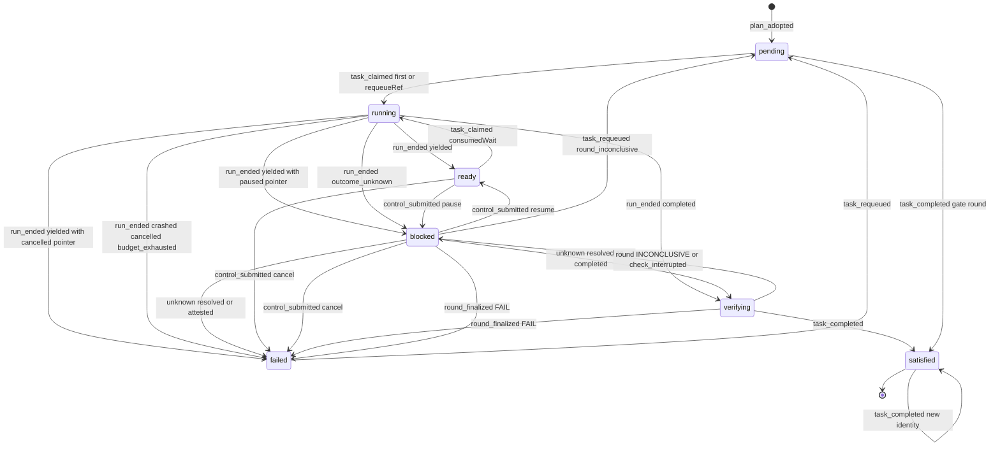

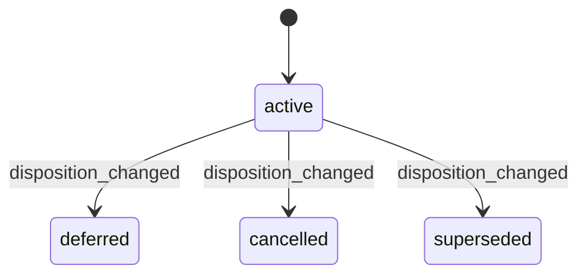

disposition 图只画已核实的方向（W16）。其他方向未在代码中核实，本规格也不新增。

### 4.6 实现对照

目标导出（`src/core/work-graph/state/task-machine.ts`，只 import `src/contracts`）：

```ts
export function projectTaskPhase(facts: TaskPhaseFacts): { phase: Phase; cause: TaskPhaseCause | null };
export function transitionTask(state: TaskMachineState, event: TaskEvent, ctx: TaskGuardContext): Transition<TaskMachineState, TaskEvent, TaskEffect>;
```

| 行号 | 状态机函数 | 调用服务（file） | 已有测试（file） | 计划新增测试 |
| --- | --- | --- | --- | --- |
| P1–P18 | `projectTaskPhase` | `plan-readers.ts` `readCanonicalTaskFacts`（`:996-1175`；追加轮次和 TaskRequeue 的读取，并做同一窗口校验） | `R3c-canonical-task-state.test.ts`、`W1-future-plan.test.ts`；`B2-execution-result.test.ts:57` 的断言要从 `blocked` 改为 `verifying` | 每个 id 一例，并按行序验证（P10 先于 P7，P17/P18 先于 P5）；有 pending 时出现 interrupted 仍为 `verifying`，pending 跑完后变为 `blocked/check_interrupted`；遗留的 PASS 带 gaps 轮次投影为 `blocked/round_inconclusive`（P8），不是 `verifying`；轮次读失败返回 `unavailable` 而不是某个 phase |
| TASK-25 | `transitionTask`（`plan_adopted`） | `plan-service.ts` `applyPlanChange`（W15 `:1057-1231`、W16 `:1676-1816`） | `W1-future-plan.test.ts` | 草案 phase 为 `ready` 或 `blocked` 的新任务也投影为 `pending` |
| TASK-01、02 | `transitionTask`（`task_claimed`） | `claim-service.ts` | `R4c-task-claim.test.ts`、`R4c-task-claim-concurrency.test.ts`；续接见 `tests/app/AG2b-collaboration.test.ts` | 表驱动机器测试 |
| TASK-03 | 同上，`requeueRef` 分支 | `claim-service.ts`；`workflow.ts:641-662` | `R4c-task-claim.test.ts:269-276`、`R4c-task-claim-boundaries.test.ts:97-108`（保持 busy） | requeue 后领取：产生新 Attempt 和 Run，租约到 @k+1，旧记录不变；两次并发领取只有一次 commit；不带 `requeueRef` 仍为 `busy` |
| TASK-04–13、20–23 | `transitionTask`（重投影事件） | 只读投影 | `B2-execution-result.test.ts` | 每种 outcome 和轮次结论对应的 phase 与 cause；`YieldedWait` 上 pause、cancel、resume 的投影（TD-5）；`blocked/check_interrupted` 经 finalize 得 FAIL 或 INCONCLUSIVE |
| TASK-14、15、24 | `transitionTask`（`task_completed`） | `completion.ts`：`:297`（facts 带 TaskRequeue）、`:360`、`:381`（先排除 S 再折叠）、`:437-447`（守卫） | `R3e-completion.test.ts` | `failed` 的 Task 拿旧 PASS 轮次完成，返回 `incomplete`；Run1 FAIL → requeue → Run2 FAIL → requeue → Run3 PASS → `satisfied`（排除两条 requeue 存储的 `supersededEvidenceIds` 的并集；完成侧不读 `afterRoundRef` 轮次，L-3）；不 requeue 时旧 FAIL 仍阻塞；并发 requeue 使完成得 `revision_conflict`；已满足后新身份完成写 revision+1 |
| TASK-16、17 | `transitionTask`（`task_requeued`） | 新增 `tasks/requeue-service.ts`；路由 `tasks/requeue`（`core-routes.ts`）；界面动作（`src/ui/main.ts`） | 无 | 前置条件逐条；写入的 TaskRequeue@1 存储 `supersededEvidenceIds`，等于 afterRound 的 `evidenceRefs`，无轮次时为空数组（L-3）；同一 afterRun 第二次；unknown 返回 `busy`；`continuation_cancelled` 可重入队、`continuation_paused` 返回 `busy`；agent 操作者返回 `forbidden`；回执重放 |
| TASK-18、19 | `transitionTask`（`disposition_changed`） | `plan-service.ts:1676-1816` | `W1-future-plan.test.ts` | TASK-19 待 U-12 确认后再写 |
| E03 组合 | 以上全部 | Workflow 与平台；D-16（U-13）确认前经 `tasks/requeue` 人工重入队 | `tests/composition/R5c-workflow-platform.test.ts` | 完整链路：检查 FAIL → requeue → 新 Attempt 实际执行 → PASS → `satisfied`；旧失败保留 |


## 5. TaskAttempt（含 TaskLease / DispatchOutbox）

本节的三个记录都属于同一次领取的生命周期，并在同一事务中演进：

- **TaskAttempt**：一次业务执行尝试。
- **TaskLease**：每个 Task 一条，各次 Attempt 复用同一条记录。
- **DispatchOutboxEntry**：该 Attempt 的派发意图。

三者都不直接接收用户意图，全部由 §6 的 Run 事件驱动。`transitionAttempt`、`transitionTaskLease`、`transitionDispatchOutbox` 只返回下一状态和效果意图；写入发生在 Run 迁移的同一个 RecordStore 提交中。

本节依赖 D-3、D-4、D-5、D-6、D-7、D-14，以及 §6 的 RD-1（已由 lead 采纳，L-8）、RD-5。其中 D-3（U-3）、D-4（含 (b) 人工认定，U-4）、D-5（U-5）、D-6（U-6）、D-7（U-7）、D-14 的配对措辞（U-14）待用户确认，lead 建议均采纳。lead 决定 L-1（人工认定要求本 Host 持有实例租约）和 L-2（从 `Entering` 结束为未知、没有 Kernel Turn 可补记时的 ATT-36、ATT-37）直接约束本节。

本节补充的决定（待用户确认）：

- **AD-1 未知结果期间 Outbox 保持 `entered`**：当 Attempt 以 `outcome_unknown` 结束时，Outbox 保持 `entered`，直到 `attempt_resolved` 才变为 `settled`。理由：与 D-4 保留占用和租约的做法一致，使“Outbox 为 `settled` ⇔ Run 以已知 outcome 结束”成立。
  - 例外（lead 决定 L-2）：§6 RUN-20(ii) 从 `Entering` 结束（探针为 `missing`/`damaged`，没有 Kernel Turn 可补记进入事实）时，Attempt 的 `startedAt` 保持 `null`（ATT-36），Outbox 保持 `pending`（ATT-37）。解决时由 ATT-29 从 `pending` 直接 `settled`。上面的等价关系仍然成立。
- **AD-2 未进入即取消的派发状态需要新版本**：D-7 未进入取消时，Outbox 从 `pending` 直接变为 `settled`，但现有 `TaskDispatchStateV1` 要求有 `consumerId` 和 `entryGeneration`（`execution-entry-codecs.ts:281-282`）。因此新增 **`dispatchState.schemaVersion: 2`** 的 settled 变体；外层 Outbox 记录的 `schemaVersion` 仍为 1：
  - `{schemaVersion:2, phase:'settled', settlement:'not_entered', consumerId: string|null, entryGeneration: number|null, sessionGeneration, eventId}`；
  - 改造点：
    - 类型：`TaskDispatchStateV1`（`claim-contracts.ts:41-48`）扩为 V1 与 V2 的联合；
    - 校验：`taskDispatchStateV1Problem` 今天拒绝多余键和 `schemaVersion≠1`（`execution-entry-codecs.ts:276-279`），改为按 `dispatchState.schemaVersion` 分派；
    - 外层：`decodeDispatchOutboxEntry` 的 `schemaVersion===1` 检查（`claim-record-codecs.ts:226`）不变，只在 `:246-250` 调用新的分派函数；
  - V1 原样可读（`claim-contracts.ts:36-40` 已约定 Outbox 变化必须带版本）。

### 5.1 持久位置与状态枚举

| 对象 | 持久位置 | 代码枚举（原样） | 与设计名 / 说明 |
| --- | --- | --- | --- |
| TaskAttempt | `TaskAttemptSnapshot` 的 `status`、`startedAt`、`endedAt`、`endOutcome` 字段（`src/contracts/dispatch.ts:339`、`:365-376`）；codec 见 `claim-record-codecs.ts:158-195`，状态与 outcome 列表见 `:78-79` | `status`：`claimed`/`started`/`ended`<br>`endOutcome`：`RunOutcome \| null`（`dispatch.ts:111`） | 与 ORCHESTRATION §2 同名。<br>“open”指 `claimed` 或 `started`。<br>“待核对”指 `ended` 且 `endOutcome='outcome_unknown'`（D-4）。<br>codec 不做跨字段校验：例如 `ended` 不强制 `endOutcome≠null`（`:182-193`）。目标由 §14 强制 |
| TaskLease | `TaskLeaseSnapshot`（`dispatch.ts:354-364`）；release 戳为 `TaskLeaseReleaseV1`（`:345-353`）；codec 见 `execution-entry-codecs.ts:205-272` | 没有枚举字段。<br>held：没有 `release`。<br>released：有 `release` | 每个 Task 一条（ref 不含 attemptId），各次 Attempt 复用。<br>`expiresAt` 恒为 `null`，绝不按时间释放（ORCHESTRATION §5 `:349`） |
| DispatchOutboxEntry | `TaskClaimOutbox` 的 `status` 与 `dispatchState`（`claim-contracts.ts:41-57`）；codec 见 `claim-record-codecs.ts:209-253`、`execution-entry-codecs.ts:274-286` | `status`：`pending`/`entered`/`settled`。<br>`dispatchState.phase`：`entered`/`settled`，必须等于 `status`；`pending` 时不得带 `dispatchState`（`claim-record-codecs.ts:241-251`） | 每个 Attempt 一条（ref 含 attemptId）。<br>`immutable claim` 保存原 `TaskClaim`（`src/contracts/core/task-claim.ts:15-26`） |

**D-14 配对不变式**（措辞待用户确认，U-14，lead 建议采纳）。每次提交后都必须成立，并作为 §11 I-1、I-6 的一部分。“租约”一列只描述本 Attempt 是租约持有者的情形。

| Attempt | Run.status / outcome | Run 入口授权（V2 phase，§6） | Outbox | 租约 | Session 占用（§8） |
| --- | --- | --- | --- | --- | --- |
| `claimed` | `starting` | 无、`authorized`、`entering`，或 D-5 之后的 `revoked` | `pending` | held | 本 Run 的代际 |
| `started` | `running` | `entered` | `entered` | held | 本 Run 的代际 |
| `ended`（outcome 已知） | `ended`，outcome 相同 | `settled`；D-7 时为 `revoked` 或无 | `settled` | released | 已释放 |
| `ended`（`outcome_unknown`），`startedAt≠null` | `ended` + `outcome_unknown` | `unknown`（§6） | `entered`（AD-1） | held | 保留 |
| `ended`（`outcome_unknown`），`startedAt=null`：只来自 ATT-36（§6 RUN-20(ii) 从 `Entering`，lead 决定 L-2） | `ended` + `outcome_unknown`，`startedAt=null` | `unknown`（§6） | `pending`（ATT-37，AD-1 的例外） | held | 保留 |

### 5.2 事件

| 事件名 | 来源 | 驱动它的 Run 事件（§6） | 载荷要点 | 对应原文编号 |
| --- | --- | --- | --- | --- |
| `attempt_claimed` | U/P | `claim_committed`，包括首次领取、续接（W2）、重入队后的领取（D-3） | `attemptRef`、`runId`、`planRef`；`consumedWait?` 或 `requeueRef?`；`claim.generation` | T2、T7 |
| `attempt_started` | K | `entered_observed` | `enteredAt`、`consumerId`、`entryGeneration`、`sessionGeneration`、`eventId` | T3、work-graph.md §6.3（`:584`、`:592`） |
| `attempt_ended` | K、U、R | `terminal_observed`（含 RUN-08 的未结算分支）、`stop_not_entered`（cancel）、`stop_paused`（RUN-23）、`reconcile_terminal`、`reconcile_interrupted_clean`、`reconcile_unknown` | `endOutcome`（含 `outcome_unknown`）、`endedAt`；从 `Entering` 核对时补记的 `startedAt`（RUN-20(ii) 没有 Turn 时为 `null`，ATT-36）；是否拥有租约和 Session（按 claim 的代际判断） | T5、R2、R5、A8、D-4、D-6、D-7 |
| `attempt_resolved` | K、R、U | `late_evidence`（K：同进程后续观察；R：下次启动），给出已知终态；`unknown_attested`（人工证明，结果为 `crashed`；只经持实例租约的 Host，L-1） | 已知 outcome；resolution 来源（`kernel_late_evidence` 或 `human_attested`）；`startedAt` 为 `null` 时，`late_evidence` 带 Kernel Turn 开始时间供补记（L-2）；授权的 `consumerId`、`generation`，供 Outbox 从 `pending` 结算（ATT-29） | D-4、R5 |

以下 Run 事件不驱动 Attempt。Attempt 保持 `claimed`，TaskLease 和 Outbox 也不写：

- `entry_authorized`、`entry_begun`、`history_recorded`；
- `pause_not_entered`、`resume_not_entered`；
- `reconcile_not_entered`（D-5）；
- `control_submitted`（只移动 Run 指针或追加 `controlInputs`，§6 RUN-12..15）。

**从 `Entering` 核对结束（与 §6 RUN-17、RUN-19、RUN-20 一致）。** Run 处于 `Entering` 时（begin 已提交、进入尚未入账，A8 的第三个崩溃点），Attempt 仍是 `claimed`，Outbox 仍是 `pending`。核对在同一提交中补记进入事实，`startedAt` 取 Kernel Turn 的开始时间，然后：

- Attempt 直接 `claimed→ended`（ATT-31、ATT-32）；
- Outbox 直接 `pending→settled`（已知结果，ATT-33）或 `pending→entered`（未知结果，ATT-34）；
- 不经过中间的 `started`/`entered` 状态，各记录 revision +1。

探针为 `missing`/`damaged`、读不到任何 Turn 时（§6 RUN-20(ii)，lead 决定 L-2），没有进入事实可补记：

- Attempt `claimed→ended(outcome_unknown)`，`startedAt=null`（ATT-36）；
- Outbox 保持 `pending`（ATT-37）；
- 之后经 `late_evidence` 解决时，ATT-11 补记 `startedAt`（与 §6 RUN-21 同提交），ATT-29 把 Outbox 从 `pending` 直接结算；经 `unknown_attested` 解决时 `startedAt` 保持 `null`。

因此 Attempt 有两类 `claimed→ended` 路径：D-7 的未进入取消（ATT-05），以及从 `Entering` 的重启核对（ATT-31、ATT-32、ATT-36）。`attempt_started` 只有 K 来源。

### 5.3 迁移表

行号是稳定 id。新增行沿用末尾编号，按对象插入相应的表中。

**TaskAttempt**

| # | from | event | guard（守卫） | to | effects（同事务副作用意图） | 幂等/重复事件 | 原文编号 | 现状 |
| --- | --- | --- | --- | --- | --- | --- | --- | --- |
| ATT-01 | ∅ | `attempt_claimed` | 由 Task 机决定（TASK-01、02、03）；Attempt 的 key 为 ∅（CAS `null`） | `claimed`@1：`startedAt`、`endedAt`、`endOutcome` 均为 `null` | 与 Run@1、Outbox@1、租约、Session 占用在同一提交 | 领取回执重放，不生成新的 attemptId（`claim-service.ts:745-747`） | T2 | 已有 `claim-service.ts:704-705` |
| ATT-02 | `claimed` | `attempt_started` | Attempt 为 `claimed`（新增显式守卫；今日只靠 auth 为 `entering`，`execution-entry-service.ts:1202`）；Run 的 auth 为 `entering`；Session 和租约属于本代际（`:1210-1214`） | `started`，`startedAt=enteredAt` | `enter_outbox`（ATT-26） | `recordExecutionEntered` 回执重放（`:1270`） | T3 | 已有 `execution-entry-service.ts:1239-1240`；改造：加显式守卫 |
| ATT-03 | `claimed` | `entry_authorized`、`entry_begun`、`history_recorded`、`pause_not_entered`、`resume_not_entered` | — | `claimed`，不写 | 无 | — | T3、R1、R3 | 已有：`entry_authorized`（W3，只写 Run，`execution-entry-service.ts:965-971`）、`entry_begun`（W4，`:1100-1101`）、`history_recorded`（W9，`execution-history-binding.ts:146`）都不写 Attempt。新增：`pause_not_entered`、`resume_not_entered`（D-7） |
| ATT-04 | `claimed` | `reconcile_not_entered` | 同 §6 RUN-16：auth 为 `entering`，探针 `ready` 且 Kernel 中没有该 turn，`exitProof≠null`（重启时本 Host 持有实例租约，D-5；进程内为 `live_clean`） | `claimed`，不写 | 无。Run 侧撤销 auth，同一 claim 以 `entryGeneration+1` 重新授权（§6 RUN-16、RUN-03）。不新建 Attempt | reconcile 操作回执重放 | A8、ORCHESTRATION §9 `:412`、D-5 | 新增 |
| ATT-05 | `claimed` | `attempt_ended`，来自 `stop_not_entered`（cancel） | Run 为 `starting`（`Claimed`/`Authorized`/`Revoked`），entry∈{none, authorized, revoked}（§6 RD-1），绝不能是 `entering`；指针条件与 §6 RUN-09 相同：U 来源指针≠cancelled（同提交 `set_pointer(cancelled)`），R 来源指针=cancelled 且指向 queued cancel | `ended`：`endOutcome='cancelled'`，`startedAt=null`，`endedAt=now` | `settle_outbox(not_entered)`（ATT-30）、`release_lease`（ATT-23）、`release_session{sessionRef, generation}`。Run、auth、意图的变化见 §6 RUN-09、§7 CTL-02 | 停止意图同身份重放 | R1、R2、D-7、RD-1 | 新增（缺口 state-writes-other §7 #15） |
| ATT-06 | `started` | `attempt_ended`，来自 `terminal_observed`（outcome 已知） | Run 的 auth 为 `entered`；Run 未结束（`:1343`）；事件序号更新（`:1638`）；Kernel 边界完整（`:1350-1367`） | `ended`，`endOutcome` 等于 Run 的 outcome | `settle_outbox`（ATT-27）；仅当 `ownsLease` 时 `release_lease`（`:1397-1398`）；仅当 `ownsSession` 时 `release_session`（`:1396`） | 回执重放（`:1331`）；对已结束 Run 的新身份返回 `busy`（`:1343`） | T5、R5 | 已有 `execution-entry-service.ts:1406-1407` |
| ATT-07 | `started` | `attempt_ended`（`outcome_unknown`），来自 `terminal_observed` 的未结算分支（§6 RUN-08） | 同 §6 RUN-08：Run 的 auth 为 `entered` 且未结束；有缺结果或 `outcome_unknown` 的工具调用，或 Turn 不完整（`execution-observation.ts:578-583`）；`exitProof≠null`（进程内为 `live_clean`） | `ended`，`endOutcome='outcome_unknown'` | 无释放；Outbox 保持 `entered`（ATT-28） | 同 ATT-06 | D-4、RD-2 | 改造 `execution-observation.ts:583-594`（今日 Run 停在 running、不写结果）。写入经扩展的 `recordRunResult`（带 `unresolvedToolCallIds`，§6 RD-5、6.1 契约 (b)）；今天 `recordRunResult` 只收已知终态（`execution-entry-service.ts:1640-1670` 没有 unknown 分支） |
| ATT-08 | `started` | `attempt_ended`，来自 `reconcile_terminal`（Run 为 `Running`） | 本 Host 持有实例租约（D-18）；Kernel 历史中有该 Run 的终态事件 | `ended`，`endOutcome` 为 Kernel 终态映射的 outcome | 同 ATT-06 | reconcile 操作回执重放 | S8、A8、D-6 | 新增 |
| ATT-09 | `started` | `attempt_ended`，来自 `reconcile_interrupted_clean`（Run 为 `Running`） | 实例租约；Kernel turn 存在、没有终态，且每个工具调用都有结果 | `ended`，`endOutcome='crashed'` | 同 ATT-06 | 同上 | A8、D-6 | 新增 |
| ATT-10 | `started` | `attempt_ended`，来自 `reconcile_unknown`（Run 为 `Running`） | 实例租约；Kernel turn 存在，且至少一个工具调用没有结果 | `ended`，`endOutcome='outcome_unknown'` | 无释放；Outbox 保持 `entered` | 同上 | A8、D-4、D-6 | 新增 |
| ATT-35 | `started` | `attempt_ended`，来自 `stop_paused`（§6 RUN-23） | 同 §6 RUN-23：Run 为 `Running`，Kernel Turn 为 paused，指针为 cancelled 且 cancel intent 仍 queued；`exitProof≠null`（进程内 `live_clean`，或重启时实例租约）；没有在途工具 | `ended`，`endOutcome='cancelled'` | `settle_outbox`（ATT-27）；`release_lease`（ATT-18，归属成立时）；`release_session`（§8 SES-06） | 随 RUN-23 回执回放（身份 = hash(runRef, cancel intentRef)） | R2、G7、RD-7 | 新增 |
| ATT-31 | `claimed`（Run 为 `Entering`） | `attempt_ended`，来自 `reconcile_terminal` 或 `reconcile_interrupted_clean` | 同 §6 RUN-17 或 RUN-19：实例租约；Kernel turn 存在；有终态，或无终态但每个工具调用都有结果 | `ended`：`startedAt` 补记为 Turn 开始时间；`endOutcome` 为 Kernel 终态映射值，或 `crashed` | `settle_outbox(entered 变体)`（ATT-33）；`release_lease`（ATT-18，归属成立时）；`release_session` | 同 ATT-08 | S8、A8、D-6 | 新增 |
| ATT-32 | `claimed`（Run 为 `Entering`） | `attempt_ended`，来自 `reconcile_unknown` | 同 §6 RUN-20 (i)(iii)：实例租约；Kernel turn 存在；有工具调用缺结果或为 `outcome_unknown`，或 yielded 终态的 continuation 无法按 RD-3 重建（含多条等待发信，lead 决定 L-5） | `ended`：`startedAt` 补记；`endOutcome='outcome_unknown'` | Outbox `pending→entered`（ATT-34）；不释放（ATT-20） | 同 ATT-08 | A8、D-4、D-6 | 新增 |
| ATT-36 | `claimed`（Run 为 `Entering`） | `attempt_ended`，来自 `reconcile_unknown` 的情形 (ii) | 同 §6 RUN-20(ii)：实例租约；探针为 `missing`/`damaged`，读不到 Turn，没有进入事实可补记 | `ended`：`startedAt=null`；`endOutcome='outcome_unknown'` | Outbox 保持 `pending`（ATT-37）；不释放（ATT-20） | 同 ATT-08 | A8、D-4、§8 SD-3、lead 决定 L-2 | 新增 |
| ATT-11 | `ended`（`outcome_unknown`） | `attempt_resolved`，来自 `late_evidence` | 新的 Kernel 证据给出已知 outcome；Run 在同一提交中改为该 outcome（§6 RUN-21） | `ended`（revision+1），`endOutcome` 改为已知值；`startedAt` 为 `null`（ATT-36 之后）时补记为 Kernel Turn 开始时间（与 RUN-21 同提交，lead 决定 L-2） | `settle_outbox`（ATT-29，从 `entered`，或 ATT-37 之后从 `pending`）、`release_lease`（ATT-22）、`release_session`；归属按原 claim 的代际判断 | 同身份重放；再次解决返回 `busy` | D-4、R5 | 新增 |
| ATT-12 | `ended`（`outcome_unknown`） | `attempt_resolved`，来自 `unknown_attested` | 有权操作者执行 `resolveUnknownRun`，记录证明人和原因（§6 RUN-22）；本 Host 持有实例租约，否则 `busy`（lead 决定 L-1） | `ended`，`endOutcome='crashed'`；`startedAt` 不补记（没有 Kernel 证据，ATT-36 之后仍为 `null`） | 同 ATT-11 | 同上 | D-4(b) | 新增，待用户确认 |
| ATT-13 | `ended`（outcome 已知） | 重复的 `attempt_ended` 或 `attempt_resolved` | — | 不变 | 无 | 同身份同内容：重放原回执；新身份：`busy`（保持 `runFinished`） | R5 | 已有 `execution-entry-service.ts:1343`、`:1609-1611` |

**TaskLease**

| # | from | event | guard（守卫） | to | effects（同事务副作用意图） | 幂等/重复事件 | 原文编号 | 现状 |
| --- | --- | --- | --- | --- | --- | --- | --- | --- |
| ATT-14 | ∅ | `attempt_claimed`（首次领取） | 租约 key 为 ∅（CAS `null`，`claim-service.ts:732`） | held@1：`holderRunId`、`attemptId`、`grantedAt`，`expiresAt=null` | — | 同 ATT-01 | T2 | 已有 `claim-service.ts:693-695` |
| ATT-15 | released | `attempt_claimed`（续接，W2） | `release` 存在，且 `holderRunId` 等于前一 Run（`claim-service.ts:614-618`） | held@k+1：持有者换新，删除 `release` | — | 身份与 actor 无关（`:381-405`） | 续接 | 已有 `claim-service.ts:696-697` |
| ATT-16 | released | `attempt_claimed`（重入队后的领取，D-3） | `release.runRef` 等于 `TaskRequeue.afterRunRef`；guard 为租约@k | held@k+1：持有者换新，删除 `release` | — | 同 TASK-03 | T7、D-3 | 改造 `claim-service.ts:639-641`、`:693-697` |
| ATT-17 | held | `attempt_claimed`（任何一种） | — | 不变 | — | — | T2 | 已有：返回 `busy`（`eligibility.ts:73-76`、`claim-service.ts:582`），见 5.4 |
| ATT-18 | held | `attempt_ended`（outcome 已知，`ownsLease`），含从 `Entering` 的核对（ATT-31） | 持有者和 attempt 与 claim 一致，且还没有 `release` | released@k+1：release 戳为 `{runRef, attemptRef, sessionRef, generation, releasedAt, eventId}` | — | 同 ATT-06 | T5、R5 | 已有 `execution-entry-service.ts:1424-1430` |
| ATT-19 | held（他人持有）或 released | `attempt_ended`（`ownsLease` 不成立） | 持有者或 attempt 不是本 claim，或已有 `release` | 不变，不写。这是无效果迁移，不是拒绝：终态照常入账；按 SD-1 返回 `ok:true`、`effects:[]`（已由 lead 采纳，L-8） | 守卫取租约读到的 revision（`:1419-1423`） | — | work-graph.md §6.3 `:588`（旧入口不释放新占用） | 已有 `execution-entry-service.ts:1397-1398` |
| ATT-20 | held | `attempt_ended`（`outcome_unknown`），含 ATT-07、10、32、36 | — | held，不写 | — | — | D-4、I-2 | 新增 |
| ATT-21 | held | `reconcile_not_entered` | D-5 | held，不写 | — | — | D-5 | 新增 |
| ATT-22 | held | `attempt_resolved` | 持有者是该 Run；尚未释放 | released@k+1 | — | 同 ATT-11 | D-4 | 新增 |
| ATT-23 | held | `attempt_ended`，来自 `stop_not_entered` | ATT-05 的守卫成立；归属条件同 ATT-18 | released@k+1，release 戳取自原 claim | — | 同 ATT-05 | D-7 | 新增 |

**DispatchOutboxEntry**

| # | from | event | guard（守卫） | to | effects（同事务副作用意图） | 幂等/重复事件 | 原文编号 | 现状 |
| --- | --- | --- | --- | --- | --- | --- | --- | --- |
| ATT-24 | ∅ | `attempt_claimed` | Outbox key 为 ∅ | `pending`@1，带不可变的 `claim` | — | 同 ATT-01 | T2 | 已有 `claim-service.ts:687` |
| ATT-25 | `pending` | `entry_authorized`、`entry_begun`、`history_recorded`、`reconcile_not_entered`、`pause_not_entered`、`resume_not_entered` | — | `pending`，不写 | — | — | work-graph.md §6.3（`:582-586`） | 已有：`entry_authorized`、`entry_begun`、`history_recorded` 都只写 Run（W3 `execution-entry-service.ts:970-971`、W4 `:1101`、W9 `execution-history-binding.ts:146`）。新增：`reconcile_not_entered`、`pause_not_entered`、`resume_not_entered` |
| ATT-26 | `pending` | `attempt_started` | 同 ATT-02 | `entered`：`dispatchState{phase:'entered', consumerId, entryGeneration, sessionGeneration, eventId}` | — | 同 ATT-02 | T3 | 已有 `execution-entry-service.ts:1244-1246` |
| ATT-27 | `entered` | `attempt_ended`（outcome 已知） | 同 ATT-06 | `settled`：`dispatchState.phase='settled'` | — | 同 ATT-06 | T5 | 已有 `execution-entry-service.ts:1408-1410` |
| ATT-28 | `entered` | `attempt_ended`（`outcome_unknown`） | — | `entered`，不写 | — | — | D-4、AD-1 | 新增 |
| ATT-29 | `entered`；或 `pending`（Run 为 `EndedUnknown`，ATT-37 之后） | `attempt_resolved` | 同 ATT-11 或 ATT-12 | `settled`。从 `pending` 来时写 V1 `dispatchState{phase:'settled', consumerId, entryGeneration, sessionGeneration, eventId}`：`consumerId`、`entryGeneration` 取自该 Run 的 V2 授权（RUN-20 之前的 entering 绑定，`dispatch.ts:124-133`），`sessionGeneration` 为 claim.generation，`eventId` 为本次解决事件 | — | 同 ATT-11 | D-4、AD-1、lead 决定 L-2 | 新增 |
| ATT-30 | `pending` | `attempt_ended`，来自 `stop_not_entered` | 同 ATT-05 | `settled`：使用 AD-2 的 `dispatchState.schemaVersion:2`、`settlement:'not_entered'` 变体 | — | 同 ATT-05 | D-7 | 新增；改造 `claim-contracts.ts:41-48`、`execution-entry-codecs.ts:274-286`（含 `:276-279`）、`claim-record-codecs.ts:241-251` |
| ATT-33 | `pending`（Run 为 `Entering`） | `attempt_ended`（已知），来自 `reconcile_terminal` 或 `reconcile_interrupted_clean` | 同 ATT-31 | `settled`：V1 `dispatchState{phase:'settled', consumerId, entryGeneration}` 取自 entering 授权 | — | 同 ATT-31 | S8、A8、D-6 | 新增 |
| ATT-34 | `pending`（Run 为 `Entering`） | `attempt_ended`（`outcome_unknown`），来自 `reconcile_unknown` | 同 ATT-32 | `entered`：V1 `dispatchState{phase:'entered', …}` 取自 entering 授权 | — | 同 ATT-32 | A8、D-4、AD-1 | 新增 |
| ATT-37 | `pending`（Run 为 `Entering`） | `attempt_ended`（`outcome_unknown`），来自 `reconcile_unknown` 的情形 (ii) | 同 ATT-36 | `pending`，不写。Run 为 `ended`+`outcome_unknown` 期间一直保持 `pending`，只有 ATT-29 能离开 | — | 同 ATT-36 | D-4、AD-1 的例外、lead 决定 L-2 | 新增 |

**Run 事件到本节事件的映射**（服务调用 `attemptEventFromRunEvent`）

| Run 事件（§6） | Attempt | 租约 | Outbox |
| --- | --- | --- | --- |
| `claim_committed` | ATT-01 | ATT-14、15、16 | ATT-24 |
| `entry_authorized`、`entry_begun`、`history_recorded` | ATT-03 | 不写 | ATT-25 |
| `entered_observed` | ATT-02 | 不写 | ATT-26 |
| `terminal_observed`（已知，RUN-07） | ATT-06 | ATT-18 或 19 | ATT-27 |
| `terminal_observed`（未结算，RUN-08） | ATT-07 | ATT-20 | ATT-28 |
| `stop_not_entered`（cancel，RUN-09） | ATT-05 | ATT-23 | ATT-30 |
| `stop_paused`（RUN-23） | ATT-35 | ATT-18 或 19 | ATT-27 |
| `pause_not_entered`、`resume_not_entered` | ATT-03 | 不写 | ATT-25 |
| `control_submitted` | 不写 | 不写 | 不写 |
| `reconcile_not_entered` | ATT-04 | ATT-21 | ATT-25 |
| `reconcile_terminal`、`reconcile_interrupted_clean`，Run 为 `Running`（RUN-18、19） | ATT-08、09 | ATT-18 或 19 | ATT-27 |
| 同上，Run 为 `Entering`（RUN-17、19） | ATT-31 | ATT-18 或 19 | ATT-33 |
| `reconcile_unknown`，Run 为 `Running`（RUN-20） | ATT-10 | ATT-20 | ATT-28 |
| `reconcile_unknown`，Run 为 `Entering`（RUN-20 (i)(iii)） | ATT-32 | ATT-20 | ATT-34 |
| `reconcile_unknown`，Run 为 `Entering`（RUN-20 (ii)，没有 Turn） | ATT-36 | ATT-20 | ATT-37 |
| `late_evidence`、`unknown_attested`（RUN-21、22） | ATT-11、12 | ATT-22 或 19 | ATT-29（从 `entered`，或 ATT-37 之后从 `pending`） |

已知终态上的 `late_evidence`/`unknown_attested` 被 §6 拒绝（6.4），不会到达本节；直接调用时按 ATT-13 拒绝。

### 5.4 明确禁止的迁移

| from | event/目标 | 拒绝原因 | 对外 CoreError | 说明 |
| --- | --- | --- | --- | --- |
| Attempt `claimed` | `terminal_observed` 直达 `ended` | `illegal` | `busy`（保持 `execution-entry-service.ts:1342`） | 终态写入要求 auth 为 `entered`；从 `Entering` 结束只能经核对（ATT-31、32、36） |
| Attempt `claimed`（Run 为 `Entering`） | `stop_not_entered` | `illegal` | —（submit 不被拒绝，改走 §6 RUN-13 的 queued） | 与 §6 6.4 一致：从 entering 起必须经 Kernel 活句柄或核对（D-7） |
| Attempt `claimed` | `reconcile_not_entered` 时新建 Attempt | `illegal` | — | 机械重试复用同一 claim（D-5、ORCHESTRATION §9 `:412`）。结构上不存在这条路径，由 §14 测试保证 |
| Attempt `started` | 回到 `claimed` | `illegal` | `invalid` | 状态只前进 |
| Attempt `ended` | 回到 `started` 或 `claimed` | `illegal` | `invalid` | 返工必须新建 Attempt（TASK-03） |
| Attempt `ended`（已知） | `attempt_resolved` | `illegal` | `busy` | 已知终态不再改写；与 §6 6.4（`Ended`/`YieldedWait` 上的 `late_evidence`/`unknown_attested`）一致 |
| Attempt `ended`（`outcome_unknown`） | `attempt_ended`（再次，新身份） | `guard_failed`；sequence 不前进时为 `stale` | `incomplete`；sequence 不前进时为 `revision_conflict` | 与 §6 6.4 一致：`EndedUnknown` 上再次到达的终态观察只能作为 `late_evidence` 判定，不是新证据时 `incomplete`。只有 `attempt_resolved`（ATT-11、12）能离开；同身份由回执重放 |
| Attempt `ended`（`outcome_unknown`） | 超时或无证据时释放 | `illegal` | — | 没有任何写入者。只能经 ATT-11 或 ATT-12（`IMPLEMENTED-CAPABILITIES.md:254`） |
| Attempt `ended`（`outcome_unknown`） | `unknown_attested`，本 Host 不持有实例租约 | `guard_failed` | `busy` | lead 决定 L-1；与 §6 6.4 同一行一致 |
| Attempt `ended`（`outcome_unknown`，`startedAt=null`） | 没有 Kernel Turn 证据时补记 `startedAt` | `illegal` | — | 只有 ATT-11 带 Kernel Turn 开始时间时补记（L-2）；ATT-12 不补记 |
| 租约 released | `attempt_claimed`（首次领取，无 requeue 或续接） | `guard_failed` | `busy` | 保持 `claim-service.ts:639-641` |
| 租约 released | `attempt_claimed`（requeue），`release.runRef` 不等于 `TaskRequeue.afterRunRef` | `stale` | `revision_conflict` | 旧 requeue 不能再用于领取；与 §4 4.4 一致 |
| 租约 held | `attempt_claimed` | `guard_failed` | `busy` | `resource_unavailable/leased`（`eligibility.ts:73-76`） |
| 租约 held | 按 `expiresAt` 或时间释放 | `illegal` | — | `expiresAt` 恒为 `null`；不能凭超时转交（ORCHESTRATION §5 `:349`） |
| Outbox `pending` | `entered`，但没有 Kernel 的 entered 观察 | `illegal` | `busy` | 只有 `recordExecutionEntered`（ATT-26）或从 `Entering` 读到 Turn 的核对（ATT-34）可以推进；RUN-20(ii) 没有 Turn，保持 `pending`（ATT-37） |
| Outbox `pending` | 经 `terminal_observed` 变为 `settled` | `illegal` | `busy` | 同第一行；从 `Entering` 的已知结束只能经核对（ATT-33） |
| Outbox `settled` | 变为 `pending` 或 `entered` | `illegal` | `invalid` | settled 是终态 |
| Outbox `entered`，或 ATT-37 的 `pending` | 在 `outcome_unknown` 下变为 `settled`（ATT-37 的 `pending` 也不得变为 `entered`） | `illegal` | — | AD-1 及其例外（L-2）；只有 ATT-29 能离开 |

旧代际迟到终态不释放新持有者、以及已释放的租约不再释放，都是 ATT-19 的无效果迁移，不列为拒绝。

### 5.5 状态图

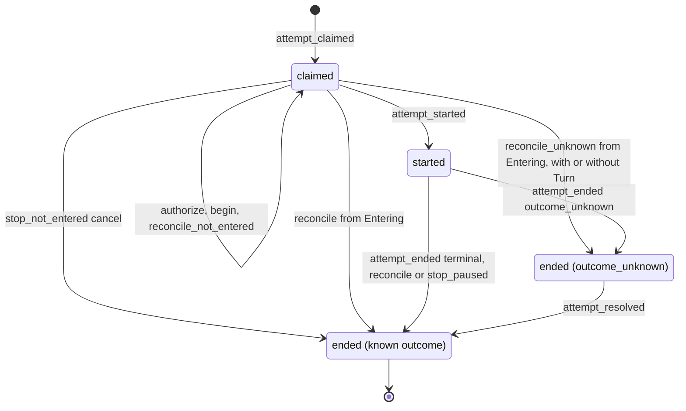

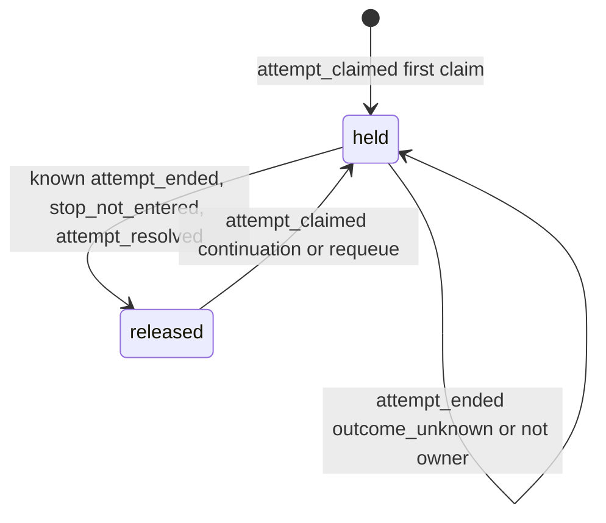

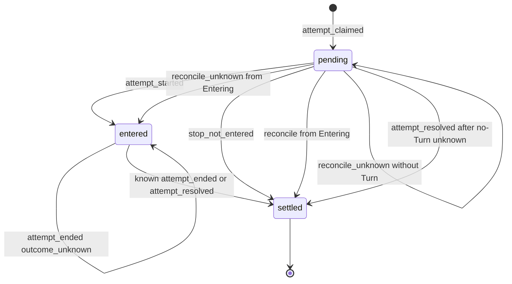

### 5.6 实现对照

目标导出（`src/core/work-graph/state/attempt-machine.ts`，只 import `src/contracts`）：`transitionAttempt`、`transitionTaskLease`、`transitionDispatchOutbox`、`attemptEventFromRunEvent`。

| 行号 | 状态机函数 | 调用服务（file） | 已有测试（file） | 计划新增测试 |
| --- | --- | --- | --- | --- |
| ATT-01、14、24 | `transitionAttempt`、`transitionTaskLease`、`transitionDispatchOutbox`（`attempt_claimed`） | `claim-service.ts:682-707` | `R4c-task-claim.test.ts`、`R4c-task-claim-concurrency.test.ts` | 表驱动：三个记录同一次提交，revision 都为 1 |
| ATT-03、25 | 不写入的事件 | `execution-entry-service.ts`（W3、W4）；`execution-history-service.ts`（W9）；未进入停止服务（§6 RUN-10、11） | `B2-execution-entry.test.ts:214`（begin 与历史记录后 Attempt 仍为 `claimed`） | 表驱动：这些事件后 Attempt、Outbox 的 revision 不变；D-7 pause/resume 后同样不变 |
| ATT-15、16 | `transitionTaskLease`（复用） | `claim-service.ts:693-697` | `tests/app/AG2b-collaboration.test.ts`（续接） | requeue 领取后租约到 @k+1 且没有 `release`；`release.runRef` 不符时 `revision_conflict`；并发领取只有一次 commit |
| ATT-17 | `transitionTaskLease`（held + `attempt_claimed`） | `claim-service.ts` | `R4c-task-claim.test.ts:326`（两个连接领取同一 Task 只有一个成功）、`R4c-task-claim-concurrency.test.ts` | 表驱动：held 时任一种 `attempt_claimed` 都返回 `busy` |
| ATT-02、26 | `attempt_started` | `execution-entry-service.ts:1158-1275` | `B2-execution-entry.test.ts:167` | Attempt 不是 `claimed` 时拒绝（新增显式守卫） |
| ATT-06、18、19、27 | `attempt_ended`（已知 outcome） | `execution-entry-service.ts:1293-1457` | `B2-execution-result.test.ts:43-48`；`:94`（旧代际终态只补自身历史，不释放新持有者，ATT-19） | 表驱动：`ownsLease`、`ownsSession` 的四种组合 |
| ATT-07、20、28 | `attempt_ended`（`outcome_unknown`） | `agent-runtime/execution-observation.ts:578-594` 的未知分支 → 扩展的 `recordRunResult`（带 `unresolvedToolCallIds`，§6 RD-5，basis `live_clean`） | 无（`tests/runtime/R4-control-runtime.test.ts:234` 只断言占用保留） | unknown 之后占用、租约保留，Outbox 为 `entered`；Task 为 `blocked`；不带 `unresolvedToolCallIds` 的 `recordRunResult` 仍只接受已知终态 |
| ATT-13 | 重复终态 | `recordRunResult`、`reconcileRun` | `B2-execution-result.test.ts:58-62`（同身份重放、新身份拒绝）、`:115`（冲突终态不改写） | 机器表：已知终态上的任一终态事件被拒绝；unknown 上再次 `attempt_ended`（不是新证据）返回 `incomplete`，sequence 不前进时 `revision_conflict` |
| ATT-04、21、25 | 不写入的事件 | 新增 reconcile 服务（§12） | 无 | D-5 之后同一 attemptId 重新授权，Attempt 数量不变 |
| ATT-05、23、30 | `attempt_ended`（`stop_not_entered`） | 未进入停止（§6 RUN-09、§7 CTL-02；`control-service.ts` `submitControl`） | 无 | `starting` + cancel：五个记录在同一提交终结；entry 为 `revoked` 时同样可停；auth 为 `entering` 时改走 queued；AD-2 变体编码、解码，V1 仍可读 |
| ATT-08–10 | reconcile 终态（Run 为 `Running`） | 新增 reconcile 服务（§12） | 无 | 三个崩溃点（A8）各一例；没有实例租约时不写 |
| ATT-35 | `attempt_ended`（`stop_paused`） | `reconcileRun(paused_stop)`（§6 RUN-23）：进程内由 `agent-runtime/execution-control.ts` 的 `deliver` 调用，重启时由 `agent-runtime/run-reconcile.ts` 调用 | 无 | 安全点暂停后 cancel：Attempt ended(cancelled)、Outbox settled、Lease 释放，与 Run 在同一提交；证明不成立时 Attempt 保持 `started` |
| ATT-31–34 | reconcile 终态（Run 为 `Entering`） | 新 `reconcileRun`（§6 RUN-17、19、20） | 无 | Attempt `claimed→ended`，`startedAt` 等于 Turn 开始时间；Outbox `pending→settled` 或 `pending→entered`；各 revision +1；未知时不释放；一个 Turn 有两条等待发信的 yielded 终态 → ATT-32/34（L-5） |
| ATT-36、37 | `attempt_ended`（`outcome_unknown`，RUN-20(ii)，Run 为 `Entering`） | 新 `reconcileRun`（§6 RUN-20(ii)） | 无 | 探针 `missing`/`damaged`：Attempt `claimed→ended(outcome_unknown)`，`startedAt=null`；Outbox 保持 `pending`（revision 不变）；Lease、Session 保留；`checkAttemptPairing` 接受这一例外（§11 I-6） |
| ATT-11、12、22、29 | `attempt_resolved` | reconcile 服务；新增 `resolveUnknownRun`（D-4(b)） | 无 | 解决后释放；再次解决返回 `busy`；ATT-36/37 之后：`late_evidence` 补记 `startedAt`，Outbox 从 `pending` 直接 `settled`，`consumerId`/`entryGeneration` 等于授权上的值；人工认定时 `startedAt` 保持 `null`；没有实例租约时人工认定返回 `busy`（L-1） |
| 配对不变式 | `checkAttemptPairing(run, attempt, outbox, lease)`（纯函数，测试用） | 全部服务 | 无 | 每条迁移提交后断言 D-14 配对表（§11 I-1、I-6） |


## 6. Run（status/outcome + 进入子状态 + 控制指针）

Run 是一次执行尝试的平台记录。本节把三个已持久化的维度放进同一个纯函数 `transitionRun`：

- 主状态 `status/outcome`；
- V2 进入授权 `executionAuthorization.phase`（“进入子状态”）；
- 控制指针 `controlState`/`controlInputs`。

TaskAttempt、DispatchOutbox、TaskLease、Session 占用和 ControlIntent 的变化只作为“同事务副作用意图”列出。这些对象各自的合法性分别由 §5（Attempt/Outbox/Lease）、§8（Session）、§7（ControlIntent）判定。本节不改名、不新增状态枚举。新增的只有：`outcome_unknown` 与授权 `unknown`/`revoked` 的写入者，以及 `reconciliation` 的写入者（原本都已声明而无写入者）。

本节依赖的待确认决定：D-4（`outcome_unknown` 持久化、人工认定出口，U-4）、D-5（重启“未进入”证明，U-5）、D-6（重启后有 Turn 的三种收尾，U-6）、D-7（未进入停止，U-7）、D-8（同提交取代）、D-9（Goal 期望状态守卫，U-8）、D-15、D-18（Host 实例租约，与 D-5 同属 U-5）。U-n 的 lead 建议均为采纳。

直接约束本节的 lead 决定：L-1（RUN-22 人工认定要求本 Host 持有实例租约，否则 `busy`）、L-2（RUN-20(ii) 从 `Entering` 结束时 Attempt、Outbox 走 §5 ATT-36、ATT-37，RUN-21 按 Kernel 证据补记 `startedAt`）、L-5（RD-3 只在恰好一条等待发信时重建）、L-10（租约被另一个存活的 Host 持有时，该 Host 不核对、不进入 Kernel）。

本节在 brief 之外补充的决定。RD-1、RD-7 已由 lead 采纳（L-8）；RD-3 的取舍已由 lead 决定 L-5 定稿；RD-6 是待用户决定的 U-9（下文给出选项和 lead 的推荐）；其余同样待确认：

- **RD-1 D-7 也适用于 `Revoked`。** **已由 lead 采纳（L-8）。** D-5 撤销后的 Run 已被证明未进入，因此 `stop_not_entered`/`pause_not_entered`/`resume_not_entered` 的守卫是 entry∈{none, authorized, revoked}（brief 只写了 none/authorized）。否则带 queued cancel 的 `Revoked` Run 既不能重新授权（指针栅栏），也不能停止。§5 ATT-05/ATT-23/ATT-30、§8 SES-05、§2 GOAL-09/GOAL-10 的守卫使用同一集合。
- **RD-2 实时未知也落 `outcome_unknown`。** 进程内观察者在 cleanProof 成立时看到 Kernel 终态，但仍有缺结果或 `outcome_unknown` 的工具调用，这时也写 Run `ended/outcome_unknown`（RUN-08）。今天在这种情况下 Run 保持 `running`。
- **RD-3 重启时 Kernel 终态为 yielded：先由持久事实重建 continuation，再按原结果入账；重建不出则记为未知，不释放。** §8 SES-06 与 §10.1 都按本条执行。
  - 重建依据，三项全部成立：
    1. Kernel 原历史中，本 Turn 内**恰好一条** `send_session_message` 工具结果带 `waiting:true` 与 `message.ref`（`src/core/agent-runtime/communication-tools.ts:247-253`），取这一条（lead 决定 L-5）。零条或多条都按重建失败处理，走 RUN-20(iii)。理由是进程内的取法并不唯一：`waitRegistered ??=`（`execution-driver.ts:329`）只决定是否让出，而进程内 continuation 取 `handle.waitMessage`，它在每次登记时被覆盖（`execution-driver.ts:330`；`execution-control.ts:224-230`），即最后登记的一条。多条时无论取最先还是最后一条，都可能与进程内的结果不同，因此不猜。
    2. 该 ref 的已存 `SessionMessage` 满足：`sender.kind==='work_run'`，`sender.runRef` 等于本 Run，`sender.generation` 等于 claim.generation，`waitAfterSend===true`。
    3. 构造的 `{task: claim.task, sessionRef: claim.sessionRef, messageRef}` 通过 `runContinuationProblem`（`execution-entry-service.ts:1615-1630`）。
  - 重建成功：按 RUN-17/18 入账 `yielded`，写 continuation 并释放。`recordRunResult` 在同一提交中读取该 `SessionMessage` 并加 CAS 守卫，不信任调用者自报。
  - 重建失败（三项依据任一不成立，包括本 Turn 的等待发信不是恰好一条）：按 RUN-20(iii) 记为 `outcome_unknown`，原因 `continuation_unrebuildable`，保留占用和 Lease。
  - 理由：A8/B10 要求“依据原结果补账”。记为 `crashed` 会写入一个与 Kernel 事实不同的结果；重建失败只发生在持久事实互相矛盾时，此时按 A8“无法确认如实 unknown”处理。
  - 不同于 D-17 的缺口：D-17 指发信成功、但 Turn 尚未 yield 时崩溃。那种情况下 Kernel 中没有 yielded 终态，按 RUN-19 记为 `crashed`，消息上的等待关联丢失。
- **RD-4 `late_evidence` 的“新”按 Kernel 事实判定。** 观察者自己按 `lastEventSeq+1` 给终态编号（`execution-observation.ts:638`），所以 `sequence>lastEventSeq` 不能证明 Kernel 有新记录，只用于排序。新证据的判定条件是：
  - Kernel 终态的位置大于 RUN-08/20 写入 `reconciliation` 的 `observedThroughPosition`（RUN-20(ii) 没有读到 Turn，窗口为 null，任何位置都算，L-2）；
  - 原 `unresolvedToolCallIds` 中的每个调用现在都有确定结果。
  - 进程已死（实例租约接管）只证明“没有在途工具”，不证明副作用已知。因此 D-4(a) 的“no in-flight tool”只适用于 D-6 的未结束 Turn（RUN-19）。已经是 `outcome_unknown` 的 Run，不能因重启接管就改为已知结果。
- **RD-5 每个事件只有一个 WG 写操作。** 按 D-6，并与 §5 ATT-07 对齐：
  - 带 Kernel 终态的事件经 `recordRunResult`：`terminal_observed`（RUN-07/08）、`reconcile_terminal`（RUN-17/18）、`late_evidence`（RUN-21）。
  - 没有 Kernel 终态的核对结果经新写操作 `reconcileRun`：`reconcile_not_entered`、`reconcile_interrupted_clean`、`reconcile_unknown`、`stop_paused`（RUN-16/19/20/23）。
  - `unknown_attested` 经新写操作 `resolveUnknownRun`（RUN-22）。
  - 未进入停止 `stop/pause/resume_not_entered` 经 `submitControl`（RUN-09..11）。
  - 因此 `recordRunResult` 的输入要扩展：`basis`、`unresolvedToolCallIds`、`enteredAt`，并接受 auth `entering`（RUN-17）和 `unknown`（RUN-21），见 6.1 契约 (b)。ORCHESTRATION S8 写的是“向 WG.reconcileRun 补账”，R5 写的是 `recordRunResult/reconcileRun`。本节按 brief D-6，终态补账走 `recordRunResult`。
- **RD-6 重启时处于安全点暂停的已进入 Run 怎么办（待用户决定 U-9）。** 情形：重启时 Kernel 状态为 `paused`（非终态，`execution-observation.ts:553-556`），没有在途工具，指针不是 queued cancel（queued cancel 走 RUN-23）。重启后沿原 Turn 恢复属于 D-17 范围外，因此用户的“已暂停”无论如何都不能再 resume 原 Turn。两个选项：
  - **(a) 记为 `crashed`（lead 推荐）。** 按 RUN-19 结束为 `crashed`，error 为 `host_interrupted_while_paused`。已 applied 的 pause intent 保持 Applied。释放 Session 和 Lease；Task 由 §4 投影为 `failed`，可以 requeue，在同一 Session 中继续。代价是用户可见的降级：“已暂停”经重启变为“失败”。§4 P6 的 `run_failed` detail 带出 error `host_interrupted_while_paused`，界面据此区分。
  - **(b) 保持 `Running`，只能取消。** 指针保持 paused，界面显示“已暂停，重启后只能取消”；由用户的 cancel 经 RUN-23 收尾（`exitProof` 为本 Host 的实例租约接管）。代价是在用户取消之前 Session 和 Lease 一直被占用；RUN-14 必须在没有活句柄时拒绝 resume；RUN-19 的守卫要排除 Kernel `paused`；§12 W-11 改为“不迁移”。
  - 本规格的表按 (a) 书写（RUN-19、6.2 `reconcile_interrupted_clean`、§12 W-11），每处都标注 U-9。用户选 (b) 时按上一条改这几处，不影响其他行。
- **RD-7 已在安全点暂停的已进入 Run，可由平台停止（`stop_paused`，RUN-23）。** **已由 lead 采纳（L-8）。** Run 在安全点暂停后，Kernel 调用已经退出，`deliver` 无处投递取消（`execution-control.ts:184-188`）。只要以下证明成立，平台就把 Run 结束为 `cancelled` 并释放占用，cancel intent 记为 Applied（§7 CTL-10）：
  - 本进程句柄 `kernelExited && resourcesClosed.status==='completed'`（`execution-control.ts:233-244`；句柄在 `close` 前一直保留，`:342-344`），或在重启时取得实例租约；
  - Kernel 状态为 `paused`；
  - 没有在途工具。
  - 这样 D-15“cancel supported”和 G7 的“先暂停、再取消”（§2 GOAL-13）才成立。
- **RD-8 `YieldedWait` 的 continuation 已被继任 Run 消费后，不再受理控制。** 判定条件：Lease 的 `holderRunId` 已不是本 Run（`claim-service.ts:614-618`）。今天仍会受理（`control-service.ts:387-391`），留下永远无效的 queued intent。改为返回 busy。

### 6.1 持久位置与状态枚举

路径简写：`dispatch.ts`=`src/contracts/dispatch.ts`；`execution-entry-service.ts`、`control-service.ts`、`claim-service.ts`、`execution-history-binding.ts`、`execution-history-service.ts`、`completion-policy.ts` 在 `src/core/work-graph/tasks/`；`execution-entry-codecs.ts`、`control-record-codecs.ts` 在 `src/core/work-graph/persistence/`；`record-readers.ts` 在 `src/core/work-graph/materials/`；`execution-observation.ts`、`execution-control.ts`、`execution-driver.ts` 在 `src/core/agent-runtime/`；`workflow.ts`=`src/business/workflow/workflow.ts`。

| 维度 | 记录与字段（file:line） | 代码取值（原样） | 与设计名的对应 / 说明 |
| --- | --- | --- | --- |
| 主状态 | `RunSnapshot.status`（`dispatch.ts:172`，类型 `:110`） | `starting`/`running`/`ended` | 与 ORCHESTRATION §2 Run 行同名 |
| 结果 | `RunSnapshot.outcome`（`dispatch.ts:173`，类型 `:111`） | `completed`/`failed`/`cancelled`/`budget_exhausted`/`crashed`/`outcome_unknown`/`yielded`，或 `null` | `failed` 没有写入者：Kernel `failed` 映射为 `crashed`（`execution-observation.ts:156-160`），本规格保持这一点。`outcome_unknown` 今天没有写入者，D-4 起成为真实持久结果。`yielded` 是代码在 CORE-DATA-OPERATIONS:365 之外新增的 |
| 进入子状态（V2） | `RunSnapshot.executionAuthorization`（`dispatch.ts:151`，V2 类型 `:124-133`），校验 `execution-entry-codecs.ts:102-123` | 字段缺省（下文记作 `none`），或 `authorized`/`entering`/`entered`/`unknown`/`revoked`/`settled` | 对应 work-graph.md §6.3 的 `authorized/entering/observed/unknown/revoked`：`observed` 相当于 `entered`，另有 `settled`。`unknown`/`revoked` 今天没有写入者。`generation` 是 entryGeneration，`sessionGeneration` 是占用代际，`revision` 是绑定自身的版本。codec 允许 `authorized` 带非空 kernel（`:115-122`），RUN-03 依赖这一点 |
| 旧授权（V1） | 同字段，`dispatch.ts:112-116` | `authorized`/`entered`/`revoked`/`quarantined`/`settled` | 只读的历史状态，不能取得 fresh 进入权（`execution-entry-service.ts:933`、`:1068`） |
| 控制指针 | `RunSnapshot.controlState`（`dispatch.ts:153-156`），校验 `control-record-codecs.ts:90-117` | 缺省，或 `{intentRef, desiredState: running/paused/cancelled/steered}` | 设计称为“控制意图独立为 running/paused/cancelled/steered”。`steered` 没有写入者，steer 走 `controlInputs` |
| 定向输入 | `RunSnapshot.controlInputs`（`dispatch.ts:189`） | `ControlIntentRef[]` | steer intent，只追加 |
| 事件水位 | `lastEventSeq`、`lastRuntimeEventId`、`lastFactEventId`（`dispatch.ts:177-181`） | 非负整数、字符串 | 平台事件排序守卫的依据（不证明 Kernel 新事实，见 RD-4） |
| 不可变输入 | `envelope`（`dispatch.ts:183`）、`inputBinding`（`:157-158`，注释为 Immutable） | `TaskEnvelopeV1` 或 `null`；`RuntimeInputBindingV1` | 由 RUN-02 写入一次；RUN-03 不改写 |
| 等待接续 | `continuation`（`dispatch.ts:185`）、`consumedWait`（`:187`） | `RunContinuationV1`、`ConsumedWaitV1` | `continuation` 只由真实 yielded 终态写入（进程内取自句柄，重启时按 RD-3 重建） |
| 核对记录 | `RunSnapshot.reconciliation`（`dispatch.ts:149`，类型 `:134-145`） | `status: done/cancelled/quarantined`；`observation: runtime_terminal/unresolved` | 今天没有写入者，也没有校验（`record-readers.ts:251-334` 不检查这个字段）。读取者有两处：`completion-policy.ts:71-75`（`quarantined` 或 `unresolved` 阻塞完成）和 `workflow.ts:216-217`（`normalEnd` 要求 status 为 `done`）。D-4..D-6 起由核对写入：除 `unresolved` 写 `quarantined` 外，新写入一律 `status:'done'`，包括 `runtime_terminal`、`not_entered`、`interrupted_clean`、`human_attested`。`cancelled` 仍无写入者。扩展见下 |
| 历史定位 | `executionHistory`（`dispatch.ts:148`） | `RunExecutionHistoryV1` | 只追加、只增长；end 只写一次 |

**机器视图。** 由 `RunSnapshot` 与读取窗口构造，不新增持久字段。V2 合法组合只有下表八种，其他 V2 组合视为损坏。V1 授权（`legacyV1`）的组合不是损坏，而是只读的历史状态，不参与迁移（见 6.4）。今天读取侧不做交叉校验（`record-readers.ts:313-314` 只校验单字段），目标是 `state/` 的构造器只产出下表组合（§14）。

| 机器状态 | status | outcome | entry（V2 phase） | 含义 |
| --- | --- | --- | --- | --- |
| `Claimed` | starting | null | none | 已领取，尚未授权 |
| `Authorized` | starting | null | authorized | 已绑定唯一 consumer/entryGeneration/inputDigest，尚未 begin |
| `Entering` | starting | null | entering | 已 fresh-commit begin，“可能已执行”（work-graph.md:586），不能当作未执行 |
| `Revoked` | starting | null | revoked | D-5 已证明未进入；等待同一 claim 以 generation+1 重新授权 |
| `Running` | running | null | entered | 已观察到真实 Kernel 进入。Kernel 可能处于 `paused`（RD-6/RD-7 的输入），机器节点不变 |
| `Ended` | ended | completed/cancelled/budget_exhausted/crashed | settled；D-7 时为 revoked 或 none | 已知终态 |
| `YieldedWait` | ended | yielded，且有 `continuation` | settled | `Ended` 的子情形：在 continuation 被消费之前仍受理控制，作为接续围栏 |
| `EndedUnknown` | ended | outcome_unknown | unknown | 保留 Session 占用与 TaskLease（界面显示“待核对”，D-4） |

```ts
// src/core/work-graph/state/run-machine.ts（目标）只 import src/contracts
type RunNode = 'Absent' | 'Claimed' | 'Authorized' | 'Entering' | 'Revoked'
  | 'Running' | 'Ended' | 'YieldedWait' | 'EndedUnknown';
type RunState = {
  node: RunNode;
  outcome: RunOutcome | null;
  entryGeneration: number | null;          // V2 generation；none 时为 null
  legacyV1: boolean;                       // V1 授权：只读历史，不参与迁移
  pointer: 'none' | 'running' | 'paused' | 'cancelled' | 'steered';
  lastEventSeq: number;                    // 只作排序
  unresolved: { observedThroughPosition: number | null; toolCallIds: readonly string[] } | null; // RUN-08/20 记录的窗口（RD-4）
};
type RunGuardContext = {
  session: { usable: boolean; owned: boolean };   // active+available；ownsOccupancy（§8，state/session-availability.ts）
  lease: 'owned' | 'released' | 'other' | 'missing';
  goal: { desiredState: 'active' | 'paused' | 'cancelled'; activePlanMatchesClaim: boolean };
  freshAdmission: CoreRejection | null;    // Host/Role/材料/deadline 复核结果；IO 留在服务
  pointerIntent: { kind: ControlIntentKindV1; status: ControlIntentSnapshotV1['status']; observed: string | null } | null;
  queuedSteerCount: number;                // controlInputs 中仍 queued 的 steer（RUN-09/23 同提交取代）
  continuationConsumed: boolean;           // YieldedWait：Lease holder 已换成继任 Run（RD-8）
  exitProof: 'live_clean' | 'host_instance_takeover' | null;
  hostLease: 'owned' | 'held_by_other' | null;    // 只用于 R 事件与 RUN-22（D-18）
  kernelProbe: SessionProbeVerdict | null; // §8 8.2 六类：ready/missing/damaged/host_config/transient/cancelled；只用于 R 事件
  kernelPaused: boolean;                   // Kernel Turn 状态为 paused（非终态）
  inputsConfirmed: boolean | null;         // 本执行的 run.input_accepted 已全部确认；Kernel 不可读时为 null
  actor: 'human' | 'system';
};
```

**本节需要的契约扩展**（A.2 冻结；这些字段今天都没有写入者，没有兼容负担）：

```ts
// (a) RunReconciliationV1（dispatch.ts:134-145）：observation 追加三种，unresolved 扩两个字段，并加 basis
  observation:
    | { kind: 'runtime_terminal'; event: RuntimeEventV1; digest: string }          // 已有；RUN-17/18/21
    | { kind: 'unresolved'; reason: string;                                         // 已有并扩展；RUN-08/20
        observedThroughPosition: number | null; unresolvedToolCallIds: string[] }
    | { kind: 'not_entered'; kernel: KernelExecutionBinding; revokedGeneration: number }   // RUN-16
    | { kind: 'interrupted_clean'; event: RuntimeEventV1; lastPosition: number | null }    // RUN-19（合成 run_crashed）、RUN-23（合成 run_cancelled）
    | { kind: 'human_attested'; attestedBy: Extract<ActorRef, { kind: 'human' }>; reason: string }; // RUN-22
  basis: { kind: 'live_clean' } | { kind: 'host_instance_takeover'; hostInstanceId: string };
// RUN-07（进程内已知终态）照旧不写 reconciliation。
// (b) recordRunResult 的输入（今天的终态观察）追加，承担全部“带 Kernel 终态”的事件（RD-5）：
  basis?: { kind: 'live_clean' } | { kind: 'host_instance_takeover'; hostInstanceId: string }; // 缺省为 live_clean（今天的调用者）
  unresolvedToolCallIds?: string[];  // 非空 → RUN-08：EndedUnknown；此时 completedHistoryBoundary=null、history.endPosition=null
  enteredAt?: string;                // auth 为 entering 时必填（RUN-17 同提交补记进入事实）；RUN-21 时 Run.startedAt 为 null（RUN-20(ii) 之后）也必填（L-2）
// 接受的 auth phase：entered（RUN-07/08/18）；entering 且 basis=host_instance_takeover（RUN-17）；
// unknown 且 Run 为 EndedUnknown（RUN-21）。yielded 且 basis≠live_clean 时，同提交读取并 CAS 守卫 continuation 的 SessionMessage（RD-3）。
// (c) WG 新写操作 reconcileRun(ctx, GraphWrite<ReconciledObservation>)。沿用 work-graph.md:521-530，显式改动如下：
type ReconciledObservation = {
  executionRef: RunRef; sessionRef: SessionRef; generation: number;   // 沿用
  consumerId: string; entryGeneration: number;                        // 沿用
  source: ArtifactRef; observedAt: string;                            // 沿用：核对读取结论的证据正文
  kernelSource: KernelObservationSource | null;                       // 沿用
  completedHistoryBoundary: CompletedHistoryBoundary | null;          // 沿用；本操作的结果都没有完整终态边界，恒为 null
  basis: { kind: 'live_clean' } | { kind: 'host_instance_takeover'; hostInstanceId: string }; // 新增
  history: ObservedExecutionHistory | null;                           // 新增：从 Entering 补记进入事实时的窗口
  enteredAt: string | null;                                           // 新增：同上，取 Turn 开始时间
  result:
    | { kind: 'not_entered' }                                                         // 沿用；RUN-16
    | { kind: 'unknown'; reason: string; unresolvedToolCallIds: string[] }            // 沿用并加字段；RUN-20
    | { kind: 'interrupted_clean'; lastPosition: number | null; kernelPaused: boolean } // 新增；RUN-19
    | { kind: 'paused_stop'; cancelIntentRef: ControlIntentRef; lastPosition: number | null }; // 新增；RUN-23
  // 删除：设计中的 { kind: 'terminal'; observation: ExecutionObservation }。Kernel 终态统一经 recordRunResult（D-6、RD-5）
};
// (d) WG 新写操作 resolveUnknownRun(ctx, GraphWrite<{ runRef: RunRef; reason: string }>)，只接受 human principal，且只经持实例租约的 Host 入口（RUN-22，lead 决定 L-1）
```

`completion-policy.ts:71-75` 的 `runBlocker` 要按扩展后的联合类型读取：`not_entered`/`interrupted_clean`/`human_attested`/`runtime_terminal` 不阻塞，`quarantined`/`unresolved` 继续阻塞。`workflow.ts:216-217` 无需改动，因为新写入都用 `done`。另外，Outbox 的“未进入结算”需要一个新的 `dispatchState` 变体，因为今天 `taskDispatchStateV1Problem` 要求 `consumerId` 非空、`entryGeneration≥1`（`execution-entry-codecs.ts:281-282`）。这一项由 §5 AD-2 定义。ControlIntent 的平台观察见 §7.1。

### 6.2 事件

| 事件名 | 来源 | 载荷要点 | 对应原文编号 |
| --- | --- | --- | --- |
| `claim_committed` | U（Workflow/Agent 已授权的领取意图） | `TaskClaim`（task、plan、sessionRef、generation、runRef、attemptRef、outboxRef）；可选 `consumedWait`；D-3 时带 `requeueRef`（§4） | T2、S3 |
| `entry_authorized` | P（Runtime driver） | Prepared 的 envelope 与 inputBinding、`consumerId`、entryGeneration（首次为 1，D-5 后为旧值+1，且 inputDigest 必须不变） | T3、§3.1 多驱动者 |
| `entry_begun` | P | permit（consumer、generation、revision、inputDigest）、`KernelExecutionBinding` | T3、work-graph.md §6.3 |
| `entered_observed` | K | permit、`kernelSource`、history（start、observedThrough）、`enteredAt` | T3、RT3 |
| `history_recorded` | K | kernel 身份、start、observedThrough、end | T3、S3 |
| `terminal_observed` | K | `RuntimeEventV1`（eventId、sequence、type）、`kernelSource`、`completedHistoryBoundary`、history、可选 continuation、未结算工具 id 列表；`exitProof=live_clean`；写操作为 `recordRunResult` | T5、R5 |
| `stop_not_entered` | U；R（重启时遗留的 queued cancel，CTL-08(a)） | cancel 的 `intentRef`、Run 版本钉 | R2、T10、G7、D-7 |
| `pause_not_entered` | U；R（遗留的 queued pause，CTL-08(a)） | pause 的 `intentRef` | R1、D-7 |
| `resume_not_entered` | U；R（遗留的 queued resume，CTL-08(a)） | resume 的 `intentRef`；U 来源时指针 intent 是 applied pause | R3、D-7 |
| `control_submitted` | U | 见 §7.2。Run 侧只移动指针或追加 `controlInputs` | R1–R4、G7 |
| `stop_paused` | K（活句柄已退出，cleanProof 成立）；R（重启） | cancel 的 `intentRef`；Kernel Turn 状态为 paused，没有在途工具；`exitProof` | R2、G7、D-15、RD-7 |
| `reconcile_not_entered` | R；K（本进程的 Kernel 调用已退出，cleanProof 成立） | `basis`（D-18 实例租约或 live_clean）、固定的 Kernel 身份、探针为 `ready` 且“Kernel Store 中没有该 Turn”的读取结论 | S8、A8（启动响应丢失）、D-5 |
| `reconcile_terminal` | R | Kernel 终态事件、`kernelSource`、完整边界、`basis=host_instance_takeover`；从 Entering 来时带 Turn 开始时间；yielded 时带按 RD-3 重建的 continuation | S8、A8（结果入账前）、D-6 |
| `reconcile_interrupted_clean` | R | Turn 存在但没有终态，包括 Kernel 状态为 paused（RD-6，按 U-9 推荐选项 (a)）；全部工具调用都有确定结果（`abandoned` 计为确定）；最后位置 | S8、D-6、RD-6 |
| `reconcile_unknown` | R | 三种原因之一：缺结果或为 outcome_unknown 的 `toolCallId` 列表；探针结论为 `missing`/`damaged`（§8 SD-3）；yielded 终态但 continuation 无法重建（RD-3，含等待发信不是恰好一条，L-5） | S8、A8、D-6 |
| `late_evidence` | K（同进程后续观察）；R（下次启动） | Kernel 终态，位置超出已记录的 `observedThroughPosition`（为 `null` 时任何位置都算），原未结算工具都已有确定结果；Run 的 `startedAt` 为 `null` 时另带 Turn 开始时间与 history 窗口（L-2）；`exitProof` | R5、D-4(a)、RD-4 |
| `unknown_attested` | U（人类） | 人类 actor、理由、Run 版本钉、本 Host 的实例租约（L-1） | D-4(b) |

T（超时/截止）不是 Run 事件：`deadlineProblem` 只拒绝 fresh 进入，返回 `capacity`（`execution-entry-service.ts:586-592`），不迁移 Run（见 6.4）。C（检查结果）不改变 Run，只经 §4 投影影响 Task。

### 6.3 迁移表

效果意图词汇（服务把它们翻译成同一个 RecordStore 提交里的记录）：

- `attempt:<事件>`：§5 的 `attempt_started`/`attempt_ended`/`attempt_resolved`。从 `Entering` 核对结束时，Attempt 直接 `claimed→ended` 并补记 `startedAt`（§5 ATT-31、ATT-32），不经 `attempt_started`（它只有 K 来源）。RUN-20(ii) 没有 Turn 可补记，`startedAt=null`（ATT-36，L-2）。
- `outbox:entered`；`outbox:settled(entered/not_entered)`；从 `Entering` 核对结束时 Outbox 直接 `pending→settled`（ATT-33）或 `pending→entered`（ATT-34）；RUN-20(ii) 时保持 `pending`（ATT-37），解决时 `pending→settled`（ATT-29，L-2）。
- `release_lease`：仅当 `leaseOwnedByRun`。
- `release_session{sessionRef, generation, historyCursor}`：仅当 `ownsOccupancy`；对应 §8 的 `occupancy_released`。
- `claim_kernel_slot(none→self / self→self)`。
- `bind_history`、`set_continuation`。
- `set_pointer`、`append_input`。
- `intent:<§7 事件>`。
- `record_reconciliation(status/observation)`。

| # | from | event | guard（守卫） | to | effects（同事务副作用意图） | 幂等/重复事件 | 原文编号 | 现状 |
| --- | --- | --- | --- | --- | --- | --- | --- | --- |
| RUN-01 | Absent | `claim_committed` | Goal desiredState=active 且活动 Plan=claim.planRef；Session active/available 且无占用；Task 为 work+active 且资格通过；首次领取要求无 Run，或最新 TaskRequeue 覆盖最近结束的 Run（D-3，§4）；接续领取要求前 Run 为 YieldedWait、其指针不是 paused/cancelled、Lease 由前 Run 释放 | `Claimed` | Attempt `attempt_claimed`；Outbox pending；Lease @1 或 @k+1；§8 `occupancy_acquired`（gen=rev+1）；`lastExecutionRef` | 先 lookupCommit 回放原回执；接续领取的身份与 actor 无关（`claim-service.ts:381-405`） | T2、S3 | 已有 `claim-service.ts:698-707`（守卫 `:514-517`、`:541-545`、`:590-641`） |
| RUN-02 | `Claimed` | `entry_authorized` | 指针不是 paused/cancelled（`steered` 时为 unsupported）；status=starting；`session.usable && session.owned`；lease=owned；无授权；Goal desiredState=active 且活动 Plan=claim.planRef；`freshAdmission=null` | `Authorized`（V2：gen 1，rev 1，kernel null） | 写 envelope、inputBinding | 原回执回放；另一 consumer → busy | T3、§3.1 | 已有 `execution-entry-service.ts:914-971` |
| RUN-03 | `Revoked` | `entry_authorized` | 同 RUN-02（“无授权”改为“现有 V2 phase=revoked”）；Prepared 的 inputDigest 与 envelope 等于 Run 上已固定的值（inputBinding 不可变，`dispatch.ts:157`）；新 generation=旧值+1；sessionGeneration=claim.generation；kernel 沿用旧绑定；consumer 可以是新的；Session 须已重验为 available（§8 SES-13） | `Authorized`（gen+1，rev 1，kernel 保留） | 不改写 envelope、inputBinding；不新建 Attempt（§9 机械重试） | 同 RUN-02 | S8、A8、D-5 | 改造 `execution-entry-service.ts:930-934`、`:961-971`（今天已有授权时一律 busy 或 forbidden）；改造 `execution-driver.ts:287-291`、`:402-406`（今天除 authorized 外的 V2 phase 都只走观察，revoked 永远不会被重新授权） |
| RUN-04 | `Authorized` | `entry_begun` | 指针栅栏同 RUN-02；status=starting；permit 与 V2 绑定逐项相等；sessionGeneration=claim.generation；session.owned、lease=owned；inputBinding 摘要等于 permit；`freshAdmission=null` | `Entering`（auth rev+1，kernel 固定） | `claim_kernel_slot`：gen 1 时 none→self；gen>1 且 kernel 相同时 self→self | 回放只观察，不再调用 Kernel（`execution-driver.ts:442`） | T3、§6.3 | 已有 `execution-entry-service.ts:1061-1101`；改造 `:1127`（gen>1 时槽位 owner→owner） |
| RUN-05 | `Entering` | `entered_observed` | auth=entering 且 permit 相等；session.owned、lease=owned；kernelSource 等于 begin 绑定；位置在 history 窗口内。不复核 Host/Role/材料，因为这是已发生的事实 | `Running`（startedAt，auth entered） | `attempt:attempt_started`；`outbox:entered`；`bind_history` | 原回执回放 | T3、RT3 | 已有 `execution-entry-service.ts:1200-1246` |
| RUN-06 | `Claimed`/`Authorized`/`Entering`/`Running` | `history_recorded` | 身份与起点固定；observedThrough 单调；end 只写一次；Kernel session 映射一致 | 节点不变（rev+1） | `bind_history`；Kernel 槽位 owner CAS | 原回执回放 | T3、S3 | 已有 `execution-history-binding.ts:113-162`、`execution-history-service.ts:407-461` |
| RUN-07 | `Running` | `terminal_observed` | auth=entered 且 consumer/generation 相等；Run 未终结；`input_accepted` 已确认（`execution-observation.ts:534-537`）；kernelSource=auth.kernel；边界与 history 完整一致；`event.sequence>lastEventSeq`（排序）；终态类型；yielded 当且仅当带 continuation；工具全部有确定结果（`abandoned` 计为确定，`:581-583`）；`exitProof≠null` | `Ended`，或 yielded 时为 `YieldedWait`；outcome 取 `terminalFact`；auth settled | `attempt:attempt_ended(outcome)`；`outbox:settled(entered)`；`release_session`（historyCursor=边界 cursor）；`release_lease`；yielded 时 `set_continuation`；lastEventSeq 等前移。提交之后，观察者按 §7 CTL-06 给仍 queued 的 intent 写观察（不在同一提交中） | 原回执回放；已终结后的重复见 6.4 | T5、R5、A8 | 已有 `execution-entry-service.ts:1340-1435`；Runtime 门 `execution-observation.ts:671-673` |
| RUN-08 | `Running` | `terminal_observed`（存在未结算工具） | 同 RUN-07，但有缺结果或 outcome_unknown 的工具调用，或 Turn 不完整（`execution-observation.ts:578-583`）；`exitProof≠null`；写操作 `recordRunResult` 带 `unresolvedToolCallIds` | `EndedUnknown`（auth unknown，endedAt） | `attempt:attempt_ended(outcome_unknown)`；Outbox 保持 entered；`record_reconciliation(quarantined/unresolved{observedThroughPosition, unresolvedToolCallIds})`；`bind_history`（observedThrough 前移，end 为 null）；**不**释放占用和 Lease；lastEventSeq 不变。提交之后，被消费的或指针指向的 queued intent 由观察者写 `outcome_unknown`（§7 CTL-03，任意 kind） | 原回执回放 | R2、R5、D-4、RD-2 | 改造 `execution-observation.ts:583-595`（今天只推进 locator，Run 保持 running）；改造 `execution-entry-service.ts:1340-1435`（今天只接受已知终态） |
| RUN-09 | `Claimed`/`Authorized`/`Revoked` | `stop_not_entered` | entry∈{none, authorized, revoked}；两种来源：(U) cancel 的提交（§7 CTL-02），要求指针≠cancelled；(R) 核对（CTL-08(a)，含与 RUN-16 同提交），要求指针=cancelled 且指针 intent 为 queued cancel（D-7 之前遗留，或在 `Entering` 时提交、随后经 RUN-16 撤销） | `Ended(cancelled)`；authorized→revoked，none/revoked 不变 | (U) `set_pointer(cancelled)`，`intent:control_applied_not_entered`（新 intent ∅→applied@2），旧的 queued 指针 intent 走 `intent:control_superseded_by_newer`；(R) 指针不变，指针 intent 走 `intent:control_reconciled`（CTL-08(a)，Queued→Applied，platform_not_entered）；两种来源：`controlInputs` 中每个 queued steer 走 `intent:control_superseded_by_newer`（CTL-04(b)）；`attempt:attempt_ended(cancelled)`（claimed→ended，ATT-05）；`outbox:settled(not_entered)`；`release_lease`；`release_session`（historyCursor 不变） | 随提交回执回放 | R2、T10、G7、D-7、RD-1 | 改造 `control-service.ts:387-430`（今天只写 queued 指针与 intent；缺口 §7 #15） |
| RUN-10 | `Claimed`/`Authorized`/`Revoked` | `pause_not_entered` | entry∈{none, authorized, revoked}；(U) 指针不是 paused/cancelled；(R) 指针=paused 且指针 intent 为 queued pause（CTL-08(a)，含与 RUN-16 同提交） | 节点不变（starting），指针 paused | (U) `set_pointer(paused)`，`intent:control_applied_not_entered`，旧 queued 指针 intent 被取代；(R) 指针不变，指针 intent 走 `intent:control_reconciled`（CTL-08(a)）；不释放 | 同上 | R1、D-7 | 改造 `control-service.ts:387-430` |
| RUN-11 | `Claimed`/`Authorized`/`Revoked`；(U) 指针 paused；(R) 指针 running 且指针 intent 为 queued resume（只来自遗留数据） | `resume_not_entered` | (U) 指针 intent 是 applied pause（observation paused）；entry 同上；两种来源都要求 Goal desiredState=active（单个 Run 的 resume 不能绕过 Goal 暂停，§2），否则 R 来源保持 queued | 节点不变，指针 running | (U) `set_pointer(running)`，`intent:control_applied_not_entered`；(R) `intent:control_reconciled`（CTL-08(a)）；之后可走 RUN-02/03/04 | 同上 | R3、D-7、D-9 | 改造 `control-service.ts:393-430` |
| RUN-12 | `Entering`/`Running`/`YieldedWait` | `control_submitted(pause)` | 指针不是 paused/cancelled；`YieldedWait` 时 continuation 尚未被消费（RD-8） | 节点不变，指针 paused | 新 intent queued@1；旧 queued resume 被取代（D-8）；活句柄在安全点消费（`execution-control.ts:276-287`） | 原回执回放；同身份不同内容 → idempotency_conflict | R1、A7 | 已有 `control-service.ts:387-413`；改造 `:412-427`（同提交取代、RD-8 守卫） |
| RUN-13 | `Entering`/`Running`/`YieldedWait` | `control_submitted(cancel)` | 指针≠cancelled；`YieldedWait` 时 continuation 尚未被消费 | 节点不变，指针 cancelled | 新 intent queued@1；旧 queued pause/resume 被取代；活句柄 abort（`execution-control.ts:189-197`）；Kernel 已在安全点暂停时由 RUN-23 收尾 | 同上 | R2、G7、A7 | 已有 `control-service.ts:387-413`；改造 `:412-427` |
| RUN-14 | `Running`/`YieldedWait`，指针 paused | `control_submitted(resume)` | Goal desiredState=active；`Running`：指针 intent 是 applied pause 且 observation=paused；`YieldedWait`：不要求 applied，但 continuation 尚未被消费 | 节点不变，指针 running | 新 intent queued@1；在 `YieldedWait` 上，旧 queued pause 被取代；在 `Running` 上由 driver 沿原 Turn 重入（`execution-driver.ts:283-291`） | 同上 | R3、D-9 | 已有 `control-service.ts:393-413`；改造 `:412-427`（同提交取代、Goal 守卫） |
| RUN-15 | `Claimed`…`Running`/`YieldedWait` | `control_submitted(steer)` | reason 非空；指针≠cancelled；`YieldedWait` 时 continuation 尚未被消费 | 节点与指针都不变 | `append_input`；新 intent queued@1 | 同上 | R4 | 已有 `control-service.ts:392`、`:413` |
| RUN-16 | `Entering` | `reconcile_not_entered` | `exitProof≠null`：重启时为 host_instance_takeover（hostLease=owned，D-18），进程内为 live_clean（本次 Kernel 调用已退出且资源已关闭）；`kernelProbe=ready`，且 Kernel Store 中没有固定 (kernelSessionId, runId, turnId) 的 Turn；auth 为 V2 | `Revoked`（auth rev+1，kernel 保留） | `record_reconciliation(done/not_entered)`；Attempt 保持 claimed，Outbox 保持 pending，占用和 Lease 保留。若指针 intent 是 queued cancel，同提交接着执行 RUN-09（R 来源）；若是 queued pause，接着执行 RUN-10（R 来源） | 核对身份 = hash(runRef, entryGeneration, basis)；同一实例重复执行时回放。含 entryGeneration：进程内变体（basis=live_clean）在同一 Run 的 gen+1 上再次发生时，身份不能与前一次相同 | S8、A8、D-5 | 新增（缺口 G2、G3；进程内变体：今天 Kernel 调用在 `turn.started` 之前失败时，Run 停在 entering，直到重启） |
| RUN-17 | `Entering` | `reconcile_terminal` | `hostLease=owned`；`kernelProbe=ready`；Turn 存在且有终态事件；工具全部确定（`abandoned` 计为确定）；`input_accepted` 已确认；边界完整；`event.sequence>lastEventSeq`；yielded 时 continuation 按 RD-3 重建成功，否则改走 RUN-20 | `Ended`，或 yielded 时为 `YieldedWait`（auth entering→settled） | Run 同提交补记进入事实（startedAt=Turn 开始时间，`bind_history`）；`attempt:attempt_ended(outcome)`（claimed→ended，补记 startedAt，ATT-31）；Outbox pending→`settled(entered)`（ATT-33）；`release_lease`；`release_session`（historyCursor=边界 cursor）；yielded 时 `set_continuation`；`record_reconciliation(done/runtime_terminal)`；非 yielded 时，指针 intent 与 queued steer 走 `intent:control_reconciled`（§7 CTL-08(b)(c)） | 原回执回放；核对身份 = hash(runRef, hostInstanceId) | S8、A8、D-6、RD-3 | 新增（经扩展的 `recordRunResult`，RD-5） |
| RUN-18 | `Running` | `reconcile_terminal` | 同 RUN-17（不需要补记进入） | `Ended` 或 `YieldedWait`（auth settled） | `attempt:attempt_ended(outcome)`；`outbox:settled(entered)`；`release_lease`；`release_session`；yielded 时 `set_continuation`；`record_reconciliation(done/runtime_terminal)`；非 yielded 时 `intent:control_reconciled` | 同 RUN-17 | S8、A8、D-6 | 新增（取代内存 cleanProof 门，§7 #14） |
| RUN-19 | `Entering`/`Running` | `reconcile_interrupted_clean` | `hostLease=owned`；`kernelProbe=ready`；Turn 存在但没有终态，包括 Kernel 状态为 paused（RD-6，按 U-9 推荐选项 (a)；用户选 (b) 时这里排除 paused）；每个工具调用都有确定结果（`abandoned` 计为确定；没有缺结果，也没有 outcome_unknown）；`input_accepted` 已确认；指针 intent 不是 queued cancel（否则走 RUN-23） | `Ended(crashed)`（auth settled） | 合成 `run_crashed`（sequence=lastEventSeq+1，error=`host_interrupted`，Kernel paused 时为 `host_interrupted_while_paused`）；从 `Entering` 来时：补记进入事实，`attempt:attempt_ended(crashed)`（claimed→ended，补记 startedAt，ATT-31），Outbox pending→`settled(entered)`（ATT-33）；从 `Running` 来时：`attempt:attempt_ended(crashed)`，`outbox:settled(entered)`；`release_lease`；`release_session`（边界为 null，historyCursor 不前移）；`record_reconciliation(done/interrupted_clean)`；`intent:control_reconciled`（CTL-08(b)(c)） | 同 RUN-17 | S8、D-6、RD-6 | 新增 |
| RUN-20 | `Entering`/`Running` | `reconcile_unknown` | `hostLease=owned`，且满足以下任一：(i) `kernelProbe=ready`，Turn 存在，有工具调用缺结果或为 outcome_unknown；(ii) `kernelProbe` 为 `missing`/`damaged`（§8 SD-3）；(iii) Turn 有 yielded 终态，但 continuation 无法按 RD-3 重建（包括本 Turn 的等待发信不是恰好一条，lead 决定 L-5） | `EndedUnknown`（auth unknown） | (i)(iii) 从 `Entering` 来时：补记进入事实，`attempt:attempt_ended(outcome_unknown)`（claimed→ended，补记 startedAt，ATT-32），Outbox pending→entered（ATT-34）。(ii) 从 `Entering` 来时（lead 决定 L-2）：没有 Turn 证据可补记，Run 与 Attempt 的 `startedAt` 都保持 null，Attempt claimed→ended(outcome_unknown)（§5 ATT-36），Outbox 保持 pending（ATT-37）；这是 §5.1 配对表和 §11 I-6 写明的例外。从 `Running` 来时：`attempt:attempt_ended(outcome_unknown)`，Outbox 保持 entered。另外：`record_reconciliation(quarantined/unresolved{reason, observedThroughPosition, unresolvedToolCallIds})`；`intent:control_reconciled`（CTL-08(d)：queued → OutcomeUnknown）；不释放；lastEventSeq 不变 | 同 RUN-17 | S8、A8、D-6、RD-3 | 新增 |
| RUN-21 | `EndedUnknown` | `late_evidence` | `exitProof≠null`；按 RD-4 判定为新的 Kernel 事实：终态位置大于 `unresolved.observedThroughPosition`（RUN-20(ii) 之后为 null，任何位置都算），且 `unresolvedToolCallIds` 中每个调用都有确定结果；RUN-20(ii) 之后另要求 Turn 内每个工具调用都有确定结果，并带 Turn 开始时间；`event.sequence>lastEventSeq`（只作排序）；`input_accepted` 已确认；yielded 时须按 RD-3 重建 continuation | `Ended(已知 outcome)` 或 `YieldedWait`（auth unknown→settled） | Run 的 `startedAt` 为 null（RUN-20(ii) 之后）时，同提交补记进入事实：`startedAt`=Turn 开始时间，`bind_history`（lead 决定 L-2）；`attempt:attempt_resolved(outcome)`（ATT-11，同样补记 Attempt 的 `startedAt`）；`outbox:settled`（ATT-29：从 entered，或 ATT-37 之后从 pending，`consumerId`/`entryGeneration` 取自授权）；`release_lease`；`release_session`（historyCursor=边界 cursor）；yielded 时 `set_continuation`；`intent:control_reconciled`（§7 CTL-07）；`record_reconciliation(done/runtime_terminal)`；lastEventSeq 前移 | 原回执回放；同一终态（同一位置）以新身份再到达时，Run 已不是 `EndedUnknown` → busy | R5、D-4(a)、RD-4 | 新增（经扩展的 `recordRunResult`） |
| RUN-22 | `EndedUnknown` | `unknown_attested` | actor=human；reason 非空；Run 版本钉一致；`hostLease=owned`，否则 `busy`（只经持实例租约的 Host 入口，D-18、lead 决定 L-1；与 §8 SES-07、SES-10、QRR-06 和 §12 HL-02 一致）；Kernel 可读时 `input_accepted` 已确认 | `Ended(crashed)`（auth settled） | `record_reconciliation(done/human_attested{who, why})`；`attempt:attempt_resolved(crashed)`（ATT-12；`startedAt` 不补记，RUN-20(ii) 之后仍为 null）；`outbox:settled`（ATT-29：从 entered，或 ATT-37 之后从 pending）；`release_lease`；`release_session`（historyCursor 不变）；ControlIntent 保持 outcome_unknown | 原回执回放 | D-4(b) | 新增（待用户确认） |
| RUN-23 | `Running`（Kernel 状态 paused；指针 cancelled，cancel intent 仍 queued） | `stop_paused` | `exitProof≠null`：进程内为 live_clean（句柄 `kernelExited && resourcesClosed.status==='completed'`，`execution-control.ts:233-244`），重启时为 host_instance_takeover（hostLease=owned）；`kernelProbe=ready`；Kernel Turn 为 paused（`execution-observation.ts:553-556`），没有缺结果或 outcome_unknown 的工具调用（未开始的下一组按 `abandoned` 计）；`input_accepted` 已确认 | `Ended(cancelled)`（auth settled） | 合成 `run_cancelled`（sequence=lastEventSeq+1，reason `cancelled_while_paused`）；`attempt:attempt_ended(cancelled)`（§5 ATT-35）；`outbox:settled(entered)`（ATT-27）；`release_lease`（ATT-18）；`release_session`（§8 SES-06；边界为 null，historyCursor 不前移）；`record_reconciliation(done/interrupted_clean)`；`intent:control_applied_paused_stop`（cancel → Applied，§7 CTL-10）；queued steer 走 `intent:control_superseded_by_newer` | 原回执回放；身份 = hash(runRef, cancel intentRef) | R2、G7、D-15、RD-7 | 新增（今天 `deliver` 在句柄已退出时原样返回 queued：`execution-control.ts:184-188`） |

**表外说明**

- **释放受持有关系约束。** 凡是结束 Run 并释放的行（RUN-07、09、17、18、19、21、22、23），释放效果都要求持有关系成立：
  - Session：`ownsOccupancy` 要求 `occupancy.kind==='execution'`、`executionRef===claim.runRef`、`generation===claim.generation`。今天在 `execution-entry-service.ts:1604-1607`，D-10 后移到 `state/session-availability.ts`，与 `query-execution.ts:935-938` 共用。
  - Lease：`leaseOwnedByRun` 要求 `holderRunId`、`attemptId` 都匹配，且尚未释放（`execution-entry-service.ts:1397-1398`）。
  - 持有关系不成立时，Run 照样结束，只跳过释放。Session 和 Lease 仍按读到的 revision 加 CAS 守卫（`:1412-1423`）。因此迟到的旧代际终态只能补自身历史，不能释放新的持有者（`tests/work-graph/B2-execution-result.test.ts:94`）。
- **事件排序守卫与“新证据”分开。**
  - `terminalFact` 拒绝 `event.sequence<=run.lastEventSeq`，返回 `revision_conflict`（`execution-entry-service.ts:1638`）。这个守卫和 Run 的 CAS 一起，保证同一 Run 的平台事实按顺序写入，旧 Run 事件也不会修改继任 Run（R5）。
  - 但观察者自己按 `lastEventSeq+1` 给终态编号（`execution-observation.ts:638`），所以对同一 Kernel 终态的任何重新观察都能通过这个守卫。它不能证明 Kernel 有新记录。
  - RUN-08/20 不前移 `lastEventSeq`，所以之后的 RUN-21 和合成事件（RUN-19/23）仍满足排序。“是不是新证据”只按 RD-4 的 Kernel 位置与工具结果集合判定。
- **cleanProof 门及其在重启后的替代。**
  - **今天的进程内门。** 只有当 `cleanProof = handle.kernelExited && resourcesClosed.status==='completed'`（`execution-observation.ts:549-551`）成立时，Runtime 才调用 `recordRunResult`（`:671-673`）。paused 和 outcome_unknown 两种 ack 也受这个门约束（`:565`、`:588`）。
  - **今天的缺陷。** 证明只在内存句柄里（`execution-control.ts:147`、`:233-244`，`close` 时清空 `:342-344`），重启后 proof 为 undefined，已结束的 Kernel Turn 因此永远无法入账（§7 #14）。
  - **目标：门变为显式守卫。** 门变成 `ctx.exitProof≠null`。进程内路径由服务设为 `live_clean`，因为调用者是持有句柄的可信 Runtime；RUN-07/08、RUN-16 的进程内变体、RUN-23 的进程内变体都属于这一种。重启路径由 `basis` 设为 `host_instance_takeover`。
  - **重启证明。** Host 启动时先按 D-18 取得实例租约。接管一个已死 pid 的锁文件，就证明旧进程已经不在：Kernel 在 Host 进程内运行；shell 工具只能在 bwrap `--die-with-parent` 下执行（`vendor/coding-agent/patches/sandbox/process/process-sandbox.ts:217-218`、`:339`）。这等价于“Kernel 已退出且资源已关闭”。
  - **租约被占用时。** 另一个存活的 Host 持有租约（或锁文件不可读，按被持有处理）时，所有 R 事件和 RUN-22 都返回 guard_failed（`busy`，lead 决定 L-1），不改任何事实。按 lead 决定 L-10，这个 Host 也不启动执行驱动、不进入 Kernel，因此不会产生需要它自己核对的 `Entering`/`Running`；普通读取和 owner 写入照常（§12 HL-02、HL-07）。
  - **核对不执行任何东西。** 核对只读 Kernel Store 并分类，不启动 Kernel Turn，不重跑工具（§12）。
- **`input_accepted` 先于终态。** 今天观察者在 `run.input_accepted` 的来源确认提交成功之前，不判定任何终态（`execution-observation.ts:534-537`）。RUN-07/08/17..21/23 都保留这个前置条件。确认失败时返回 `unavailable`，Run 不迁移，下次观察或核对时重试。
- **重启时不迁移的节点。**
  - `Claimed`/`Authorized`/`Revoked`（包括较早实例撤销的）：保持原状，由同一 claim 继续原持久待办（B10“确认未进入继续原待办”）。
    - 如果 consumerId 稳定，driver 可复用 authorized permit（`execution-driver.ts:402-404`）。
    - Workflow 今天只重驱“无授权”的 starting Run（`workflow.ts:538-553`），需要改造为也接受 `Authorized`（同一 consumer）和 `Revoked`。driver 也要把 `revoked` 改为走重新授权（RUN-03）。
    - 遗留的 queued pause/cancel 按 RUN-09/10 落地。
  - `YieldedWait`：不迁移，queued intent 保持为围栏（§7.3 第 6 种）。
  - `Ended`：不迁移，但遗留的 queued intent 由 §7 CTL-08(e) 收尾。
  - 探针 `host_config`/`transient`/`cancelled`（Host 配置问题、Kernel Store 暂时不可读或读取被取消）：Run 不迁移，由 Host 报告（§8 SD-2）。
  - 探针 `missing`/`damaged`：这不是“未进入”的证明。`Entering`/`Running` 经 RUN-20(ii) 结束为 `EndedUnknown`（§8 SD-3；从 `Entering` 来时 Attempt、Outbox 走 §5 ATT-36、ATT-37，L-2），Session health 由 §8 SES-12 改为 `unavailable`。
- **终态之后的控制收尾。** RUN-07 提交后，观察者给仍 queued 的指针 intent 和 steer 写 `terminal_without_cancel`；被消费的 cancel 写 `cancelled` 或 `terminal_without_cancel`（§7 CTL-06）。崩溃导致缺失的 ack，由下次启动的 CTL-08(e) 补上。
- **`steered` 指针。** 没有写入者。读到时，fresh 动作返回 unsupported（`execution-entry-service.ts:157-158`）。

### 6.4 明确禁止的迁移

| from | event / 目标 | 拒绝原因 | 对外 CoreError | 说明 |
| --- | --- | --- | --- | --- |
| Absent | `claim_committed`，Goal desiredState≠active | guard_failed | busy | `claim-service.ts:514`；I-9 |
| Absent | `claim_committed`，活动 Plan≠claim.planRef | stale | revision_conflict | `claim-service.ts:515-517` |
| `Ended`/`YieldedWait`/`EndedUnknown` | `entry_authorized`/`entry_begun` | illegal | busy | status≠starting（`execution-entry-service.ts:918`、`:1065`）；指针栅栏先判（`:914`、`:1061`） |
| `Authorized`/`Entering` | `entry_authorized` | illegal | busy | 已有 V2 授权（`:930-932`） |
| `Running` | `entry_authorized` | illegal | busy | status≠starting（`:918`） |
| `Revoked` | `entry_authorized`，Prepared 的 inputDigest 或 envelope 与已固定的值不同 | guard_failed | invalid | inputBinding 不可变（`dispatch.ts:157`），与 driver 的判定一致（`execution-driver.ts:289`）；出口是 RUN-09 加 requeue |
| `Claimed` | `entry_begun` | illegal | forbidden | 没有 V2 授权（`:1068`） |
| `Entering`/`Running` | `entry_begun` | illegal | busy | `Entering`：phase≠authorized（`:1069`）；`Running`：status≠starting（`:1065`） |
| `Revoked` | `entry_begun`（旧 generation 的 permit） | guard_failed | busy 或 forbidden | phase≠authorized（`:1069`），或 permit 不符（`:1070-1072`） |
| `Claimed` | `entered_observed` | illegal | forbidden | 没有 V2 授权（`:1201`，先于 phase 判定） |
| `Authorized`/`Revoked` | `entered_observed` | illegal | busy | auth≠entering（`:1202`）；没有 begin 的进入观察不可信 |
| `Claimed` | `terminal_observed` | illegal | forbidden | 没有 V2 授权（`:1341`） |
| `Authorized`/`Entering`/`Revoked` | `terminal_observed` | illegal | busy | auth≠entered（`:1342`）；`Entering` 的终态只能经核对（RUN-17） |
| `Ended`/`YieldedWait` | `terminal_observed`（新身份） | duplicate | busy | `:1342-1343`。同身份同内容由 lookupCommit 回放；冲突终态不覆盖（R5，`B2-execution-result.test.ts:115`） |
| `Running`/`EndedUnknown` | `terminal_observed`/`late_evidence`，且 `sequence<=lastEventSeq` | stale | revision_conflict | `:1638`（只作排序） |
| `EndedUnknown` | `late_evidence`，但终态位置没有超出已记录的窗口，或原未结算工具仍无结果 | guard_failed | incomplete | RD-4：重新观察同一事实不是新证据 |
| `Running` | `terminal_observed`，且 `exitProof=null` | guard_failed | incomplete | 今天 Runtime 不提交，直接返回 ready（`execution-observation.ts:671-673`）；重启后由 RUN-18 处理 |
| `Running`/`EndedUnknown` | `terminal_observed`/`late_evidence`，`input_accepted` 未确认 | guard_failed | unavailable | `execution-observation.ts:534-537`；下次观察重试 |
| `Running` | `terminal_observed`：yielded 不带 continuation，或非 yielded 带 continuation | guard_failed | invalid | `execution-entry-service.ts:1373-1381` |
| 指针为 paused/cancelled | `entry_authorized`/`entry_begun` | guard_failed | busy | `:154-155`；entered、terminal 等已发生的事实不受影响 |
| 指针为 steered | fresh 进入 | guard_failed | unsupported | `:157-158` |
| V1 授权（只读历史） | `entry_authorized`/`entry_begun` | guard_failed | forbidden | `:933`、`:1068` |
| V1 授权（只读历史） | `reconcile_*` | guard_failed | unsupported | 没有可核对的 Kernel 绑定；保持原状并报告 |
| `Entering`/`Running`/`EndedUnknown` | `stop_not_entered`/`pause_not_entered`/`resume_not_entered` | illegal | invalid（内部断言；submit 本身不被拒绝，改走 RUN-12/13 queued） | D-7：从 entering 起必须经 Kernel、RUN-23 或核对 |
| `Ended` | `stop_not_entered`/`pause_not_entered`/`resume_not_entered` | illegal | busy | Run 已结束（`control-service.ts:389-391`） |
| `YieldedWait` | `stop_not_entered`/`pause_not_entered`/`resume_not_entered` | illegal | invalid（内部断言；改走 RUN-12/13/14 queued） | 等待中的 intent 是接续围栏，不由平台直接生效 |
| `Entering`/`Running` | `reconcile_*`，探针为 `host_config`/`transient`/`cancelled` | guard_failed | unavailable | 不迁移，由 Host 报告（§8 SD-2）；“Kernel 暂时查不到”不是证明（work-graph.md:586） |
| `Entering` | `reconcile_not_entered`，探针为 `missing`/`damaged` | guard_failed | unavailable（核对内部判定） | 读不到不是“未进入”的证明；改走 RUN-20(ii)（§8 SD-3） |
| 任意 | `reconcile_*`，实例租约由另一个存活的 Host 持有，或锁文件不可读 | guard_failed | busy | D-18、lead 决定 L-10：任何事实都不改 |
| `Claimed`/`Authorized` | `reconcile_terminal`/`_interrupted_clean`/`_unknown` | illegal | invalid | 未 begin 就不可能有 Turn；Kernel 若出现同身份 Turn，就是数据损坏 |
| `Revoked` | 后续 Host 实例再次发出 `reconcile_*` | illegal | invalid（核对内部跳过，不提交） | 已证实未进入；核对只枚举 `Entering`/`Running`/`EndedUnknown`；Kernel 若出现该身份的 Turn，属于数据损坏，报告且不改 |
| `Running` | `stop_paused`，但 `exitProof=null`、Kernel 不是 paused，或有在途工具 | guard_failed | incomplete | cancel 保持 queued，等待活句柄投递、证明完成或重启核对 |
| `EndedUnknown` | 释放占用或 Lease、领取、requeue（RUN-21/22 以外的任何出口） | guard_failed | busy | §11 I-2；unknown 不等于 idle |
| `EndedUnknown` | `unknown_attested`，actor 不是 human | guard_failed | forbidden | D-4(b) |
| `EndedUnknown` | `unknown_attested`，本 Host 不持有实例租约（含锁文件不可读） | guard_failed | busy | D-18、lead 决定 L-1；与 §8 SES-07、SES-10、QRR-06 一致 |
| `Ended`/`YieldedWait` | `late_evidence`/`unknown_attested` | illegal | busy | 已知终态不再改写 |
| 任意 | 写入 outcome=`failed` | illegal | invalid | 已声明但无写入者（`execution-observation.ts:156-160`） |
| `Ended`/`YieldedWait`/`EndedUnknown` | `history_recorded` 改变 end | stale | revision_conflict | `execution-history-binding.ts:127-129` |
| `Ended`/`EndedUnknown`（非 `YieldedWait`） | `control_submitted` | illegal | busy | `control-service.ts:389-391` |
| `YieldedWait`，continuation 已被继任 Run 消费 | `control_submitted` | guard_failed | busy | RD-8；holder 已换（`claim-service.ts:614-618`） |
| 未终结或 `YieldedWait` | `control_submitted(resume)` 或 `resume_not_entered`，Goal desiredState≠active | guard_failed | busy | §2（D-9）：单个 Run 的 resume 不能绕过 Goal 暂停 |
| `Claimed`/`Authorized` | 截止时间已过（T） | illegal | capacity（只拒绝 fresh 进入） | `execution-entry-service.ts:586-592`。截止不迁移 Run，也不当作未执行；出口是 RUN-09 |

### 6.5 状态图

主状态（节点由 status、outcome、进入子状态组合而成）：

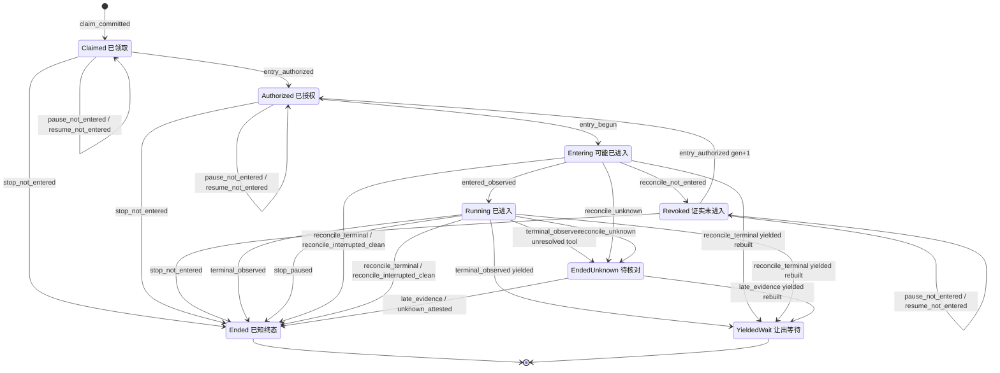

控制指针（`Run.controlState.desiredState`，与主状态正交；steer 只追加 `controlInputs`，不移动指针）：

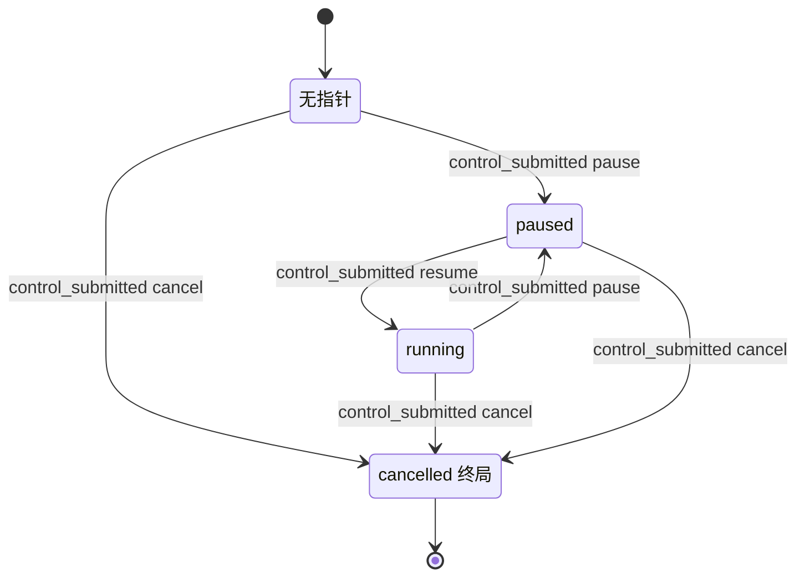

### 6.6 实现对照

状态机目标文件：`src/core/work-graph/state/run-machine.ts`，导出 `transitionRun`、`runControlFence`（由 `freshRunControlProblem` 迁入）、`isRunFinished`、`terminalOutcomeOf`（由 `terminalFact` 迁入）、`leaseOwnedByRun`。持有判定 `ownsOccupancy` 来自 `state/session-availability.ts`（§8）；指针计算 `pointerAfterSubmit` 来自 `state/control-intent-machine.ts`（§7）。Kernel Turn 的分类（not_entered、terminal、interrupted_clean、paused、unknown）和 RD-3 的 continuation 重建都需要读取 Kernel 的 RunState 和消息记录，因此留在 Runtime 的新文件 `src/core/agent-runtime/run-reconcile.ts`，不进入 `state/`。

| 行号 | 状态机函数 | 调用服务（file） | 已有测试（file） | 计划新增测试（描述） |
| --- | --- | --- | --- | --- |
| RUN-01 | `transitionRun(Absent, claim_committed)` | `claim-service.ts` `claimTask` | `tests/work-graph/R4c-task-claim.test.ts`、`R4c-task-claim-concurrency.test.ts` | 表驱动覆盖首次领取、接续领取、D-3 重入队三类守卫；Goal 非 active 时 busy |
| RUN-02、RUN-03 | `transitionRun(entry_authorized)`、`runControlFence` | `execution-entry-service.ts` `authorizeRuntimeEntry`；`execution-driver.ts` 对 revoked 改走授权 | `tests/work-graph/B2-execution-entry.test.ts:59`、`:72`、`:103`、`:127` | `Revoked`→`Authorized`：gen+1、保留 kernel、envelope/inputBinding 不变；inputDigest 不同 → invalid；非 revoked 的已有授权仍返回 busy/forbidden |
| RUN-04 | `transitionRun(entry_begun)` | `beginRuntimeEntry` | `B2-execution-entry.test.ts:142`、`:208`、`:218`、`:234` | gen>1 时槽位 owner→owner；旧 generation 的 permit 被拒；全程零 Kernel 调用 |
| RUN-05 | `transitionRun(entered_observed)` | `recordExecutionEntered` | `B2-execution-entry.test.ts:142`；`tests/work-graph/R4-control-intent.test.ts:316` | `Claimed` → forbidden；`Revoked` → busy |
| RUN-06 | `transitionRun(history_recorded)` | `execution-history-service.ts` `recordExecutionHistory` | `tests/work-graph/R4c-execution-history-index.test.ts` | 已终结的 Run 改 end → stale |
| RUN-07 | `transitionRun(terminal_observed)`、`terminalOutcomeOf`、`leaseOwnedByRun`、`ownsOccupancy` | `recordRunResult`；`execution-observation.ts` `observe` | `tests/work-graph/B2-execution-result.test.ts:24`、`:65`、`:94`、`:115`、`:132`；`tests/runtime/B2-runtime-execution.test.ts:183`、`:553` | 表驱动五种 outcome 的释放；`exitProof=null` → guard_failed；sequence 守卫；input_accepted 未确认 → unavailable |
| RUN-08 | `transitionRun(terminal_observed)` 的未结算分支 | `execution-observation.ts` 未知分支 → 扩展后的 `recordRunResult`（带 `unresolvedToolCallIds`） | `tests/runtime/R4-control-runtime.test.ts:234`（只断言占用保留） | Run ended/outcome_unknown；Attempt ended；Lease、Session 保留；Outbox 为 entered；reconciliation 记录窗口与工具 id；Task 投影 blocked（§4） |
| RUN-09..11 | `transitionRun(stop/pause/resume_not_entered)` | `control-service.ts` `submitControl`（读取与守卫集合见下） | 需要改断言的见下 | `Claimed`/`Authorized`/`Revoked` × cancel/pause/resume；cancel 后 Lease、Session 释放，authorized→revoked，queued steer → superseded；Goal 暂停时 resume → busy；与 begin 并发时一方 CAS 失败；R 来源：指针已为 cancelled/paused 且 intent 仍 queued（`Entering` 时提交、经 RUN-16 撤销后）由核对同提交落地，不新建 intent |
| RUN-12..15 | `pointerAfterSubmit` | `submitControl` | `R4-control-intent.test.ts:173`、`:183`、`:316`、`:343`；`tests/runtime/R4-control-runtime.test.ts:140`、`:349`、`:423` | D-8 同提交取代；在 `YieldedWait` 上 resume 取代 queued pause；continuation 已被消费 → busy；Goal 暂停时 resume → busy |
| RUN-16..20 | `transitionRun(reconcile_*)` | 新 `agent-runtime/run-reconcile.ts` 分类后调用：RUN-17/18 用扩展后的 `recordRunResult`（basis host_instance_takeover），RUN-16/19/20 用新 `reconcileRun`（新文件 `tasks/run-reconcile-service.ts`，与 §8.6、§15 一致）；`src/app/host.ts` 在 D-18 之后的启动阶段调用；RUN-16 的进程内变体由 driver 在 Kernel 调用退出后调用 | `tests/runtime/B2-runtime-execution.test.ts:212`、`:372`（都只在进程内） | A8 三个崩溃点 × 有/无实例租约（锁文件不可读按无租约）；探针 transient 时保持原状，missing 时为 EndedUnknown；从 `Entering` 且探针 missing：Run 与 Attempt 的 `startedAt` 为 null，Outbox 保持 pending（ATT-36/37，L-2）；yielded 重建成功/失败；同一 Turn 两条等待发信 → EndedUnknown（`continuation_unrebuildable`，L-5）；暂停中的 Run → crashed（RD-6，按 U-9 推荐选项 (a)）；断言 Kernel、provider 调用计数为 0；同一 Run 在 gen 1 与 gen 2 上各发生一次进程内 RUN-16，第二次不被当作第一次的回放 |
| RUN-21、RUN-22 | `transitionRun(late_evidence/unknown_attested)` | `recordRunResult`（RUN-21）；新 `resolveUnknownRun`（Host 人类入口，RUN-22） | — | 同一终态重新观察 → guard_failed（RD-4）；非 human → forbidden；没有实例租约 → busy（L-1）；ControlIntent 保持 outcome_unknown；只释放有持有关系的占用和 Lease；RUN-20(ii) 之后：`late_evidence` 补记 Run 与 Attempt 的 `startedAt` 与 history，Outbox 从 pending 结算且 `consumerId`/`entryGeneration` 等于授权上的值；人工认定时 `startedAt` 保持 null（L-2） |
| RUN-23 | `transitionRun(stop_paused)` | `reconcileRun(paused_stop)`：进程内由 `execution-control.ts` `deliver` 在句柄已退出且 cleanProof 成立时调用（今天在 `:184-188` 原样返回）；重启时由 `run-reconcile.ts` 调用 | — | 进程内：安全点暂停 + cancel → Ended(cancelled)，释放，cancel Applied，queued steer superseded；`resourcesClosed` 未完成 → cancel 保持 queued；重启：暂停 + queued cancel → cancelled（不是 crashed） |

**`submitControl` 的读取与守卫集合（RUN-09..15）。** 今天只经 `deps.authority.load` 读取 Run（`control-service.ts:143-158`、`:363`），只守卫 Run 与新 intent（`:421-424`）。目标如下：

- **Run 未进入时（RUN-09..11）。** 按 `readAdmissionFacts` 的方式经 `readExecution` 读取完整执行记录（`execution-entry-service.ts:309-323`：Run、Attempt、Outbox、Plan、Session、Lease），再读取 `controlInputs` 中的 steer intent。resume 时另经 `readGoalScope` 读取 Goal。
  - 守卫：Run@pin；新 intent 为 null；旧指针 intent@rev（CTL-04）；每个被取代的 steer@rev；RUN-09 另加 Attempt、Outbox、Session、Lease@读到的 revision（释放判定依赖它们）；resume 另加 Goal@rev。
- **Run 已进入或为 `YieldedWait` 时（RUN-12..15）。** 另读取 Lease，用于判定 RD-8；resume 时另读取 Goal。
  - 守卫：旧指针 intent@rev，Lease@rev，Goal@rev（resume 时）。
- 依赖从 `authority` 扩展为 `reads`（`ExecutionReadPort`）和 `records`。

**受 D-7/D-8 影响、需要改断言的已有测试。** 这些测试的夹具 Run 处于 `Claimed` 或 `Authorized`，今天断言控制为 queued。建议需要 queued 语义的用例改用 `fixture.enter()` 夹具；保留在未进入夹具上的用例改为断言 applied，并检查 RUN-09/10 的效果。

- `tests/work-graph/R4-control-intent.test.ts`：
  - `:68-109`：pause 变为 applied@2，回执回放要恢复 applied 快照（依赖 §7.1 的事件 codec 放宽）。
  - `:110-141`：pause 变为 applied；cancel 结束 Run；`:127-129` 断言 pause 仍是 queued 快照，D-7 后它是 applied（不再被取代）；`:138-140` 的 busy 原因变为 Run 已结束。
  - `:159-171`：`:170` 断言授权仍为 authorized，D-7 后变为 revoked。
  - `:364-376`：cancel 为 applied，Run 已结束。
- `tests/composition/R4-control-platform.test.ts:73-101`：cancel 为 applied，Run 已结束。

以下已有测试**不需要**改：

- `:146-157`：`freshRunControlProblem` 先于 status 判定（`execution-entry-service.ts:914-918`），busy 仍来自指针栅栏；授权由 none 保持 none。
- `:229-259`：不断言 intent 状态；pause 不撤销授权，`:257` 仍成立。


## 7. ControlIntent

ControlIntent 记录有权操作者的一次控制请求（pause、cancel、resume、steer），以及之后对它的真实观察。请求被受理不等于已经生效（CORE-DATA-OPERATIONS:379，MVP-BEHAVIOR §2 `:37`）。

**和 Run 的分工。**

- intent 只描述“这次请求的命运”。Run 的期望状态是 `Run.controlState`（指针）与 `controlInputs`，由 §6 RUN-09..15、RUN-23 在同一提交中写入。
- 观察只写 intent，从不改写 Run 指针（`control-service.ts:602-610`）。
- 本节不新增状态名。新增的只有：平台可以自行证明的观察来源（D-7、D-8、RD-7），终态之后 intent 的收尾规则，以及“迟到观察不再改写已终态 intent”的规则。

本节依赖的决定：

- 待用户确认（lead 建议均采纳）：D-7（U-7）、D-9（U-8；Goal 暂停期间不允许逐 Run 恢复）、D-18（U-5，与 D-5 一起）、§6 RD-6（U-9：暂停中的 Run 经重启记为 crashed）。
- 按 brief 列在规格头部：D-8、D-11（Query 不提供公开 pause/resume）、D-15、D-17（不做原 Turn fresh resume），以及 §6 的 RD-8。
- 已由 lead 采纳（L-8）：§6 的 RD-1（revoked 视为未进入）、RD-7（暂停中由平台停止）。

本节在 brief 之外补充的决定（同样待确认）：

- **CD-1 平台观察不得伪装成 Kernel 观察。** D-7/D-8 的 applied 和 superseded 必须带一个 observation，但今天的 `ControlObservationV1` 强制要求 Kernel 来源（entry、history、source、kernelEventId）。因此新增 `ControlPlatformObservationV1`，不填假的 Kernel 字段。
- **CD-2 `terminal_without_cancel` 与 `outcome_unknown` 可以归属任意种类。**
  - 在 Run 先到终态、控制从未生效时，pause、resume、steer 的 intent 也能离开 queued，补上 §7 #16 的缺口。
  - 被消费的 pause 遇到未知结果时，也能记录 `outcome_unknown`，修复 state-writes-other D5 路径 1：今天 codec 会拒绝，intent 永远停在 queued。
  - 名称保留以兼容；`terminal_without_cancel` 的语义是“终态先于该控制生效”。
- **CD-3 平台直接受理的 intent 写成 `∅→applied@2`。** D-7 的 intent 在同一提交中直接以 `applied` 写入。为满足 codec 规则“已观察 ⇒ revision≥2”（`control-record-codecs.ts:292-294`），记录 revision 写为 2：逻辑上经过 queued@1，事件中携带最终快照。RecordStore 不强制 `revision===expected+1`（state-writes-other §0；比较规则见 `src/core/record-store/record-codec.ts:750`）。`ControlIntentSubmitted` 事件的解码今天只接受 queued@1（`control-record-codecs.ts:380-383`），因此要按 7.1 放宽，否则所有回执回放（lookupCommit 命中、确认丢失后的恢复）都会失败。
- **CD-4 终态之后收尾所有仍 queued 的 intent，不只收尾被消费的那一个。** Run 以已知 outcome 结束后（不含 `YieldedWait`），观察者为三类 intent 写观察：被 Kernel 消费的 intent、`Run.controlState.intentRef`、`controlInputs` 中未被 Kernel 接受的 steer。崩溃导致的遗漏由启动核对 CTL-08(e) 补上。

### 7.1 持久位置与状态枚举

路径简写：`control-intent.ts`=`src/contracts/control-intent.ts`；`control-service.ts`、`control-contracts.ts` 在 `src/core/work-graph/tasks/`；`control-record-codecs.ts` 在 `src/core/work-graph/persistence/`；`execution-observation.ts`、`execution-control.ts`、`execution-driver.ts` 在 `src/core/agent-runtime/`。

| 维度 | 记录与字段（file:line） | 代码取值（原样） | 与设计名的对应 / 说明 |
| --- | --- | --- | --- |
| 状态 | `ControlIntentSnapshotV1.status`（`control-intent.ts:75-82`），校验 `control-record-codecs.ts:281-294` | `queued`：revision 恒为 1，不带 observation。`applied`/`superseded`/`outcome_unknown`：revision≥2，带 observation | 与 ORCHESTRATION §0.6“控制”行同名。界面上 pause/cancel 的 queued 显示为“停止请求中”，outcome_unknown 显示为“待核对” |
| 种类与期望 | `kind`（`:21`、`:62`）、`desiredState`（`:63`），配对校验 `control-record-codecs.ts:261-272` | pause→paused；cancel→cancelled；resume→running；steer→steered | R1–R4 |
| 观察 | `observation: ControlObservationV1`（`control-intent.ts:43-52`），校验 `control-record-codecs.ts:192-239` | kind 为 `paused`/`cancelled`/`resumed`/`steered`/`terminal_without_cancel`/`outcome_unknown`；带 entry 身份、history、source（Kernel 身份与位置）、kernelEventId 与 sequence | 只来自 Kernel 原历史。`:40-41` 的注释称“observer 尚不存在”，已过时 |
| 观察与种类的配对 | `control-record-codecs.ts:297-306` | paused→pause；resumed→resume；steered→steer；其余（cancelled、terminal_without_cancel、outcome_unknown）→cancel | 按 CD-2 放宽，见下 |
| 提交事件 | `ControlIntentSubmitted`，解码 `controlIntentSubmittedEventFromEvent`（`control-record-codecs.ts:350-393`），由 `replayControl` 使用（`control-service.ts:248-269`） | `submitted` 只含 `{intent, runRevision}`（`:375`），且 intent 必须是 queued@1（`:380-383`） | 按 CD-3 放宽，见下 |
| 不可变请求 | `ControlIntentRequestV1`（`control-intent.ts:58-67`） | ref、runRef、kind、desiredState、reason、requestedAt、requestedBy（human 或 system） | 观察只追加 status 与 observation |
| Run 侧指针 | `Run.controlState`、`Run.controlInputs`（`src/contracts/dispatch.ts:153-156`、`:189`） | 见 §6.1 | 由 §6 拥有 |

**机器视图。**

- 节点：`Absent`、`Queued`、`Applied`、`Superseded`、`OutcomeUnknown`。
- `Applied` 与 `Superseded` 是终态。`OutcomeUnknown` 只能经 `control_reconciled` 离开（D-8）。
- 对每个 Run，kind 为 pause、cancel、resume 的 intent 中，至多一个处于 `Queued`，且它就是 `Run.controlState.intentRef` 指向的那一个；`Superseded` 的 intent 永远不会被指针引用（§11 I-5）。steer 不受此限制，可以有多个 queued，它们全部在 `controlInputs` 中。

```ts
// src/core/work-graph/state/control-intent-machine.ts（目标）只 import src/contracts
type ControlNode = 'Absent' | 'Queued' | 'Applied' | 'Superseded' | 'OutcomeUnknown';
type ControlIntentState = {
  node: ControlNode; kind: ControlIntentKindV1 | null; revision: number;
  observation: ControlObservationV1 | ControlPlatformObservationV1 | null;
};
type ControlGuardContext = {
  run: { node: RunNode; pointer: 'none' | 'running' | 'paused' | 'cancelled' | 'steered';
         pointsHere: boolean; inControlInputs: boolean;
         continuationConsumed: boolean;                              // YieldedWait（§6 RD-8）
         kernelPaused: boolean;                                      // Kernel Turn 为 paused（CTL-10）
         entry: ControlEntryIdentityV1 | null;                       // 由 V2 授权与 claim generation 得到
         window: { start: number; through: number } | null };       // 已持久化的 history 窗口
  goal: { desiredState: 'active' | 'paused' | 'cancelled' };         // D-9：resume 守卫（§2）
  pointerIntent: { kind: ControlIntentKindV1; status: ControlIntentSnapshotV1['status']; observed: string | null } | null;
  pinsMatch: { intent: boolean; run: boolean };
  exitProof: 'live_clean' | 'host_instance_takeover' | null;         // CTL-10
  origin: 'live' | 'reconcile';
};
```

**新增契约（CD-1；A.2 冻结）：**

```ts
export type ControlPlatformObservationV1 = {
  schemaVersion: 1;
  origin: 'platform_not_entered' | 'platform_superseded' | 'platform_reconcile' | 'platform_paused_stop';
  kind: 'paused' | 'cancelled' | 'resumed' | 'superseded_by_newer' | 'terminal_without_cancel' | 'outcome_unknown';
  runRevision: number;                         // 同一提交写入后的 Run revision
  detail:
    | { entryPhase: 'none' | 'authorized' | 'revoked' }   // platform_not_entered（D-7）
    | { supersededBy: ControlIntentRef }                  // platform_superseded（D-8；也用于 cancel 结束 Run 时的 queued steer）
    | { hostInstanceId: string; runOutcome: RunOutcome }  // platform_reconcile（重启时没有对应的 Kernel 事件）
    | { basis: 'live_clean' | 'host_instance_takeover'; pausedBy: ControlIntentRef | null }; // platform_paused_stop（§6 RD-7）
  observedAt: string;
};
// ControlIntentSnapshotV1 的非 queued 分支：observation: ControlObservationV1 | ControlPlatformObservationV1
```

对应的 codec 与服务改造：

- `controlObservationProblem`（`control-record-codecs.ts:192-239`）按是否有 `origin` 键分派到两种变体。
- 配对规则（`:297-306`）改为：
  - `paused`→pause；`resumed`→resume；`steered`→steer；`cancelled`→cancel（Kernel 来源与平台来源都一样）；
  - `superseded_by_newer`→任意种类（steer 用于 cancel 结束 Run 时，CTL-04(b)）；
  - `terminal_without_cancel`→任意种类（CD-2）；
  - `outcome_unknown`→任意种类（CD-2；Kernel 来源与 platform_reconcile 都适用）。
- `controlIntentSubmittedEventFromEvent`（`:350-393`）中 `:380-383` 改为：`submitted.intent` 可以是 queued@1，也可以是 applied@2 且 observation 为 `origin:'platform_not_entered'`（CTL-02）。事件仍只携带 `{intent, runRevision}`（`:375`），不携带被同提交取代的旧 intent（CTL-04）。
- `observationStatusFor`（`control-service.ts:217-221`）：`superseded_by_newer` 与 `terminal_without_cancel` → superseded；`outcome_unknown` → outcome_unknown；其余 → applied。

### 7.2 事件

| 事件名 | 来源 | 载荷要点 | 对应原文编号 |
| --- | --- | --- | --- |
| `control_submitted` | U（Host 人类或系统策略；G7 的 Goal 扇出也走这里） | `runRef`、`kind`、`reason`、`requestedBy`、Run 版本钉、requestId | R1–R4、G7 |
| `control_applied_not_entered` | P（与 `control_submitted` 同一提交；重启时也可由 R 触发） | 提交时 Run 的 entry 阶段（none、authorized 或 revoked）、写入后的 Run revision | R1“排队项可直接暂停”、R2、R3、D-7 |
| `control_superseded_by_newer` | P（与取代者同一提交） | 取代者的 `intentRef`（新 intent，或结束 Run 的 cancel intent）、写入后的 Run revision；被取代的是旧指针 intent，或 cancel 结束 Run 时的 queued steer | D-8、A7、R4“过期 ack 不能覆盖较新指令” |
| `control_observed` | K（进程内可信 Runtime 观察者） | `ControlObservationV1`（entry 身份、history、source.position、kernelEventId 与 sequence）；intent 与 Run 两个版本钉 | R1–R5、A7 |
| `control_applied_paused_stop` | P（与 §6 RUN-23 同一提交） | cancel 的 `intentRef`、证明来源（live_clean 或 host_instance_takeover）、此前生效的 pause intent | R2、G7、D-15、RD-7 |
| `control_reconciled` | R（启动核对）；K/R（与 §6 RUN-21 同提交） | Kernel 原历史中对应的控制或终态证据；没有证据时给出平台结论（platform_reconcile，kind 为 terminal_without_cancel 或 outcome_unknown）；`hostInstanceId`；目标状态 | S8、A8、D-8 |

### 7.3 迁移表

| # | from | event | guard（守卫） | to | effects（同事务副作用意图） | 幂等/重复事件 | 原文编号 | 现状 |
| --- | --- | --- | --- | --- | --- | --- | --- | --- |
| CTL-01 | `Absent` | `control_submitted` | Run 接受控制：未终结，或为 continuation 尚未被消费的 `YieldedWait`（§6 RD-8）；输入合法（steer 有正文）；resume 规则成立；kind=resume 时 Goal desiredState=active（D-9，§2）；`controlSubmitProblem` 通过；Run 版本钉等于当前值（不等时先按身份重查回执，再返回 revision_conflict）；不属于 CTL-02 的情形 | `Queued`@1 | 同提交写 Run 指针或 `controlInputs`（§6 RUN-12..15）；旧的 queued 指针 intent 走 CTL-04 | lookupCommit 回放原回执；同身份不同内容 → idempotency_conflict；两次 lookup 都未命中但并发同身份已提交时，恢复原回执（`control-service.ts:370-383`） | R1–R4、G7 | 已有 `control-service.ts:358-432`；改造 `:384-399`（Goal 守卫与 RD-8 守卫，需要读取 Goal 与 Lease） |
| CTL-02 | `Absent` | `control_submitted` 加 `control_applied_not_entered` | kind 为 pause、cancel 或 resume；Run 为 starting，entry 为 none、authorized 或 revoked；resume 时要求指针 intent 是 applied pause，且 Goal desiredState=active | `Applied`@2，观察来源 platform_not_entered，kind 为 paused/cancelled/resumed | 同提交执行 §6 RUN-09/10/11；旧的 queued 指针 intent 走 CTL-04(a)；cancel 时 queued steer 走 CTL-04(b) | 同 CTL-01；`ControlIntentSubmitted` 事件携带 applied@2 快照，回放时原样恢复 | R1、R2、R3、D-7、CD-3 | 新增；改造 `control-record-codecs.ts:380-383`（今天回放只接受 queued@1） |
| CTL-03 | `Queued` | `control_observed` | intent 与 Run 的 revision 等于版本钉；V2 entry 身份一致；history 与 locator 一致，source 在已持久窗口内；Run 指针仍指向本 intent（steer 为仍在 `controlInputs` 中） | 按观察映射表：`Applied`、`Superseded` 或 `OutcomeUnknown` | 只写 intent；Run 只作 CAS 守卫，指针不变 | 同身份回放；提交结果未知时按回执恢复（`control-service.ts:616-627`） | R1–R5、A7 | 已有 `control-service.ts:520-612`，映射 `:217-221`；改造 `control-record-codecs.ts:297-306`（被消费的 pause 记 outcome_unknown 不再被拒，CD-2） |
| CTL-04 | `Queued` | `control_superseded_by_newer` | 满足以下之一：(a) 新 intent 在同一提交中写入，本 intent 是被移动前的指针 intent，且仍是 queued；(b) 本 intent 是 `controlInputs` 中仍 queued 的 steer，且同一提交中有 cancel 结束了 Run（§6 RUN-09 的 U/R 两种来源、RUN-23）；该 cancel 可以是新写入的（CTL-02），也可以是由 Queued 变为 Applied 的既有 intent（CTL-08(a)、CTL-10） | `Superseded`（revision+1，观察来源 platform_superseded，`supersededBy` 为 (a) 的新 intent 或 (b) 的 cancel intent） | 无其他效果；加本 intent 的 CAS 守卫 | 随新 intent 的提交回放：回执只含新 intent（事件形状不变，`control-record-codecs.ts:375`），被取代 intent 的状态从其记录读取 | D-8、A7、R4 | 新增（今天保持 queued，`R4-control-intent.test.ts:127-129` 断言的正是这一点） |
| CTL-05 | `Queued`（D-8 之前遗留的数据） | `control_observed` | 指针已不再指向本 intent（steer 为已不在 `controlInputs` 中） | `Superseded`，保留真实观察 | 无 | 同 CTL-03 | A7 | 已有 `control-service.ts:577-579`（保留以兼容旧的 queued 记录） |
| CTL-06 | `Queued`（任意 kind） | `control_observed`，kind=terminal_without_cancel | Run 以已知 outcome 结束：是 `Ended`，不是 `YieldedWait`（等待中的 intent 保持为围栏，见 7.3 情形 6），也不是 `EndedUnknown`（走 outcome_unknown）；Kernel 原历史显示该控制未生效就到了终态。观察者在终态提交后（或在 `alreadyEnded` 路径且 cleanProof 成立时）写观察，对象是被消费的 intent、仍 queued 的 `Run.controlState.intentRef`、未被 Kernel 接受的 queued steer；source 为终态记录的位置 | `Superseded` | 无 | 同 CTL-03 | R5、CD-2、CD-4 | 改造 `execution-observation.ts:609-624`、`:693-703`（今天只对被消费的 cancel 计算终态 ack，`:615-616`、`:695-696`）；改造 `control-record-codecs.ts:304-305` |
| CTL-07 | `OutcomeUnknown` | `control_reconciled` | 与 §6 RUN-21 同提交；新的 Kernel 证据中有该 intent 对应的控制事件（按观察映射表 → `Applied`），或者终态先于该控制生效（terminal_without_cancel → `Superseded`）；适用于任意 kind | `Applied` 或 `Superseded` | 无（Run 的变化在 RUN-21 中） | 随 RUN-21 的回执回放 | D-8、R5 | 新增 |
| CTL-08 | `Queued` | `control_reconciled` | 启动核对，且 `hostLease=owned`。按核对后的 Run 节点分为：<br>(a) Run 未进入（`Claimed`、`Authorized`、`Revoked`），且 kind 为 pause、cancel 或 resume → `Applied`，观察来源 platform_not_entered，同提交执行 RUN-09/10/11（resume 另需 Goal active，否则保持 queued）；<br>(b) Run 在本次核对中结束为已知终态（RUN-17/18/19，非 yielded），Kernel 历史中有对应的控制事件 → 按观察映射表处理；<br>(c) 同 (b)，但 Kernel 历史中没有对应事件 → `Superseded`（platform_reconcile，terminal_without_cancel）；<br>(d) Run 为 `EndedUnknown`（本次 RUN-20，或此前的 RUN-08），任意 kind → `OutcomeUnknown`（platform_reconcile，kind outcome_unknown）；<br>(e) Run 此前已经是 `Ended`（不含 `YieldedWait`），intent 仍 queued（终态之后的 ack 因崩溃遗漏）→ 同 (b)/(c)。<br>不处理：`YieldedWait`（围栏），以及 Kernel 暂停时的 queued cancel（走 CTL-10） | 见守卫 | 随 §6 RUN-09/10/16..20 同提交；(e) 单独提交，以 Run 为 CAS 守卫 | 核对身份 = hash(runRef, intentRef, hostInstanceId) | S8、A8、D-8 | 新增 |
| CTL-09 | `Applied`/`Superseded` | `control_observed`，内容相同（kind、source.position、kernelEventId 都相同） | intent 已是终态 | 不变 | 不写 | duplicate：返回已存的快照，`replayed=true` | D-8 | 改造 `control-service.ts:520-588`：在服务层新增状态守卫。今天服务不检查 status，带当前版本钉的新 requestId 会重写 intent。Runtime 观察者已经跳过非 queued 的 intent（`execution-observation.ts:305`、`:345-349`），所以这里只是服务级守卫 |
| CTL-10 | `Queued`（cancel，指针指向它） | `control_applied_paused_stop` | 与 §6 RUN-23 同提交：Kernel Turn 为 paused，`exitProof≠null`，没有在途工具 | `Applied`（revision+1，观察来源 platform_paused_stop，kind cancelled） | Run 的变化在 RUN-23 中；queued steer 走 CTL-04(b) | 随 RUN-23 的回执回放 | R2、G7、D-15、RD-7 | 新增（今天该 cancel 永远 queued：`execution-control.ts:184-188`） |

**观察映射（`observationStatusFor` 加上指针条件）**

| 观察 kind | 可能的来源 | 指针仍指向本 intent | 本 intent 已被取代 / 已终态 |
| --- | --- | --- | --- |
| `paused` | K：安全点 ack，需要 cleanProof（`execution-observation.ts:565-569`）；P：platform_not_entered | `Applied` | stale（CTL-09 的同内容情形除外） |
| `cancelled` | K：Kernel `run.cancelled`，且是该 intent 引起的（`:693-703`）；P：platform_not_entered、platform_paused_stop | `Applied` | 同上 |
| `resumed` | K：同一 Turn 重入后被确认（`:564`、`:684`）；P | `Applied` | 同上 |
| `steered` | K：输入被 Kernel 接受 | `Applied`（steer 用 `controlInputs` 判定） | 同上 |
| `terminal_without_cancel` | K：终态先到（CTL-06）；R：platform_reconcile | `Superseded` | 同上 |
| `outcome_unknown` | K：cleanProof 下 Kernel 终态含未知工具（`:588-592`，任意 kind）；R：platform_reconcile（CTL-08(d)） | `OutcomeUnknown` | 同上 |
| `superseded_by_newer` | P：platform_superseded | — | 只出现在 CTL-04 |

**迟到 ack（A7、B08“迟到旧 ack 不覆盖较新控制”）**

- 观察从不写 Run（`control-service.ts:602-610`），所以任何迟到 ack 都不会改变指针或 Run 状态。
- 对已经 `Superseded` 或 `Applied` 的 intent，内容不同的迟到观察返回 stale（`revision_conflict`），intent 记录不变。这个事实本身仍保存在 Kernel 原历史中，历史视图可以读到（D-8 所说的“只作为历史”）。
- 观察者遇到 stale 时视为结束，不重试。今天的观察者在冲突时只用刷新后的版本钉重试一次（`execution-observation.ts:368-374`）。
- 并发竞争：CTL-04 给旧 intent 加 CAS 守卫。
  - 若观察（CTL-03）先提交：新提交收到 revision_conflict，按原请求重试时旧 intent 已是终态，因此不需要再取代。
  - 若新提交先提交：观察的 CAS 失败；观察者重读后发现 intent 是 `Superseded`，得到 stale。

**不支持或不投递的情形（如实报告，不伪造生效）**

1. **QueryRun 的控制。** ControlIntent 只接受 `RunRef`（`control-service.ts:96`），Query 的停止走 QueryJob close（work-graph.md:604）。今天对 QueryRunRef 返回 invalid；pause/resume 没有公开入口（D-11）；能力上报写明这一点（7.7）。
2. **`steered` 指针。** 没有写入者；如果读到，fresh 动作返回 unsupported（`src/core/work-graph/tasks/execution-entry-service.ts:157-158`）。
3. **已在安全点暂停的 entered Run 上的 cancel。** Kernel 已经退出，handle 不再 live，`deliver` 无处投递，原样返回 queued（`execution-control.ts:184`、`:188`）。
   - 目标：由 §6 RUN-23 与 CTL-10 收尾。进程内只要句柄的 cleanProof 成立，`deliver` 就改为调用 `reconcileRun(paused_stop)`，Run 结束为 `cancelled`，cancel 记为 Applied。重启后由启动核对以实例租约作证明，做同样处理。
   - 剩余情形：`resourcesClosed` 尚未完成或失败时，cancel 保持 queued，直到证明完成或下次启动核对。这期间界面显示“停止请求中”。
4. **重启后对已进入 Run 的 pause/resume**（原 Turn 的 fresh resume）。属于 D-17 范围外。启动核对会先把 Run 收尾（RUN-17..20、RUN-23；暂停中的 Run 按 §6 RD-6 记为 crashed，RD-6 属 U-9，待用户确认，lead 建议采纳），之后再 submit 返回 busy（Run 已终结）。
5. **Runtime 没有接控制**（`deps.controls` 未注入）。`deliver` 返回 unsupported（`execution-control.ts:165`）。组合根总会注入（`src/composition/create-platform.ts:402`）。
6. **`YieldedWait` 上的控制。** 没有 Kernel 可以观察，intent 保持 queued，作为接续领取的持久围栏（`src/core/work-graph/tasks/claim-service.ts:606-611`；`src/app/collaboration-driver.ts:668-673`）。核对不处理这类 intent。continuation 被继任 Run 消费后不再受理新控制（§6 RD-8）。两项待用户决定：
   - **Q-CTL-1：** 是否像 D-7 一样把它们改为平台 applied（例如来源 `platform_yielded_wait`），免得界面一直显示“停止请求中”。
   - **Q-CTL-2（由 §4 TD-5 处理；TD-5 属 U-1，待用户确认，lead 建议采纳；未确认前保持今日投影 `ready`、领取仍 `busy`）：** cancel 落在 `YieldedWait` 上之后，今天 Task 投影仍是 ready（§4 P5）但无法领取（`claim-service.ts:608-611`）。§4 已新增投影：指针为 cancelled 时为 `failed/continuation_cancelled`（P17），TASK-16 接受这种 Run 重入队；指针为 paused 时为 `blocked/continuation_paused`（P18），经 RUN-14 resume 回到 `ready`（TASK-21、22、23）。Q-CTL-1 的选择不影响投影。

### 7.4 明确禁止的迁移

| from | event / 目标 | 拒绝原因 | 对外 CoreError | 说明 |
| --- | --- | --- | --- | --- |
| `Absent` | 对已终结且不是 `YieldedWait` 的 Run 提交 `control_submitted` | illegal | busy | `control-service.ts:389-391` |
| `Absent` | 对 continuation 已被继任 Run 消费的 `YieldedWait` 提交控制 | guard_failed | busy | §6 RD-8；holder 已换（`claim-service.ts:614-618`） |
| `Absent` | resume，Goal desiredState≠active | guard_failed | busy | D-9（§2）：Goal 暂停期间不允许单个 Run 恢复；Goal 自身的 resume 扇出在 Goal 回到 active 之后才提交 |
| `Absent` | resume，但没有指针 | guard_failed | busy | `:127` |
| `Absent` | resume，但指针不是 paused | guard_failed | busy | `:136-137` |
| `Absent` | resume（Run 为 `Running`），但 pause 未 applied 或观察不是 paused | guard_failed | busy | `:393-397` |
| `Absent` | 任意 kind，但指针已是 cancelled | guard_failed | busy | `:128-129`；cancel 是终局 |
| `Absent` | pause，但指针已是 paused | guard_failed | busy | `:131-132` |
| `Absent` | steer 没有正文 | guard_failed | invalid | `:392` |
| `Absent` | Run 版本钉过期 | stale | revision_conflict | `:381-382`；先按身份重查原回执 |
| `Absent` | 同 requestId 不同内容 | duplicate | idempotency_conflict | `tests/work-graph/R4-control-intent.test.ts:133-135` |
| `Absent` | 对 QueryRunRef 提交控制 | illegal | invalid | `:96`；Query 走 QueryJob close |
| `Absent` | 对 `Entering`/`Running` 走 `control_applied_not_entered` | illegal | invalid（内部断言；submit 改为 CTL-01 的 queued） | D-7：从 entering 起必须由 Kernel 观察、RUN-23 或核对 |
| `Queued` | `control_observed`，entry 身份不符 | guard_failed | forbidden | `:544-548` |
| `Queued` | `control_observed`，source 或窗口超出已持久的 locator | guard_failed | unavailable | `:566-573` |
| `Queued` | `control_observed`，intent 或 Run 的 revision 不等于版本钉 | stale | revision_conflict | `:525-528`、`:536-539` |
| `Queued` | 观察 kind 与 intent kind 不配对 | illegal | invalid | `control-record-codecs.ts:297-306`（按 CD-2 放宽后的规则；例如 `paused` 落在 cancel 上） |
| `Queued`（cancel） | `control_applied_paused_stop`，但 `exitProof=null`、Kernel 不是 paused，或有在途工具 | guard_failed | incomplete | 保持 queued，等待证明完成或启动核对（§6 RUN-23） |
| `Applied`/`Superseded` | `control_observed`，内容不同 | stale | revision_conflict | D-8；迟到 ack 只留在 Kernel 原历史中，不改指针 |
| `Applied`/`Superseded`/`OutcomeUnknown` | `control_superseded_by_newer` | illegal | invalid（内部断言，不对外） | 只有 queued 能被取代；服务不会选中这些节点 |
| `OutcomeUnknown` | `control_observed`（进程内） | stale | revision_conflict | D-8：只有 `control_reconciled` 能让它离开 |
| `Applied`/`Superseded` | `control_reconciled` | illegal | invalid（内部断言；核对时跳过） | 已是终态 |
| 任意 | 用观察改写 `Run.controlState` | illegal | invalid（内部断言，不对外） | 观察只写 intent（`control-service.ts:602-610`） |
| 任意 | queued@1 带 observation，或已观察但 revision<2 | illegal | invalid | `control-record-codecs.ts:282-294` |

### 7.5 状态图

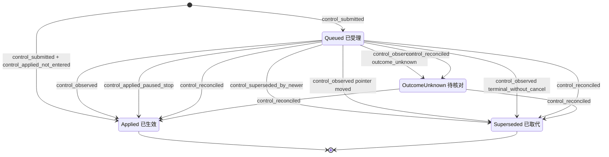

### 7.6 实现对照

状态机目标文件：`src/core/work-graph/state/control-intent-machine.ts`，导出 `transitionControlIntent`、`controlSubmitProblem`（由 `freshSubmitControlProblem` 迁入）、`observationStatusFor`（由 `control-service.ts:217-221` 迁入）、`pointerAfterSubmit`（§6 RUN-12..15 使用）。

| 行号 | 状态机函数 | 调用服务（file） | 已有测试（file） | 计划新增测试（描述） |
| --- | --- | --- | --- | --- |
| CTL-01 | `transitionControlIntent(Absent, control_submitted)`、`controlSubmitProblem` | `control-service.ts` `submitControl` | `tests/work-graph/R4-control-intent.test.ts:404`、`:431`、`:492`；`tests/runtime/R4-control-runtime.test.ts:140`、`:349` | 纯函数表：指针 4 种 × kind 4 种 × Run 节点；Goal 暂停时 resume → busy；continuation 已被消费 → busy |
| CTL-02 | 同上，加 `control_applied_not_entered` | `submitControl`（同提交执行 §6 RUN-09..11）；`controlIntentSubmittedEventFromEvent` | 需要改断言：`R4-control-intent.test.ts:68`、`:110`、`:159`、`:364`；`tests/composition/R4-control-platform.test.ts:73`（见 §6.6）。仍成立：`:146`、`:229`、`:244` | applied@2 能编码、解码、回放（包括 lookupCommit 命中和确认丢失后的恢复）；平台观察的 codec；与 begin 并发时 CAS |
| CTL-03 | `transitionControlIntent(Queued, control_observed)`、`observationStatusFor` | `recordControlObservation`；`execution-observation.ts` `recordControlAck` | `tests/runtime/R4-control-runtime.test.ts:140`、`:234`、`:423`；`tests/composition/R4-control-runtime-platform.test.ts:121` | 被消费的 pause 遇到未知结果 → `OutcomeUnknown`（今天 codec 拒绝） |
| CTL-04 | `control_superseded_by_newer` | `submitControl`；§6 RUN-09、RUN-23 | `R4-control-intent.test.ts:110`（`:127-129` 需改） | pause→cancel、resume→pause/cancel、YieldedWait 上 pause→resume 时同提交取代；未进入 cancel 时 queued steer 被取代；观察先提交与提交先提交两种竞争顺序 |
| CTL-05 | `control_observed`（指针已移动） | `recordControlObservation` | — | 旧数据中 queued 但指针已移走的 intent → superseded，并保留真实观察 |
| CTL-06 | `control_observed(terminal_without_cancel)` | `execution-observation.ts:609-624`、`:693-703`；codec | — | Run 自然完成时，仍 queued 的指针 pause、未被接受的 steer、被消费的 pause 都 → superseded；yielded 终态时保持 queued |
| CTL-07、CTL-08 | `transitionControlIntent(*, control_reconciled)` | 启动核对（`agent-runtime/run-reconcile.ts`，§6.6）：与 `recordRunResult`/`reconcileRun` 同提交；(e) 单独提交 | — | 启动核对 × Run 节点 × 有/无对应 Kernel 事件；遗留 queued cancel 落在 `Claimed` 上 → Run 变为 cancelled；`EndedUnknown` 上的 pause/steer → OutcomeUnknown；已 `Ended` 的遗留 queued intent → superseded；另一个 Host 持有实例租约时不核对，intent 全部保持原状（L-10，§12 A8-L2） |
| CTL-09 | duplicate 判定 | `recordControlObservation` | — | 同内容、新身份 → `replayed=true`，不写；内容不同 → revision_conflict |
| CTL-10 | `control_applied_paused_stop` | `reconcileRun(paused_stop)`（§6 RUN-23） | — | 暂停后 cancel：进程内 cleanProof 成立 → Applied；不成立 → 保持 queued；重启后同样 → Applied |

### 7.7 Runtime 能力上报（D-15）

能力按工作区在 `RuntimeCapabilities` 中以 `{supported, reason}` 上报（`src/core/agent-runtime/contracts.ts:3-10`）。

- 组合根 `src/composition/create-platform.ts:553-569` 覆盖 Runtime 的默认实现；默认实现的 `capabilities` 返回 unsupported（`src/core/agent-runtime/runtime.ts:42-44`）。
- 服务端没有任何行为受这些标志门控（state-writes-other §8）。
- 界面 `src/ui/views.ts:724-734` 展示这些标志，但只在 unsupported 时显示 reason（`:733-734`）。

| 能力 | 今天上报（`create-platform.ts:561-567`） | 今天的实际能力 | 目标上报 | 目标 reason 必须写明的边界 |
| --- | --- | --- | --- | --- |
| `createSession` | supported | 与上报一致（`session-operations.ts:549-690`） | supported（不变） | 持久创建与 Kernel 映射 |
| `readHistory` | supported | 与上报一致 | supported（不变） | 原始 Kernel 历史只读 |
| `continueHistory` | unsupported（`pending`） | 已有，且只在进程内：同一 Session 的新 Run 读 `session_history`（`execution-driver.ts:456-458`）；yield 后的接续领取（`claim-service.ts:590-638`） | supported | 指“同 Session 新 Run 接续、yielded 后继 Run”；不是原 Turn 的恢复；重启后由 §6 RD-3 重建 continuation（lead 决定 L-5：只在该 Turn 恰有一个等待中的发信时重建），重建不出或有多个等待发信时记为待核对（§6 RUN-20(iii)） |
| `recoverRun` | unsupported | 不存在：没有启动核对，终态写入受内存证明门约束（`execution-observation.ts:671-673`） | supported，并在 reason 中限定（D-15） | “只做启动核对（D-5/D-6）：已结束的补账、未进入的撤销授权、未知的保留（人工认定也须持实例租约，L-1）、暂停中的记为 crashed（RD-6，U-9 待用户确认）；不做原 Turn 的 fresh resume（D-17）；另一个 Host 持有实例租约时不核对、不启动执行驱动，普通读取与 owner 写入照常（L-10）” |
| `safePointPause` | unsupported | 进程内已进入的 Work Run 已有：`before_model` 与工具组屏障（`execution-driver.ts:589-590`、`:674-677`），ack 需要 cleanProof（`execution-observation.ts:565-569`）。未进入的 Run 今天只建围栏、不落地 | supported | 已进入的 Work Run 经活句柄在安全点暂停；未进入的 Run 由平台直接暂停（D-7）；重启后暂停不保留，由启动核对收尾（RD-6，U-9 待用户确认）；Query 不支持（D-11） |
| `cancel` | unsupported | 进程内已进入的 Work Run 已有（`execution-control.ts:189-197`、`:289-300`；`execution-observation.ts:693-703`）。未进入的 Run 今天不落地（§7 #15）；已在安全点暂停的 Run 今天无法投递（7.3 情形 3） | supported | 活句柄取消；未进入时平台取消（D-7）；已在安全点暂停时，凭退出证明由平台停止（RD-7）；证明未完成前保持“停止请求中”；YieldedWait 上的取消只作为接续围栏；Query 走 QueryJob close |
| `nativeCompact` | unsupported | 与上报一致，没有代码路径 | unsupported（不变） | 未实现 |
| `scopedWorkspaceWrites` | unsupported | 不确定：Host 侧只检查 manifest 的 writeScope 是子集（`create-platform.ts:176-179`），Kernel 是否强制子路径未核实 | unsupported（不变） | 未核实 Kernel 强制 |

需要同步改造：

1. 按上表修改 `create-platform.ts:561-567`。不要再用一个共用的 `pending` 常量，每项单独写 reason。
2. `src/ui/views.ts:733-734` 对 supported 的项也要显示 reason。否则 `recoverRun` 的“只做核对”限制会被隐藏为“可用”（MVP-BEHAVIOR §2 `:37`：受理、作用范围与实际效果要分开显示）。
3. `tests/composition/R3c-R4b-platform.test.ts:162-165` 断言 `continueHistory: { supported: false }`，需要一起修改。
4. 能力只是工作区级声明，单个 Run 的实际结果仍以 ControlIntent 的状态与观察为准（MVP-BEHAVIOR B08：逐个 Run 显示 unsupported 或 unknown）。


## 8. Session（lifecycle × health × occupancy → availability）

Session 没有单一状态枚举。它有三个独立持久维度，再从三者派生出只读的 `availability`（ORCHESTRATION §2 Session 行、§0.6“状态依据”）。本节只把现有协议转写成可执行表，不改名，也不新增持久字段（Query 收束新增的 outcome/closeReason 取值见 SD-4）。今天多个服务分别写 Session 字段，写入点见 8.1 的写入点表。目标是把占用、释放、generation 和持有判定收拢到 `src/core/work-graph/state/session-availability.ts`（D-10），由 claim、执行入口、Query 执行、生命周期和 reconcile 共用。

Query 只在崩溃恢复和 Session 释放范围内进入本规格（D-11），没有单独一节。因此本节另含一个 **QueryRun 收束子机** `transitionQueryRunRecovery`：状态见 8.1 末，事件见 8.2，迁移见 8.3 的 QRR 表，禁止项见 8.4，状态图见 8.5，实现对照见 8.6。

本节依赖的待确认决定：D-4（`outcome_unknown` 保留占用，U-4）、D-5/D-6（重启证明，U-5、U-6）、D-7（未进入停止，U-7）、D-10、D-11（Query 恢复）、D-17（fresh resume 不做）、D-18（Host 实例租约，属 U-5）。另依赖 §6 的 RD-1（D-7 也适用于 `Revoked`）和 RD-7（安全点暂停中的已进入 Run 可由平台停止），两者已由 lead 采纳（L-8）；以及 §6 的 RD-3（重启时 Kernel 终态为 yielded：由持久事实重建 continuation 后按原结果入账；只在本 Turn 恰好一条等待发信时重建，否则按 RUN-20(iii) 记为未知，lead 决定 L-5）。lead 决定 L-1（人工认定要求实例租约）和 L-10（租约被另一个存活的 Host 持有时不核对、不启动执行驱动）直接约束本节。

本节在 brief 之外补充的决定（SD-1、SD-2 已由 lead 采纳（L-8）；SD-3..SD-5 仍待确认，其中 SD-3 从 `Entering` 结束时的记录形状已由 lead 决定 L-2 定稿）：

- **SD-1 空迁移返回 `ok:true`。** 三种情况今天都不拒绝调用方：释放者不是当前持有者、占用已为空、health 同值观察。持有者的其他记录照常提交，只是不写 Session。为保持这一行为，`transitionSession` 对这三种情况返回 `{ok:true, next:state, effects:[]}`（SES-17..19）。brief §1 规定 `ok:false` 必须带 CoreError，会让整个提交失败，因此这里偏离 brief 的形状。**已由 lead 采纳（L-8）**：空迁移按幂等空操作返回 `ok:true`、`effects:[]`，是允许的形状（§1.1）。
- **SD-2 只有确定性的数据状态才写 `unavailable`。** 探针结论分六类（8.2）：`missing`、`damaged` 写 unavailable；`host_config`、`transient`、`cancelled` 不观察，由 Host 报告。这是对 D-10 “映射不可读或缺失 → unavailable”的收窄。依据是 ORCHESTRATION §2 Session 行“进程不存在不等于不可恢复”（`docs/refactor/ORCHESTRATION-STATE-MACHINES.md:271`）。**已由 lead 采纳（L-8）。**
- **SD-3 Kernel 数据确定性不可读时，已 begin 的执行记为未知。** 条件：探针结论为 `missing` 或 `damaged`，且 Run 的 auth 为 `entering`/`entered`，或 QueryRun 的 phase 为 `entering`/`entered`。
  - Run 侧由 §6 RUN-20 的情形 (ii) 承担：from `Entering`/`Running`；event `reconcile_unknown`（`result={kind:'unknown', reason:'kernel_unreadable:<结论码>', unresolvedToolCallIds:[]}`，`basis=host_instance_takeover`）；guard 为 `hostLease=owned` 且探针结论为 `missing`/`damaged`；to `EndedUnknown`（auth unknown）；effects 为 `attempt:attempt_ended(outcome_unknown)`（从 `Entering` 来时 Attempt 由 claimed 直接结束，不补记进入事实，因为没有 Kernel 历史）、Outbox 保持原值、`record_reconciliation(quarantined/unresolved)`、`kernelSource` 与 `history` 为 null、不释放、`lastEventSeq` 不变。从 `Entering` 来时按 lead 决定 L-2：Attempt 走 §5 ATT-36（claimed → ended(outcome_unknown)，`startedAt=null`），Outbox 走 ATT-37（Run 为 ended+outcome_unknown 期间保持 `pending`）；离开未知时 ATT-29 可用 entering 授权的 consumerId/entryGeneration 从 `pending` 直接 settle。这是 §11 I-6 和 §5.1 配对表中写明的例外。
  - 没有这条出口，已 begin 的 Run 会永远停在 `Entering`/`Running`，Session 永久占用，SES-07 不可达。§6 6.3 表外说明已收窄为“探针结论为 `host_config`/`transient`/`cancelled` 时不迁移”。
  - QueryRun 走 QRR-05，本节自有。
  - 出口：之后某次启动 Kernel 可读并出现终态时，经 `late_evidence`（RUN-21，SES-06；从 `Entering` 来的 Run 此时按 Kernel 证据补记进入事实和 `startedAt`，L-2）或 QRR-03 离开；否则在持实例租约的 Host 上经人工认定（SES-07、SES-10，L-1）。
- **SD-4 Query 的 D-5/D-6/D-4 类比（D-11 细化）。**
  - (a) `entering` 且 Kernel 中没有固定 Turn：收束为 closed，不重新进入。Query 的 entry generation 固定为 1（`src/contracts/query-job.ts:383`），begin 只接受 `prepared`（`query-execution.ts:1000-1005`）。
  - (b) 有 Turn、没有可入账的终态、没有在途工具：收束为 closed，outcome 为 `failed`。
  - (c) 有在途工具：phase 记为 `unknown`，占用保留。
  - (d) `unknown` 的人工出口沿用 `resolveUnknownRun`，扩展为接受 QueryRunRef；与 Run 一样只在持实例租约的 Host 上受理（L-1）。
  - (e) Kernel 状态无法映射为 Query 终态时（`mapOutcome` 返回 null：`created`、`running`、`paused`、`yielded`，见 `query-observation.ts:123-131`），按“没有可入账的终态”处理：全部工具有结果走 (b)，否则走 (c)。
  - 取值：未进入使用新增值 `not_entered`（`QueryRunV1.outcome`，`query-job.ts:72`；`QueryJobV1.closeReason.code`，`:294`）；(b)(d) 使用已有值 `failed`。
- **SD-5 无 Kernel 终态来源的释放（覆盖 `docs/refactor/modules/core/work-graph.md:590` 末句）。** 该句规定“实际进入后的terminal缺来源不能据此释放未知占用”。本节以下几行在实际进入后、没有可入账的 Kernel 终态来源时释放占用：
  - SES-06 的 `reconcile_interrupted_clean`（RUN-19）；依据是 D-6（实例租约接管，加上全部工具有确定结果）。
  - SES-06 的 `stop_paused`（RUN-23）；依据是 §6 RD-7（活句柄退出证明或实例租约接管，Kernel Turn 为 paused，没有在途工具）。
  - SES-09 的 QRR-04；依据是 SD-4(b)。
  - SES-07、SES-10；依据是 D-4(b) 人工认定（只在持实例租约的 Host 上，L-1）。

  这些决定确认后，`work-graph.md:590` 末句要同步改为“……除非有 D-6 的接管证明且没有在途工具，或有 D-4(b) 的人工认定”，列入待同步文档。D-7 和 QRR-01/02 属于未进入，不受该句约束。

### 8.1 持久位置与状态枚举

| 维度 | 记录与字段（file:line） | 代码取值 | 与设计名的对应 |
| --- | --- | --- | --- |
| lifecycle | `SessionRecord.lifecycle`（`src/contracts/core/session.ts:10`），`archivedAt`（`:14`） | `'active' \| 'archived'` | 同名（S6/S7） |
| health | `SessionRecord.health`（`session.ts:10`） | `'available' \| 'recoverable' \| 'unavailable'` | 同名。今天只在创建时写 `available`（`session-directory.ts:915`） |
| occupancy | `SessionRecord.occupancy`（`session.ts:4-6`、`:12`） | `null`、`{kind:'execution', executionRef: RunRef\|QueryRunRef, generation}`、`{kind:'maintenance', operationRef, generation}` | 同名。`maintenance` 没有写入者 |
| 随占用维护 | `revision`、`lastExecutionRef`、`historyCursor`（`session.ts:8`、`:12-14`） | — | 占用和释放时一起写 |
| 派生（不持久） | `SessionCard.availability`（`src/core/work-graph/sessions/contracts.ts:46`），归约函数 `availabilityOf`（`session-directory.ts:1027-1032`） | `'idle' \| 'busy' \| 'recoverable' \| 'unavailable'` | 设计 §2 的 availability。不可写 |

状态机输入与守卫上下文：

```ts
// src/core/work-graph/state/session-availability.ts（目标）只 import src/contracts
type SessionMachineState = 'absent' | {
  lifecycle: 'active' | 'archived';
  health: 'available' | 'recoverable' | 'unavailable';
  occupancy: null | { kind: 'execution' | 'maintenance'; holder: RunRef | QueryRunRef | OperationRef; generation: number };
  revision: number;
};
type SessionProbeVerdict = 'ready' | 'missing' | 'damaged' | 'host_config' | 'transient' | 'cancelled'; // 8.2
type HolderPhase =                                   // 持有者机器节点的归并
  | 'run_starting' | 'run_running' | 'run_ended' | 'run_ended_unknown'   // §6：Ended/YieldedWait → run_ended
  | 'query_claimed' | 'query_prepared' | 'query_entering' | 'query_entered' | 'query_unknown' | 'query_settled';
type SessionGuardContext = {
  caller: 'service' | 'reconcile';                  // reconcile=Host 启动核对；health_observed 与重启释放只接受它
  hostLease: 'owned' | 'held_by_other' | null;      // D-18；caller=reconcile 与人工认定（SES-07、SES-10，L-1）时必填；锁文件不可读按 held_by_other（L-10）
  pin: number | null;                               // 调用方的 Session 版本钉（占用、生命周期、链接事件）
  holder: null | {                                  // 只用于 occupancy_*
    ref: RunRef | QueryRunRef;
    claimGeneration: number;                        // Run：claim.generation；QueryRun：executionState.sessionGeneration
    before: HolderPhase;
    after: HolderPhase;                             // 持有者机器在同一提交中的 to
    kernelTurnSeen: boolean;                        // Kernel 中已有该执行的 Turn
    inputsConfirmed: boolean | 'kernel_unreadable'; // §10.3：Turn 中全部 run.input_accepted 已确认
    historyBoundaryCursor: string | null;           // 完整已结束 Turn 的边界，没有则为 null
  };
  probe: SessionProbeVerdict | null;                // 只用于 health_observed
  openResponsibleLink: boolean | null;              // 只用于 session_archived
  creation: null | { operationAcceptedAt1: boolean; plannedAbsent: boolean; mappingUnique: boolean; linkTargetsValid: boolean };
  link: null | { exists: boolean; open: boolean; targetValid: boolean; pin: number | null }; // 只用于 work_linked
};
```

Codec `checkSessionBody`（`session-record-codecs.ts:446-482`）只逐字段校验枚举，不校验跨字段约束，例如 archived ⇒ occupancy 为 null。跨字段约束由本节守卫、§11 I-4 和 §14 的写入限制共同保证。

**派生 availability 全组合表。** 归约顺序（`session-directory.ts:1028-1031`）：archived 或 health=unavailable → `unavailable`；否则有占用 → `busy`；否则 health=recoverable → `recoverable`；否则 `idle`。“今天”指当前代码中的生产写入路径，“目标”指本规格实施后。

| # | lifecycle | health | occupancy | availability | 今天可达 | 目标可达 | 说明 |
| --- | --- | --- | --- | --- | --- | --- | --- |
| 1 | active | available | null | idle | 是（SES-01、各释放行） | 是 | 唯一可领取组合 |
| 2 | active | available | execution | busy | 是（SES-02/03） | 是 | Run 为 `outcome_unknown` 时，界面结合 Run 显示“待核对”（D-4）；availability 本身仍为 busy |
| 3 | active | available | maintenance | busy | 否 | 否 | 无写入者（S4/S5 未实现） |
| 4 | active | recoverable | null | recoverable | 否 | 否 | recoverable 无写入者（D-17） |
| 5 | active | recoverable | execution | busy | 否 | 否 | 同上 |
| 6 | active | recoverable | maintenance | busy | 否 | 否 | 同上 |
| 7 | active | unavailable | null | unavailable | 否 | 是 | 先到 #8，再经不需要 Kernel 的释放（SES-05、SES-07、SES-09 中的 QRR-01、SES-10）。空闲 Session 不被探测（8.2） |
| 8 | active | unavailable | execution | unavailable | 否 | 是（SES-12） | 持有者未决时 health 变化不释放占用 |
| 9 | active | unavailable | maintenance | unavailable | 否 | 否 | 无 maintenance 写入者 |
| 10 | archived | available | null | unavailable | 是（SES-11） | 是 | 正常归档 |
| 11 | archived | available | execution | unavailable | 否 | 否 | 被归档守卫（`occupancy===null`）和占用守卫（`lifecycle==='active'`）共同排除；codec 不拦截 |
| 12 | archived | available | maintenance | unavailable | 否 | 否 | 同上 |
| 13 | archived | recoverable | null | unavailable | 否 | 否 | recoverable 无写入者 |
| 14 | archived | recoverable | execution | unavailable | 否 | 否 | 同上 |
| 15 | archived | recoverable | maintenance | unavailable | 否 | 否 | 同上 |
| 16 | archived | unavailable | null | unavailable | 否 | 是 | 先到 #7，再 SES-11。归档不检查 health，这一组合合法 |
| 17 | archived | unavailable | execution | unavailable | 否 | 否 | 同 #11 |
| 18 | archived | unavailable | maintenance | unavailable | 否 | 否 | 同 #11 |

**generation 规则（D-10 收拢到 state/）**

- **占用。** `generation = session.revision + 1`，同一提交把 Session 的 `revision` 设为 generation（`claim-service.ts:545`、`:706`；`query-execution.ts:719`、`:794-799`）。revision 单调递增，而占用时 revision 被置为 generation，所以同一 Session 的 generation 严格递增、不会复用。revision 不可读时拒绝 `unavailable`，generation 不是安全整数时拒绝 `invalid`（`claim-service.ts:544`、`:546`；`query-execution.ts:718`、`:720`）。
- **持有判定 `ownsOccupancy(session, holderRef, generation)`。** 条件是 `kind==='execution'`、`executionRef` 相同、`generation` 等于持有者的 claim generation。它只看占用，不看 lifecycle 和 health。今天这个判定复制在两处：`execution-entry-service.ts:1604-1607` 和 `query-execution.ts:935-938`。比较对象是 claim generation，不是当前 revision：工作关联、归档和 health 写入只抬高 revision，不改变 generation。
- **释放。** 写 `revision+1`、`occupancy=null`、`lastExecutionRef=持有者`。`historyCursor` 只在有完整 Turn 边界时前移：Work Run 用 `completedHistoryBoundary.cursor`（`execution-entry-service.ts:1433`），Query 用 `observation.source.cursor`（`query-execution.ts:1410`）。没有终态边界的收束保持原 `historyCursor`，包括 D-7、D-6 的 crashed（RUN-19）、RD-7 的暂停中停止（RUN-23）、QRR-01/02/04 和人工认定。这与 `docs/refactor/modules/core/work-graph.md:590` 的“非终态/缺口为null”一致；该行末句“实际进入后的terminal缺来源不能据此释放未知占用”被 SD-5 覆盖。

**今天的占用写入点及目标**（编号沿用 state-writes-other §1.2）

| # | 写入点 | 动作 | 目标 |
| --- | --- | --- | --- |
| S-g | `tasks/claim-service.ts:541-546`、`:706-707`（`claimTask`） | 为 Work Run 占用 | 调 `transitionSession(occupancy_acquired)` |
| S-h | `tasks/execution-entry-service.ts:1396`、`:1431-1434`（`recordRunResult`） | 持有时释放 | 调 `transitionSession(occupancy_released)` |
| S-i | `queries/query-execution.ts:715-720`、`:794-799`（`claim`） | 为 QueryRun 占用 | 同 S-g |
| S-j | `queries/query-execution.ts:1408-1411`、`:1420`（`recordObservation` 终态） | 持有时释放 | 同 S-h |

新增的释放路径都经过同一函数，不再在服务里写 Session 字面量（§14）。新增路径包括：D-7 未进入取消、reconcile、`resolveUnknownRun`、QRR 收束。其他 Session 写入点：S-b（创建，`session-directory.ts:910-923`）、S-d（链接，`session-lifecycle.ts:430`）、S-e（归档，`:616-617`）、S-f（重新启用，`:620`）。health 今天没有转换写入点（缺口 SG-1）。

**创建操作的进度不属于本机。** `SessionOperationRecord.phase`（`sessions/contracts.ts:26`）记录创建操作的进度，代码只写 `accepted`（S-a，`session-directory.ts:745`）和 `completed`（S-c，`:927`）；`running/failed/unknown` 没有写入者（缺口 SG-12）。Kernel 会话在这两次提交之间创建（`session-operations.ts:657-679`）。响应丢失时按同一身份重试即可恢复（`:533-537`、`:666-670`）。这个窗口内不存在占用，因此不需要 reconcile。

**QueryRun 收束子机的持久位置（D-11）**

| 字段 | 位置（`src/contracts/query-job.ts`） | 代码取值 | 说明 |
| --- | --- | --- | --- |
| `executionState.phase` | `QueryExecutionStateV1.phase`（`:373`） | `claimed/prepared/entering/entered/unknown/settled` | 进程内依次写入：claimed（`query-execution.ts:777`）、prepared（`:911`）、entering（`:1037`）、entered（`:1325`）、settled（`:1394`）。`unknown` 只有 owner 分支（`:1343`），没有生产写入者 |
| `QueryRunV1.status` | `:69`（类型 `:39`） | `pending/running/answered/closed` | claim 和 prepare 不改，仍为 pending；begin 改为 running（`query-execution.ts:1058`） |
| `QueryRunV1.outcome` | `:72` | `answered/timeout/gap/failed/cancelled`、null；新增 `not_entered` | codec `materials/record-readers.ts:169-172` 需加值 |
| `QueryRunV1.endedAt` | `:71` | null 或时间 | 终态时写（`query-execution.ts:1404`） |
| `QueryJobV1.status` | `:290`（类型 `:187`） | `pending/running/answered/closed` | begin 改为 running（`query-execution.ts:1064`） |
| `QueryJobV1.closeReason` | `:293-296` | null 或 `{code: timeout/gap/failed/stale_source/cancelled, message}`；新增 code `not_entered` | codec `query-record-codecs.ts:293` 需加值 |

```ts
type QueryRecoveryState = {
  phase: QueryExecutionStateV1['phase'];
  runStatus: 'pending' | 'running' | 'answered' | 'closed';
  jobStatus: 'pending' | 'running' | 'answered' | 'closed';
  outcome: QueryRunV1['outcome'] | 'not_entered';
  ended: boolean;                                   // endedAt≠null
};
type QueryRecoveryGuardContext = {
  caller: 'service' | 'reconcile' | 'host_entry';  // host_entry=Host 的 resolveUnknownRun 入口
  hostLease: 'owned' | 'held_by_other' | null;      // R 来源与 QRR-06 必填（D-18、L-1）；锁文件不可读按 held_by_other（L-10）
  probe: SessionProbeVerdict | null;
  kernel: null | {                                  // Runtime 读 Kernel Store 后的分类（agent-runtime/run-reconcile.ts）
    turn: 'absent' | 'present';
    mappedOutcome: 'answered' | 'failed' | 'cancelled' | 'timeout' | null; // mapOutcome（query-observation.ts:123-131）
    boundaryComplete: boolean;
    unresolvedToolCallIds: readonly string[];
  };
  inputsConfirmed: boolean | 'kernel_unreadable';
  actor: 'human' | 'system';
  reason: string | null;
  sessionOwned: boolean;                            // sessionOwnedByQuery（query-execution.ts:935-938）
};
```

不变式：`runStatus∈{answered, closed}` ⇔ `phase==='settled'` ⇔ `ended` 且 `outcome≠null`。今天的终态写入同时写这几个字段（`query-execution.ts:1392-1405`）；咨询读取方同时看 status 和 phase（`business/workflow/consultation.ts:121-122`）。

### 8.2 事件

| 事件名 | 来源 | 载荷要点 | 对应原文编号 |
| --- | --- | --- | --- |
| `session_created` | P（Runtime 建好 Kernel 映射后提交） | `operationRef`（accepted@1）、`sessionRef`、`adapterId`、`kernelSessionId`、`initialLinks` | S2 |
| `occupancy_acquired` | P（与 Run `claim_committed` 或 Query 领取同一事务） | `holder: RunRef \| QueryRunRef`、调用方 Session 版本钉 | T2、S3 |
| `occupancy_released` | K、R、U（由持有者的终态或收束触发，同一事务） | `holder`、`generation`、`historyBoundaryCursor \| null`、持有者同提交后的节点 | R5、T5、T10、S8、R2 |
| `session_archived` | U | `reason`、Session 版本钉 | S6 |
| `session_reactivated` | U | `reason`、Session 版本钉 | S7 |
| `health_observed` | R（仅 reconcile） | `observed: 'available' \| 'unavailable'`、探针结论码、`hostInstanceId` | S8 |
| `work_linked` | U、P | `target`、`relation`、`active`（开启或关闭）、Session 版本钉与链接版本钉 | S1、S6（工作关联） |
| `query_terminal_observed` | K（进程内 Query 观察者） | Kernel 终态、完整结束边界、可选 Answer | R5（Query 对应） |
| `query_reconcile_terminal` | R | 同上，另带 `hostInstanceId` | S8、D-11 |
| `query_reconcile_not_entered` | R | `hostInstanceId`；phase 为 claimed/prepared，或 entering 且 Kernel 中没有固定 Turn | S8、D-5、D-11 |
| `query_reconcile_interrupted_clean` | R | Turn 存在、没有可入账终态、全部工具有结果；Kernel 状态 | S8、D-6、D-11 |
| `query_reconcile_unknown` | R | 未结算工具 id 列表，或探针结论码（SD-3） | S8、D-6、D-4、D-11 |
| `query_unknown_attested` | U（人类） | 人类 actor、理由、QueryRun 版本钉 | D-4(b) 类比 |

**谁触发占用事件。** `occupancy_*` 不是独立对外 API。持有者所属的机器在同一提交中给出效果意图，例如 `{kind:'release_session', sessionRef, generation}`。服务把效果翻译成 Session 事件，再调用 `transitionSession`。

| 触发方事件 | Session 事件 |
| --- | --- |
| Run `claim_committed`（首次领取、yielded 接续、D-3 重新领取） | `occupancy_acquired(Run)`（SES-02） |
| Query 领取提交（`claimQuery`） | `occupancy_acquired(QueryRun)`（SES-03） |
| Run `terminal_observed`，outcome 已知，含 `yielded`（RUN-07） | `occupancy_released`（SES-04） |
| Run `terminal_observed`，存在未结算工具（RUN-08） | 无（占用保留，D-4） |
| Run `stop_not_entered`，kind=cancel（RUN-09，D-7） | `occupancy_released`（SES-05） |
| Run `reconcile_terminal`、`reconcile_interrupted_clean`、`late_evidence`、`stop_paused`（RUN-17、18、19、21、23） | `occupancy_released`（SES-06） |
| Run `unknown_attested`（RUN-22） | `occupancy_released`（SES-07） |
| Run `pause_not_entered`、`resume_not_entered`、`reconcile_not_entered`（RUN-10、11、16） | 无（占用保留：D-5 由同一 claim 重新授权） |
| Run `reconcile_unknown`（RUN-20，含 SD-3 的情形 (ii)） | 无（占用保留，D-4） |
| QueryRun `query_terminal_observed`、`query_reconcile_terminal`（QRR-03） | `occupancy_released`（SES-08） |
| QueryRun `query_reconcile_not_entered`、`query_reconcile_interrupted_clean`（QRR-01、02、04） | `occupancy_released`（SES-09） |
| QueryRun `query_unknown_attested`（QRR-06） | `occupancy_released`（SES-10） |
| QueryRun `query_reconcile_unknown`（QRR-05） | 无（占用保留） |

**reconcile 检查 health 的范围（D-10）。** 设计 S8 要求“只核对活跃/未完成引用”。每次 Host 启动并取得实例租约后，reconcile 先做 Session health 探针，再分类 Run 和 QueryRun（§12 的核对顺序，L-8）。租约被另一个存活的 Host 持有或锁文件不可读时，本 Host 不运行 reconcile，也不启动执行驱动；普通读取和经 HTTP 的 owner 写入照常，由 RecordStore CAS 保护（L-10）。reconcile 只对两类 Session 发出 `health_observed`：

- (a) 被未决执行引用为占用持有者的 Session。未决执行指 Run 为 `starting`、`running` 或 `ended`+`outcome_unknown`，或 QueryRun 未 settled。
- (b) `lifecycle=active` 且 `health≠available` 的 Session，目的是重验后恢复。

reconcile 不扫描全部 idle Session，所以 available → unavailable 只会发生在占用中的 Session 上。

**探针（SD-2）。** 探针由 Runtime 执行，复用 `readSessionHistory` 的映射解析（`session-operations.ts:739-803`），但必须跳过 `:760-762` 的 `health==='unavailable'` 短路，否则已经不可用的 Session 永远无法重验。今天这条路径的 CoreError 不区分确定性失败和瞬时失败：数据库文件缺失和 StoreError `not_found` 返回 `not_found`（`:791-792`、`:334`）；其他 StoreError（含 corrupt）、非 StoreError、适配器和映射不符都返回 `unavailable`（`:335`、`:337-338`、`:763-778`）。所以探针直接看失败来源（StoreError 的 code），返回自己的结论码：

| 结论码 | 来源（`session-operations.ts`） | `health_observed` | 执行的处置 |
| --- | --- | --- | --- |
| `ready` | 映射可读且 `kernelSessionId` 匹配 | `available` | 按 Kernel 内容分类（§6、QRR 表） |
| `missing` | Kernel 数据库文件不存在（`:791-792`）；StoreError `not_found`（`:334`） | `unavailable` | SD-3 |
| `damaged` | StoreError `corrupt`、`version_unsupported`、`invalid_record`（`:335`）；Session 记录引用不符（`:763-765`） | `unavailable` | SD-3 |
| `host_config` | 调用工作区不是可信 Kernel 工作区（`:751`）；Session 不在调用范围（`:758`）；适配器未注册（`:769-771`）；legacy 定位不符（`:774-776`）；store 属于其他工作区（`:777-778`） | 不观察 | 不迁移；Host 报告配置问题。出口是人修正 Host 配置后重启 |
| `transient` | Session 目录读取失败（`:744`）；其他 StoreError，如 `busy`、`closed`、`internal`（`:335`）；非 StoreError，含 EACCES（`:337-338`） | 不观察 | 不迁移；下次启动再核对（SG-9） |
| `cancelled` | `:331`、`:333` | 不观察 | 不迁移 |

`host_config` 的几种情况都由 Host 的注册和调用范围决定，不是 Kernel 数据本身的状态，因此归为一类，不写 health，也不触发 SD-3。修正配置后重启，同一 reconcile 会得到 `ready` 或确定性结论。

### 8.3 迁移表

表中三元组按 `lifecycle / health / occupancy` 书写，`*` 表示不变。`exec(Run,g)` 表示由 Run 以 generation g 持有。

| # | from | event | guard（守卫） | to | effects（同事务副作用意图） | 幂等/重复事件 | 原文编号 | 现状 |
| --- | --- | --- | --- | --- | --- | --- | --- | --- |
| SES-01 | absent | `session_created` | 操作为 accepted@1；planned Session 不存在；Kernel 映射唯一；初始链接目标有效 | `active / available / null`，rev 1 | 操作改为 completed@2；每个初始链接写 `SessionWorkLink`@1（since 绑定提交游标）；事件 `SessionCreated` | 同身份重放原回执（`session-directory.ts:858-862`） | S2 | 已有 `session-directory.ts:866-984` |
| SES-02 | `active / available / null` | `occupancy_acquired(Run)` | 按序：lifecycle=active → health=available → 无占用 → revision 可读 → generation 为安全整数 → 版本钉等于当前 revision（与 `claim-service.ts:541-550` 同序） | `active / available / exec(Run,g)`，`revision=g` | `lastExecutionRef=runRef`；同提交写 Lease、Attempt(claimed)、Run(starting)、Outbox(pending)（§5、§6） | 先查回执重放（`claim-service.ts:501-503`）；并发同身份提交由存储回放（`:747`）；不同内容 → `idempotency_conflict` | T2、S3 | 已有 `claim-service.ts:541-550`、`:706-707` |
| SES-03 | `active / available / null` | `occupancy_acquired(QueryRun)` | 服务先核对 Job/Run/Session 三个版本钉（`query-execution.ts:700-707`），再要求 Job 和 Run 均为 `pending`（`:708-710`），然后调用状态机；Session 守卫顺序同 SES-02 | `active / available / exec(QueryRun,g)` | `lastExecutionRef=queryRunRef`；`executionState.phase=claimed`，记录 `sessionGeneration` | Query 操作回执重放（`query-execution.ts:468-506`） | S3、§5 末段 | 已有 `query-execution.ts:700-720`、`:794-799` |
| SES-04 | `active / * / exec(Run,g)` | `occupancy_released`（Run `terminal_observed`，RUN-07） | `ownsOccupancy(Run,g)`；`holder.after=run_ended`（outcome 已知）；`inputsConfirmed=true`（今天由 `execution-observation.ts:534-537` 保证） | `active / * / null` | rev+1；`lastExecutionRef=runRef`；`historyCursor` 取完整 Turn 边界；同提交写 Run ended、Attempt ended、Outbox settled、Lease 释放 | `recordRunResult` 同身份重放；之后到达的终态由 Run 机器按 duplicate/stale 处理，不再释放 | R5、T5 | 改造 `execution-entry-service.ts:1396`、`:1431-1434` |
| SES-05 | `active / * / exec(Run,g)` | `occupancy_released`（Run `stop_not_entered`，kind=cancel，RUN-09） | `ownsOccupancy`；`holder.after=run_ended`（cancelled）；auth ∈ {none, `authorized`, `revoked`}，从未 entering/entered（D-7、RD-1）；没有 Kernel Turn，无需确认输入 | `active / * / null` | rev+1；`lastExecutionRef=runRef`；`historyCursor` 不变 | 停止意图同身份重放 | R2；R1 原文为“排队项可直接暂停”，扩展到取消来自 D-7；T10 | 新增（缺口 SG-5；D-7） |
| SES-06 | `active / * / exec(Run,g)` | `occupancy_released`（Run `reconcile_terminal`、`reconcile_interrupted_clean`、`late_evidence`、`stop_paused`，RUN-17/18/19/21/23） | `ownsOccupancy`；R 来源时 `caller=reconcile` 且 `hostLease=owned`（D-18），K 来源的 `late_evidence` 与 `stop_paused` 由持句柄的 Runtime 提交（`exitProof=live_clean`）；`holder.after=run_ended`；`inputsConfirmed=true`（§10.3）；Kernel 终态为 yielded 时按 §6 RD-3：本 Turn 恰好一条等待发信且 continuation 重建成功，才经 RUN-17/18 到达本行（L-5）；零条或多条等待发信、或重建失败，经 RUN-20(iii) 记为未知、不发本事件 | `active / * / null` | rev+1；`lastExecutionRef=runRef`；有可入账的 Kernel 终态边界时前移 `historyCursor`（含重建成功的 yielded）；RUN-19、RUN-23 不前移 | 按 §6 reconcile 身份 hash(runRef, hostInstanceId) 重放；RUN-21 按原回执重放 | S8、R5、A8 | 新增（缺口 SG-7：G2、G3） |
| SES-07 | `active / * / exec(Run,g)` | `occupancy_released`（Run `unknown_attested`，RUN-22） | `ownsOccupancy`；`holder.before=run_ended_unknown`，`after=run_ended`；`hostLease=owned`，只经持实例租约的 Host 入口，未持有时 `busy`（lead 决定 L-1，与 §6 RUN-22 一致）；Kernel 可读时 `inputsConfirmed=true`，不可读时允许 `kernel_unreadable` | `active / * / null` | rev+1；`lastExecutionRef=runRef`；`historyCursor` 不变；同提交 Run 改为 `crashed`（`resolution: human_attested`） | 同身份重放 | S8（无证据时由人决定） | 新增（D-4(b)，待用户确认） |
| SES-08 | `active / * / exec(QueryRun,g)` | `occupancy_released`（QRR-03） | `ownsQuery`：`generation==executionState.sessionGeneration`；`holder.after=query_settled`；终态带完整结束边界（`query-execution.ts:1370-1372`）；`inputsConfirmed=true`（`query-observation.ts:388-393`）；R 来源时另需 reconcile 与实例租约 | `active / * / null` | rev+1；`lastExecutionRef=queryRunRef`；`historyCursor=observation.source.cursor`；同提交写 QRR-03 的记录 | 按 Kernel 位置身份重放（`query-execution.ts:1296`） | R5（Query 对应）、D-11 | 已有 `query-execution.ts:1408-1411`、`:1420` |
| SES-09 | `active / * / exec(QueryRun,g)` | `occupancy_released`（QRR-01、QRR-02、QRR-04） | `ownsQuery`；`caller=reconcile` 且 `hostLease=owned`；`holder.after=query_settled`（closed）；有 Kernel Turn 时（QRR-04）`inputsConfirmed=true` | `active / * / null` | rev+1；`lastExecutionRef=queryRunRef`；`historyCursor` 不变 | reconcile 身份 hash(queryRunRef, hostInstanceId) 重放 | S8、D-5、D-6、D-11 | 新增（缺口 SG-6） |
| SES-10 | `active / * / exec(QueryRun,g)` | `occupancy_released`（QRR-06） | `ownsQuery`；`holder.before=query_unknown`，`after=query_settled`；`hostLease=owned`，未持有时 `busy`（同 SES-07，L-1）；Kernel 可读时 `inputsConfirmed=true`，不可读时允许 `kernel_unreadable` | `active / * / null` | rev+1；`lastExecutionRef=queryRunRef`；`historyCursor` 不变 | 同身份重放 | D-4(b) 类比、D-11 | 新增（缺口 SG-6，待用户确认） |
| SES-11 | `active / * / null` | `session_archived` | lifecycle=active；无占用；没有未关闭的 `responsible` task/work 链接 | `archived / * / null` | rev+1；`archivedAt=now`；事件 `SessionArchived`；不改 health、history、links | 同身份重放（`session-lifecycle.ts:683-684`） | S6、§0.6（待命/已暂停 → 归档） | 已有 `session-lifecycle.ts:605-617` |
| SES-12 | `active / available / *` | `health_observed(unavailable)` | `caller=reconcile` 且 `hostLease=owned`；探针结论为 `missing` 或 `damaged`（SD-2） | `active / unavailable / *` | rev+1；占用和 lifecycle 不变，不释放；新事件 `SessionHealthObserved` | 同值观察见 SES-19 | S8、§0.6（状态待核对/不可用） | 新增（缺口 SG-1，属 G3） |
| SES-13 | `active / unavailable / *` | `health_observed(available)` | 同 SES-12；探针结论为 `ready` | `active / available / *` | rev+1；占用不变 | 同上 | S8、S7 | 新增（缺口 SG-1） |
| SES-14 | `archived / * / null` | `session_reactivated` | lifecycle=archived（不核对 Kernel 能力，见缺口 SG-2） | `active / * / null` | rev+1；`archivedAt=null`；事件 `SessionReactivated`；不改 health，availability 由 health 派生 | 同身份重放 | S7 | 已有 `session-lifecycle.ts:618-620` |
| SES-15 | `active / * / *` | `work_linked(open)` | lifecycle=active；目标有效；Session 与链接版本钉 | 维度不变，rev+1 | `SessionWorkLink` rev+1，since 绑定提交游标；事件 `SessionWorkLinkChanged` | 同身份重放 | S1、S6 | 已有 `session-lifecycle.ts:406-417`、`:430-464` |
| SES-16 | `* / * / *` | `work_linked(close)` | 链接存在且未关闭 | 维度不变，rev+1 | until 绑定提交游标 | 同身份重放 | S1、S6 | 已有 `session-lifecycle.ts:418-430` |
| SES-17 | `* / * / exec(H′,g′)`，H′≠H 或 g′≠g | `occupancy_released(H,g)` | 无 | 不变 | `ok:true`、`effects=[]`（SD-1）。服务仍按读取到的 revision 加 Session 守卫；持有者的其他记录照常提交 | 本身是空迁移 | R5（旧 Run 事件不修改继任 Run） | 已有 `execution-entry-service.ts:1396`、`:1417`；`query-execution.ts:1408-1411`、`:1434` |
| SES-18 | `* / * / null` | `occupancy_released` | 无 | 不变 | `ok:true`、`effects=[]`（SD-1） | 重复终态先在持有者机器按 duplicate 处理 | R5 | 已有 `execution-entry-service.ts:1396`、`:1431`（占用为 null 时 `sessionOwnedByRun` 为假，`:1605`）；`query-execution.ts:936`、`:1408-1409` |
| SES-19 | `* / h / *` | `health_observed(h)`（同值） | 同 SES-12 | 不变 | `ok:true`、`effects=[]`，不写记录（SD-1） | 本身是空迁移 | S8 | 新增 |

表外说明：

- **SES-02 的覆盖面。** 首次领取、yielded 接续（`consumedWait`）和 D-3 重新领取都走这一行，Session 侧守卫相同。同一 Session 可以被同一 Task 的新 Attempt 复用（D-3）。
- **守卫求值顺序保持今天的 CoreError。** `transitionSession(occupancy_acquired)` 内部固定为：lifecycle（`busy`）→ health（`busy`）→ 占用（`busy`）→ revision 可读（`unavailable`）→ generation 安全（`invalid`）→ 版本钉（`revision_conflict`）。这与 Work 领取一致（`claim-service.ts:541-550`）。Query 领取的服务在调用状态机前已像今天一样核对了三个版本钉（`query-execution.ts:700-707`），所以版本钉过期且 Session 同时忙碌或已归档时，两个服务仍分别返回今天的 `busy` 和 `revision_conflict`。不需要额外的 ctx 选项。
- **SES-04 与 `outcome_unknown`。** “`outcome_unknown` 不释放”这一守卫经 §6 RUN-08 生效：进程内观察到未结算工具时，Run 落到 `EndedUnknown`，同一提交不发 `occupancy_released`；服务若误发，状态机拒绝（8.4）。今天的 `recordRunResult` 路径不会触发它，因为 `terminalFact` 只产出 completed/crashed/cancelled/budget_exhausted/yielded（`execution-entry-service.ts:1640-1670`）。
- **SES-06 与 yielded。** 重启时 Kernel 终态为 yielded，按 §6 RD-3 由持久事实重建 continuation。只有本 Turn 恰好一条带 `waiting:true` 的等待发信时才重建（L-5）：成功则经 RUN-17/18 按 yielded 入账并释放（`historyCursor` 取边界，Run 侧写 continuation）；零条或多条等待发信、或重建失败，都经 RUN-20(iii) 记为未知，不释放。等待消息的去向见 §10.1。
- **人工认定要求实例租约（SES-07、SES-10、QRR-06；lead 决定 L-1）。** `resolveUnknownRun` 只在持有实例租约（`hostLease=owned`）的 Host 上受理。租约被另一个存活的 Host 持有或锁文件不可读时返回 `busy`，不改任何事实。这与 §6 RUN-22 和 6.4、§12 HL-02 一致。理由是认定会释放占用和 Lease，只有持租约的 Host 才是核对和驱动执行的那一个；第二个 Host 只提供读取和 owner 写入（L-10）。持有者的 Kernel 执行已经结束，这一证明仍来自进入 `outcome_unknown`/`unknown` 时：进程内的 RUN-08 有 `live_clean` 证明，重启时的 RUN-20（含情形 (ii)）和 QRR-05 有实例租约接管证明。认定与 `late_evidence` 的竞争由 Run/QueryRun 的 CAS 排序。
- **health 不影响占用，但影响后续动作。** health 变化不释放、不抢占。entry、模型和计划写入的读侧屏障在 health≠available 时拒绝 `busy`：`execution-entry-service.ts:1595`、`plan-write-admission.ts:308`。结果是：
  - D-5 中“同一 claim 重新授权”要等 SES-13 重验通过后才能继续；
  - 不可用期间，只有不需要 Kernel 的释放可走：D-7 取消（SES-05）、QRR-01 收束（SES-09）、人工认定（SES-07、SES-10，须在持实例租约的 Host 上，L-1）。
- **映射不可读不是“未进入”的证明（SD-3）。** 同一轮 reconcile 中，如果探针结论为 `missing` 或 `damaged`，Run 和 QueryRun 机器都不得把“读不到 Kernel”当作 D-5 的“没有 Turn”（ORCHESTRATION §3.1：缺日志不是证明）。处置按进入阶段区分：
  - Run 的 auth 为 none、`authorized` 或 `revoked`（从未 begin，或已证明未进入）：Run 不迁移，占用保留。出口是 D-7 取消（SES-05），或映射修复后在下次启动时经 SES-13 重验再继续。
  - Run 的 auth 为 `entering`/`entered`：经 §6 RUN-20(ii) 结束为 `outcome_unknown`，占用和 Lease 保留（D-4）。之后经 `late_evidence`（SES-06）或人工认定（SES-07）离开。
  - QueryRun 为 `claimed`/`prepared`：照常走 QRR-01（SES-09）。QueryRun 为 `entering`/`entered`：走 QRR-05，出口为 QRR-03（SES-08）或 QRR-06（SES-10）。
  - 探针结论为 `host_config`/`transient`/`cancelled`：本轮都不迁移（8.2）。
- **释放前确认输入。** 凡是在 Kernel 已有 Turn 后释放占用的路径（SES-04、06、07、08、09（QRR-04）、10），都要先确认该执行在 Kernel 历史中的全部 `run.input_accepted`，理由与后果见 §10.3。SES-07、SES-10 在 Kernel 不可读时例外。
- **所有占用写入使用同一批 state 函数。** 每次占用写入都在调用方的提交中加 Session 守卫：占用时守卫调用方的版本钉，释放时守卫读取到的 revision。今天的守卫写法保持不变（`claim-service.ts:728`、`execution-entry-service.ts:1417`、`query-execution.ts:1434`）。

**QueryRun 收束子表（`transitionQueryRunRecovery`）。** from 按 `phase（runStatus/jobStatus）` 书写。进程内的 claim、prepare、begin、entered 不在本表，它们只经 SES-03 与 Session 交互。

| # | from | event | guard（守卫） | to | effects（同事务副作用意图） | 幂等/重复事件 | 原文编号 | 现状 |
| --- | --- | --- | --- | --- | --- | --- | --- | --- |
| QRR-01 | `claimed` 或 `prepared`（pending/pending） | `query_reconcile_not_entered` | `caller=reconcile`，`hostLease=owned`；这两个 phase 下没有 Kernel Turn，因为 begin 先提交 entering 再启动 Kernel（`agent-runtime/query-execution.ts:218-232`）；不需要探针结论 | `settled`（closed/closed） | QueryRun：status closed、outcome `not_entered`、endedAt=now、phase settled；QueryJob：status closed、closeReason `{code:'not_entered', message:'host_restart_before_entry'}`、updatedAt；Session 经 SES-09 释放 | 身份 hash(queryRunRef, hostInstanceId)；同一实例重复执行时回放 | S8、D-11 | 新增（缺口 SG-6） |
| QRR-02 | `entering`（running/running） | `query_reconcile_not_entered` | `caller=reconcile`，`hostLease=owned`；探针结论 `ready`；Kernel Store 中没有固定 (kernelSessionId, runId, turnId) 的 Turn（D-5 类比） | `settled`（closed/closed） | 同 QRR-01；不重新进入（SD-4(a)）；`history` 保持原值（null） | 同 QRR-01 | S8、D-5、D-11 | 新增（缺口 SG-6） |
| QRR-03 | `entering`、`entered` 或 `unknown`（running/running） | `query_terminal_observed`（K）或 `query_reconcile_terminal`（R） | entry 身份一致（`query-execution.ts:1310`）；`mappedOutcome≠null`；完整结束边界（`:1370-1372`）；没有缺结果或 outcome_unknown 的工具；`inputsConfirmed=true`；R 来源另需 reconcile 与实例租约 | `settled`（answered 或 closed） | QueryRun：status、outcome、endedAt、phase settled、history；QueryJob：status、answerRefs、closeReason；answered 时写 Answer@1；Session 经 SES-08 释放 | 按 Kernel 位置身份重放（`:1296`）：进程内与重启观察同一终态时得到同一回执 | R5、S8、D-11 | 已有 `query-execution.ts:1358-1440`（今天已接受从 `unknown` 出发） |
| QRR-04 | `entering` 或 `entered`（running/running） | `query_reconcile_interrupted_clean` | `caller=reconcile`，`hostLease=owned`；探针 `ready`；Turn 存在；`mappedOutcome=null`（Kernel 状态为 created/running/paused/yielded，SD-4(e)）；没有缺结果或 outcome_unknown 的工具；`inputsConfirmed=true` | `settled`（closed/closed） | QueryRun：status closed、outcome `failed`、endedAt、phase settled、history 取 Kernel 读到的历史；QueryJob closed，closeReason `{code:'failed', message:'host_interrupted'}`，Kernel 状态为 paused/yielded 时 message 为 `kernel_status:<状态>`；Session 经 SES-09 释放 | 同 QRR-01 | S8、D-6、D-11 | 新增（缺口 SG-6） |
| QRR-05 | `entering` 或 `entered`（running/running） | `query_reconcile_unknown` | `caller=reconcile`，`hostLease=owned`；满足其一：(i) 探针 `ready`、Turn 存在、有工具调用缺结果或为 outcome_unknown（不论 Kernel 状态能否映射）；(ii) 探针 `missing`/`damaged`（SD-3） | `unknown`（status 不变） | phase 改为 `unknown`；`history`：Kernel 可读时取读到的历史，否则保持原值（可能为 null）；记录原因（未结算工具 id 或探针结论码）；Session 不写 | 身份 hash(queryRunRef, hostInstanceId)。不能沿用 `query-execution.ts:1294-1295` 由 Kernel 位置构造的身份，SD-3 时没有位置 | S8、D-6、D-4、D-11 | 新增（缺口 SG-8；`:1340-1357` 的 owner 分支要求 entry 身份与 `observation.history`，重启路径需新写口） |
| QRR-06 | `unknown`（running/running） | `query_unknown_attested` | `caller=host_entry`（`resolveUnknownRun` 接受 QueryRunRef）；actor=human；reason 非空；QueryRun 版本钉一致；`hostLease=owned`，未持有时 `busy`（L-1）；Kernel 可读时 `inputsConfirmed=true` | `settled`（closed/closed） | QueryRun：status closed、outcome `failed`、endedAt、phase settled；QueryJob closed，closeReason `{code:'failed', message:理由}`；事件 actor 为该人类；Session 经 SES-10 释放 | 同请求身份重放 | D-4(b) 类比、D-11 | 新增（待用户确认） |

QRR 表外说明：

- **收束一致性。** 每个收束到 settled 的行都同时写 phase=settled、status、outcome、endedAt（QueryRun）以及 status、closeReason、updatedAt（QueryJob），由 state/ 的记录构造函数 `settleQueryRunRecord` 产出（§14）。不能只改 status 或只改 phase。
- **咨询 Query 收束后不会自动重来。** 咨询 Query 的身份由消息确定（`consultationQueryRefs`，`src/contracts/query-job.ts:30-38`；领取时核对，`query-execution.ts:736-738`）。QRR-01/02/04/06 把它收束为 closed 后，咨询消费者把“已关闭且没有 Answer”的 Query 投影为 `ended`（`business/workflow/consultation.ts:114-122`、`:253-254`），同一身份不会再次提交。要重新咨询，需要新的消息或新的请求。
- **`unknown` 不因接管变为已知。** 与 §6 RD-4 相同：某次启动时 QueryRun 已是 `unknown`，即使 Kernel 可读且没有在途工具，也不走 QRR-01/02/04，出口只有 QRR-03 和 QRR-06。
- **进程内的 paused/yielded Query 仍要等重启。** 进程内观察者遇到无法映射的 Kernel 状态时不写任何东西（`query-observation.ts:395-396`），占用一直保留到下次 Host 启动，由 QRR-04/05 处理（缺口 SG-13）。

### 8.4 明确禁止的迁移

| from | event/目标 | 拒绝原因 | 对外 CoreError | 说明 |
| --- | --- | --- | --- | --- |
| absent | `session_created` 以外的任何事件 | illegal | `not_found` | `claim-service.ts:535`；`query-execution.ts:215`（经 `:87`）；`session-lifecycle.ts:384`、`:593` |
| `archived / * / *` | `occupancy_acquired` | guard_failed | `busy` | `claim-service.ts:541`；`query-execution.ts:715` |
| `* / recoverable 或 unavailable / *` | `occupancy_acquired` | guard_failed | `busy` | `claim-service.ts:542`；`query-execution.ts:716` |
| `* / * / execution 或 maintenance` | `occupancy_acquired` | guard_failed | `busy` | `claim-service.ts:543`；`query-execution.ts:717`；I-4 |
| revision 不是可读的正安全整数 | `occupancy_acquired` | guard_failed | `unavailable` | `claim-service.ts:544`；`query-execution.ts:718` |
| revision+1 不是安全整数 | `occupancy_acquired` | guard_failed | `invalid` | `claim-service.ts:546`；`query-execution.ts:720` |
| 版本钉 ≠ 当前 revision | `occupancy_acquired`、`session_archived`、`session_reactivated`、`work_linked` | stale | `revision_conflict` | `claim-service.ts:550`；`query-execution.ts:700-707`；生命周期类操作由存储 CAS 判定（`session-lifecycle.ts:445`、`:635`） |
| 任意 | `occupancy_acquired(maintenance)` | illegal | `unsupported` | 声明保留，无写入者（`session.ts:6`） |
| `active / * / exec(H,g)`，`holder.after` 为 `run_starting`、`run_running` 或 `query_claimed`..`query_entered` | `occupancy_released` | illegal | 无（没有独立入口，服务内部断言） | 释放只能由持有者自己在同一提交中的结束带出。D-7 的 Run 和 SES-09 的 QueryRun 都在同一提交中结束 |
| `active / * / exec(Run,g)`，`holder.after=run_ended_unknown` | `occupancy_released` | guard_failed | `busy`（仅在被直接调用时） | I-2、D-4：只能经 reconcile 证据（SES-06）或 `resolveUnknownRun`（SES-07）离开 |
| `active / * / exec(QueryRun,g)`，`holder.after=query_unknown` | `occupancy_released` | guard_failed | `busy`（仅在被直接调用时） | I-4、SD-4：只能经 QRR-03（SES-08）或 QRR-06（SES-10）离开 |
| 持有者已 begin，探针结论为 `missing`/`damaged` | 按“未进入”处理（§6 RUN-16、本节 QRR-02） | guard_failed | 无（reconcile 内部判定） | SD-3：缺日志不是证明，改走 RUN-20(ii) 或 QRR-05 |
| 有 Kernel Turn，`holder.inputsConfirmed≠true` | `occupancy_released`（SES-04、06、08、09） | guard_failed | `unavailable` | §10.3；今天的同码拒绝见 `execution-observation.ts:535-536`、`query-observation.ts:391-392`。SES-07、SES-10 在 `kernel_unreadable` 时例外 |
| 探针结论为 `host_config`/`transient`/`cancelled` | 任何 reconcile 释放或 `health_observed` | guard_failed | 无（不迁移，Host 报告） | SD-2 |
| 实例租约由另一个存活的 Host 持有，或锁文件不可读（按被持有处理，L-10） | `health_observed`、R 来源的释放（SES-06、SES-08 的重启路径、SES-09）、人工认定的释放（SES-07、SES-10，L-1） | guard_failed | `busy` | D-18、L-1、L-10：不改任何事实；该 Host 不运行 reconcile、不启动执行驱动，普通读取和经 HTTP 的 owner 写入照常（RecordStore CAS 保护）。与 §6 6.4 同码 |
| `caller≠reconcile` | `health_observed`、SES-09 | illegal | `forbidden` | 这些事件没有对外入口 |
| 任意 | 因超时、心跳缺失或进程失联而 `occupancy_released` | illegal | 无（不存在该入口） | MVP-BEHAVIOR B10；`IMPLEMENTED-CAPABILITIES.md:254` |
| `archived / * / *` | `session_archived` | illegal | `invalid` | `session-lifecycle.ts:606` |
| `active / * / execution 或 maintenance` | `session_archived` | guard_failed | `busy` | `session-lifecycle.ts:607`；占用中的暂停执行不能靠归档清除（§0.6） |
| `active / * / null`，有未关闭的 responsible task/work 链接 | `session_archived` | guard_failed | `dependency_blocked` | `session-lifecycle.ts:610-615` |
| `active / * / *` | `session_reactivated` | illegal | `invalid` | `session-lifecycle.ts:619` |
| `archived / * / *` | `health_observed` | illegal | `invalid` | reconcile 不探测已归档 Session（8.2）；SES-12/13 的 from 均为 active |
| 任意 | `health_observed(recoverable)` | illegal | `unsupported` | recoverable 无写入者（fresh resume 不做，D-17） |
| `archived / * / *` | `work_linked(open)` | guard_failed | `busy` | `session-lifecycle.ts:407` |
| 链接不存在 | `work_linked(close)` | guard_failed | `not_found` | `session-lifecycle.ts:419` |
| 链接已关闭 | `work_linked(close)` | illegal | `invalid` | `session-lifecycle.ts:420` |
| planned Session 已存在，或操作不是 accepted@1 | `session_created` | stale | `revision_conflict` | `session-directory.ts:866-868`、`:879-880` |
| 任意 | 直接写 `availability` | illegal | 无 | availability 是派生值，没有持久字段（`sessions/contracts.ts:46`） |
| 任意 | 写出 archived 且 occupancy≠null 的记录 | illegal | 无 | 由前述守卫排除；codec 不拦截（`session-record-codecs.ts:446-482`），由 §14 写入限制和 I-4 测试兜底 |

释放者不是持有者、占用已为空、health 同值观察这三种情况不在本表中：它们是 SES-17..19 的空迁移（SD-1）。

**QueryRun 收束子机的禁止项**

| from | event/目标 | 拒绝原因 | 对外 CoreError | 说明 |
| --- | --- | --- | --- | --- |
| `settled` | 任一 QRR 事件（同身份重放除外） | illegal | `busy` | 与今天同码（`query-execution.ts:1341`、`:1359`）；收束不重复 |
| `claimed`/`prepared` | `query_reconcile_terminal`、`_interrupted_clean`、`_unknown` | illegal | `invalid` | 这两个 phase 不可能有 Turn；Kernel 若出现同身份 Turn，就是数据损坏 |
| `entering` | `query_reconcile_not_entered`，探针不是 `ready` 或 Kernel 中有 Turn | guard_failed | `unavailable` | SD-3、work-graph.md:586；与 §6 6.4 的 RUN-16 同码 |
| `entered` | `query_reconcile_not_entered` | illegal | `invalid` | 已观察到进入 |
| `entering`/`entered` | `query_reconcile_interrupted_clean`，但有缺结果或 outcome_unknown 的工具 | guard_failed | 无（reconcile 内部判定） | 改走 QRR-05 |
| `unknown` | `query_reconcile_not_entered`、`query_reconcile_interrupted_clean` | illegal | `busy` | RD-4 类比：出口只有 QRR-03、QRR-06 |
| 非 `unknown` | `query_unknown_attested` | guard_failed | `busy` | 只认定待核对的 QueryRun |
| `unknown` | `query_unknown_attested`，actor 不是 human | guard_failed | `forbidden` | D-4(b) 类比 |
| `unknown` | `query_unknown_attested`，reason 为空 | illegal | `invalid` | 认定必须留下理由 |
| 任意 | R 来源的 QRR 事件或 `query_unknown_attested`（QRR-06），实例租约由另一个存活的 Host 持有或锁文件不可读 | guard_failed | `busy` | D-18、L-1、L-10 |
| 任意 | 写出 status∈{answered, closed} 但 phase≠settled、endedAt=null 或 outcome=null，或反过来 | illegal | 无 | 8.1 不变式；由构造函数 `settleQueryRunRecord` 保证 |
| 任意 | Query 公开 pause/resume/cancel | illegal | `unsupported` | D-11：不提供，能力表照实报告 |

**已知缺口与处置（本规格只修状态机必需的部分）**

| 编号 | 缺口 | 本规格处置 | 理由 |
| --- | --- | --- | --- |
| SG-1 | health 从不转换，S8 未实现（属 G3） | 修复：SES-12、SES-13、SES-19 | D-10、SD-2：只能由 reconcile 写 |
| SG-2 | 重新启用不核对真实恢复能力（S7） | 不修，列为已知缺口 | reactivate 不改 health，availability 如实派生；claim 和 entry 都要求 health=available，所以不会发生不安全的写。后续可以在 reactivate 内执行同一探针，并在同一提交写 health |
| SG-3 | 归档不检查 health 或 Run 状态 | 不修 | 依 I-2/I-4，`occupancy===null` 已经蕴含没有未决执行（含 `outcome_unknown`）；归档一个不可用 Session 是合法操作 |
| SG-4 | 生命周期操作按调用方版本钉守卫，而不是读取到的 revision | 保持 | 版本钉不等于当前值时存储 CAS 冲突，结果安全 |
| SG-5 | 未进入的 Run 取消后既不结束也不释放（R1、R2） | 修复：SES-05 | D-7 |
| SG-6 | QueryRun 在领取后、得到终态前没有释放路径，重启后 Session 永久占用 | 修复：SES-09、SES-10，QRR-01、02、04、06 | D-11、SD-4 |
| SG-7 | 重启后 Work Run 终态写入被内存证明卡住（属 G2、G3） | 修复：SES-06 | S8、A8，由 reconcile 提供证据 |
| SG-8 | Query 的 phase `unknown` 没有生产写入者（只有 owner 分支 `query-execution.ts:1340-1357`） | 修复：QRR-05 | SD-3、SD-4 |
| SG-9 | 健康探针只在 Host 启动时运行；结论为 `host_config`/`transient` 时引用该 Session 的执行不迁移。其中有些其实是永久状态，例如持续的 EACCES、StoreError `internal`、被移除的适配器：每次启动都判为不迁移，Session 一直占用 | 不修，记为限制 | reconcile 只在启动时运行一次（brief §5）。出口是人修复环境或配置后重启，Host 报告必须写明原因。后续可增加显式的单 Session 重核操作（同样要求实例租约），或允许人把某个 store 声明为丢失（转为 `missing` 处理） |
| SG-10 | `maintenance` 占用、S4 压缩、S5 重组 | 不做 | 声明保留，无写入者；nativeCompact 仍为 unsupported |
| SG-11 | `recoverable` | 不做 | 依赖 fresh resume（D-17） |
| SG-12 | 创建操作的 `running/failed/unknown` 无写入者；`session-operations.ts:634` 是死分支 | 不在本机 | 属于创建操作进度，不是 Session 状态 |
| SG-13 | 进程内 Query 遇到 paused/yielded 等无法映射的 Kernel 状态时不写，占用保留到下次启动 | 不修，记为限制 | 重启后由 QRR-04/05 收束；进程内不补写口，Query 不提供公开控制（D-11） |

### 8.5 状态图

三个维度彼此独立，各自的转换如下：

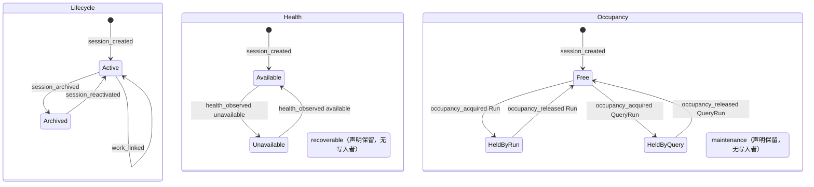

派生 availability 视图（只读，不可写）。空闲 Session 不被探测，所以 Idle 没有 `health_observed` 出边：

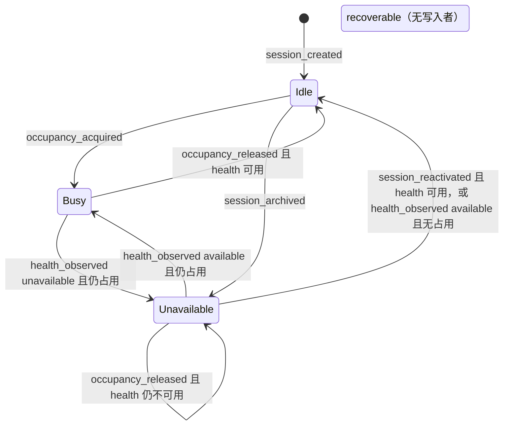

QueryRun 收束子机（只画本节负责的迁移；进程内的 claim、prepare、entered 省略，begin 只画一条说明边）：

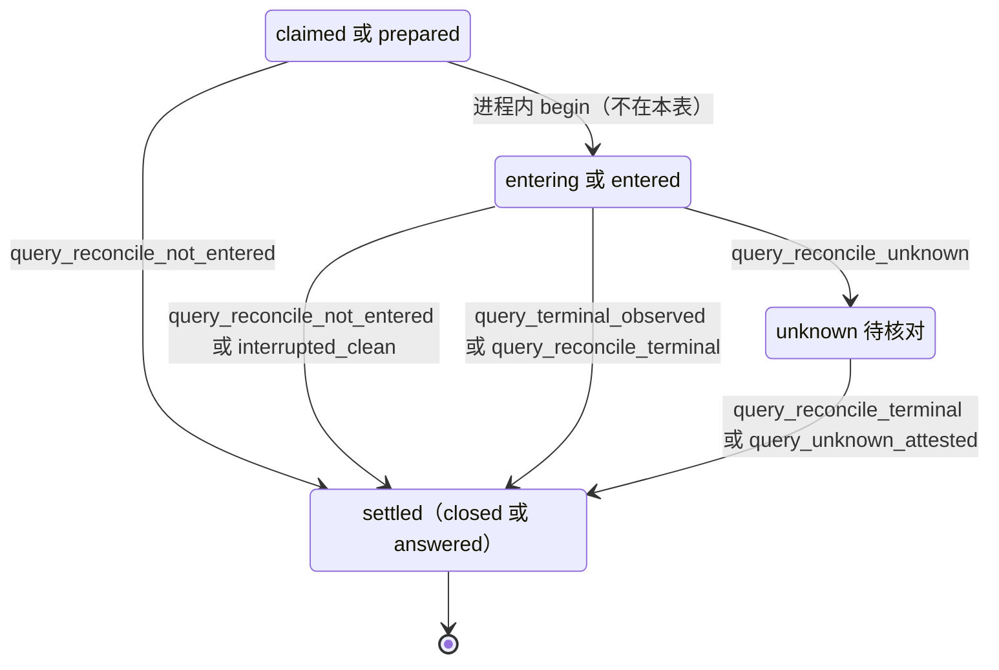

### 8.6 实现对照

状态机目标文件：`src/core/work-graph/state/session-availability.ts`（`transitionSession`）和同目录的 `query-run-recovery.ts`（`transitionQueryRunRecovery`）。

- **记录构造函数（§14）**：`createSessionRecord`、`occupySessionRecord`、`releaseSessionRecord`、`archiveSessionRecord`、`reactivateSessionRecord`、`observeSessionHealthRecord`；Query 侧为 `settleQueryRunRecord`、`markQueryRunUnknownRecord`。服务里写 lifecycle/health/occupancy 以及 QueryRun phase/status/outcome 的对象字面量都改为调用它们：`session-directory.ts:910-923`、`session-lifecycle.ts:616-617`、`:620`、`claim-service.ts:706-707`、`execution-entry-service.ts:1431-1434`、`query-execution.ts:794-799`、`:1343`、`:1392-1411`。
- **编码器去重**：`execution-entry-service.ts:1497-1499` 的私有 `encodeSession` 改用 `sessions/session-record-codecs.ts:686` 的 `encodeSessionRecord`。
- **命名冲突**：`session-lifecycle.ts:655` 已有同名私有函数 `transitionSession`（archive/reactivate 的服务流程）。迁移时把它改名为 `runLifecycleTransition`，与 state/ 的导出区分。

| 行号 | 状态机函数（目标：`src/core/work-graph/state/` 中的导出） | 调用服务（file） | 已有测试（file） | 计划新增测试（描述） |
| --- | --- | --- | --- | --- |
| SES-01 | `transitionSession`（session_created）、`createSessionRecord` | `sessions/session-directory.ts` `recordSessionCreated` | `tests/work-graph/R4b-session-directory.test.ts:146`、`:165` | 创建后三维为 active/available/null，availability=idle |
| SES-02 | `transitionSession`（occupancy_acquired）、`nextOccupancyGeneration`、`occupySessionRecord` | `tasks/claim-service.ts` `claimTask` | `tests/work-graph/R4c-task-claim.test.ts:102`、`:240`、`:347`；`tests/work-graph/A1-session-lifecycle.test.ts:252` | 对 18 种组合逐一测占用守卫；验证 generation=revision+1 且 revision 被置为 generation；版本钉过期且 Session 忙碌时仍为 `busy` |
| SES-03 | 同 SES-02 | `queries/query-execution.ts` `claim` | `tests/work-graph/R5b-query-execution.test.ts:100` | Work 与 Query 在同一组合下得到相同结论；版本钉过期且 Session 忙碌时 Query 仍为 `revision_conflict` |
| SES-04 | `transitionSession`（occupancy_released）、`ownsOccupancy`、`releaseSessionRecord` | `tasks/execution-entry-service.ts` `recordRunResult` | `tests/work-graph/B2-execution-result.test.ts:24`、`:65`、`:94`、`:132` | RUN-08 的实时未结算终态不发 `occupancy_released`；服务误发时拒绝 `busy` |
| SES-05 | 同 SES-04 | `tasks/control-service.ts` `submitControl`（D-7 未进入停止，与 §6 RUN-09 同一服务） | — | auth 为 none、authorized、revoked 时 cancel 在同一提交释放，`historyCursor` 不变；pause 不释放 |
| SES-06 | 同 SES-04 | 新 `tasks/run-reconcile-service.ts`（`reconcileRun`）；Kernel 分类在新 `agent-runtime/run-reconcile.ts`；由 `src/app/host.ts` 在 D-18 之后启动时调用；RUN-23 的进程内变体由 `agent-runtime/execution-control.ts` 的 `deliver` 调用 `reconcileRun(paused_stop)`；RUN-17/18/21 经扩展的 `recordRunResult` | — | A8 的三个崩溃点后分别释放或保留；另一个存活 Host 持租约时 `busy` 且不写；`input_accepted` 未确认时 `unavailable` 且不释放；Kernel 终态 yielded：continuation 重建成功则释放并写 continuation，重建失败则不释放（`EndedUnknown`）；本 Turn 有两条等待发信时按重建失败处理，不释放（L-5）；安全点暂停中 cancel（RUN-23）进程内与重启两条路径都释放且 `historyCursor` 不变 |
| SES-07 | 同 SES-04 | 新 `tasks/run-reconcile-service.ts` 的 `resolveUnknownRun`，经 `src/app/host.ts` 的人类入口暴露（只在持实例租约时受理，L-1） | — | 记录证明人和原因后释放；Kernel 不可读时仍可认定，后继执行可能再次接受同一消息部分（§10.3）；租约被另一个存活 Host 持有或锁文件不可读时 `busy` 且不写 |
| SES-08 | 同 SES-04 | `queries/query-execution.ts` `recordObservation`；重启路径经 `agent-runtime/query-observation.ts` | `tests/work-graph/R5b-query-execution.test.ts:100` | 旧 generation 的 Query 终态不释放新持有者；从 `unknown` 出发的终态释放 |
| SES-09 | 同 SES-04，另加 `ownsQuery` | `queries/query-execution.ts` 新 owner 写操作 `reconcileQueryRun`；由 `src/app/host.ts` 启动时调用 | — | QRR-01/02/04 三种收束都释放且 `historyCursor` 不变；无租约时 `busy`；`caller≠reconcile` 时 `forbidden` |
| SES-10 | 同 SES-09 | `src/app/host.ts` 的 `resolveUnknownRun` 对 QueryRunRef 调用 `queries/query-execution.ts` 新增的 `resolveUnknownQueryRun` | — | 只在 QueryRun 为 `unknown` 时释放；释放后 `historyCursor` 不变；未持实例租约时 `busy` 且不写（L-1） |
| SES-11、SES-14 | `transitionSession`（session_archived、session_reactivated）、`archiveSessionRecord`、`reactivateSessionRecord` | `sessions/session-lifecycle.ts` `runTransitionAttempt` | `tests/work-graph/A1-session-lifecycle.test.ts:132`、`:157`、`:287`；`tests/composition/A1-graph-session-platform.test.ts:58` | 重新启用时 health≠available，则 availability=unavailable 且不可领取 |
| SES-12、SES-13、SES-19 | `transitionSession`（health_observed）、`observeSessionHealthRecord` | `sessions/session-lifecycle.ts` 新写口 `recordSessionHealth`；探针为 `agent-runtime/session-operations.ts` 新增的 `probeSessionMapping`；由 `src/app/host.ts` 启动时调用 | — | 六类结论码逐一测试：`missing`/`damaged` → unavailable 且占用不变；`host_config`/`transient`/`cancelled` 不写；重验 → available；同值为空迁移；租约被另一个存活 Host 持有或锁文件不可读时不运行 reconcile、不写（L-10）；探针绕过 `session-operations.ts:760-762` 的短路；archived Session 被拒 |
| SES-15、SES-16 | `transitionSession`（work_linked） | `sessions/session-lifecycle.ts` `runLinkAttempt` | `tests/work-graph/A1-session-lifecycle.test.ts:37`、`:206`、`:224` | 关闭不存在的链接得到 `not_found`，关闭已关闭的链接得到 `invalid` |
| SES-17、SES-18 | `transitionSession`（occupancy_released）的空迁移分支 | 同 SES-04、SES-08 | `tests/work-graph/B2-execution-result.test.ts:94` | 返回 `ok:true` 且 `effects=[]`；持有者其他记录照常提交 |
| QRR-01..QRR-06 | `transitionQueryRunRecovery`、`settleQueryRunRecord`、`markQueryRunUnknownRecord` | `queries/query-execution.ts` 的 `recordObservation`（QRR-03）、`reconcileQueryRun`（QRR-01/02/04/05）、`resolveUnknownQueryRun`（QRR-06）；Kernel 分类复用 `agent-runtime/run-reconcile.ts` | `tests/work-graph/R5b-query-execution.test.ts:100`（只覆盖 QRR-03 的进程内路径） | 逐行表驱动；新增取值通过 codec（`query-record-codecs.ts:293`、`materials/record-readers.ts:169-172`）；收束后 phase、status、outcome、endedAt 一致；paused/yielded 的 Kernel 状态按 SD-4(e) 分流；SD-3 时进入 `unknown` 且身份不依赖 Kernel 位置；R 来源各行与 QRR-06 在未持实例租约时 `busy` 且不写（L-1、L-10）；咨询 Query 收束后投影为 `ended`，不再提交 |
| 派生 | `deriveAvailability`（迁自 `session-directory.ts:1027-1032`） | `session-directory.ts` 的 `readSession`、`findSessionsByTarget`、`findSessions`（`:1180`、`:1350`、`:1535`）。以 availability 或 occupancy 作门的消费者：`business/workflow/workflow.ts:221-228`（`roleReusable`）、`:459-460`；`business/workflow/consultation.ts:281`、`:391`；`src/app/host.ts:868`、`:877` | `tests/work-graph/B2-execution-result.test.ts:51`；`tests/composition/AG1-session-discovery.test.ts:119` | 18 种组合的 availability 快照表；Session 为 unavailable 或被 `outcome_unknown` 占用时，Host 注意力递送跳过、咨询返回 waiting、Workflow 报 waiting，都不领取 |
| 读侧持有校验 | `ownsOccupancy`：只判定占用（kind、executionRef、generation），不看 lifecycle 和 health | `execution-entry-service.ts:1593-1607`；`query-execution.ts:935-938`；`plan-write-admission.ts:306-313`；`communication/mailbox-service.ts:641-647`。lifecycle/health 检查和错误码留在各调用方：entry 与计划写入查两者并返回 `busy`（`execution-entry-service.ts:1594-1595`、`plan-write-admission.ts:307-308`）；邮箱只查 lifecycle、不查 health，返回 `forbidden`（`mailbox-service.ts:641-647`） | `tests/work-graph/C1-session-mailbox.test.ts:364` | 四处读侧改用同一函数后，各自的错误码不变 |

UI 中有两份重复的 availability 文案表：`src/ui/views.ts:516-518` 和 `src/ui/main.ts:5689-5691`。它们只是展示，不属于本机；“待核对”由 UI 组合 availability 与 Run 的 `outcome_unknown` 得出。


## 9. VerificationRound（轮次 + 单项检查）

本节把 §7 V1–V6 转写成两层小状态机：**轮次**（`RoundSnapshot.status` + `outcome`）与**单项检查**（`RoundCheckSnapshot.phase` + `outcome`），外加两类只追加记录 `Evidence` 与 `TaskEvidenceIndex` 的写入规则。轮次结论通过 D-1 的投影输入影响 Task，通过 D-3 的 `TaskRequeue` 被“超越”。本节依赖 D-2（FAIL 结论，U-2）、D-9（Goal 期望状态，U-8）、D-12（启动时 executing→interrupted，U-15）、D-13（§13 无进展键，随 U-3），均待用户确认，lead 建议均采纳。

本节在 brief 之外补充的决定。标“lead 采纳（L-n）”或“lead 决定（L-n）”的已定稿；VD-9（非 active 时拒绝开轮与起检）和 VD-10（运行中停滞接受到重启）由 brief §2a 定稿；其余同样待用户确认。U-10、U-15 是开放的用户决定，本节只列选项与 lead 建议，不替用户决定：

- **VD-1 每个 (subject task, subject Run) 至多一个轮次（已由 lead 采纳，L-8）**：新增唯一槽，取代今天“两个 requestId 可建两轮”的情况。work 轮次每个 Run 一个；同一 producer Run 另可为每个 gate 各有一个 gate 轮次。
  - **同一 Run 能否再验：用户决定 U-15（待确认）**。VD-1 与 D-12 合起来，同一 Run 的产出永远不能再验。检查中途 Host 崩溃，或 `not_started`、`source_unavailable` 这类与产物无关的 INCONCLUSIVE，都只能 requeue → 新 Run → 新模型调用。这与 V6 有偏差：V6 允许“同轮次恢复或明确新版本轮次”（`ORCHESTRATION-STATE-MACHINES.md:389`），V5 要求“不能无理由重跑”（`:388`）。选项：
    - **(i) interrupted 单项同轮不重跑，新轮次只在 requeue 之后打开**（lead 建议采纳）。用户选定前，本节各表按 (i) 书写。
    - **(ii) 显式“后继轮次”操作**（GAP-11）。仅当前一轮已 finalized 非 PASS；槽 CAS 旧轮次键→新轮次键；新轮次记 `predecessorRoundRef`，同一提交超越前一轮证据；查询取链头；失败事实与来源都不变时拒绝（同 §13）。它也是 U-10 的选项 (b)（gate 重验）。
  - **对 gate 更严重**：gate 检查执行中 Host 重启（VR-04）→ gap `interrupted_check` → INCONCLUSIVE；gate 不能 requeue（§4 TASK-16），(gate, producer Run) 槽已占。按 U-15 (i)，gate 永久非 PASS，出口取决于用户决定 U-10（见 VD-11）。列入 §12（死路 #9）。
- **VD-2 `submitEvidence` 不得写入已 finalized 的轮次**：拒绝码 `busy`，与 `beginCheck`/`recordCheckResult` 一致。
- **VD-3 打开轮次要求 subject Run 正常结束**：`ended` + `completed`，`reconciliation` 缺省或为 `done`。这与 Workflow 的 `normalEnd` 一致，今天服务层只查 `ended`。
- **VD-4 PASS ⇒ `gaps=[]`**：结论折叠中任何 gap 都给 INCONCLUSIVE；今天“同一要求另有 PASS 覆盖”时，会出现 PASS 带 `pending_check` gap 的结果（`evidence-service.ts:1007` 不看 gaps）。遗留的“PASS 带 gaps”行不改写，投影按 INCONCLUSIVE 处理（`blocked/round_inconclusive`），出口为 requeue（死路 #11）。
- **VD-5 requeue 超越旧轮次证据（lead 决定 L-3：存储 id，与 §4 TD-2 同一决定）**：
  - `requeueTask` 在同一提交中把本轮（`afterRoundRef`）`evidenceRefs` 的全部 id 写入不可变的 `TaskRequeue.supersededEvidenceIds`；没有轮次时为 `[]`。轮次 finalized 时一次写定 `evidenceRefs`（`evidence-service.ts:1036-1037`），之后不再改写（9.4），requeue 提交守卫 round@rev（VR-09）。
  - completion 折叠前排除该 Task 全部 TaskRequeue **存储的** `supersededEvidenceIds` 的并集（§4 4.3 末“完成侧的读取、排除与守卫”），不再读 `afterRoundRef` 轮次推导。brief D-3 的记录形状据此补上该字段。
  - 否则 T7 返工后新的 PASS 轮次永远被旧 FAIL 证据阻塞。只适用于 work 轮次；gate 见 VD-11。
- **VD-6 运行中的 Host：已证明未启动的单项退回 pending（VR-05；已由 lead 采纳，L-8，含 `check_abandoned` 事件与 VR-13）**：
  - runner 在 begin 之后、`new ProcessSandbox`/`execute` 之前放弃时，同一进程内可证明没有进程启动。这些路径是：root/约束与 ticket 不符（`check-execution.ts:117-120`）、begin 后 root 变化（`:121-124`）、begin 后权限变化（`:125-128`）、`afterBegin` 读取失败（`:129-130`）、调用方已取消（`:134-137`）。
  - 单项 `executing → pending`，清除 invocationId；下一次起检签发新 invocation。没有进程运行过，不算 D-12 的重跑，符合 V6“只补未执行”（`ORCHESTRATION-STATE-MACHINES.md:389`）。记为 interrupted 会把无害的放弃变成 gap → INCONCLUSIVE → requeue → 新模型调用。
  - 例外：ticket 不完整（`:108-109`）由轮次冻结值确定性产生，退回 pending 会反复失败，改记 `interrupted`（VR-13）。
  - 执行中抛出未知错误（`:159-161`）不能证明未启动，保持 executing，等待 VR-04。今天上述路径都让窗口保持“未核对”；D-12 只覆盖重启。
- **VD-7 开轮、查询与完成都用 Goal 当前采用版**：
  - Workflow 开 work 轮次时传 Goal 当前 `activePlanRevision`，不再传 `run.planRef`（`workflow.ts:113`；调用处 `:596`、`:806`、`:814` 需先读 Goal）；
  - `queryOriginalVerification` 只按 `subjectRunRef` + `subject` 匹配，`planRef` 只作校验信息（今天 `evidence-service.ts:634` 还比对 `adoptedPlanRef`；Workflow 查询传 `run.planRef`，`workflow.ts:572`）；
  - `completeTaskStep` 传 Goal 当前 `activePlanRevision`，不再传 `round.adoptedPlanRef`（`workflow.ts:146`；Goal 已在 `:583`、`:840` 读出；为 null 时等待）。completion 只比对当前采用版（`completion.ts:284-286`），不读 `round.adoptedPlanRef`；证据适用性仍按当前采用版判定（`:366-381`）。
  - 理由：Run 领取之后，或开轮之后、completeTask 之前，可能发生合法的未来采用（W16 `applyFutureRevision`；代码注释称 “W1 future apply”，`evidence-service.ts:522-526`）。之后开轮永远得到 `source_stale`（`:398-400`），completeTask 永远得到 `revision_conflict`（Workflow 每次推进都重建同一请求，`workflow.ts:587`、`:844`）。Task 停在 `verifying`，而 §4 不允许从 `verifying` 重入队。W16 不改有 Run 痕迹的 Task（`plan-readers.ts:1269-1297`），subject task 的定义不变，换用当前版是安全的。
- **VD-8 起检遇冻结绑定不符时转 finalize**：
  - 只有三种明确的比较失败按策略视为本轮终止：权限版本 ≠ 冻结值（`evidence-service.ts:689-691`；runner 起检前同一比较 `check-execution.ts:81-83`）、root ≠ 冻结 root（`:692-694`）、source digest ≠ 冻结值（`:697-698`）。冻结值可能恢复（例如内容被还原），但不无界等待。
  - Workflow 不再重试该单项，转 `finalize_checks`，剩余 pending 计为 gap。今天 Workflow 每次推进都重试同一单项，轮次永远 open（`workflow.ts:124-136`、`:824-831`）。
  - 其余 `forbidden`/`source_stale` 一律等待：authorize/resolveRoot 拒绝经 `mapWorkspaceRejection`（`:686-688`、`:124-127`）；executor 不符（`:671`，见死路 #10）；runner 起检前 `mapWorkspaceCode`（`check-execution.ts:78-80`）；capture 失败经 `mapSourceFailure`（`:696`、`:134-137`）。`unavailable`、`unsupported`、`busy`、`revision_conflict` 也等待。
  - `CoreRejection` 没有结构化细分字段（`src/contracts/core/results.ts:18-23`）。三种比较失败需带稳定的 detail 标记（`frozen_permission_changed`、`frozen_root_changed`、`frozen_source_changed`，取自 `transitionCheck` 的 `detail`），Workflow 只按标记判定。
  - **标记放在 `reason` 的固定前缀（lead 决定 L-9），不改 `CoreRejection` 契约**：格式为 `<标记>: <原说明>`，例如 `frozen_root_changed: the current workspace root is not the round fixed root`。`beginCheck`（`evidence-service.ts:689-698`）与 runner 起检前的同一比较（`check-execution.ts:81-83`）都这样写。Workflow 只按 `reason.startsWith('<标记>:')` 判定，不解析其余文字；不带前缀的拒绝一律按等待处理。
- **VD-9 Goal 或 Task 非 active 时不起新进程**：Goal `desiredState≠active` 或 subject task disposition `≠active` 时，`round_opened`、`check_begun` 被拒。已开始进程的结果、reconcile 入账、finalize 仍可写，它们只记账。
  - disposition 取自 Goal 当前 `activePlanRevision` 指向的 Plan，不取冻结的 `round.adoptedPlanRef`（W16 修订后的 disposition 只出现在新版）。由读集守卫 Goal@rev 保护（PlanRevision 不可变）。
  - 今天 `openVerification` 已守卫 Goal@rev（`evidence-service.ts:535`），但不读 `desiredState` 与 disposition；`beginCheck` 不读 Goal（`:640-726`，提交只守卫轮次 `:712`）。拒绝码对齐 claim（`claim-service.ts:514`、`:556`）。
- **VD-10 记录结果有界重试**：
  - runner 的 `recordCheckResult` 可能遇到两种失败：`revision_conflict`（pin 取自 `afterBegin`，`check-execution.ts:129`、`:172`，并发起检会使它过期）；报告存储 `unavailable`（`evidence-service.ts:778-779`）。
  - 遇到时重读轮次、刷新 pin，用同一 requestId 重试。前次实际已提交时，重试得 `idempotency_conflict`（指纹含 expected，`:750-751`），runner 改为重读轮次。
  - 重试用尽，或执行中抛出未知错误（`check-execution.ts:159-161`）→ 单项保持 executing，直到重启 reconcile（VR-04/VR-06）。这段停滞被接受，需列入 §12。
- **VD-11 gate 非 PASS 的出口：今天没有；选哪条是用户决定 U-10（待确认）**：gate 走不了 VD-5，原因是：
  - gate 不能 requeue（§4 TASK-16 要求 work）；
  - 同一 producer Run 上的 gate 槽已占（VD-1），producer 已 satisfied；
  - 旧 gate 证据留在 gate 自己的 TaskEvidenceIndex（`evidence-service.ts:508-510`、`:1101-1103`；`completion.ts:356-360`）。

  brief §2a 设想的 G5 出口（W16 把该 gate 改为 `superseded`/`cancelled` 并加替代 gate）今天不可行，卡在两处：
  1. **W16 拒绝修改任何源 gate（含 disposition）**：`validateFutureObligationCoverage` 比较 gate 的完整冻结定义（`plan-validation.ts:415-434`；冻结定义含整个 `RuntimeTask`，`plan-task-basis.ts:49-54`），不同即 `gate_definition_changed` → `invalid`（`plan-service.ts:1740-1745`），早于 `plan-readers.ts:1269-1297` 的痕迹检查。新增 gate 还必须承载新增义务（`plan-validation.ts:458-471`）。
  2. **Workflow 选择不看 disposition**：只有 work 循环过滤（`workflow.ts:634`）；必需 work 缺口（`:719-721`）、gate 选择（`:726`）与 Goal 完成前提（`:739`）都不过滤。被 superseded 的旧 gate 仍被选中，开轮被拒（VD-1 `busy` 或 VD-9 `invalid`），Workflow 永远等待；被 cancelled 的必需 work 同样让 `:720` 永远等待。

  U-10 的选项：
  - **(a) 放宽 W16**（GAP-10）：无痕迹的源 gate 可改为 `superseded`/`cancelled`，前提是其义务另有 active 必需承载者（§3/§4 改动），再加上第 2 处的 `:726` 只选 disposition=`active` 的 gate。
  - **(b) gate 重验**：U-15 选项 (ii) 的“后继轮次”（GAP-11），不需要放宽 W16。
  - **(c) 本批接受死路**：gate 非 PASS 时 Goal 一直显示 `RUNNING/awaiting_gate`，看不出失败（§2 GOAL-27，GAP-09）；结论只在 Workflow 回执和轮次读取中可见。
  - **lead 建议：本批 (c)，以后 (a)。** 用户选定前，本规格按 (c) 书写：不新增 gate 重验操作，也不放宽 W16。

  第 2 处中 `:720`、`:739` 的改动与 U-10 无关，随 VD-11 待用户确认：跳过 `cancelled`/`superseded`（与 `completion-policy.ts:239` 一致，`deferred` 仍算缺口）。今天 W16 已能取消无痕的非 gate work，这一改动对它本来就需要。gate 轮次的显示与 gate 重验一起列为开放的用户决定（brief §2a，GAP-09）。

### 9.1 持久位置与状态枚举

| 维度 | 记录.字段（位置） | 代码枚举（原值） | 说明 |
| --- | --- | --- | --- |
| 轮次状态 | `RoundSnapshot.status`（`src/contracts/verification.ts:141`） | `'open' \| 'finalized'` | codec `ROUND_STATUSES`（`evidence-record-codecs.ts:133`） |
| 轮次结论 | `RoundSnapshot.outcome`（`verification.ts:142`） | `EvidenceOutcome \| null`；`EvidenceOutcome = 'PASS' \| 'FAIL' \| 'INCONCLUSIVE'`（`src/contracts/evidence.ts:61`） | 今天只产出 PASS/INCONCLUSIVE（`evidence-service.ts:1007`） |
| 轮次缺项 | `RoundSnapshot.gaps`（`verification.ts:143`） | `{code,message,coverage?}[]` | code 有 `uncovered_requirement`、`pending_check`、`missing_check`、`evidence_<basis>`、`source_changed`、`source_unavailable` 等；新增 `interrupted_check` |
| 单项阶段 | `RoundCheckSnapshot.phase`（`verification.ts:119`） | `'pending' \| 'executing' \| 'finished' \| 'interrupted'` | `interrupted` 只声明、无写入者（codec `:134`；读于 `evidence-service.ts:956`、`workflow.ts:125`） |
| 单项结果 | `RoundCheckSnapshot.outcome / invocationId / reportRef / sourceStatus`（`verification.ts:120-123`） | outcome 同上；sourceStatus `'matched' \| 'changed' \| 'unavailable' \| 'permission_changed' \| null` | 由 `outcomeFor` 判定（`evidence-service.ts:329-335`） |
| 证据 | `EvidenceSnapshot`（`evidence.ts:97-103`） | kind `'claim' \| 'observation' \| 'verdict'`（`:60`） | 不可变，revision 恒为 1（codec `:256-257`） |
| 任务证据索引 | `TaskEvidenceIndexSnapshot`（`evidence.ts:106-111`），按 `round.ref.taskId` 建键（`evidence-service.ts:1101-1103`） | `revision === evidenceIds.length` | codec 允许 revision 0（`evidence-record-codecs.ts:290-292`）→ 见 VR-10..VR-12。gate 轮次写入 gate 自己的索引 |
| 原始轮次查找 | lookup `VerificationRoundBySubject`（`evidence-record-codecs.ts:446`、`:458-461`） | 路径 `ref.projectId/workspaceId/goalId/taskId/runId` | 只是候选索引，不唯一；多于 1 条时查询返回 `incomplete`（`evidence-service.ts:623-625`）。遗留轮次没有槽，VR-01 也查它 |

codec 没有跨字段校验（`roundSnapshotProblem` `evidence-record-codecs.ts:163-198`：open 带非空 outcome 也能解码）。目标不变式由 `state/` 构造器保证；为兼容旧行，解码器保持宽松：

- 轮次：`open` ⇒ `outcome=null`；`finalized` ⇒ `outcome≠null`，且没有 `executing` 单项（I-7）；`PASS` ⇒ `gaps=[]`，且每个必需检查都是 `finished` + `PASS` + `sourceStatus='matched'`。
- 单项：`pending` ⇒ invocationId、outcome、reportRef、sourceStatus 全为 null；`executing`/`interrupted` ⇒ `invocationId≠null`、`outcome=null`、`reportRef=null`、`sourceStatus=null`（起检只写 phase 与 invocationId，`evidence-service.ts:706`；sourceStatus 只在记录结果时写，`:781`）；`finished` ⇒ 四者全非 null。

**设计名映射**：设计 §2 第 272 行只规定复用这些名称。“只用于显示、由代码字段派生、不持久化”是本节的决定。

| 设计名（ORCHESTRATION §2） | 由代码字段派生 |
| --- | --- |
| `rejected` | `openVerification` 被拒（`incomplete`/`source_stale`/`forbidden`/`unsupported`…）：**不建记录**，只在 Workflow 回执中可见（见 9.3 末“死路与出口”#2） |
| `incomplete` | `status=open`，没有 `executing`，且不满足下面 `interrupted` 的条件：仍有 pending（不论是否已有 interrupted 单项，Workflow 会继续跑这些 pending），或全部 finished 待汇合 |
| `running` | `status=open`，至少一个单项 `executing` |
| `interrupted` | `status=open`，至少一个单项 `interrupted`，且没有 `executing`、没有 `pending`。与 Task 投影 `blocked/check_interrupted` 的条件一致 |
| `completed` | `status=finalized`。结论另看 `outcome`；`completed` 不保证 PASS |

### 9.2 事件

| 事件名 | 来源 | 载荷要点 | 对应原文编号 |
| --- | --- | --- | --- |
| `round_opened` | U/P（Workflow `open_checks`，Host executor 身份） | `subjectRunRef`、`subject`、`planRef`（Goal 当前采用版，VD-7）、`gateSubject?`、requestId | V1、T6 |
| `check_begun` | P（检查 runner） | `roundRef`@rev、`checkId`、requestId → 冻结 ticket（`invocationId`、配置/root/source digest） | V2 |
| `check_result_recorded` | C（沙箱进程观察） | `roundRef`@rev、`checkId`、`invocationId`、`CheckProcessObservation` | V2 |
| `check_interrupted` | R（启动 reconcile，持 D-18 实例租约，VR-04）；P（runner 拿到不完整 ticket，VR-13） | `roundRef`、`checkId`、`invocationId`、`cause: host_restart \| ticket_invalid`、`hostInstanceId`（仅 R） | V6、D-12 |
| `check_abandoned` | P（runner 证明进程未启动，VD-6） | `roundRef`@rev、`checkId`、`invocationId`、`cause: caller_cancelled \| root_changed \| permission_changed \| read_failed` | V6（只补未执行）、VD-6（lead 采纳，L-8） |
| `check_report_booked` | R | `roundRef`、`checkId`、`invocationId`、`hostInstanceId`、已定位的 `reportRef`（正文含原 observation/sourceStatus/outcome） | V6、D-12 |
| `evidence_submitted` | U/P（Host executor 提交声明） | `roundRef`、`claim` 文本 | V3（仅执行者声明，非审阅） |
| `round_finalized` | C（检查结论汇合；由 Workflow `finalize_checks` 以 Host executor 身份提交，与 §4 一致） | `roundRef`@rev、`reviewerEvidence`（必须为空，D-16） | V4、D-2 |
| 外部：Run `run_ended` | §4 归并的 K/R/U 事件 | VR-01 只接受结果为 `completed`，来自 `terminal_observed`、`reconcile_terminal` 或 `late_evidence`；`unknown_attested` 只给 `crashed`，不满足 | VR-01 前置条件，本机不迁移 |
| 外部：Goal `goal_pause_requested` / `goal_cancel_requested` / `goal_resume_requested` | U（§2） | 新 `desiredState` | VD-9 守卫输入，本机不迁移 |
| 外部：Task `disposition_changed` | U（§4，W16） | 新 disposition | VD-9 守卫输入；gate 替换见 VD-11 |
| 外部：Task `task_requeued` | U（§4；Workflow 自动重试也走此入口） | `afterRunRef`、`afterRoundRef`、`supersededEvidenceIds`（L-3）、basis | T7 → VR-09 |
| 外部：Task `task_completed` | C/P（§4） | 读取 finalized PASS 轮次 | V5，本机不迁移 |

没有 T（超时）事件：单项超时属于进程观察（`timedOut` ⇒ INCONCLUSIVE，`evidence-service.ts:332`），轮次没有时间触发的迁移。

### 9.3 迁移表

| # | from | event | guard（守卫） | to | effects（同事务副作用意图） | 幂等/重复事件 | 原文编号 | 现状 |
| --- | --- | --- | --- | --- | --- | --- | --- | --- |
| VR-01 | ∅（该 (subject task, subject Run) 无轮次） | `round_opened` | 调用方 = 配置 executor；`planRef` = Goal 当前采用版（VD-7）；Goal `desiredState=active`，subject task disposition `active`（VD-9）；subject Run `ended`+`completed`，reconciliation 缺省或 `done`（VD-3）；该 Run 未被 TaskRequeue 覆盖；task basis 可解析；source 捕获与 VerificationPlan 编译成功；唯一槽为空，且 `VerificationRoundBySubject` 查得 0 行（VD-1，兼容无槽遗留轮次） | `open`，outcome=null，全部单项 `pending`，`gaps`=uncovered | 写 Round@1；claim `verification-round-subject:<project,workspace,goal,task,runId>` null→roundKey；读集守卫 Goal/Plan/Workspace/Run/policy/baseline；事件 `VerificationRoundOpened`；Task 投影保持 `verifying` | 同 requestId 同指纹 → 原回执（`evidence-service.ts:368-373`）；另一 requestId 且已有轮次 → `busy` + current=已有轮次 pin。并发时 store 的 `unique_conflict` 由本服务重读 lookup 后同样返回，不走通用映射（`:550` → `execution-entry-service.ts:125`） | V1、T6 | 改造 `evidence-service.ts:337-560`（`:441` 只查 ended；`:543-546` claims 为空；已守卫 Goal@rev `:535`，但无 desiredState/disposition 守卫） |
| VR-02 | 单项 `pending`（轮次 open） | `check_begun` | pin = round.revision；executor 一致；Goal `desiredState=active`、subject task 在 Goal 当前采用版中 disposition `active`（VD-9，读集守卫 Goal@rev）；Host 权限版本、root、source digest 都等于冻结值（`:685-699`），不符时 detail 带 VD-8 标记，服务把它写成 `reason` 前缀（L-9） | 单项 `executing`（新 invocationId） | round rev+1；事件 `VerificationCheckBegun`（冻结 ticket） | 同 requestId → 原 ticket；回放的 ticket 不是执行许可（`check-execution.ts:103-106`） | V2 | 改造 `evidence-service.ts:640-726`（加 Goal 读取、VD-9 守卫与 Goal@rev 守卫；今天提交只守卫轮次 `:712`） |
| VR-03 | 单项 `executing` | `check_result_recorded` | 轮次 open；invocationId 匹配；pin = round.revision | 单项 `finished`，outcome = `outcomeFor` | 报告正文先存（事务外、内容寻址）；写 outcome/reportRef/sourceStatus；round rev+1；事件 `VerificationCheckResultRecorded` | 同 requestId 同指纹 → 原回执；已 finished → `busy`（`:767`）；runner 有界重试（VD-10），前次已提交则得 `idempotency_conflict` 后重读 | V2 | 改造 `check-execution.ts:169-174`（今天不重试）；`evidence-service.ts:728-800` 改为经 `transitionCheck` 判定，`outcomeFor`（`:329-335`）移入 state/ |
| VR-04 | 单项 `executing` | `check_interrupted`（R） | 持有 D-18 实例租约（旧进程已消失 ⇒ `bwrap --die-with-parent` 已终止检查进程，`vendor/coding-agent/dist/sandbox/process/process-sandbox.js:264`）；VR-06 不适用；轮次 open。不做 executor 检查：守卫是实例租约，actor 记为 Host system actor + `hostInstanceId`（Host 执行者配置变了也能核对，见死路 #10） | 单项 `interrupted`（保留 invocationId；outcome/reportRef/sourceStatus 为 null） | round rev+1；事件 `VerificationCheckInterrupted{cause:host_restart, hostInstanceId}`；不启动任何进程 | 核对身份 = hash(roundRef, checkId, invocationId, hostInstanceId)，与 §6 RUN-16 同法，cause 与 hostInstanceId 都在身份内：同一实例重复 → 原回执；另一实例或重读后单项已不是 executing（已 interrupted/finished）→ 机器按 9.4 拒绝，reconcile 视为已处理并跳过，不报 `idempotency_conflict` | V6、D-12（缺口 G3） | 新增 |
| VR-05 | 单项 `executing` | `check_abandoned`（P） | runner 在同一进程内证明进程未启动：begin 之后、`new ProcessSandbox`/`execute` 之前放弃（VD-6 所列五条路径，`check-execution.ts:117-137`）；invocationId 匹配；重读轮次后 pin = round.revision，重读失败则不写 | 单项 `pending`（清除 invocationId） | round rev+1；事件 `VerificationCheckAbandoned{cause}`；runner 仍返回原拒绝，Workflow 进入等待，不在同一次推进中重新起检 | 身份 = (roundRef, checkId, invocationId)，先查回执：重复 → 原回执。一个 invocation 只走一条路径，cause 不会不同 | V6、VD-6 | 改造 `check-execution.ts:117-137` |
| VR-13 | 单项 `executing` | `check_interrupted`（P） | runner 拿到的 ticket 不完整（`check-execution.ts:108-109`），进程未启动；invocationId 匹配；pin = round.revision | 单项 `interrupted` | round rev+1；事件 `VerificationCheckInterrupted{cause:ticket_invalid}`。ticket 由冻结值确定性生成，不退回 pending，避免反复起检 | 同 VR-05 | V6、VD-6 | 改造 `check-execution.ts:108-109` |
| VR-06 | 单项 `executing` | `check_report_booked`（R） | 持实例租约（同 VR-04，不做 executor 检查）；按 origin requestId `r3e-check-result-<invocationId>` 定位到已存报告，报告中的 roundRef/checkId/invocationId 一致；同一 requestId 的各份正文 (sourceStatus, outcome) 一致，不一致时改走 VR-04（注 1）；前置能力未就绪时本行不可达 | 单项 `finished`（outcome/sourceStatus 取报告中的原值） | round rev+1；事件 `VerificationCheckReportBooked`；不重新评估 source、不重跑 | 同 VR-04 | V6、D-12 | 新增 |
| VR-07 | 轮次 `open`（无 executing 单项） | `round_finalized` | pin = round.revision；executor 一致；没有 `executing`（`interrupted`、`pending` 允许，计为 gap）；`reviewerEvidence` 为空 | `finalized`，outcome 由 D-2 折叠得出（见下） | round rev+1（status/outcome/gaps/evidenceRefs）；写 k 条 verdict Evidence@1；TaskEvidenceIndex 按 VR-10..VR-12；读集守卫 Goal/采用 Plan/subject Run（新增，state-writes-other #8）；事件 `VerificationRoundFinalized`；向 Task 投影送 `round_finalized` | 同 requestId → 原回执；已 finalized → `busy`（`:903`） | V4、D-2 | 改造 `evidence-service.ts:870-1065`（`:956-958`、`:1001-1007`、`:1030-1046`） |
| VR-08 | 轮次 `open` | `evidence_submitted` | executor 一致；轮次有必需覆盖；**轮次 open**（VD-2）；round 守卫 = 读到的 revision（新增） | `open`（轮次记录不改写） | Evidence@1（kind `claim`、`INCONCLUSIVE`，折叠中中性，`coverage.ts:101`、`:110`）；index 按 VR-10..VR-12；事件 `EvidenceAdmitted` | 同 requestId → 原回执 | V3（仅执行者声明，非审阅） | 改造 `evidence-service.ts:802-868`（`:827-832` 无状态检查，`:847-850` 未守卫轮次） |
| VR-09 | work 轮次 `finalized`（FAIL、INCONCLUSIVE，或遗留的 PASS 带 gaps） | `task_requeued`（Task 机） | `TaskRequeue.afterRoundRef` = 本轮；本轮已 finalized（requeue 提交守卫 round@rev）；选定 Run 只有本轮一个轮次 | `finalized`（记录不变，其证据视为 superseded） | 轮次不写。同一提交中 TaskRequeue 存 `supersededEvidenceIds` = 本轮 `evidenceRefs` 的全部 id（L-3，§4 TD-2）。completion 折叠前排除各 TaskRequeue 存储的 id 的并集，不读 `afterRoundRef` 轮次推导（VD-5） | 重复 requeue 由 Task 机与 §13 处理 | T7（缺口 G6） | 新增 |
| VR-10 | index ∅（无记录） | `evidence_submitted` / `round_finalized` 追加 k≥1 | 守卫 `null`（记录不存在） | index@k | 写 TaskEvidenceIndex revision=k，ids 按准入顺序 | 随宿主操作回执 | V3、V4（索引随声明与汇合追加） | 改造 `evidence-service.ts:845-850`、`:1033-1044` |
| VR-11 | index@n（n≥1，或遗留 @0） | 追加 k≥1 | 守卫 = 存储的 revision。按“记录是否存在”判断，不按 `revision===0` 推断 | index@n+k | 写 revision=n+k（遗留 @0 行由此修复） | 同上 | V3、V4 | 改造 `evidence-service.ts:849`、`:1044`；`readIndex`（`:1101-1117`）需返回 `exists` |
| VR-12 | 任意 | 追加 k=0（零快照 finalize） | — | 不变 | **不写** index，也不新建 @0 行 | — | V4 | 改造 `evidence-service.ts:1033-1035`（今天写 @0，形成陷阱） |

**D-2 结论折叠**（纯函数 `finalizeRoundOutcome`，VR-07 使用）：

1. 若有单项 `executing` → 拒绝 `incomplete`，不 finalize。
2. 逐项形成候选：
   - `pending` → gap `pending_check`（含 VD-8 起检被拒后未执行的单项）；
   - `interrupted` → gap `interrupted_check`（新增）；
   - `finished` → 一条 verdict 候选。适用性按 basis 判定（`coverage.ts:152-198`）；source 不再当前时为 `STALE`（`evidence-service.ts:986`）。
3. 存在“适用（APPLICABLE）且 outcome=FAIL”的候选 → **FAIL**。显式失败优先于缺项。
4. 否则，以下任一情况 → **INCONCLUSIVE**：gaps 非空；任一必需 requirement 无适用 PASS 覆盖；存在适用的 INCONCLUSIVE。
5. 否则 → **PASS**。因此 PASS ⇒ `gaps=[]`（VD-4），与消费方一致（`workflow.ts:579`、`:837`，`completion.ts:321`）。准入规则不变：适用 PASS 覆盖项与阻塞项各写一条 Evidence。`FinalizedChecks.applicable = (outcome==='PASS')`。

**Workflow 推进顺序**（`nextAfterRound`，`workflow.ts:124-136`，目标）：有 `executing` → 等待；否则有 `pending` → 先跑，单项 interrupted 之后也一样（V6“只补未执行”）；否则 → finalize。interrupted 单项本身不重跑（D-12）。VR-05 退回的 pending 在下一次推进时照常起检；起检遇 VD-8 的三种标记 → finalize。

**轮次 → Task 投影**（D-1 的输入；原因码按 §4 TD-1，INCONCLUSIVE 的唯一原因码是 `round_inconclusive`，已由 lead 采纳，L-8）：

| 选定 Run（§4 选定规则，`plan-readers.ts:1111-1125`）的 work 轮次 | D-1 投影 | 显式原因 | §4 |
| --- | --- | --- | --- |
| 无轮次（Run `ended/completed`） | `verifying` | `awaiting_verification` | P11 |
| 多于一个轮次（遗留库） | `blocked` | `round_ambiguous` | P10 |
| `open`，无 interrupted | `verifying` | `verification_running` | P12 |
| `open`，有 interrupted，且仍有 pending 或 executing | `verifying` | `verification_running`（detail 列出 interrupted checkId） | P12 |
| `open`，有 interrupted，无 pending、无 executing | `blocked` | `check_interrupted`（下一步 finalize） | P9 |
| `finalized PASS`，`gaps=[]`，无适用 TaskReduction | `verifying` | `awaiting_completion` | P13 |
| `finalized PASS`，且有 satisfied TaskReduction | `satisfied` | — | P1 |
| `finalized FAIL` | `failed` | `check_failed`（失败 checkId） | P7 |
| `finalized INCONCLUSIVE` | `blocked` | `round_inconclusive`（gap codes） | P8 |
| `finalized PASS` 但 `gaps` 非空（VD-4 之前写入的遗留行） | `blocked` | `round_inconclusive`（gap codes） | P8（§4 已含此情形；P13 要求 `gaps=[]`）；若投影为 `verifying` 则无出口（`completion.ts:321`、`workflow.ts:579`） |
| 被 TaskRequeue 覆盖（VR-09） | `pending` | `requeued` | P4 |

这样划分后，中断之后投影单调变化：`verifying` → `blocked/check_interrupted` → finalize 后 `blocked` 或 `failed`，不会在 blocked 与 verifying 之间来回跳。

轮次经 `VerificationRoundBySubject` 读入 `projectTaskPhase` 的 facts。gate 没有自己的 Run（`r4c-run-by-task` 按 `task.taskId` 建索引，`plan-readers.ts:265`，gate 轮次的 Run 归属 producer），D-1 投影读不到 gate 轮次。gate 一直显示 `pending`（§4 P16），直到 TaskReduction；gate 轮次的结论只在 Workflow 回执和轮次读取中可见。这是显示缺口（brief §2a 与 gate 重验一起列为开放的用户决定，GAP-09；gate 非 PASS 的出口是用户决定 U-10，见 VD-11 与下表 #6、#9）。gate 轮次也不进入 producer 的投影。

**requeue（D-3）的轮次侧前置条件**：

- 选定 Run 若有轮次，必须恰好一个，且已 `finalized` 为 FAIL、INCONCLUSIVE，或遗留的 PASS 带 gaps。
  - `open` 时拒绝：投影 `verifying` 或 `blocked/check_interrupted` → `guard_failed`/`busy`（§4 4.4，“暂时不行”）。
  - 多于一个 → `guard_failed`/`busy`（`round_ambiguous`）。
  - `finalized PASS` 且 `gaps=[]` → `guard_failed`/`busy`（投影 `verifying/awaiting_completion`，同 §4 4.4 的 `verifying` 行）。
- D-1 把 open+interrupted 投影为 `blocked`，但不能据此跳过 finalize。
- 失败事实由纯函数 `roundFailureFacts(round)` 给出，作为 §13 `noProgressKey` 的输入：
  - 内容与 §13.1 一致：非 PASS 单项按 checkId 排序的 `{checkId, outcome}`，以及排序后的 gap codes；
  - 不含 invocationId、reportRef digest、时间戳。报告正文含 `invocationId`、`recordedAt`（`evidence-service.ts:283-289`），observation 含 `startedAt`/`finishedAt`（`check-execution.ts:147-148`），每次 digest 都不同；
  - 来源版本不在失败事实内，由 §13 在 requeue 时单独取得（§13 ND-2）。

**检查链的死路与出口**

| # | 停滞点 | 今天的结果 | 目标出口 | 决定 |
| --- | --- | --- | --- | --- |
| 1 | 开轮被拒：`planRef` 不是当前采用版 | Workflow 每次传 `run.planRef`，永远 `source_stale`（`workflow.ts:113`、`:595-596`；`evidence-service.ts:398-400`） | 开轮传当前采用版；查询不按 planRef 匹配 | VD-7 |
| 2 | 开轮被拒：环境或配置（无配置 `unsupported` `:381`；executor/权限 `forbidden` `:385-387`、`:450-452`；编译 `incomplete`/`invalid` `:476-480`、`:485`） | 不建记录；Task `verifying/awaiting_verification`；原因只在 Workflow 回执 | 修好 Host 配置后 Workflow 重试开轮；义务或计划问题走 G5。不 requeue：新 Run 会遇同样拒绝，白耗模型调用 | 配置等待，列入 §12；显示缺口：投影没有持久事实，分不清“未开轮”与“开轮被拒” |
| 3 | 起检遇冻结绑定明确不符（权限版本 `:689-691`、root `:692-694`、source digest `:697-698`；runner 起检前 `check-execution.ts:81-83`） | Workflow 每次重试同一单项，轮次永远 open | Workflow 转 finalize → INCONCLUSIVE → TASK-17 可 requeue。其他 `forbidden`/`source_stale` 仍等待 | VD-8 |
| 4 | 起检前沙箱不可用（`check-execution.ts:86-99`，`unsupported`） | 单项保持 pending，Workflow 等待 | 不变：环境修好后继续；不转 finalize | 环境等待，列入 §12 |
| 5 | 进程已结束但结果未入账，或执行中未知错误 | 单项 executing 到下次重启，Task `verifying/verification_running` | 有界重试（VD-10）；仍失败则接受停滞，到重启由 VR-04/VR-06 处理 | VD-10；列入 §12 |
| 6 | gate 轮次非 PASS | 无出口：W16 拒绝修改源 gate（`plan-validation.ts:430-433`）；即使允许，Workflow 仍选旧 gate（`workflow.ts:726`），并在 `:739` 等待 | U-10 三选一：(a) 放宽 W16 后经 G5 替换 gate（VD-11 两处改动）；(b) U-15 (ii) 后继轮次重验；(c) 本批接受死路 | 用户决定 U-10（VD-11）；lead 建议本批 (c)，以后 (a) |
| 7 | 同一 Run 再验 | 不可能 | U-15 (i)：只能 requeue → 新 Run；(ii)：后继轮次 | 用户决定 U-15（VD-1）；lead 建议 (i) |
| 8 | 开轮之后、completeTask 之前发生合法的未来采用（W16） | Workflow 每次用 `round.adoptedPlanRef` 重建 `complete_task`（`workflow.ts:146`、`:587`、`:844`），`completion.ts:284-286` 永远 `revision_conflict`；Task 停在 `verifying/awaiting_completion`，不能 requeue | `completeTaskStep` 传 Goal 当前采用版 | VD-7 |
| 9 | gate 检查执行中 Host 重启 | 今天：单项 executing 无人核对，轮次永远 open | 目标：VR-04 → INCONCLUSIVE；gate 不能 requeue，槽已占 → 同 #6；U-15 (i) 与 U-10 (c) 下永久非 PASS | 用户决定 U-10、U-15；列入 §12 |
| 10 | 开轮后 Host 执行者身份改变（执行者冻结在轮次中，`evidence-service.ts:516`） | begin、record、submit、finalize 都 `forbidden`（`:671`、`:764`、`:830`、`:904`），轮次永远 open | 恢复 Host 配置后继续；reconcile（VR-04/VR-06）不受影响，但 finalize 仍被拒 | 配置等待，列入 §12 |
| 11 | 遗留的 PASS 带 gaps 轮次（VD-4 之前写入） | completion 拒绝（`completion.ts:321`），Workflow 等待（`workflow.ts:579`），无出口 | 投影 `blocked/round_inconclusive`，可 requeue（TASK-17） | VD-4；遗留数据缺口 |

**注 1（D-12 报告入账的可实现性）**：

- 报告正文存在内容寻址的 body store 中：表结构 `artifacts(key, record)`（`sqlite-body-store.ts:81`），键 = `contentType|digest|size`（`body-codec.ts:148-150`），没有按 origin 或 invocation 的查找。
- 正文内含 `recordedAt`（`evidence-service.ts:288`），reconcile 无法重算它的地址。
- 因此 VR-06 需要先新增“按 origin requestId 查正文”的能力。runner 的 requestId 是确定的：`r3e-check-result-<invocationId>`（`check-execution.ts:171`）。
- VD-10 的重试沿用同一 requestId，可能留下多份正文。各份的 observation 相同，但每次尝试都重新评估 source（`evidence-service.ts:772-773`），正文含各自的 sourceStatus、outcome 和 recordedAt（`:283-289`），内容寻址下每次都另存一份（`body-codec.ts:148-150`）。所以各份可能在 PASS 与 INCONCLUSIVE 之间不同。
- 选择规则是确定的：同一 requestId 的各份正文 (sourceStatus, outcome) 全部一致 → 按该值入账（VR-06）；不一致 → 不挑选，走 VR-04（interrupted）。
- 在提供这项能力之前，VR-06 不可达，reconcile 一律走 VR-04（结论为 gap，不伪造）。

### 9.4 明确禁止的迁移

| from | event/目标 | 拒绝原因 | 对外 CoreError | 说明 |
| --- | --- | --- | --- | --- |
| (subject task, subject Run) 已有轮次（槽被占，或 lookup 有遗留行） | `round_opened`（另一 requestId） | `guard_failed` | `busy`（+ current 已有轮次 pin） | VD-1。并发时 `unique_conflict` 由 evidence 服务重读后返回同样结果；lookup 多于 1 行 → `incomplete` |
| subject Run 非 `ended`，或 outcome≠`completed` | `round_opened` | `guard_failed` | `forbidden` | 今天只拒非 ended（`evidence-service.ts:441`）；outcome_unknown/crashed/cancelled/yielded 不验收 |
| subject Run 已被 TaskRequeue 覆盖 | `round_opened` | `guard_failed` | `forbidden` | VR-01 守卫；返工的产出属于新 Run |
| `planRef` ≠ Goal 当前采用版 | `round_opened` | `stale` | `source_stale` | 保留现有码（`:398-400`），不改为 `revision_conflict`；Workflow 按 VD-7 传当前版 |
| gate 开轮：subject 不是采用版中声明种类的 gate | `round_opened` | `guard_failed` | `invalid` | `:422-425` |
| gate 开轮：producer Run 不是同 Goal、同 Plan 的 work Run，或属于另一 workspace | `round_opened` | `guard_failed` | `forbidden` | `:426-436`；work 开轮时 subject 不是 Run 的 task 同码（`:437-440`） |
| Goal `desiredState≠active` | `round_opened` / `check_begun` | `guard_failed` | `busy` | VD-9；对齐 `claim-service.ts:514`。结果入账、reconcile、finalize 不受限 |
| subject task 在 Goal 当前采用版中 disposition `≠active` | `round_opened` / `check_begun` | `guard_failed` | `invalid` | VD-9；对齐 `claim-service.ts:556` |
| 调用方不是轮次 executor | 任一写（VR-04、VR-06 的 reconcile 除外，其守卫是实例租约） | `guard_failed` | `forbidden` | `:385-387`、`:671`、`:764`、`:830`、`:904` |
| checkId 不在轮次中 | `check_begun` / `check_result_recorded` / `check_abandoned` / `check_interrupted` / `check_report_booked` | `illegal` | `invalid` | `:673`、`:766` |
| 轮次 `finalized` | `check_begun` / `check_result_recorded` / `check_abandoned` / `check_interrupted` / `check_report_booked` | `illegal` | `busy` | 保留 `:670`、`:763`；I-7 |
| 轮次 `finalized` | `evidence_submitted` | `illegal` | `busy` | VD-2；今天允许（state-writes-other #7） |
| 轮次没有必需覆盖 | `evidence_submitted` | `guard_failed` | `incomplete` | `:831-832` |
| 轮次 `finalized` | `round_finalized`（另一 requestId） | `illegal` | `busy` | `:903` |
| 轮次 `finalized` | 回到 `open`，或改写 outcome | `illegal` | `invalid` | 返工 = 新 Run + 新轮次（D-12，U-15 (i)；选 (ii) 时后继轮次也是新记录），旧轮次只追加不改写 |
| 单项 `executing` / `finished` | `check_begun` | `illegal` | `busy` | `:677` |
| 单项 `interrupted` | `check_begun`（同轮重跑） | `illegal` | `busy` | D-12：同轮次绝不重跑（U-15 两个选项都保持这一条） |
| 单项 `pending` / `finished` | `check_result_recorded`（另一 requestId） | `illegal` | `busy` | `:767`。pending 未起检，不能跳过 executing；finished 已入账。同 requestId 由回执重放（VR-03） |
| 单项 `interrupted` | `check_result_recorded`（迟到结果） | `stale` | `busy` | `:767` 先查 phase，在 `:778` 存正文之前就拒绝，不存正文；崩溃前已存的正文只作历史，不入账、不改结论 |
| 单项 `interrupted` | `check_report_booked`（之后才找到报告） | `stale` | `busy` | 不升级为 finished；报告只作历史（D-12“否则保持 interrupted”） |
| 单项 `pending` | `check_report_booked` | `illegal` | `invalid` | 没有 invocation，无报告可入账 |
| 单项 `finished` | `check_report_booked` | `illegal` | `busy` | 已入账；同 `:767` |
| 单项 `executing` | `check_report_booked`，报告中的 roundRef/checkId/invocationId 与单项不符 | `guard_failed` | `invalid` | VR-06 守卫；不入账，改走 VR-04 |
| 单项 `executing` | `check_result_recorded` / `check_abandoned`（invocationId 不符） | `guard_failed` | `forbidden` | `:768` |
| 单项 `executing` | `check_abandoned`，但 `execute` 已调用（不能证明未启动） | `guard_failed` | `unavailable` | VD-6；执行中抛出未知错误保持 executing，等待 VR-04 |
| 单项 `pending` / `finished` | `check_interrupted` | `illegal` | `invalid` | 只有 executing 窗口可被中断 |
| 单项 `pending` / `finished` / `interrupted` | `check_abandoned` | `illegal` | `invalid` | 只有 executing 窗口可退回；interrupted 不退回 pending（D-12） |
| 单项 `executing` | `check_interrupted`（R），实例租约由另一个存活的 Host 持有 | `guard_failed` | `busy` | D-18：不改任何事实；与 §6 6.4、§8 8.4 同码 |
| 单项 `executing` | `check_interrupted`（P），缺 ticket 无效证明（例如执行中抛出未知错误） | `guard_failed` | `unavailable` | 保持 executing，等待重启后的 VR-04，不伪造 |
| 轮次含 `executing` 单项 | `round_finalized` | `guard_failed` | `incomplete` | 改造 `:956-958`：今天 `interrupted` 也拒绝；目标只拒 executing，interrupted 计为 gap `interrupted_check` |
| 任意 | `round_finalized` 带 `reviewerEvidence` | `guard_failed` | `unsupported` | `:881-883`；V3/Reviewer 按 D-16 待确认 |
| pin 已过期 | 任一写 | `stale` | `revision_conflict` | `:674-676`、`:769-771`、`:905-907` |
| 轮次 `open`，投影 `verifying` | `task_requeued` | `guard_failed` | `busy` | 与 §4 4.4 `verifying` 行一致；先 finalize |
| 轮次 `open`，投影 `blocked/check_interrupted` | `task_requeued` | `guard_failed` | `busy` | 与 §4 4.4 一致；先 finalize |
| 选定 Run 有多于一个轮次 | `task_requeued` | `guard_failed` | `busy` | `round_ambiguous`（§4 4.4） |
| 轮次 `finalized PASS` 且 `gaps=[]` | `task_requeued` | `guard_failed` | `busy` | 投影 `verifying/awaiting_completion`（§4 4.4 `verifying` 行）；PASS 不返工。遗留的 PASS 带 gaps 可 requeue（死路 #11） |
| TaskEvidenceIndex | 写 revision 0，或对已存在的行用 null 守卫 | `illegal`（构造器拒绝） | `invalid` | VR-10..VR-12 不变式 |

遗留库中同一 Run 的多个轮次不自动修复：查询返回 `incomplete`（`:623-625`），投影为 `round_ambiguous`，requeue 返回 `busy`。这列为遗留数据缺口。

### 9.5 状态图

轮次：

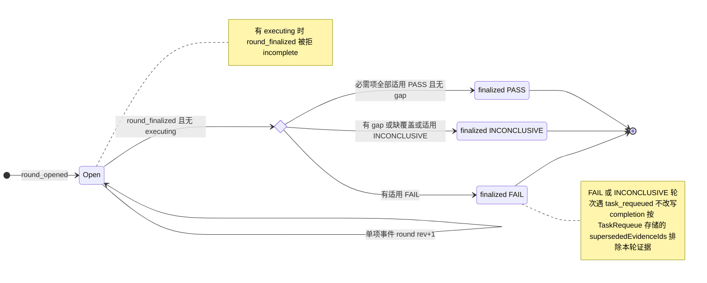

单项（轮次 open 期间）：

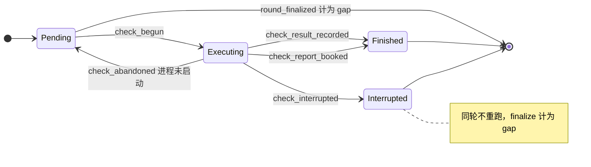

TaskEvidenceIndex 的写入不变式：

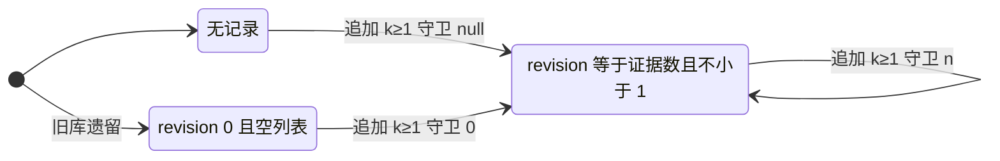

### 9.6 实现对照

状态机文件：`src/core/work-graph/state/verification-machine.ts`。

| 行号 | 状态机函数（目标：src/core/work-graph/state/<file>.ts 中的导出） | 调用服务（file） | 已有测试（file） | 计划新增测试（描述） |
| --- | --- | --- | --- | --- |
| VR-01 | `transitionRound(state, {kind:'round_opened'}, ctx)`；`roundSubjectSlotKey(ref)`；`buildOpenedRound(...)` | `evidence/evidence-service.ts`：`openVerification` 加槽、lookup 0 行与 VD-9 守卫，自行映射 `unique_conflict`；`queryOriginalVerification` 去掉 planRef 匹配（`:632-635`，VD-7）。`business/workflow/workflow.ts`：`openWorkChecksStep`（`:112-115`）与查询（`:572`）改用 Goal 当前采用版；gate 开轮（`:726-735`）遇 `busy` 时续接已有轮次 | `tests/work-graph/R3e-evidence.test.ts:70`、`:273`；`tests/composition/R5c-workflow-platform.test.ts:470` | 两个 flowId 对同一 Run 开轮 → 第二个得 `busy` + current；并发开轮只成一轮；遗留无槽轮次 → `busy`；subject Run 为 `cancelled`/`outcome_unknown` → 拒绝；领取后 W16 未来采用，Run 结束仍能开轮并完成；Goal `paused` → `busy` |
| VR-02 | `transitionCheck(check, {kind:'check_begun'}, ctx)` | `evidence-service.ts` `beginCheck`（加 Goal、disposition 读取与守卫）；`agent-runtime/check-execution.ts` | `R3e-evidence.test.ts:118`、`:183`；`tests/composition/R3e-command-check-platform.test.ts:144`（并发只跑一个进程） | 机表：pending→executing，其它 phase 一律拒绝（`interrupted` 也拒绝）；Goal 暂停后起检 → `busy`，进程计数不变；subject task 只在当前采用版中为 superseded → `invalid` |
| VR-03 | `transitionCheck(..., {kind:'check_result_recorded'})`；`outcomeFor` 移入 state | `evidence-service.ts` `recordCheckResult`；`check-execution.ts:169-174` 有界重试（VD-10） | `R3e-evidence.test.ts:118`、`:183`；`R3e-command-check-platform.test.ts:81` | 对 interrupted 单项迟到的结果 → `busy`，结论不变；并发起检使 pin 过期后重试成功入账；前次已提交时重试 → 重读得 finished |
| VR-04 | `transitionCheck(..., {kind:'check_interrupted', cause:'host_restart'})`；新 port 操作 `interruptCheck`；新事件 `VerificationCheckInterrupted` 加入 `VerificationRoundEvent` 联合（`evidence-record-codecs.ts:66-71`）与 `VERIFICATION_ROUND_EVENT_TYPES`（`:73-79`，schema 注册经 `:455-457` 自动带上） | `src/app/host.ts` 启动时在 D-18 之后调用新 `src/core/agent-runtime/check-reconcile.ts`：枚举 executing 单项，调 `interruptCheck`/`bookCheckReport`。新增 lookup `VerificationRoundByStatus`（路径 `ref.projectId/ref.workspaceId/status`），注册在 `evidence-record-codecs.ts:458-461` | `R3e-command-check-platform.test.ts:144`（组合根层不跑 reconcile，仍断言 executing，保持有效） | Host 重启并接管陈旧租约 → executing 变 interrupted，进程计数不变；另一 Host 存活 → 不变；同一实例重复 reconcile → 回放；另一实例遇已 interrupted → 跳过、不报错；Host 执行者配置变化后重启 → 仍能标记 interrupted |
| VR-05 | `transitionCheck(..., {kind:'check_abandoned', cause})`；新 port 操作 `abandonCheck`；新事件 `VerificationCheckAbandoned`（注册同 VR-04） | `check-execution.ts:117-137` 的五条早退路径重读轮次后调用 `abandonCheck`（finishing signal，同 `:168`），仍返回原拒绝 | — | begin 后调用方取消 → 单项回到 pending、无 gap，下一次推进起检得新 invocationId 并照常入账；begin 后 root 变化 → pending → 下一次起检得 `frozen_root_changed` → finalize INCONCLUSIVE；execute 抛出未知错误 → 仍为 executing |
| VR-13 | `transitionCheck(..., {kind:'check_interrupted', cause:'ticket_invalid'})`；port 操作 `interruptCheck` | `check-execution.ts:108-109` | — | ticket 不完整 → interrupted，Workflow 不再起检该单项，finalize 计 gap `interrupted_check` |
| VR-06 | `transitionCheck(..., {kind:'check_report_booked'})`；新 port 操作 `bookCheckReport`；新事件 `VerificationCheckReportBooked`（注册同 VR-04） | `check-reconcile.ts`；body store 新增按 origin requestId 的查找（注 1） | — | 报告已存而提交前崩溃 → 入账 finished，不重跑（前置能力就绪后）；同一 requestId 两份正文 outcome 不同 → interrupted；报告身份与单项不符 → 不入账；已 interrupted 后才找到报告 → `busy`，不升级 |
| VR-07 | `transitionRound(..., {kind:'round_finalized'})`；`finalizeRoundOutcome(input)`；`buildFinalizedRound(...)`；`displayRoundStatus(round)` | `evidence-service.ts` `finalizeChecks`；`workflow.ts` `nextAfterRound`（`:124-136`：只有 executing 才等待，pending 先跑，之后 finalize） | `R3e-evidence.test.ts:183`（executing ⇒ `incomplete`，保持）、`:228`；`R5c-workflow-platform.test.ts:604`、`:617`（**需改**：真实 FAIL 检查改为断言 `outcome:'FAIL'`）；`tests/work-graph/R3e-evidence-coverage.test.ts:53`、`:68` | 机表：FAIL 优先；interrupted → gap `interrupted_check` → INCONCLUSIVE；pending 加上同一要求的另一 PASS → INCONCLUSIVE（VD-4）；finalize 与 Plan 采用并发 → `revision_conflict`；中断后剩余 pending 照跑，投影单调 |
| VR-08 | `transitionRound(..., {kind:'evidence_submitted'})` | `evidence-service.ts` `submitEvidence` | 无（`tests/business/R5c-workflow.test.ts:65` 只是 stub） | finalized 后提交 → `busy`；提交与 finalize 并发 → 只有一个成功 |
| VR-09 | `supersededEvidenceIdsOf(round)`（requeue 时取本轮 `evidenceRefs` 的 id，供 §4 `write_task_requeue` 存入，L-3）；`evidenceSupersededByRequeue(requeues)`（各 TaskRequeue 存储 id 的并集）；`roundFailureFacts(round)`（§13 `noProgressKey` 的输入） | `tasks/` 中的 `requeueTask`（新，D-3）写 `afterRoundRef` 与 `supersededEvidenceIds`，守卫 round@rev；`tasks/completion.ts`：读该 Task 的 TaskRequeue（§4 4.3 末），在 `:356-381` 折叠前排除存储 id 的并集，不读 afterRound 轮次，`selectEffectiveEvidenceSet` 本身不变 | `R3e-evidence-coverage.test.ts:68`（折叠不删阻塞，保持）；`tests/work-graph/R3e-completion.test.ts:87` | Run1 轮次 FAIL → requeue → Run2 轮次 PASS → `completeTask` 成功；TaskRequeue 存储的 `supersededEvidenceIds` 等于本轮 `evidenceRefs`，无轮次时为 `[]`；不 requeue 时旧 FAIL 仍阻塞；轮次 open 时 requeue → 拒绝；遗留 PASS 带 gaps → 可 requeue；同一失败两次的 `roundFailureFacts` 相同（不含 id、digest、时间） |
| VR-10..VR-12 | `nextTaskEvidenceIndex({exists, revision, ids}, appended)` → `{write:false}` 或 `{record, guard}` | `evidence-service.ts` `submitEvidence`/`finalizeChecks`/`readIndex` | 无 | 全部 STALE 时 finalize（零快照）→ 不建 index 行，随后 submit/finalize 成功；遗留 @0 行在下一次追加时修复；`completion.ts` 的 `collectEvidenceKeys`（`:622-656`）读遗留 @0 行不报错 |
| 出口 #3（VD-8） | `beginRefusalIsPermanent(rejection)`：只有 `reason` 以 `frozen_permission_changed:`、`frozen_root_changed:`、`frozen_source_changed:` 开头的拒绝 → true（L-9 固定前缀） | `evidence-service.ts` `beginCheck`（`:689-698`）与 `check-execution.ts:81-83` 把标记写成 `reason` 前缀；`workflow.ts` `performStep` 的 `run_check` 分支（`:824-831`）：标记命中时读轮次并提交 `finalize_checks` | — | 开轮后 root 或来源 digest 变化 → 剩余单项不再重试，轮次 INCONCLUSIVE，Task `blocked/round_inconclusive`，可 requeue；authorize 暂时拒绝（`forbidden` 无标记）→ 仍等待；capture 失败（`source_stale` 无标记）→ 仍等待；沙箱不可用 → 仍等待 |
| 完成（VD-7，死路 #8） | —（Workflow 改造，无机器函数） | `workflow.ts` `completeTaskStep`（`:137-148`）：`planRef` 取 `goal.activePlanRevision`，为 null 时等待；调用处 `:587`、`:844` 已读出 Goal | `tests/composition/R5c-workflow-platform.test.ts` | 开轮之后、completeTask 之前发生 W16 未来采用 → Task 仍完成（不得 `revision_conflict`）；gate 轮次同样适用 |
| Workflow 选择（VD-11） | —（Workflow 改造，无机器函数） | `workflow.ts` `selectNext`（`:715-742`）：`:720`、`:739` 跳过 `cancelled`/`superseded`（同 `completion-policy.ts:239`）；`:726` 只选 disposition=`active` 的 gate（属于 U-10 (a)，用户选定前不做） | `tests/business/R5c-workflow.test.ts` | 必需 work 被 cancelled → 不再等待它；U-10 选 (a) 后：旧 gate 被 superseded、有替代 gate → 替代 gate 开轮并完成，旧 gate 不再被选 |
| 投影 | `roundTaskSignal(rounds)`（作为 `projectTaskPhase` 的输入，含多轮判定） | `tasks/plan-readers.ts`：`readCanonicalTaskFacts` 的折叠（`:1150-1154`）改由 state/task-machine 调用 | `tests/work-graph/R3c-canonical-task-state.test.ts` | 按“轮次 → Task 投影”表逐行断言（含 open+interrupted+pending → `verifying`、遗留 PASS 带 gaps → `blocked/round_inconclusive`）；gate 轮次不改变任何 Task 投影 |

构造器约束（§14）：`buildOpenedRound`、`withCheckPhase`、`buildFinalizedRound`、`nextTaskEvidenceIndex` 只从 `state/` 导出。`evidence-record-codecs.ts` 的解码函数在白名单内。


## 10. Message

消息是收件 Session 收到的一条陈述，不是任务义务。收件人忙或已归档都照常收信；收信不会唤醒执行、不会抢占，也不会建立任务依赖（`src/core/work-graph/communication/contracts.ts:6-11`）。本节把邮箱的六个写入点（state-writes-other §2，M-a…M-f）转写为单调状态机。消息状态只有 `pending/read/responded`。“已交付”“等待”“已落实”都用其他事实表达，不新增消息状态（ORCHESTRATION §0.2“确认层次”、§2 消息行）。

本节依赖的待确认决定：D-17（不做“让出前即持久化的等待关联”）、D-6（重启补账，U-6）、D-4(b)（人工认定，Kernel 可能不可读；属 U-4；只经持实例租约的 Host 入口，lead 决定 L-1），以及 §6 的 RD-3（重启时 Kernel 终态为 yielded：由持久事实重建 continuation 后按原结果入账；只在本 Turn 恰好一条等待发信时重建，否则记为未知，lead 决定 L-5）。

### 10.1 持久位置与状态枚举

| 字段 | 位置（file:line） | 取值 | 可变性 |
| --- | --- | --- | --- |
| `status` | `SessionMessage.status`（`communication/contracts.ts:104`），类型定义在 `:88` | `'pending' \| 'read' \| 'responded'` | 只能单调前进 |
| `readAt` | `:105` | `null \| string` | ack 时写入；回复时若仍为空则回填 |
| `response` | `:106`，类型 `MessageResponse` 在 `:81-86` | `null \| {sender: work_run \| query_run, bodyRef, sourceRef, respondedAt}` | 单槽，只写一次 |
| `replyMode`、`intent`、`needsReply`、`waitAfterSend` | `:113-119`；意图类型见 `src/contracts/core/session-message.ts:22`、`:25-29` | `'wait'`；`notify/inquiry/action_request`；boolean | 发送时固定，之后不变 |
| `acceptedInputs[]` | `:132-138` | `{inputId, part: message \| response, executionRef, kernel{…position}, acceptedAt}` | 只追加 |
| `consultationDerivation` | `:139-144` | `{childSessionRef, sourceSessionRef, sourceKernel, throughPosition}` | 只写一次，先写者胜 |
| `sender`、`recipient`、`bodyRef`、`sourceRef`、`createdAt` | `:99-103` | sender 为 `host`（`:36-39`）或 `work_run`（`:46-52`） | 不可变 |

- 状态机输入状态：`MessageMachineState = absent | { status, hasReadAt, hasResponse, acceptedInputIds, hasDerivation, revision }`。
- 守卫上下文（IO 留在服务，服务把读取和授权结果填进来）：

```ts
// src/core/work-graph/state/message-machine.ts（目标）只 import src/contracts
type MessageGuardContext = {
  principal: 'host' | 'work_run' | 'other';
  workRunAuthorization: 'ok' | CoreRejection | null;  // authorizeNewWorkRunAction 的结果（mailbox-service.ts:615-741）；Host 调用为 null
  callerIsRecipient: boolean | null;                   // ack/respond：调用方 Session 是收件人
  recipientScope: 'same_workspace' | 'other_workspace' | 'other_project' | null; // 只用于 message_sent
  sendFlags: { needsReply: boolean; waitAfterSend: boolean; replyMode: 'wait' | null; pinCount: number } | null;
  pins: { count: number; matchesMessage: boolean; revision: number | null }; // ack/respond/derive 要求恰好一个指向本消息的版本钉
  bodyBounded: boolean | null;
  queryAnswer: null | {                                // 只用于 MSG-06
    bindingMatches: boolean;                           // 咨询绑定与消息、原收件人、derivation 来源一致
    jobAnsweredWithAnswer: boolean;
    runSettledAnswered: boolean;
    answeringSessionIsClaimSession: boolean;
  };
  inputAccepted: null | {                              // 只用于 MSG-07/08
    observerOwnsExecution: boolean;                    // work_run 只能确认自己的 Run；Host 恒为 true
    kernelMatches: boolean;                            // 等于执行记录中固定的 Kernel 身份
    executionSessionMatches: boolean;                  // part=message：收件人；part=response：原发信 Session
    inputIdTakenByOtherEvent: boolean;
  };
  consumedWait: null | { responseRefMatches: boolean; sameWorkspace: boolean }; // 只用于 MSG-10
};
```

- Codec `checkSessionMessageBody` 校验三元组一致（`message-record-codecs.ts:377-386`）：pending ⇒ readAt 与 response 都为空；read ⇒ 有 readAt、无 response；responded ⇒ 有 response。Codec 不校验两件事：responded ⇒ readAt 非空，以及状态单调。这两条由本机和记录构造函数保证（§11 I-8）。记录 schema 在提交时由存储校验（`record-codec.ts:379`）。

**设计名与代码的对应**

| 设计名（§2、§0.2） | 代码表达 | 说明 |
| --- | --- | --- |
| 已持久发送／消息已保存 | 记录存在，`status:'pending'` | M1 |
| 可读取 | 任一 status | 读操作不改状态（`contracts.ts:167-170`），M2 |
| 已确认接收（已读） | `status:'read'` 加 `readAt` | M3 `ackMessage`；已读不等于已处理 |
| 已交付（进入执行） | `acceptedInputs[]` 中 `part:'message'` 的条目 | 来自 Kernel `run.input_accepted` 的观察，与 status 无关 |
| 实际答复／正式回复 | `status:'responded'` 加单槽 `response` | M3；回复可以由 work_run 写出，也可以来自正式 Query Answer |
| 回复已被原发信方的执行消费 | `acceptedInputs[]` 中 `part:'response'` 的条目 | 原发信 Session 的后继执行 |
| 相关行动已落实 | 不记在消息上 | 由 Run、控制和 Task 事实表达（§0.2） |
| 等待 | 不是消息状态 | 见下文 |

**等待怎样表达（D-17 缺口）**

1. **发送时的意图。** `needsReply`、`waitAfterSend`、`replyMode` 在发送时归一化（`mailbox-service.ts:1072-1077`）后固定。`waitAfterSend` 与 `needsReply=false` 不能同时出现，服务（`:1075-1077`）和 codec（`message-record-codecs.ts:325-327`）都会拒绝。
2. **执行中的等待登记只在内存。** 登记链路是 `communication-tools.ts:243-247` → `execution-driver.ts:328-331`（`handle.waitMessage`）。工具组屏障在 `after_group` 时让出（`execution-driver.ts:678-680`）。
3. **只有 yielded 终态会把等待写入持久记录。** `execution-control.ts:220-232` 构造 `RunContinuationV1{kind:'wait_reply', messageRef}`，经 `execution-observation.ts:647`、`:658` 交给 `recordRunResult`，写入 `Run.continuation`。yielded 终态必须带 continuation，否则 `recordRunResult` 拒绝（`execution-entry-service.ts:1373-1378`）。
4. **等待何时算满足。** 条件是消息为 `responded`，且 `response.bodyRef` 等于后继领取中 `consumedWait.responseRef`。后继领取写 `Run.consumedWait`，并在同一提交里守卫消息 revision（`claim-service.ts:590-638`、`:703`、`:731`）。`read` 状态或 `acceptedInputs` 都不满足等待（M3：“读取/接收确认不能解除等待”）。
5. **缺口（state-writes-other §7 #21，D-17 不做）。**
   - Host 若在发信成功后、yielded 终态提交前崩溃，进程内的等待登记会丢失：消息仍带 `waitAfterSend:true`，但 Run 上没有 continuation。
   - 重启补账分两种情况：
     - (a) Kernel 历史已有 `yielded` 终态（D-6）：进程内句柄上的 continuation（`execution-control.ts:220-232`）已经丢失，按现有 `recordRunResult` 会被拒为 `invalid`（`execution-entry-service.ts:1374-1376`）。本规格采用 §6 RD-3：Kernel 原历史中本 Turn 恰好有一条带 `waiting:true` 的 `send_session_message` 工具结果时（L-5），以它加上已存 `SessionMessage`（`sender.runRef`、`generation`、`waitAfterSend` 一致）重建 continuation，再经 RUN-17/18 按 yielded 入账并释放（Session 侧见 §8 SES-06），之后的回复照常触发接续领取（MSG-10）。重建不出时（含本 Turn 有零条或多条等待发信）经 RUN-20(iii) 记为 `outcome_unknown`，保留占用。
     - (b) Kernel 尚未 yield（D-17 真正的缺口，§12 W-18）：没有 yielded 终态，Run 按 RUN-19 记为 `crashed` 或按 RUN-20 记为未知，等待关联丢失。
   - 这条等待消息本身不变：仍是原来的 `pending`/`read`/`responded`，`waitAfterSend:true` 保留。情况 (b) 下之后到达的回复照常写入单槽（MSG-04..06），但没有 Run 的 continuation 指向它，所以不会触发接续领取，MSG-10 不会被调用。Task 按 §4 投影为 failed（RUN-19）或 blocked（RUN-20）。如果经 D-3 重新入队后新 Run 仍在同一 Session，输入供给会从 outbox 把这条回复当作普通输入提供（`execution-inputs.ts:110-127`），不经 `consumedWait`。
   - RD-3 不按 outbox 查找等待消息：该 Run 可能发出多条 `waitAfterSend` 消息，只有 Kernel 历史中的工具结果位置能指出是哪一条。进程内的取法也不唯一：`waitRegistered` 只记第一条（`execution-driver.ts:329`），continuation 取的 `waitHandle.waitMessage` 每次被覆盖（`:330`）。因此按 lead 决定 L-5，只在本 Turn 恰好一条等待发信时重建；多条时不猜，按重建失败经 §6 RUN-20(iii) 记为 `outcome_unknown`，保留占用和 Lease，出口为人工认定（RUN-22，须在持实例租约的 Host 上，L-1）。这些等待消息本身不变；认定之后与情形 (b) 相同：没有 continuation 指向回复，回复不触发接续领取。
   - 本节不新增消息侧的等待状态。

### 10.2 事件

| 事件名 | 来源 | 载荷要点 | 对应原文编号 |
| --- | --- | --- | --- |
| `message_sent` | U（Host 操作者或 Host 注意力递送，`src/app/host.ts:958-961`）、P（work_run 通信工具） | `recipient`、正文（先存成 `bodyRef`）、`intent/needsReply/waitAfterSend/replyMode`、发信 principal | M1 |
| `message_read` | P（work_run 工具 `ackMessage`） | `messageRef`，恰好一个消息版本钉 | M3 |
| `message_responded` | P（work_run 文本回复）；P（Host 关联正式 Query Answer） | `messageRef`、版本钉，以及 `text` 或 `answerRef` | M3、§0.1 A′ |
| `input_accepted` | K（Kernel `run.input_accepted`，由 Runtime 观察者提交，`agent-runtime/execution-inputs.ts:151-174`） | `messageRef`、`part`、`executionRef`、`kernel{adapterId, kernelSessionId, runId, turnId, position}` | M3（接收确认与响应分别记录）、§0.2 确认层次 |
| `consultation_derived` | P（Host 咨询消费者，`business/workflow/consultation.ts:368-379`） | `messageRef`、版本钉、`derivation` | §0.1 A′ |
| `task_claimed`（Task 投影事件，此处只读） | P | 接续领取中的 `consumedWait{runRef, messageRef, responseRef}` | M3（推进适用等待） |

- 没有 T（超时）来源的事件：M5 超时、失联、重定向目前没有写入者。
- 没有 R（重启）专用事件：reconcile 只会以同一身份重放 `input_accepted`（见 10.3 表后说明）。
- 实例租约被另一个存活的 Host 持有（或锁文件不可读）时，该 Host 不运行 reconcile，也不启动注意力递送等执行驱动，因此不会产生注意力递送的 `message_sent`（`src/app/host.ts:958-961`）。Host 操作者经 HTTP 的发信（MSG-01）和各读操作照常，由 RecordStore CAS 保护（lead 决定 L-10）。

### 10.3 迁移表

| # | from | event | guard（守卫） | to | effects（同事务副作用意图） | 幂等/重复事件 | 原文编号 | 现状 |
| --- | --- | --- | --- | --- | --- | --- | --- | --- |
| MSG-01 | absent | `message_sent`（Host 发信） | 可信 Host principal；收件 Session 在同一项目和工作区（忙碌或归档都可以）；发送标志合法；不带版本钉 | `pending`，rev 1 | 提交前先存正文（事务外）；写 `SessionMessage`，`readAt=null`、`response=null`；事件 `SessionMessageSent`；消息守卫为 `null` | 同身份同内容 → 重放；同身份不同内容 → `idempotency_conflict` | M1 | 已有 `mailbox-service.ts:1082-1083`、`:1126-1178` |
| MSG-02 | absent | `message_sent`（work_run 发信） | 同 MSG-01，另须通过 `authorizeNewWorkRunAction`：Run 为 running 且无 outcome；发信 Session 为 active 且由本 Run 的 generation 占用；Lease 未释放；V2 entered；角色核对 | `pending` | 同 MSG-01，并在同一提交守卫 Run、Session、Lease 和角色事实。若 `waitAfterSend`，Runtime 另在内存登记等待（不在本提交，D-17） | 同 MSG-01 | M1 | 已有 `mailbox-service.ts:1084-1124`、`:615-741` |
| MSG-03 | `pending` | `message_read` | principal 为 work_run；恰好一个版本钉；通过 `authorizeNewWorkRunAction`；调用方 Session 是收件人 | `read` | `readAt=now`，rev+1；事件 `SessionMessageRead`；守卫消息版本钉及授权事实 | 先查回执（`:1584-1586`）；未命中但状态已不是 pending → 再查一次，仍无则拒绝 | M3 | 已有 `mailbox-service.ts:1559-1624` |
| MSG-04 | `pending` | `message_responded`（work_run） | 同 MSG-03；正文有界 | `responded` | 提交前先存回复正文；写 `response{sender: work_run}`；`readAt ??= respondedAt`；rev+1；事件 `SessionMessageResponded` | 同身份重放；单槽只写一次 | M3 | 已有 `mailbox-service.ts:1629-1713` |
| MSG-05 | `read` | `message_responded`（work_run） | 同 MSG-04 | `responded` | 同 MSG-04（`readAt` 保持原值） | 同 MSG-04 | M3 | 已有 `mailbox-service.ts:1691-1697` |
| MSG-06 | `pending` 或 `read` | `message_responded`（query_run，由 Host 关联正式 Answer） | Host principal；咨询绑定与本消息、原收件人及 derivation 来源一致；QueryJob 为 answered 且列有该 Answer；QueryRun 已 settled 且 outcome 为 answered；作答 Session 是领取 Session；正文有界 | `responded` | `response{sender: query_run, generation}`；正文沿用 Answer 的原始来源；`readAt ??=`；只守卫消息版本钉 | 同身份重放（`:1838-1840`）；与 MSG-04/05 抢同一单槽时先到者胜 | M3、§0.1 A′ | 已有 `mailbox-service.ts:1726-1880` |
| MSG-07 | 任一 s | `input_accepted`（part=message） | principal 为 work_run（只能确认自己的 Run）或 Host；Kernel 身份等于执行记录中持久的身份；执行 Session 是收件人；该 inputId 尚未被接受 | s（不变） | 向 `acceptedInputs` 追加一条，rev+1；事件 `SessionMessageInputAccepted`；按读取到的 revision 守卫消息 | 身份键为 (messageRef, part, executionRef, kernel)，与观察者是谁无关（`:1996-1998`），重复即重放 | M3、§0.2 | 已有 `mailbox-service.ts:1947-2064` |
| MSG-08 | `responded` | `input_accepted`（part=response） | 同 MSG-07，但要求 `response≠null`，原发信人为 work_run，且执行 Session 是原发信 Session | `responded` | 同 MSG-07 | 同 MSG-07 | M3（回复关联原请求） | 已有 `mailbox-service.ts:2030-2033`、`:2045-2047` |
| MSG-09 | 任一 s | `consultation_derived` | Host principal；derivation 为对象，形状由 codec 在提交时校验；此前没有 derivation；恰好一个版本钉 | s（不变） | 写 `consultationDerivation`，rev+1；事件 `SessionMessageConsultationDerived`；只守卫消息版本钉 | 同身份重放（`:1912-1914`）；先写者胜 | §0.1 A′ | 已有 `mailbox-service.ts:1885-1942` |
| MSG-10 | `responded` | `task_claimed`（接续领取读取等待是否满足） | `status==='responded'` 且 `response≠null`；`response.bodyRef` 等于 `consumedWait.responseRef`；同一工作区 | `responded`（只读） | 领取提交守卫消息 revision；回复后再追加 `acceptedInputs` 会让并发领取得到 CAS 冲突 | 随领取回执重放 | M3（推进适用等待） | 已有 `claim-service.ts:619-638` |

表外说明：

- **释放前先补记输入。** 凡是在 Kernel 已有 Turn 后释放占用的路径，释放前都要先用同一函数重放 Kernel 历史中的 `run.input_accepted`。这不只适用于 Kernel 终态入账（含 RD-3 重建后的 yielded），也包括 D-6 的 crashed（RUN-19）、RD-7 的暂停中停止（RUN-23）、Query 的 interrupted_clean 和人工认定，即 §8 的 SES-04、06、07、08、09（QRR-04）、10。这个前置条件今天已经在两处生效：`execution-observation.ts:534-537` 和 `query-observation.ts:391-393`。重放靠 MSG-07/08 的身份键做到幂等，所以重启后不会重复追加。reconcile 不会重发、ack 或回复任何消息。
- **Kernel 不可读时的人工认定会造成重复投递。** §8 SES-07、SES-10（包括 SD-3 之后的认定）允许在 Kernel 不可读时释放。这时 Kernel 已接受、但还没确认的输入无法补记。后继执行的输入供给只跳过 `acceptedInputs` 中已记录的 inputId（`execution-inputs.ts:48-49`、`:74`、`:84`），所以可能再次接受同一消息部分，即至少一次投递。认定入口（只在持实例租约的 Host 上受理，L-1）要向操作者说明这一后果。
- **两个回复写入方。** MSG-04/05（work_run 文本回复）和 MSG-06（Host 关联 Query Answer）抢同一个单槽，都按消息版本钉做 CAS。若失败方在胜方提交前已读取消息，它在提交时遇到 CAS 冲突，再查回执没有命中，于是得到 `revision_conflict`。若失败方在胜方提交后才读取，它看到 `responded`，得到 `invalid`。两种情况都不覆盖胜方，胜方的同身份请求可以重放（`tests/work-graph/C1-session-mailbox.test.ts:376`）。
- **回复不要求收件人仍为 active。** MSG-06 的 Host 路径不检查收件 Session 的 lifecycle，归档不影响收件箱。work_run 路径要求的是“调用方”Session 为 active（`mailbox-service.ts:641`）。

### 10.4 明确禁止的迁移

| from | event/目标 | 拒绝原因 | 对外 CoreError | 说明 |
| --- | --- | --- | --- | --- |
| `read` 或 `responded` | 回到 `pending` | illegal | 无（没有入口） | I-8：状态不倒退；没有写入者 |
| `responded` | 回到 `read` | illegal | 无 | 同上 |
| `read` 或 `responded` | `message_read` | illegal | `invalid` | `mailbox-service.ts:1598-1605`；先按同身份重放 |
| `responded` | `message_responded`（任何发信者） | illegal | `invalid`；并发失败方可能得到 `revision_conflict` | `:1670-1675`、`:1841-1844`；单槽先到者胜 |
| absent | `message_read`、`message_responded`、`consultation_derived`、`input_accepted` | illegal | `not_found` | `:1594-1595`、`:1666-1667`、`:1763-1764`、`:1915-1916`、`:2002-2003`，经 `mapReadResult`（`:139`） |
| 任一 | Host 调用 `message_read` 或文本 `message_responded` | guard_failed | `forbidden` | `:1562`、`:1632`；Host 只能经 MSG-06 关联正式 Answer |
| 任一 | work_run 关联 Query Answer（MSG-06）或写 `consultation_derived`（MSG-09） | guard_failed | `forbidden` | `:1732`、`:1891`；两者只接受 Host principal |
| 任一 | 调用方 Session 不是收件人时 `message_read` 或 `message_responded` | guard_failed | `forbidden` | `:1597`、`:1669` |
| 任一 | work_run 的 Run 未运行、已终态、Lease 已释放或 Session 不是本 generation 占用时 send/ack/respond | guard_failed | `forbidden` | `:639-656`；原回执仍可重放（`C1-session-mailbox.test.ts:333`） |
| `pending` 或 `read` | `message_responded`（query_run），但 Query 未以 answered settled 或绑定不符 | guard_failed | `forbidden` | `:1780-1819` |
| 任一 | ack、respond 或 derive 未带恰好一个指向本消息的版本钉 | illegal | `invalid` | `:282-288` |
| 版本钉 ≠ 当前 revision | `message_read`、`message_responded`、`consultation_derived` | stale | `revision_conflict` | 存储 CAS |
| absent | `message_sent` 带版本钉 | illegal | `invalid` | `:1078` |
| absent | `message_sent` 同时设 `waitAfterSend` 与 `needsReply=false` | illegal | `invalid` | `:1075-1077` |
| absent | `message_sent` 的发信 principal 不是 host 或 work_run | illegal | `unsupported` | `:1091-1093` |
| absent | `message_sent` 的收件 Session 属于其他项目 | guard_failed | `forbidden` | `:1051`；先于工作区检查 |
| absent | `message_sent` 的收件 Session 不在本工作区 | guard_failed | `not_found` | `:1132-1134` |
| 任一 | `input_accepted` 的 inputId 已被另一事件记录 | guard_failed | `invalid`（沿用现有码） | `:2037-2042`。身份键含 executionRef 和 Kernel 位置（`:1996`），另一事件是不同身份，不是重复；这是 inputId 唯一性守卫 |
| 任一 | `input_accepted` 的 Kernel 身份或执行 Session 不符 | guard_failed | `forbidden` | `:2023-2036` |
| 任一 | work_run 为别的执行确认 `input_accepted` | guard_failed | `forbidden` | `:1981-1983` |
| 任一 | `input_accepted` 改变 `status` 或 `readAt` | illegal | 无 | 交付、已读、处理是三件事（M3）；该事件只追加 |
| 已有 derivation | `consultation_derived` | illegal | `invalid` | `:1918-1921`；先写者胜 |
| `pending` 或 `read` | 把 `message_read` 或 `input_accepted` 当作等待已满足 | guard_failed | `busy`（接续领取） | `claim-service.ts:630-632`：只有 responded 满足等待 |
| absent | `task_claimed`：接续领取引用的等待消息不存在 | guard_failed | `busy` | `claim-service.ts:626` |
| `responded` | `task_claimed`：`consumedWait.responseRef` ≠ `response.bodyRef` | guard_failed | `forbidden` | `claim-service.ts:633-635`；不信任调用方给的 responseRef |
| `responded` | `task_claimed`：等待消息不在绑定工作区 | guard_failed | `forbidden` | `claim-service.ts:636` |
| 任一 | 读操作（`readInbox`、`readMessage`、`readMessageBody`、`readOutbox`）改变 status | illegal | 无 | `contracts.ts:167-170` |
| 任一 | 因超时或失联自动改变消息状态或取消等待 | illegal | 无 | M5 只允许确定性提醒和显式处置；本规格不提供写入者 |

**守卫缺口与处置（只修状态机必需的部分）**

| 缺口（state-writes-other §7） | 本规格处置 | 理由 |
| --- | --- | --- |
| #5(a) `recordInputAccepted` 忽略调用方版本钉，按读取到的 revision 守卫 | 不修 | 这是追加型观察。身份键、inputId 唯一和读取 revision 的 CAS 已足以防止重复和丢写 |
| #5(b) 不守卫读取的 Run 或 QueryRun 事实 | 不修 | 它核对的是 begin 时固定的 Kernel 身份（`auth.kernel`、`executionHistory.kernel`、`entry.kernel`）和 claim Session，两者都不可变 |
| #5(c) 不检查消息 status | 不修（设计如此） | 交付观察与 status 无关；`part=response` 已要求 `response≠null`，等价于 responded |
| #5(d) 接受 Host principal，并以 `systemActor` 记为发送者 | 不修 | Runtime 观察者（含 Query 观察者，`query-observation.ts:391`）以可信 Host 身份运行；work_run 只能确认自己的 Run |
| #6(a) `respondFromQueryAnswer` 的 `guards: []` | 不修 | 它读取的 QueryJob（answered）、QueryRun（settled）和 Answer（rev 1）都已是终态或不可变，读后不会再变；消息本身按版本钉做 CAS |
| #6(b) `recordConsultationDerivation` 的 `guards: []` | 不修 | derivation 只写一次，按消息版本钉 CAS，先写者胜 |
| #6(c) `recordConsultationDerivation` 在服务内只检查 `isObject` | 列为已知缺口 | 形状由 codec 在提交时校验（`message-record-codecs.ts:352-371`）。子 Session 是否存在、角色和来源边界未在服务内核对，但只有 Host 能调用，且 Query 领取时会再次核对咨询绑定（`query-execution.ts:723-740`） |
| #20 子 Session 与 derivation 分两次提交 | 列为已知缺口 | 确定性 requestId 让重试复用同一子 Session（`consultation.ts:358-379`） |
| #21 等待关联只经 yielded 终态持久化 | 列为已知缺口（D-17） | 见 10.1；本规格不新增消息等待状态 |
| G11 正式 wait/subscription 与调度唤醒 | 列为已知缺口 | `IMPLEMENTED-CAPABILITIES.md:162`、`:252` |
| M5 超时、失联、重定向 | 列为已知缺口 | 没有路由或等待处置记录 |
| 正文在事务外先存 | 保持 | 孤儿正文不会被发布（`C1-session-mailbox.test.ts:417`） |

### 10.5 状态图

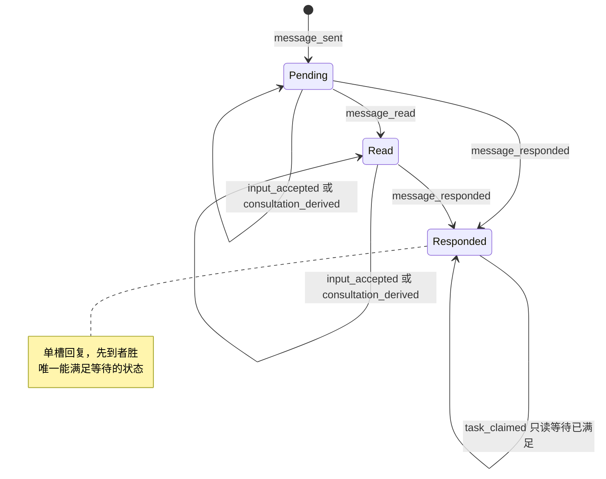

### 10.6 实现对照

| 行号 | 状态机函数（目标：`src/core/work-graph/state/message-machine.ts` 中的导出） | 调用服务（file） | 已有测试（file） | 计划新增测试（描述） |
| --- | --- | --- | --- | --- |
| MSG-01、MSG-02 | `transitionMessage`（message_sent）、`createSessionMessageRecord` | `communication/mailbox-service.ts` `sendMessage` | `tests/work-graph/C1-session-mailbox.test.ts:53`、`:107`、`:128`、`:172`；`tests/app/orchestration-mechanism.test.ts:169`、`:181`、`:189`、`:208` | 发送标志组合表（含 `waitAfterSend` 与 `needsReply=false` 的拒绝） |
| MSG-03 | `transitionMessage`（message_read）、`nextSessionMessageRecord` | `mailbox-service.ts` `ackMessage` | `C1-session-mailbox.test.ts:90`、`:188`、`:333` | read 或 responded 再 ack 得到 `invalid`；同身份重放 |
| MSG-04、MSG-05 | `transitionMessage`（message_responded） | `mailbox-service.ts` `respondMessage` | `C1-session-mailbox.test.ts:188`、`:376` | pending 直接 responded 时回填 `readAt`（I-8） |
| MSG-06 | 同上 | `mailbox-service.ts` `respondFromQueryAnswer`（经 `business/workflow/consultation.ts`） | `tests/app/AG2-consultation.test.ts:330`、`:518` | Answer 关联与 work_run 回复竞争，先到者胜 |
| MSG-07、MSG-08 | `transitionMessage`（input_accepted） | `mailbox-service.ts` `recordInputAccepted`（由 `agent-runtime/execution-inputs.ts:151-174` 调用） | `tests/app/orchestration-mechanism.test.ts:331`、`:402` | 任一 status 下追加都不改 status；同 inputId 来自另一事件得到 `invalid`；重启补账重放不追加重复条目 |
| MSG-09 | `transitionMessage`（consultation_derived） | `mailbox-service.ts` `recordConsultationDerivation` | `tests/app/orchestration-mechanism.test.ts:402`（断言在 `:470-471`） | 第二个不同 derivation 被拒（先写者胜）；work_run 调用得到 `forbidden` |
| MSG-10 | `messageSatisfiesWait`（只读谓词） | `tasks/claim-service.ts:619-638` | `tests/app/AG2b-collaboration.test.ts:150` | read 状态或只有 `acceptedInputs` 时不满足等待（`busy`） |
| 全部 | 单调性与 I-8 检查 | — | `C1-session-mailbox.test.ts:188` | 对所有事件序列做属性测试：状态不倒退；responded ⇒ `readAt≠null` 且 `response≠null` |

§14 的写入限制要求：`mailbox-service.ts` 中写 `status`、`readAt`、`response` 的对象字面量（`:1149-1165`、`:1608`、`:1691-1697`、`:1857-1863`）改为调用 `state/message-machine.ts` 的记录构造函数。`acceptedInputs` 和 `consultationDerivation` 不是状态字段，但为保持单一构造点，也一并迁入。`message-record-codecs.ts` 的解码函数在豁免名单内。


## 11. 跨状态机不变量

本节的不变量只对**持久记录**表述：在一次 RecordStore 读取窗口内读到的全部记录（I-9 另读事件日志）。它们不依赖进程内句柄，因此重启前后都必须成立。每条不变量给出三样东西：

- **形式化表述**：用下面的记号写成对记录集合的断言。
- **可能破坏它的迁移**：列出行号，以及守住它的机制（同一提交、CAS 守卫、状态机守卫）。
- **检查方式**：不变量测试中的断言函数名。函数都在 `tests/state/invariants.ts`（测试目录 `tests/state/`、`tests/scenarios/` 已由 lead 采纳，L-8），签名为 `(world: InvariantWorld, prev?: InvariantWorld, step?: FuzzStep) => InvariantViolation[]`，由 `checkAllInvariants` 汇总调用。

I-1..I-9 来自 brief §4，措辞按各节已定的状态和事件细化。I-10..I-15 是各节已经写出、纳入同一检查框架的补充不变量。

### 11.0 记号

| 记号 | 含义 |
| --- | --- |
| `runs`、`attempts`、`outboxes`、`leases`、`sessions`、`queryRuns`、`intents`、`rounds`、`messages`、`goals`、`goalPhases`、`reductions`、`requeues` | 窗口内该类型的全部记录 |
| `claimOf(r)` | Run r 的不可变领取：其 Attempt 对应 Outbox 的 `claim`（`TaskClaim`，`src/contracts/core/task-claim.ts:15-26`），含 `sessionRef`、`generation` |
| `known(o)` | `o ∉ {null, 'outcome_unknown'}` |
| `holds(s, x, g)` | `s.occupancy?.kind='execution' ∧ s.occupancy.executionRef=x ∧ s.occupancy.generation=g`，即 §8 的 `ownsOccupancy` |
| `leaseHeldBy(l, r)` | `l.release` 不存在 `∧ l.holderRunId=r.ref.runId ∧ l.attemptId=r.attemptId`，即 §6 的 `leaseOwnedByRun` |
| `phase(t)`、`cause(t)` | `projectTaskPhase(facts(t))` 的结果（§4 P1–P18） |
| `unresolved(r)` | `r.status ∈ {starting, running} ∨ r.outcome='outcome_unknown'` |
| `qUnresolved(q)` | `q.executionState` 存在且 `q.executionState.phase ≠ 'settled'` |
| `gen(h)` | Run：`claimOf(h).generation`；QueryRun：`executionState.sessionGeneration` |

### 11.1 I-1 Task running 与唯一 open Attempt 配对（D-14）

本条按 D-14 把任务书的措辞适配到代码（`claimed`↔`starting`，`started`↔`running`）。这一措辞待用户确认（U-14，lead 建议采纳）。

**形式化。** 对每个 work Task t（按 taskId 汇总全部计划版本的 Run，读取窗口与选定 Run 规则相同）：

- `O(t) = { a ∈ attempts : a.ref.taskId=t ∧ a.status ∈ {claimed, started} }`，且 `|O(t)| ≤ 1`；
- `phase(t)='running' ⇔ |O(t)|=1`；
- 若 `O(t)={a}`，r 为 a 的 Run：`(a.status='claimed' ∧ r.status='starting') ∨ (a.status='started' ∧ r.status='running')`，且 `leaseHeldBy(lease(t), r)`。

`claimed` 配 `starting` 时，r 的授权可以是 none、`authorized`、`entering`，或 D-5 之后的 `revoked`（§5.1 配对表）。

**可能破坏它的迁移与守法。**

| 行号 | 风险 | 守法 |
| --- | --- | --- |
| RUN-01、TASK-01/02/03、ATT-01/14/15/16 | 第二个 open Attempt | 租约 CAS（∅ 或 `@k` 且已有 `release`）；租约 held 时 ATT-17 返回 `busy`；TASK-03 要求 `requeueRef` 覆盖选定 Run |
| RUN-05、ATT-02、ATT-26 | Attempt 与 Run 只改其一 | 同一提交；ATT-02 新增显式守卫 Attempt=`claimed` |
| RUN-07/08/09/17–20/23、ATT-05–10/31/32/35/36 | Run 已结束而 Attempt 仍 open | `attemptEventFromRunEvent` 从同一个 Run 事件派生 Attempt 事件，Run、Attempt、Outbox、Lease 在同一提交写入，各带 CAS |
| RUN-16、ATT-04 | 撤销授权后误建 Attempt | ATT-04 不写 Attempt；新 Attempt 只能来自 TASK-03（§13.5） |

**检查。** `checkI1RunningPairing(world)`；与 §5.6 的 `checkAttemptPairing` 共用配对表。

### 11.2 I-2 Run 结束与占用、租约的释放

**形式化。** 对每个 `r ∈ runs` 且 `r.status='ended'`，取 `s = session(claimOf(r).sessionRef)`、`l = lease(r.task)`：

- `known(r.outcome) ⇒ ¬holds(s, r.ref, claimOf(r).generation) ∧ ¬leaseHeldBy(l, r)`；
- `r.outcome='outcome_unknown' ⇒ holds(s, r.ref, claimOf(r).generation) ∧ leaseHeldBy(l, r)`。

Query 类比（§8 D-11）：`q.executionState.phase='settled' ⇒ ¬holds(s_q, q.ref, gen(q))`；`phase='unknown' ⇒ holds(s_q, q.ref, gen(q))`。

**可能破坏它的迁移与守法。**

| 行号 | 风险 | 守法 |
| --- | --- | --- |
| RUN-07/09/17/18/19/21/22/23、SES-04/05/06/07 | 结束已知却漏释放 | 释放是 Run 迁移的效果意图（`release_session`、`release_lease`），与 Run 同一提交 |
| RUN-08、RUN-20、ATT-07/10/20/28/32/34/36/37 | 未知时误释放 | Run 机器对这两行不产出释放意图；Session 机器在 `holder.after=run_ended_unknown` 时拒绝 `occupancy_released`（§8.4） |
| SES-17、SES-18、ATT-19 | 旧代际终态释放新持有者 | 释放要求持有关系成立，否则为空迁移；Session、Lease 按读到的 revision 加 CAS（`execution-entry-service.ts:1412-1423`） |
| QRR-01/02/03/04/06、SES-08/09/10 | Query 收束漏释放 | `settleQueryRunRecord` 与 SES-08/09/10 同一提交 |
| QRR-05 | Query 未知时误释放 | QRR-05 不写 Session |

**检查。** `checkI2ReleaseMatchesOutcome(world)`。

### 11.3 I-3 GoalPhase COMPLETED 有正式依据

**形式化。** 对每个 `gp ∈ goalPhases`，若 `gp.phase='COMPLETED'` 且 `gp.planRef = goal.activePlanRevision`（`selectedPlanMatches`；采用新计划后旧 COMPLETED 失效属于 D-17 范围外，此时本条不检查）：

- 活动计划 P 中，每个 `requirementLevel='required'` 且 `disposition ∉ {cancelled, superseded}` 的 Task t：
  - `phase(t)='satisfied'`，即 P1 命中一条适用的 `TaskReduction(phase='satisfied')`；
  - 该 Reduction 的完成审计引用一个 `status='finalized' ∧ outcome='PASS' ∧ gaps=[]` 的轮次：work Task 的轮次 `subjectRunRef` 是它的生产 Run，gate 是 gate 轮次；轮次 `evidenceRefs` 覆盖 t 承载的义务。
- `goal.desiredState='active'`。
- 步骤局部条款（只在提交 `goal_completed` 的那一步检查）：该 Goal 的所有 Run 都不满足 `unresolved(r)`，也没有 `runBlocker`（`completion-policy.ts:64-81`）。不作为全程条款，因为 optional Task 在 Goal 完成后仍可能被领取。

**可能破坏它的迁移与守法。**

| 行号 | 风险 | 守法 |
| --- | --- | --- |
| GOAL-07、GOAL-08 | 证据不足就完成 | 同一提交内 `evaluateGoalCompletion`（`completion-policy.ts:209-279`），CAS Goal@rev 与 GoalPhase |
| TASK-14/15/24 | Reduction 引用非 PASS 轮次或旧失败 | TASK-14 守卫：投影为 `verifying`、轮次主体是选定 Run、排除 TaskRequeue 超越的证据（TD-2/VD-5；读取已存的 `TaskRequeue.supersededEvidenceIds`，lead 决定 L-3） |
| TASK-16/17 | 已满足的 Task 被重入队 | `satisfied` 上的 `task_requeued` 为 illegal（§4.4） |
| GOAL-04/06 | paused 或 cancelled 与 COMPLETED 并存 | GOAL-04/06 对 GoalPhase 加只读 CAS；GoalPhase 对应活动计划时暂停和取消为 illegal（§2.4） |
| PLAN-05（W16） | 新计划使旧完成失去对应 | `selectedPlanMatches` 变为 false，本条不再检查；由 GOAL-08 重新完成 |

**检查。** `checkI3GoalCompletionBacked(world, step)`。

### 11.4 I-4 一个 Session 至多一个写入型执行

**形式化。** 对每个 `s ∈ sessions`：

- `W(s) = { r ∈ runs : claimOf(r).sessionRef=s.ref ∧ unresolved(r) } ∪ { q ∈ queryRuns : q.executionState.sessionRef=s.ref ∧ qUnresolved(q) }`；
- `|W(s)| ≤ 1`；
- `W(s)={h} ⇒ holds(s, h.ref, gen(h))`；
- `W(s)=∅ ⇒ s.occupancy=null`（`maintenance` 没有写入者）；
- `s.lifecycle='archived' ⇒ s.occupancy=null`。

**可能破坏它的迁移与守法。**

| 行号 | 风险 | 守法 |
| --- | --- | --- |
| SES-02、SES-03、RUN-01 | 两个执行同时占用 | 占用守卫顺序 lifecycle → health → 无占用 → revision → generation → 版本钉（§8.3 表后）；Session CAS |
| SES-04–10、QRR-01–06 | 持有者结束而占用残留，或未结束先释放 | 释放只由持有者的结束在同一提交带出（§8.4）；I-2 |
| SES-11 | 归档占用中的 Session | 归档守卫 `occupancy=null`（`session-lifecycle.ts:607`） |
| SES-12、SES-13 | health 变化改了占用 | health 迁移不写 occupancy |

**检查。** `checkI4SingleWriterPerSession(world)`。

### 11.5 I-5 每个 Run 至多一个 queued 的指针意图

**形式化。** 对每个 `r ∈ runs`：

- `Q(r) = { i ∈ intents : i.runRef=r.ref ∧ i.kind ∈ {pause, cancel, resume} ∧ i.status='queued' }`，且 `|Q(r)| ≤ 1`；
- `Q(r)={i} ⇒ r.controlState.intentRef=i.ref ∧ r.controlState.desiredState=i.desiredState`；
- 对每个 `i.status='superseded'`：`r.controlState?.intentRef ≠ i.ref`；
- 每个 `kind='steer' ∧ status='queued'` 的 intent 都在 `r.controlInputs` 中。

D-8 之前写入的遗留数据可能有指针已移走、仍为 queued 的 intent（CTL-05 的兼容路径）。检查把它们报为 `legacy`，不算违规；fuzz 从空库开始，不会出现。

**可能破坏它的迁移与守法。**

| 行号 | 风险 | 守法 |
| --- | --- | --- |
| RUN-12–15、CTL-01 | 新指针意图入列，旧的仍 queued | CTL-04 在同一提交把旧的 queued 指针意图改为 `superseded`，并加旧意图的 CAS |
| RUN-09/10/11、CTL-02 | 平台直接生效时留下旧 queued | 同上；RUN-09 另把 queued steer 取代 |
| RUN-23、CTL-10 | 暂停中取消留下 queued steer | CTL-04(b) 同一提交 |
| CTL-03/05/06/07/08/09 | 观察改动指针 | 观察只写 intent，Run 只作 CAS 守卫（`control-service.ts:602-610`） |

**检查。** `checkI5SingleQueuedPointerIntent(world)`。

### 11.6 I-6 Attempt、Run、Outbox、Lease 的结束一致

**形式化。** 对每个 `a ∈ attempts`，r 为其 Run，o 为其 Outbox：

- `a.status='ended' ⇔ r.status='ended'`，且此时 `a.endOutcome = r.outcome`；
- `a.status='claimed' ⇒ r.status='starting'`；`a.status='started' ⇒ r.status='running'`；
- `o.status='settled' ⇔ (r.status='ended' ∧ known(r.outcome))`；
- `o.status='entered' ⇒ (r.status='running' ∨ (r.outcome='outcome_unknown' ∧ a.startedAt≠null))`；
- `o.status='pending' ⇒ (r.status='starting' ∨ (r.outcome='outcome_unknown' ∧ a.startedAt=null))`。

第二个析取项是明确的例外（lead 决定 L-2）：§6 RUN-20(ii) 从 `Entering` 结束为 `outcome_unknown`，探针为 `missing`/`damaged`，没有 Kernel Turn 可补记进入事实。这时：

- Attempt `claimed→ended(outcome_unknown)`，`startedAt=null`（§5 ATT-36）；Run 的 `startedAt` 也为 null；
- Outbox 保持 `pending`（ATT-37），这是 §5 AD-1 的例外，也写在 §5.1 配对表中；
- 只能经 RUN-21/22 离开：ATT-29 把 Outbox 从 `pending` 直接结算为 `settled`，`consumerId`/`entryGeneration` 取自 Run 的授权；RUN-21 同提交补记 Run 与 Attempt 的 `startedAt`（ATT-11），RUN-22 不补记。

因此未知期间 `startedAt` 是否为 null 恰好区分 Outbox 是 `entered` 还是 `pending`。

对每个 `l ∈ leases` 且 `l.release` 存在：`r' = run(l.release.runRef)` 满足 `r'.status='ended' ∧ known(r'.outcome) ∧ l.holderRunId=r'.ref.runId`。

**可能破坏它的迁移与守法。**

| 行号 | 风险 | 守法 |
| --- | --- | --- |
| RUN-21/22、ATT-11/12/22/29 | 解决未知时只改 Run，Attempt 仍为 unknown；或 ATT-37 之后的 `pending` Outbox 留在 `pending` | Attempt `endOutcome` 与 Run outcome 在同一提交改写（ATT-11 revision+1）；ATT-29 从 `entered` 或 `pending` 都结算为 `settled` |
| RUN-08/20、ATT-07/10/32/36、AD-1 | Outbox 提前 `settled` | Outbox 在 `outcome_unknown` 下保持 `entered`（ATT-28/34）或 `pending`（ATT-37） |
| RUN-20(ii)、ATT-36/37 | 没有 Turn 证据时把 Outbox 推进为 `entered`，或凭空补记 `startedAt` | ATT-37 不写 Outbox；`startedAt` 只在 RUN-21 带 Kernel Turn 开始时间时补记（L-2） |
| RUN-09、ATT-05/23/30 | 未进入取消时 Outbox 无法结算 | AD-2 的 `dispatchState.schemaVersion:2` 变体 |
| ATT-18/19/23 | 释放戳与持有者不一致 | 释放戳取自原 claim；`leaseOwnedByRun` 不成立时为空迁移 |

**检查。** `checkI6EndingConsistency(world)`。

### 11.7 I-7 轮次与单项检查的一致

**形式化。** 对每个 `v ∈ rounds`：

- `v.status='open' ⇒ v.outcome=null`；`v.status='finalized' ⇒ v.outcome≠null ∧ ∀c∈v.checks: c.phase≠'executing'`；
- `v.outcome='PASS' ⇒ v.gaps=[] ∧` 每个必需检查 `c.phase='finished' ∧ c.outcome='PASS' ∧ c.sourceStatus='matched'`；
- `v.outcome='FAIL' ⇒` 至少一个适用的 `finished` 单项 `outcome='FAIL'`（D-2）；
- 单项形状：`pending` 时 invocationId、outcome、reportRef、sourceStatus 全为 null；`executing`/`interrupted` 时只有 invocationId 非 null；`finished` 时四者全非 null（§9.1）。

跨步条款（`prev → next`）：finalized 轮次的 status、outcome、gaps、evidenceRefs 不再改变；`interrupted`、`finished` 单项不再改变；`executing → pending` 只经 VR-05。VD-4 之前遗留的“PASS 带 gaps”报为 `legacy`。

**可能破坏它的迁移与守法。**

| 行号 | 风险 | 守法 |
| --- | --- | --- |
| VR-07 | 带 executing 汇合；FAIL 被写成 INCONCLUSIVE；PASS 带 gap | 拒绝 executing（`incomplete`）；`finalizeRoundOutcome` 的 D-2 折叠 |
| VR-03、VR-06 | 迟到结果改写 interrupted 单项 | interrupted 上的结果与报告入账为 stale（§9.4） |
| VR-02 | 同轮重跑 interrupted 单项 | `check_begun` 只接受 `pending`（D-12） |
| VR-04、VR-13、VR-05（`check_abandoned`；VR-05、VR-13 已由 lead 采纳，L-8） | 中断或退回时残留结果字段 | 构造器 `withCheckPhase` 按阶段清空字段 |

**检查。** `checkI7RoundConsistency(world, prev)`。

### 11.8 I-8 消息状态单调、回复完整

**形式化。** 对每个 `m ∈ messages`：

- `m.status='pending' ⇒ m.readAt=null ∧ m.response=null`；`'read' ⇒ m.readAt≠null ∧ m.response=null`；`'responded' ⇒ m.readAt≠null ∧ m.response≠null`。
- 跨步条款：状态序 `pending < read < responded` 不倒退；`response` 一经写入不再改变；`acceptedInputs` 只追加；`consultationDerivation` 只写一次。

**可能破坏它的迁移与守法。**

| 行号 | 风险 | 守法 |
| --- | --- | --- |
| MSG-04、MSG-06 | 从 `pending` 直接回复时 `readAt` 为空 | `readAt ??= respondedAt` |
| MSG-04/05/06 | 两个回复写入方覆盖 | 单槽，按消息版本钉 CAS，先到者胜 |
| MSG-07/08/09 | 交付观察或派生改了 status | 这些行只追加，status 不变（§10.4） |

**检查。** `checkI8MessageMonotone(world, prev)`。

### 11.9 I-9 Goal 停止之后不再有新领取

**形式化（对事件日志）。** 对每个 `TaskClaimed` 事件 e（Goal g，提交游标 c(e)）：g 在游标 c(e) 之前最后一个 `GoalCreated` 或 `GoalDesiredStateChanged` 事件的 `to` 为 `active`。等价地：`desiredState≠active` 的那次提交之后、下一次回到 `active` 之前，没有该 Goal 的领取提交。

同一形式适用于其他“新进程”写入：`ExecutionEntryAuthorized`（RUN-02/03）、`VerificationRoundOpened` 与 `VerificationCheckBegun`（VR-01/02，VD-9），以及单个 Run 的 resume（RUN-11、RUN-14，D-9）。

**可能破坏它的迁移与守法。**

| 行号 | 风险 | 守法 |
| --- | --- | --- |
| RUN-01、TASK-01/02/03 | 与 GOAL-04/06 并发的领取落在暂停之后 | 领取检查 `desiredState`（`claim-service.ts:514`）并对 Goal@rev 加 CAS（`:725`），GOAL-04/06 使 Goal revision +1 |
| RUN-02/03 | 授权落在暂停之后 | `execution-entry-service.ts:939` 检查，`:988` 对 Goal 加 CAS |
| VR-01、VR-02 | 暂停后起检 | VD-9 守卫与 Goal@rev 读集守卫 |
| RUN-11、RUN-14、CTL-01/02 | 单个 Run 的 resume 绕过 Goal 暂停 | resume 守卫 Goal `desiredState=active`，并对 Goal 加 CAS |
| RUN-04 | begin 落在暂停之后 | 未加守卫（§2.4 的提议不采纳，lead 决定 L-6，GAP-15）。已授权的 Run 仍可进入，由 GOAL-11 的安全点控制收尾，不违反本条（本条只约束领取、授权、起检、resume） |

**检查。** `checkI9NoAdmissionAfterGoalStop(events)`。

### 11.10 补充不变量（各节已写）

| 编号 | 形式化 | 来源与守法 | 检查 |
| --- | --- | --- | --- |
| I-10 | 每个 V2 授权的 Run 落在 §6.1 的八种机器状态之一（status、outcome、授权 phase 的组合）；`continuation` 存在 ⇔ `outcome='yielded'`；`outcome='failed'` 从不出现 | §6.1、6.4；构造器只产出合法组合（§14） | `checkI10RunNodeShape` |
| I-11 | QueryRun：`status ∈ {answered, closed} ⇔ executionState.phase='settled' ⇔ endedAt≠null ∧ outcome≠null` | §8.1；`settleQueryRunRecord` | `checkI11QueryRunSettlement` |
| I-12 | 每个已结束 Run 至多一条 TaskRequeue；其 `afterRunRef` 的 outcome 已知，若为 `yielded` 则指针为 `cancelled`；有轮次时 `afterRoundRef` 已 finalized；新 Run 的 `requeueRef` 指向覆盖前一选定 Run 的那条 | §4 TASK-03/16/17；TaskRequeue 键 CAS null | `checkI12RequeueFacts` |
| I-13 | TaskEvidenceIndex：记录存在 ⇒ `revision = evidenceIds.length ≥ 1`（遗留 @0 报为 `legacy`） | §9 VR-10..VR-12 | `checkI13EvidenceIndex` |
| I-14 | GoalPhase 对应活动计划 ⇒ `goal.desiredState='active'` | §2 GOAL-04/06 的 GoalPhase CAS，GOAL-07 的期望状态守卫 | `checkI14CompletedGoalIsActive` |
| I-15 | 记录只前进：Run `starting → running → ended`（`Entering → Revoked → Authorized` 只经 RUN-16/03）；Attempt、Outbox、ControlIntent 终态不回退（`OutcomeUnknown` 只经 CTL-07）；`EndedUnknown` 只经 RUN-21/22 离开；PlanRevision、Evidence、TaskRequeue 不可变 | 各节 N.4 | `checkI15Monotone(world, prev)` |

### 11.11 检查框架

- `readInvariantWorld(store, projectId)`：在一次读取窗口内读出 11.0 的全部记录，并读出事件日志中的 `TaskClaimed`、`ExecutionEntryAuthorized`、`GoalCreated`、`GoalDesiredStateChanged`、`VerificationRoundOpened`、`VerificationCheckBegun` 和控制提交事件。
- `checkAllInvariants(world, prev, step)`：依次调用 I-1..I-15 的检查，返回违规列表。每条违规带不变量编号、记录 ref 和一句说明。
- 调用点：
  - 带种子的随机测试 `tests/state/invariants-fuzz.test.ts`（§15）：每一步提交之后调用。
  - 场景测试 A1、A4、A7、A8、A10、A11：每个场景结束时调用；A8 在重建 Host 之后、核对之后再调用一次。
  - 各状态机的穷尽测试只断言本机的记录级部分（例如 §5.6 的 `checkAttemptPairing`），不读全库。
- 失败时打印种子、步号和到该步为止的操作序列，便于重放。


## 12. 崩溃恢复矩阵

本节把 ORCHESTRATION §3.1 的提交与执行规则表展开成“崩溃点 → 重启后看到的持久事实 → 核对做什么”。依据的决定是 D-4、D-5、D-6、D-11、D-12、D-18（均待用户确认；对应 U-4、U-5（含 D-18）、U-6、U-15，D-11 按 brief 列在规格头部），以及 §6 的 RD-3、RD-4、RD-7（RD-7 已由 lead 采纳，L-8），§8 的 SD-2（已由 lead 采纳，L-8）、SD-3、SD-4。直接约束本节的 lead 决定：L-1（人工认定要求实例租约）、L-2（从 `Entering` 结束为未知且没有 Turn 时的 ATT-36、ATT-37）、L-5（yielded 只在恰好一条等待发信时重建 continuation）、L-10（第二个 Host 不核对、不启动执行驱动）。§6 RD-6（重启时安全点暂停中的 Run）是待用户决定的 U-9，本节按 lead 推荐的选项 (a) 书写（W-11）。

核对的总原则（brief §5、ORCHESTRATION §3.1）：

- 核对只读 Kernel Store 和平台记录，然后把结论入账。它**绝不**启动 Kernel Turn、重跑工具或检查、重发消息。
- 能确认的结果按原结果补账；确认未进入的，由同一个 claim 继续原来的待办；无法确认的如实记为未知，并保留占用。
- 进程不存在不等于不可恢复，读不到日志也不等于没有执行（ORCHESTRATION §2 Session 行、§3.1）。

### 12.1 核对流程（每次 Host 启动一次，先于任何新执行）

插入位置：`createLocalWorkbenchHost`（`src/app/host.ts:210`）。实例租约在创建平台（`:332`）之前取得；核对在平台创建之后、创建协作驱动（`:355`）和开始监听之前运行。Workflow、协作驱动和注意力递送都在核对完成之后才启动；没有取得租约时一律不启动（lead 决定 L-10，12.8）。

| 步 | 动作 | 写入行号 | 说明 |
| --- | --- | --- | --- |
| 0 | 取得 Host 实例租约（D-18）：在 `sqliteDirectory` 下以 `O_EXCL` 创建锁文件，内容 `{pid, hostInstanceId, startedAt}` | — | 锁被存活进程持有或锁文件不可读：不核对、不改任何事实、不启动执行驱动；普通读取和 owner 写入照常（L-10，12.8 HL-02、HL-07） |
| 1 | 探测 Session 映射：只探测被未决执行占用的 Session，以及 `active` 且 `health≠available` 的 Session（§8.2）。先于 Run 分类（核对顺序已由 lead 采纳，L-8） | SES-12、SES-13、SES-19 | 结论码用 §8.2 的六类：`ready`、`missing`、`damaged`、`host_config`、`transient`、`cancelled` |
| 2 | 枚举 Work Run：`status ∈ {starting, running}`，以及 `ended` 且 `outcome_unknown`；由 `agent-runtime/run-reconcile.ts` 读 Kernel 并分类 | RUN-16..21、RUN-23；随行 ATT、SES-06、CTL-07/08/10 | 每个 Run 一笔提交；Run、Attempt、Outbox、Lease、Session、ControlIntent 在同一提交 |
| 3 | 枚举未 settled 的 QueryRun | QRR-01..05；SES-08（QRR-03）、SES-09（QRR-01/02/04） | 同一分类器 |
| 4 | 枚举 `executing` 的检查单项 | VR-04、VR-06 | `agent-runtime/check-reconcile.ts` |
| 5 | 收尾已结束 Run 上遗留的 queued ControlIntent | CTL-08(e) | 单独提交，以 Run 为 CAS 守卫 |
| 6 | 重驱 Goal 扇出 | GOAL-16、GOAL-28 | 按 §2.3 的重驱协议 |
| 7 | 写出核对报告（未迁移的对象及原因），然后放行新执行 | — | 报告中列出 `host_config`、`transient` 等未迁移项 |

所有 R 来源的提交都带 `basis = {kind:'host_instance_takeover', hostInstanceId}`。核对身份为 `hash(对象 ref, hostInstanceId)`（VR-04 另含 checkId、invocationId；RUN-16 另含 entryGeneration）：同一实例重复执行时回放原回执；后续实例遇到已处理的对象时跳过。

### 12.2 Work Run：A8 的三个崩溃点

- **A8-1 进入 Kernel 之前**：begin 尚未提交。Run 为 `Claimed`、`Authorized` 或 `Revoked`。
- **A8-2 是否进入不明**：begin 已提交（`Entering`），进入事实尚未入账。
- **A8-3 已有副作用、结果未入账**：进入已入账（`Running`），Kernel 可能已执行工具甚至到达终态，但终态尚未入账。从 `Entering` 读到 Kernel Turn 的情形，核对结果与 A8-3 相同（RUN-17/19/20 同提交补记进入事实）。

| # | 崩溃点 | 重启后看到的持久事实 | reconcile 动作 | 结果状态 | 是否释放占用 | 证明依据 | 测试 |
| --- | --- | --- | --- | --- | --- | --- | --- |
| W-01 | A8-1：领取已提交，未授权 | Run `starting`、无授权；Attempt `claimed`；Outbox `pending`；Lease held；Session 被本代际占用 | 不迁移。核对后 Workflow 按同一 claim 重驱：RUN-02 → RUN-04 | `Claimed` | 否（同一 claim 继续） | begin 先提交、再调用 Kernel（ORCHESTRATION §3.1；`execution-driver.ts:409-442`）；没有 begin 就没有 Kernel 调用 | A8-1a |
| W-02 | A8-1：已授权，未 begin | 同 W-01，授权 V2 `authorized` | 不迁移。同一 consumer 复用已持久的 permit（`execution-driver.ts:402-404`）；Workflow 需改为也重驱 `Authorized`（`workflow.ts:538-553` 今天只接受无授权） | `Authorized` | 否 | 同 W-01 | A8-1b |
| W-03 | A8-1：较早实例已撤销授权，未再授权 | 授权 `revoked`，带 `reconciliation(done/not_entered)` | 不迁移。RUN-03 以 entryGeneration+1 重新授权，不新建 Attempt（ATT-04） | `Revoked` → `Authorized` | 否 | D-5 的证明已在较早实例入账 | A8-1c |
| W-04 | A8-1：W-01..W-03 上另有遗留的 queued pause 或 cancel | 指针指向 queued intent | CTL-08(a)：cancel 走 RUN-09，pause 走 RUN-10，都是 R 来源（指针不变，queued intent 变为 Applied）；resume 在 Goal 为 active 时走 RUN-11（R 来源），否则保持 queued | cancel → `Ended(cancelled)`；pause → 节点不变、指针 paused | cancel 释放（SES-05、ATT-23）；pause 不释放 | 未进入，D-7；RD-1 | A8-1d |
| W-05 | A8-2：begin 已提交 | 授权 `entering`；Attempt `claimed`；Outbox `pending`；探针 `ready`；Kernel Store 中没有固定 (kernelSessionId, runId, turnId) 的 Turn | RUN-16：撤销授权；Attempt、Outbox、Lease、Session 不写（ATT-04、ATT-21、ATT-25）；之后同 W-03。指针为 queued cancel 时同提交走 RUN-09，为 queued pause 时走 RUN-10（都是 R 来源） | `Revoked` | 否（同一 claim 继续）；同提交 cancel 时释放 | D-5：实例租约接管证明旧进程已不在，Kernel 先写 Turn 再执行；`kernelProbe=ready` 且无 Turn | A8-2a |
| W-06 | A8-2 | 同 W-05，但探针 `missing` 或 `damaged` | RUN-20(ii)：结束为未知，没有 Turn 可补记进入事实；Attempt `claimed→ended(outcome_unknown)`、`startedAt=null`（ATT-36），Outbox 保持 `pending`（ATT-37），lead 决定 L-2；SES-12 把 health 写为 `unavailable` | `EndedUnknown` | 否 | SD-3：读不到不是“未进入”的证明 | A8-2b |
| W-07 | A8-2 或 A8-3 | 探针 `host_config`、`transient` 或 `cancelled` | 不迁移，写入核对报告；下次启动再核对 | 原节点 | 否 | SD-2；“Kernel 暂时查不到”不是证明 | A8-2c |
| W-08 | A8-2，Turn 已执行 | `Entering`；Kernel Turn 存在 | 按 W-09..W-13 的同一规则分类；同提交补记进入事实（`startedAt`=Turn 开始时间，ATT-31..34） | 同 W-09..W-13 | 同 W-09..W-13 | 同 W-09..W-13 | A8-2d |
| W-09 | A8-3：Kernel 已有终态（非 yielded） | `Running`；Kernel Turn 有终态事件；工具全部有确定结果；`run.input_accepted` 可确认 | 先补记输入（MSG-07/08 同身份重放），再 RUN-18（从 `Entering` 来时为 RUN-17），经扩展的 `recordRunResult` 按原结果入账；ATT-08/18/27；CTL-08(b)(c) | `Ended`（Kernel 给出的 outcome） | 是（SES-06，historyCursor 取完整边界） | D-6：Kernel 原历史中的终态 | A8-3a |
| W-10 | A8-3：Kernel 终态为 yielded | 同 W-09，终态为 yielded | 按 RD-3 由持久事实重建 continuation，只在本 Turn 恰好一条等待发信时重建（lead 决定 L-5）：成功走 RUN-18/17（写 continuation）；失败（含零条或多条等待发信）走 RUN-20(iii) | 成功：`YieldedWait`；失败：`EndedUnknown`（原因 `continuation_unrebuildable`） | 成功：是；失败：否 | RD-3 的三项重建依据 | A8-3b（另含一例：同一 Turn 两条等待发信 → `EndedUnknown`） |
| W-11 | A8-3：没有终态，工具全部有结果 | `Running`；Turn 存在且无终态（含 Kernel 状态为 `paused`）；没有缺结果或 `outcome_unknown` 的工具调用；指针不是 queued cancel | RUN-19：合成 `run_crashed`（error 为 `host_interrupted`，Kernel paused 时为 `host_interrupted_while_paused`）；ATT-09；CTL-08(b)(c) | `Ended(crashed)`；Task 投影 `failed`，可重入队 | 是（historyCursor 不前移） | D-6：实例租约接管加全部工具有结果。Kernel `paused` 的情形按 RD-6 选项 (a) 书写；它是待用户决定的 U-9（lead 推荐 (a)），用户选 (b) 时这一情形不迁移，保持 `Running`（指针 paused），只能由用户 cancel 经 RUN-23 收尾，占用保留 | A8-3c |
| W-12 | A8-3：安全点暂停中，cancel 已入列 | `Running`；Kernel Turn 为 `paused`；指针为 queued cancel；没有在途工具 | RUN-23：合成 `run_cancelled`；ATT-35；SES-06；CTL-10 把 cancel 记为 Applied；queued steer 被取代（CTL-04(b)） | `Ended(cancelled)` | 是 | RD-7 | A8-3d |
| W-13 | A8-3：有在途工具 | Turn 存在；至少一个工具调用缺结果或为 `outcome_unknown` | RUN-20(i)：`record_reconciliation(quarantined/unresolved{observedThroughPosition, unresolvedToolCallIds})`；ATT-10；CTL-08(d) | `EndedUnknown`；Task 投影 `blocked/run_outcome_unknown`；界面显示“待核对” | 否（Session、Lease 都保留，D-4） | 无法确认的如实记为未知（A8） | A8-3e |
| W-14 | A8-3 | 同 W-09..W-13，但探针 `missing` 或 `damaged` | 同 W-06 | `EndedUnknown` | 否 | SD-3 | A8-3f |
| W-15 | 此前已经是未知 | `EndedUnknown`，带已记录的窗口 | 有 RD-4 意义上的新 Kernel 事实（终态位置超出 `observedThroughPosition`，原未结算工具都已有确定结果）：RUN-21（ATT-11/22/29、CTL-07）。W-06 之后的 Run（窗口为 null）同提交补记 Run 与 Attempt 的 `startedAt` 和 history，Outbox 从 `pending` 直接结算（L-2）。没有新事实：不迁移。之后只能由人在持实例租约的 Host 上经 RUN-22 认定（L-1） | 有新事实：`Ended` 或 `YieldedWait`；否则 `EndedUnknown` | 有新事实时释放；否则不释放 | RD-4：重启接管只证明“没有在途工具”，不证明副作用已知 | A8-3g |
| W-16 | 结束后控制收尾前 | `Ended`（不含 `YieldedWait`）；仍有 queued 指针 intent 或 queued steer | CTL-08(e)：有对应 Kernel 事件按观察映射，没有则记 `superseded`（`terminal_without_cancel`） | intent 结束；Run 不变 | 不涉及 | 终态已入账；CD-4 | A8-3h |
| W-17 | 让出等待中 | `YieldedWait`，可能有 queued intent | 不迁移；intent 保持为接续围栏（§7.3 情形 6） | `YieldedWait` | 已在终态时释放 | — | A8-3i |
| W-18 | 发信之后、让出之前（D-17 缺口） | `Running`；消息已持久（`waitAfterSend:true`）；Kernel Turn 无 yielded 终态 | 按 W-11 或 W-13 处理；消息不变，等待关联丢失 | `Ended(crashed)` 或 `EndedUnknown` | 同 W-11 或 W-13 | §6 RD-3 末项；§10.1 #5 | A8-3j |
| W-19 | 进程内未知终态提交后、观察写入前 | `EndedUnknown`；被消费或指针指向的 intent 仍为 queued | CTL-08(d)：记 `OutcomeUnknown` | intent `OutcomeUnknown` | 否 | CD-2 | A8-3k |

不在启动核对中迁移的情形：V1 旧授权（只读历史，报告为 unsupported）；`Claimed`/`Authorized` 上出现同身份 Kernel Turn（数据损坏，报告且不改，§6.4）。

**进程内的同类收尾（不需要重启）**

| 情形 | 行号 | 证明 |
| --- | --- | --- |
| Kernel 调用在 `turn.started` 之前失败，Run 停在 `entering` | RUN-16 的进程内变体 | `live_clean`：本次 Kernel 调用已退出、资源已关闭，且 Kernel Store 中没有 Turn |
| 终态带未结算工具 | RUN-08 | `live_clean` |
| 安全点暂停后 cancel | RUN-23 的进程内变体、CTL-10 | 句柄 `kernelExited && resourcesClosed.status==='completed'`（`execution-control.ts:233-244`） |
| 同进程后续观察到新证据 | RUN-21 | `live_clean` 加 RD-4 |

### 12.3 QueryRun（D-11）

| # | 崩溃点 | 重启后看到的持久事实 | reconcile 动作 | 结果状态 | 是否释放占用 | 证明依据 | 测试 |
| --- | --- | --- | --- | --- | --- | --- | --- |
| Q-01 | 领取或准备之后、begin 之前 | phase `claimed` 或 `prepared`；QueryJob、QueryRun 为 `pending` | QRR-01：收束为 closed，outcome `not_entered`，closeReason `not_entered` | `settled`（closed） | 是（SES-09） | begin 先提交 `entering` 再启动 Kernel（`agent-runtime/query-execution.ts:218-232`）；不需要探针 | A8-Q1 |
| Q-02 | begin 之后，Kernel 无 Turn | phase `entering`；探针 `ready`；没有固定 Turn | QRR-02：收束为 closed，不重新进入（entry generation 固定为 1） | `settled`（closed） | 是（SES-09） | D-5 类比 | A8-Q2 |
| Q-03 | Kernel 已有终态 | phase `entering`、`entered` 或 `unknown`；Kernel 终态可映射；边界完整；输入可确认 | QRR-03（R 来源）：按原结果入账，answered 时写 Answer | `settled`（answered 或 closed） | 是（SES-08） | D-6 类比 | A8-Q3 |
| Q-04 | 没有可入账终态，工具全部有结果 | phase `entering` 或 `entered`；Kernel 状态为 created、running、paused 或 yielded | QRR-04：closed，outcome `failed` | `settled`（closed） | 是（SES-09） | SD-4(b)(e) | A8-Q4 |
| Q-05 | 有在途工具，或 Kernel 数据确定性不可读 | 工具缺结果；或探针 `missing`/`damaged` | QRR-05：phase 记为 `unknown` | `unknown` | 否 | SD-3、SD-4(c) | A8-Q5 |
| Q-06 | 此前已为 `unknown` | phase `unknown` | 只有 QRR-03（新终态）能离开，或由人经 QRR-06 认定；不走 QRR-01/02/04 | `unknown` 或 `settled` | 只在离开时释放 | RD-4 类比 | A8-Q6 |
| Q-07 | 任意 | 探针 `host_config`、`transient` 或 `cancelled` | 不迁移，写入核对报告 | 原状 | 否 | SD-2 | A8-Q7 |

咨询 Query 收束为 closed 后，咨询消费者把它投影为 `ended`，同一消息身份不会再次提交（§8.3 QRR 表外说明）。

### 12.4 检查单项（D-12）

| # | 崩溃点 | 重启后看到的持久事实 | reconcile 动作 | 结果状态 | 是否释放占用 | 证明依据 | 测试 |
| --- | --- | --- | --- | --- | --- | --- | --- |
| C-01 | 起检之后、进程结束之前 | 单项 `executing`，带 invocationId；轮次 `open` | VR-04：单项记为 `interrupted`（cause `host_restart`）；不启动任何进程 | 单项 `interrupted`；剩余 pending 照常执行，之后 finalize 把它计为 gap `interrupted_check` → INCONCLUSIVE（VR-07） | 不涉及 | 实例租约接管 ⇒ 旧进程已死 ⇒ `bwrap --die-with-parent` 已终止检查进程（`vendor/coding-agent/patches/sandbox/process/process-sandbox.ts:339`） | A10-R1 |
| C-02 | 报告正文已存、结果未入账 | 单项 `executing`；按 origin requestId `r3e-check-result-<invocationId>`（`check-execution.ts:171`）能找到报告，且各份正文的 (sourceStatus, outcome) 一致 | VR-06：按报告中的原值入账为 `finished`，不重新评估 source | 单项 `finished` | 不涉及 | 原报告；前置能力（按 origin 查正文，§9 注 1）就绪前不可达，一律走 C-01 | A10-R2 |
| C-03 | 同 C-02，但各份正文不一致或身份不符 | 同 C-02 | 不挑选，走 VR-04 | 单项 `interrupted` | 不涉及 | §9 注 1 的选择规则 | A10-R3 |
| C-04 | 中断之后 | 单项 `interrupted` | 不重跑（D-12）。Task 投影：仍有 pending 或 executing 时为 `verifying`，否则为 `blocked/check_interrupted`，finalize 后为 `blocked/round_inconclusive` 或 `failed` | — | 不涉及 | §4 投影单调 | A10-R4 |

**运行中 Host 的停滞（不需要重启，但只有重启能解开）**

| 情形 | 今天的结果 | 目标 | 依据 |
| --- | --- | --- | --- |
| 进程已结束但结果入账失败（pin 过期或报告存储 `unavailable`） | 单项 `executing` 直到重启 | runner 有界重试（VD-10）；仍失败则接受停滞，到下次启动由 C-01/C-02 处理 | VD-10 |
| 执行中抛出未知错误（`check-execution.ts:159-161`） | 同上 | 不能证明未启动，保持 `executing` 到重启 | VD-6、VD-10 |
| begin 之后、进程启动之前放弃 | 单项 `executing` | VR-05 退回 `pending`；ticket 不完整时 VR-13 记 `interrupted` | VD-6 |

**gate 检查中断（§9 死路 #9）**：按 C-01 记为 `interrupted`，finalize 后为 INCONCLUSIVE。gate 不能 requeue，(gate, producer Run) 的轮次槽已占（VD-1），所以在 U-15 选 (i)、U-10 选 (c) 时该 gate 永久非 PASS，Goal 一直显示 `RUNNING/awaiting_gate`（§16 GAP-09）。出口取决于用户决定 U-10、U-15，核对本身不做任何额外动作。

**配置或环境等待（不迁移，Host 报告原因）**：开轮被拒（无配置、executor、权限、编译问题，§9 死路 #2）；起检前沙箱不可用（#4）；开轮后 Host 执行者身份改变（#10）。这些情况由人修好配置或环境后，Workflow 按原轮次继续；核对不处理它们。

### 12.5 queued ControlIntent，按核对后的 Run 状态

行号前缀 CI，与 §11 的不变量 I-1..I-15 区分。

| # | 核对后的 Run 状态 | intent | reconcile 动作 | 结果状态 | 依据 | 测试 |
| --- | --- | --- | --- | --- | --- | --- |
| CI-01 | `Claimed`、`Authorized`、`Revoked` | queued pause 或 cancel | CTL-08(a)，同提交 RUN-09/10 | `Applied`（platform_not_entered） | D-7、RD-1 | A8-1d |
| CI-02 | 同上 | queued resume | Goal 为 active：CTL-08(a) + RUN-11；否则保持 queued | `Applied` 或 `Queued` | D-9 | A8-1d |
| CI-03 | 本次结束为已知终态（RUN-17/18/19，非 yielded） | queued 指针 intent、queued steer | CTL-08(b)：Kernel 历史有对应控制事件，按观察映射；(c)：没有，记 `superseded`（terminal_without_cancel） | `Applied` 或 `Superseded` | D-8、CD-4 | A8-3a、A8-3c |
| CI-04 | `Running`，Kernel `paused`，指针为 queued cancel | queued cancel | CTL-10，同提交 RUN-23 | `Applied`（platform_paused_stop） | RD-7 | A8-3d |
| CI-05 | `EndedUnknown`（本次 RUN-20，或此前 RUN-08） | 任意 kind 的 queued intent | CTL-08(d) | `OutcomeUnknown` | CD-2 | A8-3e、A8-3k |
| CI-06 | `EndedUnknown`，之后有新证据 | `OutcomeUnknown` | CTL-07，与 RUN-21 同提交 | `Applied` 或 `Superseded` | D-8 | A8-3g |
| CI-07 | `EndedUnknown`，人工认定 | `OutcomeUnknown` | 不迁移（RUN-22 不改 intent） | `OutcomeUnknown` | §6 RUN-22 | A8-3g |
| CI-08 | 此前已 `Ended` | queued | CTL-08(e) | `Applied` 或 `Superseded` | CD-4 | A8-3h |
| CI-09 | `YieldedWait` | queued | 不迁移（接续围栏） | `Queued` | §7.3 情形 6 | A8-3i |
| CI-10 | 探针 `host_config`、`transient`、`cancelled` 使 Run 未迁移 | queued | 不迁移 | `Queued` | SD-2 | A8-2c |

### 12.6 Session health（D-10）

| # | 情形 | 探针结论 | reconcile 动作 | 结果 | 是否释放占用 | 依据 | 测试 |
| --- | --- | --- | --- | --- | --- | --- | --- |
| H-01 | 被未决执行占用，或 `active` 且 `health≠available` | `ready` | 已是 available：空迁移（SES-19）；否则 SES-13 写 `available` | `available` | 否（health 不改占用） | S8、S7 | A8-H1 |
| H-02 | 同上 | `missing`、`damaged` | SES-12 写 `unavailable`；持有者按 W-06/W-14、Q-05 处理 | `unavailable`；availability `unavailable` | 否 | SD-2、SD-3 | A8-H2 |
| H-03 | 同上 | `host_config`、`transient`、`cancelled` | 不写，报告 | 原值 | 否 | SD-2；SG-9 | A8-H3 |
| H-04 | 空闲、`health=available` 的 Session | 不探测 | — | 原值 | — | 只核对活跃或未完成的引用（S8） | A8-H4（断言探针调用次数为 0） |
| H-05 | `archived` | 不探测 | — | 原值 | — | §8.4 | A8-H4 |

health 为 `unavailable` 时，只有不需要 Kernel 的释放能走：D-7 取消（SES-05）、QRR-01（SES-09）、人工认定（SES-07、SES-10；须在持实例租约的 Host 上，L-1）。D-5 的同一 claim 重新授权要等 SES-13 重验通过。

### 12.7 Goal 扇出

| # | 崩溃点 | 重启后看到的持久事实 | reconcile 动作 | 结果状态 | 依据 | 测试 |
| --- | --- | --- | --- | --- | --- | --- |
| G-01 | 期望状态已提交、扇出未发出（包括期望状态是在不持租约的第二个 Host 上提交的，L-10） | Goal `paused`/`cancelled`@e（epoch e 即 `desiredStateRevision`，D-9 的记录形状，已由 lead 采纳，L-8）；某个受影响 Run 没有本 epoch 的扇出意图 | GOAL-16：按确定性 intentRef 读取，不存在则补交（未进入的走 GOAL-09/10，已进入的 intent 为 queued，随 W-09..W-13 收尾） | 每个 Run 至多一个本 epoch 的意图 | §2.3 重驱协议 | A7-G2 |
| G-02 | 扇出已落库、确认未返回 | 本 epoch 的意图已存在 | 跳过，不重交（避免 Run pin 变化导致 `idempotency_conflict`） | 原意图 | §2.3 | A7-G2 |
| G-03 | Goal 已恢复，暂停意图为 `outcome_unknown` | 意图 `OutcomeUnknown` | 不提交 resume，等 CTL-07 结算后按 GOAL-14 重试 | 原状 | GOAL-28 | A7-G3 |

### 12.8 两个 Host 实例（D-18）

行号前缀 HL（Host 实例租约），与 lead 决定 L-1..L-12 区分。

| # | 启动时看到的锁文件 | 动作 | 结果 | 依据 | 测试 |
| --- | --- | --- | --- | --- | --- |
| HL-01 | 不存在 | `O_EXCL` 创建，写入 `{pid, hostInstanceId, startedAt}` | 本 Host 持有租约，执行 12.1 | D-18 | A8-L1 |
| HL-02 | 存在，`process.kill(pid, 0)` 表明 pid 存活 | 不核对；不改任何事实；不启动任何执行驱动（核对必须先于新执行，brief §5）：协作驱动、注意力递送（`host.ts:897` 起的循环）、Workflow 推进、Goal 扇出，也不进入 Kernel（HL-07）；报告另一个 Host 持有存储。普通读取和经 HTTP 的 owner 写入照常（lead 决定 L-10） | 全部未决事实保持原状；R 事件返回 guard_failed（`busy`，§6.4、§8.4）；人工认定（RUN-22、QRR-06）同样要求租约，返回 `busy`（lead 决定 L-1） | D-18、L-1、L-10 | A8-L2 |
| HL-03 | 存在，pid 已死 | 视为陈旧租约，接管（原子替换为本实例内容） | 接管本身就是 D-5、D-6、D-11、D-12 所需的“旧进程已不在”证明 | D-18 | A8-L3 |
| HL-04 | 存在但内容不可读或损坏 | 按被持有处理，同 HL-02（lead 决定 L-10）；报告需要人工确认后删除 | 不改事实；读取与 owner 写入照常 | 安全方向：宁可不核对，也不误判旧进程已死 | A8-L4 |
| HL-05 | pid 被无关进程复用 | 判为存活，同 HL-02 | 不改事实；需要人工删除锁文件 | 同上 | A8-L5（锁文件写入一个存活的无关进程 pid，例如测试进程自身） |
| HL-06 | Host 正常关闭 | `close()`（`host.ts:994-1003`）在关闭平台之后删除锁文件。只删除本实例持有的锁（内容中的 `hostInstanceId` 等于本实例）；未取得租约的 Host（HL-02、HL-04、HL-05）关闭时不碰锁文件 | 下次启动为 HL-01 | D-18 | A8-L1；A8-L6（未持租约的 Host 关闭后锁文件原样保留） |
| HL-07 | 未持租约的 Host 运行期间（HL-02、HL-04、HL-05 之后）收到请求 | 普通读取照常。经 HTTP 的 owner 写入（领取、提交控制、发信、计划、`setGoalControl` 等）照常受理，由 RecordStore CAS 和各状态机守卫保护：未进入 Run 的 pause/cancel 经 D-7 直接生效（RUN-09/10 的 U 来源不要求租约）；已进入 Run 的控制保持 queued，由持租约 Host 的活句柄投递；Goal 期望状态立即阻止新领取，逐 Run 扇出由持租约的 Host 执行（GOAL-16、G-01）。会进入 Kernel 或启动执行驱动的入口（`executions/start`、`queries/start`、`workflow/advance`、`workflow/consultation`、`workflow/driver-start`，`src/app/core-routes.ts:156`、`:194`、`:199-201`）以及 `resolveUnknownRun` 返回 `busy` | 本 Host 不使任何 Run 进入 `Entering`，也不使任何 QueryRun 进入 `entering`；已进入或可能已进入的执行，其结果只由持租约的 Host 入账 | lead 决定 L-10、L-1。D-5、D-6、D-11 的“旧进程已不在”证明要求只有持租约的 Host 进入 Kernel；否则持租约的 Host 重启核对时，可能把另一个仍存活进程中的在途调用判为“未进入”或“中断” | A8-L6 |

本产品是单机、本地、单用户使用，不做分布式锁。HL-02、HL-04、HL-05 时 Host 提供普通读取和 owner 写入，但不核对、不执行（lead 决定 L-10，HL-07；§16 GAP-20 据此列为已知限制）。

### 12.9 不在核对范围（如实报告）

| 对象 | 现状 | 处置 |
| --- | --- | --- |
| 模型预算预留（RT5） | 跨进程预留没有恢复 | D-17，§16 |
| 让出之前的等待关联 | 只在内存中，崩溃即丢失 | D-17；见 W-18 |
| 原 Kernel Turn 的 fresh resume | 不做 | D-17；暂停中的 Run 按 RD-6 处理：待用户决定 U-9，lead 推荐 (a) 记 crashed（W-11），备选 (b) 保持 `Running`、只能取消 |
| 单笔提交中途崩溃（领取、发信、记录结果、requeue 等） | 事务回滚，不留部分写入 | 不需要核对；调用方按同一身份重试得到原回执（A4） |
| Session 创建操作（SG-12） | 两次提交之间创建 Kernel 会话 | 按同一身份重试恢复；不存在占用，不需要核对 |

### 12.10 场景测试 A8（关闭并重建 Host 与 SQLite）

测试文件 `tests/scenarios/A8-host-restart.test.ts`（目录 `tests/scenarios/` 已由 lead 采纳，L-8），沿用 `tests/app/R6-host.test.ts:391-419` 重开同一 ledger 与 Kernel 目录的做法，只用 fake 或回放 Kernel，不调用真实模型。

每个用例的步骤：

1. 在临时 `sqliteDirectory` 与 Kernel 目录上创建 Host，驱动到目标崩溃点。崩溃点由故障注入决定（例如 fake Kernel 在指定事件后挂起，或在 begin 提交后抛出）。
2. 模拟崩溃：不调用 `close()`；停止定时器，关闭 SQLite 连接；把锁文件留在原处，并改写为一个已退出子进程的 pid。
3. 在同一目录上重建 Host 与 SQLite。新 Host 接管陈旧租约（HL-03），运行核对。
4. 断言：
   - 结果状态与本节矩阵的对应行一致；
   - 核对期间 Kernel Turn 启动次数、provider 请求次数、检查进程启动次数都为 0；
   - I-1..I-15 全部成立（§11）；
   - 同一身份的请求得到原回执；
   - 再次重启（同一数据、新实例）后不产生新的写入。

| 用例 | 对应行 |
| --- | --- |
| A8-1a..A8-1d | W-01..W-04、CI-01、CI-02 |
| A8-2a..A8-2d | W-05..W-08、CI-10 |
| A8-3a..A8-3k | W-09..W-19、CI-03..CI-09 |
| A8-Q1..A8-Q7 | Q-01..Q-07 |
| A8-H1..A8-H4 | H-01..H-05 |
| A8-L1..A8-L6 | HL-01..HL-07 |

检查单项的恢复用例 A10-R1..A10-R4 放在 `tests/scenarios/A10-check-recovery.test.ts`，Goal 扇出用例 A7-G2、A7-G3 放在 `tests/scenarios/A7-control.test.ts`，做法与上面相同。


## 13. ORCHESTRATION §9/A11 无进展防护

本节落实以下要求：

- ORCHESTRATION §9（`:405-418`）与 A11（`:454`）；
- MVP-BEHAVIOR B10（`MVP-BEHAVIOR.md:184`）与 B04（`:125`）。

要求的内容是：同一动作、同一来源版本、同一已知失败、且没有新输入时，不自动再次执行；返回已有失败和“没有新依据”的解释；不新增通用 CoreError（ORCHESTRATION §9 `:411`）。依据决定 D-13，待用户确认。

去重依据保持局部、可解释（ORCHESTRATION §9 `:418`），只在 Task 进入新 Attempt 的唯一入口 `requeueTask` 计算，不给所有请求计算全仓指纹。

本节对 D-13 原文做了以下调整。ND-1、ND-2 已由 brief §2a 采纳；ND-4、ND-5 已由 lead 决定（L-12、L-8）；ND-3 仍待用户确认（GAP-17）。键中的计划组成按 lead 决定 L-4 取 Task 的有效 basis 计划（见 13.1）：

- **ND-1 失败指纹不含报告正文 digest。** 报告正文写入了 `roundRef`、`invocationId`、`subjectRunRef` 和 `recordedAt`（`evidence-service.ts:283-289`），每轮的 digest 必然不同。若计入这些 digest，键永远不会相等，防护形同虚设。改为只用 `(checkId, outcome)` 和 gap codes（brief §2a 已采纳）。
- **ND-2 来源版本取 requeue 时的值，而不是失败时的值。** 两个原因：
  - crash、cancel、budget 失败没有轮次，因而没有失败时的 `sourceDigest`；
  - 失败之后人或其他 Run 改过文件，本来就应算作新依据。

  做法是：requeue 服务用与 `openVerification` 相同的端口（`evidence-service.ts:446-459`）当场取得来源版本。
- **ND-3 与该 Task 的全部既有 TaskRequeue 比较，而不只是上一次。** D-13 只写了“与上一次 requeue/attempt 相同”。
  - 理由：文件经历 S1→S2→S1 往返、失败相同时，与上一次（S2）比较会放行，形成两状态循环；与全部比较才能挡住。
  - 代价：很久以前的某个键可能被合法地再次遇到（例如回退到旧版本后重试同一失败），这时需要新输入（人工说明）才能放行。
  - 只与上一次比较是备选，由用户选择。
- **ND-4 来源版本是整个工作区的 digest（已知局限；lead 决定 L-12：A.2 按整个工作区，按范围捕获列为缺口 GAP-30，以后再做）。**
  - 问题：同一工作区允许多个并行写执行（ORCHESTRATION `:258`）。任何无关写入都会改变 digest，使 requeue 看起来有新依据。因此在并发写入期间不能保证 A11（`:454`），键也不完全是局部的（`:418`）。
  - 今天没有按范围的捕获：`VerificationRoundSourcePort.capture(root)` 只对整个根（`src/contracts/verification-context.ts:44-46`）；Task 的 `scope` 只有 goal/stage/module（`src/contracts/plan.ts:9-18`），没有文件级写范围。
  - 本规格按整个工作区计算。失效方向是放行：不会把合法重试误判成重复（满足 `:418`），代价是并发写入期间防护变弱。13.6 用测试记录这一行为。
  - 以后的做法（不在 A.2）：新增按路径集合的捕获，把 `source` 限定为 Task 的写范围或失败检查的输入。这需要新的捕获能力和 Task 写范围。
- **ND-5 失败指纹记录失败来源，平台中断不参与比较（已由 lead 采纳，L-8）。**
  - 这一条改动了 brief §2a 固定的指纹字段（{checkId, outcome}、gap codes、Run 终态 outcome），lead 已签字（L-8）。
  - 理由：§6 RUN-19 在重启时，把“Turn 存在、没有终态、工具都有结果”的 Run 合成为 `crashed`（error=`host_interrupted`）。（RD-3 不重建 continuation 的让出，即 Turn 不是恰好一个等待发送（L-5）或重建失败，经 §6 RUN-20(iii) 记为 `outcome_unknown`，先被 §4 4.4 以 `busy` 拒绝，不进入比较。）这类失败不是动作本身的“已知失败”（ORCHESTRATION §9 `:411`）。如果它和 Kernel 报告的 `crashed` 指纹相同，连续两次 Host 重启后 Workflow 的重试会被判为“没有新依据”，而 Workflow 无法提供人工说明来解除。
  - 做法：
    - 新增 `failure.origin`，由 Run 的 `reconciliation` 派生：`observation.kind='interrupted_clean'` 且 outcome 为 `crashed`（RUN-19）为 `host_interrupted`；`observation.kind='human_attested'`（RUN-22）为 `human_attested`；其余为 `observed`，包括 Kernel 终态、D-7 未进入取消，以及 RUN-23 的暂停中取消（它也写 `interrupted_clean`，但 outcome 为 `cancelled`，是用户的取消）；
    - afterRun 的 origin 为 `host_interrupted` 时跳过键比较，但仍写入 `basis`，便于追溯。
  - §6 已用 `reconciliation.observation` 显式标记合成终态（6.1 契约 (a)），不靠 error 文本识别。
  - 残余风险：动作本身导致 Host 崩溃时会被反复重试。每次重试都需要一次 Host 重启，不会形成热循环，而且界面可见。

### 13.1 守护键 `NoProgressKeyV1`

纯函数 `noProgressKey(input)`，位于 `state/no-progress.ts`，只 import `src/contracts`。

| 组成 | 取值 | 来源 | 说明 |
| --- | --- | --- | --- |
| `taskRef` | `TaskTriple` | 请求 | — |
| `actionKind` | `'requeue'` | 固定值 | 当前唯一受控的动作。Workflow 的自动返工若获准（D-16），也只能调用 `requeueTask`，与此共用同一个键空间 |
| `failure.outcome` | afterRun 的已知 outcome | Run（§6） | 不能是 `outcome_unknown`；这种情况先被 §4 4.4 以 `busy` 拒绝，不进入比较。§4 P17（让出等待被取消）时为 `yielded` |
| `failure.origin` | `observed` / `host_interrupted` / `human_attested` | Run 的 `reconciliation`（§6 RUN-19、RUN-22） | ND-5（已由 lead 采纳，L-8） |
| `failure.checks` | 轮次中 outcome 不是 PASS 的单项，记为 `[{checkId, outcome}]`，按 checkId 排序 | `RoundCheckSnapshot`（`verification.ts:115-124`） | 没有轮次时为 `[]`。报告 digest 不计入（ND-1） |
| `failure.gapCodes` | 轮次 `gaps[].code`，排序 | `RoundSnapshot.gaps`（`verification.ts:143`） | 没有轮次时为 `[]` |
| `source` | `{workspaceRevision, sourceDigest}` | requeue 服务经 `workspaceHost.resolveRoot` 和 `source.capture` 读取（ND-2） | 整个工作区（ND-4）。不可读时整个请求返回 `unavailable`，不按“相同”处理 |
| `plan` | `basisPlanRef`：该 Task 的有效 basis 计划（`PlanRevisionRef`，`src/contracts/plan.ts:77-81`） | 读 `Goal.activePlanRevision`（`ledger.ts:61`）指向的 Plan，取 `buildEffectiveTaskBasis(plan).get(taskId)`（`plan-task-basis.ts:89-103`） | lead 决定 L-4（与 §3 3.3 第 4 点一致）。不取 `Goal.activePlanRevision` 本身：有痕任务的定义与 basis 被无痕规则冻结（§3 3.3 第 1 点），W16 采用其他任务时它沿用原 basis（`buildTargetTaskBasis`，`plan-task-basis.ts:107-140`），所以与该 Task 无关的采用不改变此项，也就不能绕过防护。今天同一 Task 的此项恒定；只有 §4 TASK-19（TD-4，待用户确认）放宽后，改变该 Task 定义的采用才会改变它，那才是新依据。basis 不可解析时整个请求返回 `incomplete`（同 `evidence-service.ts:407-410`、§4 4.4 `origin_unresolvable`），不按“相同”处理 |
| `newInputDigest` | 对已核实引用按序 canonical 后取 `sha256`；没有引用时为 `null` | 请求中的 `newInputRefs`，由服务逐项核实 | 可接受的引用只有三种：<br>• 已 `responded` 的 SessionMessage；<br>• 已存储的 Artifact；<br>• 操作者 kind 为 human 时的明确指令文本。<br>Agent 或 Workflow 的自由文本 `reason` 不计入 |
| `digest` | 对以上各项 `canonicalJson` 后取 `sha256` | — | 不含 `afterRunRef`、`afterRoundRef`、`reason`、`requestedBy`、时间。每个新 Run 的 id 都不同，若计入 id，键永远不会相等 |

### 13.2 检查位置与顺序

1. **唯一检查点：`requeueTask` 服务**（`tasks/requeue-service.ts`，见 §4 4.3）。
   - 服务计算键，把以下内容放入 `TaskGuardContext`，再调用 `transitionTask(task_requeued)`：
     - `currentBasisDigest`；
     - `priorRequeueBasisDigests`：该 Task 的全部既有 TaskRequeue 记录，在同一事实窗口内读取，key 为每个已结束 Run 的 `afterRunId`；
     - afterRun 的 `failure.origin`（ND-5）。
   - 机器的守卫只做比较，不做 IO。
2. **比较范围：该 Task 的全部既有 TaskRequeue（ND-3）。**
   - 范围包含上一次，所以覆盖 D-13 中“与上一次相同”的要求；同时也能挡住 S1→S2→S1 这样的往返。
   - 第一次 requeue 没有可比对象，总是通过：失败本身相对首次 Attempt 就是新信息。
   - afterRun 的 origin 为 `host_interrupted` 时跳过比较（ND-5，L-8）。
3. **判定顺序。**
   1. 查找回执：命中即重放原回执。
   2. 操作者检查（§4 TD-6）：不允许的操作者返回 `forbidden`。
   3. 状态前置条件（§4 4.3 TASK-16、17 与 4.4），按以下次序：
      - `running` 返回 `busy`；
      - `outcome_unknown` 返回 `busy`；
      - 轮次未 finalize 返回 `busy`；
      - `blocked/continuation_paused` 返回 `busy`；
      - `ready`、`satisfied` 返回 `invalid`。
   4. 本节的键比较。
   5. 提交。

   因此，结果未知时总是先回答“先核对”（ORCHESTRATION §9 `:413`），不会回答“没有新依据”。
4. **`claimTask` 不再检查一次。** 新 Attempt 只能来自带 `requeueRef` 的领取（TASK-03），而 requeue 已经通过了本防护。
5. **提交时的竞态。** 键比较依据的既有 TaskRequeue 以 `@1` 守卫，新记录的 key 以 `null` 守卫。并发的两次 requeue 只有一个能提交，另一个得到 `revision_conflict`；重读后再判定。

### 13.3 返回内容

| 情况 | 机器结果 | 对外返回 |
| --- | --- | --- |
| 键与某条既有 TaskRequeue 相同，且没有新输入 | `{ok:false, reason:'guard_failed', code:'dependency_blocked', detail:'no new basis'}` | `{status:'rejected', code:'dependency_blocked', reason:'no new basis: same failure, source, plan as TaskRequeue <id>; supply new input or change the method', current:[afterRun@rev, afterRound@rev（若有）, 相同键的 TaskRequeue@1]}`。0 commit |
| 与 ORCHESTRATION §3.1、§9 `:411` 的关系 | — | 不新增 CoreError，也不新增回执协议。`current` 沿用 `CoreRejection.current`（`src/contracts/core/results.ts:18-23`）。前提是 `TaskRequeueRef` 已加入 `AggregateRef`（`ledger.ts:46`，见 §4 4.1） |
| 同一 requestId 再次请求 | — | 拒绝不入账（只有 commit 有回执），所以会按当前事实重新计算。事实没有变化时结果相同，不产生写入 |
| 展示 | — | `TaskRow.phaseCause` 保持原值（`check_failed` 等）。拒绝说明由调用方展示，不写入 Task |

### 13.4 示例：合法重试与被拒的重复

| # | 场景 | 与既有键的差异 | 结果 |
| --- | --- | --- | --- |
| 1 | Run1 的检查 c1 FAIL，首次 requeue | 没有既有 TaskRequeue | 通过，Task 变为 `pending` |
| 2 | Run2 没改文件，c1 以同样方式 FAIL，再次 requeue | failure、source、plan、newInput 全部相同 | 拒绝，`dependency_blocked` |
| 3 | Run2 改了文件，c1 仍然 FAIL | `sourceDigest` 不同 | 通过（有实际修改，ORCHESTRATION §9 `:414`） |
| 4 | 同 #2，但用户回复了新说明，并作为 `newInputRefs` 引用 | `newInputDigest` 不同 | 通过 |
| 5 | 同 #2，Agent 只换了 `reason` 文本 | `reason` 不计入键 | 拒绝 |
| 6 | 同 #2，但期间采用了与该 Task 无关的新 Plan 修订（W16 没有改该 Task） | 该 Task 的有效 basis 计划不变（L-4） | 拒绝，`dependency_blocked`（无关采用不是新依据；只有改变该 Task 定义的采用才算，今天有痕任务不能改，见 §3 3.3、§4 TASK-19） |
| 7 | Run2 的 c1 转为 PASS，但 c2 FAIL | `failure.checks` 不同 | 通过 |
| 8 | Run2 以 `outcome_unknown` 结束 | 不进入比较 | 拒绝，`busy`（先核对） |
| 9 | Run1 因 Kernel 报告的错误 crashed（没有轮次，origin=`observed`），没有任何改动后 Run2 又因 Kernel 错误 crashed | failure（含 origin）、source 相同 | 第二次 requeue 被拒绝 |
| 10 | 文件经历 S1→S2→S1 往返，失败相同 | 与第一次 requeue 的键相同 | 拒绝（ND-3，与任一既有键比较） |
| 11 | 用户在失败之后手工修改了文件，然后 requeue | `sourceDigest` 不同（ND-2） | 通过 |
| 12 | Run1、Run2 都被 Host 重启中断（RUN-19，origin=`host_interrupted`），其间没有改动 | 跳过比较 | 通过（ND-5，L-8） |
| 13 | Run1 被 Host 重启中断并已 requeue；Run2 因 Kernel 错误 crashed，来源未变 | `failure.origin` 不同 | 通过（ND-5，L-8） |
| 14 | 同 #2，但两次 requeue 之间另一个 Run 在同一工作区改了无关文件 | `sourceDigest` 不同 | 通过（ND-4 的已知局限） |

### 13.5 机械重试如何排除

结构性的排除依据：对一个已经有 Run 的 Task，只有带 `requeueRef` 的领取能给出新 Attempt（TASK-03），而 `requeueRef` 只能由 `requeueTask` 产生。因此，“新 Attempt 是否受本防护约束”与“是否经过 `requeueTask`”是同一件事。下列重试都复用原 claim、Attempt 或操作身份，从类型上就无法触发本防护。

| 重试 | 不受约束的原因 | 依据 |
| --- | --- | --- |
| D-5 证明未进入后，同一 claim 以 `entryGeneration+1` 重新授权 | 不调用 `requeueTask`；Attempt 保持 `claimed`（ATT-04） | ORCHESTRATION §9 `:412`、D-5 |
| Workflow 对未受理的 `starting` Run 重新 prepare | 同一个 Run 和 claim（`workflow.ts:538-553`、`:641-644`） | ORCHESTRATION §3.1 `:297` |
| `startRun` 重复调用时 authorize 和 begin 的回执重放；begin 重放后只观察 | 同一操作身份（`execution-driver.ts:409-442`） | ORCHESTRATION §3.1 `:293` |
| 模型请求遇到 provider 暂时故障 | 今天没有任何 provider 重试：Kernel 的 provider 客户端设 `maxRetries: 0`（`vendor/coding-agent/dist/model/providers/openai/openai-model-client.js:13`、`deepseek/deepseek-model-client.js:12`）；重放或丢失响应也不重试（`src/core/agent-runtime/model-call-access.ts:8`）。若以后加入，只能在 Run 内部进行，每次模型请求单独取得并消费一次许可（`src/core/work-graph/tasks/model-call-service.ts:88`、`:176`），不经 `requeueTask` | ORCHESTRATION §9 `:412` |
| 续接领取（`consumedWait`） | 走 W2，不走 requeue；已回复的消息本身就是新依据 | TASK-02 |
| 同一 requestId 的回执重放 | 不产生新写入 | ORCHESTRATION §3.1 `:293` |
| reconcile 补记原结果 | 不重跑工具，只记账（ORCHESTRATION §3.1 `:299`）；不产生 Attempt | A8、D-6 |

### 13.6 实现对照

| 项 | 位置（目标） | 调用服务 | 已有测试 | 计划新增测试 |
| --- | --- | --- | --- | --- |
| `noProgressKey` | `state/no-progress.ts`（新增） | `tasks/requeue-service.ts` | 无 | 键稳定性：id、reason、时间、报告正文都不影响 `digest`；单项排序无关；origin 由 `reconciliation` 派生（ND-5）；`plan` 取有效 basis：同一 Task 在无关 W16 采用前后键相同，basis 不可解析返回 `incomplete`（L-4） |
| 守卫 | `state/task-machine.ts` `transitionTask`（`task_requeued`） | `tasks/requeue-service.ts` | 无 | 13.4 逐行 |
| 读取与来源捕获 | `tasks/requeue-service.ts`（新增），复用 `source.capture` 和 `workspaceHost` 端口 | 组合根接线（`create-platform.ts`） | 无 | 来源不可读返回 `unavailable`；两次并发 requeue 只有一次 commit；拒绝时 0 commit 且 `current` 带原失败的版本钉 |
| 与 E03、A11 的组合 | 端到端，无新增导出 | `workflow.ts`；`tasks/requeue-service.ts`；路由 `tasks/requeue` | `tests/composition/R5c-workflow-platform.test.ts`（在此扩展） | 同一失败重复两轮后不再出现新的 Attempt 或模型调用；两次 requeue 之间只有与该 Task 无关的 W16 采用时，第二次仍被拒（L-4）；有新输入时继续；两次 requeue 之间另一个 Run 改了无关文件时第二次通过（记录 ND-4 局限） |


## 14. 自动检查：状态只经 work-graph/state/ 写入

A.2 第 2 项要求“服务只通过状态机改状态”，并且能被自动检查（brief §3）。做法分两部分：

1. 生命周期字段只能由 `src/core/work-graph/state/` 导出的记录构造函数写出。一个类型感知的架构测试在 `state/` 之外发现对这些字段的写入时失败。
2. `check:architecture`（`scripts/check-boundaries.mjs`）保证 `state/` 是纯的：只依赖 `src/contracts/`，没有 IO。

两部分都在 A.2 第 3 步（服务改为调用状态机）完成之后加入，此时违规数应为 0，不设基线豁免。

### 14.1 受保护的记录类型与字段

“受保护字段”指决定生命周期的字段。只读字段（ref、不可变输入、时间戳之外的正文）不受限。

| 记录类型 | 声明位置 | 受保护字段 | `state/` 中的构造函数（各节已定） |
| --- | --- | --- | --- |
| `RunSnapshot` | `src/contracts/dispatch.ts:146` | `status`（:172）、`outcome`（:173）、`executionAuthorization`（:151）、`controlState`（:153）、`controlInputs`（:189）、`reconciliation`（:149）、`continuation`（:185）、`consumedWait`（:187）、`startedAt`/`endedAt`（:190-191）、`executionHistory`（:148，RUN-06）、事件水位 `lastEventSeq`/`lastRuntimeEventId`/`lastFactEventId`、新增 `requeueRef` | `run-machine.ts`（§6.6） |
| `TaskAttemptSnapshot` | `dispatch.ts:365` | `status`（:372）、`startedAt`（:373）、`endedAt`（:374）、`endOutcome`（:375）、新增 `requeueRef` | `attempt-machine.ts`（§5.6） |
| `TaskLeaseSnapshot` | `dispatch.ts:354` | `holderRunId`（:358）、`attemptId`、`release`（:363） | `attempt-machine.ts` |
| `TaskClaimOutbox`（DispatchOutboxEntry） | `src/core/work-graph/tasks/claim-contracts.ts:49` | `status`（:53）、`dispatchState`（:55） | `attempt-machine.ts` |
| `TaskReductionSnapshot` | `src/contracts/reduction.ts:54` | `phase`（:64） | `task-machine.ts`（§4.6） |
| `TaskRequeueSnapshotV1`（新增，D-3/U-3） | `src/contracts/task-requeue.ts`（拟） | 整条记录（不可变，只能创建），包括 lead 决定 L-3 存储的 `supersededEvidenceIds`、`afterRunRef`、`afterRoundRef`、`basis` | `task-machine.ts`：`newTaskRequeueRecord`（§4.1 字段表，TASK-16/17） |
| `ControlIntentSnapshotV1` | `src/contracts/control-intent.ts:75` | `status`、`observation`、`revision`（:76-81） | `control-intent-machine.ts`（§7.6） |
| `SessionRecord` | `src/contracts/core/session.ts:7` | `lifecycle`、`health`（:10）、`occupancy`（:12）、`archivedAt`（:14），以及随占用维护的 `lastExecutionRef`、`historyCursor` | `session-availability.ts`：`createSessionRecord`、`occupySessionRecord`、`releaseSessionRecord`、`archiveSessionRecord`、`reactivateSessionRecord`、`observeSessionHealthRecord`（§8.6） |
| `RoundSnapshot` | `src/contracts/verification.ts:126` | `status`（:141）、`outcome`（:142）、`gaps`（:143）、`evidenceRefs`（:144）、`checks` | `verification-machine.ts`：`buildOpenedRound`、`withCheckPhase`、`buildFinalizedRound`（§9.6） |
| `RoundCheckSnapshot` | `verification.ts:115` | `phase`（:119）、`invocationId`、`outcome`、`reportRef`、`sourceStatus`（:120-123） | `withCheckPhase` |
| `TaskEvidenceIndexSnapshot` | `src/contracts/evidence.ts:106` | `revision`、`evidenceIds` | `nextTaskEvidenceIndex`（§9 VR-10..12） |
| `SessionMessage` | `src/core/work-graph/communication/contracts.ts:95` | `status`（:104）、`readAt`（:105）、`response`（:106）；另把 `acceptedInputs`、`consultationDerivation` 一并迁入（§10.6） | `message-machine.ts`：`createSessionMessageRecord`、`nextSessionMessageRecord` |
| `GoalSnapshot` | `src/contracts/ledger.ts:55` | `desiredState`（:59）、新增 `desiredStateRevision`、`activePlanRevision`（:61） | `goal-machine.ts`：`newGoalSnapshot`、`nextGoalPointer`、`nextGoalDesiredState`（§2.6） |
| `GoalPhaseSnapshot` | `src/contracts/goal-phase.ts:22` | `phase`（:28）、`planRef`、`adoptedTaskReductions` | `buildGoalPhaseSnapshot` |
| `PlanProposal` | `src/core/work-graph/tasks/plan-contracts.ts:41` | `status`（:44） | `plan-machine.ts`：`newCandidateProposal`、`acceptProposalRecord`（§3.6） |
| `QueryRunV1` | `src/contracts/query-job.ts:57` | `status`（:69）、`endedAt`（:71）、`outcome`（:72）。`executionState`（:64）整体不受保护，其中的 `phase` 按下一行受保护：用量与准入只展开旧状态、改写 `requests`，不改 phase（`query-execution.ts:1162`、`:1244`），不算违规 | `query-run-recovery.ts`（§8.6 列出收束的两个；为使 14.3 的违规数为 0，另补前两个）：<br>• `newPendingQueryRecords`：提交时的 pending@1 QueryJob 与 QueryRun（`query-job-service.ts:758-789`），回执重放 `recoverOriginalRecord`（`:508-523`）共用；<br>• `advanceQueryExecutionRecord`：phase `claimed`、`prepared`、`entering`、`entered`，含 entering 时 QueryRun 与 QueryJob 的 `status:'running'`（`query-execution.ts:775-792`、`:909-914`、`:1035-1064`、`:1325-1326`）；<br>• `markQueryRunUnknownRecord`：phase `unknown`（今天的 owner 分支 `:1343-1344`，以及重启核对 QRR-05）；<br>• `settleQueryRunRecord`：收束（`:1377-1411`，QRR-01..04、QRR-06） |
| `QueryExecutionStateV1` | `query-job.ts:371` | `phase`（:373） | 同上 |
| `QueryJobV1` | `query-job.ts:283` | `status`（:290）、`closeReason`（:293；§8 SD-4 新增 code `not_entered`） | 同上 |
| 投影 `CanonicalTaskState` | `src/core/work-graph/tasks/plan-readers.ts:726-733` | `effectivePhase`、新增 `phaseCause` | 只由 `projectTaskPhase`（`task-machine.ts`）产出 |

不受保护（说明原因）：

- `RuntimeTask.phase`/`disposition`（`src/contracts/plan.ts:41-42`）：计划定义，不是运行状态（D-1）；变更由计划采用的守卫约束（§3.3）。`evidence/coverage.ts:50-58` 的 `missingDefinition` 因此不算违规。
- `MaterialAccessGrant` 的 `revocation`、配置与架构的活动指针、`ModelBudget` 的 meter 状态：这些对象不在本规格的状态机集合中（见 §16）。
- `PlanRevisionSnapshot`：不可变，提交层已有目标键 ∅ 守卫。

### 14.2 允许名单

允许名单里的代码在反序列化，不做迁移。名单按“文件 + 函数名”精确匹配，不按目录整体豁免。

| 文件 | 允许的函数 | 理由 |
| --- | --- | --- |
| `persistence/record-codecs.ts` | `decodeGoalSnapshot`（:390）、`decodeGoalCreatedEvent`（:412）、`goalSnapshotFromCreatedEvent`（:447） | 解码；最后一个从原始 `GoalCreated` 事件重建创建快照，用于回执重放 |
| `persistence/control-record-codecs.ts` | `decodeControlIntentSnapshot`（:337）、`controlIntentSubmittedEventFromEvent`（:350）、`controlIntentObservedEventFromEvent`（:406） | 解码与回放 |
| `persistence/execution-entry-codecs.ts` | `*EventFromEvent`（:392、:404、:435、:450）、`*Problem` 校验函数 | 解码与校验 |
| `tasks/claim-record-codecs.ts` | `decodeTaskAttemptSnapshot`（:158）、`decodeDispatchOutboxEntry`（:209）、`taskClaimedEventFromEvent`（:267） | 解码 |
| `tasks/completion-record-codecs.ts` | `decodeGoalPhaseSnapshot`（:226）、`completionEventFromEvent`（:253） | 解码 |
| `tasks/plan-record-codecs.ts` | `decodePlanProposalRecord`（:733，含遗留候选解码为 `candidate`）、`decodePlanRevisionSnapshot`（:758）、`decodePlanProposalRecordedEvent`（:764）、`decodePlanRevisionAcceptedEvent`（:770） | 解码 |
| `sessions/session-record-codecs.ts` | `decodeSessionRecord`（:736）、`decodeSessionOperationRecord`（:728）、`decodeSessionWorkLink`（:744）、`sessionCreatedPayloadFromEvent`（:775）、`check*` 校验函数 | 解码与校验 |
| `communication/message-record-codecs.ts` | `decodeSessionMessageRecord`（:559）、`sessionMessageFromEvent`（:571）、`check*` | 解码与回放 |
| `evidence/evidence-record-codecs.ts` | `decodeVerificationRoundSnapshot`（:221）、`decodeEvidenceSnapshot`（:274）、`decodeTaskEvidenceIndexSnapshot`（:306）、`verificationRoundEventFromEvent`（:338） | 解码 |
| `queries/query-record-codecs.ts` | `decodeQueryJobSnapshot`（:476）、`decodeQueryRunSnapshotRecord`（:718）及各 `decode*Event` | 解码 |
| `materials/record-readers.ts` | `validateRunSnapshot`（:251）、`validateQueryRunSnapshot`（:337） | 只校验，不构造 |

不进入允许名单、必须改为调用 `state/` 构造函数的非持久构造：

- `queries/query-job-service.ts:508-523`（`recoverOriginalRecord`，回执重放时重建 pending@1 的 QueryJob/QueryRun）：与创建写入 `:765`、`:783` 共用 `state/` 的同一个构造函数 `newPendingQueryRecords`（14.1）。
- 各服务私有的记录编码器（`claim-service.ts:711-716`、`control-service.ts:115-117`、`execution-entry-service.ts:1485-1499`、`execution-history-binding.ts:147-148`）：编码器本身只序列化，不违规；但传给它们的记录必须来自 `state/` 构造函数。§8.6 已要求把 `execution-entry-service.ts` 的私有 `encodeSession` 换成 `encodeSessionRecord`。

### 14.3 类型感知测试怎样找出违规

测试文件 `tests/architecture/state-writes.test.ts`，用 TypeScript checker 扫描 `src/` 下全部 `.ts` 文件（以 `tsconfig.json` 的编译选项建 `Program`，只取 `src/` 的源文件；`tests/` 中的夹具不扫描）。

**识别受保护类型。** 按“声明文件 + 类型名”识别 14.1 的类型。判断一个类型 T 是否受保护时，展开以下结构：联合与交叉的每个成员；`Partial`、`Readonly`、`Pick`、`Omit`、`Required` 的类型参数（经 `aliasSymbol`/`aliasTypeArguments`）；数组与只读数组的元素类型；嵌套属性（例如 `RoundSnapshot.checks` 的元素 `RoundCheckSnapshot`）。

**四条规则。** 对 `state/` 之外、且不在 14.2 允许名单函数体内的代码：

| 规则 | 识别方式 | 典型命中 |
| --- | --- | --- |
| R1 字面量带受保护上下文类型 | `ObjectLiteralExpression` 的 `checker.getContextualType(node)` 是受保护类型，且字面量中有受保护字段的 `PropertyAssignment` 或 `ShorthandPropertyAssignment`。上下文类型覆盖带类型标注的变量、返回语句、调用参数、`as`/`satisfies` | `claim-service.ts:701`（Run `status:'starting'`）、`:705`（Attempt）、`:707`（Session `occupancy`） |
| R2 展开后覆盖受保护字段 | 字面量中有 `SpreadAssignment`，被展开表达式的类型是受保护类型，且之后又写了受保护字段。不论字面量有没有上下文类型 | `execution-entry-service.ts:1236`、`:1400`（`{...nextRun, status: …}`）、`:1433`（Session `occupancy: null`）；`execution-history-binding.ts:146`（`executionHistory`） |
| R3 属性赋值 | `BinaryExpression`（`=`、`??=` 等）或 `delete`，左侧是 `PropertyAccessExpression`/`ElementAccessExpression`，对象类型是受保护类型，属性是受保护字段 | 对已解码记录的就地修改 |
| R4 `Object.assign` 与工具函数 | `Object.assign(target, …)` 的 target 是受保护类型，且源对象带受保护字段；以及参数类型为 `Partial<受保护类型>` 的私有 helper 的调用点 | `evidence-service.ts:149-151` 的 `withCheck` 及其调用 `:706`、`:781` |

`state/` 内部的写入不受限。投影字段 `CanonicalTaskState.effectivePhase` 只按 R1/R2 检查，允许写入的位置只有 `projectTaskPhase`。

**输出。** 每条违规一行：`<file>:<line>: <Type>.<field> written outside work-graph/state/ (use <constructor>)`。测试断言违规列表为空。

**测试自身的用例**（与 `tests/architecture/boundaries.test.ts` 相同，用临时夹具目录）：

- R1–R4 各一个应命中的夹具，一个类型别名或联合包装后的夹具；
- 允许名单内的解码函数不命中；同文件中不在名单内的函数命中；
- `state/` 内的同样写法不命中；
- 只读访问（`run.status === 'ended'`）不命中。

### 14.4 `check:architecture` 对 `state/` 新增的规则

`state/` 必须是纯的（brief §1）。今天 `check-boundaries.mjs` 对产品源码放行所有 `node:` 内建模块（`:418`），只拒绝 `node:module`（`:417`），所以要加一条显式规则。

- **规则内容。** `src/core/work-graph/state/` 中的文件只能：
  - import `src/contracts/` 下的文件（类型或值）；
  - import `state/` 内的其他文件。

  以下都报错：任何 `node:` 内建模块、任何包（含 `typescript`）、Kernel 公开入口、`work-graph/` 的其他子目录，以及 `src/` 之外的路径。
- **声明位置。** 规则写在单一来源 `docs/refactor/module-target.json`（任务 C）中，不在脚本里硬编码。先用 `pureDirectories`、任务 D 后改为 `pure: true` 的做法已由 lead 采纳（L-8）：
  - 任务 D 的 WorkGraph 子模块落地之后：子模块条目 `{ "id": "state", "path": "state/", "dependencies": [], "pure": true }`（任务 D 的 TARGET-DAG 已为 `state` 预留无依赖条目）。`pure: true` 表示除 `src/contracts/` 和声明的子模块依赖之外，不允许任何 import。
  - 任务 D 之前：WorkGraph 还没有子模块划分，单独声明 `state/` 会使其余文件因“没有子模块归属”失败（`check-boundaries.mjs:382`）。因此先加顶层可选字段 `"pureDirectories": ["src/core/work-graph/state/"]`，语义与 `pure: true` 相同。任务 D 落地时删除该字段，改用子模块条目。
  - 两种写法都由 `loadModuleTarget` 校验：路径存在、已规范化、位于某个模块之内。
- **报告格式。** 沿用现有格式，例如 `core/work-graph/state/run-machine.ts:3: pure directory may not import node:fs`。
- **检查器自身的测试**（`tests/architecture/boundaries.test.ts` 增加）：`state/` 文件 import `node:crypto`、`typescript`、`../tasks/x.js` 时报错；import `../../../contracts/dispatch.js` 时通过；`pureDirectories` 指向不存在的路径时报 module-target 错误。

### 14.5 与其他约束的关系

- 状态机函数不做 IO，也不读时钟。`now`、`hostInstanceId` 等都经 ctx 或事件载荷传入；纯度由 14.4 保证，可测性由 §15 的穷尽测试保证。
- 记录构造函数只产出合法组合：例如 Run 只产出 §6.1 的八种机器状态，Session 不产出 `archived` 且有占用的记录；QueryRun 收束同时写 phase、status、outcome、endedAt，同一提交中的 QueryJob 同时写 status、closeReason、updatedAt（§8 收束一致性、SD-4、SD-5）；TaskRequeue 一次写全，包括存储的 `supersededEvidenceIds`（L-3）。§11 的 I-10、I-11 在运行时再验证一次。
- 解码保持宽松，兼容旧行（§9.1、§8.1）：遗留数据由不变量检查报为 `legacy`，不在解码时拒绝。


## 15. 实现顺序与对照汇总

本节给出 A.2 的实施顺序，以及全部行号到状态机文件、服务文件和测试的对照。前提：

- lead 已定的 L-1..L-12（含 L-8 已采纳的各节补充决定）直接实施，不再重开；
- 用户待定的 U-1..U-15 按用户答复实施，lead 的建议写在规格头部“待用户确认的决定”中；
- 未确认的 U 项，以及其余尚未确认的 D-1..D-18 和各节补充决定（RD、AD、CD、SD、TD、VD、ND），对应行按“现状”列保持今天的行为，不实现。

### 15.1 文件命名

`src/core/work-graph/state/` 中每个对象一个文件，只 import `src/contracts`（§14.4）：

| 文件 | 对象 | 任务书中的示例名 |
| --- | --- | --- |
| `goal-machine.ts` | Goal 期望状态、GoalPhase、展示归约（§2） | `goal-phase.ts`（改名，避免与 `src/contracts/goal-phase.ts` 撞名） |
| `plan-machine.ts` | PlanProposal、PlanRevision（§3） | — |
| `task-machine.ts` | Task 投影与合法性（§4） | 同名 |
| `no-progress.ts` | §13 无进展键 | — |
| `attempt-machine.ts` | TaskAttempt、TaskLease、DispatchOutbox（§5） | 同名 |
| `run-machine.ts` | Run（§6） | 同名 |
| `control-intent-machine.ts` | ControlIntent（§7） | `control-machine.ts` |
| `session-availability.ts` | Session（§8） | 同名 |
| `query-run-recovery.ts` | QueryRun 收束子机（§8），以及 QueryRun/QueryJob 生命周期字段的记录构造函数（§14.1） | — |
| `verification-machine.ts` | 轮次、单项、证据索引（§9） | `verification-round-machine.ts` |
| `message-machine.ts` | SessionMessage（§10） | — |

每个文件导出 `transition*`（brief §1 的统一形态）和本对象的记录构造函数。不变量检查在 `tests/state/invariants.ts`（§11.11），不进入产品代码。

### 15.2 实施顺序

每一步结束时都要通过 `npm run typecheck`、`npm run check:architecture`，以及该步涉及的测试。第 7 步结束时跑全量测试。

**第 0 步：确认决定。** 把用户对 U-1..U-15 的答复写进规格头部“待用户确认的决定”。各节之间曾经不一致的条目已按 lead 决定 L-1..L-12 定稿（例如 L-1 人工认定须持实例租约、L-2 新增 ATT-36/37、L-3 存储 `supersededEvidenceIds`、L-10 第二个 Host 不核对也不启动执行驱动），实施时不再重开。

**第 1 步：契约扩展（只加类型和兼容解码，不改行为）。**

- 类型：
  - `RunReconciliationV1` 扩展（§6.1 契约 (a)）；`RunSnapshot.requeueRef`、`TaskAttemptSnapshot.requeueRef`；
  - `ControlPlatformObservationV1`（§7.1 CD-1）；
  - `dispatchState.schemaVersion:2`（§5 AD-2）；
  - `TaskRequeueSnapshotV1`（含 lead 决定 L-3 存储的 `supersededEvidenceIds`）、`TaskRequeueRef` 加入 `AggregateRef`（§4.1）；
  - `GoalSnapshot.desiredState` 三值与 `desiredStateRevision`（§2.1、D-9）；
  - QueryRun outcome 与 closeReason 新值 `not_entered`（§8.1）；
  - gap code `interrupted_check`（§9.1）；`TaskPhaseCauseCode`（§4 TD-1）。
- 事件类型：`GoalDesiredStateChanged`、`TaskRequeued`、`SessionHealthObserved`、`VerificationCheckInterrupted`、`VerificationCheckAbandoned`、`VerificationCheckReportBooked`。
- 解码器接受新值和新可选字段，旧行原样可读。新增 lookup：`VerificationRoundByStatus`（§9.6 VR-04）。
- 测试：各 codec 的往返测试，其中 TaskRequeue 覆盖 `supersededEvidenceIds` 非空与空数组两种情形；旧库夹具仍可读。

**第 2 步：纯状态机与穷尽测试。**

- 按依赖顺序实现：`session-availability` → `attempt-machine` → `run-machine` → `control-intent-machine` → `verification-machine` → `task-machine`（含 `projectTaskPhase`）→ `message-machine` → `plan-machine` → `goal-machine` → `no-progress` → `query-run-recovery`。
- 表驱动，`never` 穷尽检查。每个文件一个 `tests/state/<文件名>.test.ts`，对每个 (state, event) 组合：
  - 合法组合断言 `next` 和 `effects`；没有状态变化的幂等迁移断言 `ok:true` 且 `effects:[]`（SD-1，已由 lead 采纳，L-8）；
  - 非法组合断言 `reason` 和 `code`（N.4 表）。
- “现状”为“新增”的行在本步不实现，相应事件返回 illegal。“现状”为“改造”且会改变对外结果的行（例如 P5–P13 的投影、VR-07 的 FAIL、CTL-04 的同提交取代），本步先按今天的结果实现；第 5 步再在同一提交中把该行改为目标结果，并改对应断言。这样第 3 步可以证明重构不改行为，产品代码里也不留特性开关。

**第 3 步：服务改为调用状态机（行为不变）。**

- 每个写入点按 brief §1 改造：读取记录 → 构造 state 与 ctx → 调用 `transition*` → 写 `next`，并把 `effects` 翻译成同一个 RecordStore 提交中的记录。CAS 守卫与回执查找的位置不变。
- 写入点清单见状态写入盘点：W1–W16、S-a..S-j、M-a..M-f、V-a..V-e、Q-a..Q-g。逐服务提交，每个提交只改一个服务，已有测试必须不改断言地通过。
- 同时消除重复的私有记录编码（§14.2），并把 `session-lifecycle.ts:655` 的私有 `transitionSession` 改名为 `runLifecycleTransition`（§8.6）。

**第 4 步：写入限制检查。**

- 新增 `tests/architecture/state-writes.test.ts`（§14.3）和 `check:architecture` 的纯度规则（§14.4；任务 D 前用 `pureDirectories`，之后改为 `pure: true`，L-8）。违规数必须为 0，包括 QueryRun/QueryJob 的生命周期字段和 TaskRequeue（§14.1）。

**第 5 步：新行为。** 每项都经状态机，按以下顺序，因为后项依赖前项：

| 子步 | 内容 | 行号 | 依赖的决定 |
| --- | --- | --- | --- |
| 5.1 | 控制：未进入停止、同提交取代、平台观察 codec、终态后收尾、观察的状态守卫、continuation 已消费后拒收控制、resume 的 Goal 守卫 | RUN-09..15、CTL-01..06、CTL-09、ATT-05/23/30、SES-05 | D-7（U-7）、D-8、CD-1..4、RD-1（L-8）、RD-8 |
| 5.2 | 能力上报（第一部分）：`continueHistory`、`safePointPause`、`cancel` 改为 supported，每项写明 reason；界面对 supported 项也显示 reason | §7.7 | D-15 |
| 5.3 | Task 投影与检查：投影目标值、FAIL 结论、轮次唯一槽、VD-2..VD-10、证据索引 | P1–P18、TASK-04..13、TASK-20..23、VR-01..08、VR-10..13 | D-1 与 TD-5（U-1）、D-2（U-2）、D-12 与 VD-1（U-15；VD-1 的单槽已由 lead 采纳，L-8）、TD-1（L-8）、VD-2..VD-10 |
| 5.4 | T7 与 A11：TaskRequeue（存储 `supersededEvidenceIds`，L-3）、`requeueTask` 服务、`tasks/requeue` 路由与界面动作、带 `requeueRef` 的领取、完成时按 TaskRequeue 存储的 `supersededEvidenceIds` 排除被超越的证据、无进展键（计划分量取 Task 的有效 basis 计划，L-4） | TASK-03、TASK-16、TASK-17、ATT-16、VR-09、§13 | D-3、TD-3、TD-6（U-3）、D-13、TD-2（L-3）、L-4、ND-1..ND-4、ND-5（L-8） |
| 5.5 | G7：期望状态（含 `desiredStateRevision`，L-8）、`setGoalControl`、扇出驱动、展示归约、VD-9 守卫 | GOAL-04..06、GOAL-09..28 | D-9（U-8） |
| 5.6 | S8 与 A8：实例租约（L-10：未取得租约的 Host 不核对、不启动执行驱动，普通读取与经 HTTP 的 owner 写入照常；锁文件不可读视为被占用）→ 探针与 health（先于 Run 分类，L-8）→ Run 核对（含扩展的 `recordRunResult`、新的 `reconcileRun`；`Entering` 且 Kernel 不可读时走 ATT-36/37，L-2；yielded 只在恰有一个等待发信时重建 continuation，L-5）→ 进程内未知终态 → 暂停中停止 → 撤销后重新授权与 Workflow 重驱 → QueryRun 收束 → 检查核对 → 人工认定（须持实例租约，否则 `busy`，L-1；解决时 ATT-29 可从 `pending` 结算 Outbox、RUN-21 补记 `startedAt`，L-2）→ 控制核对 → 扇出重驱 | RUN-03、RUN-08、RUN-16..23、ATT-04、ATT-07..12、ATT-20..22、ATT-28/29、ATT-31..37、SES-06..10、SES-12/13/19、QRR-01..06、VR-04、VR-06、CTL-07/08/10、GOAL-16 | D-4（U-4）、D-5 与 D-18（U-5）、D-6（U-6）、D-11、D-12（U-15）、RD-6（U-9）、RD-2..RD-5、RD-7（L-8）、SD-1 与 SD-2（均 L-8）、SD-3..SD-5、L-1、L-2、L-5、L-10 |
| 5.7 | 能力上报（第二部分）：`recoverRun` 改为 supported，reason 写明“只做启动核对，不做原 Turn 的 fresh resume” | §7.7 | D-15 |

以下仍待用户确认，不在默认实施范围：

- TASK-19（有执行痕迹的 Task 改 disposition）：U-12，lead 建议暂缓；
- D-16（独立 Reviewer 与 Workflow 自动重入队）：U-13，lead 建议暂缓，返工先经界面人工重入队（§4 TD-6）；
- 失败 gate 的出口：U-10，lead 建议本批接受死路（§9 VD-11），之后再考虑为无痕迹的 gate 放宽 W16。

**第 6 步：场景测试与不变量随机测试。** 只用 fake 或回放 Kernel，不调用真实模型。

| 测试文件 | 场景 | 要点 |
| --- | --- | --- |
| `tests/scenarios/A1-rework-same-session.test.ts` | A1 | 同一 Session：Run1 检查 FAIL → requeue → Run2 → PASS → satisfied；Session ID 不变；旧 Attempt、Run、轮次保留；只加入增量输入；TaskRequeue@1 存储的 `supersededEvidenceIds` 等于 Run1 轮次的 `evidenceRefs`，完成时按该存储列表排除（L-3） |
| `tests/scenarios/A4-duplicate-receipts.test.ts` | A4 | 领取、发信、记录结果、控制、requeue、核对的同身份重复与确认丢失：得到原回执；Kernel 启动、消息与结果写入次数不增加 |
| `tests/scenarios/A7-control.test.ts` | A7 与 G7 | 未进入与已进入的 Run 各一，pause、resume、cancel、steer；迟到 ack 不覆盖新控制；不支持的控制明确返回；Goal 暂停、恢复、取消的扇出（A7-G1..G3） |
| `tests/scenarios/A8-host-restart.test.ts` | A8 | 三个崩溃点，关闭并重建 Host 与 SQLite（§12.10 的全部用例）。包括：`Entering` 且 Kernel 不可读 → Attempt 走 ATT-36、Outbox 按 ATT-37 保持 `pending`，之后解决时 ATT-29 从 `pending` 结算（L-2）；无实例租约的人工认定返回 `busy`（L-1）；多个等待发信时不重建 continuation（L-5）；第二个 Host 不核对、不启动执行驱动，普通读取与 owner 写入照常（L-10） |
| `tests/scenarios/A10-check-recovery.test.ts` | A10 | 两项 PASS、一项缺失 → INCONCLUSIVE，不完成；检查执行中重启 → interrupted，不重跑（A10-R1..R4） |
| `tests/scenarios/A11-no-progress.test.ts` | A11 | §13.4 的示例逐行（含 L-4：无关的计划采用不改变键，不能绕过守卫）；同一失败重复两轮后不再出现新 Attempt 或模型调用 |
| `tests/state/invariants-fuzz.test.ts` | 不变量 | 固定的一组种子；随机操作序列包括领取、授权、begin、进入、各种终态、控制、模拟重启（丢弃句柄后在同一存储上核对）、开轮、起检、结果、中断、汇合、完成、requeue、Goal 控制、发信与回复；每步之后调用 `checkAllInvariants` |

`tests/composition/` 中已有 `A1-graph-session-platform.test.ts`，其中 A1 指 Session 生命周期，与 ORCHESTRATION §11 的 A1 无关。所以场景测试放在新目录 `tests/scenarios/`，避免重名。新目录 `tests/state/` 与 `tests/scenarios/` 已由 lead 采纳（L-8）。

**第 7 步：全量测试与文档。**

- 全量测试通过。
- 需要改断言的已有测试（它们原本断言的是缺陷行为，A.2 报告中逐条列出）：
  - `tests/work-graph/R4-control-intent.test.ts:68-109`、`:110-141`（含 `:127-129`、`:138-140`）、`:159-171`（`:170`）、`:364-376`：D-7、D-8；
  - `tests/composition/R4-control-platform.test.ts:73-101`：D-7；
  - `tests/work-graph/B2-execution-result.test.ts:57`：`blocked` 改为 `verifying`（D-1）；
  - `tests/composition/R5c-workflow-platform.test.ts:604`、`:617`：真实 FAIL 检查改为断言 `outcome:'FAIL'`（D-2）；
  - `tests/composition/R3c-R4b-platform.test.ts:162-165`：`continueHistory` 改为 supported（D-15）。
- 更新 HANDOFF 与 IMPLEMENTED-CAPABILITIES 的对应条目（RT6、RT10、WG5 等），如实写明 §16 的剩余缺口。

### 15.3 行号对照汇总

缩写：

- state 文件相对 `src/core/work-graph/state/`；
- `wg/` = `src/core/work-graph/`，`rt/` = `src/core/agent-runtime/`，`wf/` = `src/business/workflow/`，`app/` = `src/app/`；
- 测试相对 `tests/`。

每一行另有 `tests/state/<state 文件名>.test.ts` 中的穷尽测试，表中不再重复。测试列写“已有”测试与新增的场景测试；“新”表示只有穷尽测试和该节 N.6 描述的新增服务测试。

| 行号 | state 文件 | 服务文件 | 测试 |
| --- | --- | --- | --- |
| GOAL-01 | goal-machine.ts | wg/tasks/task-service.ts → wg/persistence/commit-compiler.ts | work-graph/goal-independent.test.ts；work-graph/R3a-goal-replay-boundaries.test.ts |
| GOAL-02 | goal-machine.ts | wg/tasks/plan-service.ts → wg/tasks/plan-commit-compiler.ts | work-graph/R3c-plan-adoption.test.ts；work-graph/W2-agent-whiteboard.test.ts |
| GOAL-03 | goal-machine.ts | wg/tasks/plan-service.ts → wg/tasks/plan-commit-compiler.ts | work-graph/W1-future-plan.test.ts |
| GOAL-04 | goal-machine.ts | wg/tasks/task-service.ts（新 `setGoalControl`）；app/core-routes.ts | 新；scenarios/A7-control.test.ts |
| GOAL-05 | goal-machine.ts | 同 GOAL-04 | 新；scenarios/A7-control.test.ts |
| GOAL-06 | goal-machine.ts | 同 GOAL-04 | 新；scenarios/A7-control.test.ts |
| GOAL-07 | goal-machine.ts | wg/tasks/completion.ts | work-graph/R3e-completion.test.ts；composition/R3e-completion-platform.test.ts |
| GOAL-08 | goal-machine.ts | wg/tasks/completion.ts | work-graph/R3e-completion.test.ts |
| GOAL-09 | goal-machine.ts（`goalFanOutRequestId`）；run-machine.ts | app/ 新扇出驱动 → wg/tasks/control-service.ts | work-graph/R4-control-intent.test.ts；scenarios/A7-control.test.ts |
| GOAL-10 | 同 GOAL-09 | 同 GOAL-09 | 同 GOAL-09 |
| GOAL-11 | 同 GOAL-09 | 同 GOAL-09；`controls/deliver` | composition/R4-control-platform.test.ts；scenarios/A7-control.test.ts |
| GOAL-12 | goal-machine.ts | app/ 扇出驱动 | scenarios/A7-control.test.ts |
| GOAL-13 | goal-machine.ts；control-intent-machine.ts | app/ 扇出驱动 → wg/tasks/control-service.ts | scenarios/A7-control.test.ts |
| GOAL-14 | 同 GOAL-09 | 同 GOAL-09 | scenarios/A7-control.test.ts |
| GOAL-15 | goal-machine.ts（`projectGoalRunStop`） | app/ 扇出驱动 | scenarios/A7-control.test.ts |
| GOAL-16 | goal-machine.ts | app/ 扇出驱动（启动核对步 6） | scenarios/A7-control.test.ts（A7-G2） |
| GOAL-17 | goal-machine.ts（`reduceGoalDisplay`） | wg/tasks/plan-service.ts（新 `readGoalDisplayFacts`）；src/ui/views.ts | 新 |
| GOAL-18 | 同 GOAL-17 | 同 GOAL-17 | 新 |
| GOAL-19 | 同 GOAL-17 | 同 GOAL-17 | 新（断言永不产出） |
| GOAL-20 | 同 GOAL-17 | 同 GOAL-17 | 新 |
| GOAL-21 | 同 GOAL-17 | 同 GOAL-17 | 新 |
| GOAL-22 | 同 GOAL-17 | 同 GOAL-17 | 新 |
| GOAL-23 | 同 GOAL-17 | 同 GOAL-17 | 新 |
| GOAL-24 | 同 GOAL-17 | 同 GOAL-17 | 新 |
| GOAL-25 | 同 GOAL-17 | 同 GOAL-17 | 新 |
| GOAL-26 | 同 GOAL-17 | 同 GOAL-17 | 新 |
| GOAL-27 | 同 GOAL-17 | 同 GOAL-17 | 新 |
| GOAL-28 | goal-machine.ts | app/ 扇出驱动 | scenarios/A7-control.test.ts（A7-G3） |
| PLAN-01 | plan-machine.ts | wg/tasks/plan-service.ts | work-graph/R3c-plan-adoption.test.ts；work-graph/W1-future-plan.test.ts |
| PLAN-02 | plan-machine.ts | wg/tasks/plan-service.ts；wg/tasks/plan-write-admission.ts | work-graph/W2-agent-whiteboard.test.ts |
| PLAN-03 | plan-machine.ts | wg/tasks/plan-service.ts | work-graph/R5b-initial-plan.test.ts |
| PLAN-04 | plan-machine.ts | wg/tasks/plan-service.ts → wg/tasks/plan-commit-compiler.ts | work-graph/R3c-plan-adoption.test.ts；work-graph/R5b-initial-plan.test.ts |
| PLAN-05 | plan-machine.ts（含 `futureChangeTraceProblem`） | wg/tasks/plan-service.ts → wg/tasks/plan-commit-compiler.ts | work-graph/W1-future-plan.test.ts；work-graph/W2-future-intent.test.ts；work-graph/W2-agent-whiteboard.test.ts |
| PLAN-06 | plan-machine.ts（`derivePlanProposalStatus`） | wg/tasks/plan-readers.ts；wg/tasks/plan-service.ts | work-graph/W1-future-plan.test.ts；work-graph/R3c-plan-adoption.test.ts |
| PLAN-07 | plan-machine.ts | —（只拒绝） | 新 |
| PLAN-08 | plan-machine.ts（`derivePlanRevisionStatus`） | wg/tasks/plan-service.ts | work-graph/W1-future-plan.test.ts |
| PLAN-09 | 同 PLAN-08 | 同 PLAN-08 | work-graph/W1-future-plan.test.ts |
| P1–P18 | task-machine.ts（`projectTaskPhase`） | wg/tasks/plan-readers.ts（`readCanonicalTaskFacts`） | work-graph/R3c-canonical-task-state.test.ts；work-graph/W1-future-plan.test.ts；work-graph/B2-execution-result.test.ts（`:57` 改断言） |
| TASK-01 | task-machine.ts | wg/tasks/claim-service.ts | work-graph/R4c-task-claim.test.ts；work-graph/R4c-task-claim-concurrency.test.ts |
| TASK-02 | task-machine.ts | wg/tasks/claim-service.ts | app/AG2b-collaboration.test.ts |
| TASK-03 | task-machine.ts | wg/tasks/claim-service.ts；wf/workflow.ts | work-graph/R4c-task-claim.test.ts；work-graph/R4c-task-claim-boundaries.test.ts；scenarios/A1-rework-same-session.test.ts |
| TASK-04 | task-machine.ts | wg/tasks/plan-readers.ts（只读投影） | work-graph/B2-execution-result.test.ts |
| TASK-05 | 同 TASK-04 | 同 TASK-04 | work-graph/B2-execution-result.test.ts |
| TASK-06 | 同 TASK-04 | 同 TASK-04 | 新 |
| TASK-07 | 同 TASK-04 | 同 TASK-04 | scenarios/A8-host-restart.test.ts |
| TASK-08 | 同 TASK-04 | 同 TASK-04 | scenarios/A8-host-restart.test.ts |
| TASK-09 | 同 TASK-04 | 同 TASK-04 | scenarios/A10-check-recovery.test.ts |
| TASK-10 | 同 TASK-04 | 同 TASK-04 | composition/R5c-workflow-platform.test.ts |
| TASK-11 | 同 TASK-04 | 同 TASK-04 | scenarios/A10-check-recovery.test.ts |
| TASK-12 | 同 TASK-04 | 同 TASK-04 | scenarios/A10-check-recovery.test.ts |
| TASK-13 | 同 TASK-04 | 同 TASK-04 | 新 |
| TASK-14 | task-machine.ts | wg/tasks/completion.ts（排除 TaskRequeue 存储的 `supersededEvidenceIds`，L-3） | work-graph/R3e-completion.test.ts；scenarios/A1-rework-same-session.test.ts |
| TASK-15 | task-machine.ts | wg/tasks/completion.ts | work-graph/R3e-completion.test.ts |
| TASK-16 | task-machine.ts（含 `newTaskRequeueRecord`，存储 `supersededEvidenceIds`，L-3）；no-progress.ts | wg/tasks/requeue-service.ts（新）；app/core-routes.ts；src/ui/main.ts | scenarios/A1-rework-same-session.test.ts；scenarios/A11-no-progress.test.ts |
| TASK-17 | 同 TASK-16 | 同 TASK-16 | scenarios/A11-no-progress.test.ts |
| TASK-18 | task-machine.ts | wg/tasks/plan-service.ts | work-graph/W1-future-plan.test.ts |
| TASK-19 | task-machine.ts | wg/tasks/plan-service.ts | 待用户确认 U-12 后再写（lead 建议暂缓） |
| TASK-20 | task-machine.ts | wg/tasks/plan-readers.ts | 新 |
| TASK-21 | 同 TASK-20 | 同 TASK-20 | 新 |
| TASK-22 | 同 TASK-20 | 同 TASK-20 | scenarios/A7-control.test.ts |
| TASK-23 | 同 TASK-20 | 同 TASK-20 | scenarios/A7-control.test.ts |
| TASK-24 | task-machine.ts | wg/tasks/completion.ts | work-graph/R3e-completion.test.ts |
| TASK-25 | task-machine.ts | wg/tasks/plan-service.ts（W15、W16） | work-graph/W1-future-plan.test.ts |
| ATT-01 | attempt-machine.ts | wg/tasks/claim-service.ts | work-graph/R4c-task-claim.test.ts；work-graph/R4c-task-claim-concurrency.test.ts |
| ATT-02 | attempt-machine.ts | wg/tasks/execution-entry-service.ts（`recordExecutionEntered`） | work-graph/B2-execution-entry.test.ts |
| ATT-03 | attempt-machine.ts | wg/tasks/execution-entry-service.ts；wg/tasks/execution-history-service.ts；wg/tasks/control-service.ts | work-graph/B2-execution-entry.test.ts |
| ATT-04 | attempt-machine.ts | wg/tasks/run-reconcile-service.ts（新） | scenarios/A8-host-restart.test.ts |
| ATT-05 | attempt-machine.ts | wg/tasks/control-service.ts（`submitControl`） | scenarios/A7-control.test.ts |
| ATT-06 | attempt-machine.ts | wg/tasks/execution-entry-service.ts（`recordRunResult`） | work-graph/B2-execution-result.test.ts |
| ATT-07 | attempt-machine.ts | rt/execution-observation.ts → 扩展的 `recordRunResult`（带 `unresolvedToolCallIds`，§6 RD-5） | runtime/R4-control-runtime.test.ts |
| ATT-08 | attempt-machine.ts | wg/tasks/execution-entry-service.ts（扩展的 `recordRunResult`）；rt/run-reconcile.ts | scenarios/A8-host-restart.test.ts |
| ATT-09 | attempt-machine.ts | wg/tasks/run-reconcile-service.ts；rt/run-reconcile.ts | scenarios/A8-host-restart.test.ts |
| ATT-10 | attempt-machine.ts | 同 ATT-09 | scenarios/A8-host-restart.test.ts |
| ATT-11 | attempt-machine.ts | wg/tasks/execution-entry-service.ts（`recordRunResult`） | scenarios/A8-host-restart.test.ts |
| ATT-12 | attempt-machine.ts | wg/tasks/run-reconcile-service.ts（`resolveUnknownRun`，须持实例租约，L-1）；app/host.ts | scenarios/A8-host-restart.test.ts（含 A8-L2：无租约 → `busy`） |
| ATT-13 | attempt-machine.ts | `recordRunResult`、`reconcileRun` | work-graph/B2-execution-result.test.ts |
| ATT-14 | attempt-machine.ts | wg/tasks/claim-service.ts | work-graph/R4c-task-claim.test.ts |
| ATT-15 | attempt-machine.ts | wg/tasks/claim-service.ts | app/AG2b-collaboration.test.ts |
| ATT-16 | attempt-machine.ts | wg/tasks/claim-service.ts | scenarios/A1-rework-same-session.test.ts |
| ATT-17 | attempt-machine.ts | wg/tasks/claim-service.ts | work-graph/R4c-task-claim.test.ts；work-graph/R4c-task-claim-concurrency.test.ts |
| ATT-18 | attempt-machine.ts | wg/tasks/execution-entry-service.ts | work-graph/B2-execution-result.test.ts |
| ATT-19 | attempt-machine.ts | wg/tasks/execution-entry-service.ts | work-graph/B2-execution-result.test.ts（`:94`） |
| ATT-20 | attempt-machine.ts | 同 ATT-07、ATT-10 | scenarios/A8-host-restart.test.ts |
| ATT-21 | attempt-machine.ts | wg/tasks/run-reconcile-service.ts | scenarios/A8-host-restart.test.ts |
| ATT-22 | attempt-machine.ts | 同 ATT-11、ATT-12 | scenarios/A8-host-restart.test.ts |
| ATT-23 | attempt-machine.ts | wg/tasks/control-service.ts | scenarios/A7-control.test.ts |
| ATT-24 | attempt-machine.ts | wg/tasks/claim-service.ts | work-graph/R4c-task-claim.test.ts |
| ATT-25 | attempt-machine.ts | 同 ATT-03；wg/tasks/run-reconcile-service.ts | work-graph/B2-execution-entry.test.ts |
| ATT-26 | attempt-machine.ts | wg/tasks/execution-entry-service.ts | work-graph/B2-execution-entry.test.ts |
| ATT-27 | attempt-machine.ts | wg/tasks/execution-entry-service.ts | work-graph/B2-execution-result.test.ts |
| ATT-28 | attempt-machine.ts | 同 ATT-07 | 新 |
| ATT-29 | attempt-machine.ts（L-2：也可从 `pending` 结算，取 entering 授权的 `consumerId`、`entryGeneration`） | 同 ATT-11、ATT-12 | scenarios/A8-host-restart.test.ts（A8-3g；另加 A8-2b 之后解决、Outbox 从 `pending` 结算的用例） |
| ATT-30 | attempt-machine.ts | wg/tasks/control-service.ts；wg/persistence/execution-entry-codecs.ts | 新（AD-2 编解码） |
| ATT-31 | attempt-machine.ts | `recordRunResult`、`reconcileRun`；rt/run-reconcile.ts | scenarios/A8-host-restart.test.ts（A8-2d） |
| ATT-32 | attempt-machine.ts | 同 ATT-31 | scenarios/A8-host-restart.test.ts（A8-2d） |
| ATT-33 | attempt-machine.ts | 同 ATT-31 | scenarios/A8-host-restart.test.ts（A8-2d） |
| ATT-34 | attempt-machine.ts | 同 ATT-31 | scenarios/A8-host-restart.test.ts（A8-2d） |
| ATT-35 | attempt-machine.ts | `reconcileRun(paused_stop)`：rt/execution-control.ts（进程内）、rt/run-reconcile.ts（重启） | scenarios/A7-control.test.ts；scenarios/A8-host-restart.test.ts（A8-3d） |
| ATT-36 | attempt-machine.ts（L-2：`claimed` → `ended(outcome_unknown)`，`startedAt` 为 null） | wg/tasks/run-reconcile-service.ts（`reconcileRun`）；rt/run-reconcile.ts（§6 RUN-20(ii) 从 `Entering`） | scenarios/A8-host-restart.test.ts（A8-2b） |
| ATT-37 | attempt-machine.ts（L-2：Run 为 ended 且 `outcome_unknown` 期间 Outbox 保持 `pending`） | 同 ATT-36 | scenarios/A8-host-restart.test.ts（A8-2b） |
| RUN-01 | run-machine.ts | wg/tasks/claim-service.ts | work-graph/R4c-task-claim.test.ts；work-graph/R4c-task-claim-concurrency.test.ts |
| RUN-02 | run-machine.ts（含 `runControlFence`） | wg/tasks/execution-entry-service.ts（`authorizeRuntimeEntry`） | work-graph/B2-execution-entry.test.ts |
| RUN-03 | run-machine.ts | wg/tasks/execution-entry-service.ts；rt/execution-driver.ts；wf/workflow.ts | scenarios/A8-host-restart.test.ts（A8-1c、A8-2a） |
| RUN-04 | run-machine.ts | wg/tasks/execution-entry-service.ts（`beginRuntimeEntry`） | work-graph/B2-execution-entry.test.ts |
| RUN-05 | run-machine.ts | wg/tasks/execution-entry-service.ts（`recordExecutionEntered`） | work-graph/B2-execution-entry.test.ts；work-graph/R4-control-intent.test.ts |
| RUN-06 | run-machine.ts | wg/tasks/execution-history-service.ts；wg/tasks/execution-history-binding.ts | work-graph/R4c-execution-history-index.test.ts |
| RUN-07 | run-machine.ts（`terminalOutcomeOf`、`leaseOwnedByRun`） | wg/tasks/execution-entry-service.ts（`recordRunResult`）；rt/execution-observation.ts | work-graph/B2-execution-result.test.ts；runtime/B2-runtime-execution.test.ts |
| RUN-08 | run-machine.ts | rt/execution-observation.ts → 扩展的 `recordRunResult` | runtime/R4-control-runtime.test.ts |
| RUN-09 | run-machine.ts | wg/tasks/control-service.ts（`submitControl`） | work-graph/R4-control-intent.test.ts（改断言）；composition/R4-control-platform.test.ts（改断言）；scenarios/A7-control.test.ts |
| RUN-10 | run-machine.ts | 同 RUN-09 | work-graph/R4-control-intent.test.ts（改断言）；scenarios/A7-control.test.ts |
| RUN-11 | run-machine.ts | 同 RUN-09 | scenarios/A7-control.test.ts |
| RUN-12 | run-machine.ts；control-intent-machine.ts（`pointerAfterSubmit`） | wg/tasks/control-service.ts | work-graph/R4-control-intent.test.ts；runtime/R4-control-runtime.test.ts |
| RUN-13 | 同 RUN-12 | 同 RUN-12 | 同 RUN-12 |
| RUN-14 | 同 RUN-12 | 同 RUN-12 | 同 RUN-12 |
| RUN-15 | 同 RUN-12 | 同 RUN-12 | work-graph/R4-control-intent.test.ts |
| RUN-16 | run-machine.ts | wg/tasks/run-reconcile-service.ts（`reconcileRun`）；rt/run-reconcile.ts；app/host.ts；rt/execution-driver.ts（进程内变体） | runtime/B2-runtime-execution.test.ts；scenarios/A8-host-restart.test.ts（A8-2a） |
| RUN-17 | run-machine.ts | 扩展的 `recordRunResult`；rt/run-reconcile.ts；app/host.ts | scenarios/A8-host-restart.test.ts（A8-2d、A8-3b） |
| RUN-18 | run-machine.ts | 同 RUN-17 | scenarios/A8-host-restart.test.ts（A8-3a、A8-3b） |
| RUN-19 | run-machine.ts | wg/tasks/run-reconcile-service.ts；rt/run-reconcile.ts | scenarios/A8-host-restart.test.ts（A8-3c） |
| RUN-20 | run-machine.ts | 同 RUN-19 | scenarios/A8-host-restart.test.ts（A8-2b、A8-3e、A8-3f） |
| RUN-21 | run-machine.ts（L-2：从 RUN-20(ii) 来时按 Kernel 证据补记 `startedAt`） | wg/tasks/execution-entry-service.ts（`recordRunResult`） | scenarios/A8-host-restart.test.ts（A8-3g） |
| RUN-22 | run-machine.ts | wg/tasks/run-reconcile-service.ts（`resolveUnknownRun`，须持实例租约，否则 `busy`，L-1）；app/host.ts | scenarios/A8-host-restart.test.ts（A8-3g；A8-L2：无租约 → `busy`） |
| RUN-23 | run-machine.ts | `reconcileRun(paused_stop)`：rt/execution-control.ts（进程内）、rt/run-reconcile.ts（重启） | scenarios/A7-control.test.ts；scenarios/A8-host-restart.test.ts（A8-3d） |
| CTL-01 | control-intent-machine.ts（`controlSubmitProblem`） | wg/tasks/control-service.ts（`submitControl`） | work-graph/R4-control-intent.test.ts；runtime/R4-control-runtime.test.ts |
| CTL-02 | control-intent-machine.ts | wg/tasks/control-service.ts；wg/persistence/control-record-codecs.ts | work-graph/R4-control-intent.test.ts（改断言）；composition/R4-control-platform.test.ts（改断言） |
| CTL-03 | control-intent-machine.ts（`observationStatusFor`） | wg/tasks/control-service.ts（`recordControlObservation`）；rt/execution-observation.ts | runtime/R4-control-runtime.test.ts；composition/R4-control-runtime-platform.test.ts |
| CTL-04 | control-intent-machine.ts | wg/tasks/control-service.ts | work-graph/R4-control-intent.test.ts（`:127-129` 改断言）；scenarios/A7-control.test.ts |
| CTL-05 | control-intent-machine.ts | wg/tasks/control-service.ts（`recordControlObservation`） | 新 |
| CTL-06 | control-intent-machine.ts | rt/execution-observation.ts；wg/persistence/control-record-codecs.ts | scenarios/A7-control.test.ts |
| CTL-07 | control-intent-machine.ts | `recordRunResult`（与 RUN-21 同提交） | scenarios/A8-host-restart.test.ts（A8-3g） |
| CTL-08 | control-intent-machine.ts | rt/run-reconcile.ts；`recordRunResult`、`reconcileRun` | scenarios/A8-host-restart.test.ts（A8-1d、A8-3a、A8-3e、A8-3h） |
| CTL-09 | control-intent-machine.ts | wg/tasks/control-service.ts（`recordControlObservation`） | scenarios/A7-control.test.ts |
| CTL-10 | control-intent-machine.ts | `reconcileRun(paused_stop)` | scenarios/A7-control.test.ts；scenarios/A8-host-restart.test.ts（A8-3d） |
| SES-01 | session-availability.ts（`createSessionRecord`） | wg/sessions/session-directory.ts | work-graph/R4b-session-directory.test.ts |
| SES-02 | session-availability.ts（`occupySessionRecord`） | wg/tasks/claim-service.ts | work-graph/R4c-task-claim.test.ts；work-graph/A1-session-lifecycle.test.ts |
| SES-03 | session-availability.ts | wg/queries/query-execution.ts（`claim`） | work-graph/R5b-query-execution.test.ts |
| SES-04 | session-availability.ts（`releaseSessionRecord`、`ownsOccupancy`） | wg/tasks/execution-entry-service.ts（`recordRunResult`） | work-graph/B2-execution-result.test.ts |
| SES-05 | session-availability.ts | wg/tasks/control-service.ts | scenarios/A7-control.test.ts |
| SES-06 | session-availability.ts | wg/tasks/run-reconcile-service.ts；rt/run-reconcile.ts；app/host.ts | scenarios/A8-host-restart.test.ts |
| SES-07 | session-availability.ts | wg/tasks/run-reconcile-service.ts（`resolveUnknownRun`，须持实例租约，L-1）；app/host.ts | scenarios/A8-host-restart.test.ts（A8-3g；A8-L2） |
| SES-08 | session-availability.ts | wg/queries/query-execution.ts（`recordObservation`）；rt/query-observation.ts | work-graph/R5b-query-execution.test.ts；scenarios/A8-host-restart.test.ts（A8-Q3） |
| SES-09 | session-availability.ts | wg/queries/query-execution.ts（新 `reconcileQueryRun`）；app/host.ts | scenarios/A8-host-restart.test.ts（A8-Q1、Q2、Q4） |
| SES-10 | session-availability.ts | wg/queries/query-execution.ts（新 `resolveUnknownQueryRun`，须持实例租约，L-1）；app/host.ts | scenarios/A8-host-restart.test.ts（A8-Q6；A8-L2） |
| SES-11 | session-availability.ts（`archiveSessionRecord`） | wg/sessions/session-lifecycle.ts | work-graph/A1-session-lifecycle.test.ts；composition/A1-graph-session-platform.test.ts |
| SES-12 | session-availability.ts（`observeSessionHealthRecord`） | wg/sessions/session-lifecycle.ts（新 `recordSessionHealth`）；rt/session-operations.ts（新 `probeSessionMapping`）；app/host.ts | scenarios/A8-host-restart.test.ts（A8-H2） |
| SES-13 | 同 SES-12 | 同 SES-12 | scenarios/A8-host-restart.test.ts（A8-H1） |
| SES-14 | session-availability.ts（`reactivateSessionRecord`） | wg/sessions/session-lifecycle.ts | work-graph/A1-session-lifecycle.test.ts |
| SES-15 | session-availability.ts | wg/sessions/session-lifecycle.ts（`runLinkAttempt`） | work-graph/A1-session-lifecycle.test.ts |
| SES-16 | session-availability.ts | 同 SES-15 | work-graph/A1-session-lifecycle.test.ts |
| SES-17 | session-availability.ts | 同 SES-04、SES-08 | work-graph/B2-execution-result.test.ts（`:94`） |
| SES-18 | session-availability.ts | 同 SES-04、SES-08 | work-graph/B2-execution-result.test.ts |
| SES-19 | session-availability.ts | 同 SES-12 | scenarios/A8-host-restart.test.ts（A8-H1） |
| QRR-01 | query-run-recovery.ts（`settleQueryRunRecord`） | wg/queries/query-execution.ts（`reconcileQueryRun`）；rt/run-reconcile.ts | scenarios/A8-host-restart.test.ts（A8-Q1） |
| QRR-02 | query-run-recovery.ts | 同 QRR-01 | scenarios/A8-host-restart.test.ts（A8-Q2） |
| QRR-03 | query-run-recovery.ts | wg/queries/query-execution.ts（`recordObservation`） | work-graph/R5b-query-execution.test.ts；scenarios/A8-host-restart.test.ts（A8-Q3） |
| QRR-04 | query-run-recovery.ts | 同 QRR-01 | scenarios/A8-host-restart.test.ts（A8-Q4） |
| QRR-05 | query-run-recovery.ts（`markQueryRunUnknownRecord`） | 同 QRR-01 | scenarios/A8-host-restart.test.ts（A8-Q5） |
| QRR-06 | query-run-recovery.ts | wg/queries/query-execution.ts（`resolveUnknownQueryRun`，须持实例租约，否则 `busy`，L-1）；app/host.ts | scenarios/A8-host-restart.test.ts（A8-Q6；A8-L2） |
| VR-01 | verification-machine.ts（`buildOpenedRound`、`roundSubjectSlotKey`） | wg/evidence/evidence-service.ts（`openVerification`、`queryOriginalVerification`）；wf/workflow.ts | work-graph/R3e-evidence.test.ts；composition/R5c-workflow-platform.test.ts |
| VR-02 | verification-machine.ts（`transitionCheck`） | wg/evidence/evidence-service.ts（`beginCheck`）；rt/check-execution.ts | work-graph/R3e-evidence.test.ts；composition/R3e-command-check-platform.test.ts |
| VR-03 | verification-machine.ts（含 `outcomeFor`） | wg/evidence/evidence-service.ts（`recordCheckResult`）；rt/check-execution.ts | work-graph/R3e-evidence.test.ts；composition/R3e-command-check-platform.test.ts |
| VR-04 | verification-machine.ts | rt/check-reconcile.ts（新）→ 新 port `interruptCheck`；app/host.ts | composition/R3e-command-check-platform.test.ts；scenarios/A10-check-recovery.test.ts（A10-R1） |
| VR-05 | verification-machine.ts | rt/check-execution.ts → 新 port `abandonCheck` | 新 |
| VR-06 | verification-machine.ts | rt/check-reconcile.ts → 新 port `bookCheckReport` | scenarios/A10-check-recovery.test.ts（A10-R2、R3） |
| VR-07 | verification-machine.ts（`finalizeRoundOutcome`、`buildFinalizedRound`） | wg/evidence/evidence-service.ts（`finalizeChecks`）；wf/workflow.ts（`nextAfterRound`） | work-graph/R3e-evidence.test.ts；work-graph/R3e-evidence-coverage.test.ts；composition/R5c-workflow-platform.test.ts（`:604`、`:617` 改断言）；scenarios/A10-check-recovery.test.ts |
| VR-08 | verification-machine.ts | wg/evidence/evidence-service.ts（`submitEvidence`） | 新 |
| VR-09 | verification-machine.ts（`evidenceSupersededByRequeue(requeues)` 读 TaskRequeue 存储的 `supersededEvidenceIds`，不由 `afterRoundRef` 推导，L-3；`roundFailureFacts`） | wg/tasks/requeue-service.ts（写入时复制 afterRound 的 `evidenceRefs`）；wg/tasks/completion.ts | work-graph/R3e-evidence-coverage.test.ts；work-graph/R3e-completion.test.ts；scenarios/A1-rework-same-session.test.ts |
| VR-10 | verification-machine.ts（`nextTaskEvidenceIndex`） | wg/evidence/evidence-service.ts | 新 |
| VR-11 | 同 VR-10 | 同 VR-10 | 新 |
| VR-12 | 同 VR-10 | 同 VR-10 | 新 |
| VR-13 | verification-machine.ts | rt/check-execution.ts → `interruptCheck` | 新 |
| MSG-01 | message-machine.ts（`createSessionMessageRecord`） | wg/communication/mailbox-service.ts（`sendMessage`） | work-graph/C1-session-mailbox.test.ts；app/orchestration-mechanism.test.ts |
| MSG-02 | 同 MSG-01 | 同 MSG-01 | 同 MSG-01 |
| MSG-03 | message-machine.ts（`nextSessionMessageRecord`） | wg/communication/mailbox-service.ts（`ackMessage`） | work-graph/C1-session-mailbox.test.ts |
| MSG-04 | message-machine.ts | wg/communication/mailbox-service.ts（`respondMessage`） | work-graph/C1-session-mailbox.test.ts |
| MSG-05 | 同 MSG-04 | 同 MSG-04 | work-graph/C1-session-mailbox.test.ts |
| MSG-06 | message-machine.ts | wg/communication/mailbox-service.ts（`respondFromQueryAnswer`）；wf/consultation.ts | app/AG2-consultation.test.ts |
| MSG-07 | message-machine.ts | wg/communication/mailbox-service.ts（`recordInputAccepted`）；rt/execution-inputs.ts | app/orchestration-mechanism.test.ts；scenarios/A8-host-restart.test.ts |
| MSG-08 | 同 MSG-07 | 同 MSG-07 | app/orchestration-mechanism.test.ts |
| MSG-09 | message-machine.ts | wg/communication/mailbox-service.ts（`recordConsultationDerivation`） | app/orchestration-mechanism.test.ts |
| MSG-10 | message-machine.ts（`messageSatisfiesWait`） | wg/tasks/claim-service.ts | app/AG2b-collaboration.test.ts |
| §13 键 | no-progress.ts（`noProgressKey`；计划分量取 Task 的有效 basis 计划，L-4） | wg/tasks/requeue-service.ts | scenarios/A11-no-progress.test.ts |
| §7.7 能力 | — | src/composition/create-platform.ts；src/ui/views.ts | composition/R3c-R4b-platform.test.ts（`:162-165` 改断言） |
| §11 不变量 | —（`tests/state/invariants.ts`） | — | state/invariants-fuzz.test.ts；全部场景测试 |
| §14 写入限制 | 全部 state 文件 | scripts/check-boundaries.mjs；docs/refactor/module-target.json | architecture/state-writes.test.ts；architecture/boundaries.test.ts |


## 16. 不在本批范围 / 剩余缺口

本节列出 A.2 实施后仍然存在的缺口，分四类：

- 16.1：可选、待用户确认后再做的（D-16）；
- 16.2：明确不在范围内的（D-17，含 lead 决定 L-7 补入的一项）；
- 16.3：各节提出、待用户决定的开放项，每项附 lead 建议；
- 16.4：实施后仍存在的已知限制与遗留数据，含 lead 已决定“本批不做”的条目。

U-n 是规格头部「待用户确认的决定」的编号，L-n 是 lead 已作出的实现层决定。U-n 只给出选项和 lead 建议，正文不替用户决定。HANDOFF 与 IMPLEMENTED-CAPABILITIES 更新时，要把这些条目如实写成“未做”或“有限制”，不得写成已完成。

### 16.1 可选，待用户确认后再做（D-16）

**U-13（待用户决定）：** 是否做 D-16 的可选独立 Reviewer 与 Workflow 自动 requeue。lead 建议暂缓：先用界面上的人工“重新入队”（§4 TD-6）。

| 编号 | 内容 | 现状与影响 | 确认后的落点 |
| --- | --- | --- | --- |
| GAP-01 | 独立 Reviewer 与返工环（V3 加 T7 自动化） | `round_finalized` 的 `reviewerEvidence` 必须为空，否则返回 `unsupported`（§9 VR-07）；`evidence_submitted` 只是执行者自己的声明，不算审阅 | 新增 Reviewer 的选择与提交路径；轮次汇合接受审阅证据 |
| GAP-02 | Workflow 自动返工 | `requeueTask` 只接受 human；`system` 返回 `forbidden`（§4 TD-6）。E03 由界面人工“重新入队”驱动 | `WorkflowCalls` 增加 `requeue_task`，与人工入口共用 §13 的无进展键 |

### 16.2 明确不在范围内（D-17）

D-17 原列表六项为 GAP-03…08；lead 决定 L-7 把 GAP-41 补入这一列表。

| 编号 | 缺口 | 在本规格中的表现 | 出口 |
| --- | --- | --- | --- |
| GAP-03 | RT5：模型预算的跨进程预留恢复 | Work Run 的 meter 不持久化；重启后预留不核对（§12.9） | 另立任务 |
| GAP-04 | 让出之前就持久化的等待关联（state-writes-other §7 #21） | 发信之后、让出之前崩溃时，等待关联丢失，Run 按 RUN-19 记为 `crashed` 或按 RUN-20 记为未知（§12 W-18，§10.1）；之后到达的回复不会触发接续领取 | requeue 后同一 Session 的新 Run 把回复当普通输入接收 |
| GAP-05 | 重启后沿原 Kernel Turn 的 fresh resume | `recoverRun` 只报告为“启动核对”（D-15）；暂停中的已进入 Run 重启后记为 `crashed`（RD-6），用户看到的“已暂停”变为“失败” | requeue 后在同一 Session 继续；RD-6 的备选（保持 Running、只能取消）待用户选择（U-9，lead 建议记为 `crashed`） |
| GAP-06 | Query 的公开 pause/resume | 能力上报为 unsupported（D-11）；Query 的停止只走 QueryJob close | — |
| GAP-07 | 采用新计划后旧 GoalPhase 失效 | 旧 COMPLETED 记录保留，只由 `selectedPlanMatches` 在显示上区分（GOAL-08）；§11 I-3 只检查对应活动计划的完成 | GOAL-08 对新计划重新完成 |
| GAP-08 | PlanProposal `rejected` 的写入者 | PLAN-07 返回 `unsupported`；候选只能过期（派生 `stale`），不能显式拒绝 | 通用决定提交接通之后 |
| GAP-41 | Goal 显示与 G7 扇出不枚举 QueryRun（lead 决定 L-7 列入 D-17） | 没有按 Goal 读取 QueryRun 的索引，Query 也没有公开暂停（GAP-06）；扇出集合只含 Work Run，`runStops` 与展示归约都看不到 Query（§2.3） | 增加按 Goal 读取 QueryRun 的索引；暂停另需 GAP-06 |

### 16.3 各节提出、待用户决定的开放项

这些决定未确认之前，A.2 按各行“未决定时的后果”实施，也就是保持今天的行为或该节写明的默认做法。每项的 lead 建议只供用户参考，不是已作出的决定。U-13 在 16.1，U-9 在 GAP-05。U-1、U-2、U-4..U-7、U-14 直接对应 brief 的 D-n，只列在规格头部「待用户确认的决定」中，这里不另设 GAP 编号。GAP-16（Q-CTL-1）和 GAP-17（ND-3）没有 U 编号，同样待用户决定。

| 编号 | 开放项 | 来源 | 未决定时的后果 |
| --- | --- | --- | --- |
| GAP-09 | **U-10** 失败 gate 的出口，以及 gate 轮次的显示。选项：(a) 放宽 W16，允许无痕 gate 改处置（GAP-10）；(b) 以 VD-1 的后继轮次作为 gate 重验（GAP-11）；(c) 本批接受这条死路。**lead 建议**：本批取 (c)，之后再做 (a) | brief §2a、§2.1、§3.3、§4、§9 VD-11 | gate 不进入任何 Task 投影，一直显示 `pending`；非 PASS 的 gate 没有出口，Goal 一直显示 `RUNNING/awaiting_gate`（§9 死路 #6、#9） |
| GAP-10 | U-10 选项 (a) 需要的两项改动（§9 VD-11）：W16 放宽，无痕的源 gate 可改为 `superseded`/`cancelled`；Workflow 选择跳过非 active 的 Task。第二项与 gate 无关，被取消的必需 work 也需要它 | §3.3、§9 VD-11 | 今天 W16 一改 gate 就报 `gate_definition_changed`；被取消的必需 work 会让 Workflow 一直等待 |
| GAP-11 | **U-15** 同一 Run 的后继轮次（V6“同轮次恢复或明确新版本轮次”）。D-12/VD-1 规定 interrupted 单项不在同一轮次重跑，新轮次只在 requeue 之后。**lead 建议**：采纳 D-12/VD-1，后继轮次暂不做 | §9 VD-1、brief §2a | VD-1 加 D-12 后，同一 Run 的产出不能再验；检查中断或与产物无关的 INCONCLUSIVE 只能 requeue，代价是一次新的模型执行 |
| GAP-12 | **U-12** 有执行痕迹的 Task 改 disposition（§4 TD-4、TASK-19）。**lead 建议**：暂缓 | §4 TD-4、§3.3 第 6 点 | 有痕任务的义务或范围不能经计划改变；只能停在 `failed`/`blocked`，或取消整个 Goal |
| GAP-13 | **U-11** 无关的 W16 使“已领取、未授权”的 Run 在 W3 卡住。选项：(a) 保持今天；(b) 该任务的有效 basis 与冻结定义都没变时，W3 接受旧计划上的 claim。**lead 建议**：默认 (a)；只有测试证实确有卡住时才采用 (b) | §3.3 第 5 点 | 按 (a)：只能 D-7 取消 → `failed` → requeue，Goal 显示 FAILED，并消耗一次无进展键 |
| GAP-16 | `YieldedWait` 上的控制意图是否由平台直接记为 applied（Q-CTL-1）。lead 尚未给出建议；规格默认保持今天的 queued | §7.3 情形 6 | 意图一直 queued，界面一直显示“停止请求中”；投影已按 §4 TD-5 处理 |
| GAP-17 | 无进展键的比较范围：与该 Task 全部既有 TaskRequeue 比较，还是只比上一次（ND-3）。平台中断（`failure.origin=host_interrupted`）跳过比较已由 lead 采纳（L-8，ND-5），不再是开放项。比较范围 lead 尚未给出建议；规格默认与全部既有键比较 | §13 ND-3 | 按 ND-3 与全部既有键比较：文件经历 S1→S2→S1 往返、失败相同时被挡住；回退到旧版本后重试同一失败，需要新输入（人工说明）才放行 |
| GAP-18 | **U-3 的一部分** `requeueTask` 的操作者（§4 TD-6）：人经界面或路由现在开放；system 只在 D-16 确认之后；Agent 不开放。**lead 建议**：采纳 | §4 TD-6 | Agent，以及 D-16 确认前的 system，都返回 `forbidden` |
| GAP-19 | **U-8** D-9 目标暂停/取消（G7），含两处展示映射：`outcome_unknown` → `NEEDS_DECISION`（GOAL-23，沿用旧归约证据）；“指针为 null 且有待决初始候选” → `NEEDS_DECISION`（GOAL-21，扩展旧语义）。**lead 建议**：采纳 D-9 与 GOAL-23；GOAL-21 暂不采纳 | §2 引言、2.1 表后说明、GOAL-21、GOAL-23 | D-9 未确认时，`desiredState` 仍只有 `active`，没有目标级暂停/取消；GOAL-21 不扩展时，归为 PLANNING，cause 为 `initial_plan_pending` |

原 16.3 中已由 lead 决定的条目：

- GAP-14（PLAN-01 的 `basedOn` 守卫，L-11）、GAP-15（`entry_begun` 不检查 Goal，L-6）、GAP-20（第二个 Host，L-10）改列为 16.4 的已知限制；
- GAP-21 已由 L-9 解决：VD-8 的标记以固定前缀放在 `reason` 中，不改 `CoreRejection` 契约（§9 VD-8）。编号不再复用。

### 16.4 实施后仍存在的已知限制

**计划与目标**

| 编号 | 限制 | 来源 | 出口 |
| --- | --- | --- | --- |
| GAP-14 | PLAN-01 不检查 `basedOn`（lead 决定 L-11：A.2 不加守卫）。指向尚不存在的 planId 的候选先派生为 `stale`，该 planId 之后被采用时，它会重新成为待决 | §3.1、§3.5 | 之后给 PLAN-01 加「`basedOn` 为 null 或本 Goal 已有的 PlanRevision」守卫 |
| GAP-15 | `entry_begun`（RUN-04，W4）不检查 Goal `desiredState`（lead 决定 L-6：不采纳）。已授权的 Run 可以在扇出落地前进入 Kernel，之后由安全点控制收尾，结果仍正确 | §2.4 表后说明、§6 RUN-04 | 不计划改动：claim 与授权的期望状态守卫加上 I-9 已足够 |

**恢复与核对**

| 编号 | 限制 | 来源 | 出口 |
| --- | --- | --- | --- |
| GAP-20 | 第二个 Host（lead 决定 L-10）：另一个存活的 Host 持有实例租约时，它不核对，也不启动任何执行驱动（协作、attention、Workflow 推进、Goal 扇出）；普通读取和经 HTTP 的 owner 写入照常可用，由 RecordStore CAS 保护（人工认定 `resolveUnknownRun` 除外：它要求持有租约，否则返回 `busy`，L-1）；锁文件不可读时按“已被占用”处理。在它上面提交的 `setGoalControl` 立即阻止新领取，但逐 Run 扇出只由持有租约的 Host 执行，本规格只保证在其重启核对时补交（GOAL-16） | §12.8 HL-02、HL-04；§2.3 | 需要及时停止时，在持有租约的 Host 上操作 |
| GAP-22 | 探针结论为 `host_config`、`transient`、`cancelled` 时不迁移；其中有些其实是永久状态（持续的 EACCES、StoreError `internal`、被移除的适配器），引用该 Session 的执行会一直占用 | §8 SG-9 | 人修好环境或配置后重启；后续可加单 Session 重核，或允许人把某个 store 声明为丢失 |
| GAP-23 | 核对只在 Host 启动时运行一次；运行中的检查入账失败或执行中出现未知错误时，单项停在 `executing` 直到重启 | §9 VD-10 | 重启后由 VR-04/VR-06 处理 |
| GAP-24 | VR-06（按已存报告补账）需要先给 body store 增加“按 origin requestId 查正文”的能力；在此之前一律走 VR-04 | §9 注 1 | 增加该查找能力 |
| GAP-25 | 人工认定在 Kernel 不可读时释放占用，已被 Kernel 接受但未确认的输入可能被后继执行再次接受（至少一次投递） | §10.3 | 认定入口向操作者说明这一后果 |
| GAP-26 | `Authorized` 的 Run 只有同一 consumerId 才能复用 permit（`execution-driver.ts:402-404`）；重启后 consumerId 不同时只能 D-7 取消 | §6.3 表外说明 | Workflow 使用跨重启稳定的 consumerId |
| GAP-27 | 实例租约用 `process.kill(pid, 0)` 判断存活；pid 被无关进程复用时，Host 拒绝核对 | D-18、§12.8 HL-05 | 人工确认后删除锁文件；只在单机环境成立，不做分布式锁 |
| GAP-28 | 进程内的 paused/yielded Query 不写任何东西，占用保留到下次 Host 启动 | §8 SG-13 | 重启后由 QRR-04/05 收束 |
| GAP-29 | 重新启用 Session 不核对真实恢复能力 | §8 SG-2 | health 不变、availability 如实派生，不会发生不安全的写；后续可在重新启用时执行同一探针 |

**无进展防护**

| 编号 | 限制 | 来源 | 出口 |
| --- | --- | --- | --- |
| GAP-30 | 来源版本是整个工作区的 digest；并发写入期间，无关文件的改动会让 requeue 看起来有新依据（lead 决定 L-12：列为缺口，之后再做） | §13 ND-4 | 按路径集合捕获（需要新的捕获能力和 Task 写范围） |

**检查与证据**

| 编号 | 限制 | 来源 | 出口 |
| --- | --- | --- | --- |
| GAP-31 | 开轮被拒不建记录，投影分不清“未开轮”与“开轮被拒” | §9 死路 #2 | 原因只在 Workflow 回执中可见 |
| GAP-32 | 开轮后 Host 执行者身份改变，begin、record、submit、finalize 都返回 `forbidden` | §9 死路 #10 | 恢复 Host 配置 |
| GAP-33 | 遗留数据：同一 Run 有多个轮次（投影为 `round_ambiguous`、requeue 返回 `busy`）；VD-4 之前写入的“PASS 带 gaps”；revision 为 0 的证据索引；D-8 之前遗留的 queued 意图 | §9、§7 CTL-05、§11 | 不自动修复；不变量检查报为 `legacy`；@0 索引在下一次追加时修复 |

**通信**

| 编号 | 限制 | 来源 | 出口 |
| --- | --- | --- | --- |
| GAP-34 | 正式的 wait/subscription 与调度唤醒（G11）；消息超时、失联、重定向（M5） | §10.4 | 没有写入者 |
| GAP-35 | `recordConsultationDerivation` 在服务内只检查是否为对象；子 Session 与 derivation 分两次提交 | §10.4（state-writes-other §7 #6(c)、#20） | 只有 Host 能调用，Query 领取时会再次核对咨询绑定；确定性 requestId 让重试复用同一子 Session |

**只声明、没有写入者**

| 编号 | 对象 | 来源 |
| --- | --- | --- |
| GAP-36 | Run outcome `failed`（Kernel `failed` 映射为 `crashed`）；指针 `steered`；`reconciliation.status='cancelled'` | §6.1 |
| GAP-37 | Session `maintenance` 占用、`recoverable` health；S4 压缩、S5 重组；`nativeCompact` 仍为 unsupported | §8 SG-10、SG-11、§7.7 |
| GAP-38 | Goal `ACCEPTED_PARTIAL`；`UserDecisionOutcome`（通用决定提交） | §2、§3.1 |
| GAP-39 | Session 创建操作的 `running`/`failed`/`unknown` 进度 | §8 SG-12 |

**范围之外的写入者与显示**

| 编号 | 缺口 | 来源 |
| --- | --- | --- |
| GAP-40 | `MaterialAccessGrant` 的撤销、配置与架构的活动指针、`ModelBudget` 的 meter 状态不在本规格的状态机集合中，也不受 §14 写入限制约束 | state-writes-other A1–A3；§14.1 |
| GAP-42 | `scopedWorkspaceWrites` 仍为 unsupported：Kernel 是否强制子路径未核实 | §7.7 |
| GAP-43 | 界面里有两份重复的 availability 文案表（`src/ui/views.ts:516-518`、`src/ui/main.ts:5689-5691`） | §8.6 |

**验收场景与文档同步**

| 编号 | 缺口 | 来源 |
| --- | --- | --- |
| GAP-44 | ORCHESTRATION §11 的 A2、A3、A5、A6、A9、A12 不在 A.2 的场景测试范围内（任务书只要求 A1、A4、A7、A8、A10、A11） | 任务书 A.2 第 4 项 |
| GAP-45 | 相关决定确认后要同步的文档：`docs/refactor/modules/core/work-graph.md:590` 末句（§8 SD-5）、§6.3 的授权阶段名、`CORE-DATA-OPERATIONS.md` 中的 `requeueTask`、`reconcileRun`、`resolveUnknownRun`、`setGoalControl` | §8 SD-5、§4、§6 |


## 附录 A　待确认决定全文

lead 已定的实现层决定 L-1..L-12 不在此列。下列各项未确认前，A.2 按“现状”保持今天的行为，或按该节写明的默认做法实施（§15 第 0 步、§16.3）。行号指规格中的迁移行、投影行和恢复矩阵行。

### A. 编号决定 U-1..U-15

**U-1　D-1 Task 投影变化（含 TD-5）**
- 说明：Task phase 仍然只是投影。Run `completed` 但没有 TaskReduction → `verifying`；`crashed`/`cancelled`/`budget_exhausted` 或轮次 FAIL → `failed`；unknown、INCONCLUSIVE、interrupted → `blocked`，并带明确原因。让出等待上的 cancel → `failed`，pause → `blocked`（TD-5）。
- 选项：(1) 采纳；(2) 保持今天的投影：Run 结束后（yielded 除外）一律投影为 `blocked`；unknown 因为不落盘，仍显示为 `running`；P17/P18 仍为 `ready`，但领取恒为 `busy`。
- lead 推荐：采纳。
- 影响：§4 P3、P6、P8、P9、P11、P12、P13、P17、P18；TASK-05、06、07、09、11、12、13、21、22、23；GOAL-24、GOAL-25 的 headline；改断言 `B2-execution-result.test.ts:57`。

**U-2　D-2 轮次结论 FAIL**
- 说明：适用的检查 FAIL 时，轮次 finalize 为 `FAIL`。今天会得到 INCONCLUSIVE。
- 选项：(1) 采纳；(2) 保持 INCONCLUSIVE。
- lead 推荐：采纳。
- 影响：VR-07（`finalizeRoundOutcome`）、P7、TASK-10、§11 I-7 的 FAIL 条款；改断言 `R5c-workflow-platform.test.ts:604`、`:617`。

**U-3　D-3 `requeueTask` 重新入队，及操作者范围（TD-6）**
- 说明：新增不可变的 TaskRequeue 事实，之后可以领取新的 Attempt 和 Run，同一 Session 可以复用。返工受 D-13 无进展键约束。存储 `supersededEvidenceIds` 已由 L-3 定稿，键的计划分量已由 L-4 定稿。
- 选项：(1) 采纳，操作者为 human（界面或路由）、system（D-16 之后）、agent（不开放）；(2) 采纳，但另行规定操作者范围；(3) 不采纳：failed 的 Task 永远不能返工，E03 无法通过。
- lead 推荐：采纳；human 现在开放，system 等 D-16 确认后开放，agent 不开放。
- 影响：TASK-03、TASK-16、TASK-17、TASK-14（排除被超越的证据）、P4、RUN-01（requeue 领取守卫）、ATT-16、VR-09、I-12、§13 全节（`noProgressKey`、13.4 示例）、GAP-18。

**U-4　D-4 持久的 `outcome_unknown`，以及人工认定 `resolveUnknownRun`**
- 说明：未知结果真实落盘为 Run `ended` + `outcome_unknown`，Session 占用和 Lease 都保留，界面显示“待核对”。离开只有两条路：Kernel 新证据，或人工认定为 `crashed`。人工认定须在持实例租约的 Host 上进行（L-1）。
- 选项：(1) 两条出口都采纳；(2) 只采纳 Kernel 证据出口，Kernel 一直不可读时永久占用；(3) 保持今天：Run 停在 `running`，不写结果。
- lead 推荐：采纳 (1)。
- 影响：RUN-08、RUN-20、RUN-21、RUN-22；ATT-07、ATT-10、ATT-11、ATT-12、ATT-20、ATT-22、ATT-28、ATT-29、ATT-32、ATT-34、ATT-36、ATT-37；SES-07、SES-10；QRR-05、QRR-06；P3、TASK-07、TASK-08；GOAL-23；CTL-03（unknown 分支）、CTL-07、CTL-08(d)；I-2；W-13、W-15、CI-05..CI-07。

**U-5　D-5 与 D-18：重启时“未进入”的证明，以及 Host 实例租约**
- 说明：Host 启动时用 `O_EXCL` 锁文件取得实例租约，接管已死 pid 即证明旧进程不在。授权为 `entering`、Kernel Store 中没有该 Turn、并且持有租约时，判为未进入：撤销授权，同一 claim 以 entryGeneration+1 重新授权，不新建 Attempt。
- 选项：(1) 采纳；(2) 不采纳：没有 Turn 的 `Entering` Run 无法证明未进入，只能一直停留或交人工处理。D-6 的重启核对同样依赖实例租约。
- lead 推荐：采纳。
- 影响：RUN-16、RUN-03、ATT-04、ATT-21、ATT-25、QRR-02、W-05、HL-01..HL-07、§12.1 第 0 步；所有 R 来源行的 `hostLease` 守卫：RUN-17..20、SES-06、SES-09、SES-12、SES-13、VR-04、VR-06、CTL-08、GOAL-16。

**U-6　D-6 有 Kernel Turn 但没有终态时的收尾**
- 说明：Kernel 有终态时按原结果补账。没有终态时，看工具调用：全部工具都有结果 → `crashed` 并释放；有在途工具 → `outcome_unknown`。
- 选项：(1) 采纳；(2) 一律记为 unknown，更保守，但每次都要人工认定。
- lead 推荐：采纳。
- 影响：RUN-17、RUN-18、RUN-19、RUN-20(i)；ATT-08、ATT-09、ATT-31、ATT-33；SES-06；QRR-03（R 来源）、QRR-04；CTL-08(b)(c)；W-08..W-12；P6 的 `host_interrupted`；§13 ND-5。

**U-7　D-7 未进入的 Run 由平台直接停止**
- 说明：Run 为 `starting`、授权为 none/authorized/revoked 时，cancel 直接结束 Run 并释放占用，pause/resume 直接生效，intent 记为 `applied`。授权为 `entering` 时仍须经 Kernel 或核对。
- 选项：(1) 采纳；(2) 保持今天：intent 一直 queued，未进入的 Run 无法取消。
- lead 推荐：采纳。
- 影响：RUN-09、RUN-10、RUN-11、CTL-02、CTL-04(b)、ATT-05、ATT-23、ATT-30（AD-2）、SES-05、GOAL-09、GOAL-10、W-04、CI-01、CI-02；改断言 `R4-control-intent.test.ts`、`R4-control-platform.test.ts:73-101`。

**U-8　D-9 Goal 暂停与取消（G7），以及两处展示映射**
- 说明：`desiredState` 扩展为 active/paused/cancelled。提交后立即阻止新领取，再逐 Run 扇出控制意图。单个 Run 的 resume 不能绕过 Goal 暂停。
- 选项：(1) 采纳 D-9；(2) 展示映射 `outcome_unknown` → `NEEDS_DECISION`（GOAL-23）采纳或不采纳；(3) “指针为 null 且有待决初始候选” → `NEEDS_DECISION`（GOAL-21）采纳或不采纳。
- lead 推荐：采纳 D-9 与 GOAL-23；GOAL-21 暂不采纳，即归为 `PLANNING/initial_plan_pending`。
- 影响：GOAL-04..06、GOAL-07（新增期望状态守卫）、GOAL-09..16、GOAL-28、GOAL-17..27；RUN-11、RUN-14、CTL-01、CTL-02（resume 守卫）；VR-01、VR-02（VD-9）；PLAN-01、02、04、05（cancelled 守卫）；I-9、I-14；G-01..G-03。

**U-9　RD-6 重启时处于安全点暂停的已进入 Run**
- 说明：原 Turn 的 fresh resume 不在范围内（D-17），因此用户的“已暂停”重启后无法恢复原 Turn。
- 选项：(a) 记为 `crashed`（error 为 `host_interrupted_while_paused`），释放占用，之后可 requeue；(b) 保持 `Running`、指针 paused，只能由用户 cancel 经 RUN-23 收尾，期间一直占用。
- lead 推荐：(a)。
- 影响：RUN-19（paused 情形）、W-11、P6 的 detail、RUN-14（选 (b) 时没有活句柄要拒绝 resume）、RUN-23、§7.7 `recoverRun` 的 reason、GAP-05。

**U-10　失败 gate 的出口，以及 gate 轮次的显示**
- 说明：gate 没有 Run，轮次结果不进入投影。W16 也不能修改 source gate，所以非 PASS 的 gate 没有出口，Goal 一直显示 `RUNNING/awaiting_gate`。
- 选项：(a) 放宽 W16，允许无痕的 gate 改为 superseded/cancelled，另加替代 gate；Workflow 只选 active 的 gate；(b) 用 VD-1 的后继轮次做 gate 重验（与 U-15 (ii) 相同）；(c) 本批接受这条死路。
- lead 推荐：本批 (c)，以后做 (a)。
- 影响：§9 VD-11、死路 #6 与 #9、GOAL-27、TASK-15、PLAN-05（gate 冻结规则）、§3.3、`workflow.ts:726`、§12.4 gate 段、GAP-09、GAP-10。

**U-11　无关的 W16 让“已领取、未授权”的 Run 卡在 W3**
- 说明：W3 要求 claim 的计划等于活动计划。一次与该任务无关的计划采用之后，Run 会停在 `starting`，继续占用 Session 和 Lease。
- 选项：(a) 保持今天：出口是 D-7 取消 → `failed` → requeue，Goal 显示 FAILED，并消耗一次无进展键；(b) 该任务的有效 basis 和冻结定义都没变时，W3 接受旧计划上的 claim。
- lead 推荐：默认 (a)；只有测试证实确实会卡住时才采用 (b)。
- 影响：RUN-02（活动 Plan = claim.planRef 的守卫，`execution-entry-service.ts:940-942`）、§3.3 第 5 点、GAP-13；(a) 的出口路径经过 RUN-09、TASK-06、TASK-16。

**U-12　有执行痕迹的 Task 修改 disposition（TD-4）**
- 说明：今天的无痕规则禁止修改任何有过 Run 的任务，因此改变义务或范围只能取消整个 Goal。
- 选项：(1) 放宽：无未结束 Run、没有 unknown、租约空闲、不是 satisfied 时允许修改；(2) 暂缓。
- lead 推荐：暂缓。
- 影响：TASK-19、§4.4 中两行 disposition、§3.3 第 6 点、GAP-12。

**U-13　D-16 独立 Reviewer 与 Workflow 自动重新入队**
- 说明：可选的审阅加返工闭环。不做时，由界面上的人工“重新入队”驱动返工。
- 选项：(1) 现在做；(2) 暂缓。
- lead 推荐：暂缓，先用界面人工 requeue。
- 影响：GAP-01、GAP-02；TD-6 的 system 操作者；VR-07 的 `reviewerEvidence`（今天为 unsupported）；TASK-16、TASK-17 的 system 来源；`workflow.ts:641-662`。

**U-14　D-14 不变量措辞**
- 说明：任务书写的是“一个 started Attempt 配 starting 或 running 的 Run”。按代码改为：`claimed`↔`starting`，`started`↔`running`。
- 选项：(1) 采纳代码措辞；(2) 保留任务书原措辞。原措辞与代码不符，因为未进入的 Attempt 是 `claimed`。
- lead 推荐：采纳。
- 影响：I-1、I-6、§5.1 配对表、ATT-02 的显式守卫、`checkAttemptPairing`。

**U-15　D-12 与 VD-1：interrupted 的检查同一轮次不重跑**
- 说明：每个 Run 只有一个轮次（VD-1 已由 L-8 采纳）。中断的单项在同一轮次里不重跑，新轮次只在 requeue 之后打开，代价是一次新的模型执行。
- 选项：(i) 采纳；(ii) 增加显式的“后继轮次”操作：前一轮已 finalized 非 PASS 时，在同一 Run 上再验（GAP-11），这也是 U-10 的选项 (b)。
- lead 推荐：(i)。
- 影响：VR-02（interrupted 拒绝起检）、VR-04、§9.4 中 interrupted 的禁止行、C-01..C-04、死路 #7 与 #9、GAP-11。

### B. 没有 U 编号的开放项（2026-10-03 lead 已裁定为实现层决定 L-13..L-15，你可以推翻）

- **L-13**：Q-CTL-1 采用 (1)，保持 queued 作为接续围栏。
- **L-14**：ND-3 采用 (1)，与全部既有键比较。
- **L-15**：VD-11 第二处改动采用 (1)，Workflow 选择跳过非 active 的 Task。这是正确性修复，与 U-10 无关。

以下保留原始分析：

**Q-CTL-1（GAP-16）`YieldedWait` 上的控制意图**
- 说明：控制意图落在让出等待的 Run 上时，是否由平台直接记为 applied。
- 选项：(1) 保持 queued，即今天的行为，作为接续围栏；(2) 新增来源 `platform_yielded_wait`，直接 applied。
- lead 推荐：lead 尚未表态；规格默认 (1)。投影已经由 TD-5（U-1）处理，不受这一选择影响。
- 影响：§7.3 情形 6、CTL-01、RUN-12..14（YieldedWait）、W-17、CI-09。

**ND-3（GAP-17）无进展键的比较范围**
- 说明：requeue 时，与该 Task 全部既有 TaskRequeue 的键比较，还是只与上一次比较。
- 选项：(1) 与全部比较：能挡住 S1→S2→S1 往返，但回退到旧版本后重试需要人工说明；(2) 只比上一次。
- lead 推荐：lead 尚未表态；规格默认 (1)。
- 影响：TASK-16、TASK-17、§13.2 第 2 点、13.4 示例 #10。

**VD-11 第二处改动：Workflow 选择跳过非 active 的 Task**
- 说明：Workflow 选择任务时，`workflow.ts:720`、`:739` 跳过 cancelled/superseded 的 Task，与 `completion-policy.ts:239` 一致。这一改动与 U-10 无关；不做的话，被取消的必需 work 会让 Workflow 一直等待。
- 选项：(1) 采纳；(2) 不采纳。
- lead 推荐：lead 尚未表态；规格写为“随 VD-11 待确认”。
- 影响：§9.6 中“Workflow 选择（VD-11）”一行、GAP-10。

### C. 各节补充决定（实现细节；lead 采纳各节写明的默认做法，L-16）

这些多属实现细节。lead 按各节写明的默认做法采纳；如果你对某一条有异议，指出后再改。

| 决定 | 一句话说明 | 影响行 |
| --- | --- | --- |
| AD-1 | unknown 期间 Outbox 保持 `entered`；没有 Turn 时为 `pending`，这一例外已由 L-2 定稿 | ATT-28、ATT-34、ATT-37、I-6 |
| AD-2 | 未进入取消使用 `dispatchState.schemaVersion:2` 的 settled 变体 | ATT-30 |
| RD-2 | 进程内看到未结算工具时，也落为 `outcome_unknown` | RUN-08、ATT-07 |
| RD-4 | `late_evidence` 是否是“新证据”，按 Kernel 位置与工具结果判定 | RUN-21、6.4 |
| RD-5 | 写操作分工：`recordRunResult`、`reconcileRun`、`resolveUnknownRun` | RUN-07..23 |
| RD-8 | continuation 已被继任 Run 消费后，拒收控制（`busy`） | RUN-12..15、CTL-01 |
| CD-1..CD-4 | 平台观察类型；`terminal_without_cancel`/`outcome_unknown` 可配任意 kind；平台受理写成 `applied@2`；终态后收尾全部 queued 意图 | CTL-02、CTL-03、CTL-04、CTL-06、CTL-08 |
| SD-3 | Kernel 数据确定性不可读时，已 begin 的执行记为 unknown；从 `Entering` 结束时的形状已由 L-2 定稿 | RUN-20(ii)、QRR-05、SES-12 |
| SD-4 | Query 对 D-5、D-6、D-4 的类比，新增取值 `not_entered` | QRR-01..06 |
| SD-5 | 没有 Kernel 终态来源时也可以释放占用，覆盖 `work-graph.md:590` 末句 | SES-06、SES-07、SES-09、SES-10、GAP-45 |
| TD-3 | 重新入队后的领取显式携带 `requeueRef`（随 U-3） | TASK-03 |
| VD-2 | 已 finalized 的轮次拒收 evidence | VR-08 |
| VD-3 | 开轮要求 subject Run 为 `completed`，且 reconciliation 为 `done` | VR-01 |
| VD-4 | PASS ⇒ `gaps=[]`；遗留的 PASS 带 gaps 投影为 INCONCLUSIVE | VR-07、P8 |
| VD-7 | 开轮、查询、完成都使用 Goal 当前采用的版本 | VR-01、死路 #1、#8 |
| VD-8 | 冻结绑定不符时转 finalize；标记的携带方式已由 L-9 定稿 | VR-02、死路 #3 |

### D. brief 决定中未单独编 U 号的项（lead 已采纳；你不反对即按此实施）

| 决定 | 一句话说明 | lead 推荐 | 影响行 |
| --- | --- | --- | --- |
| D-8 | 新的控制意图在同一提交中取代旧的 queued 意图；迟到的 ack 只作历史 | 采纳（brief 已定） | CTL-04、RUN-12..14、I-5 |
| D-10 | 占用规则收拢到 `state/`；health 只由 reconcile 写 | 采纳 | SES-02..19 |
| D-11 | Query 只做崩溃恢复与释放，不提供公开 pause/resume | 采纳 | QRR-01..06、GAP-06 |
| D-13 | 无进展键（随 U-3 生效） | 采纳 | §13、TASK-16、TASK-17 |
| D-15 | 能力上报按实际情况写，每项带 reason | 采纳 | §7.7 |
| D-17 | 明确不做的范围，含 L-7 补入的 GAP-41 | 采纳 | GAP-03..08、GAP-41 |


## 附录 B　lead 已裁定的实现层决定

下列决定只涉及实现细节，或是为了让各节一致，因此由 lead 直接裁定，正文已经按此书写。你不同意哪一条，指出后再改。

| 编号 | 决定 |
| --- | --- |
| L-1 | 人工认定未知结果（RUN-22 `resolveUnknownRun`，以及 SES-07、SES-10、QRR-06）必须在持有 Host 实例租约的 Host 上进行，否则返回 `busy` |
| L-2 | 授权为 `Entering`、Kernel 数据确定性不可读而结束为未知时，Attempt 从 `claimed` 直接结束为 `outcome_unknown`，`startedAt` 保持 null（ATT-36），Outbox 保持 `pending`（ATT-37）。之后由 Kernel 证据解决时，可以从 `pending` 直接结算（ATT-29），并补记 `startedAt`（RUN-21）。I-6 与 §5.1 配对表写明这一例外 |
| L-3 | 重新入队时存储 `TaskRequeue.supersededEvidenceIds`（§4 TD-2），完成判定在折叠前排除；§9 直接读取存储值，不再推导 |
| L-4 | 无进展键的计划分量取 Task 自己的有效 basis 计划，而不是 Goal 的活动计划；否则一次无关的计划采用就能绕过防护 |
| L-5 | 重启时重建 yielded 的 continuation，只在该 Turn 恰好有一条等待发信时进行；零条或多条都记为未知（RUN-20(iii)） |
| L-6 | `entry_begun` 不加 Goal 检查；领取、授权和 I-9 已经足够（GAP-15） |
| L-7 | QueryRun 不出现在 Goal 展示和 G7 扇出中，列为剩余缺口（GAP-41） |
| L-8 | 采纳起草中的细化：SD-1（无变化的合法事件返回 `ok:true, effects:[]`）、SD-2、TD-1（统一原因码 `round_inconclusive`）、RD-1（`revoked` 视为未进入）、RD-7、VD-1（每个 subject Run 一个轮次）、ND-5、`check_abandoned` 与 VR-13、Goal 的 `desiredStateRevision` 扇出代际、核对时先探测 Session health、测试目录 `tests/state/` 与 `tests/scenarios/`、纯度规则先用 `pureDirectories`，任务 D 落地后改为 `state` 子模块上的 `pure: true` |
| L-9 | 检查冻结绑定不符的标记，用 `reason` 中的固定前缀携带，不修改 `CoreRejection` 契约 |
| L-10 | 同一 `sqliteDirectory` 上已有存活 Host 持有租约时，第二个 Host 不核对，也不启动执行驱动（协作、注意力递送、Workflow 推进、Goal 扇出）；普通读取和 owner 写入照常，由 RecordStore 的 CAS 保护。锁文件不可读视同被占用 |
| L-11 | PLAN-01 的“basedOn 必须为 null 或本 Goal 已有的 PlanRevision”不在 A.2 内，列为缺口 |
| L-12 | 按范围的源码捕获（ND-4）以后再做，列为缺口 |
| L-13 | 让出等待上的控制意图保持 queued，作为接续围栏（Q-CTL-1 选项 (1)） |
| L-14 | 无进展键与该 Task 的全部既有键比较（ND-3 选项 (1)） |
| L-15 | Workflow 选择任务时跳过非 active 的 Task（VD-11 第二处改动），这是正确性修复，与 U-10 无关 |
| L-16 | 附录 A 第 C 节的各节补充决定，按各节写明的默认做法实施 |


## 附录 C　设计决定 D-1..D-18（文中的“brief”）

正文中的“brief”和“D-n”都指本附录。它们是起草规格前由 lead 定下的约束，各节都按此书写。其中会改变产品可见行为的，已在 §0.4 和附录 A 中列为 U-n，请你确认。

| 编号 | 决定 | 对应 U 项 |
| --- | --- | --- |
| D-1 | Task phase 仍然只是投影，不新增存储的 phase。折叠逻辑从 `plan-readers.ts` 移到 `state/task-machine.ts` 的 `projectTaskPhase`；`transitionTask` 判定所有影响 Task 的写入是否合法。投影细化见 §4 | U-1 |
| D-2 | 有适用的检查 FAIL 时，轮次结论为 `FAIL`；缺项、过期或中断为 `INCONCLUSIVE`；必需项全部 PASS 才是 `PASS` | U-2 |
| D-3 | 新增 `requeueTask`，写入不可变的 TaskRequeue 事实。之后领取可以为同一 Task 建新的 Attempt 和 Run，可以复用同一 Session；旧 Attempt、Run 和轮次全部保留。TaskLease 以 CAS 从 @k 更新到 @k+1。进入 Kernel 之前的机械重试不新建 Attempt | U-3 |
| D-4 | `outcome_unknown` 是真实落盘的 Run outcome，保留 Session 占用和 TaskLease。离开它只有两条路：Kernel 新证据，或人工认定 `resolveUnknownRun` | U-4 |
| D-5 | 重启时，授权为 `entering`、Kernel Store 中没有该 Turn，并且本 Host 持有实例租约，判为未进入：撤销旧授权，同一 claim 以 entryGeneration+1 重新授权，不新建 Attempt | U-5 |
| D-6 | 重启时 Kernel 有 Turn 但没有终态：每个工具调用都有结果 → `crashed` 并释放；有在途工具 → `outcome_unknown`。Kernel 有终态 → 按原结果入账 | U-6 |
| D-7 | Run 为 `starting`、授权为 none 或 `authorized` 时，平台可以不经 Kernel 直接 cancel（结束并释放）、pause 或 resume；授权为 `entering` 及以后必须经 Kernel 或核对 | U-7 |
| D-8 | ControlIntent：新意图移动 Run 的控制指针时，旧的 queued 意图在同一提交中变为 `superseded`。`applied`/`superseded` 是终态；`outcome_unknown` 只能由核对证据改变。迟到观察只作历史，不改指针 | — |
| D-9 | Goal 的 `desiredState` 增加 `paused`/`cancelled`。领取本来就要求 `active`，所以写入后自动阻止新领取。之后逐 Run 扇出控制意图，每个 Run 的实际状态分别显示。展示 phase 由纯函数 `reduceGoalDisplay` 归约；`cancelled` 是终态 | U-8 |
| D-10 | Session 的 availability 仍然只派生。占用的取得与释放规则（代际 = revision+1、归属检查）收拢到 `state/session-availability.ts`，由领取、执行入口和 Query 执行共用。health 只由核对写入 | — |
| D-11 | Query 只覆盖崩溃恢复与 Session 释放，不提供公开的 pause/resume，能力上报如实写明 | — |
| D-12 | 重启时，所有 `executing` 的检查单项变为 `interrupted`。报告已在崩溃前保存并与本次调用一致时补记为 `finished`，否则保持 `interrupted`，finalize 时计为缺项。同一轮次内不重跑 | U-15 |
| D-13 | 无进展防护的键包括：Task、动作类型、最近失败的指纹（Run 终态 outcome，以及每个非 PASS 检查的 `{checkId, outcome}` 加 gap codes，不含报告摘要、id 或时间）、源码版本、计划版本（取 Task 的有效 basis 计划，见 L-4）、显式新输入。键相同且没有新输入时拒绝自动重来，返回已有失败 | 随 U-3 |
| D-14 | 不变量措辞按代码改写：Task 投影为 `running` ⇔ 恰好一个未结束的 Attempt；`claimed`↔Run `starting`，`started`↔Run `running` | U-14 |
| D-15 | 组合根的能力上报如实：continueHistory、safePointPause、cancel 按实际支持范围上报；recoverRun 上报为“启动核对，不做原 Turn 的 fresh resume”；每项带 reason | — |
| D-16 | 独立 Reviewer 与返工自动化（V3 + T7 自动化）是可选项，未细化设计，待用户确认 | U-13 |
| D-17 | 明确不在本批范围：RT5 跨进程预算预留恢复；发信之后、让出之前的等待关联持久化；重启后原 Kernel Turn 的 fresh resume；Query 公开 pause/resume；后续计划采用后 GoalPhase 失效；PlanProposal `rejected` 的写者；QueryRun 在 Goal 展示与扇出中的缺口（L-7） | — |
| D-18 | Host 实例租约：启动时在 `sqliteDirectory` 下以 `O_EXCL` 创建锁文件 `{pid, hostInstanceId, startedAt}`。锁被存活进程持有时不核对、不改任何事实（L-10）；pid 已死则接管，接管即“旧进程已不在”的证明。关闭时释放 | 随 U-5 |

**起草后的补充（brief §2a）：**

- 同一轮次内投影单调：轮次 `open` 且还有 `pending`/`executing` 单项时投影 `verifying`；没有 `pending`/`executing` 且有 `interrupted` 单项时才投影 `blocked/check_interrupted`。
- gate 没有自己的 Run，其轮次结果不进入任何 Task 投影；失败 gate 的出口是 U-10。
- Goal `desiredState` 不是 active 时，开轮和起检返回 `busy`；记录结果、核对和 finalize 仍然允许（VD-9）。
- §12 包括存活 Host 上执行中检查卡住的情形（VD-10，有界重试后接受到重启为止），以及 §9 列出的配置或环境等待。
