# 运行可靠性状态机规格（可执行版）

> **状态：已确认（2026-10-03）。** 用户已确认附录 A 的 U-1..U-15，其中 U-3、U-9..U-13、U-15 按用户决定 C1..C8 改变（§0.4）。本文已按这些决定修订（任务 A.1b，要点见 §0.7），A.2 按本文实施。分支 `feat/reliability-and-structure`。
>
> 本文把 [ORCHESTRATION-STATE-MACHINES](ORCHESTRATION-STATE-MACHINES.md) 的 §2、§3.1、§4–§9、§11 转写成可以直接编码、逐条测试的表格。不重新设计，也不重命名存量状态（该文 §1 第 3 条）。设计依据、协作主图和用户已认可的范围以原文为准。本文的每一行都标明原文编号，以及今天的代码是否已经这样做：`已有`、`改造` 或 `新增`。按用户决定新增的行，原文编号一栏写 `新增（Cn）`，例如 `新增（C5）`。

## 0. 一页摘要

### 0.1 覆盖范围

- **对象：** Goal（展示归约）、PlanProposal/PlanRevision、Task（投影；含 TaskRequeue、策略拒绝记录 `TaskReworkRefusal`、失败事实读模型 `TaskFailureFactsV1` 与自动化判定 `TaskAutomationVerdictV1`）、TaskAttempt（含 TaskLease、DispatchOutbox）、Run（含进入子状态、控制指针，以及接续说明 `ContinuationBriefV1` 的绑定）、ControlIntent、Session（lifecycle × health × occupancy → availability）、VerificationRound（轮次与单项检查，含后继轮次链 `RoundSnapshot.chain`）、Message。QueryRun 只覆盖崩溃恢复与 Session 释放。自动返工策略 `TaskAutomationPolicyV1`（Host 设置 `automation.autoReworkLimit`、`automation.resumeOnStartup`）是配置，不是状态机。
- **迁移行：** 共 190 行（GOAL 30、PLAN 9、TASK 30、ATT 37、RUN 24、CTL 10、SES 19、QRR 6、VR 15、MSG 10）。A.1b 新增 GOAL-29/30、TASK-26..30、RUN-24、VR-14/15，CTL-08 增加情形 (f)。每行写明守卫、同事务副作用、幂等处理、原文编号、现状，以及实现位置和测试（各节 N.6）。
- **判定表：** §4 TD-8 失败类别表 FC-*，TD-9 工作 Task 自动化判定表 AV-* 与 gate 判定表 GV-*。它们是只读投影，不是新的可变状态。
- **其余内容：** 22 条跨状态机不变量（§11，新增 I-16..I-22）；67 行崩溃恢复矩阵（§12，新增 W-20..W-25、CI-11、G-04..G-06、C-05、C-06），覆盖 A8 的三个崩溃点、暂停中被重启打断的 Run、QueryRun、执行中的检查、遗留的控制意图、Session health、Goal 扇出和两个 Host 同时打开，§12.1 另有启动后重新驱动（lead 决定 LA-6（2026-10-03））；无进展防护（§13，新增 ND-6..ND-9、示例 #15..#26，以及 13.7 重新检查的防护）；“状态只经 `state/` 写入”的自动检查（§14）；A.2 的实现顺序与逐行对照（§15）；剩余缺口（§16）：原 GAP-01..GAP-45 中 GAP-02、09、10、11、12、13 本次关闭，GAP-18 并入 GAP-46；GAP-05、GAP-17 改写；新增 GAP-46..GAP-54 与 GAP-56，不设 GAP-55（改为守卫，lead 决定 LA-3（2026-10-03））。

### 0.2 读代码确认的问题（为什么要改）

1. **Task 没有存储的 phase，只有投影。** 今天任何结束的 Run（yielded 除外）都投影为 `blocked`，`verifying` 和 `failed` 永远不会出现（`plan-readers.ts:1150-1154`）。
2. **只能首次领取。** 只要 Task 有过 Run，领取就返回 `busy`（`claim-service.ts:639-641`），没有 `requeueTask`。取消、失败或检查 FAIL 之后，这个 Task 再也无法推进（T7）。
3. **检查结论。** 检查 FAIL 时轮次结论是 INCONCLUSIVE，轮次 FAIL 从不产生（`evidence-service.ts:1007`）。检查执行中 Host 崩溃，单项永远停在 `executing`，这一轮永远无法 finalize（V6）。
4. **未知结果。** Run 的 outcome `outcome_unknown` 和 `failed` 从不写入。遇到未知时，Run 停在 `running`。
5. **重启后无法收尾。** 终态入账依赖内存里的清理证明（`execution-observation.ts:671-673`）。Host 重启后，即使 Kernel 早已结束，Run 也永远无法入账，Session 和 Lease 永久占用。Host 启动时没有任何核对（S8、A8）。
6. **未进入的执行停不下来。** 尚未进入 Kernel 的 Run 收到 cancel 后，一直停在 `starting` 并占用 Session（R1/R2“排队项可直接暂停”没有实现）。只领取、未开始的 Query 同样没有出口。
7. **能力上报失真。** 组合根把实际可用的 continueHistory、safePointPause、cancel 报为不支持（`create-platform.ts:561-567`）。
8. **没有 Goal 级控制。** Goal 只有 `active`，无法暂停或取消（G7）。
9. **状态写入分散。** Session 占用由四个服务分别写，代际规则重复实现。没有单一判定点，也没有自动检查。
10. **约束（本批不改）：冻结的 Kernel 不在未结束的 Turn 之后开新 Turn。** Kernel 会话的最后一个 Turn 没有终态时（安全点暂停、Host 中断、人工认定时 Turn 仍未结束），会话头保留 `activeRunId`，任何新的 run id 都会被拒绝（“仍有活动 Run”），`current_turn` 与 `session_history` 两种模式都一样（`vendor/coding-agent/dist/app/composition/composition-root.js:161-166`、`:172-177`；`tests/kernel/R4a-frozen-public.test.ts:284-315` 固定了这一行为）。所以经 RUN-19、RUN-23、RUN-24 结束的 Run，以及人工认定（RUN-22）时 Kernel Turn 仍未结束或 Kernel 不可读的 Run，不能在原 Session 接续。Kernel 是冻结依赖，本批不打补丁（lead 决定 LA-1（2026-10-03），GAP-50）。

### 0.3 本规格的做法

- **状态机模块。** `src/core/work-graph/state/` 中的纯函数状态机（§1.1）。服务读出当前状态，调用 `transition*`，再在同一事务里写入结果；类型感知的架构测试禁止在 `state/` 之外构造这些状态字段（§14）。
- **补齐行为。**
  - Task 投影细化（U-1），另有暂停中被中断的 `paused_interrupted`（P19）和 gate 的链头投影（P20）；
  - `requeueTask` 让同一 Task 开新的 Attempt，旧记录保留（U-3）。操作者为人、系统（Workflow）和 agent，一律由 `reworkActorClassOf` 分类；失败类别由平台推导，调用方不能指定；编排读取结构化的失败事实 `TaskFailureFactsV1`（C1、C2）；
  - 每个重新入队的 Run（含“继续”）开始时带一份平台根据持久记录组装的接续说明 `ContinuationBriefV1`：不调用模型，可审计，重放时幂等；界面标为“接续”（C3）；
  - 未知结果落盘为 `outcome_unknown`，保留占用，从不自动重试（U-4）；
  - Host 实例租约与启动核对，绝不盲目重启（U-5、U-6）；核对完成后，持实例租约的 Host 重新驱动仍有可推进事项的 active Goal，一切仍经 Workflow 和 owner 守卫（lead 决定 LA-6（2026-10-03））；
  - 未进入的 Run 由平台直接停止（U-7）；新的控制意图在同一提交中取代旧的，迟到 ack 只作历史（D-8）；
  - 重启时处于安全点暂停的 Run 不算失败：Task 显示“已暂停，可继续”，不自动继续，只由人“继续”（C4）；
  - Goal 暂停与取消，逐 Run 显示实际状态（U-8）；
  - 检查中断与轮次 FAIL（U-2）；已 finalize 且非 PASS 的轮次可以开后继轮次重新检查，不新开模型执行；gate 失败在 Goal 上可见，修复 Task 满足后重新验收（U-10、U-15，C5）；
  - 与 Task 无关的计划采用不再卡住已领取的 Run（C6）；有执行痕迹的 Task 可以经新的计划修订修改 disposition（C7）；
  - Workflow 自动重新入队和重新检查，每次自动动作都有记录并显示在 Task 和 Goal 上；自动返工上限默认每个 Task 3 次；人暂停或取消的 Task 只由人返工（`reworkFenceOf`）；自动化停下时 Goal 显示 NEEDS_DECISION 并带原因码（C8）；
  - 无进展防护对人、系统、agent 一视同仁，策略拒绝落为持久记录 `TaskReworkRefusal`（§13）；能力上报如实（D-15）。
- **Kernel 约束下的接续。** 冻结 Kernel 不在未结束的 Turn 之后开新 Turn（§0.2 第 10 条）。所以 `interrupted`（含暂停中被中断）、经 RUN-23 结束的 Run，以及人工认定（RUN-22）时 Kernel Turn 仍未结束或 Kernel 不可读的 Run，接续在新 Session 中运行：新 Session 链接旧 Session，并带入旧 Session 已完成的历史（`historySource` / `sessionBasis`）；旧 Session 标为 `unavailable`（`kernel_turn_open`）。上一 Turn 已有终态的类别仍优先用同一 Session（lead 决定 LA-1（2026-10-03））。
- **测试。** 全部使用 fake 或回放的 Kernel：每个状态机做 (state, event) 穷尽测试；带种子的随机事件序列检查不变量；场景测试覆盖 A1（自动返工）、A4、A7、A8（三个崩溃点，关闭并重建 Host 与 SQLite）、A10、A11，以及 C3-*、C5-*、C6-*、C7-* 和 `C8-auto-rework-cap`、`C8-human-stop-respected`、`C8-budget`（§15）。

### 0.4 已确认的决定

用户于 2026-10-03 确认全部 U 项：U-1、U-2、U-4..U-8、U-14 按原推荐；U-3、U-9..U-13、U-15 按用户决定 C1..C8 改变。用户的总体取向：要自动化，信任 Agent；状态机的作用是让自动编排安全，不是让人留在每个环节。旧稿中“只由人 / 暂缓 / 接受死路”的保守默认，按下表替换。各项的说明、选项、最终决定和影响的行号见附录 A。

| 编号 | 决定 | 用户决定（2026-10-03） | 对应 C 项 |
| --- | --- | --- | --- |
| U-1 | Task 投影细化：完成待检查为 `verifying`；失败、取消或检查 FAIL 为 `failed`；未知、INCONCLUSIVE 或中断为 `blocked`（带原因）；让出等待上的 pause/cancel 进入投影 | 按原推荐：采纳（含 TD-5） | — |
| U-2 | 有适用的检查 FAIL 时，轮次结论为 `FAIL`（今天为 INCONCLUSIVE） | 按原推荐：采纳 | — |
| U-3 | 新增 `requeueTask`（不可变 TaskRequeue 事实），之后可以开新的 Attempt；操作者范围 | 采纳并扩大。操作者为人（界面或路由）、系统（Workflow）和 agent（`work_run` 主体，绑定它当前的活 Run，准入方式与 agent 写计划相同，`authorizeDelegatedWrite`），一律由 `reworkActorClassOf` 分类。本批接通 Workflow 自动重新入队；agent 可调用的工具入口以后由编排接入（GAP-46），owner 操作和状态机现在就接受 agent。失败类别由平台推导，调用方不能指定：`interrupted`、`cancelled`、`check_failed`、`run_failed`、`check_incomplete`；`check_incomplete` 由系统和 agent 走重新检查（C5），人仍可重新入队已 finalize 的 `check_incomplete`（§0.7 解释 5）；`outcome_unknown` 不是类别，返回 `busy`。编排读取结构化的失败事实 `TaskFailureFactsV1`（只读投影，不是新的可变状态）。每个重新入队的 Run 带接续说明（C3） | C1、C2 |
| U-4 | `outcome_unknown` 真实落盘并保留占用；只有 Kernel 新证据或人工认定 `resolveUnknownRun` 能离开 | 按原推荐：采纳两条出口；从不自动重试（硬性限制 1） | — |
| U-5 | Host 实例租约（锁文件）；重启时授权为 `entering` 且 Kernel 中没有该 Turn，判为未进入，同一 claim 重新授权 | 按原推荐：采纳 | — |
| U-6 | 重启时 Kernel 有 Turn 但没有终态：全部工具都有结果记为 `crashed` 并释放；有在途工具记为未知 | 按原推荐：采纳。细化：RUN-19 中 Kernel 已声明、从未开始的 `pending` 工具调用按未开始计；RUN-23 推广为“排队的 cancel + 干净的 Kernel Turn”，不论是否暂停（lead 决定 LA-7（2026-10-03）） | — |
| U-7 | 未进入 Kernel 的 Run 由平台直接 cancel、pause 或 resume | 按原推荐：采纳 | — |
| U-8 | Goal `desiredState` 增加 `paused`/`cancelled`，先阻止新领取，再逐 Run 扇出控制；未知结果在 Goal 上显示为 `NEEDS_DECISION` | 按原推荐：采纳 D-9 与 GOAL-23；GOAL-21（待决初始候选也显示为 NEEDS_DECISION）不采纳。细化：人暂停的 Goal 只能由人恢复（GOAL-05）；重启后重新驱动 active Goal（GOAL-14）（lead 决定 LA-6、LA-7（2026-10-03）） | — |
| U-9 | 重启时处于安全点暂停的已进入 Run（原选项：(a) 记为 `crashed`，之后可重新入队；(b) 保持运行中、只能取消） | 新选项 (c)：不算失败。启动核对结束该 Run（RUN-24；Kernel Turn 已不在，原 Turn 的 fresh resume 仍不在范围内，D-17），暂停意图记为已生效，Session 占用与 Lease 释放；Task 显示“已暂停，可继续”（P19 `paused_interrupted`，不是 `failed`）；不自动继续；“继续”＝类别 `interrupted` 的 `requeueTask`，带接续说明（C3），只能由人发起；暂停来自 Goal 暂停扇出时，人恢复 Goal 即可带动继续（GOAL-29）。**与用户原话的偏差：** 用户原话是“在原 Session 续跑”。冻结 Kernel 拒绝在最后一个 Turn 未结束的 Kernel 会话里开新 Turn（§0.2 第 10 条），所以“继续”在新 Session 中运行：新 Session 链接旧 Session，并带入旧 Session 已完成的历史；旧 Session 标为 `unavailable`（`kernel_turn_open`）（lead 决定 LA-1（2026-10-03），GAP-50） | C4 |
| U-10 | 失败 gate 的出口（今天没有出口，因为 W16 不允许修改 gate，Goal 一直显示 `RUNNING/awaiting_gate`） | (b)：用后继轮次重新验收 gate，与 U-15 同一机制（`reverifyRound`）。gate 轮次非 PASS：源码自那一轮之后有变化（例如修复 Task 已运行）则自动重新验收；否则 Goal 显示可见的 gate 失败（NEEDS_DECISION，原因 `gate_needs_fix`，列出失败的检查），由 agent 或人经现有计划演进路径添加修复 Task（新的必需 work Task），修复 Task 满足后重新验收。gate 的 INCONCLUSIVE 不要求源码变化（§0.7 解释 6）。gate 定义仍冻结，W16 不放宽 | C5 |
| U-11 | 一次无关的计划采用让已领取、未授权的 Run 卡在 W3 | (b)：Task 的有效依据和冻结定义在活动计划中未变（`originVerdict` 为 accepted）时，W3 接受钉在旧计划上的 claim；不取消、不重新入队、不误报失败。与 VD-7 一起交付。读外部材料的 Run 同样适用：材料授权按依据判断（lead 决定 LA-2（2026-10-03）），GAP-13 关闭。2026-10-07 补注（决定 34）：材料授权的写入方从没有生产调用方，已删除；此后没有授权可读，LA-2 不再有作用对象（见附录 B 的 LA-2 行）。读取侧（授权 resolver、LA-2 的判断谓词、M2 材料事实）同日也已删除 | C6 |
| U-12 | 有执行痕迹的 Task 修改 disposition（TD-4） | 允许。经采用新的不可变计划修订完成（只追加，不覆盖），旧的 Run、Attempt、轮次和证据仍可读并保持关联；必须给出原因并写明受影响的 task id（`PlanChangeReason.affectedTaskIds`）；前提：没有打开的 Run、没有 `outcome_unknown`、Lease 空闲、未满足；只改 disposition（deferred/cancelled/superseded/active），改义务＝supersede 旧 Task 并新增 Task；gate 定义仍冻结。人停下的 Task 只有人能改 disposition；agent 或系统另加并行承载 Task 来绕过，同样被拒绝（lead 决定 LA-3（2026-10-03）） | C7 |
| U-13 | 独立 Reviewer 与 Workflow 自动返工（brief D-16） | 自动返工：采纳。Workflow 按 C2、C5 自动重新入队或重新检查；每次自动动作都有记录（谁、类别、原因、第几次），显示在 Task 详情和 Goal 上。自动返工上限默认每个 Task 3 次，Host 设置 `automation.autoReworkLimit` 可改（最大 10），只数上一次人工动作以来的自动（system/agent）次数，`interrupted` 不计。自动化停下（到达上限、没有新依据、gate 需要修复、结果未知）时，Goal 显示 NEEDS_DECISION（“需要你决定”）并带原因码。提醒只有界面和 Goal 状态，本批不发聊天消息。独立 Reviewer：仍暂缓（§16.1） | C8 |
| U-14 | 任务书的不变量措辞改为与代码一致：Attempt `claimed`↔Run `starting`，`started`↔`running` | 按原推荐：采纳 | — |
| U-15 | 中断或非 PASS 的检查怎样再验（原推荐 (i)：同一轮次不重跑，重新入队之后才开新轮次） | (ii) 后继轮次（“重新检查”）：上一轮已 finalize 且非 PASS 时，显式操作 `reverifyRound` 为同一对象（work Task 及其 Run，或 gate 及其产出 Run）开后继轮次；槽位 CAS 从旧轮次键移到新键，新轮次记录 `predecessorRoundRef`，同一提交中把前一轮的证据记为被取代（store id，同 L-3）；读取和投影一律用链头，旧轮次和报告保留。中断的单项仍不在同一轮次里重跑。防空转：源码摘要、冻结的检查配置和失败事实都没变时拒绝，前一轮只有中断或未开始缺口时除外。work Task 的 `check_incomplete` 自动重新检查，不新开模型执行 | C5 |

**硬性限制（用户 2026-10-03 保留）：**
1. `outcome_unknown` 从不自动重试，先核对或认定。
2. 无进展防护（§13）对人、系统、agent 一视同仁。自由文本原因永远不算新依据；改过的文件、不同的失败、已回复的消息、新存储的 Artifact（包括 agent 写的诊断）算新依据。C2 的类别规则是特别规定，优先适用：`interrupted` 不需要新依据，`cancelled` 由人重新入队时也不需要（ND-6）。
3. 人的暂停或取消不能被 agent 或系统推翻。
4. 自动返工上限（C8）。

lead 已裁定的实现层决定（L-1..L-16），以及 brief 中没有单独编号的决定（D-8、D-10、D-11、D-13、D-15、D-17）继续有效，与上表 C 项冲突处以 C 项为准，见附录 A 的 B–D 节和附录 B。lead 在 2026-10-03 另外裁定了 LA-1..LA-7 和 10 项解释，见 §0.7。

### 0.5 怎么审

- **建议先读三处：** 本页（尤其 §0.4 与 §0.7）、附录 A 中你关心的 U 项、§12 崩溃恢复矩阵。本次自动化行为集中在 §4 TD-8/TD-9（失败事实与自动化判定）、§2 GOAL-30（NEEDS_DECISION）、§9 VR-14/VR-15（重新检查）和 §13.7。其余表格主要供实现和测试逐行对照。
- **本文很长**：A.1 时约 52 万字符，A.1b 加入 C1..C8 的行后更长。逐行表格就是任务书要求的“每一行迁移对应实现位置和测试”，没有为了缩短而合并。
- **行号以 2026-10-02 的工作树为准**；A.1b 新增的引用以 2026-10-03 的工作树（提交 2b07125）为准。A.2 动手前会重新核对。

### 0.6 章节导航

§1 通用约定｜§2 Goal｜§3 PlanProposal/PlanRevision｜§4 Task（含失败事实与自动化判定）｜§5 TaskAttempt｜§6 Run｜§7 ControlIntent｜§8 Session（含 QueryRun 恢复）｜§9 VerificationRound（含后继轮次）｜§10 Message｜§11 跨状态机不变量｜§12 崩溃恢复矩阵｜§13 无进展防护（含 13.7 重新检查的防护）｜§14 自动检查｜§15 实现顺序与对照汇总｜§16 剩余缺口｜附录 A 决定全文（2026-10-03 已确认）｜附录 B lead 决定｜附录 C 设计决定 D-1..D-18（文中的“brief”）

### 0.7 本次修订（A.1b）要点

A.1 草案经用户 2026-10-03 审阅，按下列决定修订。优先级：用户决定 C1..C8 > lead 决定 LA-1..LA-7 > 其余 lead 裁定。

**用户的新决定**（逐项见 §0.4 和附录 A）
- C1（U-3）：重新入队的操作者加入 agent；编排按 Task 读取结构化的失败事实（类别、Run 结果与错误、失败的检查及报告、缺口码、失败后源码是否变化、自动返工次数与上限、最近一次被拒的代码与原因），这是只读投影（TD-8、`TaskRow.failure`）。
- C2（U-3）：每次重新入队都有失败类别，由平台推导，调用方不能指定；五类各自规定返工出口、可触发者、是否需要新依据、是否计入上限（TD-6、TD-8 FC-*）；`outcome_unknown` 不是类别，返工操作返回 `busy`。
- C3：每个重新入队的 Run（含“继续”）开始时带接续说明，由 AgentRuntime 只用持久事实组装，不调用模型，记录可审计，重放时幂等（RUN-02/03、I-19）。
- C4（U-9）：重启时处于安全点暂停的 Run 不算失败，显示“已暂停，可继续”，只由人继续（RUN-24、P19、TASK-26/27、GOAL-29、I-16）。
- C5（U-10、U-15）：后继轮次（重新检查 / 重新验收）及防空转守卫，gate 失败在 Goal 上可见（VR-14/15、P20、TASK-29/30、GOAL-30、13.7、I-20）。
- C6（U-11）：Task 的有效依据和冻结定义未变时，W3 接受旧计划上的 claim（RUN-02/03）。
- C7（U-12）：有执行痕迹的 Task 经新的计划修订修改 disposition，必须写明原因和受影响的 task id（TASK-18/19、I-21、I-22）。
- C8（U-13）：自动返工加提醒，上限默认 3，每次自动动作都有记录；独立 Reviewer 仍暂缓（TD-9 AV-*/GV-*、TASK-28、GOAL-30、I-17、I-18）。

**lead 按用户总体取向裁定的 10 项解释**（按推荐写为已定；用户可以随时重新提出）
1. 人停下的围栏适用于所有失败类别，不只是暂停中被中断的 Run：选中 Run 的控制指针是人发起的 pause 或 cancel 时，只有人能重新入队或重新检查，自动重新检查同样被挡住（`reworkFenceOf`；TD-9、VR-14、I-17）。
2. Goal 只在没有任何可自动推进的事时才把标题显示为 NEEDS_DECISION：Goal 内没有 `starting|running` 的 Run，也没有必需 active Task 的判定为 `requeue`、`reverify` 或 `claim_requeued`。每个自动化停止原因始终作为原因列在 Goal 上（GOAL-30、GOAL-27）。
3. 计数器：人工重新入队（含“继续”）重置重新入队计数，人工重新检查重置该轮次链的重新检查计数，两个计数共用一个上限；人工修改 disposition 不重置。gate 的轮次链只由人工重新验收重置，用来止住 agent 的修复循环（TD-9、13.7、I-12、I-20）。
4. 人附上的说明 `note`（重新入队和重新检查都有，只接受人工操作者）由 owner 先存为 Artifact，引用加入 `newInputRefs` 后算新依据；界面只在 `no_new_basis` 拒绝之后提供显式动作“附上说明作为新依据”；`reason` 文本不算新依据（13.1、13.7）。
5. 人可以重新入队已 finalize 的 `check_incomplete`，作为额外的人工出口；系统和 agent 走重新检查（TASK-17）。
6. gate 的 INCONCLUSIVE 不要求源码变化即自动重新验收；一条轮次链上的第一次重新检查没有可比的旧键，不会被无进展键拒绝（GV-10、13.7）。
7. `process_cancelled` 的检查不属于豁免；豁免只给 Host 重启造成的中断（不比键、不计上限）和未开始的检查（不比键、仍计上限）（13.7）。
8. “只改 disposition”按严格口径：除 `disposition` 和 `replacedByTaskId` 外，冻结定义必须全部相同；有执行痕迹的 Task 仍留在原义务的承载列表中（TASK-19、§3.3）。
9. 升级前遗留的 failed Task，在升级后第一次推进时就按判定进入自动返工（TD-9、§15）。
10. 所有返工操作（重新入队、继续、重新检查）对任何操作者都要求 Goal 为 `active`，人工重新入队也一样，否则返回 `busy`（“先恢复 Goal”）；TASK-19 是计划采用，Goal 暂停时仍可做（13.2、TASK-16/17/27、VR-14）。

**lead 决定 LA-1..LA-7（2026-10-03）**（全文见附录 B）
- LA-1：打开的 Kernel Turn 之后不能再用同一 Session。`interrupted`（含暂停中被中断）、经 RUN-23 结束的 Run，以及人工认定（RUN-22）时 Kernel Turn 仍未结束或 Kernel 不可读的 Run，在新 Session 中接续，新 Session 带入旧 Session 已完成的历史（`historySource` / `sessionBasis`），旧 Session 标为 `unavailable`（`kernel_turn_open`）；上一 Turn 已有终态的类别仍优先同一 Session。这是对用户原话“在原 Session 续跑”的如实偏差（§0.2 第 10 条、§0.4 U-9、§7.7、GAP-50）；用 Kernel 补丁收掉悬空 Turn 留待以后。**用户 2026-10-05 确认 LA-1**（HANDOFF 顶部用户决定第 7 条）：接受代价（发给原 Session 的回复不再到达接续；每次这样的中断留下一个退役的 Session），Kernel 补丁仍是以后的选项。
- LA-2：读外部材料的 Run，材料授权按依据判断，判断谓词在组合时注入（materials 不引用 tasks/）；C6 端到端成立，GAP-13 关闭。（2026-10-07 补注，决定 34：材料授权的写入方已删除，LA-2 不再有作用对象，见附录 B 的 LA-2 行。）
- LA-3：agent 或系统的 W16 为一项义务新增承载 Task，而该义务现有的 active work 承载 Task（gate 不计入）全部被人停下（`reworkFenceOf ≠ 'none'`）时，返回 `forbidden`；人工采用允许（§3 W16 守卫、§4、测试）。
- LA-4：依赖配置的重新检查拒绝记录 `configurationRevision`，配置修订变化后即过时；计划服务读路径经组合注入现有的 `configurationFor(scope)`；GAP-47 只剩“人工编辑和其他 Goal 的 Run 结束不会唤醒拒绝”。
- LA-5：重新入队的无进展键改用只取摘要的源码采集，不受 64 个改动文件的上限；开轮（VR-01）和重新检查仍用完整采集，GAP-54 缩小到这两处。
- LA-6：启动核对完成后，持实例租约（L-10）的 Host 为 `desiredState='active'` 且有可推进事项（必需 active Task 的判定为 `requeue`、`reverify` 或 `claim_requeued`，或有已领取、已授权或已撤销授权（`Revoked`，含本次核对经 RUN-16 撤销的）且指针不是 paused 的未进入 Run 待同一 claim 重驱，§12 W-01..W-03、W-05）的 Goal 启动现有协作驱动（`TaskAutomationPolicyV1.resumeOnStartup`，Host 设置 `automation.resumeOnStartup`，默认 `true`）；一切仍经 Workflow 和 owner 守卫，暂停中被中断的 Task 仍只由人继续；没有定时调度，GAP-48 缩小（§12.1、GOAL-14、§15 第 5.6/5.8 步、A8）。
- LA-7：RUN-19 中 Kernel `pending`（已声明、从未开始）的工具调用按未开始计；RUN-23 推广为“排队的 cancel + 干净的 Kernel Turn”，不论是否暂停；人暂停的 Goal 只能由人恢复（GOAL-05）；GOAL-14 的重启后重新驱动即 LA-6。

**其他已采纳的衔接**
- 所有带已知结果的 Run 结束写入（`recordRunResult`：RUN-07/17/18/21；`reconcileRun`：RUN-19/23/24；`resolveUnknownRun`：RUN-22）都在同一提交写 `RunSnapshot.terminalPayload`（结果与错误），供失败事实和接续说明使用；结果未知（RUN-08、RUN-20）与未进入取消（RUN-09）不写（§6 契约 (f)）。
- 界面动作“添加修复任务”预填失败的检查 id，并把 gate 轮次的报告引用放进 `PlanChangeReason.sources`。修复 Task 是首次领取，不带接续说明；本批没有自动提出修复 Task 的角色（GAP-56）。
- 重新检查不创建 Run，所以没有接续说明。自动重新检查的 `reason` 为 `auto-reverify:<class>#<autoCount>`，与自动重新入队的 `auto-rework:<class>#<autoCount>` 对应，两种操作都留下“谁、类别、原因、第几次”的记录。

**如实说明的限制**（另写入 STATUS.md；STATUS.md 是文档，不属于本规格）
- “继续”和其他打开 Turn 之后的接续不在原 Session 中运行（LA-1）。
- 没有定时调度：自动返工只在推进、驱动启动、启动后重新驱动和现有关注触发时进行（GAP-48）。
- “失败后源码是否变化”：没有轮次的 Run 级失败，在第一次拒绝采集之前如实为 `unknown`；逐文件的“上一 Run 结束以来的改动”见 GAP-49（TD-8）。
- agent 可调用的返工工具本批不开放：owner 已接受 agent，Runtime 拒绝未知工具名（GAP-46）。
- 预算耗尽后的重新入队比 C2 字面的“更大的预算（或新依据）”窄：只有更大的预算、`newInputRefs` 或人工 `note` 放行，改过的文件不单独放行同预算的重新入队；原因是预算检查在来源采集之前（统一检查顺序），且没有 Run 结束时的来源检查点（GAP-49）。你可以重新提出（§4 G-BUDGET、§13 ND-7）。

2026-10-07 补注（第 7 步）：对照第 6 步和简化之后的代码，这五项都仍然成立。第 1 项在第 6 步核实了一个代价（lead 决定 LA-9（2026-10-07））：接续 Session 里只有第一个 Run 带着原 Session 的历史，之后的 Run 只看到这个 Session 自己的 Turn（§16 GAP-50 (ii)）。简化另带来两项对使用者有影响的变化，不在这五项里：计划写了精确输入的 Task 现在照常启动，不带这份输入（lead 决定 LA-11（2026-10-07），§16.4 补注）；材料授权已删除，一个 Run 只能读自己的材料（决定 34，附录 B LA-2 行）。截至 2026-10-07，STATUS.md 的“缺口”写了第 1 项（含它的三个代价）和简化的这两项，第 2–5 项还没有写进去，留给收尾。


## 1. 通用约定

### 1.1 统一的状态机形态

A.2 在 `src/core/work-graph/state/` 中按对象各建一个文件，全部是纯函数：不做 IO，只依赖 `src/contracts`（§14 有自动检查）。统一形态：

```ts
type Transition<S, E, X> =
  | { ok: true; next: S; effects: readonly X[] }
  | { ok: false; reason: 'illegal' | 'guard_failed' | 'duplicate' | 'stale'; detail: string; code: CoreError };

export function transitionTask(state: TaskMachineState, event: TaskEvent, ctx: TaskGuardContext): Transition<TaskMachineState, TaskEvent, TaskEffect>;
// 同形：transitionAttempt / transitionRun / transitionControl / transitionSession / transitionRound / transitionCheck
//       transitionMessage / transitionGoal / transitionProposal；投影：projectTaskPhase / deriveAvailability / reduceGoalDisplay
```

- 表驱动实现，事件与状态的 `switch` 用 `never` 做穷尽检查：新增状态或事件而没有处理时编译失败。
- 无状态变化的合法事件（例如 Task 对 Run 事件只做重投影）返回 `ok:true, effects:[]`（lead 决定 L-8 采纳的 SD-1）。
- 服务的固定写法：**回执查找优先**（命中即重放，不再调用状态机）→ 读取当前记录、构造 `state` 与 `ctx` → 调用 `transition*` → 把 `next` 与 `effects` 翻译成**同一个** RecordStore 提交里的记录和事件（CAS guard 与今日一致）。状态机不读存储、不生成 id、不取时间；时间、id、版本钉都由服务放进 `ctx` 或事件载荷。

### 1.2 拒绝原因与对外 CoreError

| `reason` | 含义 | 默认对外 CoreError | 例外原则 |
| --- | --- | --- | --- |
| `illegal` | 从该状态出发，本事件在表里根本不存在 | `invalid` | 今日服务对同一情形已返回别的码（如“已有 Run 不能首次领取”为 `busy`）时**保持今日的码**，表中逐行注明 |
| `guard_failed` | 迁移存在，但守卫不满足（资格、占用、控制指针、授权等）。重新入队与重新检查（reverify）的策略守卫（预算、自动返工上限、无进展键、`verification_uncovered`、`source_unchanged`）不在这里，它们提交拒绝记录，见下文“策略拒绝” | 按行：`busy` / `forbidden` / `dependency_blocked` / `unsupported` / `incomplete` / `unavailable` | 同上 |
| `duplicate` | 同一操作身份重复到达 | 同身份同内容：**重放原回执**；同身份异内容：`idempotency_conflict` | 回执查找在服务里先于状态机完成，状态机只在“记录已处于目标状态且载荷一致”时返回 `duplicate` |
| `stale` | 依据已过期：旧版本钉、旧事件序号（`event.sequence ≤ lastEventSeq`）、迟到的旧 ack、被替代的 intent | `revision_conflict` | 迟到观察可以作为历史保存，但不改变当前状态（R5、D-8） |

`code` 必须保留今日对外可见的码，因为已有测试断言这些码。CoreError 的闭集见 `src/contracts/core/results.ts:17-49`（`CORE-DATA-OPERATIONS.md` §2）。

**策略拒绝是已提交的结果，不是 CoreError（C1、C5、C8）。** `requeueTask` 与 `reverifyRound` 的策略拒绝只有五个码：`no_new_basis`、`auto_rework_cap_reached`、`budget_not_increased`（只用于 requeue）、`source_unchanged`（只用于带 `onlyIfSourceChanged` 的 reverify）、`verification_uncovered`（只用于 reverify）。它们不返回 `ok:false`：状态机按 §4 TASK-28 走 `task_rework_refused`，返回 `ok:true`，Task 的 phase 与 cause 不变，effects 写版本化记录 `TaskReworkRefusal` 和持久事件 `TaskReworkRefused`。服务返回 `status:'committed'`，值为 `{kind:'refused', refusal}`（`TaskRequeueOutcomeV1` / `ReverifyOutcomeV1`）。这个值有普通回执，同身份重放得到同一个 `refused` 值。调用方必须读值的 `kind`，`committed` 不等于“已重新入队”或“已开后继轮次”。其余问题仍按上表 0 提交返回 CoreError：权限与准入（`forbidden`）、状态前置条件（`busy`，含 `finalize_first:`；`invalid`；链无效为 `incomplete`；轮次链超长为 `dependency_blocked`，reason 前缀 `round_chain_limit:`）、过期依据（`revision_conflict`）、暂时性问题（`unavailable`）和 `idempotency_conflict`（§13.3、§13.7）。

### 1.3 事件来源

| 记号 | 来源 | 例子 |
| --- | --- | --- |
| U | 人工操作者或 Agent 的意图（返工操作者类别 `human` 或 `agent`）。Agent 的决定也是意图，不是平台的确定性提交 | 采用计划、pause/cancel/resume、人工或 Agent 的重新入队与重新检查（reverify）、继续（TASK-27）、处置变更（TASK-19）、Goal 暂停 |
| K | Kernel 的真实观察 | `entered_observed`、`terminal_observed` |
| C | 检查结果 | `check_result_recorded`、`round_finalized` |
| T | 超时或截止时间 | 准入截止（今日只在入口守卫中出现，不单独驱动迁移） |
| R | Host 启动时的重启核对（reconcile，§12） | `reconcile_not_entered`、`reconcile_unknown`、`check_interrupted` |
| P | 平台内部的确定性提交，包括平台自动化 actor（`PLATFORM_AUTOMATION_ACTORS`：Workflow 的 `WORKFLOW_AUTOMATION_ACTOR`、Goal 扇出的 `GOAL_FAN_OUT_ACTOR`；返工操作者类别 `system`）发起的提交 | `claim_committed`、`entry_authorized`、未进入时的直接停止、Workflow 自动重新入队与自动重新检查、Goal 恢复时的继续（GOAL-29） |

**返工操作者类别（C1）。** 执行返工操作（重新入队、继续、重新检查）的一方的类别是 `ReworkActorClass = 'human' | 'system' | 'agent'`，只由纯函数 `reworkActorClassOf(principal, actor)`（`src/contracts/task-requeue.ts`）派生：`work_run` principal 为 `agent`；`host` principal 且 actor 与 `PLATFORM_AUTOMATION_ACTORS` 的某个成员规范相等时为 `system`；其余 `host` actor 都是 `human`（即操作者），包括以 `kind:'system'` 启动 actor 启动的 Host。任何守卫、计数和展示都不得用 `ActorRef.kind==='human'` 判断人工。停下 Run 的一方按同一原则分类（`StopRequester = 'human' | 'goal_fan_out' | 'system' | 'none'`，由 `stopRequesterOf(intent)` 派生，§4）：`GOAL_FAN_OUT_ACTOR` 为 `goal_fan_out`，`WORKFLOW_AUTOMATION_ACTOR` 为 `system`，没有 pause/cancel 指针为 `none`，其余（不是平台自动化 actor）都是 `human`。人工停下的 Run（控制指针是 `human` 发起的 pause 或 cancel），以及暂停中被 Host 重启中断的 Run（paused-interrupted，C4），由 `reworkFenceOf` 挡住非人工的返工；Goal 扇出暂停的 paused-interrupted Run 另允许 Goal 恢复时的继续（GOAL-29）（硬限制 3，§4）。

来源记号与类别的对应：`human`、`agent` 发起的事件记为 U，`system` 发起的记为 P。因此 `task_requeued`、`round_reverified`、`task_rework_refused` 的来源都是 U/P；TASK-19（有执行痕迹的处置变更）为 U；GOAL-29（Goal 恢复时的继续）为 P。来源记号只说明谁发起，不决定权限；谁可以做什么由各行守卫按类别判断（§4 TD-6、§9 VR-14）。

### 1.4 表格约定

- 每个对象一节，固定六个小节：N.1 持久位置与状态枚举；N.2 事件；N.3 迁移表；N.4 明确禁止的迁移；N.5 mermaid 状态图；N.6 实现对照。
- 迁移表列固定为 `# | from | event | guard | to | effects | 幂等/重复事件 | 原文编号 | 现状`。`#` 是稳定 id（如 `RUN-07`），不表示顺序。
- `原文编号` 引用 `ORCHESTRATION-STATE-MACHINES.md` 的 G1–G7、T1–T10、S1–S8、R1–R5、V1–V6、M1–M5、A1–A12；填补缺口的行写 `新增` 并说明对应缺口。按 2026-10-03 用户决定新增或改写的行写 `新增（Cn）`，或在原文编号后加 `Cn`（C1–C8，见 §0.4）；lead 决定写 `lead 决定 LA-n（2026-10-03）`。按这些决定新增的验收场景用 `C3-…`、`C5-…`、`C8-…` 等前缀命名，不占用 A 编号（A1–A12 只指 ORCHESTRATION 的场景）。
- `现状` 只取三值之一：`已有 <file:line>`（今日行为就是这样）、`改造 <file:line>`（今日有但要改）、`新增`（今日没有代码）。行号以 2026-10-02 的工作树为准，实现时重新核对。
- 实现对照表的“计划新增测试”是 A.2 的测试清单；穷尽测试另外覆盖每个 (state, event) 组合（§15）。

### 1.5 状态的持久位置一览

| 对象 | 状态存放在哪里 | 本规格的处理 |
| --- | --- | --- |
| Goal | `GoalSnapshot.desiredState`（今日只能是 `active`）+ `activePlanRevision`；`GoalPhaseSnapshot.phase`（只有 `COMPLETED`） | D-9 增加 `paused`/`cancelled`；展示 phase 由 `reduceGoalDisplay` 归约（§2） |
| PlanProposal / PlanRevision | 提案 `status`；PlanRevision 不可变，“采用/被替代”由 Goal 指针体现 | §3 |
| Task | **没有存储的 phase**；由 Run、Attempt、Lease、Reduction、轮次（选定 Run 的轮次链头；gate 用自己的 gate 链头）、TaskRequeue 投影。策略拒绝记录 `TaskReworkRefusal`（版本化，每个 Task、操作、对象一条：requeue 的对象是选定 Run，reverify 的对象是被重新检查的链头轮次）不改变 phase，只进入失败事实读模型 `TaskFailureFactsV1` 的自动化判定 | D-1：`projectTaskPhase`（§4）；失败类别 `deriveReworkClass`、自动化判定（FC/AV/GV 表）与 `buildTaskFailureFacts`（§4 TD-8/TD-9，C1/C2/C8）；拒绝记录由 TASK-28 写入 |
| TaskAttempt / TaskLease / DispatchOutbox | `TaskAttemptSnapshot.status`；租约 `release` 戳；outbox `status` | §5 |
| Run | `RunSnapshot.status/outcome` + 进入子状态 `executionAuthorization`（V2）+ 控制指针 `controlState` | §6 |
| ControlIntent | `ControlIntentSnapshotV1.status` + observation | §7 |
| Session | `lifecycle` × `health` × `occupancy`，`availability` 只派生 | §8 |
| VerificationRound | 轮次 `status/outcome` + 单项 `phase/outcome`（单项为 interrupted 或 INCONCLUSIVE 时另记 `incompleteCause`）+ 轮次链 `RoundSnapshot.chain: RoundChainV1`（`ordinal`、`predecessorRoundRef`、累计 `supersededEvidenceIds`、累计 `basisDigests`、`autoCount`、`reverify` 事实 `RoundReverifyFactV1`，其中操作者类别 `actorClass` 由平台派生，不是输入）。链随轮次创建写一次（VR-01 写序号 1，后继轮次写序号 n+1），之后不改；没有 `chain` 的旧轮次按无槽的链根读取。链头由 `roundChainHead` 派生，“被替代”只派生、不存储 | §9（后继轮次 VR-14/15，C5） |
| Message | `SessionMessage.status` + `acceptedInputs` | §10 |
| QueryRun（只涉及恢复与占用） | `executionState.phase` + `QueryRun/QueryJob.status` | §8（QRR 行）、§12 |

### 1.6 共享事件词表

跨节引用时使用以下名字（各节 N.2 给出载荷和来源）。

- Run：`claim_committed`、`entry_authorized`、`entry_begun`、`entered_observed`、`terminal_observed`、`history_recorded`、`stop_not_entered`、`pause_not_entered`、`resume_not_entered`、`stop_paused`、`reconcile_not_entered`、`reconcile_terminal`、`reconcile_interrupted_clean`、`reconcile_unknown`、`late_evidence`、`unknown_attested`
- Attempt：`attempt_claimed`、`attempt_started`、`attempt_ended`、`attempt_resolved`
- Task（投影）：`plan_adopted`、`task_claimed`、`run_ended`、`control_submitted`、`round_finalized`、`task_completed`、`task_requeued`、`task_rework_refused`、`round_reverified`、`disposition_changed`
- ControlIntent：`control_submitted`、`control_superseded_by_newer`、`control_applied_not_entered`、`control_applied_paused_stop`、`control_observed`、`control_reconciled`
- Session：`session_created`、`occupancy_acquired`、`occupancy_released`、`session_archived`、`session_reactivated`、`health_observed`、`work_linked`
- QueryRun（恢复）：`query_terminal_observed` 及 §8 QRR 行列出的 `query_*` 事件
- VerificationRound：`round_opened`、`check_begun`、`check_result_recorded`、`check_interrupted`、`check_abandoned`、`check_report_booked`、`evidence_submitted`（2026-10-07 随 VR-08 删除，决定 34）、`round_finalized`、`round_reverified`
- Message：`message_sent`、`message_read`、`message_responded`、`input_accepted`、`consultation_derived`
- Goal：`goal_created`、`plan_adopted`、`goal_pause_requested`、`goal_resume_requested`、`goal_cancel_requested`、`goal_completed`
- PlanProposal：`proposal_recorded`、`proposal_accepted`、`proposal_stale`（派生）、`proposal_rejected`（声明但无写者）

本批新增或扩大用途的名字（C1、C2、C4、C5、C8）：

- `task_rework_refused`（持久事件 `TaskReworkRefused`）：requeue 与 reverify 共用的策略拒绝（§4 TASK-28，§1.2“策略拒绝”）。它只写 `TaskReworkRefusal`，Task 的 phase 不变。
- `round_reverified`（持久事件 `VerificationRoundReverified`）：为同一对象开后继轮次（§9 VR-14/15）。Task 对它只做重投影（工作 Task 为 TASK-29，gate 为 TASK-30）。
- `task_requeued`（持久事件 `TaskRequeued`）：操作者扩大为 `human`/`system`/`agent`（§1.3）。“继续”（TASK-27）也是这个事件。Goal 恢复时的继续（GOAL-29）不新增 Goal 事件：它以 `GOAL_FAN_OUT_ACTOR` 调用 `requeueTask`（`trigger.kind='goal_resume'`），产生的是 Task 事件 `task_requeued`。
- `reconcile_interrupted_clean`：同时覆盖 RUN-19（执行中被 Host 重启中断）和 RUN-24（暂停中被 Host 重启中断，即 paused-interrupted，C4）。两者都结束为 `Ended(crashed)`，由核对标记 `interrupted_clean` 的 `pausedIntentRef` 是否为空区分（`isPausedInterrupted`，§6）。paused-interrupted 不是新的 Run 状态，也不算失败。


## 2. Goal（持久期望 + 展示归约）

Goal 由三个相互独立的持久事实组成：期望状态 `desiredState`（D-9，另带记录最近一次变化所在 Goal 版本的 `desiredStateRevision`）、活动计划指针 `activePlanRevision`、正式完成记录 `GoalPhase`。设计 §2 的十个 Goal 名字只是一个**纯展示归约** `reduceGoalDisplay(facts)` 的输出，不落库，也不是执行命令（ORCHESTRATION §2「Goal phase 不是执行命令」）。G7 的目标级暂停/取消先提交期望状态（立即阻止新领取）；提交成功**之后**，再由 Host 扇出驱动对每个受影响 Run 各做一笔独立提交（不在 Goal 的同一事务里）。每个 Run 的实际状态单独显示，Goal 层不汇总成「全部已停」。D-9 按原推荐采纳（U-8，用户 2026-10-03 确认；§16.3 GAP-19 已决定）。

用户 2026-10-03 的决定给本节增加两行，并改写三行展示归约：GOAL-29（人恢复 Goal 后，接续因 Host 重启而结束的扇出暂停执行，C4）；GOAL-30（自动化停下时显示“需要你决定”，合并为一行，C8，含 C5 的 gate 失败和 C7 的延后必需任务）；GOAL-24、GOAL-25、GOAL-27 据此改写。人工暂停的 Goal 只能由人恢复（GOAL-05，lead 决定 LA-7（2026-10-03））；Host 重启后的 Goal 重驱见 2.3 表后说明（lead 决定 LA-6（2026-10-03））。

本节只写期望状态的变化，使用新操作 `setGoalControl{goalRef, control: 'pause'|'resume'|'cancel', reason}`。`updateGoalIntent` 的已文档签名只改目标正文（`docs/refactor/modules/core/work-graph.md:362`，`docs/refactor/CORE-DATA-OPERATIONS.md:294`），属于 G5 的另一半，不在本规格范围，也不借用这个名字。

### 2.1 持久位置与状态枚举

| 维度 | 记录.字段（位置） | 今天的代码枚举 | 本规格目标 | 写入点 |
| --- | --- | --- | --- | --- |
| 期望状态 | `GoalSnapshot.desiredState`（`src/contracts/ledger.ts:59`） | 字面量 `"active"`；解码拒绝其它值（`src/core/work-graph/persistence/record-codecs.ts:229`），解码结果写死为 `"active"`（`:404`） | `'active' \| 'paused' \| 'cancelled'`（D-9）。`GoalCreated` 事件载荷仍只能是 `active`（`src/contracts/command-event.ts:68`，`record-codecs.ts:284`） | 创建：`persistence/commit-compiler.ts:108,117`；变化：新增 `setGoalControl` |
| 期望状态版本 | `GoalSnapshot.desiredStateRevision`（新增字段） | 无 | 期望状态最近一次变化时的 Goal revision，创建时为 1；计划采用不改它。扇出用它作 epoch：生成确定性 requestId，并判断扇出是否过期（2.3） | `setGoalControl`；已由 lead 采纳（L-8，属于 D-9 的记录形状改动） |
| 期望状态请求者 | `GoalSnapshot.desiredStateRequestedBy`（新增字段） | 无 | `ActorRef \| null`：最近一次期望状态变化的 Host actor，创建时为 null；计划采用不改它。GOAL-05 用它判断“人工暂停只能由人恢复”：按 `reworkActorClassOf` 对 Host 主体分类（lead 决定 LA-7（2026-10-03），硬限制 3） | `setGoalControl`（GOAL-04…06）；属于 D-9 的记录形状改动 |
| 活动计划指针 | `GoalSnapshot.activePlanRevision`（`ledger.ts:61`） | `PlanRevisionRef \| null` | 不变；只单调前移（见 §3） | `tasks/plan-commit-compiler.ts:144`（初次）、`:293`（future-only），两处都用 `{...goal}` 展开，保留期望状态字段 |
| 版本 | `GoalSnapshot.revision`（`ledger.ts:63`） | ≥1 | 期望状态或指针每次变化都 +1；claim、授权、采用、完成都对它做 CAS | 同上 |
| 完成记录 | `GoalPhaseSnapshot.phase`（`src/contracts/goal-phase.ts:28`） | 仅 `'COMPLETED'`；codec `tasks/completion-record-codecs.ts:181` | 不变（仍只写 COMPLETED） | `tasks/completion.ts:572-582` |
| 完成是否对应活动计划 | `GoalCompletionView.selectedPlanMatches`（`model/plan-contracts.ts:112-114`） | 派生 | 展示归约的输入 | `plan-service.ts:1456-1459` |
| 十个展示名 | 无（`goal-phase.ts:13-21` 注明旧十状态控制器未迁移） | 无 | `reduceGoalDisplay` 纯函数输出（D-9） | 不写入 |

**设计名对照与展示归约**（`reduceGoalDisplay`，纯函数，不产生持久迁移，所以不放在 2.3）。按优先级取第一个命中的行作为 `phase`；所有命中的行都进入 `causes`，避免次要事实被主状态掩盖。GOAL-30 的原因与 headline 条件分开写：原因总是列出，只有 headline 条件成立时它才是 `phase`。凡读 Task 判定的行，只读 `TaskRow.failure.automation.verdict`（§4 TD-9 的 AV、GV 表），本节不重算判定。

| # | 优先级 | 条件（全部来自正式记录） | 输出 phase / cause | 输入事实（来源） | 原文编号 | 现状 |
| --- | --- | --- | --- | --- | --- | --- |
| GOAL-17 | 1 | `desiredState='cancelled'` | `CANCELLED`，附 `runStops` | `GoalSnapshot.desiredState`（`ledger.ts:59`） | G7 | 新增 |
| GOAL-18 | 2 | completion 为 `recorded`，且 `selectedPlanMatches` | `COMPLETED` | `GoalCompletionView`（`plan-contracts.ts:96-98`，`plan-service.ts:1456-1459`） | G6 | 新增（输入已有 `plan-service.ts:1456-1459`） |
| GOAL-19 | 3 | `partialAcceptance≠null` | `ACCEPTED_PARTIAL` | 输入类型恒为 `null`，归约永不产出 | G6 | 新增（只声明，无写入者，D-9） |
| GOAL-20 | 4 | `desiredState='paused'` | `PAUSED`，附 `runStops` | 同 GOAL-17 | G7 | 新增 |
| GOAL-21 | 5 | 指针为 null，且有待决的初始候选（`basedOn=null`） | `PLANNING` / `initial_plan_pending` | `findPendingProposal`（`tasks/plan-readers.ts:441-495`） | §2 Goal、G2–G4 | 新增（U-8 按原推荐：不扩展为 `NEEDS_DECISION`，见表后说明） |
| GOAL-22 | 6 | 指针为 null | `PLANNING` | `GoalSnapshot.activePlanRevision` | §2 Goal、G1 | 新增（与旧归约「no active plan → PLANNING」一致） |
| GOAL-23 | 7 | 任一 Run 为 `ended`+`outcome_unknown`，或带未核对的 reconciliation / 授权 | `NEEDS_DECISION` / `unknown_outcome` | `runsByTaskId`（`plan-readers.ts:1167-1171`）；判据为 `runUnresolvedBlocker`（由 `completion-policy.ts:61-81` 的 `runBlocker` 原样移入 `state/`，§4 TD-8；失败类别 FC-2 用同一函数）中针对已结束 Run 的分支：`outcome_unknown`、`quarantined`、`unresolved` reconciliation、授权 `unknown`/`quarantined`（`:68-79`）；`starting\|running` 分支（`:65-67`）不算 | §2 Goal、A8、R5、硬限制 1 | 新增（依赖 D-4；沿用旧归约的映射；U-8 按原推荐采纳） |
| GOAL-30 | 7b | **原因**（总是计算并列入 `causes`）：<br>• 每个 disposition 为 `active` 的 Task（work 或 gate），若判定为 `stopped` 且 reason≠`unknown_outcome`（该码归 GOAL-23），给出 `{code: reason, taskId, detail}`，码为停止原因（见表后“原因码”）；<br>• 活动计划中有 required work Task 为 `deferred` 且未满足，同时没有 required、`active` 的 Task 在运行、可领取或 `verifying` 时，给出 `required_task_deferred`（Goal 专用原因，带这些 taskId）；<br>• optional Task 的停止只列为原因，不参与 headline。<br>**headline 为 `NEEDS_DECISION` 当且仅当**：来自 required Task 的原因非空；Goal 内没有 `starting\|running` 的 Run；也没有 required、`active` 的 Task 判定为 `requeue`、`reverify` 或 `claim_requeued`。headline 的 cause 取活动计划任务顺序中第一个来自 required Task 的原因（含 `required_task_deferred`），其余原因（含 optional Task 的）照常列出。不成立时落到后面的行（通常是 GOAL-27 `RUNNING`），这些原因照样列出，界面标“需要你决定” | `NEEDS_DECISION` / 停止原因或 `required_task_deferred` | `TaskRow.failure`（work 与 gate，`subjectKind`；判定见 §4 TD-9 的 AV、GV 表）；活动计划的 disposition 与 TaskReduction；`runsByTaskId`；全部经 `readGoalDisplayFacts` 在同一窗口读取 | C8、C5、C4、C7、硬限制 3、G6 | 新增（C8；把自动化停止、gate 失败、暂停、延后必需任务合并为一行、一条 headline 规则：lead 按用户总体取向裁定） |
| GOAL-24 | 8 | 没有 `starting\|running` 的 Run，且某个 required、`active` 的 **work** Task 投影为 `failed`，而它的判定既不是待执行（`requeue`、`reverify`、`claim_requeued`）也不是 `stopped`。gate 永不产出本行（gate 失败经 GV 表进入 GOAL-30）。有自动化之后，这一行只是防御性兜底 | `FAILED` / `task_failed` | `projectTaskPhase`（D-1，§4）；`TaskRow.failure.automation.verdict`（§4 TD-9） | G6、T7、C8 | 新增（C8 加判定条件，只计 work） |
| GOAL-25 | 9 | 没有 `starting\|running` 的 Run，且满足下列之一：<br>(a) 某个 required、`active` 的 work Task 投影为 `blocked`，它的判定不是待执行也不是 `stopped`，原因也不是 `paused_interrupted`；<br>(b) disposition 为 `active` 的 required Task 未全部满足（`cancelled`、`superseded` 不计，同 `completion-policy.ts:239`；`deferred` 只经 GOAL-30 的 `required_task_deferred` 报告），却没有可领取的 work Task、没有 `verifying` 的 Task、没有判定待执行的 required Task，也没有处于 `awaiting_gate`、`gate_verifying` 或 `gate_fix_in_progress` 的 gate | `BLOCKED` / `task_blocked` 或 `no_dispatchable_work` | 投影 phase、`eligibility`（`plan-service.ts:632-658`）、`goalPlanningView`（`:610-631`）、`TaskRow.failure.automation.verdict`、活动计划的 disposition | G6、T8、C8、C7 | 新增（C8、C7 加排除条件） |
| GOAL-26 | 10 | 有 `basedOn=活动计划` 的待决候选 | `CHANGE_PENDING` | `findPendingProposal` | G5 | 新增 |
| GOAL-27 | 11 | 其它情况（有活动计划） | `RUNNING`；cause 可含下列运行中原因：<br>• `auto_rework_pending{taskId, operation, failureClass}`：判定为 `requeue`、`reverify` 或 `claim_requeued` 的 Task（`claim_requeued` 的 `operation` 为 `requeue`，`failureClass` 取覆盖它的 TaskRequeue，即 `automation.coveringRequeue`）。界面写“等待推进”，不暗示正在执行（没有周期调度器，GAP-48）；<br>• `auto_rework_count{taskId, operation, n, cap}`：自动计数 n>0 的 Task（重入队取 `automation.requeueAutoCount`，重新检查取 `round.autoCount`）；<br>• `gate_verifying{gateTaskId}`：gate 链头 `open`，或链头 PASS 等待完成；<br>• `gate_fix_in_progress{gateTaskId, failingChecks}`：gate 链头非 PASS，而它覆盖范围内仍有未满足的 required、`active` work Task（GV-5）；<br>• `awaiting_gate`：见右列；<br>• 没有成为 headline 的 GOAL-30 原因也列在这里 | `awaiting_gate`：某个 required、`active` 的 gate 还没有轮次链（GV-1），且其覆盖范围（goal/stage/module）内的 required work Task 都已 `satisfied`。gate 本身永远不可领取（`eligibility.ts:41-44`），所以它不计入 GOAL-25 的「无可推进工作」。其余原因来自 `TaskRow.failure`、`TaskRow.rework` | §2 Goal、G6、C8、C5 | 新增（C8、C5 增加原因码，`awaiting_gate` 只表示 gate 尚无轮次链） |

说明：

- 先报告 FAILED/BLOCKED、后报告 CHANGE_PENDING，原因是候选不改变当前工作（G5「候选阶段不能偷偷使旧计划失效」）；待决候选仍会出现在 `causes` 里。只要还有活动 Run，失败只作为 cause 出现，headline 仍是 RUNNING。
- **NEEDS_DECISION 的语义（U-8 按原推荐采纳；C8 扩展，已定）。** 设计要求复用已有的十名归约（ORCHESTRATION §2「复用…的归约展示」）。旧归约的测试证据 `docs/refactor/reviews/evidence/r3a-r4a-2026-09-23/platform-scoped.json` 中有两条：「P1-05 goal reducer (Control) same facts + unreconciled outcome_unknown -> NEEDS_DECISION」和「no active plan -> PLANNING」。所以 GOAL-23 沿用 `NEEDS_DECISION`，不改成 BLOCKED。这也与 D-4 一致：离开 `outcome_unknown` 需要核对证据或人工确认（`resolveUnknownRun`）。GOAL-21 原拟把「指针为 null 且有待决初始候选」也归为 `NEEDS_DECISION`，这是对旧语义的扩展，旧证据里没有对应项；按原推荐不采纳，这种情况归为 `PLANNING`，cause 为 `initial_plan_pending`。C8 把 `NEEDS_DECISION`（界面“需要你决定”）定为“自动化已经停下，需要人或 agent 决定”。来源只有两行：GOAL-23（`unknown_outcome`，硬限制 1：未知结果从不自动重试）和 GOAL-30（停止原因与 `required_task_deferred`）。GOAL-30 只在 Goal 内已没有可自动推进的工作时成为 headline；停止原因总是列入 `causes`（lead 按用户总体取向裁定）。理由：与 GOAL-24/25「没有 `starting\|running` 的 Run」的条件一致；`no_new_basis` 这类可能因别的 Run 结束而过期的拒绝不需要特例；每次停止都始终显示在 Goal 上，满足 C8 的提醒要求。提醒只有界面和 Goal 状态，本批不发聊天消息（C8）。
- **gate 失败可见（U-10 → C5 选项 (b)，已定；原“gate 失败不可见”的死路关闭）。** gate 没有自己的 Run，但有自己的轮次链：每个 gate 至多一条，锚定在首个 producer Run 上（§9 VD-15，后继轮次为 VR-14；GAP-51）。gate 的 `TaskRow.failure`（`subjectKind:'gate'`）由 gate 链头构造（按 `VerificationRoundByTask` 读取）：`run` 各字段取锚定的 producer Run，`failureClass = reverifyFailureClass(head)`；判定由 §4 TD-9 的 GV 表给出，与 work Task 走同一条路径进入 GOAL-30，Goal 归约不另读链头。过程如下：
  1. 链头 FAIL：判定为 `reverify{onlyIfSourceChanged:true}`，Goal 显示 `RUNNING`，原因 `auto_rework_pending{operation:'reverify'}`。
  2. Workflow 试一次（一次来源采集，不调用模型）。来源未变时，所有者记录策略拒绝 `source_unchanged`（§4 TASK-28，§1.2“策略拒绝”），判定变为 `stopped/gate_needs_fix`（GV-8）。GOAL-30 的 headline 条件成立时，Goal 显示 `NEEDS_DECISION/gate_needs_fix`，否则作为原因列在 `RUNNING` 下；`detail.failingChecks` 列出失败的 checkId 与报告 ref。
  3. agent 或人经现有计划演进（W16）新增 required 修复任务，承载该 gate 的义务。界面动作“添加修复任务”预填失败的 checkId，并把 gate 轮次的报告 ref 放进 `PlanChangeReason.sources`（已有的 `ArtifactRef[]` 字段），让修复任务的作者和它的第一个 Run 都看到事实。修复任务是首次领取，不带接续说明（C3 只约束重入队产生的 Run）。修复任务未满足时 gate 判定为 `none`，Goal 显示 `RUNNING/gate_fix_in_progress`（GV-5）。
  4. 修复任务的 Run 结束会使拒绝过期（`countEndedGoalRuns` 增加），自动化再试一次重新验收；来源已变，打开后继轮次，Goal 显示 `gate_verifying`。
  
  链头 INCONCLUSIVE 时自动重新验收，不要求来源改变（lead 按用户总体取向裁定，见 §4）。gate 链的自动计数只由人工“重新验收”清零：自动的“修复—重新验收”循环达到上限后判定为 `stopped/auto_rework_cap_reached{operation:'reverify'}`，由人按“重新验收”（lead 按用户总体取向裁定，用来停住 agent 的修复循环）。本批没有自动起草修复任务的组件，只有提醒（GAP-56）。§3 已核实：W16 仍不能取消或替代 source gate（`plan-validation.ts:415-434`），U-10 选项 (a) 不采用。
- **非 active 的 Task 不产生原因。** 判定只对 disposition 为 `active` 的 Task 求值，非 active 的判定为 `none`（§4 AV-1）；它的 disposition 与 `dispositionChange` 在 Task 上单独显示。延后的 required work 只经 `required_task_deferred` 报告。
- **Goal 扇出暂停、尚未接续的 Task。** Goal 已恢复为 `active`，而某个 paused-interrupted 的 Run 的暂停来自 Goal 扇出、又没有 TaskRequeue 覆盖它时（GOAL-29 丢失，例如 Goal 是在不持租约的第二个 Host 上恢复的，L-10），判定为 `stopped/task_paused{pausedBy:'goal_fan_out'}`（§4 AV-5，lead 合并裁定）：Goal 上可见，人可以直接按“继续”；Workflow 仍不重入队它。正常情况下 GOAL-29 在同一次恢复里就把它清掉。

**原因码（C8、C5、C7；本节只用下表的码，lead 合并裁定（2026-10-03））。** 停止原因就是 `verdict.stopped.reason` 的九个取值（§4 TD-9）；`detail` 可带 `operation: 'requeue'|'reverify'`、`cause`（`not_reworkable` 用，取值见 §4 `notReworkableCause`）、`fence: 'human_pause'|'human_cancel'`、`pausedBy`（`StopRequester`）、`failingChecks`（`FailingCheckFactV1[]`）、`minTokenBudgetExclusive`（`budget_exhausted` 用）。§1.2 的策略拒绝码经 §4 的 AV、GV 表映射为停止原因（例如 `source_unchanged` → `gate_needs_fix`），Goal 展示不直接显示拒绝码，也不读 Workflow 的 `reason` 文本。界面文字由界面自己保存一份副本（界面不能导入 contracts 的值），测试断言它与接续说明渲染器的副本相同。

| 类别 | 码 | 出现在 | 界面文字 |
| --- | --- | --- | --- |
| 停止原因 | `unknown_outcome` | GOAL-23 `NEEDS_DECISION`（硬限制 1）；不进 GOAL-30 | 执行结果待核对 |
| 停止原因 | `auto_rework_cap_reached` | GOAL-30；`detail.operation`；n 与 cap 取自该 Task 的 `TaskRow.failure` | 自动返工已达上限（n/cap），需要你决定 |
| 停止原因 | `no_new_basis` | GOAL-30；`detail.operation` 区分重入队与重新检查 | 没有新依据，自动返工已停止：修改文件、回复消息或附加材料后可再试 |
| 停止原因 | `gate_needs_fix` | GOAL-30（gate；由拒绝码 `source_unchanged` 映射）；`detail.failingChecks` | 验收未通过，需要添加修复任务 |
| 停止原因 | `verification_uncovered` | GOAL-30（重新检查的拒绝） | 没有能覆盖该要求的检查，需要先登记检查 |
| 停止原因 | `budget_exhausted` | GOAL-30 | 预算耗尽，需要更大预算 |
| 停止原因 | `task_cancelled` | GOAL-30；`detail.fence='human_cancel'` | 你取消了该任务，可重新入队 |
| 停止原因 | `task_paused` | GOAL-30；`detail.fence='human_pause'` 或 `detail.pausedBy` | 已暂停，可继续 |
| 停止原因 | `not_reworkable` | GOAL-30；`detail.cause` | 需要计划处理 |
| Goal 专用原因 | `required_task_deferred` | GOAL-30（只由计划与 Task 事实派生，不读 Workflow 的 reason 文本） | 必需任务已延后，需要你决定 |
| 运行中原因 | `auto_rework_pending`、`auto_rework_count`、`gate_verifying`、`gate_fix_in_progress`、`awaiting_gate` | GOAL-27 `RUNNING` | `auto_rework_pending` 写“等待推进” |
| `runStops` 值 | `paused_interrupted` | `runStops`（见下表顺序 0） | 已暂停，可继续（按暂停请求者细分，见下表顺序 0） |

**失败类别与操作者类别的标签（§1 术语表的界面标签，CROSS-CHECK §1.8）。** 这两张表的界面文字同样由界面自己保存副本，由上面那条测试一并断言与接续说明渲染器的副本相同。

| 失败类别（`ReworkFailureClass`） | 界面文字 |
| --- | --- |
| `interrupted` | 平台中断 |
| `cancelled` | 已取消 |
| `check_failed` | 检查未通过 |
| `run_failed` | 执行失败 |
| `check_incomplete` | 检查不完整 |

| 操作者类别（`ReworkActorClass`） | 界面文字 |
| --- | --- |
| `human` | 人工 |
| `system` | 系统自动 |
| `agent` | Agent |

界面不调用 `reworkActorClassOf`：TaskRequeue 的类别由 `automation.automatic` 与 `requestedBy.kind` 推导（`automatic` 为假 → 人工；为真时 `requestedBy.kind='agent'` → Agent，否则 → 系统自动），后继轮次取 `chain.reverify.actorClass`。

`runStops`（`projectGoalRunStop(run, pointedIntent, fanOutIntentRef, capability)`，只在 `desiredState≠active` 时输出）按下面顺序给出每个 Run 的实际状态：

| 顺序 | 条件 | 输出 |
| --- | --- | --- |
| 0 | Run 为 paused-interrupted（`isPausedInterrupted(run)`，§6 RUN-24；C4，新增） | `paused_interrupted`。指针意图的请求者为 Goal 扇出（`stopRequesterOf` 为 `goal_fan_out`）时显示“已暂停（执行已因重启结束，恢复目标后接续）”；其它请求者（人单独提交的暂停）时显示“已暂停（需你点继续）”。先于顺序 1，因为这种 Run 以 `crashed` 结束，但不是失败 |
| 1 | Run 以已知 outcome 结束 | `ended:<outcome>` |
| 2 | Run 为 `ended`+`outcome_unknown` | `unknown_outcome`（D-4「待核对」） |
| 3 | 该 Run 类型或适配器对这种控制的能力为 unsupported | `unsupported`，附原因。来源是能力报告（D-15，`src/composition/create-platform.ts:566-567`），或投递返回 `unsupported`（`src/app/core-routes.ts:326`，由驱动作为非持久显示输入传入） |
| 4 | 指针是本 epoch 的扇出意图，且为 `queued` | `stop_requested` |
| 5 | 指针是本 epoch 的扇出意图，且为 `applied`，observation 为 `paused`/`cancelled` | `paused` / `cancelled` |
| 6 | 指针是本 epoch 的扇出意图，且为 `outcome_unknown` | `stop_unknown` |
| 7 | 指针是其它意图（例如用户单独提交） | `other_intent`，并显示该意图 |
| 8 | 还没有本 epoch 的扇出意图 | `not_delivered`（驱动会重试） |

这满足 G7 和 MVP-BEHAVIOR B08（`docs/MVP-BEHAVIOR.md:165`）「能力不支持时显示各自原因」。

**展示读取。** `queryGoal` 与 `queryTaskGraph` 提供不了上述输入：`TaskGraph` 只带选定 Run 的 ref（`plan-contracts.ts:99-103`），而且两者是不同水位的独立读取（`plan-service.ts:1335-1354`、`:1377-1462`）。因此新增专用读取 `readGoalDisplayFacts`，在同一水位窗口内依次读取：`readGoalPlanWindow`（`plan-readers.ts:698`）、`findPendingProposal`、`readCanonicalTaskFacts`（`:996`，取 `byTaskId` 和 `runsByTaskId`）、`readGoalPhase`（`:1183`）。水位确认沿用 `queryTaskGraph` 的做法（`plan-service.ts:1418-1440`）。各 Run 的 `controlState.intentRef` 指向的 ControlIntent 在窗口之后读取，允许它比 Run 快照新：`runStops` 只用意图自身的状态（按 D-8 单调），从不据此推断 Run 的状态。

C8、C5 之后，`readGoalDisplayFacts` 读取的是扩展后的 `readCanonicalTaskFacts`（§4，C1）：同一窗口内另读选定 Run 的轮次链头、gate 的轮次链头（`VerificationRoundByTask`）、按 afterRun 的 TaskRequeue、TaskReworkRefusal（重入队与重新检查两种键）；指针意图的不可变请求字段在窗口之后读取（同上）；Goal 内已结束 Run 数 `countEndedGoalRuns` 按未过滤的原始候选计数，不进守卫。然后对每个 Task 调用与 `queryTaskGraph` 相同的纯函数 `buildTaskFailureFacts`（`state/task-failure.ts`），注入 `automationPolicy()` 和 `configurationFor(scope)`（重新检查拒绝的配置版本过期判断，lead 决定 LA-4（2026-10-03））。所以 Task 详情与 Goal 展示读同一份判定，不会不一致。`required_task_deferred` 另读活动计划中各 Task 的 disposition 与 TaskReduction。

### 2.2 事件

| 事件名 | 来源 | 载荷要点 | 对应原文编号 |
| --- | --- | --- | --- |
| `goal_created` | U | goalId、workspace、objective、requestId、Project/Workspace pin | G1 |
| `plan_adopted` | U（Host `applyPlanChange`，或已授权 Agent `apply_future_plan`；agent 的决定是意图，不是平台的确定性提交，§1.3） | proposalRef、basedOn、目标 planRef；与 §3 的 `proposal_accepted` 是同一提交；有处置变化（含 TASK-19 的只改处置）时 PlanRevision 带编译器写的 `dispositionRecord`（C7，§3 PLAN-05） | G4、G5 |
| `goal_pause_requested` | U | goalRef、Goal pin、GoalPhase pin（2026-10-07 补注（第 7 步，决定 29）：必填，没有 GoalPhase 记录时为 0；缺了为 `invalid`，见 §2.4 “缺 GoalPhase pin”一行）、reason、requestId；只接受 Host 可信上下文（`setGoalControl`） | G7 |
| `goal_resume_requested` | U | 同上；暂停者为操作者（类别 `human`）时，恢复者也必须是 `human`（GOAL-05，lead 决定 LA-7（2026-10-03）） | G7（对应 R3） |
| `goal_cancel_requested` | U | 同上 | G7 |
| `goal_completed` | P（Host/Workflow 调 `completeGoal`，依据由 C 类检查结论形成的 TaskReduction） | goalRef；pin 恰为 Goal + GoalPhase（首次为 0） | G6 |
| `task_requeued`（Goal 恢复接续，GOAL-29；不是 Goal 事件） | P（Host 扇出驱动以 `GOAL_FAN_OUT_ACTOR` 调 `requeueTask`） | taskRef、afterRunRef、`trigger{kind:'goal_resume', goalRef, resumedEpoch, pausedEpoch}`；写 TaskRequeue@1（§4 TASK-27） | G7、C4 |
| 扇出与显示输入（不是 Goal 事件） | K / C / R / U / P | `control_submitted`、`control_applied_not_entered`、`control_observed`、`control_reconciled`、`terminal_observed`、`round_finalized`、`task_completed`、`task_requeued`、`task_rework_refused`、`round_reverified` 等，只改变展示归约的输入；R 指重启核对按 2.3 的重驱协议补交扇出（含 GOAL-29 与 LA-6 的启动重驱） | G7「每个 Run 的实际状态随确认更新」、C8 |

### 2.3 迁移表

**持久迁移**（`transitionGoal`，写 Goal / GoalPhase）：

| # | from | event | guard（守卫） | to | effects（同事务副作用意图） | 幂等/重复事件 | 原文编号 | 现状 |
| --- | --- | --- | --- | --- | --- | --- | --- | --- |
| GOAL-01 | ∅ | `goal_created` | Host 可信上下文；Project/Workspace pin 与读到的一致；Goal 不存在（CAS Goal ∅，`commit-compiler.ts:126`） | `active`，指针 null，`desiredStateRevision` 1，rev 1 | 写 Goal@1；事件 `GoalCreated` | 同身份同内容→原回执（`task-service.ts:186-194`）；同身份异内容→`idempotency_conflict` | G1 | 已有 `task-service.ts:154-257`；`commit-compiler.ts:85-133` |
| GOAL-02 | `active`/`paused`，指针 null | `plan_adopted`（basedOn null） | PLAN-04 全部通过；Goal pin；不是 `cancelled` | 指针=P1，期望状态与 `desiredStateRevision` 不变，rev+1 | 与 PLAN-04 同一提交：PlanRevision@1、proposal→accepted、事件 `PlanRevisionAccepted` | 回执重放；拒绝后按同身份复查（`plan-service.ts:1120-1138,1225-1229`） | G4 | 已有 `plan-commit-compiler.ts:144`；`paused` 下采用依赖 D-9 |
| GOAL-03 | `active`/`paused`，指针 Pk | `plan_adopted`（basedOn Pk） | PLAN-05 通过（source==Pk，目标 Pk+1）；PLAN-05 的「Goal 不是 `cancelled`」同样适用于含 TASK-19 只改处置的采用，`paused` 允许（W16 是计划采用，不是返工） | 指针=Pk+1，rev+1 | 同一提交：PlanRevision Pk+1（带 `taskStateBasis`；有处置变化时带 `dispositionRecord`，只改处置的任务继承 basis，C7）、proposal→accepted。采用不使其它 Task 已领取未进入的 Run 失效：W3 对定义与 basis 未变的 Task 按 `carried_unchanged` 放行（C6，§6 RUN-02） | 同上 | G4、G5、C6、C7 | 已有 `plan-commit-compiler.ts:293`；`plan-service.ts:1676-1816`；C7 改造见 §3 PLAN-05、§4 TASK-19 |
| GOAL-04 | `active`，GoalPhase 不对应活动计划 | `goal_pause_requested` | Host 可信上下文；Goal pin 等于当前 rev；GoalPhase pin 等于读到的值（∅ 或 @r）（2026-10-07 补注（第 7 步，决定 29）：GoalPhase pin 必填，∅ 记为 0；缺了在回执查找之前为 `invalid`，不进状态机） | `paused`，`desiredStateRevision`=rev+1，`desiredStateRequestedBy`=调用者 actor，rev+1 | 写 Goal；事件 `GoalDesiredStateChanged{from,to,control:'pause',desiredStateRevision,reason}`；CAS Goal@rev，以及 GoalPhase ∅/@r（只读守卫，防止并发 `completeGoal` 落成 paused+COMPLETED） | 同身份同内容→原回执；同身份异内容→`idempotency_conflict`；新身份重复暂停见 2.4 | G7 | 新增（缺口 G9） |
| GOAL-05 | `paused` | `goal_resume_requested` | Host 可信上下文；Goal pin 等于当前 rev；请求也必须带 GoalPhase pin（2026-10-07 补注（第 7 步，决定 29）：缺了在回执查找之前为 `invalid`），但恢复不比较它：Goal 暂停期间 `completeGoal` 一律被拒（GOAL-07 的期望状态守卫，且它 CAS Goal），GoalPhase 不会变；`desiredStateRequestedBy` 按 `reworkActorClassOf` 分类为 `human`（人工暂停）时，调用者的类别也必须是 `human`，否则 `forbidden`（lead 决定 LA-7（2026-10-03），硬限制 3；以 `kind:'system'` 启动 actor 启动的 Host 的操作者也分类为 `human`）。这是 GOAL-29 的前提：人工暂停的 Goal，它的扇出暂停只会因人的恢复而被接续 | `active`，`desiredStateRevision`=rev+1，`desiredStateRequestedBy`=调用者 actor，rev+1 | 写 Goal；事件 `GoalDesiredStateChanged{control:'resume',pausedEpoch}`；CAS Goal@rev。提交之后，扇出驱动执行 GOAL-14 与 GOAL-29（不在同一事务） | 同上 | G7、R3、硬限制 3 | 新增（LA-7 守卫为新增） |
| GOAL-06 | `active`/`paused`，GoalPhase 不对应活动计划 | `goal_cancel_requested` | 同 GOAL-04 | `cancelled`（终态），`desiredStateRevision`=rev+1，`desiredStateRequestedBy`=调用者 actor，rev+1 | 写 Goal；事件 `GoalDesiredStateChanged{control:'cancel'}`；CAS 同 GOAL-04。不撤销文件，不删除历史 | 同上 | G7 | 新增 |
| GOAL-07 | `active`，指针 P，无 GoalPhase | `goal_completed` | Goal pin、GoalPhase pin=0；`desiredState=active`（新增）；`evaluateGoalCompletion` 满足（`completion-policy.ts:209-279`：required work、gate、义务均已正式满足，没有 `runBlocker`，没有 leased） | GoalPhase `COMPLETED@1`，planRef=P | 写 GoalPhase；事件 `GoalCompleted`；CAS Goal@rev（只读）、GoalPhase（`completion.ts:584-590`） | 同身份→原回执（`completion.ts:507-513`） | G6 | 改造 `completion.ts:481-614`（加期望状态守卫） |
| GOAL-08 | `active`，指针 P′，GoalPhase `COMPLETED@r` 但 planRef≠P′（之后采用了新计划） | `goal_completed` | 同 GOAL-07；GoalPhase pin==r | `COMPLETED@r+1`，planRef=P′ | 同上 | 同上 | G6 | 已有 `completion.ts:539-582`（pin 守卫）。D-17：采用新计划不会让旧 COMPLETED 失效，只由 `selectedPlanMatches` 在显示上区分 |

**扇出不是 GOAL-04…06 的同事务副作用。** 期望状态提交成功后，Host 扇出驱动依据 `GoalDesiredStateChanged`（重启后依据核对，§12）派生后续工作。每个 Run 一笔独立提交，合法性由 §6 Run 和 §7 ControlIntent 的状态机判定。

GOAL-04…06 自身不对受影响 Run 做 CAS，因为运行中的 Run 会因历史写入频繁增版本，整笔提交会反复冲突。受影响集合由驱动在 Goal 提交之后读取：`readCanonicalTaskFacts(...).runsByTaskId` 中状态为 `starting|running` 的 Run，底层是 `r3c-run-by-goal` 索引（`plan-readers.ts:50`）。这个集合是完整的：任何 claim（含 yielded 续接）都对 Goal 做 CAS（`claim-service.ts:725`），所以期望状态提交之后不会再出现新 Run（I-9）。

**扇出身份与重驱协议**：

- **身份。** `requestId = goalFanOutRequestId(goalRef, desiredStateRevision, runRef, control)`。actor 是稳定的平台自动化 actor `GOAL_FAN_OUT_ACTOR`（`{kind:'system', id:'host:goal-fan-out'}`，定义在 `src/contracts/task-requeue.ts`），所以扇出意图的请求者分类为 `goal_fan_out`（`stopRequesterOf`），GOAL-29 据此识别 Goal 扇出的暂停；reason 是确定性文本 `goal:<goalId>:<control>@<desiredStateRevision>`。因此同一 epoch、同一 Run 的扇出总得到同一个 `intentId = identityDigest(actor, project, workspace, requestId)`（`control-service.ts:104-108,346`）。
- **为什么不能直接重交。** 确定性 requestId 本身不足以让重驱拿回原回执：`submitControl` 的 fingerprint 包含 Run pin（`control-service.ts:348-350`），而第一次提交本身会让 Run revision +1（`:412`）。同身份带新 pin 重交，会在 `lookupCommit` 得到 `idempotency_conflict`（`sqlite-record-store.ts:507-508`，`in-memory-record-store.ts:414-415`），而不是原回执。
- **重驱步骤。**
  1. 驱动先用 control-service 新导出的 `controlIntentRefFor` 算出确定性 intentRef，调 `readControl`（`control-service.ts:439`）。读到 → 已提交，跳过，按意图状态显示；`not_found` → 进入第 2 步。
  2. 读 Goal 与 Run。若 Goal 的 `desiredState` 或 `desiredStateRevision` 已不是本 epoch 的值，放弃（过期扇出）。
  3. 用当前 Run pin 和 Goal fence 提交。Goal fence 是 Goal@读到的 rev，只作 CAS 守卫，不写 Goal（改造 `control-service.ts:421-424`）。
  4. 提交返回 `idempotency_conflict`：说明并发的同身份提交已落库，回到第 1 步读取意图。返回 `revision_conflict`：重读 Goal；epoch 未变（例如中途有计划采用）就回到第 1 步重试，epoch 已变就放弃。

**G7 扇出：逐 Run 动作与实际状态**（epoch e = 本次 `desiredStateRevision`）：

| # | from | event | guard（守卫） | to | effects（同事务副作用意图） | 幂等/重复事件 | 原文编号 | 现状 |
| --- | --- | --- | --- | --- | --- | --- | --- | --- |
| GOAL-09 | Goal `paused`@e；Run `starting`，entry∈{none, authorized, revoked}，指针不是 paused/cancelled | `control_submitted(pause)` → `pause_not_entered` + `control_applied_not_entered` | Run 未进入（D-7，§6 RUN-10）；Goal fence 有效 | Run 仍为 `starting`，指针 paused；intent `applied`（observation paused，source `platform_not_entered`）；显示「已暂停（未进入）」 | 见 §6 RUN-10、§7 CTL-02；另加 Goal fence 只读 CAS | 按重驱协议：确定性 intentRef 已存在则跳过 | G7、R1 | 新增（D-7） |
| GOAL-10 | Goal `cancelled`@e；Run `starting`，entry∈{none, authorized, revoked}，指针≠cancelled | `control_submitted(cancel)` → `stop_not_entered` | 同上（§6 RUN-09） | Run `ended/cancelled`（auth：authorized→revoked，none/revoked 不变），Attempt ended，lease 与 Session 释放；intent `applied`；显示「已取消（未进入）」 | 见 §6 RUN-09；Goal fence | 同上 | G7、R2 | 新增（D-7） |
| GOAL-11 | Run entry 为 `entering`/`entered` 或状态 `running`，Host 持有 live handle | `control_submitted(pause\|cancel)` → `control_observed`（取消也可能经 `terminal_observed` 结束） | `freshSubmitControlProblem` 通过（`control-service.ts:125-140`）；Goal fence 有效 | intent `queued` → 到安全点为 `applied` 或 `outcome_unknown`；显示「请求中」→「已暂停/已取消/已完成/未知」 | 提交见 `control-service.ts:405-427`；投递 `controls/deliver`（`src/app/core-routes.ts:155`） | 同上 | G7、R1、R2 | 改造 `control-service.ts:421-424`（逐 Run 提交已有；Goal fence 与扇出驱动为新增） |
| GOAL-12 | Run 指针已是 `cancelled` | （不提交） | — | 不变；显示该 cancel 意图的实际状态 | 跳过（否则得到 busy，`control-service.ts:128-130`） | — | G7 | 新增（守卫已有 `control-service.ts:128-130`；驱动跳过为新增） |
| GOAL-13 | Run 指针是用户此前单独提交的 `paused` | Goal 暂停：不提交；Goal 取消：`control_submitted(cancel)` + `control_superseded_by_newer` | 取消路径同 GOAL-10/11 | 暂停：不变；取消：cancel 入列，旧的 queued pause 在同一提交中变为 `superseded`（D-8） | 见 §7 CTL-04 | 同上 | G7、R2 | 新增（D-8） |
| GOAL-14 | Goal 已恢复为 `active`@e′；Run 指针是本 Goal 上一个暂停 epoch 的扇出意图 | `control_submitted(resume)` → `resume_not_entered`（未进入，§6 RUN-11）/ `control_observed`（已进入，R3） | 暂停意图为 `applied` 且 observation 为 `paused`（`control-service.ts:393-397`），否则得到 busy，驱动等观察到达后重试；Goal fence 有效 | 未进入：可继续授权/进入；已进入：恢复原 Run；显示「恢复请求中」→「运行」。Run 已因重启经 RUN-24 结束（paused-interrupted）时不提交 resume（会得 busy），改走 GOAL-29 | 见 §7 | 同上 | G7、R3、C4 | 新增（守卫已有 `control-service.ts:393-397`；扇出驱动新增；重启重驱见表后说明，LA-6、LA-7） |
| GOAL-15 | Run 已 ended（任何已知 outcome，含 yielded 等待），或为 ended+`outcome_unknown` | （不在扇出集合） | — | 不变；yielded 续接 claim 被期望状态拒绝（`claim-service.ts:514`）；`outcome_unknown` 显示「待核对」（D-4）；paused-interrupted 的 Run 在 Goal 恢复时由 GOAL-29 接续 | 无 | — | G7 | 新增（claim 守卫已有 `claim-service.ts:514`；显示新增） |
| GOAL-16 | Goal≠active@e；某受影响 Run 没有本 epoch 的扇出意图（崩溃发生在 Goal 提交之后），或扇出已落库但未确认，或 Run 已进入但没有 live handle（重启时只剩第 2 步未迁移的，§12 W-07） | 重启核对重驱：`control_submitted` / `control_reconciled` | 持有 Host 实例租约（D-18）；按重驱协议执行 | 意图已存在 → 跳过（不重交，避免 Run pin 变化导致 `idempotency_conflict`）；不存在 → 补交；未进入的（含 §12.1 第 2 步经 W-05/RUN-16 撤销授权的）走 GOAL-09/10 直接生效；已进入且 Kernel 可读的 Run 已在第 2 步结束，不在扇出集合（Turn 干净时按 §12 W-11 结束为普通中断）；只有第 2 步未迁移的已进入 Run（§12 W-07）补交的 intent 保持 `queued`，下次核对时随该 Run 的分类收尾：Turn 干净时 pause 经 RUN-24/CTL-08(f)、cancel 经 RUN-23/CTL-10，其他情形按 §12 W-05..W-14（§12 G-01）；显示「请求中/待核对」 | 见 §12 | 每个 epoch、每个 Run 至多一个扇出意图 | G7、S8 | 新增 |
| GOAL-28 | Goal 已恢复为 `active`；Run 指针是本 Goal 暂停扇出意图，而该意图为 `outcome_unknown` | （不提交 resume） | resume 守卫不成立（`control-service.ts:393-397` 返回 busy） | 不变；等 reconcile 依据证据把意图结算为 `applied` 或 `superseded`（D-8）后，再按 GOAL-14 重试；`runStops` 显示 `stop_unknown` | 无 | 驱动在核对结果出来后重试 | G7、R5、D-8 | 新增 |
| GOAL-29 | Goal 经恢复为 `active`@e′；某个 work Task 的选定 Run 已结束且为 paused-interrupted（`isPausedInterrupted`，§6 RUN-24），没有 TaskRequeue 覆盖它；指针意图的 `requestedBy` 等于 `GOAL_FAN_OUT_ACTOR`，且 `pausedIntentRef` 等于某个 E<e′ 的 `controlIntentRefFor(GOAL_FAN_OUT_ACTOR, scope, goalFanOutRequestId(goalRef, E, afterRunRef, 'pause'))`（对 E∈[1, e′) 有界重算，不解析文本；E 通常是恢复事件的 `pausedEpoch`，但不一定：暂停@e0→重启→恢复@e1 时 GOAL-29 丢失→暂停@e2→恢复@e3，这个 Run 仍指向 e0 的意图） | `task_requeued`（P）：Host 扇出驱动以 `GOAL_FAN_OUT_ACTOR` 调 `requeueTask`，带 `trigger{kind:'goal_resume', goalRef, resumedEpoch:e′, pausedEpoch:E}` | 持有 Host 实例租约（D-18）；Goal 仍为 `active`@e′（否则按过期丢弃）；§4 TASK-27 的守卫（触发对象合法、Goal `active`、状态前置条件）。恢复本身是人的动作，不是编排选择：人工暂停的 Goal 只能由人恢复（GOAL-05） | Task `pending/requeued`（P4）。之后 Workflow 带 `requeueRef` 领取：原 Session 为 `unavailable/kernel_turn_open`，所以经 `create_session{requeue}` 在新 Session 中运行，AgentRuntime `prepare` 由 `TaskRequeue.historySource` 填入 `sessionBasis`，播种原 Session 已完成的历史（lead 决定 LA-1（2026-10-03），§8） | 每个 Task 一笔独立提交：TaskRequeue@1（类别 `interrupted`、`interruption:'paused'`、`trigger`、`historySource`）。§13 的键不比较（ND-5），不计入自动返工上限，新 Run 必带接续说明（C3）。不写 Goal、Run、租约、Session | requestId `goalResumeContinueRequestId(goalRef, e′, afterRunRef)`；每个 afterRun 至多一个 TaskRequeue。已有 TaskRequeue（例如人已先按“继续”）→ `revision_conflict`（`current=[TaskRequeue@1]`），驱动按已完成处理；Goal 仍 `active` 但 epoch 已变 → `revision_conflict`，Goal 已再次暂停或取消 → `busy`，两者都丢弃，由新 epoch 的恢复接手。重启时在 §12.1 第 6 步重驱（§12.7 G-04、G-06） | G7、R3、C4、C3 | 新增（C4） |

**GOAL-29 的枚举与边界（C4）。** 2.3 的受影响集合只含 `starting|running` 的 Run，GOAL-15 也排除已结束的 Run，所以 GOAL-29 另行枚举：在同一个 `readCanonicalTaskFacts` 窗口中取本 Goal 各 work Task 的选定 Run，挑出已结束且为 paused-interrupted 的。GOAL-29 是对人恢复 Goal 这一动作的机械转换（与 GOAL-14 相同），放在 Host 扇出驱动（`src/app/`）里；Workflow 从不解除暂停，它的自动化跳过 `paused_interrupted`（§4 AV-4、AV-5）。暂停由人单独提交的 paused-interrupted Task 不被 GOAL-29 选中，Goal 恢复后仍等人按“继续”（§4 TASK-27）。Goal 暂停的扇出在重启前还没提交的 Run，重启时指针不是 paused，经 RUN-19 结束为普通的 `interrupted`（不是 paused-interrupted），不经 GOAL-29；Goal 恢复后由自动化接续（C2 允许 system），界面显示“失败（平台中断）”而不是“已暂停”，这一差别接受，核对顺序不变。

**重启后的 Goal 重驱（lead 决定 LA-6、LA-7（2026-10-03））。** 只由持有实例租约的 Host 执行（L-10），按 §12.1 的顺序：
1. 第 2 步分类 Run（§6）：已进入、Kernel Turn 干净的 Run 中，指针为 paused 的经 RUN-24 结束为 paused-interrupted，指针为排队的 cancel 的经 RUN-23 结束为 `cancelled`，其余经 RUN-19 结束（类别 `interrupted`）；有进行中工具调用的按 RUN-20 记为结果未知（硬限制 1）。
2. 第 6 步重驱 Goal 扇出：除 GOAL-16（`Goal≠active`）和 GOAL-28 外，对每个 `active` 的 Goal 还做两件事，都按 2.3 的重驱协议（先按确定性 intentRef 或 TaskRequeue 键读取，存在就跳过）：
   - GOAL-29：第 2 步刚结束为 paused-interrupted、暂停来自本 Goal 扇出的 Run，同一次启动内就接续（Goal 在崩溃前已恢复的情形）；
   - GOAL-14 补交：Run 未进入、指针是本 Goal 较早暂停 epoch 的扇出意图、而本 epoch 的 resume 扇出意图不存在（恢复提交之后、resume 扇出之前崩溃）→ 补交 resume（`resume_not_entered`，§6 RUN-11）。已进入的 Run 不补交 resume：它已在第 2 步结束，resume 会得 busy，改走 GOAL-29（指针 paused）或自动化（指针不是 paused）。
3. 第 6b 步（第 6 步之后新增）启动重驱：对每个 `active` 的 Goal，只要有 required、`active` 的 Task 判定为 `requeue`、`reverify` 或 `claim_requeued`，或有已领取、已授权或已撤销授权（`Revoked`，含本次核对经 RUN-16 撤销的）且指针不是 paused 的未进入 Run 待同一 claim 重驱（§12 W-01..W-03、W-05），就启动现有的协作驱动。由 `TaskAutomationPolicyV1.resumeOnStartup` 控制（Host 设置 `automation.resumeOnStartup`，默认 `true`）。这不是盲目重启：一切仍经 Workflow 和所有者守卫；`paused` 或 `cancelled` 的 Goal 不启动；由人暂停的 paused-interrupted Task 仍只能由人继续。

没有周期调度器：停在 `waiting` 的驱动只由推进、驱动启动、启动重驱和已有的 attention 触发唤醒（GAP-48）。

QueryRun 不在扇出集合：Query 没有公开暂停（D-11，能力报告为 unsupported）。今天也没有按 Goal 读取 QueryRun 的索引，所以 Goal 显示不枚举 Query。lead 决定 L-7：列为剩余缺口，并入 D-17 列表（§16.2 GAP-41）。

第二个 Host（启动时另一个存活的 Host 持有实例租约，§12.8 HL-02/HL-04）按 lead 决定 L-10 不运行扇出驱动，也不做 GOAL-16 的重驱；经它的 HTTP 提交的 `setGoalControl` 仍然有效，并立即阻止新领取（I-9）。逐 Run 扇出只由持有租约的 Host 执行，本规格只保证它在重启核对时按 GOAL-16 补交（§16.4 GAP-20）。GOAL-29 与 LA-6 的启动重驱同样只由持有租约的 Host 执行；在第二个 Host 上恢复的 Goal，其扇出暂停的 Task 在此之前显示 `task_paused{pausedBy:'goal_fan_out'}`，人可以直接按“继续”。

### 2.4 明确禁止的迁移

| from | event/目标 | 拒绝原因 | 对外 CoreError | 说明 |
| --- | --- | --- | --- | --- |
| `cancelled` | `goal_cancel_requested`（新身份） | guard_failed | `busy` | 重复取消。与 Run 指针已是 cancelled 时的 `busy` 一致（`control-service.ts:128-130`）；新增 |
| `cancelled` | `goal_pause_requested` / `goal_resume_requested` | illegal | `invalid` | `cancelled` 是终态（D-9），暂停和恢复都没有意义；新增 |
| `cancelled` | `plan_adopted`、`proposal_recorded` | illegal | `invalid` | 已终止的目标不再记录或采用计划，含 TASK-19 的只改处置（C7；`paused` 下允许）；新增 |
| `paused` 或 `cancelled` | `goal_completed` | guard_failed | `busy` | 非 active 不归约完成，与 `claim-service.ts:514` 同码；新增 |
| `paused` | `goal_pause_requested`（新身份） | guard_failed | `busy` | 已经暂停；对齐 `control-service.ts:131-133` |
| `active` | `goal_resume_requested` | guard_failed | `busy` | 没有暂停；对齐 `control-service.ts:136-138` |
| `paused`，`desiredStateRequestedBy` 分类为 `human` | `goal_resume_requested`，调用者类别为 `system`（平台自动化 actor） | guard_failed | `forbidden` | 人工暂停只能由人恢复（GOAL-05，lead 决定 LA-7（2026-10-03），硬限制 3）。agent 已由下方 work_run 行拒绝；新增 |
| GoalPhase 对应活动计划 | `goal_pause_requested` / `goal_cancel_requested` | illegal | `invalid` | 已完成的目标没有可停的工作；新增 |
| 任意 | `goal_pause_requested` / `goal_cancel_requested` 提交时，GoalPhase 已被并发的 `completeGoal` 改变 | stale | `revision_conflict` | GOAL-04/06 的 GoalPhase CAS；`completeGoal` 只写 GoalPhase、对 Goal 只做只读守卫（`completion.ts:584-597`），没有这条 CAS 就会出现 paused+COMPLETED；新增 |
| GoalPhase 对应活动计划 | `goal_completed`（新身份） | guard_failed | `busy` | G6「归约重复无重复完成事件」。今天只有 CAS，会写 `@r+1`（`completion.ts:539-582`）；改造 |
| 指针 null | `goal_completed` | guard_failed | `incomplete` | 已有 `completion.ts:527` |
| 任意 | `goal_completed`，归约未满足 | guard_failed | `incomplete` | 已有 `completion.ts:548-555` |
| Goal 已存在 | `goal_created`（新身份） | stale | `revision_conflict` | 保留现有码：pin 比较（`task-service.ts:211-222`）或提交时 Goal ∅ 守卫失败（`commit-compiler.ts:126` → `task-service.ts:249-251`） |
| 任意 | 任何写入时 Goal/GoalPhase pin 过期 | stale | `revision_conflict` | 已有 `completion.ts:523-546`；claim 的 CAS 在 `claim-service.ts:725` |
| 任意 | `goal_pause_requested` / `goal_resume_requested` / `goal_cancel_requested` 的 `meta.expected` 缺 GoalPhase pin（只带 Goal pin、带两个 Goal pin，或多带别的 pin） | 输入检查（owner `tasks/goal-control.ts` 的 `checkPins`，不进状态机） | `invalid` | 2026-10-07 补注（第 7 步，决定 29）：新增。GoalPhase pin 必填（没有记录时为 0），防止对着过期画面的取消作用到新状态。原因文本 “meta.expected must pin the Goal and its GoalPhase (0 = none stored)”。在调用者检查（非 Host → `forbidden`）之后、回执查找和其余全部守卫之前判定，与 requeue（“meta.expected must pin the Goal and the afterRun”）、reverify（“meta.expected must pin the predecessor round”）缺必需钉相同：不读记录、不写入、不留回执，也不会被当成重放或 `idempotency_conflict`。e070284b |
| 任意 | 同身份异内容 | duplicate | `idempotency_conflict` | 已有（各服务先查回执） |
| `desiredState≠active` | Task `task_claimed`（含 yielded 续接） | guard_failed | `busy` | 已有 `claim-service.ts:514`，CAS 在 `:725`（I-9） |
| `desiredState≠active` | Run `entry_authorized` | guard_failed | `busy` | 已有 `execution-entry-service.ts:939`，CAS 在 `:988` |
| `desiredState≠active` | Verification `round_opened` / `check_begun` | guard_failed | `busy` | VD-9（§9）；结果入账、reconcile、finalize 仍允许。改造：`evidence/evidence-service.ts:337-441`（`openVerification`）和 `:640-726`（`beginCheck`）今天不读 `desiredState` |
| `desiredState≠active` | 任何返工操作：Task `task_requeued`（含“继续”与 GOAL-29）、Verification `round_reverified`；任何操作者类别 | guard_failed | `busy` | “先恢复目标”。一条 Goal 规则，与 §4 AV-0、GV-0 一致（lead 按用户总体取向裁定）；TASK-19 是计划采用，不是返工，`paused` 下仍合法。新增 |
| Goal 恢复接续（GOAL-29） | Goal 仍为 `active`，但 `desiredStateRevision≠e′`（之后又经过暂停与恢复） | stale | `revision_conflict` | 过期的 `goal_resume` trigger（§4 TASK-27）；驱动重读 Goal 后丢弃，由新 epoch 的恢复接手。Goal 已再次暂停或已取消时按上面的返工行得到 `busy`，驱动同样丢弃；新增 |
| Goal 恢复接续（GOAL-29） | afterRun 已有 TaskRequeue（人已先按“继续”，或上一次扇出已提交） | stale | `revision_conflict`（`current=[TaskRequeue@1]`） | 驱动按已完成处理；Workflow 与界面（“已在接续”）读同一个码（§4 4.4）；新增 |
| 扇出提交 | Goal fence 过期（Goal.revision≠驱动读到的值） | stale | `revision_conflict` | 驱动重读 Goal：epoch 未变就用新 pin 重试，epoch 已变就丢弃，由新 epoch 的扇出接手。这样慢到的暂停扇出不会落在已恢复的 Goal 上，过期的恢复扇出也不会落在再次暂停的 Goal 上；新增 |
| `desiredState≠active` | 针对单个 Run 的 `control_submitted(resume)` 或 `resume_not_entered` | guard_failed | `busy` | 已由 lead 纳入 D-9（D-9 按原推荐采纳，U-8）：§6 RUN-11、RUN-14 与 §7 CTL-01/02 守卫 Goal `desiredState=active`；`submitControl` 读取 Goal 并加 Goal@rev 守卫（§6.6）；§11 I-9 覆盖 |
| work_run 调用者 | `goal_*_requested` | guard_failed | `forbidden` | 首版只接受 Host 可信上下文 |
| 展示 | 把 `PAUSED`/`CANCELLED` 解释成「全部 Run 已停」 | — | — | 显示约束（MVP-BEHAVIOR B08，`docs/MVP-BEHAVIOR.md:165`）：headline 只表示期望，逐 Run 状态单独列出 |
| 展示 | 把 paused-interrupted 显示为失败，或把 `auto_rework_pending` 显示为正在执行 | — | — | 显示约束（C4、C8）：前者显示“已暂停，可继续”（`runStops` 顺序 0、原因 `task_paused`）；后者显示“等待推进”（没有周期调度器，GAP-48）；新增 |

**`entry_begun` 不检查 Goal（lead 决定 L-6，§16.4 GAP-15）。** `desiredState≠active` 时 Run `entry_begun` 不被拒绝，因此不在上表。§6 RUN-04（W4，`execution-entry-service.ts:1113-1122`）不读 Goal、不加 Goal CAS：claim（`claim-service.ts:514`，CAS 在 `:725`）与授权（`execution-entry-service.ts:939`，CAS 在 `:988`）的期望状态守卫加上 I-9 已经足够。代价是已授权的 Run 可以在扇出落地前进入 Kernel：未进入扇出（GOAL-09/10）与 W4 的 Run CAS 冲突后，驱动重读并改走 GOAL-11 的安全点控制，结果仍然正确。

### 2.5 状态图

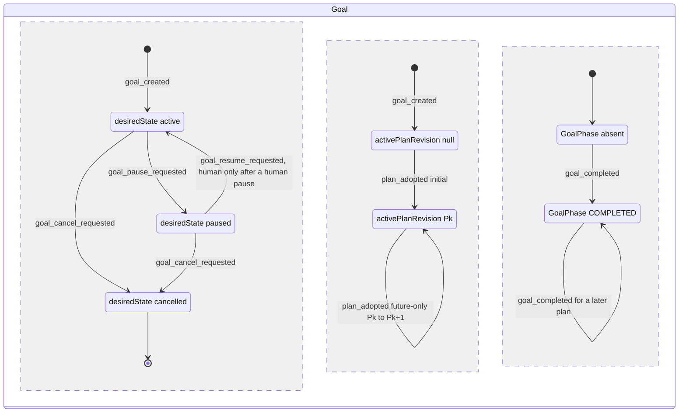

三个并行区域是相互独立的持久事实。十个展示名由 2.1 的 GOAL-17…27 与 GOAL-30 从这三个区域加上 Task（含失败事实与自动化判定）、Run 和 ControlIntent 事实归约而来，图里不画。扇出（GOAL-09…16、GOAL-28）是 Run/ControlIntent 上的独立提交，Goal 恢复接续（GOAL-29）是 TaskRequeue 上的独立提交，也不画在这里。恢复边上的标注是 GOAL-05 的守卫（LA-7），不新增状态。

### 2.6 实现对照

目标文件：`src/core/work-graph/state/goal-machine.ts`（与其它节的 `*-machine.ts` 命名一致，不与 `src/contracts/goal-phase.ts` 撞名）。

- 状态机：导出 `transitionGoal(state, event, ctx)`。state 为 `{desiredState, desiredStateRevision, activePlanRef, completion: 'none'|'for_active'|'for_other'}`，另带 `desiredStateRequestedBy` 的类别（GOAL-05，LA-7）；ctx 含调用者类别（`reworkActorClassOf`）、pin 比较结果、`GoalCompletionEvaluation`。
- 展示与扇出：导出 `reduceGoalDisplay`、`projectGoalRunStop`、`goalFanOutRequestId`，以及 GOAL-29 用的 `findGoalResumeContinuations`（纯函数：从窗口事实中选出可接续的 Task 和它的 `pausedEpoch`）与 `goalResumeContinueRequestId`。`GOAL_FAN_OUT_ACTOR` 定义在 `src/contracts/task-requeue.ts`，这里只再导出。`reduceGoalDisplay` 只按名字读取 `TaskRow.failure.automation.verdict`，不导入 `state/task-failure.ts` 的判定表。
- 记录构造函数：`newGoalSnapshot`、`nextGoalPointer`、`nextGoalDesiredState`、`buildGoalPhaseSnapshot`。按 §14，它们只能从 `state/` 导出。

| 行号 | 状态机函数（目标：`src/core/work-graph/state/<file>.ts` 中的导出） | 调用服务（file） | 已有测试（file） | 计划新增测试（描述） |
| --- | --- | --- | --- | --- |
| GOAL-01 | `goal-machine.ts`: `transitionGoal`、`newGoalSnapshot` | `tasks/task-service.ts:154-257` → `persistence/commit-compiler.ts:85-133` | `tests/work-graph/goal-independent.test.ts:38`；`tests/work-graph/R3a-goal-replay-boundaries.test.ts:41,64` | 对已存在的 Goal 用新身份发 `goal_created` → stale / `revision_conflict`（保留现有码） |
| GOAL-02、03 | `transitionGoal(plan_adopted)`、`nextGoalPointer` | `tasks/plan-service.ts:1155-1215,1676-1816` → `tasks/plan-commit-compiler.ts:144,293` | `tests/work-graph/R3c-plan-adoption.test.ts:98`；`tests/work-graph/W1-future-plan.test.ts:363,462,485`；`tests/work-graph/W2-agent-whiteboard.test.ts:189` | `paused` 下采用后仍为 `paused`，`desiredStateRevision` 与 `desiredStateRequestedBy` 不变；`cancelled` 下采用 → `invalid`。C7：`paused` 下含 TASK-19 只改处置的采用提交成功，目标 PlanRevision 带 `dispositionRecord`；`cancelled` 下同一采用 → `invalid`（测试与 §4 TASK-19 共用） |
| GOAL-04…06 | `transitionGoal`、`nextGoalDesiredState` | 新增 `GoalTaskPort.setGoalControl`（在 `tasks/task-service.ts:415-425` 的 `tasks` 对象中注册）；Host 路由 `goals/control`（加在 `src/app/core-routes.ts:162` 旁） | 无 | 期望状态 3×3 事件穷尽，`cancelled` 下 cancel → `busy`，pause/resume → `invalid`；暂停提交后 claim 得到 `busy`，并发 claim 因 Goal CAS 冲突（I-9）；暂停与 `completeGoal` 并发时只有一方成功，不出现「paused + 对应活动计划的 COMPLETED」。LA-7：操作者暂停后，以 `WORKFLOW_AUTOMATION_ACTOR` 或 `GOAL_FAN_OUT_ACTOR` 恢复 → `forbidden`，Goal 不变；以 `kind:'system'` 启动 actor 启动的 Host 上，操作者的暂停与恢复都分类为 `human`，恢复成功；`desiredStateRequestedBy` 随 GOAL-04…06 写入，回执重放恢复同一值，旧记录解码为 null；（2026-10-07 补注（第 7 步，决定 29））缺 GoalPhase pin → `invalid`，零提交、无事件、无回执；只换了两个 pin 的先后的重发得到原回执（45f2c012）。用例在 `tests/work-graph/A2-goal-control.test.ts` |
| GOAL-07、08 | `transitionGoal(goal_completed)`、`buildGoalPhaseSnapshot` | `tasks/completion.ts:481-614` | `tests/work-graph/R3e-completion.test.ts:87,166`；`tests/composition/R3e-completion-platform.test.ts:117` | `paused` → `busy`，`cancelled` → `busy`；同一计划重复完成不产生新事件；采用新计划后可再次完成（@r+1） |
| GOAL-09…16、28 | `projectGoalRunStop`（显示）、`goalFanOutRequestId`；逐 Run 合法性由 `transitionControlIntent` / `transitionRun` 判定 | Host 扇出驱动（`src/app/`，新增）→ `tasks/control-service.ts:325-432`（`submitControl`）、`:439`（`readControl`）、`controls/deliver`；重启核对（§12） | `tests/work-graph/R4-control-intent.test.ts`；`tests/composition/R4-control-platform.test.ts`（逐 Run 守卫） | A7 的 Goal 版：两个 Run（一个未进入、一个已进入）同时暂停、再恢复、再取消，逐 Run 实际状态各自显示。扇出已落库但未确认时关闭并重建 Host 与 SQLite：重驱按确定性 intentRef 读到原意图并跳过，intent 数不增加，不出现 `idempotency_conflict`。暂停扇出在 Goal 已恢复后才到达 → fence 过期被丢弃，Run 不被暂停。扇出途中插入一次计划采用 → 同 epoch 重试成功。暂停意图为 `outcome_unknown` 时，恢复等待核对（GOAL-28）。GOAL-14 重启补交：Goal 恢复提交之后、resume 扇出之前崩溃，未进入的 Run 指针仍是较早 epoch 的扇出暂停 → 重启后补交一次 resume，intent 数为 1；已进入的同类 Run 经 RUN-24 结束后不提交 resume |
| GOAL-29 | `goal-machine.ts`：`findGoalResumeContinuations`、`goalFanOutRequestId`、`goalResumeContinueRequestId`；接续的合法性由 `transitionTask`（§4 TASK-27）判定 | Host 扇出驱动（`src/app/`，新增）在恢复提交之后和 §12.1 第 6 步重驱时执行 → `claims.requeueTask`（`tasks/requeue-service.ts`，新增，§4）；枚举复用 `readCanonicalTaskFacts`（`plan-readers.ts:996`）；§15 5.6（需要 5.4 的重入队） | 无 | `tests/state/goal-machine.test.ts`：扇出意图命中 → 选中；人单独提交的暂停 → 不选；指向较早 epoch（E 小于恢复事件的 `pausedEpoch`）的扇出意图 → 选中。`tests/app/goal-fan-out-driver.test.ts`：两次驱动只写一个 TaskRequeue；epoch 已变 → 不写；人已先按“继续” → `revision_conflict` 后按已完成处理；多 epoch（暂停@e0→重启→恢复@e1 时接续丢失→暂停@e2→恢复@e3）只写一个 TaskRequeue；重启重驱在 Run 分类之后对 `active` 的 Goal 执行。场景 A7-G4、A7-G4b、A7-G5、A7-G6、A7-G7（§12.10）：接续在新 Session 中运行并带接续说明；人单独暂停的 Task 在 Goal 恢复后仍为 paused-interrupted |
| GOAL-14 重启补交、启动重驱（LA-6） | `goal-machine.ts`：`goalFanOutRequestId`；协作驱动的启动条件只读 `TaskRow.failure.automation.verdict` 与 Run 事实 | Host 启动流程（`src/app/host.ts:332-355` 之后）：§12.1 第 6 步的扇出重驱与其后新增的启动重驱步骤；`TaskAutomationPolicyV1.resumeOnStartup`（Host 设置 `automation.resumeOnStartup`，经 `registerAutomationPolicy`）；§15 5.6、5.8 | 无 | 场景 A8（§12.10）：`resumeOnStartup=true` 时，重启后有 `requeue`/`reverify`/`claim_requeued` 判定或有未进入 Run 的 `active` Goal 自动推进；`false` 时不推进，模型调用数不变；`paused` 的 Goal 不启动驱动；人暂停的 paused-interrupted Task 不被重入队；只有持租约的 Host 执行 |
| GOAL-17…27、30 | `reduceGoalDisplay`、`projectGoalRunStop` | 新增 `readGoalDisplayFacts`（`tasks/plan-service.ts`，复用 `plan-readers.ts:441-495,698,996,1183`，见 2.1）。它读取扩展后的 `readCanonicalTaskFacts` 并调用 `buildTaskFailureFacts`（`state/task-failure.ts`），注入 `automationPolicy()` 与 `configurationFor(scope)`；`src/ui/views.ts:450-466` 展示 headline、原因与“需要你决定”；§15 5.8（C8），gate 部分 5.9（C5） | 无 | 优先级表每行一例；全部 work 已满足、gate 还没有轮次链 → `RUNNING/awaiting_gate`，不是 BLOCKED；`outcome_unknown` → `NEEDS_DECISION`；能力为 unsupported 的 Run 显示 `unsupported`；带种子的随机事实组合断言输出唯一且符合优先级；`ACCEPTED_PARTIAL` 永不产出；GOAL-21 → `PLANNING/initial_plan_pending`。GOAL-30：每个停止原因各一例；多个原因时 headline 的 cause 为计划顺序中第一个来自 required Task 的原因，排在它前面的 optional Task 的原因不取；有 `running` 的 Run 或有判定待执行的 required Task 时 headline 为 `RUNNING`、原因仍列出；GOAL-23 先于 GOAL-30；optional Task 的停止只进原因；非 active 的 Task 不产生原因；人暂停的 paused-interrupted → `NEEDS_DECISION/task_paused`；指针为人工暂停的 `failed/check_failed` Task → `NEEDS_DECISION/task_paused{fence:'human_pause'}`，不是 `FAILED`；Goal 扇出暂停、无 TaskRequeue → `task_paused{pausedBy:'goal_fan_out'}`；只剩 `deferred` 的 required work → `NEEDS_DECISION/required_task_deferred`；`cancelled` 的 required work 义务由别处承载 → 不是 `BLOCKED`。gate：链头 FAIL 且判定 `reverify` → `RUNNING/auto_rework_pending`；拒绝 `source_unchanged` 之后 → `NEEDS_DECISION/gate_needs_fix`，`failingChecks` 带 checkId；修复任务未满足 → `RUNNING/gate_fix_in_progress`；链头 open 或 PASS 待完成 → `gate_verifying`；gate 失败永不产出 `FAILED/task_failed`。GOAL-24/25 遇到待执行或 `stopped` 判定时不命中；GOAL-27 的 `auto_rework_count` 分别取重入队与重新检查的计数。`runStops` 对 paused-interrupted 的 Run 输出 `paused_interrupted`，先于 `ended:crashed`。界面原因文字、失败类别标签与操作者类别标签的副本与接续说明渲染器的副本一致 |

D-9 波及的其它位置（A.2 需要同步改造）：

| 位置 | 今天 | 改造 |
| --- | --- | --- |
| `src/contracts/ledger.ts:59`；解码 `persistence/record-codecs.ts:229,404` | 字面量 `active`，解码结果写死 | 扩成三值，加 `desiredStateRevision` 与 `desiredStateRequestedBy`（LA-7；旧记录解码为 null）；按存储值解码（codec 在豁免名单中，只反序列化） |
| `src/contracts/command-event.ts:52-71`（`GoalCreatedEvent`）；事件编解码与重放 | 只有创建事件；回执重放用 `goalSnapshotFromCreatedEvent`（`record-codecs.ts:447-460`） | 新增 `GoalDesiredStateChanged` 事件类型和编码/解码；`setGoalControl` 的回执重放从该事件恢复原快照（做法同 `:447-460`）；`GoalCreated` 载荷保持 `active` |
| `tasks/eligibility.ts:9`；`plan-service.ts:637`；`claim-service.ts:568` | 以字面量 `goalDesiredState: 'active'` 传入 | 类型扩宽。`taskRow` 必须传入真实期望状态，否则暂停后 ready 列表仍显示 eligible。claim 已在 `:514` 拒绝非 active，`:568` 只需随类型扩宽 |
| `evidence/evidence-service.ts:337-441`（`openVerification`）、`:640-726`（`beginCheck`） | 不读 `desiredState` | `openVerification` 已在 `:392` 读取 Goal，加 `desiredState≠active` → `busy`；`beginCheck` 新增 Goal 读取和 CAS（VD-9） |
| `tasks/control-service.ts:104-108,421-424` | 守卫只有 Run@rev 和 intent ∅；`identityDigest` 是模块私有函数 | 系统扇出提交可以带 Goal fence（只读 CAS）；resume（含未进入的 resume）读取 Goal 并守卫 `desiredState=active`（§6 RUN-11、RUN-14）；新导出 `controlIntentRefFor` 供驱动计算确定性 intentRef |
| `tasks/execution-entry-service.ts:1113-1122`（W4） | 不读 Goal | 不改造（lead 决定 L-6，见 2.4 表后说明） |
| `src/business/workflow/workflow.ts:609` | 只判断指针是否为 null | `desiredState≠active` → `waiting`，不再尝试 claim |
| `src/ui/views.ts:460` | 显示原始 `desiredState` | 显示 `reduceGoalDisplay` 的结果、`causes`（GOAL-30 的原因标“需要你决定”，文字见 2.1 原因码表）和 `runStops`；界面只经 `src/app/core-http-types.ts` 的类型再导出读取这些类型，不导入 contracts 的值 |


## 3. PlanProposal / PlanRevision

计划由两种记录组成：状态可变的候选 `PlanProposal`，以及不可变的 `PlanRevision`（`revision` 恒为 1）。「采用」不是 PlanRevision 上的字段，而是同一笔提交里的三件事：候选从 `candidate` 变为 `accepted`，写入新的 PlanRevision@1，Goal 指针前移（GOAL-02/03）。「被替代」与「过期候选」都由 Goal 指针派生，不写入记录。计划里每个 Task 存储的 `phase`/`disposition` 是定义；运行时的 phase 由 D-1 的 `projectTaskPhase` 投影得到，存储的 phase 只作为 `planPhaseGuardReasons` 的输入。

### 3.1 持久位置与状态枚举

| 对象.字段 | 位置 | 代码枚举 | 说明 |
| --- | --- | --- | --- |
| `PlanProposal.status`（`candidate_v2`） | `src/core/work-graph/model/plan-contracts.ts:39-48`（`:42`） | `'candidate' \| 'accepted' \| 'rejected'`；codec 三个值都接受（`persistence/plan-record-codecs.ts:645-647`） | `rejected` **只声明，无写入者**（D-17） |
| `PlanProposal`（`legacy_v1`） | `plan-contracts.ts:48-50` | 恒为 `'candidate'`（解码见 `plan-record-codecs.ts:752`） | 只读；采用时返回 `unsupported` |
| 派生 `stale` | 无字段 | `status='candidate'` 且 `basedOn≠Goal.activePlanRevision`；`findPendingProposal` 会跳过它（`plan-readers.ts:483,487`） | 是否可逆取决于 `basedOn` 指向什么。`basedOn` 为 null（指针已非空之后），或指向本 Goal 已存在、非活动的版本时，不可逆：指针只前移，W16 还要求目标键 ∅。`basedOn` 指向尚不存在的 planId 时，可逆：Host `proposePlan` 只检查形状（`plan-service.ts:1015-1017`），之后若另一候选以该 planId 被采用（`:1724-1733`），它会重新成为待决。lead 决定 L-11：A.2 不给 PLAN-01 加「`basedOn` 必须为 null 或本 Goal 已有的 PlanRevision」守卫，列为剩余缺口（§16.4 GAP-14） |
| `PlanRevisionSnapshot` | `src/contracts/plan.ts:228-255`；`revision: 1`（`:233`） | 不可变；提交时对目标键做 ∅ 守卫（`plan-commit-compiler.ts:167,315`） | 没有候选、拒绝或替代字段 |
| 派生 `adopted` / `superseded` | 无字段；以 `GoalSnapshot.activePlanRevision`（`ledger.ts:61`）为准 | 指针指向它 = adopted；指针已移到更后的版本 = superseded | 与 Task 的 `disposition: 'superseded'` 不是一回事 |
| `taskStateBasis`（schema 2，可选） | `plan.ts:97-100` | 未改变的任务指向来源计划，改变或新增的任务指向目标计划（`buildTargetTaskBasis`，`plan-task-basis.ts:107-140`）；字段缺省时每个任务指向本计划（`buildEffectiveTaskBasis`，`:89-103`，回退在 `:101`）。只改处置的任务（`dispositionOnlyTaskIds`，有痕无痕一样）继承 source 的 basis，不指向目标计划（C7，见 3.3 第 6 点） | 决定哪些 Run/Reduction 适用于该任务 |
| `dispositionRecord`（schema 2，可选，新增 C7） | `PlanRevisionSnapshot.dispositionRecord`（`plan.ts:248-255` 的 schema 2 分支）；条目类型 `TaskDispositionChangeV1`（`plan.ts`，与 `TaskStateBasisV1` 相邻） | `{schemaVersion:1; entries: TaskDispositionChangeV1[]}`：每个任务一条，记该任务最近一次经 W16 的处置变化（`taskId`、`from`、`to`、`replacedByTaskId`、`traced`、`setIn`、proposal 身份、`reason{text, sources, affectedTaskIds}`、`actor`），按 taskId 排序；本次没改处置的任务从 source 原样继承。字段缺省 = 从未经 W16 改过处置 | 编译器所有：draft 与候选带它即拒绝，快照上校验（同 `taskStateBasis`，`plan-record-codecs.ts:500-507`）。`PlanRevisionSnapshot@1` 的 schema id 不变（可选字段，旧记录仍合法）。Task 行的 `TaskRow.dispositionChange` 取自所读计划的这一条，不回溯历史 |
| 任务定义 `phase`/`disposition` | `RuntimeTask`（`plan.ts:35-65`） | phase 七个值，disposition 四个值 | 存储的 phase 不参与运行时 phase 投影（`plan-readers.ts:1150-1154`）。`replacedByTaskId`（`plan.ts:58-64`）今天没有任何校验；C7 起，处置字段改变的任务要校验它（3.3 任务定义守卫表） |
| `PlanChangeReason.affectedTaskIds`（可选，新增 C7） | `src/core/work-graph/model/plan-contracts.ts:38` | `affectedTaskIds?: string[]` | 提交候选时只查形状：存在时为数组，≤200 个互不相同的非空字符串，每个都是 draft 中的 taskId，否则 `invalid`。采用时，每个有痕且只改处置的任务都必须列在其中（TASK-19 守卫 6）。codec 见 `persistence/plan-record-codecs.ts:400-416`、`:637-642`；缺省时与今天所有候选兼容 |
| 旧决定结果 | `UserDecisionOutcome`（`src/contracts/goal-change.ts:153`） | accept/reject/defer | 无写入者；所有采用路径的 `decisionRefs` 都必须为空 |

与设计 §2 的对应关系：「候选」= `candidate`；「采用」= `accepted` + PlanRevision + 指针移动；「拒绝」= `rejected`（无写入者）；「被后续版本替代」= PlanRevision `superseded`（派生）；G3 所说的过期候选 = `stale`（派生）。

### 3.2 事件

| 事件名 | 来源 | 载荷要点 | 对应原文编号 |
| --- | --- | --- | --- |
| `proposal_recorded` | U（Host `proposePlan`；Agent `propose_future_plan`）/ P（Workflow 写入初始规划答案 `proposeInitialPlanFromAnswer`） | goalRef、basedOn、draft、reason（`{text, sources, affectedTaskIds?}`）；Agent 版另带 `submittedBy` | G2、G3 |
| `proposal_accepted` | U（Host `applyPlanChange`；Agent `apply_future_plan`，只能采用本 Run 自己提交的候选） | proposalRef、`expectedProposalRevision`、`decisionRefs=[]`；同一提交里 Goal 发生 `plan_adopted`，处置字段改变的任务发 Task `disposition_changed`（无痕 TASK-18，有痕只改处置 TASK-19；来源同为 U） | G4、G5 |
| `proposal_stale`（派生） | P（Goal 指针移动后，在读取时派生） | `basedOn≠activePlanRevision` | G3「过期反馈可记录，采用前重新核对」 |
| `proposal_rejected` | U（只声明） | 无写入者（D-17） | §2 Plan「拒绝」 |
| `plan_adopted` | 与 `proposal_accepted` 同一提交 | PlanRevision：∅→adopted；前一版本→superseded | G4 |

来源列按 §1.3 的口径：U 是人或 Agent 的意图（Agent 的决定也是意图，不是平台的确定性提交），P 是平台内部的确定性提交，包括平台自动化 actor（Workflow、Goal 扇出）发起的提交。因此 Agent 的提交与采用记为 U。

初始规划答案为 `needs_decision` 时不产生事件：不写候选、不写决定，只返回问题（`plan-service.ts:1318-1321`；`plan-contracts.ts:108-118`）。

### 3.3 迁移表

**PlanProposal 与 PlanRevision**：

| # | from | event | guard（守卫） | to | effects（同事务副作用意图） | 幂等/重复事件 | 原文编号 | 现状 |
| --- | --- | --- | --- | --- | --- | --- | --- | --- |
| PLAN-01 | ∅ | `proposal_recorded`（Host） | Host 可信上下文；Goal 存在且属于同一 workspace；调用方 pin 与读到的一致（`plan-service.ts:953-961`）；draft 形状合法；Goal 不是 `cancelled`（新增）；`reason.affectedTaskIds` 存在时形状合法（3.1），draft 不带编译器字段 `dispositionRecord`（改造，C7）。**不**检查 `basedOn` 是否存在，也不检查是否等于活动计划 | `candidate@1`（带 `validatePlanDraft` 的 issues） | 写候选；事件 `PlanProposalRecorded`；CAS Project、Workspace、Goal@rev、proposal ∅（`:980-986`） | 先查回执（`:942-951`） | G2、G3；`affectedTaskIds`/`dispositionRecord` 两条为 C7 | 已有 `plan-service.ts:923-1055`。候选可以一写入就过期，`W1-future-plan.test.ts:471-473` 依赖这一点。改造：`plan-service.ts:1023-1026`、`plan-record-codecs.ts:539-551` 及编译器字段校验（`:500-507` 的模式） |
| PLAN-02 | ∅ | `proposal_recorded`（Agent） | `authorizePlanWrite`：Run 为 `running`，auth/outbox 为 `entered`，Session 由本代际占用，持有 lease（`plan-write-admission.ts:285-324`）；draft schema 2；`basedOn` 非空且等于活动计划（`plan-service.ts:1954-1970`）；Goal 不是 `cancelled`（新增）；`affectedTaskIds` 形状与 `dispositionRecord` 同 PLAN-01（改造，C7） | `candidate@1` + `submittedBy` | 同 PLAN-01；CAS 另含来源计划@1 和准入守卫（`:1985-1992`） | 先查回执；Agent 身份按 Run 区分 | G3、G5；`affectedTaskIds`/`dispositionRecord` 两条为 C7 | 已有 `plan-service.ts:1886-2011`。改造：同 PLAN-01；Agent 工具说明 `whiteboard-tools.ts:192-199` 写明 `affectedTaskIds`、严格的只改处置规则、「改范围＝替代 + 新增载体」、唯一载体规则，并把 `dispositionRecord` 加入 `:196` 的丢弃列表 |
| PLAN-03 | ∅ | `proposal_recorded`（初始规划答案） | QueryJob/QueryRun 为 `answered`，executionState 为 `settled`（`:793-807`）；答案 kind 为 `plan`；`basedOn` 恒为 null | `candidate@1` | 同 PLAN-01，另加 Answer/Job/QueryRun 守卫（`:1325-1329`） | 同 PLAN-01 | G2 | 已有 `plan-service.ts:1244-1333` |
| PLAN-04 | `candidate`，`basedOn=null` | `proposal_accepted`（初次） | `candidate_v2`，status 为 `candidate`，revision 等于预期（`:1144-1149`）；`decisionRefs` 为空（`:1165`）；Goal 指针为 null（`:1166-1170`）；来源核验与治理（`:1171-1179`）；`validatePlanDraft`、`validatePlanAssignments`、`planPhaseGuardReasons`（`:1180-1185`）；Goal 不是 `cancelled`（新增） | `accepted`，rev+1 | 写 PlanRevision@1（draft 任务原样写入，`plan-commit-compiler.ts:59`）；Goal 指针 null→P（GOAL-02）；事件 `PlanRevisionAccepted`；CAS 来源、Project、Workspace、Goal、proposal@rev、治理、PlanRevision ∅ | 回执重放；拒绝后按同身份复查（`:1120-1138,1225-1229`） | G4 | 已有 `plan-service.ts:1140-1215`；`plan-commit-compiler.ts:135-181` |
| PLAN-05 | `candidate`，`basedOn=Pk`（等于活动计划） | `proposal_accepted`（future-only，Host 或 Agent） | draft schema 2，`decisionRefs` 为空（`:1695-1705`）；source 等于活动计划（`:1712-1717`）；draft goalId 与 planId 合法（`:1718-1726`）；`planRevision=source+1`，目标 planId 未被使用（`:1721-1733`）；`deriveFuturePlanDelta` 不删任务（`:1737-1738`）；义务覆盖与冻结规则（`validateFutureObligationCoverage`，`plan-validation.ts:363-511`，拒绝映射为 `invalid`，`plan-service.ts:1740-1745`，见下方任务定义守卫表）；`planPhaseGuardReasons`（`:1766-1767`）；按 `deriveFuturePlanDelta` 的三类任务分别守卫（改造，C7）：改变执行定义或新增的任务（`changedTaskIds ∪ addedTaskIds`）走**无痕规则**（`:1769-1771`，不变）；只改处置的任务（`dispositionOnlyTaskIds`，判定用 `executionDefinitionsAgree`）有痕时走 TASK-19 守卫 1–8（`tracedDispositionChangeProblem`，见下方守卫列表），无痕时保持今天的 Lease ∅ / Reduction ∅；处置字段改变的任务 `replacedByTaskId` 合法；采用者的 actor 类别（§1 `reworkActorClassOf`：Agent `apply_future_plan` 为 `agent`；Host 主体的 actor 等于 `PLATFORM_AUTOMATION_ACTORS` 之一时为 `system`；其它 Host actor，包括以 `kind:'system'` 启动的 Host，都是操作者 `human`）为 `agent`/`system` 时另走并行载体防护（守卫 9，lead 决定 LA-3（2026-10-03））。Agent 版另要求 status 为 `candidate`、`submittedBy` 等于写入者、`basedOn` 非空（`:2069-2087`）；Goal 不是 `cancelled`（新增；即 TASK-19 守卫 8，只查一次），Goal 为 `paused` 不拒绝 | `accepted` | 写 PlanRevision Pk+1：未改变的任务取自 source，改变执行定义或新增的任务取自候选，只改处置的任务取 source 定义、只替换 `disposition`/`replacedByTaskId`（不取调用方的 assignment 与输入）；带 `taskStateBasis`，只改处置的任务继承 source basis（`plan-commit-compiler.ts:253-292`）；写编译器所有的 `dispositionRecord`：本次 `disposition` 或 `replacedByTaskId` 改变的每个任务一条（有痕无痕都写，`traced` 由调用方传入），其余从 source 继承；Goal 指针 Pk→Pk+1（GOAL-03）。对 `disposition` 或 `replacedByTaskId` 改变的任务发 Task `disposition_changed`：无痕的为 TASK-18，有痕只改处置的为 TASK-19（§4）；新增任务以新的 `pending` 定义进入。不写 Run、Attempt、Lease、Session、轮次、证据、TaskRequeue。CAS 含每个改变执行定义或新增任务的 Lease ∅ / Reduction ∅（`plan-service.ts:1773-1782`）；无痕只改处置任务的 Lease ∅ / Reduction ∅；有痕只改处置任务的全部 Run@rev、Lease@k（已释放）、Reduction ∅、选中 Run 的指针 ControlIntent@rev；守卫 9 读到的每个载体任务的选中 Run@rev、Lease（@k 或 ∅）、指针 ControlIntent@rev；以及目标 ∅ | 同 PLAN-04；Agent 走 `recheckAgentApply`；一笔提交，提交前崩溃不留下任何记录，同 requestId 重试经 `applyPlanChange` 回执重放（`plan-service.ts:1806-1815`） | G4、G5；处置部分 C7；守卫 9 为 lead 决定 LA-3（2026-10-03） | 已有 `plan-service.ts:1676-1816`；`plan-commit-compiler.ts:241-328`。改造：`plan-validation.ts:306-347`（分出 `dispositionOnlyTaskIds`；`replacedByTaskId` 校验并入 `validateFutureObligationCoverage` 的 issues）、`plan-service.ts:1737-1793`（`applyFutureRevision` 另收 actor 类别）、`plan-readers.ts`（新增 `readDispositionChangeTaskFacts`）、`plan-task-basis.ts`（`executionDefinitionsAgree`）、`plan-commit-compiler.ts:241-328`（只改处置任务的写法与 `dispositionRecord`）、`plan-record-codecs.ts` |
| PLAN-06 | `candidate` | `proposal_stale` | Goal 指针≠`basedOn` | 存储仍为 `candidate`，读取时视为 `stale` | 无写入。`findPendingProposal` 不返回它；采用时得到 `revision_conflict` | — | G3 | 已有 `plan-readers.ts:487`（派生）；采用拒绝见 `plan-service.ts:1166-1170,1712-1717` |
| PLAN-07 | `candidate` | `proposal_rejected` | — | （`rejected`） | — | — | §2 Plan | 新增（状态机返回 illegal；写入者见 D-17） |
| PLAN-08 | PlanRevision ∅ | `plan_adopted` | 与 PLAN-04/05 同一提交 | PlanRevision@1，派生为 adopted | 写 PlanRevision（CAS ∅） | 同 PLAN-04 | G4 | 已有 `plan-commit-compiler.ts:167,315` |
| PLAN-09 | PlanRevision Pk（adopted） | `plan_adopted`（Pk+1） | 指针单调前移（source 等于活动计划，target 为 source+1 且不存在） | Pk 派生为 superseded；记录本身不变 | 不写 Pk | — | G4、G5 | 已有 `plan-commit-compiler.ts:293`（指针前移；superseded 由此派生） |

**初次采用与 future-only 采用的区别**（W13–W16）：

| 项 | 初次（W15，PLAN-04） | future-only（W16，PLAN-05） |
| --- | --- | --- |
| 入口 | Host `applyPlanChange`，`basedOn=null`（`plan-service.ts:1155` 分支之前） | Host `applyPlanChange`，`basedOn≠null`（`:1155-1163`）；Agent `applyPlanChangeAsAgent`（`:2019-2106`） |
| 指针前提 | 必须为 null | 必须等于 `basedOn` |
| draft | schema 1 或 2 | 只接受 schema 2；schema 1 → `incomplete`/`unsupported`（`:1695-1700`） |
| 任务来源 | 全部取自 draft | 未改变的取自 source，改变执行定义或新增的取自候选；只改处置的取 source 定义，只替换 `disposition`/`replacedByTaskId`，basis 继承（C7） |
| 任务存储 phase | `planPhaseGuardReasons` | 同左，另要求新增任务 phase 为 `pending`（`plan-validation.ts:472-477`） |
| 有执行痕迹的任务 | 不适用（还没有 Run） | 改执行定义：无痕规则，改变执行定义或新增的任务不得有 Run/Lease/Reduction（不变）；只改处置：TASK-19 守卫 1–8（C7） |
| 处置变化 | — | 只有这里能改 disposition，四个值之间任意方向（含 deferred/cancelled/superseded→active），只对**非 gate** 任务生效，含有痕任务（TASK-19 守卫 1–8，C7）。只改处置不改变 basis。无痕规则见 `plan-service.ts:1769-1771` → `plan-readers.ts:1269-1297`；source gate 的定义仍冻结（`plan-validation.ts:415-434`，gate 失败走 C5 的重新验收）；required 义务还必须保留 active、required 的载体（`:402-412`），所以延后或取消唯一载体时，同一采用必须加入新载体；有痕任务改处置时必须列在 `reason.affectedTaskIds` 中 |
| 人工停止的工作 | 不适用 | actor 类别为 `agent`/`system` 时：不得改被人工停止的有痕任务的处置（守卫 7），也不得为「现有 active work 载体全部被人工停止」的义务新增载体（守卫 9，lead 决定 LA-3（2026-10-03））。操作者（`human`）采用不受这两条限制 |
| 处置记录 | — | 编译器写 `dispositionRecord`（本次变化的条目 + 从 source 继承的条目），Task 行显示 `dispositionChange` |
| Agent 可用 | 否 | 是（`decisionRefs` 由平台置空，`whiteboard-tools.ts:299`）。Agent 不能改自己正在执行的任务的处置：它自己的 Run 未结束，守卫 1 返回 `busy`；对 Run 已结束的兄弟任务可以 |

**任务定义守卫**：

| 守卫 | 内容 | 拒绝码 | 位置 |
| --- | --- | --- | --- |
| `planPhaseGuardReasons` | 存储 phase 为 `satisfied/running/verifying/failed` 时拒绝；允许 `pending/ready/blocked` | `incomplete` | `plan-validation.ts:234-244`；调用于 `plan-service.ts:1184-1185,1766-1767` |
| 新增任务从 `pending` 开始 | future-only 新增的任务必须是 `pending` | `invalid` | `plan-validation.ts:472-477`，映射于 `plan-service.ts:1742-1744` |
| 不得物理删除任务 | 必须保留 taskId，改用 disposition 表达 | `unsupported` | `plan-validation.ts:318-321`，映射于 `plan-service.ts:1737-1738` |
| source gate 定义冻结 | source 中每个 gate 的冻结定义（完整 `RuntimeTask`，含 phase、disposition，以及所承载的义务）必须不变 | `invalid`（`gate_definition_changed`） | `plan-validation.ts:415-434`，映射于 `plan-service.ts:1742-1744` |
| 义务语义不变 | source 的每个义务都必须保留，title、强度、验证要求都不变 | `invalid`（`obligation_semantics_changed`） | `plan-validation.ts:390-401` |
| required 义务保留载体 | 每个 required 义务至少有一个 active、required 的 work 或 gate 载体 | `invalid`（`obligation_task_mapping`） | `plan-validation.ts:402-412` |
| 计划级与执行意图冻结 | reviewAdmissionProtocol、origin 不变；已声明的 executionIntent 不能省略；新增 gate 不带 executionIntent，且至少承载一个新义务 | `invalid` | `plan-validation.ts:379-388,440-448,458-470` |
| 角色分配冻结 | 既有任务的 role 不能改，分配不能删；新增分配只能用 source 已授权的 role（显式带 executionIntent 的新增节点除外） | `invalid` | `plan-validation.ts:484-509` |
| 无痕规则 | 改变**执行定义**或新增的任务没有 Run、TaskLease、TaskReduction。把有痕任务从某个义务的 `taskIds` 中移走也属于改变执行定义，拒绝原因写明「有痕任务只能改 disposition/replacedByTaskId；把它留在 obligations[...].taskIds 中，替代任务作为额外载体加入」 | `revision_conflict` | `plan-readers.ts:1238-1301`（拒绝在 `:1276,1286,1294`） |
| 有痕任务只改处置（新增，C7） | TASK-19 守卫 1–8，见下方列表：Goal 不是 `cancelled`；Run 全部结束；无 `outcome_unknown`；无其它未核对的 Run；无未消费的让出等待；Lease 已释放；无 Reduction；`reason.affectedTaskIds` 列出该任务；人工停止的任务只由人工改 | `busy` / `invalid` / `forbidden` / `unavailable` | `state/plan-machine.ts` `tracedDispositionChangeProblem`；事实由 `plan-readers.ts` 新增的 `readDispositionChangeTaskFacts` 读取 |
| `replacedByTaskId` 合法（新增，C7） | 只校验本次 disposition 或 `replacedByTaskId` 改变的任务：目标为 `superseded` 时为 null，或指向目标计划中另一个 `taskKind` 相同的任务；目标不是 `superseded` 时缺省或为 null | `invalid`（`unsupported_execution_change`，不新增 `PlanValidationCode`） | `plan-validation.ts`（新函数并入 `validateFutureObligationCoverage` 的 issues） |
| 处置变化不得移走唯一载体（已有规则，不是新守卫） | 延后或取消某个 required 义务唯一的 active、required 载体，而同一采用没有加入新载体 | `invalid`（`obligation_task_mapping`） | `plan-validation.ts:402-412`；所以被延后的 required 任务只在其义务另有 active required 载体（例如 Goal gate），或它不承载义务时才会出现 |
| 并行载体防护（守卫 9，新增，lead 决定 LA-3（2026-10-03）） | actor 类别为 `agent`/`system` 的 W16，不得为这样的义务新增 active work 载体：该义务在 source 中的 active work 载体非空，且每一个的 `reworkFenceOf(选中 Run, 指针 ControlIntent) ≠ 'none'` | `forbidden`（「a human stopped this work」） | `state/plan-machine.ts` `parallelCarrierFenceProblem`；载体事实同样由 `readDispositionChangeTaskFacts` 读取 |

存储的 phase 在 D-1 下仍只是定义：允许写入 `ready`/`blocked`，但 `projectTaskPhase` 不读它。改变存储的 phase 仍算改变执行定义。只改 `disposition`/`replacedByTaskId` 属于「只改处置」：`executionDefinitionsAgree`（`plan-task-basis.ts` 新增）与 `frozenTaskDefinitionsAgree`（`plan-task-basis.ts:49-54,168-170`）比较同样的冻结定义（`RuntimeTask`、assignment、inputRequirements、所列入的义务），只是去掉这两个字段。只改处置的任务不改变 basis（C7）。读取侧的 `verifyBasisDelegation`、`taskOriginVerdict` 和证据适用性（`tasks/evidence-coverage.ts:178`）同步改用 `executionDefinitionsAgree`，否则继承的 basis 会因 disposition 不同而让整张 TaskGraph 读成 `unavailable`；gate 冻结仍用完整比较。

**有痕任务只改处置的守卫（TASK-19，C7）与并行载体防护（守卫 9）**。事实按任务由 `readDispositionChangeTaskFacts(records, goalRef, source, taskIds)` 读取（基于定向的 `readCanonicalTaskFacts`，与领取用同一读取器）：全部 Run、选中 Run、Lease、Reduction，以及选中 Run 的 `controlState.intentRef` 指向的 ControlIntent（缺省为 null）。「有痕」= 有任一 Run、Lease 记录或 Reduction。纯函数 `tracedDispositionChangeProblem` 只收 `state/` 里用 contracts 类型声明的 `TracedTaskFactsV1`（`RunSnapshot[]`、选中 `RunSnapshot | null`、`TaskLeaseSnapshot | null`、`TaskReductionSnapshot | null`、`ControlIntentSnapshotV1 | null`），不收 `tasks/` 的读取器类型。检查顺序：守卫 8 → 1 → 2 → 2b → 3 → 4 → 5 → 6 → 7（每个有痕只改处置的任务按 taskId 顺序），之后是守卫 9；第一个命中的返回，零写入。

- 守卫 8：Goal `desiredState='cancelled'` → `invalid`（与 PLAN-05 的 D-9 检查是同一处）。`paused` 不拒绝：暂停中的 Run 仍未结束，由守卫 1 返回 `busy`。
- 守卫 1：该任务的每个 Run（`runsByTaskId` 全部条目，跨所有计划）都是 `ended`，否则 `busy`「任务 X 的执行仍未结束」。
- 守卫 2：没有 `outcome='outcome_unknown'` 的 Run，否则 `busy`「先解决未知结果」（硬限制 1）。
- 守卫 2b：没有其它未核对的 Run（`runUnresolvedBlocker`，由 `tasks/completion-policy.ts:61-81` 的 `runBlocker` 移入 `state/`：`reconciliation.status='quarantined'`、`reconciliation.observation.kind='unresolved'`、V1/V2 授权 phase 为 `unknown`/`quarantined`），否则 `busy`「先核对 Run X」。
- 守卫 3：选中 Run 不是未消费的让出等待（`outcome='yielded'`、有 continuation、指针 `desiredState≠'cancelled'`），否则 `busy`「先取消或恢复这个让出等待」。P17（`continuation_cancelled`）允许。
- 守卫 4：Lease 记录存在且已释放，否则 `busy`；有 Run 却没有 Lease 记录 → `unavailable`（事实不一致，旧数据；原因写明）。
- 守卫 5：没有 TaskReduction，否则 `invalid`「已满足任务的处置是终态」（Reduction 只会是 `satisfied`，`completion.ts:392-395`）。
- 守卫 6：`reason.affectedTaskIds` 包含该 taskId，否则 `invalid`「reason.affectedTaskIds 必须列出有痕任务 X」。候选记录不可变，Agent 漏写时重新提交候选。
- 守卫 7：`reworkFenceOf(选中 Run, 指针 ControlIntent) ≠ 'none'` 且采用者 actor 类别 ≠ `human` → `forbidden`「只有人工能改人工暂停或取消的任务的处置」（硬限制 3）。`reworkFenceOf` 在 `state/task-failure.ts`，规则见 §1、§4；Goal 扇出暂停后 Host 重启造成的 `human_or_goal_resume` 同样只放行 `human`。操作者用 `plans/apply` 采用 Agent 提交的候选不受影响。
- 守卫 9（不是 TASK-19 的一部分，作用于整次采用）：只在采用者 actor 类别为 `agent`/`system` 时检查。对 source 的每个义务 O：「现有载体」= O 在 source 中 `taskIds` 里、disposition 为 `active` 的 work 任务；「新载体」= O 在目标中 `taskIds` 里、disposition 为 `active` 的 work 任务，但在 source 中不是 O 的 active 载体（新增任务、新列入 `O.taskIds`、或由非 active 恢复为 active）。当 O 有新载体、现有载体非空、且每个现有载体的 `reworkFenceOf ≠ 'none'` 时 → `forbidden`「a human stopped this work」。gate 不计入：gate 没有指针，永远不被围栏，也不执行工作。只有获得新载体的义务才读取其现有载体的事实，读到的选中 Run、Lease（含 ∅）与指针 ControlIntent 都进入同一提交的守卫，所以并发的人工暂停/取消或首次领取会让采用 `revision_conflict`，重读后重新判定。C5 的 gate 修复任务同样受这条约束。

由此得出：**W16 不能取消或替代 source gate**。gate 的处置一变，就会触发 `gate_definition_changed`；C7 也保持 gate 定义冻结。§9 VD-11 和附录所说的「失败 gate 只能经 G5 由 W16 改为 superseded/cancelled」这个出口不采用。U-10 已决定 (b)（C5）：非 PASS 的 gate 经 §9 VR-14 的后继轮次重新验收；需要修复时，Agent 或人经现有的计划演进路径（W16）新增一个 required work 修复任务，它满足后 gate 再重新验收（§9 VR-14、§4 GV 行）。gate 失败在 Goal 上可见（§2 GOAL-30，原因 `gate_needs_fix`）。修复任务的采用正是 C6 让其不再影响无关工作的那类「无关采用」。原选项 (a)（放宽 W16 的 gate 规则）不再需要，§16 GAP-09/10 关闭。

**无痕规则与 D-3 重新领取的交互**：

1. 一旦任务有过 Run（包括已 ended 的），它的**执行定义**（定义、存储的 phase、assignment、输入要求、所列入的义务）在之后任何计划版本里都不能再改（`plan-readers.ts:1269-1297`，I-22）。它的处置（延后、取消、替代、恢复）仍可经 TASK-19 改变（C7，见第 6 点），而且不改变有效 basis：旧 Run、轮次和证据继续挂在该任务上，§13 也不把处置变化当成新依据。不改义务的返工仍是 D-3 的做法：`requeueTask` 写入 TaskRequeue 事实，再用新的 Attempt/Run 重新领取（MVP-BEHAVIOR B06）。要改义务或范围，用「替代旧任务 + 新增载体」（第 6 点）。
2. `requeueTask` 不写 PlanRevision，也不移动 Goal 指针。TaskRequeue 一定发生在某个 ended Run 之后，而 Run 痕迹本身已经会让 W16 拒绝改这个任务，所以无痕规则不需要另读 TaskRequeue 的键。并发时的结果是不对称的：W16 不读也不钉 TaskRequeue，所以 **W16 不会因 requeue 失败**；而 requeue 按 §4 钉 Goal@rev（TASK-16 的提交守卫），W16 又会让 Goal revision +1（`plan-commit-compiler.ts:293`），所以 **W16 先提交时，并发的 requeue 得到 `revision_conflict`**，重读后重试即可。TASK-19 与 requeue 并发同样不对称：TASK-19 也不钉 TaskRequeue。W16 先提交时，requeue 重读后若任务已非 active，得到 `invalid`（非 active 的任务不能 requeue）；requeue 先提交时，W16 照常提交，结果是一个带 TaskRequeue 的非 active 任务（§4 P4 `pending/requeued`，旁边显示 disposition），恢复为 active 后用这个 `requeueRef` 领取。
3. 重新领取钉住的是当前活动计划（`claim-service.ts:515-517`）。未改变任务的 basis 不会因 W16 改变，所以旧 Run 和新 Run 共用同一个有效 basis，`originVerdict` 对两者都接受（`plan-readers.ts:900-938`）。任务的执行历史因此可以跨计划版本连续。只改处置不改变 basis，所以这一点对 TASK-19 之后的版本同样成立；处置变化（包括延后后又恢复）也不改变第 4 点的 `plan` 分量，不是新依据（§13.4 #26）。
4. **D-13 键的计划分量（lead 决定 L-4）。** D-13 键中的「plan revision」取该任务的有效 basis 计划（`buildEffectiveTaskBasis`，`plan-task-basis.ts:89-103`），而不是 `Goal.activePlanRevision`。理由是：有痕任务的 basis 已被无痕规则冻结；如果用活动计划版本，一次与该任务无关的 W16 采用就会被当成「新依据」，从而绕过无进展防护。§13.1 的 `plan` 分量与用例 #6 按此修改：只有改变了该任务有效 basis 的采用才算新依据。
5. **U-11 已决定 (b)（C6）：无关的 W16 不再让已领取未授权的 Run 卡住。** 原来的问题：W16 之后，已领取但尚未授权、仍钉在旧计划上的 Run 会在 W3 被拒（`execution-entry-service.ts:940-942`，要求指针完全相等，返回 `revision_conflict`），即使它的任务没有改变；出路只有 D-7 未进入取消 → `failed` → requeue，Goal 会显示 FAILED，还占用一次无进展键。决定后的规则：
   - **放宽的 W3 计划守卫。** `authorizeRuntimeEntry`（以及 RUN-03 的重新授权）保留指针完全相等的快路径。`Goal.activePlanRevision` 为 null 时仍是 `revision_conflict`。`claim.planRef` 等于活动计划时为 `active_plan`，不多读。否则读活动计划和两边 basis 来源（都不可变，@1；与读取侧用同一个 `readOriginPlans`），计算纯函数 `entryPlanVerdict({claimPlan, activePlan, basisSources, taskId, goalRef})`（`tasks/plan-task-basis.ts`）。它返回 `carried_unchanged` 当且仅当以下全部成立：两份计划属于同一 Goal；`claimPlan.planRevision < activePlan.planRevision`；`verifyBasisDelegation(activePlan, taskId)` 通过；`taskOriginVerdict(origin=claimPlan, selected=activePlan)` 为 `accepted`（有效 basis 相同，两条 basis 链都核验通过，执行定义按 `executionDefinitionsAgree` 一致）；活动计划中该任务为 `taskKind:'work'` 且 `disposition:'active'`（单列，因为 C7 之后一致关系不看 disposition）。判定为 `excluded`、或活动计划中该任务缺失、不是 work、不是 active 时返回 `changed`；任一 basis 链或定义无法解析时返回 `unavailable`。映射：`active_plan` / `carried_unchanged` → 继续；`changed` → `revision_conflict`「Goal 活动计划已不再原样带着这个任务；取消领取（D-7）后 requeue」；`unavailable` → `unavailable`。`verifyBasisDelegation`、`taskOriginVerdict`（原 `originVerdict`）和 `planTaskFacts`（原 `planFactsEntry`）从 `plan-readers.ts:811-938` 移到 `plan-task-basis.ts` 导出，行为只改一致关系。
   - **提交钉什么。** 原有守卫不变（Run、Attempt、Outbox、claim 计划@1、Session、Lease、Goal@rev、Workspace@rev、角色、材料）。只在 `carried_unchanged` 时另加活动计划@1 和读到的每个 basis 来源@1。与 W16 串行化靠已有的 Goal@rev 守卫（`:988`）：W3 读之后有 W16 提交，W3 得到 `revision_conflict`，执行驱动重读后按新指针重新授权。
   - **幂等与重放。** 不变：先查回执，指纹不含活动计划（`:891-908`、`:1009-1024`）。同 requestId 在之后任何 W16 后重试，重放原 permit。Run、Attempt、Outbox、envelope、inputBinding 永远保留 `claim.planRef`；任务的历史经 `taskOriginVerdict` 跨计划版本连续（第 3 点）。审计：`ExecutionEntryAuthorized` 事件增加可选的 `activePlanRef`，只在 `carried_unchanged` 时出现（§6 RUN-02）。
   - **`changed` 分支。** 在干净数据上经 owner 操作走不到：无痕规则和 TASK-19 守卫 1 都禁止改一个领取未结束的任务（I-22）。它只防旧数据、损坏数据和以后的规则变化，出口仍是 D-7 未进入取消 → requeue，不为它另加自动化。
   - **前提：§9 VD-7 同批实施。** Workflow 对 `open_checks` 与 `complete_task` 总传 Goal 当前的活动计划，原轮次查询不再要求计划相等（`OriginalVerificationQuery.planRef` 改为可选）。没有 VD-7，放宽 W3 放进来的 Run 会在开轮时卡住。规则只在 §9 VD-7 写一份，这里不重复。
   - **外部材料授权（lead 决定 LA-2（2026-10-03））。** 今天读者 Run 的材料授权钉在 Goal 活动计划上：发放时要求 `readerRun.planRef` 等于活动计划（`materials/grant-service.ts:674-676`，复查 `:750-752`、`:767`，`basis.planRef` 取 `readerRun.planRef`，`:788`），每次读取时活动计划≠`grant.basis.planRef` 即失效（`materials/applicability.ts:219-223`），而 Run 读者的 `current` 读取一定要授权（`applicability.ts:94-119`）。这样读外部材料或计划选定输入的 Run，在无关 W16 之后仍无法准备、授权和进入；已进入的 Run 在下一个模型调用关口失败（今天就如此）。本批改为按 basis 判定：只要读者 Run 的任务从 `grant.basis.planRef`（发放时为 `readerRun.planRef`）原样带入 Goal 活动计划（同 `entryPlanVerdict` 的 `carried_unchanged`），授权仍有效，也可以发放。`materials/` 不能导入 `tasks/`，所以判定通过组合根注入：谓词 `isTaskCarriedUnchanged` 在 `src/composition/create-platform.ts:294`（`createMaterialAccessResolver`）、`material-facts-service.ts:183` 和授权服务的依赖中注入，由 `tasks/` 的读取实现，`materials/` 只调用它，不自己读 PlanRevision。读者 Run 的 `planRef` 必须等于 `grant.basis.planRef` 这一条不变。材料拒绝照原样返回，不被放宽的 W3 掩盖。这样 C6 对读材料的 Run 也端到端成立，§16 GAP-13 关闭。**2026-10-07 补注（决定 34）：** 授权的写入方 `grant-service.ts` 从没有生产调用方（没有路由、Workflow 步骤或脚本调用发放和撤销），已删除，它的测试 `B2-material-admission.test.ts`、`M1-material-grants.test.ts` 一起删除。此后没有授权可读，本段的 LA-2 规则不再有作用对象；只为授权存在的读取分支随后删除。同日已删：授权 resolver（`createMaterialAccessResolver`）、谓词 `createTaskCarriedUnchanged` 及其注入、M2 材料事实服务和它的测试 `M2-material-read-facts.test.ts`；Run 读者现在只能读自己的材料，读别人的一律 `forbidden`。W3 的放宽（C6）不受影响。
   - 现状：改造 `execution-entry-service.ts:936-942`、`:973-977`、`:979-992`（RUN-02/03，§6）；`plan-task-basis.ts`；`materials/applicability.ts:219-223`；`materials/grant-service.ts:674-676`、`:750-752`、`:767`；`materials/material-facts-service.ts:183` 与 `src/composition/create-platform.ts:294`（注入谓词）；`persistence/execution-entry-codecs.ts:303-306`、`:392-398`（`activePlanRef`）。原选项 (a)（按现状，D-7 取消后 requeue）不再采用。（2026-10-07：`materials/grant-service.ts`、`materials/material-facts-service.ts` 已删除，`applicability.ts` 的 basis 判定和 `create-platform.ts` 的谓词注入也已删除，见上一点的补注。）
6. **U-12 已决定允许（C7）：有痕任务可以改处置，以 TASK-19 为唯一版本（§4）。** 原来的缺口（§16 GAP-12）：有痕任务要改义务或范围时 W16 拒绝改它，`CORE-DATA-OPERATIONS.md:285` 要求的「取消/替换显式处置」又没有实现，这样的任务只能留在 `failed/blocked`。原来的 lead 建议（暂缓）不再采用，GAP-12 关闭。决定后的规则：
   - **追加，不改写。** 处置变化通过采用一个新的不可变 PlanRevision 完成。旧 Run、Attempt、轮次、证据和 TaskRequeue 都不写，继续可读并挂在该任务上（Run.planRef 不变，basis 继承）。
   - **只改处置的判定是严格的（lead 按用户总体取向裁定）。** `deriveFuturePlanDelta` 把已有任务分成三类：执行定义不同 → `changedTaskIds`；执行定义相同但完整定义不同（只差 `disposition`/`replacedByTaskId`）→ `dispositionOnlyTaskIds`；完全相同 → 未改变。所列入的义务也必须相同：被替代或取消的有痕任务要留在原义务的 `taskIds` 中，替代任务作为额外载体加入。非 active 的载体不计入载体规则，被取消或替代的 required 任务也不计入 Goal 完成，所以留在列表中没有语义影响，还保留了「原来由 A 承载，现在由 B 承载」的历史。规则对有痕、无痕任务一样：无痕任务只改处置也继承 basis。
   - **前置条件。** TASK-19 守卫 1–8（上方列表）：无未结束的 Run、无 `outcome_unknown`、无其它未核对的 Run、无未消费的让出等待、Lease 已释放、未满足（无 Reduction）、原因列出受影响的任务 id、人工停止的任务只由人工改、Goal 不是 `cancelled`。未结束或未 finalized 的验收轮次不阻止处置变化；非 active 任务不能开轮或起检（§9 VD-9，本批实现），恢复为 active 后经 VD-7 接回原轮次。
   - **方向与 `replacedByTaskId`。** 四个处置值之间任意方向，有痕无痕一样（载体不变，恢复为 active 在机制上安全）。`replacedByTaskId` 见上方守卫表。
   - **改义务 = 替代 + 新增。** 改义务或范围时，在同一个修订里把旧任务改为 `superseded`（可带 `replacedByTaskId`），加入新任务作为义务的载体（已有载体规则）。被延后或取消的若是某个 required 义务唯一的 active required 载体，同一采用必须加入新载体，否则 `invalid`。
   - **gate 仍冻结。** gate 的处置不能改；gate 失败走 C5（见上文）。
   - **Goal 状态。** 与 PLAN-05 一致：Goal `active` 或 `paused` 时允许，`cancelled` 时 `invalid`（D-9）。TASK-19 是计划采用，不是返工，不受「返工要求 Goal 为 `active`」的限制。
   - **与自动化的关系（C8）。** 处置变化不是失败类别，不计入自动返工上限，也不重置自动返工计数（lead 按用户总体取向裁定；计数规则见 §4 TD-9）。非 active 的任务不能 claim、requeue、reverify（`invalid`），Workflow 跳过它们（L-15），其自动化判定为 `none`（§4 TD-9），所以把卡住的任务替代或取消后，它不再产生 NEEDS_DECISION 原因；被延后的 required 任务在 Goal 上显示原因 `required_task_deferred`（§2 GOAL-30）。
   - **投影。** phase 仍是事实投影，处置变化不改 phase/cause；disposition 和 `TaskRow.dispositionChange` 显示在 phase 旁边（§4）。非 active 任务的静止条件见 I-21。
   - **谁能做。** 操作者经 `plans/propose` + `plans/apply`；Agent 经 `propose_future_plan` + `apply_future_plan`，但不能改自己正在执行的任务（守卫 1），也不能改被人工停止的任务（守卫 7），也不能绕开人工停止另加载体（守卫 9）。Agent 提交、人工采用的组合也可以。UI 的 Task 详情提供「延后 / 恢复 / 取消」：从活动计划构造只改该任务处置的 future draft（丢弃编译器字段，含 `dispositionRecord`），reason 带 `affectedTaskIds:[taskId]`，再走 `plans/propose` + `plans/apply`；替代需要新增任务，仍由 Agent 或 Host draft 完成。非 active 任务不显示「重新入队」。

### 3.4 明确禁止的迁移

| from | event/目标 | 拒绝原因 | 对外 CoreError | 说明 |
| --- | --- | --- | --- | --- |
| `accepted` / `rejected` | `proposal_accepted` | illegal | `invalid` | 保留现有码：「is not a pending candidate」（`plan-service.ts:1145,2070`） |
| `accepted` | 回到 `candidate`，或改为 `rejected` | illegal | `invalid` | `accepted` 是终态，没有回退的写入入口 |
| `legacy_v1` | `proposal_accepted` | illegal | `unsupported` | 保留现有码（`:1144,2069`） |
| `candidate`，revision≠预期 | `proposal_accepted` | stale | `revision_conflict` | `:1146-1149`、`:2071-2073` |
| `candidate`，`basedOn=null` 但指针非空 | `proposal_accepted` | stale | `revision_conflict` | 指针已移动；`:1166-1170` |
| `candidate`，`basedOn≠活动计划` | `proposal_accepted` | stale | `revision_conflict` | 指针已移动；`:1712-1717`；`W1-future-plan.test.ts:462` |
| `candidate` | `proposal_accepted`，`planRevision≠source+1` 或目标已存在 | stale | `revision_conflict` | `:1721-1723`、`:1728-1732` |
| `candidate` | `proposal_accepted`，draft 的 goalId 不是本 Goal，或目标 planId 等于 source | illegal | `invalid` | 保留现有码（`:1718-1720`、`:1724-1726`） |
| `candidate` | `proposal_accepted`，source 计划属于别的 Goal | illegal | `not_found` | 保留现有码（`:1709-1711`） |
| `candidate` | `proposal_accepted`，改变**执行定义**或新增的任务有 Run/Lease/Reduction（含 requeue 之后；含把有痕任务从义务 `taskIds` 中移走） | guard_failed | `revision_conflict` | 无痕规则，保留现有码（`plan-service.ts:1769-1771` → `plan-readers.ts:1269-1297`）；拒绝原因与 §4.4 一致。只改处置的有痕任务不落在这一行，见下面 TASK-19 各行 |
| `candidate` | `proposal_accepted`，有痕任务只改处置，但该任务有未结束的 Run、`outcome_unknown` 的 Run、其它未核对的 Run（`runUnresolvedBlocker`）、未消费的让出等待，或 Lease 未释放 | guard_failed | `busy` | TASK-19 守卫 1、2、2b、3、4；新增（C7） |
| `candidate` | `proposal_accepted`，有痕任务只改处置，有 Run 却没有 Lease 记录 | guard_failed | `unavailable` | TASK-19 守卫 4，事实不一致（旧数据）；新增（C7） |
| `candidate` | `proposal_accepted`，有痕任务只改处置，但已有 TaskReduction（已满足） | illegal | `invalid` | TASK-19 守卫 5；新增（C7） |
| `candidate` | `proposal_accepted`，有痕任务只改处置，`reason.affectedTaskIds` 没有列出它 | guard_failed | `invalid` | TASK-19 守卫 6；新增（C7） |
| `candidate` | `proposal_accepted`，`replacedByTaskId` 不合法 | guard_failed | `invalid` | `unsupported_execution_change`；新增（C7） |
| `candidate` | `proposal_accepted`，actor 类别为 `agent`/`system`，改被人工停止（`reworkFenceOf ≠ 'none'`）的有痕任务的处置 | guard_failed | `forbidden` | TASK-19 守卫 7（硬限制 3）；新增（C7） |
| `candidate` | `proposal_accepted`，actor 类别为 `agent`/`system`，为现有 active work 载体全部被人工停止的义务新增载体 | guard_failed | `forbidden` | 守卫 9；新增（lead 决定 LA-3（2026-10-03）） |
| `candidate` | `proposal_accepted`，source gate 的定义（含 phase、disposition、所承载的义务）改变 | guard_failed | `invalid` | `plan-validation.ts:415-434`，映射于 `plan-service.ts:1742-1744`。W16 因此不能取消或替代 gate（见 3.3） |
| `candidate` | `proposal_accepted`，source 义务缺失或语义改变 | guard_failed | `invalid` | `plan-validation.ts:390-401` |
| `candidate` | `proposal_accepted`，required 义务没有 active、required 的载体 | guard_failed | `invalid` | `plan-validation.ts:402-412` |
| `candidate` | `proposal_accepted`，改变 reviewAdmissionProtocol/origin，省略已声明的 executionIntent，新增 gate 不合规，或改变/删除既有 role 分配、使用未授权 role | guard_failed | `invalid` | `plan-validation.ts:379-388,440-448,458-470,484-509` |
| `candidate` | `proposal_accepted`，draft 任务 phase 为 `satisfied/running/verifying/failed` | guard_failed | `incomplete` | `plan-validation.ts:234-244` |
| `candidate` | `proposal_accepted`，新增任务 phase 不是 `pending` | guard_failed | `invalid` | `plan-validation.ts:472-477` |
| `candidate` | `proposal_accepted`，删除了任务 | guard_failed | `unsupported` | `plan-validation.ts:318-321` |
| `candidate` | `proposal_accepted`，`decisionRefs` 非空 | guard_failed | 初次 `invalid`（`:1165`）；future `unsupported`（`:1704`）；Agent `forbidden`（`:2035`） | 保留现有码；通用决定提交尚未接通 |
| `candidate`，future 且 draft 为 schema 1 | `proposal_accepted` | guard_failed | `incomplete` | `:1695-1698` |
| `candidate` | Agent `proposal_accepted`，没有 `submittedBy`，或不是本 Run 提交的 | guard_failed | `forbidden` | `:2075-2082` |
| ∅ | Agent `proposal_recorded`，draft schema≠2 | guard_failed | `unsupported` | `:1954-1956`；`W2-agent-whiteboard.test.ts:239`（v1 变体） |
| ∅ | Agent `proposal_recorded`，`basedOn=null` | guard_failed | `forbidden` | `:1957-1958` |
| ∅ | Agent `proposal_recorded`，source 属于别的 Goal | illegal | `not_found` | 保留现有码（`:1963-1965`；`W2-agent-whiteboard.test.ts:239`） |
| ∅ | Agent `proposal_recorded`，`basedOn≠活动计划` | stale | `revision_conflict` | `:1966-1970` |
| ∅ / `candidate` | Agent 写入准入失败：没有 V2 授权或授权不在 `entered`，或 dispatch 代际与授权不一致 | guard_failed | `forbidden` | `plan-write-admission.ts:287-288,298-304`；已结束的 Run 落在这一行（`W2-agent-whiteboard.test.ts:229`） |
| ∅ / `candidate` | Agent 写入准入失败：Run 不是 `running`；outbox 不在 `entered`；Session 已归档、不可用或不再由本代际占用；lease 缺失、已释放或被别人持有 | guard_failed | `busy` | `plan-write-admission.ts:289,295-297,307-323` |
| ∅ / `candidate` | Agent 写入在准入之后、提交之前，Run 正式结束 | stale | `revision_conflict` | 准入守卫进入同一提交（`plan-service.ts:1985-1986`）；`W2-agent-whiteboard.test.ts:339` |
| ∅ | Host 或 Agent `proposal_recorded`，调用方 pin 与读到的不一致 | stale | `revision_conflict` | `:956-961`、`:1944-1950` |
| ∅ | Host 或 Agent `proposal_recorded`，`reason.affectedTaskIds` 形状不合法（不是数组、有重复或空值、超过 200 个、含 draft 中不存在的 taskId） | guard_failed | `invalid` | 只查形状；新增（C7） |
| ∅ | Host 或 Agent `proposal_recorded`，draft 带编译器字段 `dispositionRecord` | guard_failed | `invalid` | 编译器所有字段，同 `taskStateBasis`（`plan-record-codecs.ts:500-507`）；新增（C7） |
| ∅ / `candidate` | Goal 为 `cancelled` 时 `proposal_recorded` / `proposal_accepted` | illegal | `invalid` | 新增（D-9）。也覆盖 TASK-19（守卫 8）；Goal 为 `paused` 不是拒绝理由 |
| `candidate` | `proposal_rejected` | illegal | `unsupported` | 偏离默认的 `invalid`：拒绝写入者属于 D-17 范围外、尚未实现的功能，对外按能力缺失报 `unsupported`（与 `legacy_v1` 采用的码一致）；新增 |
| PlanRevision（任意） | 改写 tasks/phase/disposition | illegal | `invalid` | 没有改写入口；`revision` 恒为 1（`plan.ts:233`）。提交层还有目标键 ∅ 守卫（`plan-commit-compiler.ts:167,315`），绕过时报 `revision_conflict`。TASK-19（C7）也是追加一个新版本，不改写旧版本 |
| PlanRevision Pk（superseded） | 重新成为活动计划 | stale | `revision_conflict` | 指针只前移：采用要求 source 等于活动计划，且目标键不存在（`plan-service.ts:1712-1717,1728-1732`）；保留现有码 |

### 3.5 状态图

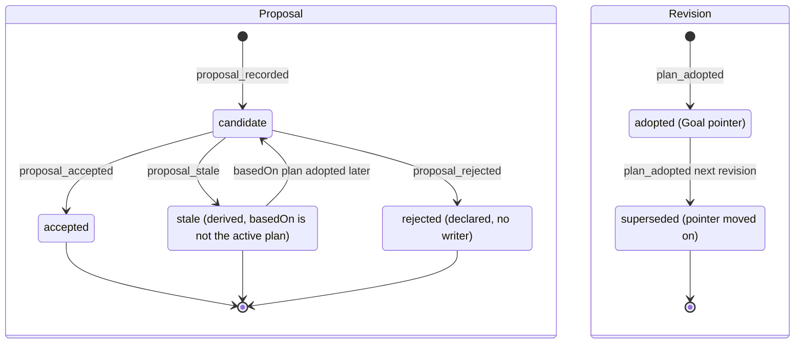

`Candidate → Accepted` 与 `[*] → Adopted`（以及前一版本的 `Adopted → Superseded`）是同一笔提交。`Stale` 只在读取时派生，存储的 status 仍是 `candidate`。`Stale → Candidate` 只发生在 `basedOn` 指向尚不存在的 planId、而该 planId 之后被采用的情况（见 3.1）；`basedOn` 为 null 或指向已存在的非活动版本时，过期不可逆。C6、C7 不新增计划状态：有痕任务改处置仍是一次 `Candidate → Accepted` 加一个新的 Revision，放宽的 W3 只改 Run 授权的守卫（§6）。

### 3.6 实现对照

目标文件：`src/core/work-graph/state/plan-machine.ts`。

简化（2026-10-07，不改行为）：`plan-machine.ts` 导出 `samePlanPointer`，Goal 状态机用同一份比较两个计划指针。GOAL-02/03 的三句拒绝文字（已有活动计划时不能首次采用、来源计划不是当前活动计划、目标 planId 必须是新的）也从这里导出，和 Plan 状态机（PLAN-04/05）共用一份，做法同 `GOAL_CANCELLED_PLAN_DETAIL`。

- 状态机与派生：导出 `transitionPlanProposal(state, event, ctx)`、`derivePlanProposalStatus`（candidate/stale/accepted）、`derivePlanRevisionStatus`（adopted/superseded）。
- 无痕判定：导出 `futureChangeTraceProblem`，纯函数，输入是 `readFutureChangeTaskFacts` 读到的事实。只用于 `changedTaskIds ∪ addedTaskIds`。
- 有痕只改处置与并行载体（新增，C7 与 lead 决定 LA-3（2026-10-03））：导出 `tracedDispositionChangeProblem`（TASK-19 守卫 8、1、2、2b、3–7）和 `parallelCarrierFenceProblem`（守卫 9），都是纯函数。输入是 `state/` 里只用 contracts 类型声明的 `TracedTaskFactsV1`（由 `readDispositionChangeTaskFacts` 的结果转换）、`reason.affectedTaskIds`、采用者的 `ReworkActorClass`（服务用 `reworkActorClassOf(principal, actor)` 求出，不看 `ActorRef.kind`）、Goal `desiredState`，以及守卫 9 所需的 source/目标义务载体列表。它们调用 `state/task-failure.ts` 的 `reworkFenceOf` 和 `state/run-machine.ts` 的 `runUnresolvedBlocker`（由 `tasks/completion-policy.ts:61-81` 的 `runBlocker` 移入，`completion-policy.ts` 改为 import 它）。
- 纯计划比较留在 `tasks/plan-task-basis.ts`（不进 `state/`）：新增 `executionDefinitionsAgree`、`entryPlanVerdict`；从 `plan-readers.ts:811-938` 移来 `planTaskFacts`（原 `planFactsEntry`）、`verifyBasisDelegation`、`taskOriginVerdict`（原 `originVerdict`），一致关系改用 `executionDefinitionsAgree`。`tasks/evidence-coverage.ts:178` 同样改用它。
- 记录构造函数：`newCandidateProposal`、`acceptProposalRecord`。按 §14，它们只能从 `state/` 导出；`plan-commit-compiler.ts:145-149,294-298` 改为调用它们。`dispositionRecord` 由 `plan-commit-compiler.ts` 写（编译器所有，§14），编译器是纯的：有痕任务集合与变更条目由 `applyFutureRevision` 传入。
- 保留在原处：`planPhaseGuardReasons` 与 `validateFutureObligationCoverage` 留在 `plan-validation.ts`，由状态机的守卫调用；`replacedByTaskId` 校验作为新函数并入 `validateFutureObligationCoverage` 的 issues。

| 行号 | 状态机函数（目标：`src/core/work-graph/state/<file>.ts` 中的导出） | 调用服务（file） | 已有测试（file） | 计划新增测试（描述） |
| --- | --- | --- | --- | --- |
| PLAN-01 | `plan-machine.ts`: `transitionPlanProposal(∅, proposal_recorded)`、`newCandidateProposal` | `tasks/plan-service.ts:923-1055` | `tests/work-graph/R3c-plan-adoption.test.ts:98`；`tests/work-graph/W1-future-plan.test.ts:462`（候选一写入就过期仍可提交） | Goal 为 `cancelled` 时拒绝；issues 不阻止记录；`basedOn` 指向尚不存在的 planId 时，候选先为 stale，该 planId 被采用后成为待决；（C7）`reason.affectedTaskIds` 不是数组、有重复或空值、超过 200 个、含 draft 外的 taskId → `invalid`，零写入；缺省时照旧记录；draft 带 `dispositionRecord` → `invalid`，零写入（`W1-future-plan.test.ts` S20）；`plan-record-codecs.ts` 对快照上的 `dispositionRecord` 做校验，对 draft/候选拒绝 |
| PLAN-02 | 同上（ctx 为 Agent 写入者） | `plan-service.ts:1886-2011`；`tasks/plan-write-admission.ts:247-324`；`agent-runtime/whiteboard-tools.ts:192-199`（工具说明与 `:196` 丢弃列表） | `tests/work-graph/W2-agent-whiteboard.test.ts:171,229,239,261,279,339` | `basedOn=null` → `forbidden`；非活动计划 → `revision_conflict`；schema 1 → `unsupported`；Run 不在 `running` → `busy`；（C7）Agent 提交的 `affectedTaskIds` 形状不合法 → `invalid`；工具丢弃列表含 `dispositionRecord`，从活动计划复制出的 draft 能正常提交 |
| PLAN-03 | 同上 | `plan-service.ts:1244-1333` | `tests/work-graph/R5b-initial-plan.test.ts:178` | `needs_decision` 不产生迁移，也不写记录 |
| PLAN-04 | `transitionPlanProposal(candidate, proposal_accepted)`、`acceptProposalRecord`；Goal 侧 GOAL-02 | `plan-service.ts:1140-1215` → `plan-commit-compiler.ts:135-181` | `tests/work-graph/R3c-plan-adoption.test.ts:98`（含重放与 `idempotency_conflict`）；`tests/work-graph/R5b-initial-plan.test.ts:316`（phase 守卫） | 每个守卫一例：status、revision、`decisionRefs`、指针非空、phase |
| PLAN-05 | 同上 + `futureChangeTraceProblem`、`tracedDispositionChangeProblem`、`parallelCarrierFenceProblem`（守卫 9 的测试见本表「PLAN-05 守卫 9」行）；Goal 侧 GOAL-03；Task 侧 TASK-18/19（§4） | `plan-service.ts:1676-1816`（`applyFutureRevision`：`:1737-1793` 分三类任务读事实并合并守卫，另收采用者类别）→ `plan-commit-compiler.ts:241-328`（只改处置任务的写法、`dispositionRecord`）；`plan-validation.ts:306-347`（`dispositionOnlyTaskIds`、`replacedByTaskId` 校验）；`plan-readers.ts`（新增 `readDispositionChangeTaskFacts`，`readFutureChangeTaskFacts` 不变）；`plan-task-basis.ts`（`executionDefinitionsAgree`）；`plan-record-codecs.ts`；`plan-service.ts:632-658`（`taskRow` 带 `dispositionChange`） | `tests/work-graph/W1-future-plan.test.ts:363,485,534,600,663`；`tests/work-graph/W2-future-intent.test.ts:350,382,483`；`tests/work-graph/W2-agent-whiteboard.test.ts:189,208,383` | 改写原计划用例：有痕任务（含 requeue 之后）改变**执行定义** → `revision_conflict`；有痕任务只改处置 → 走 TASK-19；source gate 改处置 → `invalid`（不变）；无痕非 gate 任务只改处置 → 只对处置真正改变的任务发 Task `disposition_changed`，只改 title 的不发，basis 改为继承（新期望）；requeue 与 W16 并发：W16 总能成功，W16 先提交时 requeue 得到 `revision_conflict`，重读后若任务已非 active 得到 `invalid`，否则重试成功。（C7）`tests/state/plan-task-basis.test.ts`：`executionDefinitionsAgree` 只差 `disposition` 或 `replacedByTaskId` → 一致，title/phase/assignment/输入/所列义务不同 → 不一致，`frozenTaskDefinitionsAgree` 对 disposition 仍不一致；只改处置的采用之后，旧计划的 Run `taskOriginVerdict` 为 `accepted`。`tests/state/plan-validation.test.ts`：只改处置 → `dispositionOnlyTaskIds`；改处置同时移走载体 → `changedTaskIds`；`replacedByTaskId` 指向自己、指向不存在的任务、非 `superseded` 却带 id → issues。`tests/state/plan-machine.test.ts`（`tracedDispositionChangeProblem` 表）：starting/running Run → `busy`；`outcome_unknown` → `busy`；已结束但 `reconciliation.status='quarantined'`、`observation.kind='unresolved'` 或 V2 授权 phase 为 `unknown` → `busy`；让出等待且指针 running/paused → `busy`，指针 cancelled → 通过；Lease 未释放 → `busy`；有 Run 无 Lease → `unavailable`；有 Reduction → `invalid`；`affectedTaskIds` 漏列 → `invalid`；围栏为 `human_only` 或 `human_or_goal_resume` 且类别 `agent`/`system` → `forbidden`，类别 `human` → 通过；Goal `cancelled` → `invalid`（先于其它检查）；Goal `paused` 且 Run 全部结束 → 通过。`W1-future-plan.test.ts` 新场景 S9–S21：S9 有痕 `failed` 任务 A 改为 `superseded`（`replacedByTaskId:'A2'`），新增 A2 并加入列有 A 的每个义务的 `taskIds`，A 仍留在其中，`affectedTaskIds:[A]` → 提交；快照中 A 只改处置，`taskStateBasis` 中 A 仍为旧 basis；Task 行为 `failed`、execution 为旧 Run、带 disposition 与 `dispositionChange`；Run/Lease/Attempt/轮次记录逐字节不变。S10 漏写 `affectedTaskIds` → `invalid`。S11 把 A 从 `taskIds` 移走 → `revision_conflict`，原因为无痕规则表中的新文字。S12 A 在运行、`outcome_unknown`、Lease 未释放、让出未消费 → `busy`。S13 A 已满足 → `invalid`。S14 gate 改处置 → `invalid`（`gate_definition_changed`）。S15 A 失败并 requeue 后先延后再恢复（两次采用）→ basis 不变，延后期间用已有 `requeueRef` 领取 → `invalid`，恢复后成功。S16 无痕任务只改处置也继承 basis。S17 Goal `paused` → 提交；`cancelled` → `invalid`，零写入。S18 延后某 required 义务唯一的 active required 载体而不加新载体 → `invalid`（`obligation_task_mapping`），零写入。S19 S9 之后无关 W16（改无痕任务 C 的 title）原样带出 A 的 `dispositionRecord` 条目；无痕任务同时改 title 与处置时也写条目，`traced:false`。S20 见 PLAN-01。S21（类别按 §1 `reworkActorClassOf`）A 的最后一个 Run 被人工请求的 ControlIntent 取消：Host 主体的 actor 为 `WORKFLOW_AUTOMATION_ACTOR`（类别 `system`）→ `forbidden`；Host 操作者 actor（包括以 `kind:'system'` 启动的 Host）→ 提交。`W2-agent-whiteboard.test.ts`：写入者是另一任务的 running Run：Agent `apply_future_plan` 改 Run 已结束的兄弟任务的处置 → 提交；兄弟任务是人工暂停后被重启打断的（C4）→ `forbidden`；改写入者自己的任务 → `busy`。竞争（`tests/composition/W1-future-plan-platform.test.ts:280-341` 的模式）：TASK-19 与 requeue 领取两种顺序各一例（一方提交，另一方 `revision_conflict`，重试得到 `invalid` 或 `busy`）；TASK-19 与 requeue：W16 先 → requeue 重试 `invalid`；requeue 先 → W16 提交，得到带 TaskRequeue 的非 active 任务；TASK-19 与选中 Run 上的 `submitControl` 并发 → `revision_conflict`，重试后重新判定守卫 3、7。`R3e-evidence-coverage.test.ts`：在延后版本上锚定的证据，在恢复后的版本上仍为 `APPLICABLE`。场景 `tests/scenarios/C7-supersede-failed-task.test.ts`、`C7-defer-reactivate.test.ts`（§15）；I-21、I-22 在生成的世界上检查，fuzz 增加「随机任务只改处置的 W16」一步（§11） |
| PLAN-06 | `derivePlanProposalStatus` | `plan-readers.ts:441-495`（`findPendingProposal`）；`plan-service.ts:1335-1354` | `tests/work-graph/W1-future-plan.test.ts:462`；`tests/work-graph/R3c-plan-adoption.test.ts:400-425` | 指针前移后，`basedOn=null` 或指向已存在旧版本的候选永远是 `stale` |
| PLAN-07 | `transitionPlanProposal(candidate, proposal_rejected)` → illegal | — | — | 断言拒绝，且没有任何写入 |
| PLAN-08、09 | `derivePlanRevisionStatus` | `plan-service.ts:1377-1462`（`queryTaskGraph` 可按显式 planRef 读历史版本） | `tests/work-graph/W1-future-plan.test.ts:663` | 指针单调；superseded 版本不能再被指回 |
| PLAN-05 守卫 9（新增，lead 决定 LA-3（2026-10-03）） | `plan-machine.ts`: `parallelCarrierFenceProblem`；调用 `state/task-failure.ts` 的 `reworkFenceOf` | `plan-service.ts:1737-1793`（类别为 `agent`/`system` 时，对获得新载体的义务读取其现有 active work 载体的事实，并把选中 Run@rev、Lease、指针 ControlIntent@rev 加入提交守卫）；`plan-readers.ts`（`readDispositionChangeTaskFacts`） | — | `tests/state/plan-machine.test.ts`：义务 O 唯一的 active work 载体 T 的最后一个 Run 被人工请求的 intent 取消，目标新增载体 T′：类别 `agent`/`system` → `forbidden`，`human` → 通过；O 另有一个未被围栏的 active work 载体 → 通过；T 是 Goal 扇出暂停后被重启打断的（围栏 `human_or_goal_resume`）→ `agent` 仍 `forbidden`；把 O 的一个已延后载体恢复为 active 也算新载体 → `forbidden`；O 的未围栏载体只有 gate → 仍 `forbidden`（gate 不计入）；新载体属于别的义务 → 通过；O 没有 active work 载体 → 通过。`W2-agent-whiteboard.test.ts`：Agent `apply_future_plan` 加入 T′ → `forbidden`，零写入；同一候选由操作者经 `plans/apply` 采用 → 提交。`W1-future-plan.test.ts`：Host 主体的 actor 为 `WORKFLOW_AUTOMATION_ACTOR` → `forbidden`；以 `kind:'system'` 启动的 Host 操作者 → 提交。竞争（`tests/composition/W1-future-plan-platform.test.ts`）：守卫 9 读取之后、提交之前，人工取消 O 的最后一个未围栏载体 → 采用 `revision_conflict`，重读后 `forbidden` |
| 3.3 第 5 点（C6；迁移行是 §6 RUN-02/03） | `tasks/plan-task-basis.ts`: `entryPlanVerdict`（纯）；Run 机守卫读 `RunGuardContext.entryPlan`（§6） | `execution-entry-service.ts:936-1003`（`authorizeRuntimeEntry`，RUN-03 的重新授权用同一 helper）；`persistence/execution-entry-codecs.ts:303-306,392-398`（`activePlanRef`）；`materials/applicability.ts:219-223`、`materials/grant-service.ts:674-676,750-752,767`（2026-10-07 已删除，决定 34）、`materials/material-facts-service.ts:183`、`src/composition/create-platform.ts:294`（注入 `isTaskCarriedUnchanged`；这三处 2026-10-07 随授权读取侧删除，决定 34） | `tests/work-graph/B2-execution-entry.test.ts`；`tests/work-graph/B2-material-admission.test.ts`（2026-10-07 已删除） | `tests/state/plan-task-basis.test.ts`（`entryPlanVerdict`）：同一 ref → `active_plan`；P1 领取、P2 改了别的任务 → `carried_unchanged`；预置 P2 改了本任务 title → `changed`；活动计划中本任务被延后/取消或是 gate（预置）→ `changed`；basis 来源缺失 → `unavailable`；claim 计划晚于活动计划 → `changed`；P1→P2（无关）→P3（别的任务只改处置）→ `carried_unchanged`。`B2-execution-entry.test.ts`：P1 领取后无关 W16 到 P2，授权提交、`replayed:false`，Run/Attempt/Outbox 仍为 P1，事件带 `activePlanRef=P2`；W3 读后提交前有 W16 提交 → `revision_conflict`、零写入，按新指针重新授权成功；预置 P2 改了 title → `revision_conflict`、零写入；basis 来源缺失 → `unavailable`；P1 授权、之后 W16、同 requestId 重试 → 重放原 permit；无关 W16 后 RUN-03 重新授权（代际 +1）提交。`B2-material-admission.test.ts`（2026-10-07 随授权写入方删除）：P1 领取，经授权读一个选定输入，无关 W16 到 P2：准备、W3、W4 都通过，第二次无关 W16 后模型调用关口仍准入该材料。场景 `tests/scenarios/C6-unrelated-adoption.test.ts`（含领取与授权之间 Host 重启的 A8 变体，§12 W-01；以及 T1 经授权读外部材料的变体，lead 决定 LA-2（2026-10-03），这个变体 2026-10-07 随授权写入方删除）与 §9 VD-7 的 Workflow 用例同批 |


## 4. Task（投影 phase + disposition）

Task 没有可写的存储 phase（D-1）。`effectivePhase` 是对 Run（含控制指针）、TaskAttempt、TaskLease、TaskReduction、选定 Run 的轮次链头（§9 VR-14，C5；gate 取 gate 自己的链头，P20）和新增 TaskRequeue 的纯投影，由 `projectTaskPhase(facts)` 计算。所有影响 Task 的写入都先经 `transitionTask` 判定合法性，并返回投影后的下一 phase。这些写入是：领取、重入队（含“继续”）、返工拒绝记录（TASK-28，重入队与后继轮次共用）、完成、处置变更。

`disposition` 是独立维度（ORCHESTRATION §2 `:268`），不并入 phase。本节依赖 D-1、D-2、D-3、D-13。D-1、D-2 即 U-1、U-2，按原推荐采纳（2026-10-03）；D-3 即 U-3，用户已决定 C1：操作者含 human、system、agent，编排读取结构化失败事实。本节还落实用户决定 C2（失败类别）、C3（接续说明的 Task 侧）、C4（暂停中重启不算失败）、C5（后继轮次，含 gate）、C7（有痕任务改处置）、C8（自动返工与上限）。D-13 的无进展守卫作用于重入队（§13）和后继轮次（§13.7），对 human、system、agent 一律适用；其计划分量按 lead 决定 L-4 取 Task 的有效 basis 计划（§13）。

本节在 brief 之外补充的决定（逐条标明状态：lead 已定的标 L-n 或“lead 决定 LA-n（2026-10-03）”；用户 2026-10-03 已定的标 C-n 或“按原推荐”；lead 合并各备忘录时按用户总体取向作出的裁定标“lead 按用户总体取向裁定”；lead 合并各备忘录时的技术裁定（命名、顺序、码）标“lead 合并裁定（2026-10-03）”）：

- **TD-1 投影原因码统一（已由 lead 采纳，L-8）**：`phaseCause.code` 使用下表 `TaskPhaseCauseCode`，§9 的轮次投影原因按此命名。INCONCLUSIVE 轮次（含遗留的 PASS 带 gaps）的唯一原因码是 `round_inconclusive`；brief §2a 示例中的旧原因名不再使用。
- **TD-2 重入队必须让旧证据退出完成折叠（lead 决定 L-3：存储；C5 后改为整条链的累积 id）**：`TaskRequeue.supersededEvidenceIds` 在重入队提交时一次写定，之后不变（显式、不可变，完成时少一次读取）。取值是 afterRun 轮次链头的累积证据 id `chainEvidenceIds(head)` = `head.chain.supersededEvidenceIds ∪ ids(head.evidenceRefs)`，即该 Run 每一个轮次（根轮次和全部后继轮次）的证据；没有轮次时为 `[]`。只取链头自己的 `evidenceRefs` 不够：同一 Run 较早轮次的阻塞证据会继续挡住完成（lead 合并裁定（2026-10-03））。`completeTask` 在折叠前排除集合 S = 该 Task 全部 TaskRequeue 的 `supersededEvidenceIds` 的并集 ∪ 完成所用轮次的 `chain.supersededEvidenceIds`（后继轮次已在自己的记录里写定其前驱的证据，§9 VR-14）。§9 VD-5、VR-09 读取这些存储的列表，不再由 `afterRoundRef` 推导；brief D-3 的记录形状据此增加该字段。理由与完成侧规则见 4.3 末“缺口”。TD-2 随 C1 的重入队（§15 5.4）实施，链证据部分随 C5（§15 5.9）实施。
- **TD-3 领取显式携带 `requeueRef`**（D-3 的领取侧，随 C1）：重入队后的领取必须在输入中带 `requeueRef`，与 `consumedWait` 互斥。新 Run 和新 Attempt 记录这个引用，把新 Attempt 链接到原失败和改变依据（ORCHESTRATION §9 `:414`）。
- **TD-4 已有执行痕迹的 Task 可改 disposition（U-12 → C7，已定）**：TASK-19 放宽 W16 的“无任何痕迹”限制，只放宽处置，不放宽执行定义。规则如下：
  - 新的增量类别 `dispositionOnlyTaskIds`：冻结定义中只有 `disposition`、`replacedByTaskId` 不同，其余（含 `carriedObligations`）都相同，用 `executionDefinitionsAgree` 判定（§3）。只改处置的任务按 source 定义写入、只替换这两个字段，有效 basis 继承不变，所以旧 Run、Attempt、轮次、证据、TaskRequeue 都留在这个 Task 上，§13 的键也不变（处置变化不是新依据）。
  - 采纳新的不可变 PlanRevision（只追加，不改写），编译器写入并逐版继承 `PlanRevisionSnapshot.dispositionRecord`（每个 Task 最近一次处置变化 `TaskDispositionChangeV1`）；`TaskRow.dispositionChange` 从读取所选计划的这条记录取值，不遍历历史。
  - 必须给原因：有痕任务的处置变化要求 `PlanChangeReason.affectedTaskIds` 列出它，否则 `invalid`。
  - 前置条件（TASK-19）：没有未结束 Run；没有 `outcome_unknown`，也没有其它 `runUnresolvedBlocker` 意义上未核对的 Run；没有未消费的让出等待；租约已释放；不是 `satisfied`；Goal 不是 `cancelled`（`paused` 允许，W16 是计划采用，不是返工）。
  - 只改处置（`active`/`deferred`/`cancelled`/`superseded` 四值之间任意方向）。改义务或范围 = 把旧 Task 改为 `superseded` 并新增一个 Task 承载义务（现有载体规则）；旧 Task 仍留在义务的 `taskIds` 中（严格的只改处置，lead 按用户总体取向裁定）。gate 定义仍冻结（gate 的出口是 C5 的后继轮次）。
  - 人工停止的任务（`reworkFenceOf ≠ 'none'`）只有操作者类别为 `human` 时才能改处置（硬限制 3）。另一条绕行路径——agent 或 system 的 W16 为一个全部现有 active work 载体（gate 不计入：gate 没有指针，永不被围栏）都被围住的义务新增载体——由 §3 的 W16 守卫 9 拒绝为 `forbidden`（lead 决定 LA-3（2026-10-03）；规范定义以 §3 守卫 9 为准）。
  - 人工改处置不重置自动返工计数（lead 按用户总体取向裁定；计数只在人工重入队/继续或人工重新检查时重置，见 TD-9）。
- **TD-5 让出等待上的控制指针进入投影（属 U-1，按原推荐采纳）**：选定 Run 为 `YieldedWait`（§6）且指针为 `cancelled` 时投影 `failed/continuation_cancelled`，可重入队；指针为 `paused` 时投影 `blocked/continuation_paused`，经 §6 RUN-14 resume 回到 `ready`。这偏离 D-1“yielded 且有 continuation → ready（不变）”。理由：续接领取对这两种指针恒返回 `busy`（`claim-service.ts:606-611`），协作驱动也会取消让出等待（`collaboration-driver.ts:668-673`），不投影就是永久死路（§7 7.3“不支持或不投递的情形”第 6 项的请求）。
- **TD-6 重入队与后继轮次的操作者（U-3 → C1，已定）**：新增 core 路由 `tasks/requeue` 与界面“重新入队 / 继续”动作；后继轮次的路由 `verification/reverify` 见 §9。两种返工操作的操作者类别都只由纯函数 `reworkActorClassOf(principal, actor)`（`src/contracts/task-requeue.ts`）给出，结果为 `ReworkActorClass = 'human' | 'system' | 'agent'`：
  - `agent`：`work_run` 主体，经 `authorizeDelegatedWrite(…, 'requeue_task')` 或 `(…, 'reverify_round')` 准入（与 agent 计划写入同一模式，`plan-write-admission.ts`：Run 已进入且 `running`、Session 由该 Run 占用、租约由它持有、manifest 授予该工具、Host/角色复核），且只能作用于同一 Goal 的 Task。
  - `system`：`host` 主体，且其 actor 与 `PLATFORM_AUTOMATION_ACTORS` 中某个成员规范相等：Workflow 用 `WORKFLOW_AUTOMATION_ACTOR`（经 `automationContext(owned)`，只用于 `requeue_task` 和 `reverify_round` 两步）；Goal 恢复扇出用 `GOAL_FAN_OUT_ACTOR`，且只能带合法的 `trigger{kind:'goal_resume'}`（GOAL-29）。
  - `human`：其余全部 `host` actor，即操作者，包括以 `kind:'system'` 启动 actor 启动的 Host。任何地方都不用 `ActorRef.kind==='human'` 判断。
  - 每个失败类别允许谁触发，见 4.3“操作者与失败类别”矩阵。agent 的工具入口（把 `requeue_task`、`reverify_round` 加入 Runtime 工具表）属于以后的编排批次（GAP-46）；在此之前生产角色不得授予这两个工具名，因为 AgentRuntime driver 在启动时拒绝未知工具名。所有者操作和状态机现在就接受 agent。
- **TD-7 暂停中的已进入 Run 遇到 Host 重启（U-9 → C4 选项 (c)，已定）**：启动核对经 §6 RUN-24 结束该 Run（`crashed`，`reconciliation.observation.kind='interrupted_clean'` 且 `pausedIntentRef≠null`，即 `isPausedInterrupted(run)`），释放 Session 与租约，不算失败。Task 投影新行 P19 `blocked/paused_interrupted`，界面显示“已暂停，可继续”。“继续”不是新操作，而是 `requeueTask`：平台派生类别 `interrupted`、`interruption:'paused'`（TASK-27）。只有操作者（human）可以继续；如果暂停来自 Goal 暂停扇出，由人恢复 Goal，Goal 恢复扇出以 `GOAL_FAN_OUT_ACTOR` 驱动继续（§2 GOAL-29）。不自动继续。继续不需要新依据，不计入自动返工上限，新 Run 一定带接续说明（C3）。冻结的 Kernel 不允许在最后 Turn 未结束的 Kernel 会话里开新 Turn，所以接续 Run 不能在原 Session 中运行：它在一个新 Session 中运行，模型历史由原 Session 已完成的历史播种（`TaskRequeue.historySource`，由 AgentRuntime `prepare` 填入 `sessionBasis`），原 Session 变为 `unavailable/kernel_turn_open`（lead 决定 LA-1（2026-10-03），§8；这偏离用户原话“在原 Session 续跑”，见 §0）。
- **TD-8 失败类别（C2，已定）**：每次重入队与后继轮次的失败类别 `ReworkFailureClass = 'interrupted' | 'cancelled' | 'check_failed' | 'run_failed' | 'check_incomplete'` 由平台派生，调用方不能设置。work Task 用 `deriveReworkClass`（`state/task-failure.ts`，表 FC-1..FC-17），轮次用 `reverifyFailureClass`（FAIL → `check_failed`；INCONCLUSIVE 或遗留 PASS 带 gaps → `check_incomplete`）。`outcome_unknown` 以及其它未核对的 Run（`runUnresolvedBlocker`，由 `tasks/completion-policy.ts:61-81` 的 `runBlocker` 原样移入 `state/`，GOAL-23、TASK-19 与后继轮次共用）永远不是类别：重入队与后继轮次都返回 `busy`（先核对，硬限制 1）。类别写入 TaskRequeue 只作审计副本，读取时总是重新派生。表见 4.3 末“失败类别与自动化判定”。
- **TD-9 自动化判定（C8 与 C5，已定）**：WorkGraph 为每个 Task 计算 `TaskAutomationVerdictV1`（表 AV-0..AV-12，含 AV-7a..AV-7d，用于 work Task；表 GV-0..GV-10，含 GV-3′，用于 gate），放在只读的失败事实 `TaskRow.failure.automation.verdict` 上。它的规范含义是“所有者现在是否会接受一次自动返工，不接受时原因是什么”，是可接受性事实，不是编排命令：顺序、Session、预算以及是否行动都由 Workflow 决定。Goal 展示（§2 GOAL-30）读同一个判定。人工停止的围栏 `reworkFenceOf` 对所有类别都生效，并且对重入队和后继轮次都生效（AV-4 排在 AV-7a..AV-7d 之前，lead 按用户总体取向裁定：硬限制 3）。AV-4 按行序保留，也停住无需返工的行（例如被自然完成取代的人工暂停，CTL-06，指针仍留在 Run 上）：`stopped` 只跳过该 Task 的返工（requeue、reverify、按 requeueRef 领取）；已完成 Run 的开轮、起检、汇合与完成照常进行（lead 决定，A.2 5.8 同步）。所以这类 Task PASS 时照常满足；FAIL 时判定保持 `stopped/task_paused` 或 `stopped/task_cancelled`，由人决定。自动返工上限按两个计数、一个上限计算：重入队计数 `automation.autoCount`（人工重入队或继续时归零），后继轮次计数 `chain.autoCount`（人工重新检查时归零；新 Run 开新链，自然归零）；`interrupted` 与 `host_interruption` 豁免不计。因此每个 Task 的自动后继轮次至多为 上限 ×（1 + 自动重入队次数）。gate 链只由人工“重新验收”归零：达到上限后需要人决定，用来止住 agent 的修复循环（lead 按用户总体取向裁定）。表见 4.3 末。

本节原先列出的待决事项已有决定：

- **gate 轮次的显示与 gate 重验（U-10 → (b)、U-15 → (ii)，即 C5，已定）**：gate 按自己的轮次链头投影（P20，TASK-30），失败 gate 在 Goal 上可见（§2 GOAL-30，`gate_needs_fix`）。gate 永远不重入队（4.4）；出口是同一 gate 链上的后继轮次（§9 VR-14）：链头 FAIL 时只在来源改变后自动重新验收（通常因为新增的修复任务已经满足），否则由 agent 或人经现有计划演进（W16）新增修复任务；链头 INCONCLUSIVE 时自动重新验收，不要求来源改变（lead 按用户总体取向裁定：C2 把 `check_incomplete` 定为重新检查类别，按字面读会让 Host 中断的 gate 变成需要人决定）。W16 不为 gate 放宽（U-10 (a) 不采用）。

### 4.1 持久位置与状态枚举

| 维度 | 持久位置 | 代码枚举（原样） | 与设计名 / 说明 |
| --- | --- | --- | --- |
| 计划定义 phase | `RuntimeTask.phase`（`src/contracts/plan.ts:42`，类型 `:8`），在不可变 `PlanRevisionSnapshot` 中 | `pending`/`ready`/`running`/`verifying`/`blocked`/`satisfied`/`failed` | 与 ORCHESTRATION §2 同名。投影不读这个值。它出现在：<br>• 采用守卫（`plan-validation.ts:234-244`）；<br>• 新增任务必须为 `pending`（`:472-477`）；<br>• future-only 的冻结定义比较，比较整个 `RuntimeTask`，phase 也算改变（`plan-task-basis.ts:49-54`、`:74-84`）；<br>• 界面在没有任务图行时的回退显示（`src/ui/views.ts:1750-1753`） |
| 投影 phase | 不持久化。`CanonicalTaskState.effectivePhase`（`plan-readers.ts:726-733`），折叠在 `:1145-1154` | 同上 7 值 | 目标：移入 `state/task-machine.ts` 的 `projectTaskPhase` |
| 投影原因 | 今日无此字段 | `TaskPhaseCauseCode`（见下） | D-1“blocked 带明确原因”；T8。字段扩展见下方契约列表 |
| 正式归约 phase | `TaskReductionSnapshot.phase`（`src/contracts/reduction.ts:25`、`:64`） | `verifying`/`blocked`/`failed`/`satisfied` | 唯一写者是 `completeTask`，实际只写 `satisfied`（`completion.ts:392-395`）。保持不变 |
| disposition | `RuntimeTask.disposition`（`plan.ts:7`、`:41`） | `active`/`deferred`/`cancelled`/`superseded` | 唯一改变点：W16 `applyFutureRevision`（`plan-service.ts:1769-1771`），含有痕任务的只改处置（TASK-19，C7）；只改处置不改变有效 basis。最近一次变化记在 `PlanRevisionSnapshot.dispositionRecord`（编译器写入，逐版继承） |
| 重入队事实 | 新增 `TaskRequeueSnapshotV1`（字段见下表） | 不可变，revision 恒为 1 | D-3（U-3 → C1）；记录形状按 L-3 增加 `supersededEvidenceIds`，按 C1/C2/C3/C4/C8 增加类别、停止者、自动计数、预算、历史来源等字段；对应 `requeueTask`（`CORE-DATA-OPERATIONS.md:288`、`modules/core/work-graph.md:371`） |
| 返工拒绝事实 | 新增 `TaskReworkRefusalSnapshotV1`（字段见下表），每个（Task，操作，对象）一个键 | 有版本：`∅→@1`，之后每次拒绝 `@k→@k+1`；每次拒绝另有领域事件 `TaskReworkRefused` | C8 与 C1“最近一次重入队/重新检查拒绝（码 + 原因）”；重入队与后继轮次共用（lead 合并裁定（2026-10-03））。它是持久的输入事实，失败事实本身仍是纯投影 |
| 投影输入 | Run（§6，含 `controlState.desiredState`、`reconciliation`）；TaskAttempt、TaskLease（§5）；选定 Run 的轮次链头（§9，`roundChainHead`），按 `VERIFICATION_ROUND_ORIGINAL_LOOKUP`（`VerificationRoundBySubject`）读取（`evidence-record-codecs.ts:446`）；gate 的链头按新 lookup `VerificationRoundByTask` 读取（§9）；TaskRequeue | — | 选定 Run 的规则不变，按以下顺序（`plan-readers.ts:1111-1125`、`:790-799`）：<br>1. 租约持有者；<br>2. 活动的 Run 优先于已结束的；<br>3. `endedAt ?? startedAt` 较新者；<br>4. revision 较高者 |
| 失败事实读模型 | 不持久化。`TaskRow.failure: TaskFailureFactsV1`、`TaskRow.rework: TaskReworkSummaryV1`（字段见下文） | — | C1 的结构化“为什么失败”。输入在投影输入之外再加：TaskReworkRefusal（选定 Run 的重入队拒绝、链头的重新检查拒绝）、选定 Run 指针指向的 ControlIntent（不可变请求字段，窗口之后读取，同 §2.1“展示读取”）、Goal `desiredState`、自动化策略 `automationPolicy()`、Goal 内已结束 Run 数 `countEndedGoalRuns`（不进守卫） |

**投影规则（D-1）。** 按表中行序从上到下匹配，第一条命中即生效。id 是稳定编号，不表示顺序：P20 只对 gate 求值，紧跟 P1；P17、P18、P19 是新增行，排在 P5 之前；P10 排在 P7 之前，因为 P7–P9 只对有效的轮次链有定义。“今日”一列取自 `plan-readers.ts:1150-1154`。“目标值”与“今日值”不同的行（含 TD-5 的 P17、P18）属于 U-1，按原推荐采纳，A.2 按“目标值”实现（§15 第 2 步）。P7 的 FAIL 依赖 U-2（D-2，按原推荐采纳），P4 依赖 C1，P19 依赖 C4，P20 和“链头”读法依赖 C5。凡写“轮次”“链头”的行，读的都是选定 Run 的轮次链头（`roundChainHead`，§9）；链头是 VR-14 打开的后继轮次时，`phaseCause.detail` 另带 `{ordinal, predecessorRoundRef}`。

| id | 输入条件 | 今日值 | 目标值 | 目标 `phaseCause.code` | 依据 |
| --- | --- | --- | --- | --- | --- |
| P1 | 有适用的 TaskReduction：同 basis、同 taskKind、同 planRevision（`:1126-1141`） | `reduction.phase`，实际为 `satisfied` | 不变 | — | T9 |
| P20 | 只对 `taskKind='gate'` 求值：该 gate 有轮次链（按 `VerificationRoundByTask` 读取，链头由 `roundChainHead` 给出） | `pending`（gate 轮次不进投影，落到 P16） | 按链头映射，与 work 相同：<br>• 链头 `open`：同 P9/P12，`blocked` 或 `verifying`；<br>• `finalized FAIL` → `failed`；<br>• `finalized INCONCLUSIVE` 或遗留 PASS 带 gaps → `blocked`；<br>• `finalized PASS` 且 `gaps=[]` → `verifying`；<br>• 链无效 → `blocked`。<br>没有链时不命中，落到 P16 `pending` | 依次为 `check_interrupted`/`verification_running`、`check_failed`、`round_inconclusive`、`awaiting_completion`、`round_ambiguous`；`detail.gate=true`，另带 `ordinal` | C5、§9 VR-14、TD-9 GV 表 |
| P2 | 选定 Run 为 `starting` 或 `running` | `running` | 不变 | — | T2、T3 |
| P3 | 选定 Run 为 `ended`，outcome 为 `outcome_unknown` | 今日不落盘：Run 停在 `running`（`execution-observation.ts:578-594`），投影为 `running` | `blocked` | `run_outcome_unknown` | D-4、T8 |
| P4 | 最新 TaskRequeue 的 `afterRunRef` 等于选定 Run | 无此事实，投影为 `blocked` | `pending` | `requeued`（同时显示 `requeueRef`） | D-3、T7 |
| P17 | 选定 Run 为 `ended/yielded`，有 `continuation`，且 `controlState.desiredState='cancelled'` | `ready`，但领取恒为 `busy`（`claim-service.ts:606-611`） | `failed` | `continuation_cancelled` | TD-5、R2 |
| P18 | 同 P17，但 `desiredState='paused'` | 同上 | `blocked` | `continuation_paused` | TD-5、R1 |
| P19 | 选定 Run 为 `ended`，outcome 为 `crashed`，`reconciliation.observation.kind='interrupted_clean'` 且 `pausedIntentRef≠null`（`isPausedInterrupted`，§6 RUN-24），且没有 TaskRequeue 覆盖它（被覆盖时 P4 先命中） | `running`（今天重启后暂停中的 Run 不会结束，一直占用 Session 和租约） | `blocked` | `paused_interrupted`（detail `{afterRunRef, pausedIntentRef, kernelPaused}`；界面显示“已暂停，可继续”） | C4、TD-7、§6 RUN-24 |
| P5 | 选定 Run 为 `ended/yielded`，有 `continuation`（指针不是 paused/cancelled） | `ready` | 不变 | — | 续接 W2 |
| P6 | 选定 Run 为 `ended`，outcome 为 `crashed`、`cancelled`、`budget_exhausted` 或 `failed`，且不满足 P19 | `blocked` | `failed` | `run_failed`（detail 带 outcome 与 `failure.origin`；RUN-19 合成终态时 error 为 `host_interrupted`。失败类别另由 TD-8 派生，可为 `interrupted`、`cancelled` 或 `run_failed`） | D-1、T5、§6 RUN-19、TD-8 |
| P10 | outcome 为 `completed`，选定 Run 的轮次链无效（遗留多根、序号断档、前驱不符；`roundChainHead` 返回 `invalid`） | `blocked` | `blocked` | `round_ambiguous` | `evidence-service.ts:623-625` 拒绝猜测；C5 |
| P7 | outcome 为 `completed`，选定 Run 的轮次链头为 `finalized` 且 `FAIL` | `blocked`（今日轮次不会出 FAIL，`evidence-service.ts:1007`） | `failed` | `check_failed`（detail 带失败的 checkId） | D-1、D-2、V4 |
| P8 | outcome 为 `completed`，链头为 `finalized` 且 `INCONCLUSIVE`，或为 VD-4 之前遗留的 `PASS` 且 `gaps` 非空 | `blocked` | `blocked` | `round_inconclusive`（detail 带 gap codes） | D-1、V4、§9 VD-4 |
| P9 | outcome 为 `completed`，链头为 `open`，没有 `pending` 也没有 `executing` 单项，且至少一个单项为 `interrupted` | `blocked` | `blocked` | `check_interrupted`（下一步 finalize） | D-12、V6、brief §2a |
| P11 | outcome 为 `completed`，尚无轮次链 | `blocked` | `verifying` | `awaiting_verification` | D-1、T5 |
| P12 | outcome 为 `completed`，链头 `open`，且没有 `interrupted` 单项，或仍有 `pending`/`executing` 单项 | `blocked` | `verifying` | `verification_running`（有 interrupted 时 detail 列出其 checkId；链头是后继轮次时 detail 带 `ordinal`） | T6、brief §2a、C5 |
| P13 | outcome 为 `completed`，链头 `finalized PASS` 且 `gaps=[]`，但没有适用的 TaskReduction | `blocked` | `verifying` | `awaiting_completion` | V5 |
| P14 | outcome 为 `yielded` 但没有 `continuation` | `blocked` | `blocked` | `run_failed` | 防御项。W6 拒绝写入这种结果（`execution-entry-service.ts:1373-1381`），实际不可达 |
| P15 | 无选定 Run，但有来源 Plan 不可解析的 Run 或 Reduction（`:1117`、`:1131`） | `blocked` | 不变 | `origin_unresolvable` | T8 |
| P16 | 没有 Run | `pending` | 不变 | — | T1 |

**同一轮次内投影单调（brief §2a）。** 轮次 `open` 时，只要还有 `pending` 或 `executing` 单项，就投影 `verifying`（P12），即使已有单项 `interrupted`。只有没有 `pending`/`executing` 且有 `interrupted` 时，才投影 `blocked/check_interrupted`（P9）。finalize 后转为 `failed`（P7）或 `blocked/round_inconclusive`（P8）。因此一个轮次的投影只沿 `verifying` → `blocked/check_interrupted` → `failed` 或 `blocked/round_inconclusive` 前进，不会在 `blocked` 与 `verifying` 之间来回跳。后继轮次（§9 VR-14）是另一个轮次：链头换成新的 `open` 轮次后，投影回到 `verifying`（TASK-29、TASK-30），新轮次内同样单调。

- 轮次读取失败（lookup 出错、记录损坏）不对应任何 phase。整个读取返回 `unavailable`，与 `readCanonicalTaskFacts` 现有的读失败语义一致，不猜成 `verifying`。轮次链无效（遗留多根、序号断档）不是读取失败，按 P10 投影。
- gate 没有自己的 Run（`RUN_BY_TASK_INDEX` 按 `task.taskId` 建索引，`plan-readers.ts:265`），所以 gate 按自己的轮次链头投影（P20，C5）：每个 gate 至多一条链，锚定在首个 producer Run 上（§9；GAP-51），按 `VerificationRoundByTask` 读取。没有链时按 P16 显示 `pending`。gate 轮次仍不进入 producer 的投影（§9 9.3）。
- `ready` 仍只表示 P5 的可续接状态。P4 的 `pending` 同样可领取（`eligibility.ts:69`），但必须带 `requeueRef`（TASK-03）。P4 的 Task 可能已不是 `active`（重入队之后经 TASK-19 延后）：领取同时要求 `requeueRef` 和 disposition 为 `active`，否则 `invalid`（`task_not_active`）。
- disposition 不参与 phase 投影（C7）。非 active 的 Task 照常投影 phase 与原因，`TaskRow` 另带 `disposition` 和 `dispositionChange?`；资格判断给出 `task_not_active`。例如被替代的失败任务显示 `failed/check_failed` 加“已替代 → T2”。
- `paused_interrupted`（P19）与 `continuation_paused`（P18）不同：P18 的 Turn 已以 `yielded` 正常结束，出口是 Run 级 resume（RUN-14）；P19 的 Run 已经结束，Run 级控制返回 `busy`，出口是 Task 级“继续”（TASK-27）。

**本节需要的契约扩展**（A.2 冻结；都是新增可选字段或新记录，没有兼容负担）：

- `TaskRequeueSnapshotV1`，拟放在 `src/contracts/task-requeue.ts`。另需两处注册：
  - `TaskRequeueRef` 加入 `AggregateRef` 联合（`src/contracts/ledger.ts:46`），这样它才能作为 VersionPin 使用；
  - schema `TaskRequeue@1` 随 `TASK_CLAIM_RECORD_SCHEMAS` 注册（`claim-record-codecs.ts:309-312`）。
- `ClaimTaskInput.requeueRef?`（`claim-contracts.ts:20-34`），与 `consumedWait?` 互斥。
- `RunSnapshot.requeueRef?`（`src/contracts/dispatch.ts:146-192`，与 `consumedWait?` 同位，只由 TASK-03 写入）；Run codec（`record-readers.ts:251-334`）接受该可选字段。
- `TaskAttemptSnapshot.requeueRef?`（`dispatch.ts:365-376`）；Attempt codec（`claim-record-codecs.ts:158-195`）接受该可选字段。
- `CanonicalTaskState.phaseCause`（`plan-readers.ts:726-733`）；`TaskRow.phaseCause` 与 `TaskRow.requeueRef`（`plan-contracts.ts:77`）。都只读。
- `TaskClaimPort.requeueTask?(ctx, GraphWrite<RequeueTaskInput>): Promise<WriteResult<TaskRequeueOutcomeV1>>`（`claim-contracts.ts:58-61`）。可选成员：`createTaskClaimService` 声明返回 `TaskClaimPort`（`claim-service.ts:373`），而重入队在另一个服务里；`create-platform.ts:452-455` 总是发布它。结果 `TaskRequeueOutcomeV1 = {kind:'requeued'; requeue} | {kind:'refused'; refusal}`：提交的 `refused` 不是 CoreError（§1.2）。
- `RequeueTaskInput`：`{taskRef, afterRunRef, reason, newInputRefs?: NewBasisInputRefV1[], budget?: TaskBudgetV1, trigger?, note?}`。`reason` 非空、有界，从不计入键；`budget` 可选，`budget_exhausted` 时用于预算检查（G-BUDGET），非空时总是钉住 TASK-03 领取的预算，agent 不得提供；`trigger` 只用于 `{kind:'goal_resume', goalRef, resumedEpoch, pausedEpoch}`，只接受 `GOAL_FAN_OUT_ACTOR`；`note` 只接受操作者类别 `human`，所有者在提交前经 `MaterialPort.storeArtifact` 存为 Artifact，并把引用加入 `newInputRefs`（重新检查的输入有同样的 `note`，§9）。`meta.expected` 必须钉 Goal@rev 与 afterRun@rev，可另钉 `TaskReworkRefusal@k`（0 表示不存在），让过期拒绝之后的重试有不同的指纹与 requestId。
- `NewBasisInputRefV1 = {kind:'session_message'; ref} | {kind:'artifact'; ref}` 与 `newBasisInputProblem`（`src/contracts/no-progress.ts`），重入队与后继轮次共用；平台自己产生的正文（任务 manifest、Query manifest、检查报告）永远不是新依据（§13 ND-9）。
- 新文件 `src/contracts/task-requeue.ts`：`TaskRequeueSnapshotV1`、`TaskRequeueRef`、`TaskReworkRefusalSnapshotV1`、`TaskReworkRefusalRef{aggregateType:'TaskReworkRefusal', projectId, goalId, taskId, operation:'requeue'|'reverify', subjectId}`（重入队时 `subjectId` 为 afterRunId，重新检查时为前驱轮次 id）、`ReworkFailureClass`、`ReworkActorClass`、`reworkActorClassOf`、`StopRequester = 'human' | 'goal_fan_out' | 'system' | 'none'`（`TaskRequeueSnapshotV1.stopRequester`、失败事实的 `interruption.pausedBy` 与 `stop.requester`、§6 接续说明的 `cancelledBy` 都用它；类型在 contracts，派生函数 `stopRequesterOf`、`reworkFenceOf` 在 `state/task-failure.ts`，因为 contracts 不 import `state/`）、`WORKFLOW_AUTOMATION_ACTOR = {kind:'system', id:'workflow:auto-rework'}`、`GOAL_FAN_OUT_ACTOR = {kind:'system', id:'host:goal-fan-out'}`、`PLATFORM_AUTOMATION_ACTORS`、`isAutomationActor`、`TaskAutomationPolicyV1{schemaVersion:1, autoReworkLimit, resumeOnStartup}`、`DEFAULT_AUTO_REWORK_LIMIT = 3`（上限 10）。`state/goal-machine.ts` 只转出这些常量。`TaskReworkRefusalRef` 同样加入 `AggregateRef`；schema `TaskReworkRefusal@1` 与事件 `TaskReworkRefused@1` 随 claim 记录 schema 注册。
- 新文件 `src/contracts/task-failure.ts`（`state/` 产出它，所以放在 contracts）：`TaskFailureFactsV1`、`TaskAutomationVerdictV1`、`TaskReworkSummaryV1`、`FailingCheckFactV1 = {checkId, phase, outcome: EvidenceOutcome|null, cause: RoundCheckIncompleteCause|null, reportRef: ArtifactRef|null}`。`SourceChangeVerdictV1 = 'changed'|'unchanged'|'unknown'` 与 `compareSourceCheckpoints` 在 `src/contracts/continuation-brief.ts`。
- `TaskRow.failure?: TaskFailureFactsV1`、`TaskRow.rework?: TaskReworkSummaryV1`、`TaskRow.dispositionChange?: TaskDispositionChangeV1`（`plan-contracts.ts:77-89`），都只读。界面只能 type-only 导入 `app/core-http-types`，所以这些类型与 `RequeueTaskInput`、`TaskRequeueOutcomeV1`、`TaskRequeueRef`、`NewBasisInputRefV1` 都经 `src/app/core-http-types.ts`（`:51` 旁）type-only 转出。
- `TaskPhaseCauseCode` 增加 `paused_interrupted`；`phaseCause.detail` 增加 `{ordinal, predecessorRoundRef?, gate?}`。
- `plan-write-admission.ts`：`identifyPlanWriter`/`authorizePlanWrite` 推广为 `identifyDelegatedWriter`/`authorizeDelegatedWrite`（旧名保留为别名），`DelegatedWriteOperation = 'propose_future_plan' | 'apply_future_plan' | 'requeue_task' | 'reverify_round'`。`PlanWriteProvenanceV1`（`plan-contracts.ts:27-36`）移到新文件 `src/contracts/delegated-write.ts`，改名 `DelegatedWriteProvenanceV1`，旧名保留为别名（JSON 形状不变，PlanProposal 的 codec 不变）。
- Workflow：`WorkflowCalls.requeue_task: NonNullable<TaskClaimPort['requeueTask']>`；`create_session` 操作的附加参数增加可选的 `requeue?: {requeueRef, budget}`（`src/business/workflow/contracts.ts:37-62`）。Workflow 从 `src/contracts/task-requeue.ts` 导入 `WORKFLOW_AUTOMATION_ACTOR`（WorkGraph 不能 import Workflow，所以常量放在 contracts）。
- 读取依赖的其它节字段：`RunSnapshot.terminalPayload?`（§6 契约 (f)：已知结果的结束写入都写，RUN-08/20 与 RUN-09 不写；读取按 TD-8 的回退顺序）、`reconciliation.observation` 的 `interrupted_clean{event, lastPosition, kernelPaused, pausedIntentRef}`（§6 RUN-19/24）、`RoundSnapshot.chain: RoundChainV1` 与 `RoundCheckSnapshot.incompleteCause`（§9）。

**TaskRequeue 记录字段：**

| 字段 | 内容 |
| --- | --- |
| `ref` | `{aggregateType:'TaskRequeue', projectId, goalId, taskId, afterRunId}`。每个已结束 Run 至多一条，写入用 CAS `null` |
| `revision` / `schemaVersion` | 都恒为 1，记录不可变 |
| `task` / `planRef` | `TaskTriple`，以及重入队时 Goal 的活动 Plan |
| `afterRunRef` / `afterAttemptRef` | 被覆盖的选定 Run（即租约持有者）及其 Attempt |
| `afterOutcome` | 该 Run 的已知 outcome。不得为 `outcome_unknown`；为 `yielded` 时其指针必须为 `cancelled`（P17，TD-5） |
| `afterRoundRef` | 该 Run 的轮次链头（C5）；没有轮次时为 `null` |
| `failureClass` | `ReworkFailureClass`，按 TD-8 派生（C2），调用方不能设置；只作审计副本 |
| `interruption` | `'executing' \| 'paused' \| null`；只在类别为 `interrupted` 时非空（`paused` 即 P19 的“继续”，C4） |
| `stopIntentRef` / `stopRequester` | 选定 Run 指针指向的 pause/cancel intent（没有时为 `null`）/ `stopRequesterOf(intent)` 的结果 `StopRequester`（没有指针时为 `'none'`） |
| `trigger?` | 只用于 `{kind:'goal_resume', goalRef, resumedEpoch, pausedEpoch}`，只由 `GOAL_FAN_OUT_ACTOR` 写入（§2 GOAL-29） |
| `basis` | §13 的 `NoProgressKeyV1`，连同其 `digest`。键总是计算并存储；`budget_exhausted` 时 `failure.exhaustedTokenBudget` 为 afterRun 的 `budget.tokenBudget`，否则为 `null`（§13.1） |
| `basisComparison` | `'compared' \| 'skipped_interrupted' \| 'skipped_human_cancel'`：本次是否与既有键比较（§13 ND-5、ND-6） |
| `supersededEvidenceIds` | 重入队提交时写定的 `chainEvidenceIds(head)`：afterRun 轮次链上全部轮次的证据 id（链头的 `chain.supersededEvidenceIds` ∪ 链头自己的 `evidenceRefs`）；没有轮次时为空数组。存储后不变，完成侧（4.3 末）与 §9 VD-5、VR-09 只读此字段，不再推导（TD-2，lead 决定 L-3；累积 id 为 lead 合并裁定（2026-10-03）） |
| `newInputRefs` | `NewBasisInputRefV1[]`：§13 已核实的新输入引用（已回复的 SessionMessage、已存储的 Artifact），含人工 `note` 存成的 Artifact；可为空，至多 16 条 |
| `budget` | `TaskBudgetV1 \| null`：重入队时给出的预算；非空时钉住 TASK-03 领取的预算 |
| `reason` | 有界文本（≤ 2000 字符）。不计入 §13 的键，但写进接续说明（C3）。Workflow 自动返工写 `auto-rework:<class>#<autoCount>` |
| `requestedBy` / `requestedAt` | 真实操作者 `ActorRef`（human/system/agent，agent 带 `runRef`，TD-6）/ 请求时间 |
| `agentProvenance` | `DelegatedWriteProvenanceV1 \| null`；只在操作者类别为 `agent` 时非空 |
| `automation` | `{automatic, counted, autoCount, cap}`：`automatic` = 操作者类别为 `system` 或 `agent`；`counted` = `automatic` 且类别不是 `interrupted`；`autoCount` = 自上次人工重入队或继续以来、沿 Run 链计数的自动重入队次数（人工时为 0；不计数时沿用前值）；`cap` = 当时的 `autoReworkLimit`（人工时为 `null`）。计数在写入时沿 Run 链推导（让出续接 `consumedWait` 不断链），不是可变计数器（C8） |
| `historySource` | `{sessionRef, adapterId, kernelSessionId, throughPosition} \| null`：在同一读取窗口从 afterRun 的 claim Session 的 `historyCursor` 读出；afterRun 从未进入 Kernel 时，复制 afterRun 的 `requeueRef` 所指 TaskRequeue 的 `historySource`（同一读取窗口；那条记录已按同一规则写定，只读一跳，不设跳数上限）；afterRun 没有 `requeueRef` 时为 `null`（§11 I-12 第 10 款）。由 AgentRuntime `prepare` 用来填 `sessionBasis`（TD-7，lead 决定 LA-1（2026-10-03）） |

整条记录仍只写一次（`newTaskRequeueRecord`，§14 构造器规则）。

**TaskReworkRefusal 记录字段**（重入队与后继轮次共用；只记策略拒绝，即 §1.2“策略拒绝”的五个码；权限、状态与暂时性问题仍是 0 提交的 CoreError）：

| 字段 | 内容 |
| --- | --- |
| `ref` | `TaskReworkRefusalRef{aggregateType:'TaskReworkRefusal', projectId, goalId, taskId, operation:'requeue'\|'reverify', subjectId}`。重入队时 `subjectId` 为 afterRunId；重新检查时为前驱轮次（work 为选定 Run 的链头，gate 为 gate 链头）的 roundId。每个（Task，操作，对象）一个键 |
| `revision` / `schemaVersion` | revision = 该键的拒绝次数（`∅→@1`，之后 `@k→@k+1`）；schemaVersion 恒为 1。每次拒绝另记领域事件 `TaskReworkRefused`，历史不丢 |
| `task` | `TaskTriple` |
| `afterRunRef` / `subjectRoundRef` | 重入队：选定 Run / 它的链头（可为 `null`）；重新检查：主体 Run（gate 为锚定的 producer Run）/ 前驱轮次 |
| `failureClass` | 派生的类别（TD-8；重新检查用 `reverifyFailureClass`） |
| `code` | `no_new_basis`、`auto_rework_cap_reached`、`budget_not_increased`（只用于重入队）、`source_unchanged`（只用于带 `onlyIfSourceChanged` 的重新检查）、`verification_uncovered`（只用于重新检查） |
| `reason` | 平台生成的有界文本 |
| `basisDigest` | 本次计算的键摘要；上限与预算拒绝不采集来源，为 `null` |
| `source` | `{workspaceRevision, sourceDigest} \| null`：本次采集的来源（没有采集时为 `null`） |
| `matchedRequeueRef` | 重入队 `no_new_basis` 时与之相同的既有 TaskRequeue；其余为 `null`（重新检查的同键由 `basisDigest ∈ 前驱 chain.basisDigests` 表明） |
| `requestedBy` / `refusedAt` | 真实操作者 / 时间 |
| `goalEndedRunsAtRefusal` | 拒绝时 Goal 内已结束 Run 的数目，由 `countEndedGoalRuns` 在来源采集**之前**从不加守卫的 Goal 范围读取得出（读者与写者对同一原始候选集计数，不按计划过滤） |
| `configurationRevision` | 依赖检查配置的重新检查拒绝（`verification_uncovered`，以及重新检查的 `no_new_basis`）记当时的检查配置修订；其余为 `null`（lead 决定 LA-4（2026-10-03）） |

拒绝“过期”（`stale`）当且仅当：现在的 `countEndedGoalRuns` 大于 `goalEndedRunsAtRefusal`；或记录了 `configurationRevision` 且当前检查配置修订与之不同（读路径在组装时经注入拿到既有的 `configurationFor(scope)`，lead 决定 LA-4（2026-10-03））。过期的拒绝让判定回到 `requeue`/`reverify`（`retryAfterRefusal:true`），只重试一次；再被拒绝就写 @k+1，判定再次为 `stopped`。这个界由 Run 结束次数和配置修订数给出，不依赖时钟。人工改文件、其它 Goal 的 Run 结束都不会使拒绝过期（GAP-47）。

**失败事实读模型 `TaskFailureFactsV1`（`TaskRow.failure`）与 `TaskReworkSummaryV1`（`TaskRow.rework`）**（C1；纯投影，由 `state/task-failure.ts` 的 `buildTaskFailureFacts` 计算；Workflow、界面、Goal 展示与接续说明都读它；重入队服务与后继轮次的所有者把同一组纯函数用作守卫，所以展示与守卫不会不一致）：

| 字段 | 内容 |
| --- | --- |
| 何时出现 | `failure`：work Task 的选定 Run 已结束且 Task 不是 `satisfied`，或没有选定 Run 但有来源不可解析的 Run（P15，`run*` 字段为 `null`，`notReworkableCause='origin_unresolvable'`）；gate 有轮次链且不是 `satisfied`（判定见 GV 表）。`rework`：该 Task 至少有一条 TaskRequeue 或拒绝记录 |
| `subjectKind` | `'work' \| 'gate'`。gate 的 `run*` 字段取链锚定的 producer Run（§9 VD-15），`failureClass = reverifyFailureClass(head)` |
| `runRef` / `runRevision` / `attemptRef` / `sessionRef` | 选定 Run 及其版本、Attempt；`sessionRef` 取 `run.executionHistory?.sessionRef`（从未进入 Kernel 时为 `null`；Workflow 另经 `readExecution(...).outbox.claim.sessionRef` 读 claim Session） |
| `failureClass` / `notReworkableCause` | 二者至多一个非空，`round_chain_limit` 例外：链头 `chain.ordinal ≥ ROUND_CHAIN_MAX` 时 `failureClass` 照常派生（work Task 仍可重入队，TASK-16/17），`notReworkableCause='round_chain_limit'` 只表示不能再开后继轮次（AV-7b、GV-7）。`notReworkableCause ∈ {run_outcome_unknown, continuation_paused, round_ambiguous, origin_unresolvable, round_chain_limit}`；都为空表示“现在无需返工”（例如 `ready`、`verifying`） |
| `run` | `{outcome, endedAt, budget, origin, error, errorSource}`。`origin` 按 §13 ND-5：FC-6/FC-7 为 `host_interrupted`，`observation.kind='human_attested'` 为 `human_attested`，其余为 `observed`。`error` 依次取 `terminalPayload`（§6）、`reconciliation.observation.event.payload`、Kernel `run.failed`；都没有时 `error:null, errorSource:'not_recorded'`（接续说明用同一个取值函数） |
| `interruption` | `{kind:'executing'\|'paused', kernelPaused, pausedIntentRef, pausedBy: StopRequester \| null} \| null`（`pausedBy` 由 `stopRequesterOf` 给出） |
| `stop` | `{intentRef, kind:'pause'\|'cancel', requestedBy, requester: StopRequester} \| null`：选定 Run 的指针 intent。intent 的请求字段不可变，在窗口之后读取（同 §2.1“展示读取”） |
| `round` | `{roundRef, status, outcome, failingChecks: FailingCheckFactV1[], gapCodes, sourceDigest, workspaceRevision, ordinal, autoCount} \| null`：链头。`failingChecks` 由 `state/no-progress.ts` 的 `roundFailureFacts` 给出，含每个 outcome 不是 PASS 的单项（`interrupted`、未运行的单项 `outcome:null`）；遗留单项没有 `incompleteCause` 时 `cause:null`；`ordinal` 是链上位置，`autoCount` 是该链的自动后继轮次计数。A.2 5.9 第一部分同步：另有 `revision`，即链头当前的修订号；操作者的 `verification/reverify` 用 `roundRef` 与它组成 `meta.expected` 的前驱钉 |
| `source` | `{atFailure, lastChecked, sinceFailure: SourceChangeVerdictV1}`。`atFailure` 取链头的 `identity`（只有 Run 级失败时为 `null`）；`lastChecked` 取最近一次拒绝采集的来源；`sinceFailure` 由 `compareSourceCheckpoints` 只用持久戳比较，判断不了时为 `'unknown'`。没有轮次的 Run 级失败、以及还没有任何拒绝采集时，如实为 `'unknown'`（C1 的这一项只部分满足：完整回答需要 Run 结束时的来源检查点，GAP-49） |
| `requeueActors` / `reverifyActors` | `ReworkActorClass[]`：现在同时满足状态前置条件、Goal `active` 与“操作者与失败类别”矩阵（含围栏）的操作者类别。例：FC-13 的 `requeueActors=[]`；已被 TaskRequeue 覆盖的 Run 为 `[]`；人工停止的 Task 为 `['human']`；Goal 暂停时为 `[]`（所有返工操作对所有操作者都要求 Goal `active`，lead 按用户总体取向裁定） |
| `automation` | `{cap, requeueAutoCount, coveringRequeue, lastRefusal, lastReverifyRefusal, verdict}`。`cap` = `automationPolicy().autoReworkLimit`；`requeueAutoCount` = 从选定 Run 沿 Run 链向前（经 `consumedWait` 不断链）找到的最近一条 TaskRequeue 的 `automation.autoCount`，没有时为 0（与写入时的推导相同）；`coveringRequeue` = afterRun 为该 Run 的 TaskRequeue（P4）；`lastRefusal` / `lastReverifyRefusal` = 选定 Run 的重入队拒绝 / 链头（gate 为 gate 链头）的重新检查拒绝，各为 `{ref, revision, code, reason, requestedBy, refusedAt, stale} \| null`；`verdict` = 4.3 末的 AV/GV 表 |
| `TaskReworkSummaryV1` | `{entries, requeueAutoCount, cap}`；`entries` 按 Run 链顺序列出每条 TaskRequeue：`{ref, afterRunRef, failureClass, requestedBy, automatic, autoCount, reason, requestedAt}`。后继轮次的记录在轮次的 `chain.reverify` 上（谁、类别、原因、第几次），界面从链读取，C8 的“每次自动动作都有记录”由两处合起来满足 |

读取由扩展后的 `readCanonicalTaskFacts` 在同一窗口组装：选定 Run 的链头、按每个已结束 Run 的 `afterRunId` 读取的 TaskRequeue、两类拒绝记录（键不存在时以 `null` 守卫）。指针 intent 在窗口之后读取。`goalEndedRuns` 用 `countEndedGoalRuns` 在按计划过滤（`plan-readers.ts:1045-1047`）之前对原始 `RUN_BY_GOAL_INDEX` 候选计数，不进守卫。写路径（重入队、拒绝）必须用按 `taskId` 定向的读取取守卫：不定向的读取会对 Goal 内每个 Run 加守卫（`plan-readers.ts:1039-1043`）。

**原因码 `TaskPhaseCauseCode`（TD-1）**：`requeued`、`run_outcome_unknown`、`run_failed`、`check_failed`、`round_inconclusive`、`check_interrupted`、`round_ambiguous`、`awaiting_verification`、`verification_running`、`awaiting_completion`、`origin_unresolvable`、`continuation_cancelled`、`continuation_paused`、`paused_interrupted`（C4）。它只用于投影显示，不替代 `TaskReductionCauseCode`（`reduction.ts:26`）。

### 4.2 事件

| 事件名 | 来源 | 载荷要点 | 对应原文编号 |
| --- | --- | --- | --- |
| `plan_adopted` | U/P（§3 PLAN-04、PLAN-05、PLAN-08） | 新 PlanRevision 中首次出现的 taskId | T1、G4 |
| `task_claimed` | U/P（`claimTask`）；与 §6 `claim_committed`、§5 `attempt_claimed`、§8 `occupancy_acquired` 是同一提交 | `taskRef`、`planRef`、`sessionRef`；`consumedWait?` 与 `requeueRef?` 二选一；expected 钉住 Goal、Workspace、Session | T2；续接（W2）；T7 |
| `run_ended` | 由 §6 的 Run 事件归并而来：<br>K：`terminal_observed`、`late_evidence`（同进程）、`stop_paused`（活句柄已退出）；<br>U：`stop_not_entered`（cancel）、`unknown_attested`（须持 Host 实例租约，lead 决定 L-1）；<br>R：`stop_not_entered`（遗留的 queued cancel，CTL-08(a)）、`reconcile_terminal`、`reconcile_interrupted_clean`（含 §6 RUN-24 的暂停中中断）、`reconcile_unknown`、`late_evidence`、`stop_paused` | `runRef`、outcome（含 `outcome_unknown`）；是否是对 unknown 的解决；结束时的指针；`reconciliation.observation`（`interrupted_clean{kernelPaused, pausedIntentRef}`） | T5、R5、D-4、D-6、D-7、C4 |
| `control_submitted` | U（§7 7.2；作用于选定的 `YieldedWait` Run 时才改变投影） | `runRef`、kind（pause/cancel/resume） | R1–R3、TD-5 |
| `round_finalized` | C（§9 `round_finalized`） | `roundRef`、`subjectRunRef`；outcome 为 PASS、FAIL 或 INCONCLUSIVE；`gaps` | T6、V4、V6 |
| `task_completed` | C/P（`completeTask`） | 已 finalized 的 PASS `roundRef`；TaskReduction 版本钉 | T9、V5 |
| `task_requeued` | U（human 经 `tasks/requeue`；agent 经委托写入 `requeue_task`）/ P（Workflow 以 `WORKFLOW_AUTOMATION_ACTOR` 自动返工，C8；Goal 恢复扇出以 `GOAL_FAN_OUT_ACTOR` 继续，§2 GOAL-29）。“继续”（TASK-27）是同一事件 | `afterRunRef`、`afterRoundRef?`（链头）、`reason`、`newInputRefs?`、§13 `basis`、`failureClass`、`interruption`、`stopRequester`、`automation`、`budget?`、`trigger?`、`historySource` | T7、T8、ORCHESTRATION §9、C1、C2、C4 |
| `task_rework_refused` | U/P（同 `task_requeued`，以及 §9 `round_reverified` 的同类来源） | `operation`（`requeue`/`reverify`）、`code`、`basisDigest?`、`matchedRequeueRef?`、`goalEndedRunsAtRefusal`、`configurationRevision?` | C1、C8 |
| `round_reverified` | U/P（§9 VR-14：human 经 `verification/reverify`；agent 经委托写入 `reverify_round`；Workflow 自动） | `predecessorRoundRef@rev`、后继轮次（`chain.ordinal`、`chain.reverify`） | V6、T7、C5 |
| `disposition_changed` | U（`applyPlanChange` 的未来修订，W16；Host 采用或 agent `apply_future_plan`，都是意图） | `taskId`、`from`、新 disposition、`replacedByTaskId?`、`traced`、`actorClass` | T10、G5、C7 |

来源标记沿用 §1.3：U 是人或 agent 的意图（agent 的决定是意图，不是平台的确定性提交）；P 只用于平台自动化 actor（Workflow、Goal 扇出）。

`plan_adopted`、`run_ended`、`control_submitted`、`round_finalized`、`round_reverified`，以及 §9 的 `round_opened`、`check_begun`、`check_result_recorded`、`check_interrupted`、`check_abandoned`、`check_report_booked`、`evidence_submitted`（2026-10-07 随 VR-08 删除，决定 34），都由各自的机器判定合法性。`transitionTask` 对它们只做重投影：返回 `ok:true`，`effects:[]`。

### 4.3 迁移表

行号是稳定 id。新增行沿用末尾编号，按生命周期顺序插入表中。

| # | from | event | guard（守卫） | to | effects（同事务副作用意图） | 幂等/重复事件 | 原文编号 | 现状 |
| --- | --- | --- | --- | --- | --- | --- | --- | --- |
| TASK-25 | ∅ | `plan_adopted`（初次采用 W15，或 future-only 新增任务 W16） | taskId 首次出现在活动 Plan 中；W16 要求草案 phase 为 `pending`（`plan-validation.ts:472-477`） | `pending`（P16），与草案 phase 无关 | 无。PlanRevision、Goal 指针由 §3、§2 负责 | 由 `applyPlanChange` 的回执幂等保证 | T1、G4 | 已有 `plan-commit-compiler.ts:59-95`（W15）、`:253-292`（W16）；投影 `plan-readers.ts:1154` |
| TASK-01 | `pending`（无 Run） | `task_claimed`（首次领取） | Goal 为 `active`，且 Plan 是活动 Plan；Task 为 `work`/`active`；资格通过；`taskHasRun=false`；Session 为 `active`/`available` 且无占用；角色、期限有效 | `running` | `create_attempt(claimed)`、`create_run(starting)`、`create_outbox(pending)`、`hold_lease(@1)`、`occupy_session(gen=rev+1)` | 同身份同内容：重放原回执；同身份异内容：`idempotency_conflict` | T2 | 已有 `claim-service.ts:473-749` |
| TASK-02 | `ready`（P5） | `task_claimed`（带 `consumedWait`） | 前一 Run 为 `yielded` 且有 continuation；消息已 `responded`，responseRef 一致；前一 Run 的指针 `desiredState` 不是 paused/cancelled（不论 intent 状态）；租约由该 Run 释放 | `running` | 同 TASK-01，但租约改为 `hold_lease(@k→@k+1，去掉 release)`；新 Run 记录 `consumedWait`。续接领取不带接续说明（C3）：前一 Turn 以 `yielded` 正常结束，历史已完整；§6 RUN-02 对它要求 `continuationBrief=absent_ok` | 身份 = (前一 Run, 消息)，与 actor 无关（`claim-service.ts:381-405`） | T2、续接 | 已有 `claim-service.ts:590-638`（指针 `:606-611`）、`:693-697` |
| TASK-03 | `pending`（P4） | `task_claimed`（带 `requeueRef`） | `requeueRef` 是覆盖选定 Run 的那条 TaskRequeue；租约 `release.runRef` 等于 `afterRunRef`；Task disposition 为 `active`（否则 `invalid`，`task_not_active`，重入队之后可能已经 TASK-19 延后）；`requeue.budget ≠ null` 时领取的 `budget` 必须与它规范相等（否则 `invalid`“the requeue pins the claim budget”，C1）；其余同 TASK-01。原 Session 只要仍为 `active`/`available` 且无占用就可以再次被选；Kernel Turn 未结束的类别（`interrupted`、RUN-23，以及人工认定时 Kernel Turn 未结束或 Kernel 不可读的 RUN-22）原 Session 已是 `unavailable/kernel_turn_open`，SES 守卫拒绝它，Workflow 改为新建 Session（TD-7，lead 决定 LA-1（2026-10-03），§8） | `running` | 同 TASK-01，但租约为 `hold_lease(@k→@k+1，去掉 release)`；新 Run 和 Attempt 记录 `requeueRef`；守卫 TaskRequeue@1。领取提交本身不写接续说明；新 Run 首次 RUN-02 必须绑定接续说明（§6 RUN-02 `continuationBrief=bound`，C3） | 同 TASK-01（身份绑定 actor）；并发第二次领取因租约 CAS 失败 | T7、D-3、TD-3、C1、C3 | 改造 `claim-service.ts:639-641`（替换一刀切的 busy）、`:693-697`、`:703` |
| TASK-04 | `running` | `run_ended`（`yielded`，有 continuation） | 结束的是选定 Run；其指针不是 paused/cancelled | `ready` | 无。Run、Attempt、Lease、Session 的写入由 §6、§5、§8 负责 | 重投影是纯函数，结果相同 | T5、R5 | 已有 `plan-readers.ts:1148-1152` |
| TASK-21 | `running` | `run_ended`（`yielded`，有 continuation） | 结束的是选定 Run；其指针为 paused 或 cancelled（运行中提交、未被活句柄消费） | 按 P17/P18：cancelled → `failed`（`continuation_cancelled`）；paused → `blocked`（`continuation_paused`） | 无 | 同上 | T5、R1、R2、TD-5 | 新增（今日投影 `ready` 而领取 `busy`：`claim-service.ts:606-611`） |
| TASK-05 | `running` | `run_ended`（`completed`） | 结束的是选定 Run | `verifying`（`awaiting_verification`） | 无 | 同上 | T5、D-1 | 改造 `plan-readers.ts:1153`（今日为 `blocked`） |
| TASK-06 | `running` | `run_ended`（`crashed`、`cancelled`、`budget_exhausted` 或 `failed`），含 D-7 未进入取消、D-6 干净中断（RUN-19，指针不是 paused）、排队取消（RUN-23，已推广到未暂停的干净 Turn，lead 决定 LA-7（2026-10-03）） | 结束的是选定 Run，且不是暂停中中断（`isPausedInterrupted` 为假，否则走 TASK-26） | `failed`（`run_failed`）；失败类别按 TD-8 派生（`interrupted`、`cancelled` 或 `run_failed`） | 无 | 同上 | T5、T7、D-1、C2 | 改造 `plan-readers.ts:1153` |
| TASK-07 | `running` | `run_ended`（`outcome_unknown`） | 同上 | `blocked`（`run_outcome_unknown`） | 无。占用和租约保留（I-2） | 同上 | D-4、T8 | 新增（今日 unknown 不落盘） |
| TASK-26 | `running` | `run_ended`（§6 RUN-24：暂停中的已进入 Run 遇到 Host 重启，`reconcile_interrupted_clean`） | 结束的是选定 Run，且 `isPausedInterrupted` 为真 | `blocked`（`paused_interrupted`，P19） | 无。Run、Attempt、Lease、Session 的写入（含原 Session 变为 `unavailable/kernel_turn_open`）由 §6、§5、§8 负责 | 重投影是纯函数，结果相同 | C4、R1 | 新增（今日重启后暂停中的 Run 不结束，投影一直是 `running`） |
| TASK-08 | `blocked`（`run_outcome_unknown`） | `run_ended`（解决：`late_evidence` 给出已知 outcome，或 `unknown_attested` 判为 `crashed`） | Run 在同一提交中从 `outcome_unknown` 改为已知 outcome | 按 TASK-04/05/06/21 的规则映射 | 无 | 对已知终态的迟到证据被 §6 拒绝（6.4），不到达本机 | D-4、R5、T8 | 新增 |
| TASK-22 | `ready`（P5） | `control_submitted`（pause 或 cancel，作用于选定的 `YieldedWait` Run，§6 RUN-12/13） | 合法性由 §6、§7 判定 | pause → `blocked`（`continuation_paused`）；cancel → `failed`（`continuation_cancelled`） | 无 | 同上 | R1、R2、TD-5 | 新增（今日仍投影 `ready`） |
| TASK-23 | `blocked`（`continuation_paused`） | `control_submitted`（resume，§6 RUN-14；或 cancel，RUN-13） | 同上 | resume → `ready`（P5）；cancel → `failed`（`continuation_cancelled`） | 无 | 同上 | R2、R3、T8、TD-5 | 新增 |
| TASK-09 | `verifying` | `round_opened`、`check_begun`、`check_result_recorded`、`check_interrupted`、`check_abandoned`、`check_report_booked` | 轮次主体是选定 Run，且该轮次是链头（后继轮次同样适用，C5）；事件之后仍有 `pending`/`executing` 单项，或没有 `interrupted` 单项（P12） | `verifying`（`verification_running`） | 无 | 同上 | T6、V1、V2、V6 | 改造 `plan-readers.ts:1150-1154`（今日为 `blocked`） |
| TASK-12 | `verifying` | `check_interrupted`、`check_result_recorded`、`check_report_booked` | 轮次 `open`；事件之后没有 `pending` 也没有 `executing` 单项，且至少一个单项为 `interrupted`（P9） | `blocked`（`check_interrupted`） | 无。之后 finalize 走 TASK-10 或 TASK-11 | 同上 | V6、D-12 | 新增 |
| TASK-10 | `verifying` 或 `blocked`（`check_interrupted`） | `round_finalized`（FAIL） | 轮次主体是选定 Run，且该轮次是链头 | `failed`（`check_failed`） | 无 | finalize 的幂等由 §9 负责 | V4、D-2 | 改造 `plan-readers.ts:1150-1154`（依赖 D-2） |
| TASK-11 | `verifying` 或 `blocked`（`check_interrupted`） | `round_finalized`（INCONCLUSIVE） | 同上 | `blocked`（`round_inconclusive`） | 无 | 同上 | V4、V6 | 改造 `plan-readers.ts:1150-1154` |
| TASK-13 | `verifying` | `round_finalized`（PASS） | 同上 | `verifying`（`awaiting_completion`） | 无 | 同上 | V5 | 改造 `plan-readers.ts:1150-1154`（今日为 `blocked`） |
| TASK-29 | work Task：`failed`（`check_failed`）或 `blocked`（`round_inconclusive`），链头是选定 Run 的链头 | `round_reverified`（§9 VR-14 打开后继轮次） | 合法性由 §9 VR-14 判定（链头已 `finalized` 非 PASS、Goal `active`、disposition `active`、该 Run 没有 TaskRequeue、人工停止围栏、上限、键等） | `verifying`（`verification_running`，detail `{ordinal, predecessorRoundRef}`） | 无。轮次与槽的写入由 §9 负责；新轮次不创建 Run、Attempt，也没有接续说明（只有重入队的 Run 才有，C3） | 重投影是纯函数，结果相同；后继轮次的幂等由 §9 负责 | V6、T7、C5 | 新增 |
| TASK-30 | gate Task（只由 P20 投影） | • `round_opened`（gate，§9 VR-01；gate 槽 `null→key`，每个 gate 至多一条链）；<br>• 检查事件与 `round_finalized`（链头）；<br>• `round_reverified`（gate 链上的后继轮次） | 合法性由 §9 判定；事件的轮次是该 gate 的链头 | 按 P20 映射：<br>• 无链 `pending` → `verifying`（`verification_running`）；<br>• 链头 `open` → `verifying` 或 `blocked`（`check_interrupted`）；<br>• `finalized FAIL` → `failed`（`check_failed`）；INCONCLUSIVE 或遗留 PASS 带 gaps → `blocked`（`round_inconclusive`）；PASS 且 `gaps=[]` → `verifying`（`awaiting_completion`）；<br>• `failed`/`blocked` 经 `round_reverified` → `verifying` | 无 | 重投影是纯函数，结果相同 | G6、V6、C5 | 新增（今日 gate 一直投影 `pending`，失败不可见） |
| TASK-14 | `verifying` | `task_completed` | 投影为 `verifying`；轮次是选定 Run 的链头，`finalized`、`PASS`、无 gaps、证据非空，且 `subjectRunRef` 等于选定 Run；生产 Run 的 outcome 已知且不是 `yielded`；排除集合 S（TD-2：该 Task 全部 TaskRequeue 的 `supersededEvidenceIds` ∪ 本轮的 `chain.supersededEvidenceIds`）后 `evaluateTaskCompletion.satisfied` 为真 | `satisfied` | `write_task_reduction(satisfied，带 completion 审计)` | 同身份：重放（`completion.ts:265-271`）；已满足后的新身份见 TASK-24 | T9、V5、C5 | 已有 `completion.ts:222-471`；改造：新增“投影为 verifying”和“轮次是选定 Run 的链头”两条守卫，以及 TD-2 的证据排除 |
| TASK-15 | `verifying`（gate，`awaiting_completion`，P20） | `task_completed`（gate 轮次） | gate 链头 `finalized PASS` 且 `gaps=[]`；链锚定的 producer Run 是同 Plan 中某个 work Task 的已结束 Run（`completion.ts:344-351` 不要求 `Run.planRef` 等于该 Plan，所以新增修复任务或 C7 改处置之后锚点仍有效）；排除 S 中本轮的 `chain.supersededEvidenceIds` 后完成判定为真 | `satisfied` | `write_task_reduction` | 同 TASK-14 | T9、G6、C5 | 已有 `completion.ts:344-354`；改造：from 由 `pending` 改为 P20 的 `verifying`，加链头与证据排除 |
| TASK-24 | `satisfied`（P1） | `task_completed`（新身份） | 与 TASK-14（work）或 TASK-15（gate）相同，只是不要求投影为 `verifying` | `satisfied`（TaskReduction revision+1） | `write_task_reduction(satisfied)` | 同身份：重放 | T9 | 已有 `completion.ts:403`（没有“已满足”短路）；保持 |
| TASK-16 | `failed`（`run_failed`、`check_failed` 或 `continuation_cancelled`） | `task_requeued` | 按 4.3“处理步骤”的统一顺序检查（lead 合并裁定（2026-10-03）），全部满足：<br>• 主体准入（TD-6）：human、system 为 Host 主体；agent 经 `authorizeDelegatedWrite(…, 'requeue_task')` 准入，且 Task 与写者同一 Goal（否则 `forbidden`）；<br>• `afterRunRef` 是当前选定 Run（否则 `revision_conflict`，带当前选定 Run 的版本钉，不写拒绝）；<br>• 选定 Run 已结束，且 `runUnresolvedBlocker` 为空（否则 `busy`，硬限制 1）；为 `yielded` 时只允许 P17；<br>• 轮次链有效且链头已 `finalized`（链无效 → `incomplete`；链头 `open` → `busy`，`finalize_first:`）；<br>• Plan 是活动 Plan；Task 为 `work`，disposition 为 `active`（gate → `invalid`；非 active → `invalid`）；<br>• 租约已由该 Run 释放；该 Run 的 claim Session 不再被它占用；<br>• 该 Run 还没有 TaskRequeue（否则 `revision_conflict`，`current=[TaskRequeue@1]`）；<br>• Goal `desiredState='active'`（否则 `busy`“先恢复 Goal”；对所有操作者类别，lead 按用户总体取向裁定）；<br>• 类别按 TD-8 派生，操作者类别按 4.3“操作者与失败类别”矩阵允许，含人工停止围栏（否则 `forbidden` 或 `invalid`）；agent 不得给 `budget`，非 human 不得给 `note`（`invalid`）；`newInputRefs` 未通过 `newBasisInputProblem`（平台正文、未回复的消息、未存储的 Artifact，§13 ND-9）→ `invalid`，0 提交，不比较键；<br>• 预算（G-BUDGET）、自动返工上限（G-CAP）、§13 的键（G-BASIS）都通过。这三项任何一项不通过都不在本行拒绝，而是转到 TASK-28 提交拒绝记录 | `pending`（`requeued`） | `write_task_requeue(@1, {failureClass, interruption, stopIntentRef, stopRequester, trigger?, basis, basisComparison, supersededEvidenceIds = chainEvidenceIds(head), newInputRefs, budget, automation, agentProvenance, historySource})`；`note` 在提交前经 `MaterialPort.storeArtifact` 存为 Artifact，引用加入 `newInputRefs`。不写租约、Session、Attempt，也不写轮次。守卫：Goal@rev、Plan@1、定向 `facts.guards`（该 Task 全部 Run、Lease、Reduction、TaskRequeue、重入队拒绝记录）、链头轮次@rev 加轮次槽的同 owner CAS（`{expectedOwner: headKey, nextOwner: headKey}`，遗留根为 `null→null`；因为 §9 VR-14 不改写前驱，只守卫轮次@rev 发现不了并发的后继轮次）、Session@rev、Workspace@rev；agent 另加准入守卫（Run、Attempt、Outbox、Session、Lease、角色事实）。事件 `TaskRequeued` | 同身份同内容：重放（由 `TaskRequeued` 事件恢复）；同身份异内容：`idempotency_conflict`；并发第二条：TaskRequeue 键 CAS `null` → `revision_conflict`；与同一 Run 的后继轮次并发：槽 CAS 或 TaskRequeue CAS 使恰好一个提交 | T7、ORCHESTRATION §9、D-3、D-13、C1、C2、C8 | 新增 |
| TASK-17 | `blocked`（`round_inconclusive`） | `task_requeued` | 同 TASK-16，但只允许操作者类别 `human`（system、agent → `invalid`“check_incomplete 走重新检查”，C2）；链头为 `finalized INCONCLUSIVE` 或遗留 PASS 带 gaps。自动化对这类 Task 只做后继轮次（AV-7d）；保留人工重入队是给人的额外出口（lead 按用户总体取向裁定） | `pending`（`requeued`） | 同 TASK-16 | 同 TASK-16 | T7、T8、C2 | 新增 |
| TASK-27 | `blocked`（`paused_interrupted`，P19） | `task_requeued`（“继续”） | TASK-16 的准入与状态前置条件（`afterRunRef` 是选定 Run、租约已释放、Session 不再被占用、Task 为 `work`/`active`、该 Run 还没有 TaskRequeue）；Goal `desiredState='active'`（否则 `busy`“先恢复 Goal”）；操作者为：<br>• human：允许；<br>• `GOAL_FAN_OUT_ACTOR`：只在带合法 `trigger{kind:'goal_resume', goalRef, resumedEpoch, pausedEpoch}` 时允许——Goal `desiredStateRevision=resumedEpoch`；`pausedEpoch<resumedEpoch`；指针 intent 的 ref 等于服务重算的 `controlIntentRefFor(GOAL_FAN_OUT_ACTOR, scope, goalFanOutRequestId(goalRef, pausedEpoch, afterRunRef, 'pause'))`，且其 `requestedBy` 等于 `GOAL_FAN_OUT_ACTOR`（§2 GOAL-29）；过期的 trigger → `revision_conflict`；<br>• agent、其它 system → `forbidden`（C4：只有人可以继续）。<br>不比较 §13 的键（origin `host_interrupted`，ND-5），不检查上限与预算 | `pending`（`requeued`） | `write_task_requeue(@1, {failureClass:'interrupted', interruption:'paused', stopIntentRef, stopRequester, trigger?, afterRoundRef:null, basis, basisComparison:'skipped_interrupted', supersededEvidenceIds:[], historySource, automation})`：`stopIntentRef` 为指针 pause intent，`stopRequester = stopRequesterOf(该 intent)`（扇出时为 `goal_fan_out`，I-12 第 4、6 款）；`afterRoundRef=null`（RUN-24 的 Run 以 `crashed` 结束，没有轮次）；其余字段（`newInputRefs`、`budget`、`reason`、`requestedBy`、`agentProvenance=null`）同 TASK-16，由 `newTaskRequeueRecord` 派生。human 时 `autoCount=0`、`cap=null`（继续算人工动作，计数归零）；`GOAL_FAN_OUT_ACTOR` 时 `automatic=true`、`counted=false`、`autoCount` 沿用前值、`cap = automationPolicy().autoReworkLimit`（I-12 第 7 款）。守卫同 TASK-16。新 Run 经 TASK-03 领取，一定带接续说明（C3），在新 Session 中运行，历史由原 Session 已完成的部分播种（TD-7，lead 决定 LA-1（2026-10-03）） | 同身份同内容：重放；同身份异内容：`idempotency_conflict`；同一 afterRun 已有 TaskRequeue（例如人已先继续）→ `revision_conflict`，`current=[TaskRequeue@1]`，GOAL-29 与界面都把它当作“已在接续”（lead 合并裁定（2026-10-03）） | C4、C2、C3、T7 | 新增 |
| TASK-28 | • 重入队：`failed`（TASK-16 的来源）或 `blocked`（`round_inconclusive`，TASK-17，只有 human）；<br>• 后继轮次（§9 VR-14）：work `failed`（`check_failed`）或 `blocked`（`round_inconclusive`）；gate `failed` 或 `blocked`（P20） | `task_rework_refused` | 准入、状态前置条件、Goal `active` 与矩阵（含围栏）都已通过，之后：<br>• 重入队按 G-BUDGET → G-CAP → G-BASIS 的顺序，第一项不通过决定码 `budget_not_increased`、`auto_rework_cap_reached`、`no_new_basis`；<br>• 后继轮次按 上限 → 采集与编译 → `verification_uncovered` → `source_unchanged`（只在 `onlyIfSourceChanged` 时）→ 键 的顺序，第一项不通过决定码（§9 VR-14、§13.7）。<br>类别 `interrupted`（含 P19 的继续）不比较键、不计上限、不会是 `budget_exhausted`，所以从不产生拒绝 | phase 与原因不变；判定按 AV/GV 表重新求值。拒绝只在它的操作与自动化将走的操作相同时才可能停住判定：重入队的 `no_new_basis` 经 AV-9；重新检查的 `no_new_basis`、`verification_uncovered` 经 AV-7c、GV-8，`source_unchanged` 只在 gate 链头为 FAIL 时经 GV-8 停住；上限停止只由计数行 AV-7a、AV-8、GV-6 给出，`budget_exhausted` 由 AV-11 按 outcome 给出（都不读拒绝记录）。对 work Task `check_failed` 链头的重新检查拒绝（判定照常走 AV-8..AV-12）、对 `check_incomplete` 的人工重入队拒绝（判定照常走 AV-7a..AV-7d）不改变判定 | `write_task_rework_refusal(∅→@1 或 @k→@k+1, {operation, code, failureClass, basisDigest?, source?, matchedRequeueRef?, goalEndedRunsAtRefusal, configurationRevision?, requestedBy})`。守卫：与 TASK-16（或 §9 VR-14）相同的读集，加 refusal@k（不存在时 `null`）。事件 `TaskReworkRefused`。不写 TaskRequeue、轮次或 Run。返回提交的 `{kind:'refused', refusal}`，不是 CoreError（§1.2） | 同身份：重放原 `refused` 值；并发的拒绝或重入队 → `revision_conflict`；新 requestId 且事实不变：写 @k+1（拒绝次数加一，`goalEndedRunsAtRefusal` 不减） | C1、C8、硬限制 2 与 4 | 新增 |
| TASK-18 | `pending`（无 Run、Lease、Reduction 痕迹） | `disposition_changed` | 未来修订的全部校验通过；改变执行定义或新增的 Task 没有任何痕迹（`plan-readers.ts:1269-1297`）；只改处置的 Task 按 source 定义写入、basis 继承（`executionDefinitionsAgree`，C7） | phase 不变，disposition 为新值 | `write_plan_revision`、`move_goal_pointer`（§2 Goal、§3 Plan 负责）；处置有变化时写 `dispositionRecord` | 由 `applyPlanChange` 的回执幂等保证 | T10、G5、C7 | 改造 `plan-service.ts:1769-1771`、`plan-validation.ts:306-347`、`plan-commit-compiler.ts:247-257` |
| TASK-19 | 有痕 Task（有 Run、Lease 或 Reduction）的任一投影，除了 `running`（P2）、`satisfied`（P1）、`blocked/run_outcome_unknown`（P3）、`ready`（P5，未消费的续接）、`blocked/continuation_paused`（P18）；即 P4、P6–P15、P17、P19 | `disposition_changed`（只改处置，W16；载荷 `{taskId, from, to, replacedByTaskId, traced:true, actorClass}`） | 全部满足（`state/plan-machine.ts` `tracedDispositionChangeProblem`，§3 PLAN-05）：<br>• Goal 不是 `cancelled`（否则 `invalid`，先于其它检查）；`paused` 允许（W16 是计划采用，不是返工）；<br>• 该 Task 的每个 Run 都已结束（否则 `busy`）；<br>• 没有 `outcome_unknown`，也没有其它 `runUnresolvedBlocker`（否则 `busy`）；<br>• 选定 Run 不是未消费的让出等待（yielded、有 continuation、指针不是 cancelled → `busy`）；<br>• 租约记录存在且已释放（否则 `busy`；有 Run 而无租约记录 → `unavailable`）；<br>• 没有 TaskReduction（否则 `invalid`）；<br>• `reason.affectedTaskIds` 列出该 Task（否则 `invalid`）；<br>• 执行定义相同（`executionDefinitionsAgree`，含 `carriedObligations`），否则按执行定义改变处理 → `revision_conflict`；`replacedByTaskId` 合法（否则 `invalid`）；不是 gate（gate 定义冻结）；现有载体规则；<br>• `reworkFenceOf ≠ 'none'` 时操作者类别必须是 `human`（否则 `forbidden`，硬限制 3）。<br>开着的验证轮次不阻止 | phase 与原因不变（纯投影）；disposition 为新值；非 active 时不可领取、不可重入队、不可重新检查。旧 Run、Attempt、轮次、证据、TaskRequeue 都留在该 Task 上 | `write_plan_revision`（该 Task := source 定义 ⊕ {disposition, replacedByTaskId}，basis 继承）、`record_disposition_change`（`dispositionRecord`）、`move_goal_pointer`（§2 GOAL-03）。不写 Run、Attempt、Lease、Session、轮次、证据或 TaskRequeue。守卫：该 Task 全部 Run@rev、Lease@k、Reduction `null`、指针 intent@rev，加 W16 现有守卫 | 由 `applyPlanChange` 的回执幂等保证；同身份异内容：`idempotency_conflict`；与领取（Lease@k）、完成（Reduction `null`）并发时恰好一个提交；与重入队、后继轮次并发时结果不对称（§3 3.3 第 2 点）：W16 先提交时对方因 Goal@rev 得到 `revision_conflict`，重读后若 Task 已非 active 得到 `invalid`（`task_not_active`）；对方先提交时 W16 照常提交（TASK-19 不钉 TaskRequeue、轮次与槽），结果是带 TaskRequeue 或带后继轮次的非 active Task | T10、TD-4、C7 | 新增 `state/task-machine.ts`、`state/plan-machine.ts`、`plan-service.ts:1737-1793`、`plan-readers.ts`、`plan-commit-compiler.ts` |
| TASK-20 | 任意 | `run_ended` 或 `round_finalized`，但指向非选定的旧 Run | — | 不变 | 无 | 只作历史 | R5（旧 Run 的事件不修改继任 Run） | 已有（选定规则 `plan-readers.ts:1111-1125`） |

**T1–T10 对照**

| 原文 | 在 Task 机中的位置 |
| --- | --- |
| T1 查询就绪 | 任务由 TASK-25 进入 `pending`。查询本身只读，没有迁移：`queryReadyTasks` 使用投影 phase 和 `evaluateEligibility`（`plan-service.ts:1464-1551`） |
| T2 领取 | TASK-01、02、03 |
| T3 开始执行 | Task 没有迁移，保持 `running`。Attempt 从 `claimed` 变为 `started`（§5 ATT-02） |
| T4 并行推进 | 每个 Task 各自走 TASK-01；没有 Task 之间的迁移 |
| T5 接收执行结果 | TASK-04 至 08、TASK-21、TASK-26 |
| T6 进入检查 | TASK-09、12；gate 走 TASK-30 |
| T7 失败后返工 | 新 Run：TASK-16、17 或 27（继续），随后 TASK-03；同一 Run 的后继轮次（不开新 Run）：TASK-29（gate 为 TASK-30）；策略拒绝：TASK-28 |
| T8 阻塞与解除 | 阻塞原因见 P3、P8、P9、P10、P15、P18、P19、P20 的 `phaseCause`。解除途径：<br>• unknown 核对后走 TASK-08；<br>• `check_interrupted` 经 finalize 走 TASK-10/11；<br>• `round_inconclusive` 经后继轮次走 TASK-29（自动化与人都可以），或由人重入队走 TASK-17；<br>• `continuation_paused` 经 resume 或 cancel 走 TASK-23；<br>• `paused_interrupted` 经人工继续（或 Goal 恢复扇出）走 TASK-27；<br>• 来源不可解析或链无效时走计划修订（TASK-19 改处置，或替代并新增 Task） |
| T9 完成任务 | TASK-14、15、24 |
| T10 取消、替代、延期 | TASK-18（无痕）；TASK-19（有痕，只改处置，C7） |

**与资格判断的交互**

- `evaluateEligibility` 只放行 `pending` 和 `ready`（`eligibility.ts:62-72`）。
  - 目标中新出现的 `verifying` 和 `failed` 归入 `task_phase_not_dispatchable{blocked:false}`；`blocked` 归入 `{blocked:true}`。
  - 领取对这些情况仍返回 `busy`（`claim-service.ts:581`）。
- 重入队后的 `pending` 通过资格判断。租约因已释放，投影为 `free`（`plan-readers.ts:960`）。如果该 Task 之后经 TASK-19 变为非 active，资格判断给出 `task_not_active`，带 `requeueRef` 领取也返回 `invalid`；重新激活后用原 `requeueRef` 领取（C7）。
- P19 `blocked/paused_interrupted` 归入 `task_phase_not_dispatchable{blocked:true}`；不带 `requeueRef` 的领取仍为 `busy`（`claim-service.ts:581`、`:639-641`）。
- TD-5 之后，“投影为 `ready` 但续接领取恒为 `busy`”的情况消失。
- `goalDesiredState` 今日是字面量 `'active'`（`eligibility.ts:9`）。两个调用处都把它写死：`claim-service.ts:568`、`plan-service.ts:637`。D-9 之后改为传入真实的 `goal.desiredState`。
- 保留一个已知差异：`queryReadyTasks` 不看 `taskHasRun`（`plan-service.ts:1539`）。有旧 Plan Run 的 Task、以及已重入队的 `pending` Task 都会显示为可领取；不带 `requeueRef` 领取返回 `busy`（4.4）。本节不修改查询，Workflow 必须带 `requeueRef`。

**`requeueTask` 服务（新增 `tasks/requeue-service.ts`，挂在 `TaskClaimPort` 上，`claim-contracts.ts:58-61`）**

签名延续 `modules/core/work-graph.md:371`，其中 `failedRunRef` 对应本节的 `afterRunRef`。

**公开入口与操作者（TD-6）：**

- core 路由 `tasks/requeue`：`{kind:'graph_write', binding:'requeueTask', owner:'claims.requeueTask'}`，加入 `CoreRouteSuffix`（`src/app/core-http-types.ts:74`）、`CORE_ROUTE_SPECS`（`src/app/core-routes.ts:152-216`）和分派 switch（`:441-503`）。平台在 `claims` 端口上暴露 `requeueTask`（`create-platform.ts:452-455`）。
- 界面：`failure.requeueActors` 含 `human` 时，Task 详情显示“重新入队”；`interruption='paused'`（P19）时按钮文字为“继续”。表单有 `reason`（必填，提示“说明不计为新依据”）、可选的 `newInputRefs`（已有 Artifact 或该 Task Session 中已回复的消息）、只在 `budget_exhausted` 时出现的 token 预算。收到 `no_new_basis` 拒绝后，界面另给一个明确动作“附上说明作为新依据”，它把 `note` 交给所有者存成 Artifact（只有操作者类别 `human` 可用，lead 按用户总体取向裁定）；界面从不悄悄把说明存成依据。`refused` 结果显示为提示，不是错误。P18（`continuation_paused`）显示既有的 resume/cancel 控制按钮，不显示重新入队。写路由白名单与标签加在 `src/ui/main.ts:1015-1024`（标签“重新入队 / 继续”），提交写法参照控制提交（`:4352-4353`）。界面类型只经 `src/app/core-http-types.ts` type-only 转出；界面不导入 `WORKFLOW_AUTOMATION_ACTOR`，自动与人工的标签取自 `automation.automatic` 与 `requestedBy.kind`。
- Workflow：`WorkflowCalls.requeue_task`（`src/business/workflow/contracts.ts:37-48`），只经 `automationContext(owned)` 以 `WORKFLOW_AUTOMATION_ACTOR` 调用（C8）。
- Agent：所有者与状态机现在接受 `work_run` 主体（`authorizeDelegatedWrite(…, 'requeue_task')`），工具入口留给以后的编排批次（GAP-46）。
- 操作者类别只由 `reworkActorClassOf` 给出（TD-6）；每个类别能触发哪些失败类别见下面的矩阵。
- E03 由 Workflow 自动驱动（C8）；人工经 `tasks/requeue` 也可以。

**操作者与失败类别（C1、C2、C4；硬限制 3）：**

| 失败类别 / 子情形 | human | system | agent | 不允许时 |
| --- | --- | --- | --- | --- |
| `interrupted`，`interruption='executing'`（RUN-19） | ✓ | ✓ | ✓ | — |
| `interrupted`，`interruption='paused'`，`stopRequester='goal_fan_out'`（`reworkFenceOf='human_or_goal_resume'`） | ✓（继续） | 只有 `GOAL_FAN_OUT_ACTOR` 且带合法 `goal_resume` trigger（GOAL-29）；Workflow 从不这样做 | ✗ | `forbidden` |
| `interrupted`，`interruption='paused'`，其它 `stopRequester`（`reworkFenceOf='human_only'`） | ✓（继续） | ✗ | ✗ | `forbidden`“暂停的任务只能由人继续” |
| `cancelled`，`stopRequester='human'` | ✓ | ✗ | ✗ | `forbidden`“人取消的任务只能由人重新入队” |
| `cancelled`，`stopRequester` 为 `goal_fan_out`、`system` 或 `none` | ✓ | ✓ | ✗（C2 只列 human 或 system） | agent → `forbidden` |
| `check_failed` | ✓ | ✓ | ✓ | — |
| `run_failed`（含 `budget_exhausted`、`human_attested`） | ✓ | ✓ | ✓（agent 不得给 `budget`） | agent 给 `budget` → `invalid` |
| `check_incomplete`，链头已 finalized（FC-16） | ✓（TASK-17） | ✗ 走后继轮次 | ✗ 走后继轮次 | `invalid`“check_incomplete 走重新检查” |
| `check_incomplete`，链头 `open` 且只剩 `interrupted` 单项（FC-13） | ✗ | ✗ | ✗ | `busy`（`finalize_first:`；状态前置条件，先于矩阵） |
| 人工停止围栏（任一类别）：`reworkFenceOf(selectedRun, pointerIntent)='human_only'`，即指针 pause/cancel 的请求者是 `human` | ✓ | ✗ | ✗ | `forbidden`（硬限制 3） |
| Goal `desiredState ≠ 'active'` | ✗ | ✗ | ✗ | `busy`“先恢复 Goal”（所有返工操作、所有操作者都一样，lead 按用户总体取向裁定） |

表中 human 指操作者（Host 主体、非自动化 actor），system 指平台自动化 actor。除 `goal_fan_out` 暂停那一行外，system 列只指 `WORKFLOW_AUTOMATION_ACTOR`：`GOAL_FAN_OUT_ACTOR` 只用于 TASK-27 且必须带合法的 `goal_resume` trigger，在其它行一律 `forbidden`（I-12 第 6 款）。围栏同样作用于后继轮次（§9 VR-14：`reworkFenceOf ≠ 'none'` 且操作者类别不是 `human` → `forbidden`）。gate 没有指针，永远不被围住。

**按类别的依据、预算与上限：**

- §13 的键（G-BASIS）：`interrupted` 不比较（ND-5）；`cancelled` 且操作者为 human 不比较（ND-6；C2 对人工取消不要求新依据，C2 是专门规则，优先于“一律适用”）；其余全部与该 Task 的所有既有键比较（ND-3）。键总是计算并存储，`basisComparison` 记下是否比较。自由文本 `reason` 永远不是新依据（硬限制 2）；改过的文件、不同的失败、已回复的消息、新存储的 Artifact（含 agent 写的诊断）才是。
- 预算（G-BUDGET）：类别 `run_failed` 且 afterOutcome 为 `budget_exhausted` 时，要求 `budget.tokenBudget > afterRun.budget.tokenBudget`，或 `newInputRefs` 非空，或操作者类别为 `human` 且带 `note`（第 5 步已确认类别；`note` 到第 9 步之后才存为 Artifact，但在本步就计为新输入，同 §13.2 第 3 点第 6 步）；否则拒绝 `budget_not_increased`。这里的“新依据”只算 `newInputRefs` 与人工 `note`，比 C2 字面的“更大的预算（或新依据）”窄：改过的文件不单独放行同预算的重入队。这是统一顺序（lead 合并裁定（2026-10-03））的结果：预算在第 6 步，先于来源采集（第 9 步），预算拒绝不采集来源；而且没有 Run 结束时的来源检查点（GAP-49），判断不了失败之后文件是否改过。若改用“与每条既有键的 `sourceDigest` 都不同”，第一次重入队没有既有键，同预算的重入队总会通过。Workflow 只传配置的 binding 预算，而且只在它更大时才传（`work-graph.md:377`，不自行加倍）；人提高 binding 预算后（`registerWorkflowBinding` 立即生效）下一次推进就会带它重入队。
- 上限（G-CAP）：`counted ∧ autoCount > automationPolicy().autoReworkLimit` 时拒绝 `auto_rework_cap_reached`。上限为 0 表示不允许计数的自动重入队，`interrupted` 仍可自动重入队（平台中断不是产品失败，C2）。上限是 Host 设置 `automation.autoReworkLimit`（整数 0..10，默认 3），经 `registerAutomationPolicy` 推给 WorkGraph。

**处理步骤**（重入队、继续与 §9 后继轮次共用同一顺序，lead 合并裁定（2026-10-03））：

1. **回执优先。** 身份为 `task-requeue:` + sha(actor, project, workspace, requestId)，指纹包含输入和 expected。命中即重放（`requeued` 或 `refused` 原值）。agent 路径先 `identifyDelegatedWriter`，同 W2。
2. **主体准入。** 得出操作者类别（`reworkActorClassOf`）；agent 另经 `authorizeDelegatedWrite(…, 'requeue_task')`，并要求同一 Goal。
3. **读取与状态前置条件。** 同一窗口读取：Goal、活动 Plan；按 `taskId` 定向的 `readCanonicalTaskFacts`（已扩展为同时读选定 Run 的轮次链头、按每个已结束 Run 的 `afterRunId` 读取的 TaskRequeue、选定 Run 的重入队拒绝记录）；afterRun 的 claim Session（同时给出 `historySource`）；链头轮次与轮次槽；Workspace。指针 intent 在窗口之后按 `readIntentRecord` 的方式读取（`control-service.ts:198-216`）。然后依次检查：
   - `afterRunRef` 不是选定 Run → `revision_conflict`（没有选定 Run 时也一样，例如 P15）；
   - Run 为 `running` → `busy`；`runUnresolvedBlocker` 不为空 → `busy`；
   - 链无效 → `incomplete`（链无效时没有链头，所以先于下一条，同 §13.2、§9 VR-14）；链头 `open` → `busy`（`finalize_first:`）；`continuation_paused` → `busy`；
   - `ready`/`satisfied` → `invalid`；尚无轮次链，或链头 `finalized PASS` 且 `gaps=[]`（投影 `verifying`）→ `busy`；disposition 不是 `active` → `invalid`；
   - 有效 basis 不可解析 → `incomplete`（§13.1 `plan`）；gate → `invalid`；
   - 该 Run 已有 TaskRequeue → `revision_conflict`，`current=[TaskRequeue@1]`。
4. **Goal。** `desiredState` 不是 `active` → `busy`。
5. **类别与矩阵。** 按 TD-8 派生类别；按上表判定操作者，含围栏与 `goal_resume` trigger 校验（`forbidden`、`invalid`，过期的 trigger 为 `revision_conflict`）；agent 的 `budget`、非 human 的 `note`、非 `GOAL_FAN_OUT_ACTOR` 的 `trigger` → `invalid`；`GOAL_FAN_OUT_ACTOR` 只用于 TASK-27（带合法 `trigger{kind:'goal_resume'}`），不带 trigger 或用于其它类别 → `forbidden`（I-12 第 6 款）；`newInputRefs` 未通过 `newBasisInputProblem`（平台正文、未回复的消息、未存储的 Artifact，§13 ND-9）→ `invalid`，0 提交，不比较键。
6. **预算**（G-BUDGET）。
7. **上限**（G-CAP；`interrupted` 跳过）。
8. **计数。** 从不加守卫的 Goal 范围读取得出 `countEndedGoalRuns`，必须在第 9 步之前（先采集后计数会漏掉一次唤醒）。第 6、7 步不通过时，也先读取 `countEndedGoalRuns` 写入拒绝记录的 `goalEndedRunsAtRefusal` 再提交；这两种拒绝不采集来源（同 §13.2 第 3 点第 8 步）。
9. **采集。** 只取摘要的来源采集（`sourceDigest`；没有 64 个改动文件的上限，lead 决定 LA-5（2026-10-03））；读不出 → `unavailable`，0 提交。
10. （只用于后继轮次：`verification_uncovered`、`source_unchanged`，见 §9 VR-14。）
11. **键。** 构造 §13 的键并比较（类别 `interrupted` 跳过；类别 `cancelled` 且本次操作者类别为 `human` 跳过，不论是谁取消，ND-6）。
12. **提交。** 调用 `transitionTask(state, task_requeued | task_rework_refused, ctx)`，一次提交写 TaskRequeue@1（TASK-16/17/27）或 TaskReworkRefusal@k+1（TASK-28），二者不同时写。`note` 在提交前存为 Artifact。守卫见 TASK-16、TASK-28；事件 `TaskRequeued` 或 `TaskReworkRefused`。

第 6、7、10、11 步的策略失败提交拒绝记录；其余失败都是 0 提交的 CoreError。

**expected 版本钉。** 必须钉 Goal 和 afterRun 两项，与 `completeTask` 只钉依赖对象的做法一致；可另钉 `TaskReworkRefusal@k`（0 表示不存在），让拒绝过期后的重试有不同的指纹与 requestId，不会重放旧的 `refused` 回执。

**`claimTask` 的改动（D-3）**

- **输入。** `ClaimTaskInput` 增加 `requeueRef?`（`claim-contracts.ts:20-34`），与 `consumedWait` 互斥，并计入指纹。
- **领取判定。** `claim-service.ts:639-641` 改为：
  - 当 `taskHasRun` 为真时，只有 `requeueRef` 指向覆盖选定 Run 的 TaskRequeue 才放行；
  - 否则保持原来的 `busy` 文本。
  - 现有测试 `R4c-task-claim.test.ts:269-276` 和 `R4c-task-claim-boundaries.test.ts:97-108` 因此不变。
- **租约。** 沿用续接分支的复用写法（`:693-697`）：
  - revision 从 @k 变为 @k+1，持有者换成新 Run 和新 Attempt，删除 release；
  - commit 的 guard 取 `facts.guards` 中租约的 revision：`:729` 先于 `:732` 加入，非 null 值优先（`:720-724`）。
- **旧记录。** 旧 Attempt、旧 Run、旧轮次都不写。
- **预算。** `requeue.budget` 非空时领取的 `budget` 必须与它规范相等（TASK-03）；Workflow 传 `verdict.budget ?? binding.budget`。
- **Workflow**（C8；细节归 §15）。`workflow.ts:628-705` 的 `selectNext` 在每个 Task 上先读 `row.failure.automation.verdict`，再走今天的规则：
  - `requeue` → 执行 `requeue_task`（`automationContext`，reason `auto-rework:<class>#<autoCount>`，expected `[Goal@rev, afterRun@rev, TaskReworkRefusal@k]`）；`stopped/budget_exhausted` 且 binding 预算更大时同样执行，带该预算；
  - `reverify` → 先 finalize（`needsFinalize`），再执行 `reverify_round`（§9；同样经 `automationContext`，reason `auto-reverify:<class>#<autoCount>`，expected 钉前驱轮次与该链头的重新检查拒绝记录；后继轮次不开新 Run，没有接续说明）；
  - `claim_requeued` → 读 afterRun 的 claim Session（`readExecution(...).outbox.claim.sessionRef`）：(a) `roleReusable` → 在它上面带 `requeueRef` 领取；(b) 被占用 → 本轮跳过该 Task；(c) `unavailable` 且结论码为 `kernel_turn_open` → `create_session{requeue}`，从不复用别的 Session（否则历史播种失效）；(d) 已归档、角色已变，或因 `missing`/`damaged` 不可用（`healthConclusion ∈ {missing, damaged}`）→ `chooseSession(hint=null)`（同 §8 8.3、§12 W-21）；
  - `stopped` → 只跳过该 Task 的返工（requeue、reverify、按 requeueRef 领取）；已完成 Run 的开轮、起检、汇合与完成照常进行，其它 Task 继续；原因经 Goal 展示可见（§2 GOAL-30）（lead 决定，A.2 5.8 同步：AV-4 按行序保留，见 TD-9）；
  - 结果映射：提交（`requeued`、`reverified`、`refused`）→ `select_work`；被拒的 `revision_conflict` → `select_work`（每次重试都需要另一次外部写入，不会空转）；其它拒绝 → `waiting('<code>: …')`。
  - 从不自动重入队：`stopped` 的 Task、`outcome_unknown`、`paused_interrupted`、人工停止的 Task、`check_incomplete`（只做后继轮次）。Goal 不是 `active` 时 `selectNext` 返回 `waiting`。
  - 没有定时调度：自动返工只在推进、驱动启动、Host 启动核对之后的重新驱动（`automation.resumeOnStartup`，默认开，lead 决定 LA-6（2026-10-03），§12.1）或既有的提醒触发时运行；驱动停在 `waiting` 之后不会自己醒来（GAP-48）。所以 Goal 上的 `auto_rework_pending` 表示“等待推进”，不表示正在执行。
  - 升级之后第一次推进时，升级前就已 `failed` 且 outcome 已知的 Task 同样按判定自动返工，受上限约束；这是已知的迁移行为，不另加守卫（lead 按用户总体取向裁定）。

**缺口（TD-2；存储方式已由 lead 决定 L-3，随 C1 实施，链证据随 C5）：返工后，旧的阻塞证据仍会挡住完成**

只做 D-3，Task 能拿到新 Attempt，但永远到不了 `satisfied`，E03 失败（`MVP-BEHAVIOR.md:197`）。原因链如下：

1. `finalizeChecks` 把 FAIL 和 INCONCLUSIVE 单项也作为 verdict 证据写入 TaskEvidenceIndex（`evidence-service.ts:964-970`、`:1023-1037`）。
2. `completeTask` 会读取索引中的全部证据（`completion.ts:638`）。
3. 只要计划、策略和 basis 没变，旧证据始终是 `APPLICABLE`。完成时使用的 currentAnchor 直接沿用证据自己的 `workspaceRevision`（`completion.ts:375`），所以文件改动不会让旧证据过期。
4. 折叠明确不删除阻塞项（`tasks/evidence-coverage.ts:10-15`、`:111-118`）。
5. 因此 `evaluateTaskCompletion` 落到 `failed`（`completion-policy.ts:110-116`、`:155-156`）。

TD-2 的做法：`TaskRequeue.supersededEvidenceIds` 在重入队时存储被超越的证据 id（L-3），取 afterRun 整条轮次链的累积 id `chainEvidenceIds(head)`；后继轮次（§9 VR-14）在自己的 `chain.supersededEvidenceIds` 中写定前驱各轮的证据 id（同一提交，C5）。完成折叠前排除这些 id。这是有版本、有记录的显式超越，符合 `coverage.ts:14-15` 不按顺序或时间猜测的要求；`selectEffectiveEvidenceSet` 本身不变。完成侧不再读取 `afterRoundRef` 轮次来推导这些 id，§9 VD-5、VR-09 同样只读存储的列表。

**完成侧的读取、排除与守卫（`completeTaskFromHost`）：**

1. **读取。** `readCanonicalTaskFacts`（`completion.ts:297`）在同一窗口内，为该 Task 的每个已结束 Run 读取键 `TaskRequeue{…, afterRunId}`，返回存在的记录；完成所用轮次按选定 Run 的链头读取（`roundChainHead`，C5）。
2. **排除。** 取全部 TaskRequeue 的 `supersededEvidenceIds` 的并集，再并上完成所用轮次（必然是链头，因为只有非 PASS 的链头才会有后继）的 `chain.supersededEvidenceIds`，得到 S；多次返工时 S 包含每一次，不只是最新一条。gate 的 S 只有 gate 链头的 `chain.supersededEvidenceIds`。`collectEvidenceKeys`（`:360`、`:622-656`）读出的证据先去掉 S 中的 id，再交给 `selectEffectiveEvidenceSet`（`:381`）。
3. **守卫。** 每个读到的 TaskRequeue 以 `@1` 守卫；选定 Run 的 TaskRequeue 键不存在时以 `null` 守卫。它们经 `facts.guards` 进入合并守卫（`:437-447`），所以并发 requeue 会使完成提交得到 `revision_conflict`。

**失败类别与自动化判定（TD-8、TD-9）**

失败类别 `deriveReworkClass`（`state/task-failure.ts`，只 import `src/contracts`）。输入：选定 Run、其指针 intent 的请求字段、选定 Run 的轮次链头（或“链无效”）。按行序匹配，第一条命中即生效：

| id | 选定 Run 的事实 | 结果 |
| --- | --- | --- |
| FC-1 | `status ≠ ended` | 无需返工（`running`）；重入队 → `busy` |
| FC-2 | `runUnresolvedBlocker(run) ≠ null`：outcome `outcome_unknown`，或 `reconciliation.status='quarantined'`，或 `reconciliation.observation.kind='unresolved'`，或 `executionAuthorization.phase ∈ {unknown, quarantined}`（与 GOAL-23 同一检查） | 不可返工 `run_outcome_unknown`（硬限制 1）；重入队、后继轮次 → `busy`“先核对” |
| FC-3 | outcome `yielded`，有 `continuation`，指针 `cancelled`（P17） | `cancelled`；`stopRequester` 取指针 intent |
| FC-4 | outcome `yielded`，指针 `paused`（P18） | 不可返工 `continuation_paused`（出口是 Run 级 resume） |
| FC-5 | outcome `yielded`，其它（P5/P14） | 无需返工（`ready`，W2 续接） |
| FC-6 | outcome `crashed`，`reconciliation.observation.kind='interrupted_clean'`，`pausedIntentRef≠null`（`isPausedInterrupted`，RUN-24） | `interrupted`，`interruption='paused'`；`stopRequester` 取该 pause intent |
| FC-7 | outcome `crashed`，`interrupted_clean`，`pausedIntentRef=null`（RUN-19） | `interrupted`，`interruption='executing'` |
| FC-8 | outcome `cancelled`（D-7 未进入取消、运行中取消、RUN-23 带 `interrupted_clean`） | `cancelled`。指针 kind 为 `cancel` **或** `pause` 时 `stopRequester = stopRequesterOf(指针 intent)`，否则 `none`（这样存储的 `stopRequester` 与围栏一致） |
| FC-9 | outcome `crashed`（Kernel 观察到的或 `human_attested`）或 `failed` | `run_failed` |
| FC-10 | outcome `budget_exhausted` | `run_failed`（子类 `budget_exhausted`） |
| FC-11 | outcome `completed`，轮次链无效（`roundChainHead` 返回 invalid：遗留多根、序号断档、前驱不符） | 不可返工 `round_ambiguous` |
| FC-12 | `completed`，没有轮次 | 无需返工（`verifying/awaiting_verification`） |
| FC-13 | `completed`，链头 `open`，没有 `pending`/`executing` 单项，至少一个 `interrupted`（P9） | `check_incomplete`（判定 `reverify{needsFinalize:true}`） |
| FC-14 | `completed`，链头 `open`，其它（P12） | 无需返工（`verifying`） |
| FC-15 | `completed`，链头 `finalized FAIL` | `check_failed` |
| FC-16 | `completed`，链头 `finalized INCONCLUSIVE`，或遗留 PASS 带 gaps | `check_incomplete` |
| FC-17 | `completed`，链头 `finalized PASS`，`gaps=[]` | 无需返工（`awaiting_completion`） |

没有选定 Run 但有来源不可解析的 Run（P15）时，`notReworkableCause='origin_unresolvable'`。origin（§13 ND-5）是另一个输出：FC-6/FC-7 为 `host_interrupted`；`observation.kind='human_attested'` 为 `human_attested`；其余为 `observed`（D-7 未进入取消与 RUN-23 的取消也是 `observed`）。

work Task 的自动化判定 `automationVerdict(facts, policy)`（AV 表）。按行序匹配，第一条命中即生效：

| id | 条件 | 判定 |
| --- | --- | --- |
| AV-0 | Goal `desiredState ≠ 'active'` | `none`（自动化不在非 active 的 Goal 下动作；Goal 展示先显示 PAUSED/CANCELLED） |
| AV-1 | Task `satisfied`；或 disposition 不是 `active`；或选定 Run 未结束；或没有选定 Run 且不是 P15 | `none`（非 active 的 Task 只在旁边显示 disposition 与 `dispositionChange`，lead 合并裁定（2026-10-03）） |
| AV-2 | FC-2 | `stopped/unknown_outcome` |
| AV-3 | 有 TaskRequeue 覆盖选定 Run（P4） | `claim_requeued{requeueRef, budget}` |
| AV-4 | `reworkFenceOf(selectedRun, pointerIntent)='human_only'`：人工 pause/cancel 的指针（含 FC-4 的人工暂停），或暂停中中断且请求者不是 `goal_fan_out`（C4：只有人可以继续） | pause → `stopped/task_paused`（`detail.fence='human_pause'`、`pausedBy`）；cancel → `stopped/task_cancelled`（`detail.fence='human_cancel'`）。FC-4 的出口是 Run 级 resume（RUN-14），界面显示控制按钮而不是“继续” |
| AV-5 | 暂停中中断且 `reworkFenceOf='human_or_goal_resume'`（Goal 暂停扇出造成），没有 TaskRequeue 覆盖 | `stopped/task_paused{pausedBy:'goal_fan_out'}`：可见，允许人工继续；通常 GOAL-29 在同一次 Goal 恢复中就会继续它。Workflow 从不重入队它（lead 合并裁定（2026-10-03）） |
| AV-6 | FC-1/4/5/11/12/14/17，或 P15，前面都没命中 | `none`；`round_ambiguous` 与 `origin_unresolvable` 为 `stopped/not_reworkable{cause}` |
| AV-7a | 类别 `check_incomplete`，且一次计数的自动后继轮次会超过上限：`round.autoCount + 1 > limit`，豁免不是 `host_interruption` | `stopped/auto_rework_cap_reached{operation:'reverify'}` |
| AV-7b | 类别 `check_incomplete`，链头 `chain.ordinal ≥ ROUND_CHAIN_MAX`（32） | `stopped/not_reworkable{cause:'round_chain_limit'}` |
| AV-7c | 类别 `check_incomplete`，链头有未过期的重新检查拒绝，且码为 `no_new_basis` 或 `verification_uncovered` | `stopped/<码>{operation:'reverify'}`：两个码各自映射到同名停止原因。另外两种重新检查拒绝不停住判定，落到 AV-7d：`source_unchanged`（只可能来自显式带 `onlyIfSourceChanged` 的人工或 agent 请求；AV-7d 的自动请求不带它，所以这条拒绝不预示自动请求的结果）；`auto_rework_cap_reached`（上限只由 AV-7a 按 `chain.autoCount` 与当前上限计算，存储的上限拒绝在上限提高后不再生效，同 AV-10） |
| AV-7d | 类别 `check_incomplete` | `reverify{roundRef: 链头, needsFinalize（FC-13 为 true）, onlyIfSourceChanged:false, failureClass:'check_incomplete', retryAfterRefusal: 有过期拒绝}` |
| AV-8 | 类别不是 `interrupted`（自动重入队会计数），且 `requeueAutoCount + 1 > limit` | `stopped/auto_rework_cap_reached{operation:'requeue'}` |
| AV-9 | 选定 Run 有未过期的重入队拒绝，码为 `no_new_basis` | `stopped/no_new_basis{operation:'requeue'}` |
| AV-10 | 重入队拒绝码为 `auto_rework_cap_reached` 且上限仍超出 | `stopped/auto_rework_cap_reached`。在 AV-8 之后不可达，只用来说明：存储的上限拒绝不会在上限提高后继续生效 |
| AV-11 | 类别 `run_failed`，outcome `budget_exhausted` | `stopped/budget_exhausted{detail.minTokenBudgetExclusive = afterRun.budget.tokenBudget}`。binding 预算更大时 Workflow 仍可带它重入队 |
| AV-12 | 其它（`interrupted` 执行中、非人工的 `cancelled`、`check_failed`、`run_failed`） | `requeue{failureClass, retryAfterRefusal: 选定 Run 的重入队拒绝已过期}` |

gate 的自动化判定（GV 表；gate 的 `TaskRow.failure` 由 gate 链头构建，按 `VerificationRoundByTask` 读取）。按行序匹配，第一条命中即生效：

| id | 条件 | 判定 |
| --- | --- | --- |
| GV-0 | Goal 不是 `active` | `none` |
| GV-1 | gate 不是 `active`，或已满足，或没有链 | `none`（GOAL-27 显示 `awaiting_gate`） |
| GV-2 | 链无效 | `stopped/not_reworkable{cause:'round_ambiguous'}` |
| GV-3 | 链头 `open`，只剩 `interrupted` 单项 | `reverify{needsFinalize:true}` |
| GV-3′ | 链头 `open`，其它 | `none`（`gate_verifying`） |
| GV-4 | 链头 PASS 且 `gaps=[]` | `none`（`gate_verifying`，等待完成） |
| GV-5 | 链头非 PASS，且 gate 范围内有 required、active 的 work Task 尚未满足 | `none`（`gate_fix_in_progress`） |
| GV-6 | 一次计数的自动后继轮次会超过上限（`chain.autoCount + 1 > limit`，豁免不是 `host_interruption`） | `stopped/auto_rework_cap_reached{operation:'reverify'}` |
| GV-7 | 链头 `chain.ordinal ≥ 32` | `stopped/not_reworkable{cause:'round_chain_limit'}` |
| GV-8 | 该链头有未过期的重新检查拒绝，且码为 `no_new_basis`、`verification_uncovered`，或码为 `source_unchanged` 且链头为 FAIL | `stopped/<拒绝码对应的停止原因>{operation:'reverify'}`：`no_new_basis`、`verification_uncovered` 映射到同名停止原因；`source_unchanged` 映射为 `gate_needs_fix`（GV-9 的自动请求自己带 `onlyIfSourceChanged:true`）。链头 INCONCLUSIVE（或遗留 PASS 带 gaps）上的 `source_unchanged` 拒绝不停住判定，落到 GV-10（自动请求不带该标志，C2、C5）；`auto_rework_cap_reached` 拒绝也不停住判定，上限只由 GV-6 按 `chain.autoCount` 与当前上限计算（同 AV-10） |
| GV-9 | 链头 FAIL | `reverify{onlyIfSourceChanged:true, failureClass:'check_failed'}` |
| GV-10 | 链头 INCONCLUSIVE，或遗留 PASS 带 gaps | `reverify{onlyIfSourceChanged:false, failureClass:'check_incomplete'}` |

gate 链头 FAIL 的走法：GV-9 先花一次便宜的尝试（一次来源采集，不调用模型），来源没变就被拒绝为 `source_unchanged`，判定变为 `stopped/gate_needs_fix`，Goal 显示需要你决定（§2 GOAL-30）；agent 或人经现有计划演进新增修复任务（界面动作“添加修复任务”预填失败的 checkId，并把 gate 轮次的报告引用放进 `PlanChangeReason.sources`；修复任务是首次领取，没有接续说明）。修复任务未满足时为 GV-5；它的 Run 结束会让拒绝过期，满足之后 GV-9 再试，来源已变，后继轮次通过准入。

`verdict` 的形状（`src/contracts/task-failure.ts` 的 `TaskAutomationVerdictV1`）：`none | requeue{failureClass, retryAfterRefusal} | reverify{roundRef, needsFinalize, onlyIfSourceChanged, failureClass, retryAfterRefusal} | claim_requeued{requeueRef, budget} | stopped{reason, detail}`。它是可接受性事实，不是命令。`stopped.reason` 只取这九个停止原因：`unknown_outcome`、`auto_rework_cap_reached`、`no_new_basis`、`gate_needs_fix`、`verification_uncovered`、`budget_exhausted`、`task_cancelled`、`task_paused`、`not_reworkable`，它们同时就是 Goal NEEDS_DECISION 的原因码（§2 GOAL-30；`unknown_outcome` 的标题仍由 GOAL-23 给出）。`detail` 可带 `operation`（`'requeue'|'reverify'`）、`cause`（用于 `not_reworkable`）、`fence`（`'human_pause'|'human_cancel'`）、`pausedBy`、`failingChecks`、`minTokenBudgetExclusive`（用于 `budget_exhausted`）。

### 4.4 明确禁止的迁移

| from | event/目标 | 拒绝原因 | 对外 CoreError | 说明 |
| --- | --- | --- | --- | --- |
| `failed` | `task_completed` → `satisfied` | `illegal` | `incomplete`（保持 `completion.ts:392-395` 今日的码） | D-1 明令禁止。旧 PASS 轮次不能越过最新失败（TASK-14 的轮次主体守卫） |
| `blocked` | `task_completed` | `illegal` | `incomplete` | 轮次不是 PASS，或 outcome 未知（`completion.ts:319-322`、`:338-339`） |
| `running` | `task_completed` | `guard_failed` | `incomplete` | 生产 Run 未结束（`completion.ts:338`），或有 runBlocker（`completion-policy.ts:64-81`；移入 `state/` 后名为 `runUnresolvedBlocker`，逻辑不变） |
| `blocked`（`check_interrupted`） | `round_finalized`（PASS） | `illegal` | — | interrupted 计为 gap，PASS 不可能（§9 VD-4）；结构上不出现 |
| `running` | `task_requeued` | `guard_failed` | `busy` | 执行未结束，不能重入队；要先停止或核对（R1、R2） |
| `blocked`（`run_outcome_unknown`） | `task_requeued` | `guard_failed` | `busy` | 未知结果先核对（`MVP-BEHAVIOR.md:125`、ORCHESTRATION §9 `:413`）。这一检查先于 §13 的比较。选定 Run 有其它 `runUnresolvedBlocker` 情形（quarantined、unresolved、授权 unknown/quarantined）时同样 `busy`；自动化永远不重试（硬限制 1） |
| `blocked`（`check_interrupted`） | `task_requeued` | `guard_failed` | `busy`（`finalize_first:`） | 先 finalize 轮次（§9 的轮次侧前置条件）；之后按类别走后继轮次或由人重入队 |
| `blocked`（`round_ambiguous`） | `task_requeued` | `guard_failed` | `incomplete` | 轮次链无效（遗留多根、序号断档），finalize 解决不了；需要计划处理（GAP-52）。与 §9 VR-14 对无效链的码一致（lead 合并裁定（2026-10-03）） |
| `blocked`（`continuation_paused`） | `task_requeued` | `guard_failed` | `busy` | 先 resume（回到 `ready`）或 cancel（变为 `failed` 后可重入队） |
| `blocked`（`origin_unresolvable`，P15，无选定 Run） | `task_requeued` | `stale` | `revision_conflict`（没有当前选定 Run 的版本钉） | 来源 Plan 不可解析，需要计划处理。没有选定 Run，所以统一顺序的第一项“`afterRunRef` 不是选定 Run”先命中。选定 Run 存在而该 Task 的有效 basis 不可解析时另为 `incomplete`（4.3“处理步骤”第 3 步，§13.1 `plan`） |
| `verifying` | `task_requeued` | `guard_failed` | `busy` | 检查进行中或待完成。先 finalize；结果为 FAIL 后可重入队，为 INCONCLUSIVE 后走后继轮次（人也可以重入队，TASK-17） |
| `ready`（续接） | `task_requeued` | `illegal` | `invalid` | 已有正式续接路径（W2） |
| `satisfied` | `task_requeued` 或 `task_claimed` | `illegal` | requeue 返回 `invalid`；领取返回 `busy`（`claim-service.ts:581`） | 重开需要正式计划演进，不在本范围 |
| `pending`（已重入队） | `task_requeued`（新身份、同一 afterRun） | `stale` | `revision_conflict`，`current=[TaskRequeue@1]`；提交时的并发竞态同样为 `revision_conflict` | 同一 afterRun 只能有一条 TaskRequeue。这是“别人已经接着做了”，Workflow 回到 `select_work` 后得到 `claim_requeued`，GOAL-29 当作已完成，界面显示“已在接续”（原为 `invalid`；lead 合并裁定（2026-10-03）） |
| `pending`（已重入队） | `round_reverified`（后继轮次，主体 Run 已被 TaskRequeue 覆盖） | `stale` | `revision_conflict`，`current=[TaskRequeue@1]` | 同上：重入队已开新 Run，旧 Run 的链不再接续（§9 VR-14） |
| `failed`/`blocked` | `task_requeued`，读取之后同一 Run 的后继轮次已提交 | `stale` | `revision_conflict`（轮次槽的同 owner CAS），带当前链头版本钉 | 先后顺序不变：重新检查先提交，重入队就输 |
| 任意 | `task_requeued`，`afterRunRef` 不是当前选定 Run | `stale` | `revision_conflict`，带当前选定 Run 的版本钉；不写拒绝记录 | 别的流程已经重入队并领取 |
| `failed`/`blocked` | `task_requeued`，预算、自动返工上限或 §13 的键不通过 | — | 不是 CoreError：提交 `{kind:'refused', refusal}`（TASK-28）；`refusal.matchedRequeueRef` 取代原来的 `current` | D-13、C8，详见 §13.3。原来 0 提交的 `dependency_blocked` 改为持久拒绝，Workflow 才不会反复提出同一请求 |
| `failed`/`blocked`（含 `paused_interrupted`） | `task_requeued` 或 `round_reverified`，Goal `desiredState` 不是 `active`（暂停或取消） | `guard_failed` | `busy`“先恢复 Goal”（Goal 取消时与 `claim-service.ts:514` 一致） | 对所有操作者类别、所有返工操作都一样（lead 按用户总体取向裁定）。TASK-19 是计划采用，不在此列 |
| 任意 | `task_requeued`，`work_run` 主体未通过准入（Run 未进入或不是 `running`、Session 未被它占用、未持有租约、manifest 未授予 `requeue_task`、Host/角色复核失败） | `guard_failed` | `forbidden` 或 `busy`，与 `authorizeDelegatedWrite` 的返回一致 | TD-6；生产角色在 GAP-46 之前不得授予该工具 |
| 任意 | `task_requeued`，agent 作用于另一个 Goal 的 Task | `guard_failed` | `forbidden` | TD-6 |
| 任意 | `task_requeued`，agent 给出 `budget`；操作者类别不是 human 却给出 `note`；不是 `GOAL_FAN_OUT_ACTOR` 却给出 `trigger` | `illegal` | `invalid` | C1、硬限制 2 |
| 任意 | `task_requeued`，`newInputRefs` 含平台正文（任务 manifest、Query manifest、检查报告）或未核实的引用（未回复的消息、未存储的 Artifact） | `guard_failed` | `invalid` | §13 ND-9；0 提交，不做键比较（4.3“处理步骤”第 5 步） |
| 任意 | `task_requeued`，操作者为 `GOAL_FAN_OUT_ACTOR` 但不带 `trigger`，或用于 TASK-27 以外的类别 | `guard_failed` | `forbidden` | `GOAL_FAN_OUT_ACTOR` 只用于 TASK-27，且带合法 `trigger{kind:'goal_resume'}`（GOAL-29）；I-12 第 6 款 |
| 任意 | `task_requeued`，人工停止围栏：`reworkFenceOf='human_only'` 且操作者类别不是 `human`（含 human 取消的 `cancelled` 类、human 暂停的任何类）；或 `reworkFenceOf='human_or_goal_resume'` 且操作者既不是 `human`，也不是带合法 `trigger{kind:'goal_resume'}` 的 `GOAL_FAN_OUT_ACTOR`（TASK-27、GOAL-29） | `guard_failed` | `forbidden` | 硬限制 3。后继轮次同样受围栏约束（§9 VR-14） |
| `failed`（类别 `cancelled`，非人工取消） | `task_requeued`，操作者类别为 `agent` | `guard_failed` | `forbidden` | C2 只允许 human 或 system |
| `blocked`（`round_inconclusive`） | `task_requeued`，操作者类别为 `system` 或 `agent` | `illegal` | `invalid`“check_incomplete 走重新检查” | C2；自动化走 AV-7d |
| `blocked`（`paused_interrupted`） | `task_requeued`，操作者类别为 `agent`，或 system 但不是带合法 `goal_resume` trigger 的 `GOAL_FAN_OUT_ACTOR` | `guard_failed` | `forbidden`“暂停的任务只能由人继续” | C4、硬限制 3 |
| `blocked`（`paused_interrupted`） | `task_requeued`，`GOAL_FAN_OUT_ACTOR` 的 trigger 已过期（`desiredStateRevision ≠ resumedEpoch`） | `stale` | `revision_conflict` | GOAL-29 重新读取后再判断 |
| gate（`failed`/`blocked`） | `task_requeued` | `illegal` | `invalid` | gate 永远不重入队；出口是 gate 链上的后继轮次（§9 VR-14，C5） |
| disposition 不是 `active` | `task_requeued` 或 `round_reverified` | `guard_failed` | `invalid`（`task_not_active`） | C7；与 `claim-service.ts:556`、`:580` 一致 |
| `failed`/`blocked`/`verifying` | `task_claimed`（无 `requeueRef`，无 `consumedWait`） | `guard_failed` | `busy` | 保持 `claim-service.ts:581`、`:639-641` |
| `pending`（已重入队） | `task_claimed`（无 `requeueRef`） | `guard_failed` | `busy` | `taskHasRun`（`claim-service.ts:639-641`）。`queryReadyTasks` 仍把它列为可领取（`plan-service.ts:1539`） |
| `failed`（`continuation_cancelled`）或 `blocked`（`continuation_paused`） | `task_claimed`（带 `consumedWait`） | `guard_failed` | `busy` | 保持 `claim-service.ts:606-611`。出口分别是重入队和 resume |
| `pending`（已重入队） | `task_claimed`，所带 `requeueRef` 不覆盖选定 Run | `stale` | `revision_conflict` | 旧 requeue 不能再次用于领取 |
| `pending`（已重入队，disposition 已不是 `active`） | `task_claimed`（带 `requeueRef`） | `guard_failed` | `invalid`（`task_not_active`） | C7；重新激活后用原 `requeueRef` 领取 |
| `pending`（已重入队，`requeue.budget ≠ null`） | `task_claimed`，`budget` 与 `requeue.budget` 不同 | `illegal` | `invalid`“the requeue pins the claim budget” | C1 |
| `running` | `task_claimed` | `guard_failed` | `busy` | 已有租约（`eligibility.ts:73-76`） |
| 任意 | 计划草案声明 phase 为 `satisfied`、`running`、`verifying` 或 `failed` | `illegal` | `incomplete`（保持 `plan-service.ts:1185`、`:1767`） | 计划草案不能声称进度 |
| 有 Run、Lease 或 Reduction 痕迹 | `disposition_changed` 同时改变执行定义（含把它从义务的 `taskIds` 中移走） | `guard_failed` | `revision_conflict`（保持 `plan-readers.ts:1276-1295`；提示“有痕任务只能改 disposition/replacedByTaskId，保留在义务的 taskIds 中并把替代任务加为另一载体”） | 有痕 Task 的执行定义永远冻结；只改处置走 TASK-19（C7） |
| `running`、`blocked`（`run_outcome_unknown`）、`ready`（未消费的续接）、`blocked`（`continuation_paused`），或租约未释放，或有其它 `runUnresolvedBlocker` 的 Run | `disposition_changed`（有痕，只改处置） | `guard_failed` | `busy` | 先结束、核对、取消或恢复（T10，C7）。只有 Run 没有租约记录时为 `unavailable`（不一致的事实） |
| `satisfied` | `disposition_changed`（有痕） | `illegal` | `invalid` | 已满足 Task 的处置是最终的 |
| 有痕 Task | `disposition_changed`，`reason.affectedTaskIds` 没有列出它 | `guard_failed` | `invalid` | C7 要求原因列出受影响的任务 |
| 人工停止的有痕 Task（`reworkFenceOf ≠ 'none'`） | `disposition_changed`，操作者类别不是 `human` | `guard_failed` | `forbidden` | 硬限制 3 |
| 任意 | W16 由 `agent` 或 `system` 采用，为一个全部现有 active work 载体（gate 不计入：gate 没有指针，永不被围栏）都被围住（`reworkFenceOf ≠ 'none'`）的义务新增载体 Task | `guard_failed` | `forbidden`“a human stopped this work” | 硬限制 3 的平行载体绕行；守卫在 §3 W16 守卫 9（规范定义以它为准），人工采用允许（lead 决定 LA-3（2026-10-03）） |
| 任意 | `disposition_changed`，Goal 为 `cancelled` | `guard_failed` | `invalid` | 与 §3 PLAN-05 一致（D-9）；Goal `paused` 不拒绝 |
| gate | `disposition_changed` | `guard_failed` | `invalid`（`gate_definition_changed`，保持） | gate 定义冻结，C7 不放宽 |
| 任意 | 直接写入一个存储的 Task phase | `illegal` | — | D-1 规定没有存储的 Task phase；由 §14 的结构测试拦截 |

`requeueTask` 是新服务，没有今日的码需要保留。`running`、`verifying` 上的重入队是“暂时不行”，因此写作 `guard_failed`/`busy`。§9 9.4 中的同类拒绝（轮次 `open` 且投影 `verifying`；轮次 `finalized PASS` 且 `gaps=[]`）已按此对齐。策略拒绝（预算、上限、键，以及后继轮次的 `verification_uncovered`、`source_unchanged`）不在本表：它们提交拒绝记录（TASK-28），返回值不是 CoreError（§1.2）。后继轮次的其余拒绝见 §9 9.4。检查顺序是 4.3“处理步骤”的统一顺序：先回执、准入，再状态前置条件，再 Goal，再类别与矩阵，最后是策略检查。

### 4.5 状态图

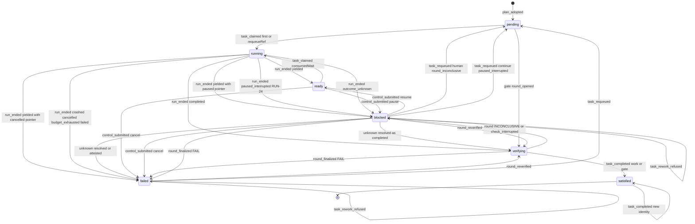

gate 只走 `pending --> verifying`（首轮打开）以及 `verifying`、`failed`、`blocked` 之间的轮次边，从不走 `task_requeued`。

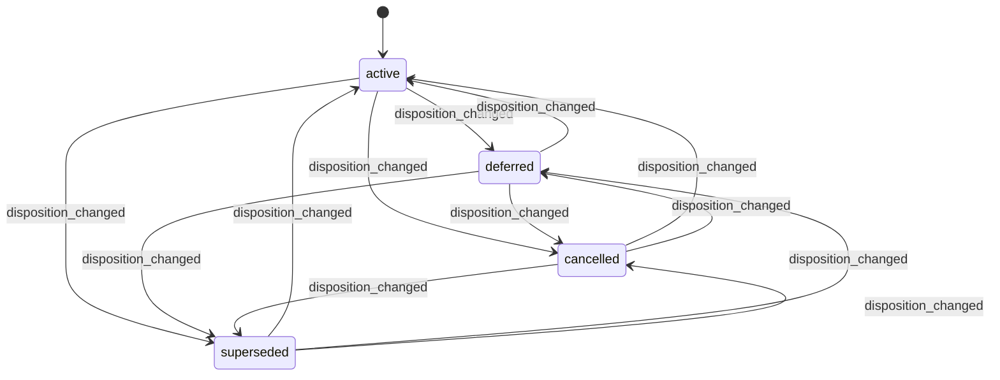

disposition 在四个值之间可以任意方向改变（W16；无痕 Task 今日已无方向限制，有痕 Task 经 TASK-19，C7）。有痕 Task 受 TASK-19 的守卫约束；gate 的处置仍冻结。

### 4.6 实现对照

简化（2026-10-07，不改行为）：TASK-01..03 的 Goal/Plan 钉住检查和领取依据检查用 `run-machine.ts` 的 `claimPinProblem`、`claimBasisProblem`，与 RUN-01 同一份；重做许可里“是不是 Goal 扇出身份”用 `task-failure.ts` 的 `isGoalFanOutActor`。

目标导出（`src/core/work-graph/state/task-machine.ts`，只 import `src/contracts`）：

```ts
export function projectTaskPhase(facts: TaskPhaseFacts): { phase: Phase; cause: TaskPhaseCause | null };
export function transitionTask(state: TaskMachineState, event: TaskEvent, ctx: TaskGuardContext): Transition<TaskMachineState, TaskEvent, TaskEffect>;
```

目标导出（`src/core/work-graph/state/task-failure.ts`，只 import `src/contracts`）：`deriveReworkClass`、`stopRequesterOf`、`reworkFenceOf`、`reworkPermission`、`nextRequeueAutoCount`、`automationVerdict`（work 走 AV 表，gate 走 GV 表）、`buildTaskFailureFacts`、`newTaskReworkRefusalRecord`、`countEndedGoalRuns`。`runUnresolvedBlocker` 从 `tasks/completion-policy.ts:61-81` 移到 `state/`，`completion-policy.ts` 反向 import。`reworkActorClassOf`、`StopRequester` 类型、自动化 actor 常量与 `TaskAutomationPolicyV1` 在 `src/contracts/task-requeue.ts`（类型在 contracts，派生函数在 `state/`）。`newTaskRequeueRecord` 留在 `task-machine.ts`，调用上述函数。

| 行号 | 状态机函数 | 调用服务（file） | 已有测试（file） | 计划新增测试 |
| --- | --- | --- | --- | --- |
| P1–P20 | `projectTaskPhase` | `plan-readers.ts` `readCanonicalTaskFacts`（`:996-1175`；追加选定 Run 的轮次链头、gate 链头（`VerificationRoundByTask`）、TaskRequeue 与拒绝记录的读取，并做同一窗口校验） | `R3c-canonical-task-state.test.ts`、`W1-future-plan.test.ts`；`B2-execution-result.test.ts:57` 的断言要从 `blocked` 改为 `verifying` | 每个 id 一例，并按行序验证（P20 只对 gate 且紧跟 P1，P10 先于 P7，P17/P18/P19 先于 P5，P4 先于 P19，P19 先于 P6）；有 pending 时出现 interrupted 仍为 `verifying`，pending 跑完后变为 `blocked/check_interrupted`；遗留的 PASS 带 gaps 轮次投影为 `blocked/round_inconclusive`（P8），不是 `verifying`；链头是 `open` 的后继轮次 → `verifying/verification_running`，detail `ordinal=2`；链无效 → `blocked/round_ambiguous`；P19 的 detail；gate 无链 → `pending`，链头 open/FAIL/INCONCLUSIVE/PASS → `verifying`/`failed`/`blocked`/`verifying(awaiting_completion)`；非 active 的 Task 仍按事实投影 phase；轮次读失败返回 `unavailable` 而不是某个 phase |
| FC-1..FC-17、AV-0..AV-12、GV-0..GV-10 | `deriveReworkClass`、`automationVerdict`、`reworkPermission`、`buildTaskFailureFacts` | `plan-service.ts` `taskRow`（`:631-658`）挂 `failure`、`rework`；`PlanServiceDependencies.automationPolicy?()` 默认上限 3；读路径注入 `configurationFor(scope)`（lead 决定 LA-4（2026-10-03））；`readGoalDisplayFacts`（§2）复用同一组函数 | 无 | 新增 `tests/state/task-failure.test.ts`（纯函数、表驱动、`never` 穷尽）：FC 每行一例与行序（FC-6 先于 FC-9；FC-8 覆盖 RUN-23；FC-13 先于 FC-14）；FC-2 的三种 `runUnresolvedBlocker` 情形；FC-8 人工 pause 指针 + `cancelled` → `stopRequester='human'`；origin 推导；`stopRequesterOf`（`{kind:'human'}`、不在清单中的 Host `{kind:'system'}` 都是 `human`，两个自动化 actor 分别为 `goal_fan_out`、`system`，无指针为 `none`）；矩阵 ×{human, system, agent}×Goal{active, paused, cancelled}×围栏；AV-0..AV-12 与 AV-7a..AV-7d（上限 0 停住计数类别但不停 `interrupted`；降低上限 → `stopped`；过期拒绝 → `retryAfterRefusal:true`；`budget_exhausted` 带 `minTokenBudgetExclusive`；AV-5 显示 `task_paused{pausedBy:'goal_fan_out'}`）；GV-0..GV-10；AV-7c 与 GV-8 的码筛选（未过期的 `source_unchanged` 拒绝在 work 链头与 INCONCLUSIVE gate 链头上不停住判定，分别得 AV-7d、GV-10 的 `reverify`，在 FAIL gate 链头上为 `stopped/gate_needs_fix`；未过期的 `auto_rework_cap_reached` 重新检查拒绝在上限提高后不再停住判定；work `check_failed` 链头上的重新检查拒绝不改变 AV-12 的 `requeue`）；`nextRequeueAutoCount`（人工归零、`interrupted` 不加、`consumedWait` 不断链）；`requeueActors` 与状态前置条件取交集；`countEndedGoalRuns` 不按计划过滤。服务级 `tests/work-graph/task-failure-facts.test.ts`（经 `queryTaskGraph`）：检查 FAIL、崩溃、预算耗尽、人工取消、`interrupted_clean`、暂停中中断各一例；运行中、已满足、无 Run 时没有 `failure`；`rework.entries` 按链顺序；读取拒绝与 intent 后仍是一个窗口 |
| TASK-25 | `transitionTask`（`plan_adopted`） | `plan-service.ts` `applyPlanChange`（W15 `:1057-1231`、W16 `:1676-1816`） | `W1-future-plan.test.ts` | 草案 phase 为 `ready` 或 `blocked` 的新任务也投影为 `pending` |
| TASK-01、02 | `transitionTask`（`task_claimed`） | `claim-service.ts` | `R4c-task-claim.test.ts`、`R4c-task-claim-concurrency.test.ts`；续接见 `tests/app/AG2b-collaboration.test.ts` | 表驱动机器测试；续接领取的新 Run 不带接续说明（RUN-02 `continuationBrief=absent_ok`，测试在 §6） |
| TASK-03 | 同上，`requeueRef` 分支 | `claim-service.ts`；`workflow.ts:628-705`（`claim_requeued` 的 Session 选择）、`:489-508`（`buildClaimOperation` 带 `requeue`）、`:751-782`（`create_session{requeue}`） | `R4c-task-claim.test.ts:269-276`、`R4c-task-claim-boundaries.test.ts:97-108`（保持 busy） | requeue 后领取：产生新 Attempt 和 Run，租约到 @k+1，旧记录不变；两次并发领取只有一次 commit；不带 `requeueRef` 仍为 `busy`；`requeue.budget` 非空时预算不同 → `invalid`；非 active → `invalid`；`unavailable/kernel_turn_open` 的原 Session 被拒，Workflow 改为 `create_session{requeue}`；新 Run 的 RUN-02 要求 `continuationBrief=bound`（§6） |
| TASK-04–13、20–23、26、29、30 | `transitionTask`（重投影事件） | 只读投影 | `B2-execution-result.test.ts` | 每种 outcome 和轮次结论对应的 phase 与 cause；`YieldedWait` 上 pause、cancel、resume 的投影（TD-5）；`blocked/check_interrupted` 经 finalize 得 FAIL 或 INCONCLUSIVE；RUN-24 → `blocked/paused_interrupted`，RUN-19 → `failed/run_failed`；`round_reverified` 把 `failed/check_failed` 与 `blocked/round_inconclusive` 变回 `verifying`；gate 首轮打开、finalize、后继轮次的投影 |
| TASK-14、15、24 | `transitionTask`（`task_completed`） | `completion.ts`：`:297`（facts 带 TaskRequeue 与链头）、`:360`、`:381`（先排除 S 再折叠）、`:437-447`（守卫）、`:344-354`（gate 锚定 producer） | `R3e-completion.test.ts`、`R3e-completion-platform.test.ts:72-107`（work 与 gate 轮次在同一 producer Run 上，槽不同，结果不变） | `failed` 的 Task 拿旧 PASS 轮次完成，返回 `incomplete`；Run1 FAIL → requeue → Run2 FAIL → requeue → Run3 PASS → `satisfied`（排除两条 requeue 存储的 `supersededEvidenceIds` 的并集；完成侧不读 `afterRoundRef` 轮次，L-3）；同一 Run R1 FAIL → 改文件 → 后继轮次 R2 PASS → `satisfied`（排除 R2 的 `chain.supersededEvidenceIds`）；Run1 上 R1、R2 都失败后重入队 → 新 Run PASS → `satisfied`（`chainEvidenceIds` 含 R1 与 R2）；不 requeue、不重新检查时旧 FAIL 仍阻塞；并发 requeue 使完成得 `revision_conflict`；gate 从 `verifying(awaiting_completion)` 完成，旧 gate FAIL 证据被排除；已满足后新身份完成写 revision+1 |
| TASK-16、17、27、28 | `transitionTask`（`task_requeued`、`task_rework_refused`） | 新增 `tasks/requeue-service.ts`（依赖 `records`、`workspaceHost`、`source`、`automationPolicy()`、`delegatedWrites?`、`now`、`newId`、`eventId`）；`plan-write-admission.ts` 推广为委托写入；路由 `tasks/requeue`（`core-routes.ts`）；界面动作（`src/ui/main.ts`）；`create-platform.ts:452-455` 发布 `claims.requeueTask` | 无 | 新增 `tests/state/task-machine.test.ts` 的 TASK-16/17/27/28 守卫表（拒绝顺序预算 → 上限 → 键；人工取消不比较；`outcome_unknown` 在任何策略检查之前为 `busy`；agent 给 `budget` → `invalid`；TASK-27：human ✓、agent/无 trigger 的 system → `forbidden`、合法 `goal_resume` ✓、多 epoch 的 `pausedEpoch` ✓、`pausedEpoch ≥ resumedEpoch` → `forbidden`、过期 `resumedEpoch` → `revision_conflict`、Goal 暂停或取消 → `busy`、同一 afterRun 第二次 → `revision_conflict`）。新增 `tests/work-graph/requeue-service.test.ts`：人工重入队 `autoCount=0`、回执重放；system 重入队 `autoCount=1`、`cap=3`；策略拒绝写 refusal@1，事实不变的新请求写 @2，重放请求 1 得原 `refused`；上限拒绝不采集来源；来源读不出 → `unavailable`、0 提交；预算三例；并发重入队与拒绝恰好一个提交；守卫不含其它 Task 的 Run；过期 afterRun → `revision_conflict`、不写拒绝；与后继轮次的两种先后顺序；`countEndedGoalRuns` 先于采集；Host `{kind:'system'}` 操作者算 `human`，其取消围住 Workflow 的重入队；`historySource` 两例（RUN-19 与未进入）；写入的 `supersededEvidenceIds` 等于 `chainEvidenceIds(head)`，无轮次时为空数组；`note` 存为 Artifact 并成为新依据，非 human 给 `note` → `invalid`；`newInputRefs` 只引用任务 manifest → `invalid`、0 提交、不比较键（§13.4 #25）；`GOAL_FAN_OUT_ACTOR` 对 `check_failed` 重入队、或不带 trigger → `forbidden`；非 active → `invalid`；gate → `invalid`；链无效（含带 `open` 轮次的遗留多根）→ `incomplete`，不是 `busy`（链无效先于 `finalize_first:`）。新增 `tests/work-graph/requeue-continue.test.ts`（继续的端到端规则，Goal@rev 守卫与并发 Goal 暂停冲突）。新增 `tests/work-graph/requeue-agent-admission.test.ts`（W2 fixture 授予 `requeue_task`：同 Goal 已进入的 agent 提交，`requestedBy.kind='agent'` 带 `runRef`、计入上限；Run 已结束 → `busy`；另一 Goal 或无授权 → `forbidden`；人工取消的 Task → `forbidden`；`check_incomplete` → `invalid`；新存储的诊断 Artifact 通过，同一 Artifact 第二次被拒）。Runtime 负例：授予 `requeue_task` 或 `reverify_round` 的 manifest 在启动时得 `unsupported`，provider 调用 0（GAP-46） |
| TASK-18、19 | `transitionTask`（`disposition_changed`）；`state/plan-machine.ts` `tracedDispositionChangeProblem` | `plan-service.ts:1676-1816`（`:1737-1793`）、`plan-readers.ts`（`readDispositionChangeTaskFacts`）、`plan-commit-compiler.ts:241-328`、`plan-validation.ts:306-347`、`plan-task-basis.ts`（`executionDefinitionsAgree`） | `W1-future-plan.test.ts`、`W2-agent-whiteboard.test.ts` | `task-machine.test.ts`：TASK-19 从每个允许的投影出发 phase/原因不变，不允许的投影按 4.4 的码拒绝；TASK-16 对非 active → `invalid`。`plan-machine.test.ts`：`tracedDispositionChangeProblem` 全表（Goal `cancelled` 最先 `invalid`；开着的 Run、unknown、三种 `runUnresolvedBlocker`、未消费的让出等待、未释放租约 → `busy`；无租约记录 → `unavailable`；有 Reduction → `invalid`；缺 `affectedTaskIds` → `invalid`；围栏 + 非 human → `forbidden`）。`W1-future-plan.test.ts` 新场景：有痕失败 Task 被替代并新增载体（旧记录逐字节不变、basis 继承、`dispositionChange` 可见）；缺 `affectedTaskIds`；从 `taskIds` 移走 → `revision_conflict`；Goal `paused` 允许、`cancelled` 拒绝；`dispositionRecord` 逐版继承；人工取消的 Task 由 Host `system` 操作者采用 → 提交（操作者类别为 `human`），由 agent 采用 → `forbidden`。lead 决定 LA-3（2026-10-03）：agent 采用为全部 active work 载体被围住的义务新增载体 → `forbidden`（未围栏的载体只有 gate 时仍 `forbidden`，§3 守卫 9），人工采用 → 提交。与领取、重入队的竞态两种顺序 |
| E03 组合 | 以上全部 | Workflow 与平台：Workflow 按判定自动重入队、领取（C8）；人工经 `tasks/requeue` 也可以 | `tests/composition/R5c-workflow-platform.test.ts`（`:602-618` 的断言改为：非 PASS 的 finalize 回到 `select_work`，之后执行 `requeue_task`） | 完整链路：检查 FAIL → Workflow 自动重入队（system，`check_failed`，`autoCount=1`）→ 同一 Session 领取 → 新 Attempt 实际执行 → PASS → `satisfied`；旧失败保留；Run2 的首个模型请求含接续说明（失败的 checkId、报告 digest、Run1 改动的文件、标准说明，`continuity='same_session_history'`），放在 `tests/scenarios/A1-rework-same-session.test.ts`；Goal 显示 `auto_rework_count{n:1, cap:3}`。场景 `C8-auto-rework-cap`（每个 Run 写不同内容，恰好 4 个 Run 后 `stopped/auto_rework_cap_reached`，Goal 需要你决定；提高上限后自动继续；人工重入队归零）、`C8-human-stop-respected`（人工取消后 0 次重入队、0 次模型调用，system/agent → `forbidden`，人工重入队不需要新依据；Host `system` 启动 actor 的变体）、`C8-budget`（预算耗尽停住，提高 binding 预算后带它重入队）；A8 合并后的 3l/3n 断言 `create_session` 与历史播种（§12） |


## 5. TaskAttempt（含 TaskLease / DispatchOutbox）

本节的三个记录都属于同一次领取的生命周期，并在同一事务中演进：

- **TaskAttempt**：一次业务执行尝试。
- **TaskLease**：每个 Task 一条，各次 Attempt 复用同一条记录。
- **DispatchOutboxEntry**：该 Attempt 的派发意图。

三者都不直接接收用户意图，全部由 §6 的 Run 事件驱动。`transitionAttempt`、`transitionTaskLease`、`transitionDispatchOutbox` 只返回下一状态和效果意图；写入发生在 Run 迁移的同一个 RecordStore 提交中。

本节依赖 D-3、D-4、D-5、D-6、D-7、D-14，以及 §6 的 RD-1（已由 lead 采纳，L-8）、RD-5、RD-6（U-9 已定为选项 (c)，C4）。2026-10-03 用户已确认：D-3（U-3）按 C1 采纳，操作者含 human、system、agent，本节的重新入队领取（ATT-16）不因操作者不同而不同；D-4（含 (b) 人工认定，U-4）、D-5（U-5）、D-6（U-6）、D-7（U-7）、D-14 的配对措辞（U-14）按原推荐采纳。D-6 的“每个工具调用都有结果”按 lead 决定 LA-7（2026-10-03）读作“没有 `running` 或 `outcome_unknown` 的工具调用”：Kernel `pending`（已声明、从未开始）的调用计为未开始，不算在途。lead 决定 L-1（人工认定要求本 Host 持有实例租约）和 L-2（从 `Entering` 结束为未知、没有 Kernel Turn 可补记时的 ATT-36、ATT-37）直接约束本节。

本节补充的决定（lead 按本节写明的默认做法采纳，L-16）：

- **AD-1 未知结果期间 Outbox 保持 `entered`**：当 Attempt 以 `outcome_unknown` 结束时，Outbox 保持 `entered`，直到 `attempt_resolved` 才变为 `settled`。理由：与 D-4 保留占用和租约的做法一致，使“Outbox 为 `settled` ⇔ Run 以已知 outcome 结束”成立。
  - 例外（lead 决定 L-2）：§6 RUN-20(ii) 从 `Entering` 结束（探针为 `missing`/`damaged`，没有 Kernel Turn 可补记进入事实）时，Attempt 的 `startedAt` 保持 `null`（ATT-36），Outbox 保持 `pending`（ATT-37）。解决时由 ATT-29 从 `pending` 直接 `settled`。上面的等价关系仍然成立。
- **AD-2 未进入即取消的派发状态需要新版本**：D-7 未进入取消时，Outbox 从 `pending` 直接变为 `settled`，但现有 `TaskDispatchStateV1` 要求有 `consumerId` 和 `entryGeneration`（`execution-entry-codecs.ts:281-282`）。因此新增 **`dispatchState.schemaVersion: 2`** 的 settled 变体；外层 Outbox 记录的 `schemaVersion` 仍为 1：
  - `{schemaVersion:2, phase:'settled', settlement:'not_entered', consumerId: string|null, entryGeneration: number|null, sessionGeneration, eventId}`；
  - 改造点：
    - 类型：`TaskDispatchStateV1`（`claim-contracts.ts:41-48`）扩为 V1 与 V2 的联合；
    - 校验：`taskDispatchStateV1Problem` 今天拒绝多余键和 `schemaVersion≠1`（`execution-entry-codecs.ts:276-279`），改为按 `dispatchState.schemaVersion` 分派；
    - 外层：`decodeDispatchOutboxEntry` 的 `schemaVersion===1` 检查（`claim-record-codecs.ts:226`）不变，只在 `:246-250` 调用新的分派函数；
  - V1 原样可读（`claim-contracts.ts:36-40` 已约定 Outbox 变化必须带版本）。

### 5.1 持久位置与状态枚举

| 对象 | 持久位置 | 代码枚举（原样） | 与设计名 / 说明 |
| --- | --- | --- | --- |
| TaskAttempt | `TaskAttemptSnapshot` 的 `status`、`startedAt`、`endedAt`、`endOutcome` 字段（`src/contracts/dispatch.ts:339`、`:365-376`）；codec 见 `claim-record-codecs.ts:158-195`，状态与 outcome 列表见 `:78-79` | `status`：`claimed`/`started`/`ended`<br>`endOutcome`：`RunOutcome \| null`（`dispatch.ts:111`） | 与 ORCHESTRATION §2 同名。<br>“open”指 `claimed` 或 `started`。<br>“待核对”指 `ended` 且 `endOutcome='outcome_unknown'`（D-4）。<br>codec 不做跨字段校验：例如 `ended` 不强制 `endOutcome≠null`（`:182-193`）。目标由 §14 强制 |
| TaskLease | `TaskLeaseSnapshot`（`dispatch.ts:354-364`）；release 戳为 `TaskLeaseReleaseV1`（`:345-353`）；codec 见 `execution-entry-codecs.ts:205-272` | 没有枚举字段。<br>held：没有 `release`。<br>released：有 `release` | 每个 Task 一条（ref 不含 attemptId），各次 Attempt 复用。<br>`expiresAt` 恒为 `null`，绝不按时间释放（ORCHESTRATION §5 `:349`） |
| DispatchOutboxEntry | `TaskClaimOutbox` 的 `status` 与 `dispatchState`（`claim-contracts.ts:41-57`）；codec 见 `claim-record-codecs.ts:209-253`、`execution-entry-codecs.ts:274-286` | `status`：`pending`/`entered`/`settled`。<br>`dispatchState.phase`：`entered`/`settled`，必须等于 `status`；`pending` 时不得带 `dispatchState`（`claim-record-codecs.ts:241-251`） | 每个 Attempt 一条（ref 含 attemptId）。<br>`immutable claim` 保存原 `TaskClaim`（`src/contracts/core/task-claim.ts:15-26`） |

**D-14 配对不变式**（措辞按原推荐采纳，U-14，2026-10-03 用户确认）。每次提交后都必须成立，并作为 §11 I-1、I-6 的一部分。“租约”一列只描述本 Attempt 是租约持有者的情形。

| Attempt | Run.status / outcome | Run 入口授权（V2 phase，§6） | Outbox | 租约 | Session 占用（§8） |
| --- | --- | --- | --- | --- | --- |
| `claimed` | `starting` | 无、`authorized`、`entering`，或 D-5 之后的 `revoked` | `pending` | held | 本 Run 的代际 |
| `started` | `running` | `entered` | `entered` | held | 本 Run 的代际 |
| `ended`（outcome 已知） | `ended`，outcome 相同 | `settled`；D-7 时为 `revoked` 或无 | `settled` | released | 已释放 |
| `ended`（`outcome_unknown`），`startedAt≠null` | `ended` + `outcome_unknown` | `unknown`（§6） | `entered`（AD-1） | held | 保留 |
| `ended`（`outcome_unknown`），`startedAt=null`：只来自 ATT-36（§6 RUN-20(ii) 从 `Entering`，lead 决定 L-2） | `ended` + `outcome_unknown`，`startedAt=null` | `unknown`（§6） | `pending`（ATT-37，AD-1 的例外） | held | 保留 |

### 5.2 事件

| 事件名 | 来源 | 驱动它的 Run 事件（§6） | 载荷要点 | 对应原文编号 |
| --- | --- | --- | --- | --- |
| `attempt_claimed` | U/P | `claim_committed`，包括首次领取、续接（W2）、重入队后的领取（D-3） | `attemptRef`、`runId`、`planRef`；`consumedWait?` 或 `requeueRef?`；`claim.generation` | T2、T7 |
| `attempt_started` | K | `entered_observed` | `enteredAt`、`consumerId`、`entryGeneration`、`sessionGeneration`、`eventId` | T3、work-graph.md §6.3（`:584`、`:592`） |
| `attempt_ended` | K、U、R | `terminal_observed`（含 RUN-08 的未结算分支）、`stop_not_entered`（cancel）、`stop_paused`（RUN-23）、`reconcile_terminal`、`reconcile_interrupted_clean`、`reconcile_unknown` | `endOutcome`（含 `outcome_unknown`）、`endedAt`；从 `Entering` 核对时补记的 `startedAt`（RUN-20(ii) 没有 Turn 时为 `null`，ATT-36）；是否拥有租约和 Session（按 claim 的代际判断） | T5、R2、R5、A8、D-4、D-6、D-7 |
| `attempt_resolved` | K、R、U | `late_evidence`（K：同进程后续观察；R：下次启动），给出已知终态；`unknown_attested`（人工证明，结果为 `crashed`；只经持实例租约的 Host，L-1） | 已知 outcome；resolution 来源（`kernel_late_evidence` 或 `human_attested`）；`startedAt` 为 `null` 时，`late_evidence` 带 Kernel Turn 开始时间供补记（L-2）；授权的 `consumerId`、`generation`，供 Outbox 从 `pending` 结算（ATT-29） | D-4、R5 |

以下 Run 事件不驱动 Attempt。Attempt 保持 `claimed`，TaskLease 和 Outbox 也不写：

- `entry_authorized`、`entry_begun`、`history_recorded`；
- `pause_not_entered`、`resume_not_entered`；
- `reconcile_not_entered`（D-5）；
- `control_submitted`（只移动 Run 指针或追加 `controlInputs`，§6 RUN-12..15）。

**从 `Entering` 核对结束（与 §6 RUN-17、RUN-19、RUN-20、RUN-24 以及重启时的 RUN-23 一致）。** Run 处于 `Entering` 时（begin 已提交、进入尚未入账，A8 的第三个崩溃点），Attempt 仍是 `claimed`，Outbox 仍是 `pending`。核对在同一提交中补记进入事实，`startedAt` 取 Kernel Turn 的开始时间，然后：

- Attempt 直接 `claimed→ended`（ATT-31、ATT-32）；
- Outbox 直接 `pending→settled`（已知结果，ATT-33）或 `pending→entered`（未知结果，ATT-34）；
- 不经过中间的 `started`/`entered` 状态，各记录 revision +1。

探针为 `missing`/`damaged`、读不到任何 Turn 时（§6 RUN-20(ii)，lead 决定 L-2），没有进入事实可补记：

- Attempt `claimed→ended(outcome_unknown)`，`startedAt=null`（ATT-36）；
- Outbox 保持 `pending`（ATT-37）；
- 之后经 `late_evidence` 解决时，ATT-11 补记 `startedAt`（与 §6 RUN-21 同提交），ATT-29 把 Outbox 从 `pending` 直接结算；经 `unknown_attested` 解决时 `startedAt` 保持 `null`。

因此 Attempt 有两类 `claimed→ended` 路径：D-7 的未进入取消（ATT-05），以及从 `Entering` 的重启核对（ATT-31、ATT-32、ATT-36）。`attempt_started` 只有 K 来源。

**重启时暂停中的 Run（C4，§6 RUN-24）。** Run 为 `Entering`/`Running`，指针为 `paused`（pause intent 已 applied 或仍 queued）；重启核对时 Kernel Turn 存在、没有终态，也没有 `running`/`outcome_unknown` 的工具调用。这样的 Run 由 §6 RUN-24 结束为 paused-interrupted，不算失败。它与 RUN-19 用同一个 Run 事件 `reconcile_interrupted_clean`，本节三个记录的处理也与 RUN-19 相同：

- Attempt：`endOutcome='crashed'`。从 `Running` 走 ATT-09；从 `Entering` 走 ATT-31，并补记 `startedAt`。
- 租约走 ATT-18 或 19；Outbox 走 ATT-27，从 `Entering` 来时走 ATT-33。
- 本节记录不区分 paused-interrupted。区分只看 Run 的 `reconciliation.observation.pausedIntentRef≠null`（`isPausedInterrupted`，§6），Task 投影见 §4 P19。
- RUN-19、RUN-23、RUN-24 结束时 Kernel Turn 仍没有 Kernel 终态；RUN-22 认定的 Run 在 Turn 没有 Kernel 终态或 Kernel 不可读时也一样。这些行的 `release_session` 保留原 `historyCursor`（不写 null），并在同一提交把 Session 记为 `unavailable`/`kernel_turn_open`（§8 SES-06、SES-07）。本节三个记录的写法不受影响。
- “继续”就是 `requeueTask`：class `interrupted`，`interruption:'paused'`，只允许人工；Goal 扇出的暂停由人恢复 Goal 后经 §2 GOAL-29 驱动（§4 TASK-27）。之后的领取按 ATT-16 复用同一条租约，按 ATT-01、ATT-24 新建 Attempt 和 Outbox。按 lead 决定 LA-1（2026-10-03），这次领取在与原 Session 关联的新 Session 中进行：原 Session 为 `kernel_turn_open` 时 Workflow 走 `create_session`，模型历史接原 Session 已完成的部分（`TaskRequeue.historySource`，由 AgentRuntime `prepare` 填入 `sessionBasis`）；原 Session 不再执行。

### 5.3 迁移表

行号是稳定 id。新增行沿用末尾编号，按对象插入相应的表中。

**TaskAttempt**

| # | from | event | guard（守卫） | to | effects（同事务副作用意图） | 幂等/重复事件 | 原文编号 | 现状 |
| --- | --- | --- | --- | --- | --- | --- | --- | --- |
| ATT-01 | ∅ | `attempt_claimed` | 由 Task 机决定（TASK-01、02、03）；Attempt 的 key 为 ∅（CAS `null`） | `claimed`@1：`startedAt`、`endedAt`、`endOutcome` 均为 `null` | 与 Run@1、Outbox@1、租约、Session 占用在同一提交 | 领取回执重放，不生成新的 attemptId（`claim-service.ts:745-747`） | T2 | 已有 `claim-service.ts:704-705` |
| ATT-02 | `claimed` | `attempt_started` | Attempt 为 `claimed`（新增显式守卫；今日只靠 auth 为 `entering`，`execution-entry-service.ts:1202`）；Run 的 auth 为 `entering`；Session 和租约属于本代际（`:1210-1214`） | `started`，`startedAt=enteredAt` | `enter_outbox`（ATT-26） | `recordExecutionEntered` 回执重放（`:1270`） | T3 | 已有 `execution-entry-service.ts:1239-1240`；改造：加显式守卫 |
| ATT-03 | `claimed` | `entry_authorized`、`entry_begun`、`history_recorded` | — | `claimed`，不写 | 无 | — | T3、R1、R3 | 已有：`entry_authorized`（W3，只写 Run，`execution-entry-service.ts:965-971`）、`entry_begun`（W4，`:1100-1101`）、`history_recorded`（W9，`execution-history-binding.ts:146`）都不写 Attempt。A.2 5.1 同步：Run 事件 `pause_not_entered`、`resume_not_entered`（D-7，§6 RUN-10/11）与 `control_submitted` 一样不进入 Attempt 机器（`attemptEventFromRunEvent` 映射为 `null`），Attempt、Outbox、Lease 都不写 |
| ATT-04 | `claimed` | `reconcile_not_entered` | 同 §6 RUN-16：auth 为 `entering`，探针 `ready` 且 Kernel 中没有该 turn，`exitProof≠null`（重启时本 Host 持有实例租约，D-5；进程内为 `live_clean`） | `claimed`，不写 | 无。Run 侧撤销 auth，同一 claim 以 `entryGeneration+1` 重新授权（§6 RUN-16、RUN-03）。不新建 Attempt | reconcile 操作回执重放 | A8、ORCHESTRATION §9 `:412`、D-5 | 新增 |
| ATT-05 | `claimed` | `attempt_ended`，来自 `stop_not_entered`（cancel） | Run 为 `starting`（`Claimed`/`Authorized`/`Revoked`），entry∈{none, authorized, revoked}（§6 RD-1），绝不能是 `entering`；指针条件与 §6 RUN-09 相同：U 来源指针≠cancelled（同提交 `set_pointer(cancelled)`），R 来源指针=cancelled 且指向 queued cancel | `ended`：`endOutcome='cancelled'`，`startedAt=null`，`endedAt=now` | `settle_outbox(not_entered)`（ATT-30）、`release_lease`（ATT-23）、`release_session{sessionRef, generation}`。Run、auth、意图的变化见 §6 RUN-09、§7 CTL-02 | 停止意图同身份重放 | R1、R2、D-7、RD-1 | 新增（缺口 state-writes-other §7 #15） |
| ATT-06 | `started` | `attempt_ended`，来自 `terminal_observed`（outcome 已知） | Run 的 auth 为 `entered`；Run 未结束（`:1343`）；事件序号更新（`:1638`）；Kernel 边界完整（`:1350-1367`） | `ended`，`endOutcome` 等于 Run 的 outcome | `settle_outbox`（ATT-27）；仅当 `ownsLease` 时 `release_lease`（`:1397-1398`）；仅当 `ownsSession` 时 `release_session`（`:1396`） | 回执重放（`:1331`）；对已结束 Run 的新身份返回 `busy`（`:1343`） | T5、R5 | 已有 `execution-entry-service.ts:1406-1407` |
| ATT-07 | `started` | `attempt_ended`（`outcome_unknown`），来自 `terminal_observed` 的未结算分支（§6 RUN-08） | 同 §6 RUN-08：Run 的 auth 为 `entered` 且未结束；有缺结果或 `outcome_unknown` 的工具调用，或 Turn 不完整（`execution-observation.ts:578-583`）；`exitProof≠null`（进程内为 `live_clean`） | `ended`，`endOutcome='outcome_unknown'` | 无释放；Outbox 保持 `entered`（ATT-28） | 同 ATT-06 | D-4、RD-2 | 改造 `execution-observation.ts:583-594`（今日 Run 停在 running、不写结果）。写入经扩展的 `recordRunResult`（带 `unresolvedToolCallIds`，§6 RD-5、6.1 契约 (b)）；今天 `recordRunResult` 只收已知终态（`execution-entry-service.ts:1640-1670` 没有 unknown 分支） |
| ATT-08 | `started` | `attempt_ended`，来自 `reconcile_terminal`（Run 为 `Running`） | 本 Host 持有实例租约（D-18）；Kernel 历史中有该 Run 的终态事件 | `ended`，`endOutcome` 为 Kernel 终态映射的 outcome | 同 ATT-06 | reconcile 操作回执重放 | S8、A8、D-6 | 新增 |
| ATT-09 | `started` | `attempt_ended`，来自 `reconcile_interrupted_clean`（Run 为 `Running`；§6 RUN-19 或 RUN-24） | 同 §6 RUN-19 或 RUN-24：实例租约；Kernel turn 存在、没有终态（可为 paused）；没有 `running` 或 `outcome_unknown` 的工具调用（`pending` 计为未开始，lead 决定 LA-7）；指针 intent 不是 queued cancel（否则 RUN-23 → ATT-35）。指针为 `paused` 时是 RUN-24（paused-interrupted，C4），否则是 RUN-19 | `ended`，`endOutcome='crashed'`（RUN-19、RUN-24 相同） | 同 ATT-06；`release_session` 的 Session 侧见上文“重启时暂停中的 Run”与 §8 SES-06 | 同上 | A8、D-6、C4 | 新增 |
| ATT-10 | `started` | `attempt_ended`，来自 `reconcile_unknown`（Run 为 `Running`） | 实例租约；Kernel turn 存在，且至少一个工具调用为 `running`（没有结果）或 `outcome_unknown`；`pending`（从未开始）不算（lead 决定 LA-7） | `ended`，`endOutcome='outcome_unknown'` | 无释放；Outbox 保持 `entered` | 同上 | A8、D-4、D-6 | 新增 |
| ATT-35 | `started` | `attempt_ended`，来自 `stop_paused`（§6 RUN-23） | 同 §6 RUN-23：Run 为 `Running`（`Entering` 的重启情形走 ATT-31、ATT-33），Kernel Turn 为 paused（重启时也可以是没有终态、未暂停的 Turn：lead 决定 LA-7 把 RUN-23 推广为“queued cancel + 干净的 Kernel Turn”），指针为 cancelled 且 cancel intent 仍 queued；`exitProof≠null`（进程内 `live_clean`，或重启时实例租约）；没有在途工具（`pending` 计为未开始） | `ended`，`endOutcome='cancelled'` | `settle_outbox`（ATT-27）；`release_lease`（ATT-18，归属成立时）；`release_session`（§8 SES-06） | 随 RUN-23 回执回放（身份 = hash(runRef, cancel intentRef)） | R2、G7、RD-7 | 新增 |
| ATT-31 | `claimed`（Run 为 `Entering`） | `attempt_ended`，来自 `reconcile_terminal` 或 `reconcile_interrupted_clean`（§6 RUN-17、RUN-19 或 RUN-24），或重启时来自 `stop_paused`（§6 RUN-23 从 `Entering`，lead 决定 LA-7） | 同 §6 RUN-17、RUN-19、RUN-23 或 RUN-24：实例租约；Kernel turn 存在；有终态（RUN-17），或无终态（可为 paused）且没有 `running`/`outcome_unknown` 的工具调用（`pending` 计为未开始，lead 决定 LA-7）。无终态时按指针分行：指针 intent 为 queued cancel 是 RUN-23（LA-7 推广后的重启情形）；指针为 `paused` 是 RUN-24（paused-interrupted，C4）；否则是 RUN-19 | `ended`：`startedAt` 补记为 Turn 开始时间；`endOutcome` 为 Kernel 终态映射值，或 `crashed`（RUN-19、RUN-24），或 `cancelled`（RUN-23） | `settle_outbox(entered 变体)`（ATT-33）；`release_lease`（ATT-18，归属成立时）；`release_session`（RUN-19、RUN-23、RUN-24 时 Session 侧见上文“重启时暂停中的 Run”与 §8 SES-06） | 同 ATT-08；RUN-23 时同 ATT-35 | S8、A8、D-6、C4、RD-7 | 新增 |
| ATT-32 | `claimed`（Run 为 `Entering`） | `attempt_ended`，来自 `reconcile_unknown` | 同 §6 RUN-20 (i)(iii)：实例租约；Kernel turn 存在；有工具调用为 `running`（缺结果）或 `outcome_unknown`（`pending` 未开始不算，lead 决定 LA-7），或 yielded 终态的 continuation 无法按 RD-3 重建（含多条等待发信，lead 决定 L-5） | `ended`：`startedAt` 补记；`endOutcome='outcome_unknown'` | Outbox `pending→entered`（ATT-34）；不释放（ATT-20） | 同 ATT-08 | A8、D-4、D-6 | 新增 |
| ATT-36 | `claimed`（Run 为 `Entering`） | `attempt_ended`，来自 `reconcile_unknown` 的情形 (ii) | 同 §6 RUN-20(ii)：实例租约；探针为 `missing`/`damaged`，读不到 Turn，没有进入事实可补记 | `ended`：`startedAt=null`；`endOutcome='outcome_unknown'` | Outbox 保持 `pending`（ATT-37）；不释放（ATT-20） | 同 ATT-08 | A8、D-4、§8 SD-3、lead 决定 L-2 | 新增 |
| ATT-11 | `ended`（`outcome_unknown`） | `attempt_resolved`，来自 `late_evidence` | 新的 Kernel 证据给出已知 outcome；Run 在同一提交中改为该 outcome（§6 RUN-21） | `ended`（revision+1），`endOutcome` 改为已知值；`startedAt` 为 `null`（ATT-36 之后）时补记为 Kernel Turn 开始时间（与 RUN-21 同提交，lead 决定 L-2） | `settle_outbox`（ATT-29，从 `entered`，或 ATT-37 之后从 `pending`）、`release_lease`（ATT-22）、`release_session`；归属按原 claim 的代际判断 | 同身份重放；再次解决返回 `busy` | D-4、R5 | 新增 |
| ATT-12 | `ended`（`outcome_unknown`） | `attempt_resolved`，来自 `unknown_attested` | 有权操作者执行 `resolveUnknownRun`，记录证明人和原因（§6 RUN-22）；本 Host 持有实例租约，否则 `busy`（lead 决定 L-1） | `ended`，`endOutcome='crashed'`；`startedAt` 不补记（没有 Kernel 证据，ATT-36 之后仍为 `null`） | 同 ATT-11 | 同上 | D-4(b) | 新增（U-4 按原推荐采纳） |
| ATT-13 | `ended`（outcome 已知） | 重复的 `attempt_ended` 或 `attempt_resolved` | — | 不变 | 无 | 同身份同内容：重放原回执；新身份：`busy`（保持 `runFinished`） | R5 | 已有 `execution-entry-service.ts:1343`、`:1609-1611` |

**TaskLease**

| # | from | event | guard（守卫） | to | effects（同事务副作用意图） | 幂等/重复事件 | 原文编号 | 现状 |
| --- | --- | --- | --- | --- | --- | --- | --- | --- |
| ATT-14 | ∅ | `attempt_claimed`（首次领取） | 租约 key 为 ∅（CAS `null`，`claim-service.ts:732`） | held@1：`holderRunId`、`attemptId`、`grantedAt`，`expiresAt=null` | — | 同 ATT-01 | T2 | 已有 `claim-service.ts:693-695` |
| ATT-15 | released | `attempt_claimed`（续接，W2） | `release` 存在，且 `holderRunId` 等于前一 Run（`claim-service.ts:614-618`） | held@k+1：持有者换新，删除 `release` | — | 身份与 actor 无关（`:381-405`） | 续接 | 已有 `claim-service.ts:696-697` |
| ATT-16 | released | `attempt_claimed`（重入队后的领取，D-3） | `release.runRef` 等于 `TaskRequeue.afterRunRef`；guard 为租约@k | held@k+1：持有者换新，删除 `release` | — | 同 TASK-03 | T7、D-3 | 改造 `claim-service.ts:639-641`、`:693-697` |
| ATT-17 | held | `attempt_claimed`（任何一种） | — | 不变 | — | — | T2 | 已有：返回 `busy`（`eligibility.ts:73-76`、`claim-service.ts:582`），见 5.4 |
| ATT-18 | held | `attempt_ended`（outcome 已知，`ownsLease`），含从 `Entering` 的核对（ATT-31） | 持有者和 attempt 与 claim 一致，且还没有 `release` | released@k+1：release 戳为 `{runRef, attemptRef, sessionRef, generation, releasedAt, eventId}` | — | 同 ATT-06 | T5、R5 | 已有 `execution-entry-service.ts:1424-1430` |
| ATT-19 | held（他人持有）或 released | `attempt_ended`（`ownsLease` 不成立） | 持有者或 attempt 不是本 claim，或已有 `release` | 不变，不写。这是无效果迁移，不是拒绝：终态照常入账；按 SD-1 返回 `ok:true`、`effects:[]`（已由 lead 采纳，L-8） | 守卫取租约读到的 revision（`:1419-1423`） | — | work-graph.md §6.3 `:588`（旧入口不释放新占用） | 已有 `execution-entry-service.ts:1397-1398` |
| ATT-20 | held | `attempt_ended`（`outcome_unknown`），含 ATT-07、10、32、36 | — | held，不写 | — | — | D-4、I-2 | 新增 |
| ATT-21 | held | `reconcile_not_entered` | D-5 | held，不写 | — | — | D-5 | 新增 |
| ATT-22 | held | `attempt_resolved` | 持有者是该 Run；尚未释放 | released@k+1 | — | 同 ATT-11 | D-4 | 新增 |
| ATT-23 | held | `attempt_ended`，来自 `stop_not_entered` | ATT-05 的守卫成立；归属条件同 ATT-18 | released@k+1，release 戳取自原 claim | — | 同 ATT-05 | D-7 | 新增 |

**DispatchOutboxEntry**

| # | from | event | guard（守卫） | to | effects（同事务副作用意图） | 幂等/重复事件 | 原文编号 | 现状 |
| --- | --- | --- | --- | --- | --- | --- | --- | --- |
| ATT-24 | ∅ | `attempt_claimed` | Outbox key 为 ∅ | `pending`@1，带不可变的 `claim` | — | 同 ATT-01 | T2 | 已有 `claim-service.ts:687` |
| ATT-25 | `pending` | `entry_authorized`、`entry_begun`、`history_recorded`、`reconcile_not_entered` | — | `pending`，不写 | — | — | work-graph.md §6.3（`:582-586`） | 已有：`entry_authorized`、`entry_begun`、`history_recorded` 都只写 Run（W3 `execution-entry-service.ts:970-971`、W4 `:1101`、W9 `execution-history-binding.ts:146`）。新增：`reconcile_not_entered`。`pause_not_entered`、`resume_not_entered` 不进入 Attempt 机器（A.2 5.1 同步，见 ATT-03） |
| ATT-26 | `pending` | `attempt_started` | 同 ATT-02 | `entered`：`dispatchState{phase:'entered', consumerId, entryGeneration, sessionGeneration, eventId}` | — | 同 ATT-02 | T3 | 已有 `execution-entry-service.ts:1244-1246` |
| ATT-27 | `entered` | `attempt_ended`（outcome 已知） | 同 ATT-06 | `settled`：`dispatchState.phase='settled'` | — | 同 ATT-06 | T5 | 已有 `execution-entry-service.ts:1408-1410` |
| ATT-28 | `entered` | `attempt_ended`（`outcome_unknown`） | — | `entered`，不写 | — | — | D-4、AD-1 | 新增 |
| ATT-29 | `entered`；或 `pending`（Run 为 `EndedUnknown`，ATT-37 之后） | `attempt_resolved` | 同 ATT-11 或 ATT-12 | `settled`。从 `pending` 来时写 V1 `dispatchState{phase:'settled', consumerId, entryGeneration, sessionGeneration, eventId}`：`consumerId`、`entryGeneration` 取自该 Run 的 V2 授权（RUN-20 之前的 entering 绑定，`dispatch.ts:124-133`），`sessionGeneration` 为 claim.generation，`eventId` 为本次解决事件 | — | 同 ATT-11 | D-4、AD-1、lead 决定 L-2 | 新增 |
| ATT-30 | `pending` | `attempt_ended`，来自 `stop_not_entered` | 同 ATT-05 | `settled`：使用 AD-2 的 `dispatchState.schemaVersion:2`、`settlement:'not_entered'` 变体 | — | 同 ATT-05 | D-7 | 新增；改造 `claim-contracts.ts:41-48`、`execution-entry-codecs.ts:274-286`（含 `:276-279`）、`claim-record-codecs.ts:241-251` |
| ATT-33 | `pending`（Run 为 `Entering`） | `attempt_ended`（已知），来自 `reconcile_terminal` 或 `reconcile_interrupted_clean`（§6 RUN-17、RUN-19 或 RUN-24），或重启时来自 `stop_paused`（§6 RUN-23，lead 决定 LA-7） | 同 ATT-31 | `settled`：V1 `dispatchState{phase:'settled', consumerId, entryGeneration}` 取自 entering 授权；RUN-23、RUN-24 与 RUN-19 相同 | — | 同 ATT-31 | S8、A8、D-6、C4、RD-7 | 新增 |
| ATT-34 | `pending`（Run 为 `Entering`） | `attempt_ended`（`outcome_unknown`），来自 `reconcile_unknown` | 同 ATT-32 | `entered`：V1 `dispatchState{phase:'entered', …}` 取自 entering 授权 | — | 同 ATT-32 | A8、D-4、AD-1 | 新增 |
| ATT-37 | `pending`（Run 为 `Entering`） | `attempt_ended`（`outcome_unknown`），来自 `reconcile_unknown` 的情形 (ii) | 同 ATT-36 | `pending`，不写。Run 为 `ended`+`outcome_unknown` 期间一直保持 `pending`，只有 ATT-29 能离开 | — | 同 ATT-36 | D-4、AD-1 的例外、lead 决定 L-2 | 新增 |

**Run 事件到本节事件的映射**（服务调用 `attemptEventFromRunEvent`）

| Run 事件（§6） | Attempt | 租约 | Outbox |
| --- | --- | --- | --- |
| `claim_committed` | ATT-01 | ATT-14、15、16 | ATT-24 |
| `entry_authorized`、`entry_begun`、`history_recorded` | ATT-03 | 不写 | ATT-25 |
| `entered_observed` | ATT-02 | 不写 | ATT-26 |
| `terminal_observed`（已知，RUN-07） | ATT-06 | ATT-18 或 19 | ATT-27 |
| `terminal_observed`（未结算，RUN-08） | ATT-07 | ATT-20 | ATT-28 |
| `stop_not_entered`（cancel，RUN-09） | ATT-05 | ATT-23 | ATT-30 |
| `stop_paused`（RUN-23），Run 为 `Running` | ATT-35 | ATT-18 或 19 | ATT-27 |
| `stop_paused`（RUN-23），Run 为 `Entering`（只在重启时，lead 决定 LA-7） | ATT-31 | ATT-18 或 19 | ATT-33 |
| `pause_not_entered`、`resume_not_entered`（不进入 Attempt 机器，A.2 5.1 同步） | 不写 | 不写 | 不写 |
| `control_submitted` | 不写 | 不写 | 不写 |
| `reconcile_not_entered` | ATT-04 | ATT-21 | ATT-25 |
| `reconcile_terminal`、`reconcile_interrupted_clean`，Run 为 `Running`（RUN-18、19、24） | ATT-08、09 | ATT-18 或 19 | ATT-27 |
| 同上，Run 为 `Entering`（RUN-17、19、24） | ATT-31 | ATT-18 或 19 | ATT-33 |
| `reconcile_unknown`，Run 为 `Running`（RUN-20） | ATT-10 | ATT-20 | ATT-28 |
| `reconcile_unknown`，Run 为 `Entering`（RUN-20 (i)(iii)） | ATT-32 | ATT-20 | ATT-34 |
| `reconcile_unknown`，Run 为 `Entering`（RUN-20 (ii)，没有 Turn） | ATT-36 | ATT-20 | ATT-37 |
| `late_evidence`、`unknown_attested`（RUN-21、22） | ATT-11、12 | ATT-22 或 19 | ATT-29（从 `entered`，或 ATT-37 之后从 `pending`） |

已知终态上的 `late_evidence`/`unknown_attested` 被 §6 拒绝（6.4），不会到达本节；直接调用时按 ATT-13 拒绝。

### 5.4 明确禁止的迁移

| from | event/目标 | 拒绝原因 | 对外 CoreError | 说明 |
| --- | --- | --- | --- | --- |
| Attempt `claimed` | `terminal_observed` 直达 `ended` | `illegal` | `busy`（保持 `execution-entry-service.ts:1342`） | 终态写入要求 auth 为 `entered`；从 `Entering` 结束只能经核对（ATT-31、32、36） |
| Attempt `claimed`（Run 为 `Entering`） | `stop_not_entered` | `illegal` | —（submit 不被拒绝，改走 §6 RUN-13 的 queued） | 与 §6 6.4 一致：从 entering 起必须经 Kernel 活句柄或核对（D-7） |
| Attempt `claimed` | `reconcile_not_entered` 时新建 Attempt | `illegal` | — | 机械重试复用同一 claim（D-5、ORCHESTRATION §9 `:412`）。结构上不存在这条路径，由 §14 测试保证 |
| Attempt `started` | 回到 `claimed` | `illegal` | `invalid` | 状态只前进 |
| Attempt `ended` | 回到 `started` 或 `claimed` | `illegal` | `invalid` | 返工必须新建 Attempt（TASK-03） |
| Attempt `ended`（已知） | `attempt_resolved` | `illegal` | `busy` | 已知终态不再改写；与 §6 6.4（`Ended`/`YieldedWait` 上的 `late_evidence`/`unknown_attested`）一致 |
| Attempt `ended`（`outcome_unknown`） | `attempt_ended`（再次，新身份） | `guard_failed`；sequence 不前进时为 `stale` | `incomplete`；sequence 不前进时为 `revision_conflict` | 与 §6 6.4 一致：`EndedUnknown` 上再次到达的终态观察只能作为 `late_evidence` 判定，不是新证据时 `incomplete`。只有 `attempt_resolved`（ATT-11、12）能离开；同身份由回执重放 |
| Attempt `ended`（`outcome_unknown`） | 超时或无证据时释放 | `illegal` | — | 没有任何写入者。只能经 ATT-11 或 ATT-12（`IMPLEMENTED-CAPABILITIES.md:254`） |
| Attempt `ended`（`outcome_unknown`） | `unknown_attested`，本 Host 不持有实例租约 | `guard_failed` | `busy` | lead 决定 L-1；与 §6 6.4 同一行一致 |
| Attempt `ended`（`outcome_unknown`，`startedAt=null`） | 没有 Kernel Turn 证据时补记 `startedAt` | `illegal` | — | 只有 ATT-11 带 Kernel Turn 开始时间时补记（L-2）；ATT-12 不补记 |
| 租约 released | `attempt_claimed`（首次领取，无 requeue 或续接） | `guard_failed` | `busy` | 保持 `claim-service.ts:639-641` |
| 租约 released | `attempt_claimed`（requeue），`release.runRef` 不等于 `TaskRequeue.afterRunRef` | `stale` | `revision_conflict` | 旧 requeue 不能再用于领取；与 §4 4.4 一致 |
| 租约 held | `attempt_claimed` | `guard_failed` | `busy` | `resource_unavailable/leased`（`eligibility.ts:73-76`） |
| 租约 held | 按 `expiresAt` 或时间释放 | `illegal` | — | `expiresAt` 恒为 `null`；不能凭超时转交（ORCHESTRATION §5 `:349`） |
| Outbox `pending` | `entered`，但没有 Kernel 的 entered 观察 | `illegal` | `busy` | 只有 `recordExecutionEntered`（ATT-26）或从 `Entering` 读到 Turn 的核对（ATT-34）可以推进；RUN-20(ii) 没有 Turn，保持 `pending`（ATT-37） |
| Outbox `pending` | 经 `terminal_observed` 变为 `settled` | `illegal` | `busy` | 同第一行；从 `Entering` 的已知结束只能经核对（ATT-33） |
| Outbox `settled` | 变为 `pending` 或 `entered` | `illegal` | `invalid` | settled 是终态 |
| Outbox `entered`，或 ATT-37 的 `pending` | 在 `outcome_unknown` 下变为 `settled`（ATT-37 的 `pending` 也不得变为 `entered`） | `illegal` | — | AD-1 及其例外（L-2）；只有 ATT-29 能离开 |

旧代际迟到终态不释放新持有者、以及已释放的租约不再释放，都是 ATT-19 的无效果迁移，不列为拒绝。

### 5.5 状态图

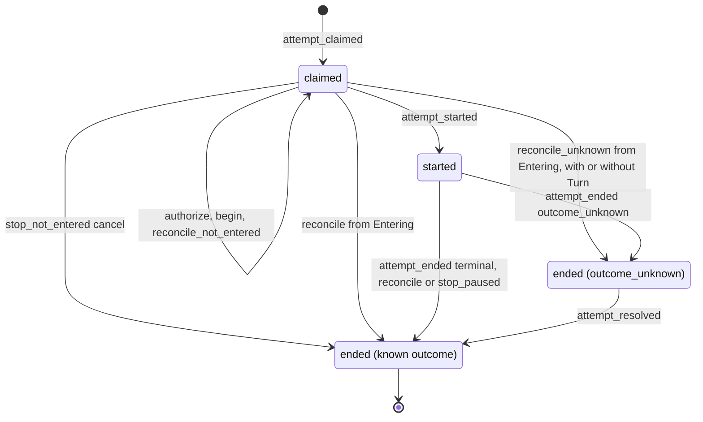

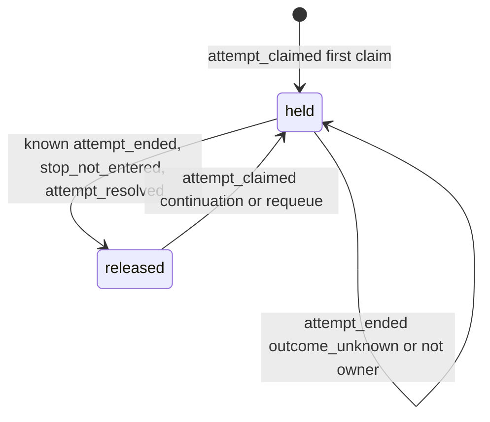

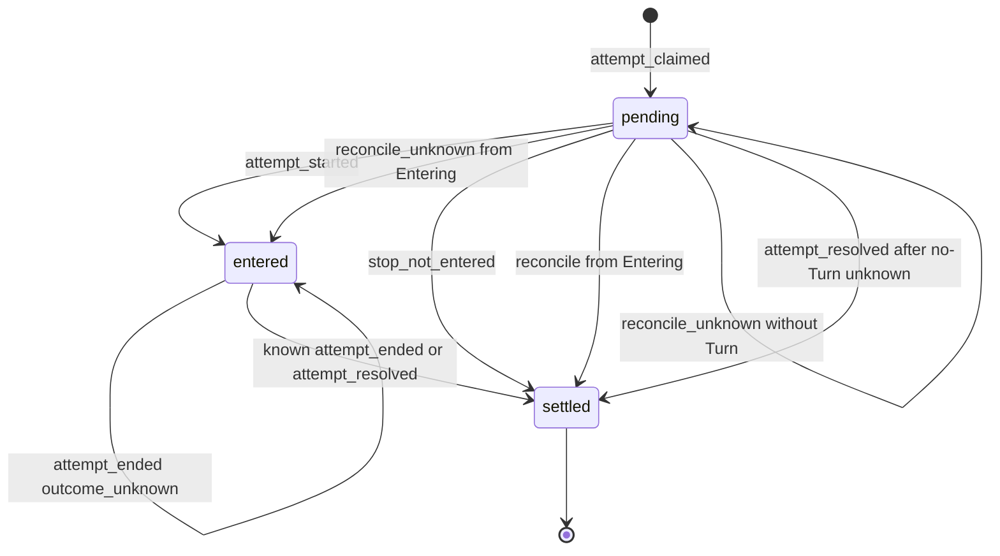

### 5.6 实现对照

目标导出（`src/core/work-graph/state/attempt-machine.ts`，只 import `src/contracts`）：`transitionAttempt`、`transitionTaskLease`、`transitionDispatchOutbox`、`attemptEventFromRunEvent`。

| 行号 | 状态机函数 | 调用服务（file） | 已有测试（file） | 计划新增测试 |
| --- | --- | --- | --- | --- |
| ATT-01、14、24 | `transitionAttempt`、`transitionTaskLease`、`transitionDispatchOutbox`（`attempt_claimed`） | `claim-service.ts:682-707` | `R4c-task-claim.test.ts`、`R4c-task-claim-concurrency.test.ts` | 表驱动：三个记录同一次提交，revision 都为 1 |
| ATT-03、25 | 不写入的事件 | `execution-entry-service.ts`（W3、W4）；`execution-history-service.ts`（W9）；未进入停止服务（§6 RUN-10、11） | `B2-execution-entry.test.ts:214`（begin 与历史记录后 Attempt 仍为 `claimed`） | 表驱动：这些事件后 Attempt、Outbox 的 revision 不变；D-7 pause/resume 后同样不变（A.2 5.1 同步：这两个 Run 事件不进入 Attempt 机器，改在服务层证明，`tests/work-graph/A2-control-service.test.ts` 的 claimed Run pause/resume 用例断言 Attempt、Outbox、Lease、Session 不变） |
| ATT-15、16 | `transitionTaskLease`（复用） | `claim-service.ts:693-697` | `tests/app/AG2b-collaboration.test.ts`（续接） | requeue 领取后租约到 @k+1 且没有 `release`；`release.runRef` 不符时 `revision_conflict`；并发领取只有一次 commit |
| ATT-17 | `transitionTaskLease`（held + `attempt_claimed`） | `claim-service.ts` | `R4c-task-claim.test.ts:326`（两个连接领取同一 Task 只有一个成功）、`R4c-task-claim-concurrency.test.ts` | 表驱动：held 时任一种 `attempt_claimed` 都返回 `busy` |
| ATT-02、26 | `attempt_started` | `execution-entry-service.ts:1158-1275` | `B2-execution-entry.test.ts:167` | Attempt 不是 `claimed` 时拒绝（新增显式守卫） |
| ATT-06、18、19、27 | `attempt_ended`（已知 outcome） | `execution-entry-service.ts:1293-1457` | `B2-execution-result.test.ts:43-48`；`:94`（旧代际终态只补自身历史，不释放新持有者，ATT-19） | 表驱动：`ownsLease`、`ownsSession` 的四种组合 |
| ATT-07、20、28 | `attempt_ended`（`outcome_unknown`） | `agent-runtime/execution-observation.ts:578-594` 的未知分支 → 扩展的 `recordRunResult`（带 `unresolvedToolCallIds`，§6 RD-5，basis `live_clean`） | 无（`tests/runtime/R4-control-runtime.test.ts:234` 只断言占用保留） | unknown 之后占用、租约保留，Outbox 为 `entered`；Task 为 `blocked`；不带 `unresolvedToolCallIds` 的 `recordRunResult` 仍只接受已知终态 |
| ATT-13 | 重复终态 | `recordRunResult`、`reconcileRun` | `B2-execution-result.test.ts:58-62`（同身份重放、新身份拒绝）、`:115`（冲突终态不改写） | 机器表：已知终态上的任一终态事件被拒绝；unknown 上再次 `attempt_ended`（不是新证据）返回 `incomplete`，sequence 不前进时 `revision_conflict` |
| ATT-04、21、25 | 不写入的事件 | 新增 reconcile 服务（§12） | 无 | D-5 之后同一 attemptId 重新授权，Attempt 数量不变 |
| ATT-05、23、30 | `attempt_ended`（`stop_not_entered`） | 未进入停止（§6 RUN-09、§7 CTL-02；`control-service.ts` `submitControl`） | 无 | `starting` + cancel：五个记录在同一提交终结；entry 为 `revoked` 时同样可停；auth 为 `entering` 时改走 queued；AD-2 变体编码、解码，V1 仍可读 |
| ATT-08–10 | reconcile 终态（Run 为 `Running`；ATT-09 含 RUN-24） | 新增 reconcile 服务（§12）：`tasks/run-reconcile-service.ts`（`reconcileRun`）、`agent-runtime/run-reconcile.ts` | 无 | 三个崩溃点（A8）各一例；没有实例租约时不写；指针 paused（pause 已 applied 或仍 queued）→ RUN-24 走 ATT-09：Attempt `ended(crashed)`、Outbox `settled`、Lease 释放，与 Run 在同一提交，与 RUN-19 的三个记录相同（`work-graph/run-reconcile-service.test.ts`；`scenarios/A8-host-restart.test.ts` 的 A8-3l、A8-3m、A8-3o）；Turn 只剩 Kernel `pending` 的下一组时走 ATT-09，不走 ATT-10（LA-7） |
| ATT-35 | `attempt_ended`（`stop_paused`） | `reconcileRun(paused_stop)`（§6 RUN-23）：进程内由 `agent-runtime/execution-control.ts` 的 `deliver` 调用，重启时由 `agent-runtime/run-reconcile.ts` 调用 | 无 | 安全点暂停后 cancel：Attempt ended(cancelled)、Outbox settled、Lease 释放，与 Run 在同一提交；证明不成立时 Attempt 保持 `started`；重启时 Kernel 未暂停、没有在途工具、cancel 仍 queued → 同样走 ATT-35（LA-7） |
| ATT-31–34 | reconcile 终态（Run 为 `Entering`） | 新 `reconcileRun`（§6 RUN-17、19、20、24，以及重启时的 RUN-23） | 无 | Attempt `claimed→ended`，`startedAt` 等于 Turn 开始时间；Outbox `pending→settled` 或 `pending→entered`；各 revision +1；未知时不释放；一个 Turn 有两条等待发信的 yielded 终态 → ATT-32/34（L-5）；指针 paused 的 `Entering` Run（RUN-24）→ ATT-31/33，`endOutcome='crashed'`，记录与 RUN-19 相同；`Entering`、Turn 干净、cancel 仍 queued（RUN-23，LA-7）→ ATT-31/33，`endOutcome='cancelled'`，Lease 释放 |
| ATT-36、37 | `attempt_ended`（`outcome_unknown`，RUN-20(ii)，Run 为 `Entering`） | 新 `reconcileRun`（§6 RUN-20(ii)） | 无 | 探针 `missing`/`damaged`：Attempt `claimed→ended(outcome_unknown)`，`startedAt=null`；Outbox 保持 `pending`（revision 不变）；Lease、Session 保留；`checkAttemptPairing` 接受这一例外（§11 I-6） |
| ATT-11、12、22、29 | `attempt_resolved` | reconcile 服务；新增 `resolveUnknownRun`（D-4(b)） | 无 | 解决后释放；再次解决返回 `busy`；ATT-36/37 之后：`late_evidence` 补记 `startedAt`，Outbox 从 `pending` 直接 `settled`，`consumerId`/`entryGeneration` 等于授权上的值；人工认定时 `startedAt` 保持 `null`；没有实例租约时人工认定返回 `busy`（L-1） |
| 配对不变式 | `checkAttemptPairing(run, attempt, outbox, lease)`（纯函数，测试用） | 全部服务 | 无 | 每条迁移提交后断言 D-14 配对表（§11 I-1、I-6） |


## 6. Run（status/outcome + 进入子状态 + 控制指针）

Run 是一次执行尝试的平台记录。本节把三个已持久化的维度放进同一个纯函数 `transitionRun`：

- 主状态 `status/outcome`；
- V2 进入授权 `executionAuthorization.phase`（“进入子状态”）；
- 控制指针 `controlState`/`controlInputs`。

TaskAttempt、DispatchOutbox、TaskLease、Session 占用和 ControlIntent 的变化只作为“同事务副作用意图”列出。这些对象各自的合法性分别由 §5（Attempt/Outbox/Lease）、§8（Session）、§7（ControlIntent）判定。本节不改名、不新增状态枚举。新增的只有：`outcome_unknown` 与授权 `unknown`/`revoked` 的写入者，以及 `reconciliation` 的写入者（原本都已声明而无写入者）；另加两个可选字段 `RunSnapshot.terminalPayload`（C1 要求失败原因带 Run outcome 与错误，见 6.1 契约 (f)）与 `inputBinding.continuationBriefDigest`（C3，见 6.1 契约 (e)）。

本节依赖的决定（2026-10-03 用户已定，均按原推荐）：D-4（`outcome_unknown` 持久化、人工认定出口，U-4）、D-5（重启“未进入”证明，U-5）、D-6（重启后有 Turn 的三种收尾，U-6）、D-7（未进入停止，U-7）、D-8（同提交取代）、D-9（Goal 期望状态守卫，U-8）、D-15、D-18（Host 实例租约，与 D-5 同属 U-5）。同日改动本节的用户决定：C4（U-9 改为选项 (c)：重启时暂停中的 Run 结束为 paused-interrupted，不算失败，RD-6、RUN-24）、C3（requeue Run 必须绑定接续说明，RUN-02/03）、C6（U-11 选 (b)：W3 接受旧计划上未变的 claim，RUN-02/03）。C1/C2 的失败类别由 §4 从本节的 outcome、`reconciliation` 与 `terminalPayload` 派生，本节不写类别。

直接约束本节的 lead 决定：L-1（RUN-22 人工认定要求本 Host 持有实例租约，否则 `busy`）、L-2（RUN-20(ii) 从 `Entering` 结束时 Attempt、Outbox 走 §5 ATT-36、ATT-37，RUN-21 按 Kernel 证据补记 `startedAt`）、L-5（RD-3 只在恰好一条等待发信时重建）、L-10（租约被另一个存活的 Host 持有时，该 Host 不核对、不进入 Kernel）；lead 决定 LA-1（2026-10-03）（平台合成的结束留下未结束的 Kernel Turn 时，原 Kernel 会话不能再开 Turn：Session 记为 `unavailable/kernel_turn_open`，接续在新 Session 中进行，见 6.3 表外说明“Kernel Turn 未结束时的释放”）、LA-2（2026-10-03）（外部材料授权按与 W3 相同的 basis 规则保持有效，RUN-02/03/04 的 `freshAdmission`；2026-10-07 起授权写入方已删除，LA-2 不再有作用对象，决定 34）、LA-6（2026-10-03）（核对完成后由持实例租约的 Host 重驱 active Goal 的协作驱动，未进入的 Run 经此继续，见 6.3 表外说明“重启时不迁移的节点”）、LA-7（2026-10-03）（Kernel `pending` 工具调用计为未开始；RUN-23 推广为“queued cancel + 干净的 Kernel Turn”）。

本节在 brief 之外补充的决定。RD-1、RD-7 已由 lead 采纳（L-8）；RD-3 的取舍已由 lead 决定 L-5 定稿；RD-6 已由用户决定（C4，U-9 选项 (c)）；其余（RD-2、RD-4、RD-5、RD-8）按 lead 决定 L-16 采纳本节写明的做法：

- **RD-1 D-7 也适用于 `Revoked`。** **已由 lead 采纳（L-8）。** D-5 撤销后的 Run 已被证明未进入，因此 `stop_not_entered`/`pause_not_entered`/`resume_not_entered` 的守卫是 entry∈{none, authorized, revoked}（brief 只写了 none/authorized）。否则带 queued cancel 的 `Revoked` Run 既不能重新授权（指针栅栏），也不能停止。§5 ATT-05/ATT-23/ATT-30、§8 SES-05、§2 GOAL-09/GOAL-10 的守卫使用同一集合。
- **RD-2 实时未知也落 `outcome_unknown`。** 进程内观察者在 cleanProof 成立时看到 Kernel 终态，但仍有缺结果或 `outcome_unknown` 的工具调用，这时也写 Run `ended/outcome_unknown`（RUN-08）。今天在这种情况下 Run 保持 `running`。
- **RD-3 重启时 Kernel 终态为 yielded：先由持久事实重建 continuation，再按原结果入账；重建不出则记为未知，不释放。** §8 SES-06 与 §10.1 都按本条执行。
  - 重建依据，三项全部成立：
    1. Kernel 原历史中，本 Turn 内**恰好一条** `send_session_message` 工具结果带 `waiting:true` 与 `message.ref`（`src/core/agent-runtime/communication-tools.ts:247-253`），取这一条（lead 决定 L-5）。零条或多条都按重建失败处理，走 RUN-20(iii)。理由是进程内的取法并不唯一：`waitRegistered ??=`（`execution-driver.ts:329`）只决定是否让出，而进程内 continuation 取 `handle.waitMessage`，它在每次登记时被覆盖（`execution-driver.ts:330`；`execution-control.ts:224-230`），即最后登记的一条。多条时无论取最先还是最后一条，都可能与进程内的结果不同，因此不猜。
    2. 该 ref 的已存 `SessionMessage` 满足：`sender.kind==='work_run'`，`sender.runRef` 等于本 Run，`sender.generation` 等于 claim.generation，`waitAfterSend===true`。
    3. 构造的 `{task: claim.task, sessionRef: claim.sessionRef, messageRef}` 通过 `runContinuationProblem`（`execution-entry-service.ts:1615-1630`）。
  - 重建成功：按 RUN-17/18 入账 `yielded`，写 continuation 并释放。`recordRunResult` 在同一提交中读取该 `SessionMessage` 并加 CAS 守卫，不信任调用者自报。
  - 重建失败（三项依据任一不成立，包括本 Turn 的等待发信不是恰好一条）：按 RUN-20(iii) 记为 `outcome_unknown`，原因 `continuation_unrebuildable`，保留占用和 Lease。
  - 理由：A8/B10 要求“依据原结果补账”。记为 `crashed` 会写入一个与 Kernel 事实不同的结果；重建失败只发生在持久事实互相矛盾时，此时按 A8“无法确认如实 unknown”处理。
  - 不同于 D-17 的缺口：D-17 指发信成功、但 Turn 尚未 yield 时崩溃。那种情况下 Kernel 中没有 yielded 终态，按 RUN-19 记为 `crashed`，消息上的等待关联丢失。
- **RD-4 `late_evidence` 的“新”按 Kernel 事实判定。** 观察者自己按 `lastEventSeq+1` 给终态编号（`execution-observation.ts:638`），所以 `sequence>lastEventSeq` 不能证明 Kernel 有新记录，只用于排序。新证据的判定条件是：
  - Kernel 终态的位置大于 RUN-08/20 写入 `reconciliation` 的 `observedThroughPosition`（RUN-20(ii) 没有读到 Turn，窗口为 null，任何位置都算，L-2）；
  - 原 `unresolvedToolCallIds` 中的每个调用现在都有确定结果。
  - 进程已死（实例租约接管）只证明“没有在途工具”，不证明副作用已知。因此 D-4(a) 的“no in-flight tool”只适用于 D-6 的未结束 Turn（RUN-19）。已经是 `outcome_unknown` 的 Run，不能因重启接管就改为已知结果。
- **RD-5 每个事件只有一个 WG 写操作。** 按 D-6，并与 §5 ATT-07 对齐：
  - 带 Kernel 终态的事件经 `recordRunResult`：`terminal_observed`（RUN-07/08）、`reconcile_terminal`（RUN-17/18）、`late_evidence`（RUN-21）。
  - 没有 Kernel 终态的核对结果经新写操作 `reconcileRun`：`reconcile_not_entered`、`reconcile_interrupted_clean`、`reconcile_unknown`、`stop_paused`（RUN-16/19/20/23/24）。
  - `unknown_attested` 经新写操作 `resolveUnknownRun`（RUN-22）。
  - 未进入停止 `stop/pause/resume_not_entered` 经 `submitControl`（RUN-09..11）。
  - 因此 `recordRunResult` 的输入要扩展：`basis`、`unresolvedToolCallIds`、`enteredAt`，并接受 auth `entering`（RUN-17）和 `unknown`（RUN-21），见 6.1 契约 (b)。ORCHESTRATION S8 写的是“向 WG.reconcileRun 补账”，R5 写的是 `recordRunResult/reconcileRun`。本节按 brief D-6，终态补账走 `recordRunResult`。
- **RD-6 重启时处于暂停中的已进入 Run：结束为 paused-interrupted，不算失败（用户决定 C4，U-9 选项 (c)，2026-10-03）。** 重启后沿原 Turn 恢复属于 D-17 范围外，所以 Kernel Turn 无论如何不能再继续；但用户的暂停是意图，不是失败。原选项 (a)（记为失败，可自动 requeue）与 (b)（保持 `Running`，只能取消）都不再采用。
  - **触发条件看指针，不只看 Kernel。** 核对时 Run 为 `Entering`/`Running`；Turn 存在且没有终态；没有 `running`/`outcome_unknown` 的工具调用（`pending` 是已声明、未开始的调用，计为未开始；`abandoned` 与已结算的计为确定；lead 决定 LA-7（2026-10-03））；`input_accepted` 已确认；**指针=paused，指针 intent 为 pause，状态 queued 或 applied**。此时走 RUN-24。`kernelPaused` 只记录 Kernel 是否已到安全点。理由是硬限制 3：如果只认 Kernel 已暂停，重启时仍 queued 的人工暂停会变成普通 `interrupted`，C2 允许 system/agent 对它 requeue，等于绕过了人的暂停。
  - **各情形的去向：**

    | Kernel | 指针 | 行 | 结果 |
    | --- | --- | --- | --- |
    | paused | paused，intent applied | RUN-24 | paused-interrupted |
    | paused | paused，intent queued（ack 在崩溃窗口中丢失） | RUN-24 | paused-interrupted；pause 以 `platform_reconcile` 记为 Applied（§7 CTL-08(f)；没有活句柄时 Kernel `run.paused` 不能归属到该 intent） |
    | 其他非终态 | paused，intent queued（Host 在到达安全点前停止） | RUN-24 | paused-interrupted；pause 以 `platform_reconcile` 记为 Applied（§7 CTL-08(f)） |
    | paused | running（queued resume：用户已恢复，重入前崩溃） | RUN-19 | 普通 `interrupted`；resume 走 CTL-08(c) 记为 `terminal_without_cancel`；与用户最后的意图一致，自动化可以继续 |
    | paused | 无指针或不是 paused（例如 fail-closed 的 `decide` 暂停，`execution-control.ts:249-273`） | RUN-19 | 普通 `interrupted` |
    | 任意（干净） | cancelled，cancel intent queued | RUN-23 | `cancelled` |

  - **结束形状。** `Ended(crashed)`，auth settled；合成 `run_crashed`，error 为 `host_interrupted_while_paused`（只用于显示与审计，任何逻辑都不读这段文字，§13 ND-5）；`reconciliation = {status:'done', observation:{kind:'interrupted_clean', event, lastPosition, kernelPaused, pausedIntentRef}, basis}`，其中 `pausedIntentRef = controlState.intentRef`。纯谓词 `isPausedInterrupted(run)` = `outcome==='crashed' ∧ observation.kind==='interrupted_clean' ∧ observation.pausedIntentRef!==null`（`state/run-machine.ts`）。不新增 `RunOutcome`。不采用的做法：新增 outcome 值（要改每个读取者和枚举）；用 error 文本做标记（ND-5 禁止）；记为 `cancelled`（与 C2 的类别 `cancelled` 冲突，而且不真实，用户没有取消）。与 `controlState` 的一致性由 §11 I-16 约束。
  - **指针与 intent。** 指针不变，留在已结束的 Run 上作为历史；之后对该 Run 的控制一律 `busy`（6.4）。已 applied 的 pause 不改。queued 的 pause 同提交记为 Applied，一律按 §7 CTL-08(f)（`platform_reconcile`，kind `paused`）：Kernel 的 `run.paused` 不带 intent 身份，fail-closed 的 `decide` 暂停也会产生它（`execution-control.ts:249-273`），没有活句柄时无法证明它由该 intent 引起（归属规则由 §7 定）；Kernel 是否到了安全点只记在 `kernelPaused`。queued steer：Kernel 已接受该输入（`run.input_accepted` 的 input id 为 `control:<sha(intentRef)>`，`execution-driver.ts:697`）时按 CTL-08(b) 记为 Applied，否则按 CTL-08(c) 记为 Superseded；两类 steer 的文字都进入接续说明（C3）。
  - **占用、Lease 与 Session。** 同提交释放 Lease 和占用。`release_session` 的边界为 null，`historyCursor` 保持原值（不写 null，否则 Session 会被悄悄退回 `current_turn`）。同提交把 Session 记为 `health:'unavailable'`，结论码 `kernel_turn_open`（§8，lead 决定 LA-1（2026-10-03））：冻结 Kernel 在 Kernel 会话的最后一个 Turn 未结束时拒绝任何新 Turn（`vendor/coding-agent/dist/app/composition/composition-root.js:161-166`、`:172-177`；`tests/kernel/R4a-frozen-public.test.ts:284-315` 已固定这一点）。RUN-19、RUN-23，以及 Kernel Turn 未结束或 Kernel 不可读时的 RUN-22（§8 SES-07），同样如此（见 6.3 表外说明“Kernel Turn 未结束时的释放”）。
  - **Task 与继续。** §4 P19 把 Task 投影为 `blocked/paused_interrupted`，显示“已暂停，可继续”，不是 `failed`。没有自动继续。“继续”就是 `requeueTask`：平台派生类别 `interrupted`、`interruption:'paused'`；只允许人工；暂停来自 Goal 扇出时，由人恢复 Goal，Goal 恢复扇出（§2 GOAL-29）代为 requeue。继续不需要新依据，不计入自动返工上限，必定带接续说明（C3），界面标为“接续”，从不写“原执行恢复”。Goal 展示见 §2 GOAL-30（`task_paused`）与 `runStops` 的 `paused_interrupted`。
  - **与用户原话的差异（lead 决定 LA-1（2026-10-03））。** 用户写的是“在原 Session 续跑”。由于上述 Kernel 约束，继续的新 Run 只能在一个与原 Session 关联的新 Session 中执行；它的模型历史以原 Session 最后一个已完成的边界做种子（`TaskRequeue.historySource` → manifest 的 `sessionBasis`，见 6.1 契约 (e)）。被中断的那个 Turn 不在任何后续历史中，由接续说明承载。这一点在 §0、附录 A U-9、§7.7 与 §16 GAP-50 中同样写明。
  - **重启后不沿原 Turn 重入的 Runtime 守卫。** driver 的 `resumeEntered` 只在本进程登记过该 Run 的活句柄（`control.proof(runRef)!==undefined`）时才沿原 Turn 重入，否则返回 `busy`（RUN-14）。这堵住了核对未能分类（探针 `transient`/`host_config`）的窗口：此时 UI 的 resume 会走 `executions/start` 进入 `resumeEntered`，也就是 D-17 排除的“重启后原 Turn 的 fresh resume”。这个窗口中提交的 resume 仍是 queued，下次核对按指针 running 走 RUN-19，与用户的恢复意图一致。
  - **RUN-24 以外的暂停情形**（各走原有行，不显示“已暂停，可继续”）：未进入（`Claimed`/`Authorized`/`Revoked`）且指针 paused：没有 Turn，RUN-10 / CTL-08(a)，重启后 RUN-11 仍可恢复；`Entering`、探针 `ready`、没有 Turn：RUN-16 + RUN-10(R)；`YieldedWait` 且指针 paused（§4 P18）：Turn 已终结，RUN-14 恢复后同一 Session 可用；指针 paused 且有 `running`/`outcome_unknown` 工具：RUN-20(i)（硬限制 1），pause 记为 OutcomeUnknown（CTL-08(d)），之后经 RUN-22 认定时 Session 同样记为 `kernel_turn_open`；探针 `transient`/`host_config`：不迁移，由上一条 driver 守卫保护；租约在另一个存活的 Host：不核对（L-10）。
  - **重启顺序不变。** 崩溃前 Goal 已暂停、但扇出的 pause 尚未提交的 Run，核对时指针不是 paused，走 RUN-19，显示为普通中断（§12 G-01）。Goal 暂停仍阻止领取；Goal 恢复后自动化可以继续它。显示上的差异（“失败（平台中断）”而非“已暂停”）是接受的代价。
- **RD-7 已在安全点暂停的已进入 Run，可由平台停止（`stop_paused`，RUN-23）。** **已由 lead 采纳（L-8）。** Run 在安全点暂停后，Kernel 调用已经退出，`deliver` 无处投递取消（`execution-control.ts:184-188`）。只要以下证明成立，平台就把 Run 结束为 `cancelled` 并释放占用，cancel intent 记为 Applied（§7 CTL-10）：
  - 本进程句柄 `kernelExited && resourcesClosed.status==='completed'`（`execution-control.ts:233-244`；句柄在 `close` 前一直保留，`:342-344`），或在重启时取得实例租约；
  - Kernel 状态为 `paused`；
  - 没有在途工具。
  - 这样 D-15“cancel supported”和 G7 的“先暂停、再取消”（§2 GOAL-13）才成立。
  - **queued steer。** 重启变体与 RUN-19/24 相同：Kernel 已接受该输入（`run.input_accepted` 的 inputId 为 `control:<sha(intentRef)>`，`execution-driver.ts:697`）时按 §7 CTL-08(b) 记为 Applied（steered），否则按 CTL-04(b) 记为 Superseded；两类正文都进入接续说明（C3）。进程内变体中仍 queued 的 steer 一律按 CTL-04(b) 记为 Superseded（CTL-08 只用于启动核对；已被 Kernel 接受的由观察者经 CTL-03 记录）。LA-7 推广后重启时也会遇到 Kernel 已接受、但 ack 未写的 steer，记为 Superseded 会与 Kernel 事实不符。
  - **推广（lead 决定 LA-7（2026-10-03））。** 重启核对时，指针为 queued cancel、Turn 存在且没有终态、没有 `running`/`outcome_unknown` 工具调用（`pending` 计为未开始）的 Run，即使 Kernel 不是 `paused`，也经 RUN-23 结束为 `cancelled`，cancel 记为 Applied。否则这种 Run 不匹配任何行：RUN-19 排除 queued cancel，原 RUN-23 要求 Kernel paused，Run 会永远占着 Session 和 Lease。推广后 RUN-23 也接受 `Entering`（重启时，同提交补记进入事实）。进程内变体仍只处理 Kernel 为 `paused` 的情形，因为进程内没有 RUN-19 那样的“Turn 无终态”收尾。
- **RD-8 `YieldedWait` 的 continuation 已被继任 Run 消费后，不再受理控制。** 判定条件：Lease 的 `holderRunId` 已不是本 Run（`claim-service.ts:614-618`）。今天仍会受理（`control-service.ts:387-391`），留下永远无效的 queued intent。改为返回 busy。

### 6.1 持久位置与状态枚举

路径简写：`dispatch.ts`=`src/contracts/dispatch.ts`；`execution-entry-service.ts`、`control-service.ts`、`claim-service.ts`、`execution-history-binding.ts`、`execution-history-service.ts`、`completion-policy.ts` 在 `src/core/work-graph/tasks/`；`execution-entry-codecs.ts`、`control-record-codecs.ts` 在 `src/core/work-graph/persistence/`；`record-readers.ts` 在 `src/core/work-graph/materials/`；`execution-observation.ts`、`execution-control.ts`、`execution-driver.ts` 在 `src/core/agent-runtime/`；`workflow.ts`=`src/business/workflow/workflow.ts`。

| 维度 | 记录与字段（file:line） | 代码取值（原样） | 与设计名的对应 / 说明 |
| --- | --- | --- | --- |
| 主状态 | `RunSnapshot.status`（`dispatch.ts:172`，类型 `:110`） | `starting`/`running`/`ended` | 与 ORCHESTRATION §2 Run 行同名 |
| 结果 | `RunSnapshot.outcome`（`dispatch.ts:173`，类型 `:111`） | `completed`/`failed`/`cancelled`/`budget_exhausted`/`crashed`/`outcome_unknown`/`yielded`，或 `null` | `failed` 没有写入者：Kernel `failed` 映射为 `crashed`（`execution-observation.ts:156-160`），本规格保持这一点。`outcome_unknown` 今天没有写入者，D-4 起成为真实持久结果。`yielded` 是代码在 CORE-DATA-OPERATIONS:365 之外新增的 |
| 进入子状态（V2） | `RunSnapshot.executionAuthorization`（`dispatch.ts:151`，V2 类型 `:124-133`），校验 `execution-entry-codecs.ts:102-123` | 字段缺省（下文记作 `none`），或 `authorized`/`entering`/`entered`/`unknown`/`revoked`/`settled` | 对应 work-graph.md §6.3 的 `authorized/entering/observed/unknown/revoked`：`observed` 相当于 `entered`，另有 `settled`。`unknown`/`revoked` 今天没有写入者。`generation` 是 entryGeneration，`sessionGeneration` 是占用代际，`revision` 是绑定自身的版本。codec 允许 `authorized` 带非空 kernel（`:115-122`），RUN-03 依赖这一点 |
| 旧授权（V1） | 同字段，`dispatch.ts:112-116` | `authorized`/`entered`/`revoked`/`quarantined`/`settled` | 只读的历史状态，不能取得 fresh 进入权（`execution-entry-service.ts:933`、`:1068`） |
| 控制指针 | `RunSnapshot.controlState`（`dispatch.ts:153-156`），校验 `control-record-codecs.ts:90-117` | 缺省，或 `{intentRef, desiredState: running/paused/cancelled/steered}` | 设计称为“控制意图独立为 running/paused/cancelled/steered”。`steered` 没有写入者，steer 走 `controlInputs` |
| 定向输入 | `RunSnapshot.controlInputs`（`dispatch.ts:189`） | `ControlIntentRef[]` | steer intent，只追加 |
| 事件水位 | `lastEventSeq`、`lastRuntimeEventId`、`lastFactEventId`（`dispatch.ts:177-181`） | 非负整数、字符串 | 平台事件排序守卫的依据（不证明 Kernel 新事实，见 RD-4） |
| 不可变输入 | `envelope`（`dispatch.ts:183`）、`inputBinding`（`:157-158`，注释为 Immutable） | `TaskEnvelopeV1` 或 `null`；`RuntimeInputBindingV1` | 由 RUN-02 写入一次；RUN-03 不改写。新增可选的 `inputBinding.continuationBriefDigest`（C3；requeue Run 必有，RUN-02 写一次，§11 I-19），见 6.1 契约 (e) |
| 终态细节 | `terminalPayload`（新增可选字段，`dispatch.ts:146-192`） | `RuntimeEventV1['payload']`（有界） | 今天没有：`terminalFact` 校验 `run_crashed.payload.error` 后只返回 `{outcome, exitCode}`（`execution-entry-service.ts:1632-1671`），Run 上不留错误文本。C1 起与已知 outcome 同提交写一次，见 6.1 契约 (f) |
| 等待接续 | `continuation`（`dispatch.ts:185`）、`consumedWait`（`:187`） | `RunContinuationV1`、`ConsumedWaitV1` | `continuation` 只由真实 yielded 终态写入（进程内取自句柄，重启时按 RD-3 重建） |
| 核对记录 | `RunSnapshot.reconciliation`（`dispatch.ts:149`，类型 `:134-145`） | `status: done/cancelled/quarantined`；`observation: runtime_terminal/unresolved` | 今天没有写入者，也没有校验（`record-readers.ts:251-334` 不检查这个字段）。读取者有两处：`completion-policy.ts:71-75`（`quarantined` 或 `unresolved` 阻塞完成）和 `workflow.ts:216-217`（`normalEnd` 要求 status 为 `done`）。D-4..D-6 起由核对写入：除 `unresolved` 写 `quarantined` 外，新写入一律 `status:'done'`，包括 `runtime_terminal`、`not_entered`、`interrupted_clean`（带 `kernelPaused`、`pausedIntentRef`；RUN-19/23/24，C4）、`human_attested`。`cancelled` 仍无写入者。扩展见下 |
| 历史定位 | `executionHistory`（`dispatch.ts:148`） | `RunExecutionHistoryV1` | 只追加、只增长；end 只写一次 |

**机器视图。** 由 `RunSnapshot` 与读取窗口构造，不新增持久字段。V2 合法组合只有下表八种，其他 V2 组合视为损坏。V1 授权（`legacyV1`）的组合不是损坏，而是只读的历史状态，不参与迁移（见 6.4）。今天读取侧不做交叉校验（`record-readers.ts:313-314` 只校验单字段），目标是 `state/` 的构造器只产出下表组合（§14）。

| 机器状态 | status | outcome | entry（V2 phase） | 含义 |
| --- | --- | --- | --- | --- |
| `Claimed` | starting | null | none | 已领取，尚未授权 |
| `Authorized` | starting | null | authorized | 已绑定唯一 consumer/entryGeneration/inputDigest，尚未 begin |
| `Entering` | starting | null | entering | 已 fresh-commit begin，“可能已执行”（work-graph.md:586），不能当作未执行 |
| `Revoked` | starting | null | revoked | D-5 已证明未进入；等待同一 claim 以 generation+1 重新授权 |
| `Running` | running | null | entered | 已观察到真实 Kernel 进入。Kernel 可能处于 `paused`（RUN-23/24 的输入，RD-6/RD-7），机器节点不变 |
| `Ended` | ended | completed/cancelled/budget_exhausted/crashed | settled；D-7 时为 revoked 或 none | 已知终态。含 paused-interrupted 子情形：crashed，`reconciliation.observation` 为 `interrupted_clean` 且 `pausedIntentRef≠null`（`isPausedInterrupted`，RUN-24，C4），不是新节点 |
| `YieldedWait` | ended | yielded，且有 `continuation` | settled | `Ended` 的子情形：在 continuation 被消费之前仍受理控制，作为接续围栏 |
| `EndedUnknown` | ended | outcome_unknown | unknown | 保留 Session 占用与 TaskLease（界面显示“待核对”，D-4） |

```ts
// src/core/work-graph/state/run-machine.ts（目标）只 import src/contracts
type RunNode = 'Absent' | 'Claimed' | 'Authorized' | 'Entering' | 'Revoked'
  | 'Running' | 'Ended' | 'YieldedWait' | 'EndedUnknown';
type RunState = {
  node: RunNode;
  outcome: RunOutcome | null;
  entryGeneration: number | null;          // V2 generation；none 时为 null
  legacyV1: boolean;                       // V1 授权：只读历史，不参与迁移
  pointer: 'none' | 'running' | 'paused' | 'cancelled' | 'steered';
  lastEventSeq: number;                    // 只作排序
  unresolved: { observedThroughPosition: number | null; toolCallIds: readonly string[] } | null; // RUN-08/20 记录的窗口（RD-4）
};
type RunGuardContext = {
  session: { usable: boolean; owned: boolean };   // active+available；ownsOccupancy（§8，state/session-availability.ts）
  lease: 'owned' | 'released' | 'other' | 'missing';
  goal: { desiredState: 'active' | 'paused' | 'cancelled'; activePlanMatchesClaim: boolean }; // activePlanMatchesClaim 只用于 RUN-01（领取钉住活动计划）
  entryPlan: 'active_plan' | 'carried_unchanged' | 'changed' | 'unavailable'; // RUN-02/03（C6）：EntryPlanVerdict['kind']，服务用 entryPlanVerdict 计算，见契约 (g)
  continuationBrief: 'absent_ok' | 'bound' | 'missing' | 'unexpected' | 'mismatch'; // RUN-02/03（C3）：服务比较，机器只看取值，见契约 (e)
  freshAdmission: CoreRejection | null;    // Host/Role/材料/deadline 复核结果；IO 留在服务（2026-10-07 起不再复核材料，lead 决定 LA-11）
  pointerIntent: { kind: ControlIntentKindV1; status: ControlIntentSnapshotV1['status']; observed: string | null } | null;
  queuedSteers: readonly ControlIntentRef[]; // controlInputs 中仍 queued 的 steer（RUN-09/23 同提交取代；A.2 5.1 同步：由计数改为 ref 列表，取代效果要逐个点名 intent）
  continuationConsumed: boolean;           // YieldedWait：Lease holder 已换成继任 Run（RD-8）
  exitProof: 'live_clean' | 'host_instance_takeover' | null;
  hostLease: 'owned' | 'held_by_other' | null;    // 只用于 R 事件与 RUN-22（D-18）
  kernelProbe: SessionProbeVerdict | null; // §8 8.2 六类：ready/missing/damaged/host_config/transient/cancelled；用于 R 事件，以及 RUN-16、RUN-23 的进程内变体（Runtime 在 Kernel 调用退出后读 Kernel Store 给出）
  kernelPaused: boolean;                   // Kernel Turn 状态为 paused（非终态）；RUN-23 进程内变体要求为 true（LA-7），RUN-19/23/24 只记录它
  inputsConfirmed: boolean | null;         // 本执行的 run.input_accepted 已全部确认；Kernel 不可读时为 null
  actor: 'human' | 'system';
};
```

**本节需要的契约扩展**（A.2 冻结；这些字段今天都没有写入者，没有兼容负担）：

```ts
// (a) RunReconciliationV1（dispatch.ts:134-145）：observation 追加三种，unresolved 扩两个字段，并加 basis
  observation:
    | { kind: 'runtime_terminal'; event: RuntimeEventV1; digest: string }          // 已有；RUN-17/18/21
    | { kind: 'unresolved'; reason: string;                                         // 已有并扩展；RUN-08/20
        observedThroughPosition: number | null; unresolvedToolCallIds: string[] }
    | { kind: 'not_entered'; kernel: KernelExecutionBinding; revokedGeneration: number }   // RUN-16
    | { kind: 'interrupted_clean'; event: RuntimeEventV1; lastPosition: number | null;     // RUN-19、RUN-24（合成 run_crashed）、RUN-23（合成 run_cancelled）
        kernelPaused: boolean;                        // 新增（C4）：Kernel Turn 为 paused
        pausedIntentRef: ControlIntentRef | null }    // 新增（C4）：RUN-24 为指针 intent（paused-interrupted）；RUN-19、RUN-23 为 null（§11 I-16）
    | { kind: 'human_attested'; attestedBy: Extract<ActorRef, { kind: 'human' }>; reason: string }; // RUN-22
  basis: { kind: 'live_clean' } | { kind: 'host_instance_takeover'; hostInstanceId: string };
// RUN-07（进程内已知终态）照旧不写 reconciliation。
// (b) recordRunResult 的输入（今天的终态观察）追加，承担全部“带 Kernel 终态”的事件（RD-5）：
  basis?: { kind: 'live_clean' } | { kind: 'host_instance_takeover'; hostInstanceId: string }; // 缺省为 live_clean（今天的调用者）
  unresolvedToolCallIds?: string[];  // 非空 → RUN-08：EndedUnknown；此时 completedHistoryBoundary=null、history.endPosition=null
  enteredAt?: string;                // auth 为 entering 时必填（RUN-17 同提交补记进入事实）；RUN-21 时 Run.startedAt 为 null（RUN-20(ii) 之后）也必填（L-2）
// 接受的 auth phase：entered（RUN-07/08/18）；entering 且 basis=host_instance_takeover（RUN-17）；
// unknown 且 Run 为 EndedUnknown（RUN-21）。yielded 且 basis≠live_clean 时，同提交读取并 CAS 守卫 continuation 的 SessionMessage（RD-3）。
// 已知 outcome 时同提交写 RunSnapshot.terminalPayload（契约 (f)），取自 event.payload；调用者不另传（C1，改造 execution-entry-service.ts:1400-1404）。
// (c) WG 新写操作 reconcileRun(ctx, GraphWrite<ReconciledObservation>)。沿用 work-graph.md:521-530，显式改动如下：
type ReconciledObservation = {
  executionRef: RunRef; sessionRef: SessionRef; generation: number;   // 沿用
  consumerId: string; entryGeneration: number;                        // 沿用
  source: ArtifactRef; observedAt: string;                            // 沿用：核对读取结论的证据正文
  kernelSource: KernelObservationSource | null;                       // 沿用
  completedHistoryBoundary: CompletedHistoryBoundary | null;          // 沿用；本操作的结果都没有完整终态边界，恒为 null
  basis: { kind: 'live_clean' } | { kind: 'host_instance_takeover'; hostInstanceId: string }; // 新增
  history: ObservedExecutionHistory | null;                           // 新增：从 Entering 补记进入事实时的窗口
  enteredAt: string | null;                                           // 新增：同上，取 Turn 开始时间
  result:
    | { kind: 'not_entered' }                                                         // 沿用；RUN-16
    | { kind: 'unknown'; reason: string; unresolvedToolCallIds: string[] }            // 沿用并加字段；RUN-20
        // unresolvedToolCallIds：`running` 或 `outcome_unknown` 的 toolCallId；Kernel `pending` 不计（lead 决定 LA-7（2026-10-03））
    | { kind: 'interrupted_clean'; lastPosition: number | null; kernelPaused: boolean }   // 新增；RUN-19 或 RUN-24，由 WG 机器按指针选择（C4）
        // pausedIntentRef 不是输入：WG 从 Run.controlState 派生。queued pause 一律按 §7 CTL-08(f) 记为 Applied，
        // 所以不传 Kernel run.paused 的位置；Kernel 已接受的 steer 由核对随 control_reconciled 给出证据（CTL-08(b)）
    | { kind: 'paused_stop'; cancelIntentRef: ControlIntentRef; lastPosition: number | null;
        kernelPaused: boolean };                                                            // 新增；RUN-23（推广后 Kernel 可以不是 paused，LA-7）
  // 删除：设计中的 { kind: 'terminal'; observation: ExecutionObservation }。Kernel 终态统一经 recordRunResult（D-6、RD-5）
};
// (d) WG 新写操作 resolveUnknownRun(ctx, GraphWrite<{ runRef: RunRef; reason: string; kernelTurnOpen: boolean }>)，只接受 human principal，且只经持实例租约的 Host 入口（RUN-22，lead 决定 L-1）
//     kernelTurnOpen（新增，lead 决定 LA-1（2026-10-03））：Host 入口在认定前经 Runtime 用核对的同一读取器读 Kernel 得出；
//     Kernel 可读且该 Run 的 Turn 没有 Kernel 终态（如 RUN-20(i)）为 true，Turn 有 Kernel 终态（如 RUN-20(iii) 的 yielded）为 false，
//     Kernel 不可读（RUN-20(ii)）为 true。与 §8 SES-07 的 holder.kernelTurnOpen 同值
//     kernelTurnOpen 与 inputsConfirmed 是 owner 输入，但不进幂等指纹：指纹只含请求本身（runRef、reason、pin），
//     所以 Kernel 读法不同的同身份重试也得到原回执（A.2 第 6 步同步，lead 决定 LA-8（2026-10-07）；QRR-06 相同）
// (e) C3 接续说明绑定（类型与纯函数在新文件 src/contracts/continuation-brief.ts）。RUN-02 写一次，之后不可变，与 inputBinding 其余字段相同
RuntimeInputBindingV1.continuationBriefDigest?: string;   // = continuationBriefDigest(manifest.continuationBrief) = sha256Hex(canonicalJson(brief))；
                                                          //   有 requeueRef 的 Run 一经授权必有，其他 Run 必无（§11 I-19）；inputBindingProblem 允许该键并校验 sha256
PreparedTaskManifestV1.continuationBrief?: ContinuationBriefV1;   // 在同一内容寻址的 manifest Artifact 中；manifestProblem 校验形状
PreparedTaskManifestV1.sessionBasis?: { sourceKernelSessionId: string; throughPosition: number | null };
  // 由 AgentRuntime prepare 填写，Workflow 不传（lead 决定 LA-1（2026-10-03））。四项同时成立时从 TaskRequeue.historySource 派生：
  // claim Session ≠ historySource.sessionRef；claim Session 的 historyCursor 为 null；两个 Session 用同一 Kernel 适配器（composition-root.js:151）；
  // historySource 的 Kernel 会话可读（prepare 用 kernel-turn-facts.ts 读到源边界）。否则不填 sessionBasis，session.continuity='other_session'，
  // 接续说明照常组装（RUN-22 在 Kernel 不可读时认定，§8 SES-07 把结论码改为 kernel_turn_open，Workflow 走 create_session；
  // 带不可读的种子 begin 会在 turn.started 之前失败，落入 RUN-16 → RUN-03 的循环）。
  // 被 inputDigest/manifestDigest 覆盖。driver 在 claim Session 自身 cursor 为 null 时用它代替 current_turn（execution-driver.ts:455-458）
// manifest.input 的最后一节是 renderContinuationBriefZh(brief, digest)：第二行是 continuationBriefMarker(digest)；WG 重新渲染并比较这一后缀。
// 固定之后不再重新组装：Run 已有 inputBinding（Authorized/Entering/Revoked 也都是 status=starting）时，prepare 不组装新说明，
//   返回 rehydratePreparedExecution(record) = { kind:'task', claim: outbox.claim, envelope: run.envelope, inputBinding: run.inputBinding }
//   （execution-preparation.ts 导出，与 src/ui/main.ts:4361 的写法相同）。W-02/W-03 重驱与 RUN-03 都用它；driver 预检见 6.3 表外说明
// RunGuardContext.continuationBrief 的取值（服务计算）：
//   absent_ok：Run 没有 requeueRef，且既无 brief 也无 digest（首次领取、consumedWait 接续领取）
//   bound：有 requeueRef；brief.runRef=claim.runRef；brief.requeueRef=run.requeueRef；digest 相等；manifest.input 以 "\n\n"+渲染文本结尾
//   missing：有 requeueRef，缺 brief 或 digest；unexpected：没有 requeueRef 却带 brief 或 digest；mismatch：上述任一相等关系不成立
// ContinuationBriefV1 完整字段（src/contracts/continuation-brief.ts；全部有界，纯数据，不调用模型）：
//   schemaVersion: 1; runRef: RunRef（新 Run）; task: TaskTriple; requeueRef: TaskRequeueRef;
//   mode: 'rework' | 'resume_after_interruption';            // 类别 interrupted ⇒ resume_after_interruption，其余 ⇒ rework
//   failureClass: ReworkFailureClass;
//   trigger: { actorClass: ReworkActorClass; goalResume: boolean; requeueNumber: number;           // requeueNumber：本 Task 第几次 TaskRequeue，从 1 计
//              autoRework: { count: number; cap: number } | null;                                 // 取自不可变的 TaskRequeue.automation（count=autoCount）；
//              earlierRequeues: Array<{ afterRunId: string; failureClass: ReworkFailureClass }> };  //   不读实时设置；非自动重入队为 null；earlierRequeues ≤5
//   previous: { runRef; attemptRef; sessionRef;               // 恒为 afterRun
//               outcome: Exclude<RunOutcome, 'outcome_unknown'>; origin: 'observed' | 'host_interrupted' | 'human_attested';
//               interruption: { kind: 'executing' | 'paused'; kernelPaused: boolean; pausedBy: StopRequester | null } | null;
//               cancelledBy: StopRequester | null;   // 抄自 TaskRequeue.stopRequester，'none' 记为 null
//               error: BoundedTextV1 | null;         // 与 §4 失败事实同一取值顺序，见契约 (f)
//               limit: { kind; observed; allowed } | null; budget: { previousTokenBudget; currentTokenBudget } | null;
//               wait: { messageRef; status } | null; unacceptedSteers: Array<{ intentRef; text }>; endedAt: string | null };
//   factsFrom: { runRef: RunRef; hops: number; truncated: boolean };  // afterRun 未进入 Kernel 时，沿 TaskRequeue 链找最近一个进入过的祖先（hops≤4）
//   stoppedAt: { kernel: 'read' | 'not_entered' | 'unavailable'; reason: string | null;
//                turnStatus: 'completed' | 'failed' | 'cancelled' | 'limit_exceeded' | 'yielded' | 'paused' | 'running' | null;
//                lastPosition: number | null; lastToolGroup: { sourceMessageId: string; calls: number } | null;
//                lastAssistant: BoundedTextV1 | null; window: { fromPosition; throughPosition; omittedRecords } | null };
//   toolCalls: { confirmed: ContinuationToolCallV1[]; notExecuted: ContinuationToolCallV1[];   // notExecuted：Kernel pending/abandoned（LA-7）
//                unknown: ContinuationToolCallV1[]; confirmedOmitted; notExecutedOmitted; unknownOmitted };
//     // ContinuationToolCallV1 = { callId; name; target: BoundedTextV1 | null; result: 'success'|'error'|'cancelled'|'not_started'|'outcome_unknown';
//     //                            sideEffect: 'none'|'possible'|'confirmed'|null; changedPaths: string[]（≤8）; changedPathsOmitted; error }
//   acceptedInputs: { steers; steersOmitted; messages: Array<{ messageRef; part: 'message'|'response'; excerpt }>; messagesOmitted };
//                                                            // continuity='same_session_history' 时为空（历史里已有）
//   checks: { roundRef: VerificationRoundRef; roundOrdinal: number; failing: FailingCheckFactV1[]; gapCodes: string[] } | null;
//   requeue: { reason: BoundedTextV1; reasonAuthor: ReworkActorClass; newInputs: ContinuationNewInputV1[] }; // 新输入只有 session_message 与 artifact，没有 instruction
//     // ContinuationNewInputV1：session_message 带 replyBody（发给新 Run 所在 Session 之外时内联正文，否则 null）；artifact 带有界正文
//   workspace: { selfChanged: { status: 'known'|'partial'|'not_entered'|'unavailable'; confirmed: string[]; possible: string[]; omitted };
//                checkpoints: Array<{ kind: 'round_open'|'requeue'|'brief'; at; workspaceRevision; sourceDigest; unavailableReason }>;
//                segments: Array<{ from; to; verdict: SourceChangeVerdictV1; reason }>;   // compareSourceCheckpoints 计算
//                unobserved: { from: 'previous_run_end'; to; previousEndedAt };          // 上一 Run 结束到第一个检查点之间无法观察，如实写出
//                uncommitted: { status: 'git'|'not_git'|'unavailable'; baseCommit; paths; omitted; reason } };
//     // 规则：永远不声称“没有变化”；无法确定时写明无法确定（§16 GAP-49）
//     // A.2 第 6 步收尾同步（lead 决定 LA-10（2026-10-07））：afterRun 未进入 Kernel 时，checks 取 factsFrom Run 的轮次
//     //   （它那条 TaskRequeue 覆盖的轮次）；round_open 检查点和从它开始的分段也取这一轮，at 取该 Run 的结束时间。
//     //   所以“检查轮次开始以来的变化”从所列检查所在的位置算起。unobserved 的 previousEndedAt 同样取该 Run 的结束时间，
//     //   该 Run 没有轮次时也一样：工作区一节只说这一次执行（与 selfChanged 相同），无法观察的区间不会倒着走。
//     //   afterRun 进入过时不变，仍取它自己的轮次和结束时间
//   session: { continuity: 'same_session_history' | 'same_session_without_previous_turn' | 'other_session_seeded' | 'other_session';
//              sessionRef: SessionRef（新 Run 的领取 Session）; seededFrom: { sessionRef; throughPosition } | null; boundaryPosition: number | null };
//   standingInstructionVersion: 1;   // 固定文本块，必含“文件可能已经变化，编辑前先重新读取”；改动文本即升版本
// CONTINUATION_BRIEF_LIMITS：confirmed 40、notExecuted 20、unknown 20 次调用；路径 64（每次调用 8）；读取 Kernel 记录 ≤5,000；
//   渲染文本 ≤16,384 字节；超限按字段截断并记 …Omitted / truncated，固定说明块始终保留。
// C3 要求的每一项由哪个字段承载：停在哪里 → stoppedAt；哪些工具调用已有确认结果 → toolCalls.confirmed（未执行与结果未知分列）；
//   失败的检查与报告引用 → checks.failing[].reportRef；重新入队原因与新输入 → requeue；上一 Run 结束后的工作区变化 → workspace（尽力而为，
//   无法确定时明确写出）；固定提醒 → standingInstructionVersion 对应的文本块；接续方式（同 Session / 新 Session 带历史）→ session.continuity。
// 渲染：origin='observed' 写“执行记录”（不写“Kernel 记录”：D-7 未进入取消与 RUN-23 也是 observed）；
//   RUN-23（cancelled + interrupted_clean）写“Host 重启核对时按你的取消结束”（进程内变体写“暂停后按取消请求结束”）；
//   未进入的 Run 按 stoppedAt.kernel='not_entered' 渲染
// (f) RunSnapshot.terminalPayload?: RuntimeEventV1['payload']（C1；Run codec 校验形状）。与已知 outcome 同提交只写一次：
//   recordRunResult：RUN-07、RUN-17、RUN-18、RUN-21，取 Kernel 终态事件的 payload；
//   reconcileRun：RUN-19、RUN-24（合成 run_crashed）、RUN-23（合成 run_cancelled），取合成事件的 payload；
//   resolveUnknownRun：RUN-22，{ error: 'human_attested: ' + reason }。
//   crashed 的 error 与 cancelled 的 reason 截断到 2,000 字符，末尾加 `…[truncated]`。
//   RUN-08、RUN-20（EndedUnknown）不写，已知结果由之后的 RUN-21/22 写；RUN-09（未进入取消）不写，没有终态事件。
//   读取顺序（§4 失败事实与接续说明共用同一取值函数）：terminalPayload → reconciliation.observation.event.payload → Kernel run.failed；
//   都没有时 error:null、errorSource='not_recorded'
// (g) C6 放宽的授权计划守卫（纯函数 entryPlanVerdict，tasks/plan-task-basis.ts）：
type EntryPlanVerdict =
  | { kind: 'active_plan' }                                          // 活动计划 = claim.planRef（今天的路径，不多读）
  | { kind: 'carried_unchanged'; activePlanRef: PlanRevisionRef }    // 同一 Goal；claim 计划早于活动计划；verifyBasisDelegation 通过；
                                                                     // 以 claim 计划为来源的 origin 判定为 accepted（有效 basis 相同、两条链都已验证、
                                                                     // executionDefinitionsAgree）；活动计划中该 Task 为 work 且 disposition=active
  | { kind: 'changed'; reason: string }                              // origin 判定为 excluded，或该 Task 缺失、不是 work、不是 active
  | { kind: 'unavailable'; reason: string };                         // basis 链或定义不可解析、basis 源缺失
// ExecutionEntryAuthorizedEvent.activePlanRef?: PlanRevisionRef（execution-entry-codecs.ts:303-306）：只在 carried_unchanged 时出现；回放忽略它
// RunGuardContext.entryPlan = entryPlanVerdict(...).kind。carried_unchanged 时授权提交另钉活动 Plan@1 与读到的 basis 源 Plan@1；
//   Goal@rev（已有，execution-entry-service.ts:988）让授权与并发的 W16 串行。claim、envelope、inputBinding 始终保持 claim.planRef。
// 外部材料：授权有效性按同一 basis 规则判定（lead 决定 LA-2（2026-10-03）：组合时注入谓词，materials 不 import tasks/），
//   所以 carried_unchanged 的 Run 的 freshAdmission 不因无关的计划采用而失败；材料本身被拒时照常返回该拒绝
//   （2026-10-07，决定 34：授权写入方已删除，此后没有授权可读；只为授权存在的读取分支随后删除，同日已删）
//   （2026-10-07，lead 决定 LA-11：入口的外部材料准入已删除，freshAdmission 只复核 Host/Role 与 deadline）
```

`completion-policy.ts:71-75` 的 `runBlocker`（按 §4 移到 `state/`，改名 `runUnresolvedBlocker`）要按扩展后的联合类型读取：`not_entered`/`interrupted_clean`/`human_attested`/`runtime_terminal` 不阻塞，`quarantined`/`unresolved` 继续阻塞。`workflow.ts:216-217` 无需改动，因为新写入都用 `done`。另外，Outbox 的“未进入结算”需要一个新的 `dispatchState` 变体，因为今天 `taskDispatchStateV1Problem` 要求 `consumerId` 非空、`entryGeneration≥1`（`execution-entry-codecs.ts:281-282`）。这一项由 §5 AD-2 定义。ControlIntent 的平台观察见 §7.1。

### 6.2 事件

| 事件名 | 来源 | 载荷要点 | 对应原文编号 |
| --- | --- | --- | --- |
| `claim_committed` | U（Workflow/Agent 已授权的领取意图） | `TaskClaim`（task、plan、sessionRef、generation、runRef、attemptRef、outboxRef）；可选 `consumedWait`；D-3 时带 `requeueRef`（§4） | T2、S3 |
| `entry_authorized` | P（Runtime driver） | Prepared 的 envelope 与 inputBinding、`consumerId`、entryGeneration（首次为 1，D-5 后为旧值+1，且 inputBinding 必须不变）；requeue Run 的 manifest 带接续说明，inputBinding 带 `continuationBriefDigest`（C3）；`entryPlan` 为 `carried_unchanged` 时事件带 `activePlanRef`（C6） | T3、§3.1 多驱动者；C3、C6 |
| `entry_begun` | P | permit（consumer、generation、revision、inputDigest）、`KernelExecutionBinding` | T3、work-graph.md §6.3 |
| `entered_observed` | K | permit、`kernelSource`、history（start、observedThrough）、`enteredAt` | T3、RT3 |
| `history_recorded` | K | kernel 身份、start、observedThrough、end | T3、S3 |
| `terminal_observed` | K | `RuntimeEventV1`（eventId、sequence、type）、`kernelSource`、`completedHistoryBoundary`、history、可选 continuation、未结算工具 id 列表；`exitProof=live_clean`；写操作为 `recordRunResult` | T5、R5 |
| `stop_not_entered` | U；R（重启时遗留的 queued cancel，CTL-08(a)） | cancel 的 `intentRef`、Run 版本钉 | R2、T10、G7、D-7 |
| `pause_not_entered` | U；R（遗留的 queued pause，CTL-08(a)） | pause 的 `intentRef` | R1、D-7 |
| `resume_not_entered` | U；R（遗留的 queued resume，CTL-08(a)） | resume 的 `intentRef`；U 来源时指针 intent 是 applied pause | R3、D-7 |
| `control_submitted` | U | 见 §7.2。Run 侧只移动指针或追加 `controlInputs` | R1–R4、G7 |
| `stop_paused` | K（活句柄已退出，cleanProof 成立）；R（重启） | cancel 的 `intentRef`；Kernel Turn 没有终态：K 来源时为 paused，R 来源可以不是 paused（lead 决定 LA-7（2026-10-03））；没有 `running`/`outcome_unknown` 的工具调用（`pending` 计为未开始）；`lastPosition`、`kernelPaused`；R 来源且 Run 为 `Entering` 时另带 Turn 开始时间与 history 窗口；`exitProof` | R2、G7、D-15、RD-7；LA-7 |
| `reconcile_not_entered` | R；K（本进程的 Kernel 调用已退出，cleanProof 成立） | `basis`（D-18 实例租约或 live_clean）、固定的 Kernel 身份、探针为 `ready` 且“Kernel Store 中没有该 Turn”的读取结论 | S8、A8（启动响应丢失）、D-5 |
| `reconcile_terminal` | R | Kernel 终态事件、`kernelSource`、完整边界、`basis=host_instance_takeover`；从 Entering 来时带 Turn 开始时间；yielded 时带按 RD-3 重建的 continuation | S8、A8（结果入账前）、D-6 |
| `reconcile_interrupted_clean` | R | Turn 存在但没有终态（Kernel 可以是 paused）；没有 `running`/`outcome_unknown` 的工具调用（`pending` 计为未开始，`abandoned` 与已结算的计为确定，lead 决定 LA-7（2026-10-03））；`lastPosition`；`kernelPaused`；从 `Entering` 来时另带 Turn 开始时间与 history 窗口。WG 机器按 Run 的指针分行：指针 paused → RUN-24（paused-interrupted，C4），否则 RUN-19 | S8、D-6、RD-6；C4 |
| `reconcile_unknown` | R | 三种原因之一：`running` 或 `outcome_unknown` 的 `toolCallId` 列表（`pending` 不计，lead 决定 LA-7（2026-10-03））；探针结论为 `missing`/`damaged`（§8 SD-3）；yielded 终态但 continuation 无法重建（RD-3，含等待发信不是恰好一条，L-5） | S8、A8、D-6 |
| `late_evidence` | K（同进程后续观察）；R（下次启动） | Kernel 终态，位置超出已记录的 `observedThroughPosition`（为 `null` 时任何位置都算），原未结算工具都已有确定结果；Run 的 `startedAt` 为 `null` 时另带 Turn 开始时间与 history 窗口（L-2）；`exitProof` | R5、D-4(a)、RD-4 |
| `unknown_attested` | U（人类） | 人类 actor、理由、Run 版本钉、本 Host 的实例租约（L-1）；认定前读 Kernel 得出的 `kernelTurnOpen`（契约 (d)，lead 决定 LA-1（2026-10-03）） | D-4(b) |

T（超时/截止）不是 Run 事件：`deadlineProblem` 只拒绝 fresh 进入，返回 `capacity`（`execution-entry-service.ts:586-592`），不迁移 Run（见 6.4）。C（检查结果）不改变 Run，只经 §4 投影影响 Task。

### 6.3 迁移表

效果意图词汇（服务把它们翻译成同一个 RecordStore 提交里的记录）：

- `attempt:<事件>`：§5 的 `attempt_started`/`attempt_ended`/`attempt_resolved`。从 `Entering` 核对结束时，Attempt 直接 `claimed→ended` 并补记 `startedAt`（§5 ATT-31、ATT-32），不经 `attempt_started`（它只有 K 来源）。RUN-20(ii) 没有 Turn 可补记，`startedAt=null`（ATT-36，L-2）。
- `outbox:entered`；`outbox:settled(entered/not_entered)`；从 `Entering` 核对结束时 Outbox 直接 `pending→settled`（ATT-33）或 `pending→entered`（ATT-34）；RUN-20(ii) 时保持 `pending`（ATT-37），解决时 `pending→settled`（ATT-29，L-2）。
- `release_lease`：仅当 `leaseOwnedByRun`。
- `release_session{sessionRef, generation, historyCursor, kernelTurnOpen}`：仅当 `ownsOccupancy`；对应 §8 的 `occupancy_released`。没有完整终态边界时 `historyCursor` 保持原值（不写 null）。`kernelTurnOpen=true` 时同一提交把 Session 记为 `health='unavailable'`、结论码 `kernel_turn_open`（§8 SES-06/07，lead 决定 LA-1（2026-10-03））；RUN-19、RUN-23、RUN-24 恒为 true，RUN-22 取认定输入，其余行为 false。
- `claim_kernel_slot(none→self / self→self)`。
- `bind_history`、`set_continuation`。
- `set_pointer`、`append_input`。
- `intent:<§7 事件>`。
- `record_reconciliation(status/observation)`。

| # | from | event | guard（守卫） | to | effects（同事务副作用意图） | 幂等/重复事件 | 原文编号 | 现状 |
| --- | --- | --- | --- | --- | --- | --- | --- | --- |
| RUN-01 | Absent | `claim_committed` | Goal desiredState=active 且活动 Plan=claim.planRef；Session active/available 且无占用；Task 为 work+active 且资格通过；首次领取要求无 Run，或最新 TaskRequeue 覆盖最近结束的 Run（D-3，§4）；接续领取要求前 Run 为 YieldedWait、其指针不是 paused/cancelled、Lease 由前 Run 释放 | `Claimed` | Attempt `attempt_claimed`；Outbox pending；Lease @1 或 @k+1；§8 `occupancy_acquired`（gen=rev+1）；`lastExecutionRef` | 先 lookupCommit 回放原回执；接续领取的身份与 actor 无关（`claim-service.ts:381-405`） | T2、S3 | 已有 `claim-service.ts:698-707`（守卫 `:514-517`、`:541-545`、`:590-641`） |
| RUN-02 | `Claimed` | `entry_authorized` | 指针不是 paused/cancelled（`steered` 时为 unsupported）；status=starting；`session.usable && session.owned`；lease=owned；无授权；Goal desiredState=active；`entryPlan ∈ {active_plan, carried_unchanged}`（C6：活动 Plan 等于 claim.planRef，或活动 Plan 原样承载该 Task；`changed` → stale/`revision_conflict`，`unavailable` → guard_failed/`unavailable`，契约 (g)）；`continuationBrief ∈ {absent_ok, bound}`（C3：有 `requeueRef` 的 Run 必须绑定接续说明，其他 Run 不得带，契约 (e)）；`freshAdmission=null`（外部材料按 basis 判定，lead 决定 LA-2（2026-10-03），材料授权 2026-10-07 已整体删除，决定 34；2026-10-07 起 freshAdmission 不再复核材料，lead 决定 LA-11） | `Authorized`（V2：gen 1，rev 1，kernel null） | 写 envelope、inputBinding（requeue Run 时含 `continuationBriefDigest`，之后不可变，§11 I-19）；`carried_unchanged` 时事件带 `activePlanRef`，提交另钉活动 Plan@1 与 basis 源 Plan@1；Goal@rev 守卫（已有）让授权与 W16 串行 | 原回执回放（指纹不含活动 Plan）；另一 consumer → busy | T3、§3.1；C3、C6 | 已有 `execution-entry-service.ts:914-971`；改造 `:936-942`、`:973-977`、`:979-992`（C6 放宽计划守卫与读集守卫）；改造 `:861-971` 的授权读取、`:471-523`（manifest 形状）、`:1525-1556`（`manifestAgainstPrepared` 比较摘要与渲染后缀）、`execution-entry-codecs.ts:173-199`（允许并校验 `continuationBriefDigest`）（C3） |
| RUN-03 | `Revoked` | `entry_authorized` | 同 RUN-02（“无授权”改为“现有 V2 phase=revoked”；放宽的计划守卫 C6 与接续说明守卫 C3 同样适用）；Prepared 的 `inputBinding` 与 Run 上已固定的 `inputBinding` 逐字段相等（含 `continuationBriefDigest`），envelope 相等，即 Prepared 由 `rehydratePreparedExecution(record)` 从 Run 重建（inputBinding 不可变，`dispatch.ts:157`；C3）；新 generation=旧值+1；sessionGeneration=claim.generation；kernel 沿用旧绑定；consumer 可以是新的；Session 须已重验为 available（§8 SES-13） | `Authorized`（gen+1，rev 1，kernel 保留） | 不改写 envelope、inputBinding；不重新组装接续说明；不新建 Attempt（§9 机械重试）；`entryPlan=carried_unchanged` 时事件带 `activePlanRef`，提交另钉活动 Plan@1 与读到的 basis 源 Plan@1；Goal@rev 守卫（已有）让重新授权与 W16 串行（C6） | 同 RUN-02 | S8、A8、D-5；C3、C6 | 改造 `execution-entry-service.ts:930-934`、`:961-971`（今天已有授权时一律 busy 或 forbidden）；改造 `execution-driver.ts:287-291`、`:402-406`（今天除 authorized 外的 V2 phase 都只走观察，revoked 永远不会被重新授权）；新增 `execution-preparation.ts` 的 `rehydratePreparedExecution`，`prepare` 对已有 inputBinding 的 Run 返回它（C3） |
| RUN-04 | `Authorized` | `entry_begun` | 指针栅栏同 RUN-02；status=starting；permit 与 V2 绑定逐项相等；sessionGeneration=claim.generation；session.owned、lease=owned；inputBinding 摘要等于 permit；`freshAdmission=null`。不读 Goal（L-6），所以 W3 之后的无关 W16 不影响进入；外部材料的授权按 basis 规则保持有效（lead 决定 LA-2（2026-10-03）；授权 2026-10-07 已整体删除，决定 34），无关的计划采用不会让 `freshAdmission` 失败（2026-10-07 起 freshAdmission 不再复核材料，lead 决定 LA-11） | `Entering`（auth rev+1，kernel 固定） | `claim_kernel_slot`：gen 1 时 none→self；gen>1 且 kernel 相同时 self→self | 回放只观察，不再调用 Kernel（`execution-driver.ts:442`） | T3、§6.3；C6 | 已有 `execution-entry-service.ts:1061-1101`；改造 `:1127`（gen>1 时槽位 owner→owner）；改造 `materials/applicability.ts:219-223`、`materials/grant-service.ts:674-676`、`:750-752`、`:767`（在 `create-platform.ts:294` 组装处注入 basis 谓词，LA-2；`grant-service.ts`、basis 判定和谓词注入 2026-10-07 都已删除，决定 34） |
| RUN-05 | `Entering` | `entered_observed` | auth=entering 且 permit 相等；session.owned、lease=owned；kernelSource 等于 begin 绑定；位置在 history 窗口内。不复核 Host/Role/材料，因为这是已发生的事实 | `Running`（startedAt，auth entered） | `attempt:attempt_started`；`outbox:entered`；`bind_history` | 原回执回放 | T3、RT3 | 已有 `execution-entry-service.ts:1200-1246` |
| RUN-06 | `Claimed`/`Authorized`/`Entering`/`Running` | `history_recorded` | 身份与起点固定；observedThrough 单调；end 只写一次；Kernel session 映射一致 | 节点不变（rev+1） | `bind_history`；Kernel 槽位 owner CAS | 原回执回放 | T3、S3 | 已有 `execution-history-binding.ts:113-162`、`execution-history-service.ts:407-461` |
| RUN-07 | `Running` | `terminal_observed` | auth=entered 且 consumer/generation 相等；Run 未终结；`input_accepted` 已确认（`execution-observation.ts:534-537`）；kernelSource=auth.kernel；边界与 history 完整一致；`event.sequence>lastEventSeq`（排序）；终态类型；yielded 当且仅当带 continuation；工具全部有确定结果（`abandoned` 计为确定，`:581-583`）；`exitProof≠null` | `Ended`，或 yielded 时为 `YieldedWait`；outcome 取 `terminalFact`；auth settled | `attempt:attempt_ended(outcome)`；`outbox:settled(entered)`；`release_session`（historyCursor=边界 cursor）；`release_lease`；yielded 时 `set_continuation`；写 `terminalPayload`=Kernel 终态事件的 payload（契约 (f)，C1）；lastEventSeq 等前移。提交之后，观察者按 §7 CTL-06 给仍 queued 的 intent 写观察（不在同一提交中） | 原回执回放；已终结后的重复见 6.4 | T5、R5、A8；C1 | 已有 `execution-entry-service.ts:1340-1435`；Runtime 门 `execution-observation.ts:671-673`；改造 `:1400-1404`（写 `terminalPayload`，C1） |
| RUN-08 | `Running` | `terminal_observed`（存在未结算工具） | 同 RUN-07，但有缺结果或 outcome_unknown 的工具调用，或 Turn 不完整（`execution-observation.ts:578-583`）；`exitProof≠null`；写操作 `recordRunResult` 带 `unresolvedToolCallIds` | `EndedUnknown`（auth unknown，endedAt） | `attempt:attempt_ended(outcome_unknown)`；Outbox 保持 entered；`record_reconciliation(quarantined/unresolved{observedThroughPosition, unresolvedToolCallIds})`；`bind_history`（observedThrough 前移，end 为 null）；**不**释放占用和 Lease；lastEventSeq 不变。提交之后，被消费的或指针指向的 queued intent 由观察者写 `outcome_unknown`（§7 CTL-03，任意 kind） | 原回执回放 | R2、R5、D-4、RD-2 | 改造 `execution-observation.ts:583-595`（今天只推进 locator，Run 保持 running）；改造 `execution-entry-service.ts:1340-1435`（今天只接受已知终态） |
| RUN-09 | `Claimed`/`Authorized`/`Revoked` | `stop_not_entered` | entry∈{none, authorized, revoked}；两种来源：(U) cancel 的提交（§7 CTL-02），要求指针≠cancelled；(R) 核对（CTL-08(a)，含与 RUN-16 同提交），要求指针=cancelled 且指针 intent 为 queued cancel（D-7 之前遗留，或在 `Entering` 时提交、随后经 RUN-16 撤销） | `Ended(cancelled)`；authorized→revoked，none/revoked 不变 | (U) `set_pointer(cancelled)`，`intent:control_applied_not_entered`（新 intent ∅→applied@2），旧的 queued 指针 intent 走 `intent:control_superseded_by_newer`；(R) 指针不变，指针 intent 走 `intent:control_reconciled`（CTL-08(a)，Queued→Applied，platform_not_entered）；两种来源：`controlInputs` 中每个 queued steer 走 `intent:control_superseded_by_newer`（CTL-04(b)）；`attempt:attempt_ended(cancelled)`（claimed→ended，ATT-05）；`outbox:settled(not_entered)`；`release_lease`；`release_session`（historyCursor 不变） | 随提交回执回放 | R2、T10、G7、D-7、RD-1 | 改造 `control-service.ts:387-430`（今天只写 queued 指针与 intent；缺口 §7 #15） |
| RUN-10 | `Claimed`/`Authorized`/`Revoked` | `pause_not_entered` | entry∈{none, authorized, revoked}；(U) 指针不是 paused/cancelled；(R) 指针=paused 且指针 intent 为 queued pause（CTL-08(a)，含与 RUN-16 同提交） | 节点不变（starting），指针 paused | (U) `set_pointer(paused)`，`intent:control_applied_not_entered`，旧 queued 指针 intent 被取代；(R) 指针不变，指针 intent 走 `intent:control_reconciled`（CTL-08(a)）；不释放 | 同上 | R1、D-7 | 改造 `control-service.ts:387-430` |
| RUN-11 | `Claimed`/`Authorized`/`Revoked`；(U) 指针 paused；(R) 指针 running 且指针 intent 为 queued resume（只来自遗留数据） | `resume_not_entered` | (U) 指针 intent 是 applied pause（observation paused）；entry 同上；两种来源都要求 Goal desiredState=active（单个 Run 的 resume 不能绕过 Goal 暂停，§2），否则 R 来源保持 queued | 节点不变，指针 running | (U) `set_pointer(running)`，`intent:control_applied_not_entered`；(R) `intent:control_reconciled`（CTL-08(a)）；之后可走 RUN-02/03/04 | 同上 | R3、D-7、D-9 | 改造 `control-service.ts:393-430` |
| RUN-12 | `Entering`/`Running`/`YieldedWait` | `control_submitted(pause)` | 指针不是 paused/cancelled；`YieldedWait` 时 continuation 尚未被消费（RD-8） | 节点不变，指针 paused | 新 intent queued@1；旧 queued resume 被取代（D-8）；活句柄在安全点消费（`execution-control.ts:276-287`） | 原回执回放；同身份不同内容 → idempotency_conflict | R1、A7 | 已有 `control-service.ts:387-413`；改造 `:412-427`（同提交取代、RD-8 守卫） |
| RUN-13 | `Entering`/`Running`/`YieldedWait` | `control_submitted(cancel)` | 指针≠cancelled；`YieldedWait` 时 continuation 尚未被消费 | 节点不变，指针 cancelled | 新 intent queued@1；旧 queued pause/resume 被取代；活句柄 abort（`execution-control.ts:189-197`）；Kernel 已在安全点暂停时由 RUN-23 收尾；重启时只要 Turn 干净，Kernel 未暂停也由 RUN-23 收尾（lead 决定 LA-7（2026-10-03）） | 同上 | R2、G7、A7 | 已有 `control-service.ts:387-413`；改造 `:412-427` |
| RUN-14 | `Running`/`YieldedWait`，指针 paused | `control_submitted(resume)` | Goal desiredState=active；`Running`：指针 intent 是 applied pause 且 observation=paused；`YieldedWait`：不要求 applied，但 continuation 尚未被消费。WG 提交本身不看活句柄 | 节点不变，指针 running | 新 intent queued@1；在 `YieldedWait` 上，旧 queued pause 被取代；在 `Running` 上由 driver 沿原 Turn 重入（`execution-driver.ts:283-291`），但 driver 另要求本 Host 进程登记过该 Run 的活句柄（`control.proof(runRef)!==undefined`），否则 `executions/start` 返回 `busy`，不调用 Kernel（C4，RD-6）。没有活句柄时这个 resume 保持 queued，下次核对按指针 running 走 RUN-19。核对之后 Run 已 `Ended`，resume 由 6.4 拒绝为 busy：经 RUN-24 结束的，出口是 Task 级继续（§4 TASK-27）；经 RUN-19 结束的，出口是 requeue（§4 TASK-16） | 同上 | R3、D-9；C4 | 已有 `control-service.ts:393-413`；改造 `:412-427`（同提交取代、Goal 守卫）；改造 `execution-driver.ts:283-286`（活句柄守卫，C4） |
| RUN-15 | `Claimed`…`Running`/`YieldedWait` | `control_submitted(steer)` | reason 非空；指针≠cancelled；`YieldedWait` 时 continuation 尚未被消费 | 节点与指针都不变 | `append_input`；新 intent queued@1 | 同上 | R4 | 已有 `control-service.ts:392`、`:413` |
| RUN-16 | `Entering` | `reconcile_not_entered` | `exitProof≠null`：重启时为 host_instance_takeover（hostLease=owned，D-18），进程内为 live_clean（本次 Kernel 调用已退出且资源已关闭）；`kernelProbe=ready`，且 Kernel Store 中没有固定 (kernelSessionId, runId, turnId) 的 Turn；auth 为 V2 | `Revoked`（auth rev+1，kernel 保留） | `record_reconciliation(done/not_entered)`；Attempt 保持 claimed，Outbox 保持 pending，占用和 Lease 保留。若指针 intent 是 queued cancel，同提交接着执行 RUN-09（R 来源）；若是 queued pause，接着执行 RUN-10（R 来源） | 核对身份 = hash(runRef, entryGeneration, basis)；同一实例重复执行时回放。含 entryGeneration：进程内变体（basis=live_clean）在同一 Run 的 gen+1 上再次发生时，身份不能与前一次相同 | S8、A8、D-5 | 新增（缺口 G2、G3；进程内变体：今天 Kernel 调用在 `turn.started` 之前失败时，Run 停在 entering，直到重启） |
| RUN-17 | `Entering` | `reconcile_terminal` | `hostLease=owned`；`kernelProbe=ready`；Turn 存在且有终态事件；工具全部确定（`abandoned` 计为确定）；`input_accepted` 已确认；边界完整；`event.sequence>lastEventSeq`；yielded 时 continuation 按 RD-3 重建成功，否则改走 RUN-20 | `Ended`，或 yielded 时为 `YieldedWait`（auth entering→settled） | Run 同提交补记进入事实（startedAt=Turn 开始时间，`bind_history`）；`attempt:attempt_ended(outcome)`（claimed→ended，补记 startedAt，ATT-31）；Outbox pending→`settled(entered)`（ATT-33）；`release_lease`；`release_session`（historyCursor=边界 cursor）；yielded 时 `set_continuation`；写 `terminalPayload`（契约 (f)，C1）；`record_reconciliation(done/runtime_terminal)`；非 yielded 时，指针 intent 与 queued steer 走 `intent:control_reconciled`（§7 CTL-08(b)(c)） | 原回执回放；核对身份 = hash(runRef, hostInstanceId) | S8、A8、D-6、RD-3 | 新增（经扩展的 `recordRunResult`，RD-5） |
| RUN-18 | `Running` | `reconcile_terminal` | 同 RUN-17（不需要补记进入） | `Ended` 或 `YieldedWait`（auth settled） | `attempt:attempt_ended(outcome)`；`outbox:settled(entered)`；`release_lease`；`release_session`；yielded 时 `set_continuation`；写 `terminalPayload`（契约 (f)，C1）；`record_reconciliation(done/runtime_terminal)`；非 yielded 时 `intent:control_reconciled` | 同 RUN-17 | S8、A8、D-6 | 新增（取代内存 cleanProof 门，§7 #14） |
| RUN-19 | `Entering`/`Running` | `reconcile_interrupted_clean` | `hostLease=owned`；`kernelProbe=ready`；Turn 存在但没有终态（Kernel 可以是 paused）；没有 `running`/`outcome_unknown` 的工具调用：`pending`（已声明、未开始）计为未开始，`abandoned` 与已结算的计为确定（lead 决定 LA-7（2026-10-03））；`input_accepted` 已确认；**指针不是 paused**（否则 RUN-24，C4）；指针 intent 不是 queued cancel（否则 RUN-23） | `Ended(crashed)`（auth settled） | 合成 `run_crashed`（sequence=lastEventSeq+1，error 恒为 `host_interrupted`，只作显示与审计，§13 ND-5）；写 `terminalPayload`=合成事件的 payload（契约 (f)）；从 `Entering` 来时：补记进入事实，`attempt:attempt_ended(crashed)`（claimed→ended，补记 startedAt，ATT-31），Outbox pending→`settled(entered)`（ATT-33）；从 `Running` 来时：`attempt:attempt_ended(crashed)`（ATT-09），`outbox:settled(entered)`；`release_lease`；`release_session`（边界为 null，`historyCursor` 保持原值；`kernelTurnOpen=true`：同提交 Session 记为 `unavailable/kernel_turn_open`，§8 SES-06，lead 决定 LA-1（2026-10-03））；`record_reconciliation(done/interrupted_clean{event, lastPosition, kernelPaused, pausedIntentRef:null})`；指针 intent 与 queued steer 走 `intent:control_reconciled`（CTL-08(b)(c)：queued resume 记为 `terminal_without_cancel`；Kernel 已接受的 steer 记为 Applied，其余记为 Superseded，正文进入接续说明） | 同 RUN-17 | S8、D-6、RD-6；C4 | 新增 |
| RUN-20 | `Entering`/`Running` | `reconcile_unknown` | `hostLease=owned`，且满足以下任一：(i) `kernelProbe=ready`，Turn 存在，至少一个工具调用为 `running`（已开始、缺结果）或 `outcome_unknown`；只剩 Kernel `pending`（已声明、未开始）的调用不算（走 RUN-19/23/24，lead 决定 LA-7（2026-10-03））；(ii) `kernelProbe` 为 `missing`/`damaged`（§8 SD-3）；(iii) Turn 有 yielded 终态，但 continuation 无法按 RD-3 重建（包括本 Turn 的等待发信不是恰好一条，lead 决定 L-5） | `EndedUnknown`（auth unknown） | (i)(iii) 从 `Entering` 来时：补记进入事实，`attempt:attempt_ended(outcome_unknown)`（claimed→ended，补记 startedAt，ATT-32），Outbox pending→entered（ATT-34）。(ii) 从 `Entering` 来时（lead 决定 L-2）：没有 Turn 证据可补记，Run 与 Attempt 的 `startedAt` 都保持 null，Attempt claimed→ended(outcome_unknown)（§5 ATT-36），Outbox 保持 pending（ATT-37）；这是 §5.1 配对表和 §11 I-6 写明的例外。从 `Running` 来时：`attempt:attempt_ended(outcome_unknown)`，Outbox 保持 entered。另外：`record_reconciliation(quarantined/unresolved{reason, observedThroughPosition, unresolvedToolCallIds})`；`intent:control_reconciled`（CTL-08(d)：queued → OutcomeUnknown）；不释放；lastEventSeq 不变 | 同 RUN-17 | S8、A8、D-6、RD-3 | 新增 |
| RUN-21 | `EndedUnknown` | `late_evidence` | `exitProof≠null`；按 RD-4 判定为新的 Kernel 事实：终态位置大于 `unresolved.observedThroughPosition`（RUN-20(ii) 之后为 null，任何位置都算），且 `unresolvedToolCallIds` 中每个调用都有确定结果；RUN-20(ii) 之后另要求 Turn 内每个工具调用都有确定结果，并带 Turn 开始时间；`event.sequence>lastEventSeq`（只作排序）；`input_accepted` 已确认；yielded 时须按 RD-3 重建 continuation | `Ended(已知 outcome)` 或 `YieldedWait`（auth unknown→settled） | Run 的 `startedAt` 为 null（RUN-20(ii) 之后）时，同提交补记进入事实：`startedAt`=Turn 开始时间，`bind_history`（lead 决定 L-2）；`attempt:attempt_resolved(outcome)`（ATT-11，同样补记 Attempt 的 `startedAt`）；`outbox:settled`（ATT-29：从 entered，或 ATT-37 之后从 pending，`consumerId`/`entryGeneration` 取自授权）；`release_lease`；`release_session`（historyCursor=边界 cursor）；yielded 时 `set_continuation`；写 `terminalPayload`（契约 (f)，C1）；`intent:control_reconciled`（§7 CTL-07）；`record_reconciliation(done/runtime_terminal)`；lastEventSeq 前移 | 原回执回放；同一终态（同一位置）以新身份再到达时，Run 已不是 `EndedUnknown` → busy | R5、D-4(a)、RD-4 | 新增（经扩展的 `recordRunResult`） |
| RUN-22 | `EndedUnknown` | `unknown_attested` | actor=human；reason 非空；Run 版本钉一致；`hostLease=owned`，否则 `busy`（只经持实例租约的 Host 入口，D-18、lead 决定 L-1；与 §8 SES-07、SES-10、QRR-06 和 §12 HL-02 一致）；Kernel 可读时 `input_accepted` 已确认 | `Ended(crashed)`（auth settled） | `record_reconciliation(done/human_attested{who, why})`；写 `terminalPayload`=`{error:'human_attested: '+reason}`（契约 (f)，C1）；`attempt:attempt_resolved(crashed)`（ATT-12；`startedAt` 不补记，RUN-20(ii) 之后仍为 null）；`outbox:settled`（ATT-29：从 entered，或 ATT-37 之后从 pending）；`release_lease`；`release_session`（historyCursor 不变；`kernelTurnOpen` 取认定输入：Turn 没有 Kernel 终态或 Kernel 不可读时为 true，同提交 Session 记为 `unavailable/kernel_turn_open`，§8 SES-07，lead 决定 LA-1（2026-10-03））；ControlIntent 保持 outcome_unknown | 原回执回放；指纹只含请求本身（Run、理由、pin），不含 Host 入口读到的 Kernel 事实（`kernelTurnOpen`、`inputsConfirmed`）；Host 入口在租约检查之后、准入与 Kernel 读取之前按身份查回执（A.2 第 6 步同步，lead 决定 LA-8（2026-10-07）） | D-4(b) | 新增（D-4(b)，U-4 按原推荐，2026-10-03）；`kernelTurnOpen` 与 `terminalPayload` 新增（LA-1、C1） |
| RUN-23 | `Running`；重启时也可以是 `Entering`（指针 cancelled，cancel intent 仍 queued） | `stop_paused` | `exitProof≠null`：进程内为 live_clean（句柄 `kernelExited && resourcesClosed.status==='completed'`，`execution-control.ts:233-244`），重启时为 host_instance_takeover（hostLease=owned）；`kernelProbe=ready`；Kernel Turn 存在且没有终态：进程内变体要求 Kernel 为 paused（`execution-observation.ts:553-556`），重启变体不要求（Kernel 未暂停的干净 Turn 也走本行，lead 决定 LA-7（2026-10-03））；没有 `running`/`outcome_unknown` 的工具调用（`pending` 计为未开始，未开始的下一组按 `abandoned` 计）；`input_accepted` 已确认 | `Ended(cancelled)`（auth settled） | 合成 `run_cancelled`（sequence=lastEventSeq+1，reason `cancelled_while_paused`；Kernel 不是 paused 时为 `cancelled_at_reconcile`）；写 `terminalPayload`=合成事件的 payload（契约 (f)，C1）；从 `Running` 来时：`attempt:attempt_ended(cancelled)`（§5 ATT-35），`outbox:settled(entered)`（ATT-27）；从 `Entering` 来时（只在重启变体）：补记进入事实（startedAt=Turn 开始时间，`bind_history`），Attempt claimed→ended(cancelled) 并补记 startedAt，Outbox pending→`settled(entered)`（§5 ATT-31、ATT-33）；`release_lease`（ATT-18）；`release_session`（§8 SES-06；边界为 null，`historyCursor` 保持原值；`kernelTurnOpen=true`：同提交 Session 记为 `unavailable/kernel_turn_open`，lead 决定 LA-1（2026-10-03））；`record_reconciliation(done/interrupted_clean{event, lastPosition, kernelPaused, pausedIntentRef:null})`；`intent:control_applied_paused_stop`（cancel → Applied，§7 CTL-10）；queued steer：重启变体中 Kernel 已接受该输入（`run.input_accepted` 的 inputId 为 `control:<sha(intentRef)>`）时按 §7 CTL-08(b) 记为 Applied（steered）；其余（含进程内变体中仍 queued 的全部 steer，进程内已被 Kernel 接受的由观察者先经 CTL-03 记录）按 CTL-04(b) 走 `intent:control_superseded_by_newer` 记为 Superseded；两类正文都进入接续说明（C3） | 原回执回放；身份 = hash(runRef, cancel intentRef) | R2、G7、D-15、RD-7；LA-7 | 新增（今天 `deliver` 在句柄已退出时原样返回 queued：`execution-control.ts:184-188`）；推广到 Kernel 未暂停与 `Entering`（LA-7） |
| RUN-24 | `Entering`/`Running`，指针 paused | `reconcile_interrupted_clean` | `hostLease=owned`；`kernelProbe=ready`；Turn 存在但没有终态（Kernel 为 paused，或尚未到安全点的其他非终态）；没有 `running`/`outcome_unknown` 的工具调用（`pending` 计为未开始，lead 决定 LA-7（2026-10-03））；`input_accepted` 已确认；指针=paused，指针 intent 的 kind 为 pause、状态 queued 或 applied（指针为 queued cancel 时先走 RUN-23） | `Ended(crashed)`（auth settled），paused-interrupted（`isPausedInterrupted`）；不是新节点，不算失败 | 合成 `run_crashed`（sequence=lastEventSeq+1，error `host_interrupted_while_paused`，只作显示与审计，§13 ND-5）；写 `terminalPayload`=合成事件的 payload（契约 (f)，C1）；`record_reconciliation(done/interrupted_clean{event, lastPosition, kernelPaused, pausedIntentRef=controlState.intentRef})`；从 `Running` 来时：`attempt:attempt_ended(crashed)`（ATT-09），`outbox:settled(entered)`；从 `Entering` 来时：补记进入事实（startedAt=Turn 开始时间，`bind_history`），ATT-31，ATT-33；`release_lease`；`release_session`（边界为 null，`historyCursor` 保持原值；`kernelTurnOpen=true`：同提交 Session 记为 `unavailable/kernel_turn_open`，§8 SES-06，lead 决定 LA-1（2026-10-03））；指针不变（留在已结束的 Run 上）；pause intent：applied 的不写，queued 的走 `intent:control_reconciled`（CTL-08(f)：Applied，platform_reconcile，kind `paused`）；queued steer：Kernel 已接受该输入时 CTL-08(b)（Applied/steered），否则 CTL-08(c)（Superseded），两类正文都进入接续说明 | 原回执回放；核对身份 = hash(runRef, hostInstanceId)：同一实例重复执行时回放，之后的实例跳过（Run 已 `Ended`） | S8、D-6、RD-6；新增（C4） | 新增 |

**表外说明**

- **释放受持有关系约束。** 凡是结束 Run 并释放的行（RUN-07、09、17、18、19、21、22、23、24），释放效果都要求持有关系成立：
  - Session：`ownsOccupancy` 要求 `occupancy.kind==='execution'`、`executionRef===claim.runRef`、`generation===claim.generation`。今天在 `execution-entry-service.ts:1604-1607`，D-10 后移到 `state/session-availability.ts`，与 `query-execution.ts:935-938` 共用。
  - Lease：`leaseOwnedByRun` 要求 `holderRunId`、`attemptId` 都匹配，且尚未释放（`execution-entry-service.ts:1397-1398`）。
  - 持有关系不成立时，Run 照样结束，只跳过释放。Session 和 Lease 仍按读到的 revision 加 CAS 守卫（`:1412-1423`）。因此迟到的旧代际终态只能补自身历史，不能释放新的持有者（`tests/work-graph/B2-execution-result.test.ts:94`）。
- **事件排序守卫与“新证据”分开。**
  - `terminalFact` 拒绝 `event.sequence<=run.lastEventSeq`，返回 `revision_conflict`（`execution-entry-service.ts:1638`）。这个守卫和 Run 的 CAS 一起，保证同一 Run 的平台事实按顺序写入，旧 Run 事件也不会修改继任 Run（R5）。
  - 但观察者自己按 `lastEventSeq+1` 给终态编号（`execution-observation.ts:638`），所以对同一 Kernel 终态的任何重新观察都能通过这个守卫。它不能证明 Kernel 有新记录。
  - RUN-08/20 不前移 `lastEventSeq`，所以之后的 RUN-21 和合成事件（RUN-19/23/24）仍满足排序。“是不是新证据”只按 RD-4 的 Kernel 位置与工具结果集合判定。
- **cleanProof 门及其在重启后的替代。**
  - **今天的进程内门。** 只有当 `cleanProof = handle.kernelExited && resourcesClosed.status==='completed'`（`execution-observation.ts:549-551`）成立时，Runtime 才调用 `recordRunResult`（`:671-673`）。paused 和 outcome_unknown 两种 ack 也受这个门约束（`:565`、`:588`）。
  - **今天的缺陷。** 证明只在内存句柄里（`execution-control.ts:147`、`:233-244`，`close` 时清空 `:342-344`），重启后 proof 为 undefined，已结束的 Kernel Turn 因此永远无法入账（§7 #14）。
  - **目标：门变为显式守卫。** 门变成 `ctx.exitProof≠null`。进程内路径由服务设为 `live_clean`，因为调用者是持有句柄的可信 Runtime；RUN-07/08、RUN-16 的进程内变体、RUN-23 的进程内变体都属于这一种。重启路径由 `basis` 设为 `host_instance_takeover`。
  - **重启证明。** Host 启动时先按 D-18 取得实例租约。接管一个已死 pid 的锁文件，就证明旧进程已经不在：Kernel 在 Host 进程内运行；shell 工具只能在 bwrap `--die-with-parent` 下执行（`vendor/coding-agent/patches/sandbox/process/process-sandbox.ts:217-218`、`:339`）。这等价于“Kernel 已退出且资源已关闭”。
  - **租约被占用时。** 另一个存活的 Host 持有租约（或锁文件不可读，按被持有处理）时，所有 R 事件和 RUN-22 都返回 guard_failed（`busy`，lead 决定 L-1），不改任何事实。按 lead 决定 L-10，这个 Host 也不启动执行驱动、不进入 Kernel，因此不会产生需要它自己核对的 `Entering`/`Running`；普通读取和 owner 写入照常（§12 HL-02、HL-07）。
  - **核对不执行任何东西。** 核对只读 Kernel Store 并分类，不启动 Kernel Turn，不重跑工具（§12）。
- **`input_accepted` 先于终态。** 今天观察者在 `run.input_accepted` 的来源确认提交成功之前，不判定任何终态（`execution-observation.ts:534-537`）。RUN-07/08/17..21/23/24 都保留这个前置条件。确认失败时返回 `unavailable`，Run 不迁移，下次观察或核对时重试。
- **重启时不迁移的节点。**
  - `Claimed`/`Authorized`/`Revoked`（包括较早实例撤销的）：保持原状，由同一 claim 继续原持久待办（B10“确认未进入继续原待办”）。
    - 如果 consumerId 稳定，driver 可复用 authorized permit（`execution-driver.ts:402-404`）。
    - Workflow 今天只重驱“无授权”的 starting Run（`workflow.ts:538-553`），需要改造为也接受 `Authorized`（同一 consumer）和 `Revoked`。driver 也要把 `revoked` 改为走重新授权（RUN-03）。
    - 遗留的 queued pause/cancel 按 RUN-09/10 落地。
    - 重驱用 `rehydratePreparedExecution`（或 `prepare`，它对已有 inputBinding 的 Run 返回同一值），不重新组装接续说明（C3，§11 I-19）。
    - claim 计划可能早于活动计划（重启前后发生过无关的计划采用）；RUN-02/03 的放宽计划守卫照常放行（C6）。
    - 谁来重驱：核对完成后，持实例租约的 Host 为 `desiredState='active'`、且有这类 Run 的 Goal 启动已有的协作驱动（Host 设置 `automation.resumeOnStartup`，默认 true；lead 决定 LA-6（2026-10-03），§12.1）。一切仍经 Workflow 与 owner 守卫；paused-interrupted 的 Task 仍只由人继续。
  - `YieldedWait`：不迁移，queued intent 保持为围栏（§7.3 第 6 种）。
  - `Ended`：不迁移，但遗留的 queued intent 由 §7 CTL-08(e) 收尾。
  - 探针 `host_config`/`transient`/`cancelled`（Host 配置问题、Kernel Store 暂时不可读或读取被取消）：Run 不迁移，由 Host 报告（§8 SD-2）。
  - 探针 `missing`/`damaged`：这不是“未进入”的证明。`Entering`/`Running` 经 RUN-20(ii) 结束为 `EndedUnknown`（§8 SD-3；从 `Entering` 来时 Attempt、Outbox 走 §5 ATT-36、ATT-37，L-2），Session health 由 §8 SES-12 改为 `unavailable`。
- **Kernel Turn 未结束时的释放（lead 决定 LA-1（2026-10-03））。**
  - 事实：冻结 Kernel 在 Kernel 会话头 `activeRunId` 非空、且不是本次 runId 时拒绝开新 Turn，`current_turn` 与 `session_history` 两种模式都一样（`vendor/coding-agent/dist/app/composition/composition-root.js:161-166`、`:172-177`；`tests/kernel/R4a-frozen-public.test.ts:284-315`）。`paused` 不是终态。平台合成的结束（RUN-19、RUN-23、RUN-24）不在 Kernel 中写终态；RUN-22 认定时 Turn 可能也没有终态。
  - 所以 RUN-19、RUN-23、RUN-24 释放时 `release_session.kernelTurnOpen=true`，RUN-22 在 Turn 没有 Kernel 终态或 Kernel 不可读时也是 true（契约 (d)）：`historyCursor` 保持原值（被中断的 Turn 不进入任何之后的历史），Session 同提交记为 `unavailable/kernel_turn_open`（§8 SES-06、SES-07）。不这样做，下一个 Run 会在 begin 之后被 Kernel 拒绝，经进程内 RUN-16 撤销、RUN-03 重新授权，再次被拒，无限循环且 Task 永远不能继续。
  - 之后的 requeue（类别 `interrupted`，含 paused-interrupted 的“继续”；RUN-23 结束的 `cancelled`；Turn 未结束时 RUN-22 认定的 `run_failed`）在新 Session 中运行：Workflow 读 afterRun 的 claim Session 结论码，为 `kernel_turn_open` 时走 `create_session`（§8）；AgentRuntime `prepare` 从 `TaskRequeue.historySource` 填 `sessionBasis`，用原 Session 最后一个已完成的边界做种子（契约 (e)）。被中断那个 Turn 的事实由接续说明承载（C3）。
  - Kernel 会话中没有留下未结束 Turn 的类别（上一个 Turn 有 Kernel 终态，或根本没有 Turn：`check_failed`、`check_incomplete`、Kernel 记录的 `run_failed`/`cancelled`、D-7 未进入取消、RUN-20(iii) 之后的认定）仍然优先同一 Session。
  - 这偏离用户原话“在原 Session 续跑”（C4），原因只是上述 Kernel 约束；§0、附录 A U-9、§7.7 与 §16 GAP-50 同样写明。Kernel 打补丁关闭悬空 Turn 是以后可做的改进，不在本批。
- **driver 的检查顺序（C3、C4）。** `execution-driver.ts` 的 start 路径按以下顺序检查，两条都在任何 WG 写入和 Kernel 调用之前：
  1. 绑定相等（C3）。读完执行记录、校验 Session 映射之后（`:253-260`），固定 Kernel 身份之前（`:267`）：Run 已有 `inputBinding` 时，Prepared 的 `inputBinding` 与 `envelope` 必须与 Run 上的值按 `canonicalJson` 相等（不用对键顺序敏感的 `sameRef`；`additionalMaterialRefs` 缺省与 `[]` 视为相等），否则 `invalid`。这堵住两次 prepare 得到不同接续说明时、Run 停在 `Entering` 却没有 Kernel Turn 的竞争。
  2. 活句柄（C4，RUN-14）。`resumeEntered`（`:283-286`）只在本进程登记过该 Run 的活句柄时成立，否则返回 `busy`。
  - 先比绑定、再看活句柄：不相等的 Prepared 无论有没有句柄都不能用。之后才是观察分支（`:286-290`）、授权（`:409`）与 begin（`:434`）。
- **终态之后的控制收尾。** RUN-07 提交后，观察者给仍 queued 的指针 intent 和 steer 写 `terminal_without_cancel`；被消费的 cancel 写 `cancelled` 或 `terminal_without_cancel`（§7 CTL-06）。崩溃导致缺失的 ack，由下次启动的 CTL-08(e) 补上。
- **`steered` 指针。** 没有写入者。读到时，fresh 动作返回 unsupported（`execution-entry-service.ts:157-158`）。

### 6.4 明确禁止的迁移

| from | event / 目标 | 拒绝原因 | 对外 CoreError | 说明 |
| --- | --- | --- | --- | --- |
| Absent | `claim_committed`，Goal desiredState≠active | guard_failed | busy | `claim-service.ts:514`；I-9 |
| Absent | `claim_committed`，活动 Plan≠claim.planRef | stale | revision_conflict | `claim-service.ts:515-517` |
| `Ended`/`YieldedWait`/`EndedUnknown` | `entry_authorized`/`entry_begun` | illegal | busy | status≠starting（`execution-entry-service.ts:918`、`:1065`）；指针栅栏先判（`:914`、`:1061`） |
| `Authorized`/`Entering` | `entry_authorized` | illegal | busy | 已有 V2 授权（`:930-932`） |
| `Running` | `entry_authorized` | illegal | busy | status≠starting（`:918`） |
| `Revoked` | `entry_authorized`，Prepared 的 `inputBinding`（含 `continuationBriefDigest`）或 envelope 与已固定的值不同 | guard_failed | invalid | inputBinding 不可变（`dispatch.ts:157`），与 driver 的判定一致（`execution-driver.ts:289`；C3 起由 6.3 表外说明的 driver 预检先拒绝）；出口是 RUN-09 加 requeue |
| `Claimed`/`Revoked` | `entry_authorized`，Run 有 `requeueRef` 但缺接续说明或摘要（`continuationBrief=missing`） | guard_failed | invalid | 新增（C3）：requeue Run 不能不带接续说明进入 Kernel |
| `Claimed`/`Revoked` | `entry_authorized`，Run 没有 `requeueRef`（首次领取或 `consumedWait` 接续领取）却带接续说明或摘要（`unexpected`） | guard_failed | invalid | 新增（C3）：只有 requeue Run 带接续说明 |
| `Claimed`/`Revoked` | `entry_authorized`，接续说明的 `runRef`、`requeueRef`、摘要或渲染后缀与 Run、manifest 不一致（`mismatch`） | guard_failed | invalid | 新增（C3）：与已有的 manifest 不符错误一致（`execution-entry-service.ts:1544-1546`） |
| `Claimed`/`Revoked` | `entry_authorized`，`entryPlan=changed`（活动计划不再原样承载该 Task） | stale | revision_conflict | 新增（C6）：只在数据损坏或测试播种时可达（owner 操作不允许改带未结束 claim 的 Task）；出口是 RUN-09 加 requeue |
| `Claimed`/`Revoked` | `entry_authorized`，`entryPlan=unavailable`（basis 链或定义不可解析） | guard_failed | unavailable | 新增（C6） |
| 已固定 `inputBinding` 的节点（`Authorized`/`Entering`/`Revoked`/`Running`/已结束），driver 的 start | Prepared 的 `inputBinding` 或 envelope 与 Run 上的值不按 `canonicalJson` 相等 | —（不是机器迁移，机器不被调用） | invalid | 新增（C3）：driver 预检（6.3 表外说明“driver 的检查顺序”），零 WG 写入、零 Kernel 调用 |
| `Running`，本进程没有该 Run 的活句柄 | driver 的 start 沿原 Turn 重入（`resumeEntered`） | —（Runtime 守卫） | busy | 新增（C4）：重启后不沿原 Turn 恢复（D-17）；resume 保持 queued，下次核对按 RUN-19 处理（RUN-14） |
| `Claimed` | `entry_begun` | illegal | forbidden | 没有 V2 授权（`:1068`） |
| `Entering`/`Running` | `entry_begun` | illegal | busy | `Entering`：phase≠authorized（`:1069`）；`Running`：status≠starting（`:1065`） |
| `Revoked` | `entry_begun`（旧 generation 的 permit） | guard_failed | busy 或 forbidden | phase≠authorized（`:1069`），或 permit 不符（`:1070-1072`） |
| `Claimed` | `entered_observed` | illegal | forbidden | 没有 V2 授权（`:1201`，先于 phase 判定） |
| `Authorized`/`Revoked` | `entered_observed` | illegal | busy | auth≠entering（`:1202`）；没有 begin 的进入观察不可信 |
| `Claimed` | `terminal_observed` | illegal | forbidden | 没有 V2 授权（`:1341`） |
| `Authorized`/`Entering`/`Revoked` | `terminal_observed` | illegal | busy | auth≠entered（`:1342`）；`Entering` 的终态只能经核对（RUN-17） |
| `Ended`/`YieldedWait` | `terminal_observed`（新身份） | duplicate | busy | `:1342-1343`。同身份同内容由 lookupCommit 回放；冲突终态不覆盖（R5，`B2-execution-result.test.ts:115`） |
| `Running`/`EndedUnknown` | `terminal_observed`/`late_evidence`，且 `sequence<=lastEventSeq` | stale | revision_conflict | `:1638`（只作排序） |
| `EndedUnknown` | `late_evidence`，但终态位置没有超出已记录的窗口，或原未结算工具仍无结果 | guard_failed | incomplete | RD-4：重新观察同一事实不是新证据 |
| `Running` | `terminal_observed`，且 `exitProof=null` | guard_failed | incomplete | 今天 Runtime 不提交，直接返回 ready（`execution-observation.ts:671-673`）；重启后由 RUN-18 处理 |
| `Running`/`EndedUnknown` | `terminal_observed`/`late_evidence`，`input_accepted` 未确认 | guard_failed | unavailable | `execution-observation.ts:534-537`；下次观察重试 |
| `Running` | `terminal_observed`：yielded 不带 continuation，或非 yielded 带 continuation | guard_failed | invalid | `execution-entry-service.ts:1373-1381` |
| 指针为 paused/cancelled | `entry_authorized`/`entry_begun` | guard_failed | busy | `:154-155`；entered、terminal 等已发生的事实不受影响 |
| 指针为 steered | fresh 进入 | guard_failed | unsupported | `:157-158` |
| V1 授权（只读历史） | `entry_authorized`/`entry_begun` | guard_failed | forbidden | `:933`、`:1068` |
| V1 授权（只读历史） | `reconcile_*` | guard_failed | unsupported | 没有可核对的 Kernel 绑定；保持原状并报告 |
| `Entering`/`Running`/`EndedUnknown` | `stop_not_entered`/`pause_not_entered`/`resume_not_entered` | illegal | invalid（内部断言；submit 本身不被拒绝，改走 RUN-12/13 queued） | D-7：从 entering 起必须经 Kernel、RUN-23 或核对 |
| `Ended` | `stop_not_entered`/`pause_not_entered`/`resume_not_entered` | illegal | busy | Run 已结束（`control-service.ts:389-391`） |
| `YieldedWait` | `stop_not_entered`/`pause_not_entered`/`resume_not_entered` | illegal | invalid（内部断言；改走 RUN-12/13/14 queued） | 等待中的 intent 是接续围栏，不由平台直接生效 |
| `Entering`/`Running` | `reconcile_*`，探针为 `host_config`/`transient`/`cancelled` | guard_failed | unavailable | 不迁移，由 Host 报告（§8 SD-2）；“Kernel 暂时查不到”不是证明（work-graph.md:586） |
| `Entering` | `reconcile_not_entered`，探针为 `missing`/`damaged` | guard_failed | unavailable（核对内部判定） | 读不到不是“未进入”的证明；改走 RUN-20(ii)（§8 SD-3） |
| 任意 | `reconcile_*`，实例租约由另一个存活的 Host 持有，或锁文件不可读 | guard_failed | busy | D-18、lead 决定 L-10：任何事实都不改 |
| `Claimed`/`Authorized` | `reconcile_terminal`/`_interrupted_clean`/`_unknown` | illegal | invalid | 未 begin 就不可能有 Turn；Kernel 若出现同身份 Turn，就是数据损坏 |
| `Revoked` | 后续 Host 实例再次发出 `reconcile_*` | illegal | invalid（核对内部跳过，不提交） | 已证实未进入；核对只枚举 `Entering`/`Running`/`EndedUnknown`；Kernel 若出现该身份的 Turn，属于数据损坏，报告且不改 |
| `Entering`/`Running` | `stop_paused`，但 `exitProof=null`、Turn 已有终态、有 `running`/`outcome_unknown` 工具，或进程内变体时 Kernel 不是 paused | guard_failed | incomplete | cancel 保持 queued，等待活句柄投递、证明完成或重启核对；重启时 Kernel 未暂停不再是拒绝理由（lead 决定 LA-7（2026-10-03））；`Entering` 只经重启变体 |
| `Entering`/`Running`，指针 paused | `reconcile_interrupted_clean` 按 RUN-19 结束（记为普通中断） | illegal | invalid（核对内部断言，不提交） | 新增（C4）：指针 paused 的干净 Turn 只能走 RUN-24；否则人的暂停会变成 `interrupted`，被 system/agent 自动 requeue（硬限制 3） |
| `Ended`（paused-interrupted） | `control_submitted`（任意 kind） | illegal | busy | 新增（C4）：本表 `Ended`/`EndedUnknown` + `control_submitted` 一行的特例，代码路径相同（`control-service.ts:389-391`），只改 reason：“暂停中的执行已在 Host 重启时结束；请在 Task 上继续”。出口是 §4 TASK-27 |
| `EndedUnknown` | 释放占用或 Lease、领取、requeue（RUN-21/22 以外的任何出口） | guard_failed | busy | §11 I-2；unknown 不等于 idle |
| `EndedUnknown` | `unknown_attested`，actor 不是 human | guard_failed | forbidden | D-4(b) |
| `EndedUnknown` | `unknown_attested`，本 Host 不持有实例租约（含锁文件不可读） | guard_failed | busy | D-18、lead 决定 L-1；与 §8 SES-07、SES-10、QRR-06 一致 |
| `Ended`/`YieldedWait` | `late_evidence`/`unknown_attested` | illegal | busy | 已知终态不再改写 |
| 任意 | 写入 outcome=`failed` | illegal | invalid | 已声明但无写入者（`execution-observation.ts:156-160`） |
| `Ended`/`YieldedWait`/`EndedUnknown` | `history_recorded` 改变 end | stale | revision_conflict | `execution-history-binding.ts:127-129` |
| `Ended`/`EndedUnknown`（非 `YieldedWait`） | `control_submitted` | illegal | busy | `control-service.ts:389-391` |
| `YieldedWait`，continuation 已被继任 Run 消费 | `control_submitted` | guard_failed | busy | RD-8；holder 已换（`claim-service.ts:614-618`） |
| 未终结或 `YieldedWait` | `control_submitted(resume)` 或 `resume_not_entered`，Goal desiredState≠active | guard_failed | busy | §2（D-9）：单个 Run 的 resume 不能绕过 Goal 暂停 |
| `Claimed`/`Authorized` | 截止时间已过（T） | illegal | capacity（只拒绝 fresh 进入） | `execution-entry-service.ts:586-592`。截止不迁移 Run，也不当作未执行；出口是 RUN-09 |

### 6.5 状态图

主状态（节点由 status、outcome、进入子状态组合而成）：

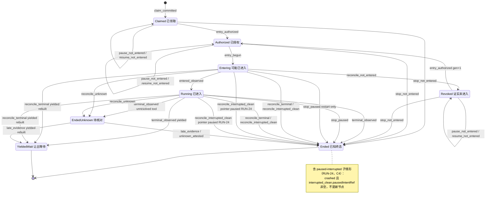

控制指针（`Run.controlState.desiredState`，与主状态正交；steer 只追加 `controlInputs`，不移动指针）：

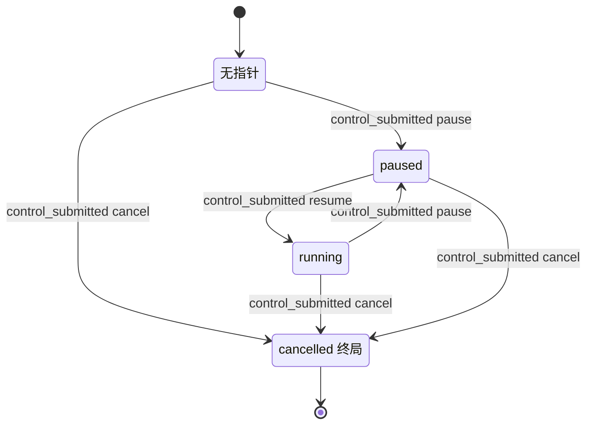

### 6.6 实现对照

状态机目标文件：`src/core/work-graph/state/run-machine.ts`，导出 `transitionRun`、`runControlFence`（由 `freshRunControlProblem` 迁入）、`isRunFinished`、`terminalOutcomeOf`（由 `terminalFact` 迁入）、`leaseOwnedByRun`。持有判定 `ownsOccupancy` 来自 `state/session-availability.ts`（§8）；指针计算 `pointerAfterSubmit` 来自 `state/control-intent-machine.ts`（§7）。Kernel Turn 的分类（not_entered、terminal、interrupted_clean、paused、unknown）和 RD-3 的 continuation 重建都需要读取 Kernel 的 RunState 和消息记录，因此留在 Runtime 的新文件 `src/core/agent-runtime/run-reconcile.ts`，不进入 `state/`。

简化（2026-10-07，不改行为）：`run-machine.ts` 另导出 `claimPinProblem`（Goal 为 active、领取钉住当前 Plan）和 `claimBasisProblem`（首次、接续、重入队三种领取依据，再加准入）。RUN-01 和 TASK-01..03 共用这一份，两台状态机各自的 Session、Task、阶段、租约检查仍按原顺序夹在中间。

本批（A.1b）补充：`run-machine.ts` 另导出纯谓词 `isPausedInterrupted(run)`（C4），并按契约 (f) 构造 `terminalPayload`；分类器不看平台指针，RUN-19/RUN-24 由 `transitionRun` 按 `state.pointer` 分开。Kernel 记录的解码与 Turn 归约移到共享的 `src/core/agent-runtime/kernel-turn-facts.ts`（`execution-observation.ts:107-131` 的私有函数移入，观察器改为 import），核对与接续说明（C3）用同一读取器，所以“确定结果”和“`pending` 计为未开始”（LA-7）在两处含义相同。接续说明的组装在 AgentRuntime（`execution-preparation.ts`），WG 只在 RUN-02 比较绑定与渲染文本（契约 (e)）。

| 行号 | 状态机函数 | 调用服务（file） | 已有测试（file） | 计划新增测试（描述） |
| --- | --- | --- | --- | --- |
| RUN-01 | `transitionRun(Absent, claim_committed)` | `claim-service.ts` `claimTask` | `tests/work-graph/R4c-task-claim.test.ts`、`R4c-task-claim-concurrency.test.ts` | 表驱动覆盖首次领取、接续领取、D-3 重入队三类守卫；Goal 非 active 时 busy |
| RUN-02、RUN-03 | `transitionRun(entry_authorized)`、`runControlFence` | `execution-entry-service.ts` `authorizeRuntimeEntry`（计算 `entryPlan` 与 `continuationBrief`）；`tasks/plan-task-basis.ts` `entryPlanVerdict`（C6）；`execution-entry-codecs.ts`（`continuationBriefDigest`、`activePlanRef`）；`execution-preparation.ts`（组装接续说明、`rehydratePreparedExecution`，C3）；`execution-driver.ts` 对 revoked 改走授权，并加绑定相等预检 | `tests/work-graph/B2-execution-entry.test.ts:59`、`:72`、`:103`、`:127`（首次领取，`absent_ok`；`inputBindingProblem` 只多允许一个键） | `Revoked`→`Authorized`：gen+1、保留 kernel、envelope/inputBinding 不变；inputBinding 不同 → invalid；非 revoked 的已有授权仍返回 busy/forbidden。C3：`continuationBrief` 五值 ×（有无 `requeueRef`、有无 `consumedWait`），只有（`absent_ok`，无 `requeueRef`）与（`bound`，有 `requeueRef`）放行，其余 guard_failed/invalid；requeue Run 授权后 `Run.inputBinding.continuationBriefDigest` 持久；Revoked→Authorized 时摘要不变；对已授权的 requeue Run 调用 `prepare` 得到与重建值 canonical 相等的 Prepared；driver 拒绝与已固定 inputBinding 不同的 Prepared（WG 写入 0、Kernel 调用 0），同一 Prepared 重发仍通过（`tests/runtime/B2-runtime-execution.test.ts:467-485` 的回放用例）；同一 `Claimed` requeue Run 两次 prepare 得到不同摘要、以同一 consumer 并发 start：第二个返回 invalid 且没有 begin，模型请求恰好 1 次，Run 不会停在没有 Kernel Turn 的 `Entering`。C6：`entryPlan` ∈ {active_plan, carried_unchanged, changed, unavailable} → ok / ok（事件带 `activePlanRef`）/ revision_conflict / unavailable；Goal 暂停时仍先返回 busy；授权读完后并发的 W16 → Goal@rev 冲突，重读后重新授权。接续说明本身：`tests/runtime/continuation-brief-assemble.test.ts`（C3 每一项都在；只有 `stoppedAt.kernel='not_entered'` 可以写“没有执行任何工具”；各上限下固定说明块都保留）、`tests/runtime/kernel-turn-facts.test.ts`、`tests/runtime/continuation-prepare-failures.test.ts`（W-25） |
| RUN-04 | `transitionRun(entry_begun)` | `beginRuntimeEntry`；材料授权的 basis 谓词在 `create-platform.ts:294` 注入（LA-2；2026-10-07 随授权读取侧删除，决定 34） | `B2-execution-entry.test.ts:142`、`:208`、`:218`、`:234` | gen>1 时槽位 owner→owner；旧 generation 的 permit 被拒；全程零 Kernel 调用；LA-2：在 P1 领取、经授权读取一项任务材料的 Run，经过无关的 W16 到 P2 后，准备、W3、W4 都成功，再一次无关的 W16 之后模型屏障仍放行该材料（`tests/work-graph/B2-material-admission.test.ts`；这个用例 2026-10-07 随授权写入方删除，决定 34） |
| RUN-05 | `transitionRun(entered_observed)` | `recordExecutionEntered` | `B2-execution-entry.test.ts:142`；`tests/work-graph/R4-control-intent.test.ts:316` | `Claimed` → forbidden；`Revoked` → busy |
| RUN-06 | `transitionRun(history_recorded)` | `execution-history-service.ts` `recordExecutionHistory` | `tests/work-graph/R4c-execution-history-index.test.ts` | 已终结的 Run 改 end → stale |
| RUN-07 | `transitionRun(terminal_observed)`、`terminalOutcomeOf`、`leaseOwnedByRun`、`ownsOccupancy` | `recordRunResult`；`execution-observation.ts` `observe` | `tests/work-graph/B2-execution-result.test.ts:24`、`:65`、`:94`、`:115`、`:132`；`tests/runtime/B2-runtime-execution.test.ts:183`、`:553` | 表驱动五种 outcome 的释放；`exitProof=null` → guard_failed；sequence 守卫；input_accepted 未确认 → unavailable；`terminalPayload` 与终态同提交写一次，crashed 的 error 超过 2,000 字符时截断并带 `…[truncated]`；不带 `terminalPayload` 的旧 Run 仍可读（C1） |
| RUN-08 | `transitionRun(terminal_observed)` 的未结算分支 | `execution-observation.ts` 未知分支 → 扩展后的 `recordRunResult`（带 `unresolvedToolCallIds`） | `tests/runtime/R4-control-runtime.test.ts:234`（只断言占用保留） | Run ended/outcome_unknown；Attempt ended；Lease、Session 保留；Outbox 为 entered；reconciliation 记录窗口与工具 id；Task 投影 blocked（§4） |
| RUN-09..11 | `transitionRun(stop/pause/resume_not_entered)` | `control-service.ts` `submitControl`（读取与守卫集合见下） | 需要改断言的见下 | `Claimed`/`Authorized`/`Revoked` × cancel/pause/resume；cancel 后 Lease、Session 释放，authorized→revoked，queued steer → superseded；Goal 暂停时 resume → busy；与 begin 并发时一方 CAS 失败；R 来源：指针已为 cancelled/paused 且 intent 仍 queued（`Entering` 时提交、经 RUN-16 撤销后）由核对同提交落地，不新建 intent |
| RUN-12..15 | `pointerAfterSubmit` | `submitControl` | `R4-control-intent.test.ts:173`、`:183`、`:316`、`:343`；`tests/runtime/R4-control-runtime.test.ts:140`、`:349`、`:423` | D-8 同提交取代；在 `YieldedWait` 上 resume 取代 queued pause；continuation 已被消费 → busy；Goal 暂停时 resume → busy；RUN-14 的 driver 守卫（C4）：新的 Runtime 实例（没有句柄）对带 queued resume 的已进入 Run 执行 `executions/start` → busy，Kernel Turn 启动数为 0（`tests/runtime/R4-control-runtime.test.ts` 新用例）；同进程的暂停/恢复用例（`:140-231`、`:395-421`）不受影响 |
| RUN-16..20 | `transitionRun(reconcile_*)` | 新 `agent-runtime/run-reconcile.ts` 分类后调用：RUN-17/18 用扩展后的 `recordRunResult`（basis host_instance_takeover），RUN-16/19/20 用新 `reconcileRun`（新文件 `tasks/run-reconcile-service.ts`，与 §8.6、§15 一致）；`src/app/host.ts` 在 D-18 之后的启动阶段调用；RUN-16 的进程内变体由 driver 在 Kernel 调用退出后调用 | `tests/runtime/B2-runtime-execution.test.ts:212`、`:372`（都只在进程内） | A8 三个崩溃点 × 有/无实例租约（锁文件不可读按无租约）；探针 transient 时保持原状，missing 时为 EndedUnknown；从 `Entering` 且探针 missing：Run 与 Attempt 的 `startedAt` 为 null，Outbox 保持 pending（ATT-36/37，L-2）；yielded 重建成功/失败；同一 Turn 两条等待发信 → EndedUnknown（`continuation_unrebuildable`，L-5）；指针 paused → RUN-24（paused-interrupted），Kernel paused 但指针 running 或没有指针 → RUN-19（C4）；Turn 只剩 Kernel `pending` 的下一组 → RUN-19/24，不是 RUN-20（LA-7）；RUN-19 的 error 恒为 `host_interrupted`，写 `terminalPayload`、`pausedIntentRef=null`；RUN-19 的 `release_session` 保持原 `historyCursor`（不写 null）并带 `kernelTurnOpen=true`（Session `unavailable/kernel_turn_open`），RUN-17/18 写取自 Kernel 终态事件的 `terminalPayload`、`kernelTurnOpen=false`；断言 Kernel、provider 调用计数为 0；同一 Run 在 gen 1 与 gen 2 上各发生一次进程内 RUN-16，第二次不被当作第一次的回放 |
| RUN-21、RUN-22 | `transitionRun(late_evidence/unknown_attested)` | `recordRunResult`（RUN-21）；新 `resolveUnknownRun`（Host 人类入口，RUN-22；入口先经 Runtime 的 `kernel-turn-facts.ts` 读 Kernel 得出 `kernelTurnOpen`，契约 (d)） | — | 同一终态重新观察 → guard_failed（RD-4）；非 human → forbidden；没有实例租约 → busy（L-1）；ControlIntent 保持 outcome_unknown；只释放有持有关系的占用和 Lease；RUN-20(ii) 之后：`late_evidence` 补记 Run 与 Attempt 的 `startedAt` 与 history，Outbox 从 pending 结算且 `consumerId`/`entryGeneration` 等于授权上的值；人工认定时 `startedAt` 保持 null（L-2）；两行都写 `terminalPayload`（RUN-22 为 `human_attested: <reason>`，C1）；RUN-22 的 `kernelTurnOpen`：RUN-20(i) 的未结束 Turn → true，RUN-20(iii) 的 yielded 终态 → false，RUN-20(ii) Kernel 不可读 → true，为 true 时 Session 同提交记为 `unavailable/kernel_turn_open`（LA-1） |
| RUN-23 | `transitionRun(stop_paused)` | `reconcileRun(paused_stop)`：进程内由 `execution-control.ts` `deliver` 在句柄已退出且 cleanProof 成立时调用（今天在 `:184-188` 原样返回）；重启时由 `run-reconcile.ts` 调用 | — | 进程内：安全点暂停 + cancel → Ended(cancelled)，释放，cancel Applied，queued steer superseded；`resourcesClosed` 未完成 → cancel 保持 queued；进程内且 Kernel 未暂停 → 不走本行；重启：暂停 + queued cancel → cancelled（不是 crashed）；重启时 Kernel 未暂停、Turn 干净（只剩 `pending`）+ queued cancel → cancelled，reason `cancelled_at_reconcile`（LA-7）；重启时 `Entering` + Turn 已存在 + queued cancel → 补记进入事实后 cancelled；重启时 Kernel 已接受（inputId 为 `control:<sha(intentRef)>`）的 queued steer → Applied（steered），未接受的 → superseded，两类正文都进入接续说明；有 `running`/`outcome_unknown` 工具 → 不走本行（RUN-20(i)）；所有情形都写 `terminalPayload`，`release_session` 保持原 `historyCursor` 并带 `kernelTurnOpen=true` |
| RUN-24 | `transitionRun(reconcile_interrupted_clean)` 的指针 paused 分支、`isPausedInterrupted` | 重启时 `run-reconcile.ts` 分类后调用 `reconcileRun(interrupted_clean)`（`tasks/run-reconcile-service.ts`）：同一提交写 Run、Attempt、Outbox、Lease、Session（含 `kernel_turn_open`）、queued pause intent（CTL-08(f)）与 steer intent | — | 纯函数表（`tests/state/run-machine.test.ts`）：（`Entering`/`Running`）× 指针 {paused 且 applied，paused 且 queued，running 且 queued resume，无，cancelled 且 queued} × `kernelPaused` {true, false} × 工具 {全部已结算，只剩 `pending` 下一组，一个 `running`，一个 `outcome_unknown`}：指针 paused 且干净 → RUN-24、`pausedIntentRef`=指针 intent；running/无且干净 → RUN-19；queued cancel 且干净 → RUN-23；有 `running`/`outcome_unknown` → RUN-20(i)；`hostLease≠owned` → busy；探针 transient → unavailable。`isPausedInterrupted` 只对 crashed + `interrupted_clean` + 非空 `pausedIntentRef` 为真，RUN-23 的 cancelled 为假。服务（`tests/work-graph/run-reconcile-service.test.ts`）：一个提交；同一实例回放，新实例跳过；Session 的 `historyCursor` 与核对前逐字节相同、occupancy 为 null、`health='unavailable'` 且结论码 `kernel_turn_open`；之后另一个 Task 的 Workflow 领取不会选中原 Session，直接点名领取它 → busy。场景：§12 A8-3l、A8-3m、A8-3o（Kernel Turn 启动数与 provider 调用数在核对期间为 0） |

**`submitControl` 的读取与守卫集合（RUN-09..15）。** 今天只经 `deps.authority.load` 读取 Run（`control-service.ts:143-158`、`:363`），只守卫 Run 与新 intent（`:421-424`）。目标如下：

- **Run 未进入时（RUN-09..11）。** 按 `readAdmissionFacts` 的方式经 `readExecution` 读取完整执行记录（`execution-entry-service.ts:309-323`：Run、Attempt、Outbox、Plan、Session、Lease），再读取 `controlInputs` 中的 steer intent。resume 时另经 `readGoalScope` 读取 Goal。
  - 守卫：Run@pin；新 intent 为 null；旧指针 intent@rev（CTL-04）；每个被取代的 steer@rev；RUN-09 另加 Attempt、Outbox、Session、Lease@读到的 revision（释放判定依赖它们）；resume 另加 Goal@rev。
- **Run 已进入或为 `YieldedWait` 时（RUN-12..15）。** 另读取 Lease，用于判定 RD-8；resume 时另读取 Goal。
  - 守卫：旧指针 intent@rev，Lease@rev，Goal@rev（resume 时）。
- 依赖从 `authority` 扩展为 `reads`（`ExecutionReadPort`）和 `records`。
- **A.2 5.1 同步（实际落地的读取集合，功能等价）。** 只有两种提交经 `readExecution` 读取执行窗口，并以窗口中的 Run 代替精确读取：未进入 Run 的 cancel（RUN-09，要结束 claim 的 Attempt、Outbox、Lease、Session），以及 `YieldedWait`（RD-8 按 Lease 判定）。未进入 Run 的 pause/resume（RUN-10/11）只写 Run 指针与新 intent，不读执行窗口，也不加 Attempt、Outbox、Session、Lease 守卫；`controlInputs` 中的 steer 只在 RUN-09 读取（CTL-04(b)）。旧指针 intent 只在提交要移动已有指针时读取（resume 规则与 D-8，`submissionReadsPointerIntent`），Goal 只在 resume 时读取（`submissionReadsGoal`）。已进入的 Run 不读 Lease、不加 Lease 守卫：RD-8 只对 `YieldedWait` 成立；`YieldedWait` 上不结束 claim 的提交加 Lease@读到的 revision 守卫，继任领取在读取与提交之间移动 Lease 时提交冲突。

**受 D-7/D-8 影响、需要改断言的已有测试。** 这些测试的夹具 Run 处于 `Claimed` 或 `Authorized`，今天断言控制为 queued。建议需要 queued 语义的用例改用 `fixture.enter()` 夹具；保留在未进入夹具上的用例改为断言 applied，并检查 RUN-09/10 的效果。

- `tests/work-graph/R4-control-intent.test.ts`：
  - `:68-109`：pause 变为 applied@2，回执回放要恢复 applied 快照（依赖 §7.1 的事件 codec 放宽）。
  - `:110-141`：pause 变为 applied；cancel 结束 Run；`:127-129` 断言 pause 仍是 queued 快照，D-7 后它是 applied（不再被取代）；`:138-140` 的 busy 原因变为 Run 已结束。
  - `:159-171`：`:170` 断言授权仍为 authorized，D-7 后变为 revoked。
  - `:364-376`：cancel 为 applied，Run 已结束。
- `tests/composition/R4-control-platform.test.ts:73-101`：cancel 为 applied，Run 已结束。

以下已有测试**不需要**改：

- `:146-157`：`freshRunControlProblem` 先于 status 判定（`execution-entry-service.ts:914-918`），busy 仍来自指针栅栏；授权由 none 保持 none。
- `:229-259`：不断言 intent 状态；pause 不撤销授权，`:257` 仍成立。


## 7. ControlIntent

ControlIntent 记录有权操作者的一次控制请求（pause、cancel、resume、steer），以及之后对它的真实观察。请求被受理不等于已经生效（CORE-DATA-OPERATIONS:379，MVP-BEHAVIOR §2 `:37`）。

**和 Run 的分工。**

- intent 只描述“这次请求的命运”。Run 的期望状态是 `Run.controlState`（指针）与 `controlInputs`，由 §6 RUN-09..15、RUN-23 在同一提交中写入。
- 观察只写 intent，从不改写 Run 指针（`control-service.ts:602-610`）。
- 本节不新增状态名。新增的只有：平台可以自行证明的观察来源（D-7、D-8、RD-7、C4），终态之后 intent 的收尾规则，以及“迟到观察不再改写已终态 intent”的规则。

本节依赖的决定：

- 用户已定（2026-10-03）：D-7（U-7，按原推荐）、D-9（U-8，按原推荐；Goal 暂停期间不允许逐 Run 恢复）、D-18（U-5，与 D-5 一起，按原推荐）、§6 RD-6（U-9 → C4：重启时暂停中的已进入 Run 结束为 paused-interrupted，不算失败，释放 Session 与 Lease，由人“继续”）。
- 按 brief 列在规格头部：D-8、D-11（Query 不提供公开 pause/resume）、D-15、D-17（不做原 Turn fresh resume），以及 §6 的 RD-8。
- 已由 lead 采纳（L-8）：§6 的 RD-1（revoked 视为未进入）、RD-7（暂停中由平台停止）。
- lead 决定（2026-10-03）：LA-1（接续＝新 Run；上一个 Kernel Turn 未结束时，在新 Session 中接原会话已完成的历史）、LA-6（启动核对之后的重驱）、LA-7（§6 RUN-23 推广到 Kernel 未暂停的干净 Turn）。

本节在 brief 之外补充的决定（lead 按 L-16 采纳）：

- **CD-1 平台观察不得伪装成 Kernel 观察。** D-7/D-8 的 applied 和 superseded 必须带一个 observation，但今天的 `ControlObservationV1` 强制要求 Kernel 来源（entry、history、source、kernelEventId）。因此新增 `ControlPlatformObservationV1`，不填假的 Kernel 字段。
- **CD-2 `terminal_without_cancel` 与 `outcome_unknown` 可以归属任意种类。**
  - 在 Run 先到终态、控制从未生效时，pause、resume、steer 的 intent 也能离开 queued，补上 §7 #16 的缺口。
  - 被消费的 pause 遇到未知结果时，也能记录 `outcome_unknown`，修复 state-writes-other D5 路径 1：今天 codec 会拒绝，intent 永远停在 queued。
  - 名称保留以兼容；`terminal_without_cancel` 的语义是“终态先于该控制生效”。
- **CD-3 平台直接受理的 intent 写成 `∅→applied@2`。** D-7 的 intent 在同一提交中直接以 `applied` 写入。为满足 codec 规则“已观察 ⇒ revision≥2”（`control-record-codecs.ts:292-294`），记录 revision 写为 2：逻辑上经过 queued@1，事件中携带最终快照。RecordStore 不强制 `revision===expected+1`（state-writes-other §0；比较规则见 `src/core/record-store/record-codec.ts:750`）。`ControlIntentSubmitted` 事件的解码今天只接受 queued@1（`control-record-codecs.ts:380-383`），因此要按 7.1 放宽，否则所有回执回放（lookupCommit 命中、确认丢失后的恢复）都会失败。
- **CD-4 终态之后收尾所有仍 queued 的 intent，不只收尾被消费的那一个。** Run 以已知 outcome 结束后（不含 `YieldedWait`），观察者为三类 intent 写观察：被 Kernel 消费的 intent、`Run.controlState.intentRef`、`controlInputs` 中未被 Kernel 接受的 steer。崩溃导致的遗漏由启动核对 CTL-08(e) 补上。

### 7.1 持久位置与状态枚举

路径简写：`control-intent.ts`=`src/contracts/control-intent.ts`；`control-service.ts`、`control-contracts.ts` 在 `src/core/work-graph/tasks/`；`control-record-codecs.ts` 在 `src/core/work-graph/persistence/`；`execution-observation.ts`、`execution-control.ts`、`execution-driver.ts` 在 `src/core/agent-runtime/`。

| 维度 | 记录与字段（file:line） | 代码取值（原样） | 与设计名的对应 / 说明 |
| --- | --- | --- | --- |
| 状态 | `ControlIntentSnapshotV1.status`（`control-intent.ts:75-82`），校验 `control-record-codecs.ts:281-294` | `queued`：revision 恒为 1，不带 observation。`applied`/`superseded`/`outcome_unknown`：revision≥2，带 observation | 与 ORCHESTRATION §0.6“控制”行同名。界面上 pause/cancel 的 queued 显示为“停止请求中”，outcome_unknown 显示为“待核对” |
| 种类与期望 | `kind`（`:21`、`:62`）、`desiredState`（`:63`），配对校验 `control-record-codecs.ts:261-272` | pause→paused；cancel→cancelled；resume→running；steer→steered | R1–R4 |
| 观察 | `observation: ControlObservationV1`（`control-intent.ts:43-52`），校验 `control-record-codecs.ts:192-239` | kind 为 `paused`/`cancelled`/`resumed`/`steered`/`terminal_without_cancel`/`outcome_unknown`；带 entry 身份、history、source（Kernel 身份与位置）、kernelEventId 与 sequence | 只来自 Kernel 原历史。`:40-41` 的注释称“observer 尚不存在”，已过时 |
| 观察与种类的配对 | `control-record-codecs.ts:297-306` | paused→pause；resumed→resume；steered→steer；其余（cancelled、terminal_without_cancel、outcome_unknown）→cancel | 按 CD-2 放宽，见下 |
| 提交事件 | `ControlIntentSubmitted`，解码 `controlIntentSubmittedEventFromEvent`（`control-record-codecs.ts:350-393`），由 `replayControl` 使用（`control-service.ts:248-269`） | `submitted` 只含 `{intent, runRevision}`（`:375`），且 intent 必须是 queued@1（`:380-383`） | 按 CD-3 放宽，见下 |
| 不可变请求 | `ControlIntentRequestV1`（`control-intent.ts:58-67`） | ref、runRef、kind、desiredState、reason、requestedAt、requestedBy（human 或 system） | 观察只追加 status 与 observation。谁提出了暂停或取消，由 `stopRequesterOf(intent)` 判定（§4；不在 `PLATFORM_AUTOMATION_ACTORS` 中的 actor 都算 `human`），不直接看 `requestedBy.kind` |
| Run 侧指针 | `Run.controlState`、`Run.controlInputs`（`src/contracts/dispatch.ts:153-156`、`:189`） | 见 §6.1 | 由 §6 拥有 |

**机器视图。**

- 节点：`Absent`、`Queued`、`Applied`、`Superseded`、`OutcomeUnknown`。
- `Applied` 与 `Superseded` 是终态。`OutcomeUnknown` 只能经 `control_reconciled` 离开（D-8）。
- 对每个 Run，kind 为 pause、cancel、resume 的 intent 中，至多一个处于 `Queued`，且它就是 `Run.controlState.intentRef` 指向的那一个；`Superseded` 的 intent 永远不会被指针引用（§11 I-5）。steer 不受此限制，可以有多个 queued，它们全部在 `controlInputs` 中。

```ts
// src/core/work-graph/state/control-intent-machine.ts（目标）只 import src/contracts
type ControlNode = 'Absent' | 'Queued' | 'Applied' | 'Superseded' | 'OutcomeUnknown';
type ControlIntentState = {
  node: ControlNode; kind: ControlIntentKindV1 | null; revision: number;
  observation: ControlObservationV1 | ControlPlatformObservationV1 | null;
};
type ControlGuardContext = {
  run: { node: RunNode; pointer: 'none' | 'running' | 'paused' | 'cancelled' | 'steered';
         pointsHere: boolean; inControlInputs: boolean;
         continuationConsumed: boolean;                              // YieldedWait（§6 RD-8）
         kernelPaused: boolean;                                      // Kernel Turn 为 paused（CTL-10 的进程内变体要求；重启变体不要求，LA-7）
         pausedInterrupted: boolean;                                 // isPausedInterrupted(run)：Run 经 §6 RUN-24 结束为 paused-interrupted（CTL-08(f)、7.4）
         entry: ControlEntryIdentityV1 | null;                       // 由 V2 授权与 claim generation 得到
         window: { start: number; through: number } | null };       // 已持久化的 history 窗口
  goal: { desiredState: 'active' | 'paused' | 'cancelled' };         // D-9：resume 守卫（§2）
  pointerIntent: { kind: ControlIntentKindV1; status: ControlIntentSnapshotV1['status']; observed: string | null } | null;
  pinsMatch: { intent: boolean; run: boolean };
  exitProof: 'live_clean' | 'host_instance_takeover' | null;         // CTL-10
  origin: 'live' | 'reconcile';
};
```

**新增契约（CD-1；A.2 冻结）：**

```ts
export type ControlPlatformObservationV1 = {
  schemaVersion: 1;
  origin: 'platform_not_entered' | 'platform_superseded' | 'platform_reconcile' | 'platform_paused_stop';
  kind: 'paused' | 'cancelled' | 'resumed' | 'superseded_by_newer' | 'terminal_without_cancel' | 'outcome_unknown';
  runRevision: number;                         // 同一提交写入后的 Run revision
  detail:
    | { entryPhase: 'none' | 'authorized' | 'revoked' }   // platform_not_entered（D-7）
    | { supersededBy: ControlIntentRef }                  // platform_superseded（D-8；也用于 cancel 结束 Run 时的 queued steer）
    | { hostInstanceId: string; runOutcome: RunOutcome }  // platform_reconcile（重启时没有可归属的 Kernel 事件；kind paused 只用于 CTL-08(f)，此时 runOutcome='crashed'）
    | { basis: 'live_clean' | 'host_instance_takeover'; pausedBy: ControlIntentRef | null }; // platform_paused_stop（§6 RD-7）；pausedBy＝此前生效的 pause intent，LA-7 的未暂停情形为 null；与读模型的 `pausedBy: StopRequester` 不是同一字段
  observedAt: string;
};
// ControlIntentSnapshotV1 的非 queued 分支：observation: ControlObservationV1 | ControlPlatformObservationV1
```

对应的 codec 与服务改造：

- `controlObservationProblem`（`control-record-codecs.ts:192-239`）按是否有 `origin` 键分派到两种变体。
- 配对规则（`:297-306`）改为：
  - `paused`→pause；`resumed`→resume；`steered`→steer；`cancelled`→cancel（Kernel 来源与平台来源都一样；`paused` 的平台来源包括 platform_reconcile，只用于 CTL-08(f)）；
  - `superseded_by_newer`→任意种类（steer 用于 cancel 结束 Run 时，CTL-04(b)）；
  - `terminal_without_cancel`→任意种类（CD-2）；
  - `outcome_unknown`→任意种类（CD-2；Kernel 来源与 platform_reconcile 都适用）。
- `controlIntentSubmittedEventFromEvent`（`:350-393`）中 `:380-383` 改为：`submitted.intent` 可以是 queued@1，也可以是 applied@2 且 observation 为 `origin:'platform_not_entered'`（CTL-02）。事件仍只携带 `{intent, runRevision}`（`:375`），不携带被同提交取代的旧 intent（CTL-04）。
- `observationStatusFor`（`control-service.ts:217-221`）：`superseded_by_newer` 与 `terminal_without_cancel` → superseded；`outcome_unknown` → outcome_unknown；其余 → applied。

### 7.2 事件

| 事件名 | 来源 | 载荷要点 | 对应原文编号 |
| --- | --- | --- | --- |
| `control_submitted` | U（Host 操作者）；P（G7 的 Goal 扇出，`GOAL_FAN_OUT_ACTOR`） | `runRef`、`kind`、`reason`、`requestedBy`、Run 版本钉、requestId | R1–R4、G7 |
| `control_applied_not_entered` | P（与 `control_submitted` 同一提交；重启时也可由 R 触发） | 提交时 Run 的 entry 阶段（none、authorized 或 revoked）、写入后的 Run revision | R1“排队项可直接暂停”、R2、R3、D-7 |
| `control_superseded_by_newer` | P（与取代者同一提交） | 取代者的 `intentRef`（新 intent，或结束 Run 的 cancel intent）、写入后的 Run revision；被取代的是旧指针 intent，或 cancel 结束 Run 时的 queued steer | D-8、A7、R4“过期 ack 不能覆盖较新指令” |
| `control_observed` | K（进程内可信 Runtime 观察者） | `ControlObservationV1`（entry 身份、history、source.position、kernelEventId 与 sequence）；intent 与 Run 两个版本钉 | R1–R5、A7 |
| `control_applied_paused_stop` | P（与 §6 RUN-23 同一提交） | cancel 的 `intentRef`、证明来源（live_clean 或 host_instance_takeover）、此前生效的 pause intent（Kernel 未暂停的情形为 null，LA-7） | R2、G7、D-15、RD-7、LA-7 |
| `control_reconciled` | R（启动核对）；K/R（与 §6 RUN-21 同提交） | Kernel 原历史中对应的控制或终态证据；没有可归属的证据时给出平台结论（platform_reconcile，kind 为 terminal_without_cancel、outcome_unknown，或 CTL-08(f) 的 paused）；`hostInstanceId`；目标状态 | S8、A8、D-8、C4 |

### 7.3 迁移表

| # | from | event | guard（守卫） | to | effects（同事务副作用意图） | 幂等/重复事件 | 原文编号 | 现状 |
| --- | --- | --- | --- | --- | --- | --- | --- | --- |
| CTL-01 | `Absent` | `control_submitted` | Run 接受控制：未终结，或为 continuation 尚未被消费的 `YieldedWait`（§6 RD-8）；输入合法（steer 有正文）；resume 规则成立；kind=resume 时 Goal desiredState=active（D-9，§2）；`controlSubmitProblem` 通过；Run 版本钉等于当前值（不等时先按身份重查回执，再返回 revision_conflict）；不属于 CTL-02 的情形 | `Queued`@1 | 同提交写 Run 指针或 `controlInputs`（§6 RUN-12..15）；旧的 queued 指针 intent 走 CTL-04 | lookupCommit 回放原回执；同身份不同内容 → idempotency_conflict；两次 lookup 都未命中但并发同身份已提交时，恢复原回执（`control-service.ts:370-383`） | R1–R4、G7 | 已有 `control-service.ts:358-432`；改造 `:384-399`（Goal 守卫与 RD-8 守卫，需要读取 Goal 与 Lease） |
| CTL-02 | `Absent` | `control_submitted` 加 `control_applied_not_entered` | kind 为 pause、cancel 或 resume；Run 为 starting，entry 为 none、authorized 或 revoked；resume 时要求指针 intent 是 applied pause，且 Goal desiredState=active | `Applied`@2，观察来源 platform_not_entered，kind 为 paused/cancelled/resumed | 同提交执行 §6 RUN-09/10/11；旧的 queued 指针 intent 走 CTL-04(a)；cancel 时 queued steer 走 CTL-04(b) | 同 CTL-01；`ControlIntentSubmitted` 事件携带 applied@2 快照，回放时原样恢复 | R1、R2、R3、D-7、CD-3 | 新增；改造 `control-record-codecs.ts:380-383`（今天回放只接受 queued@1） |
| CTL-03 | `Queued` | `control_observed` | intent 与 Run 的 revision 等于版本钉；V2 entry 身份一致；history 与 locator 一致，source 在已持久窗口内；Run 指针仍指向本 intent（steer 为仍在 `controlInputs` 中） | 按观察映射表：`Applied`、`Superseded` 或 `OutcomeUnknown` | 只写 intent；Run 只作 CAS 守卫，指针不变 | 同身份回放；提交结果未知时按回执恢复（`control-service.ts:616-627`） | R1–R5、A7 | 已有 `control-service.ts:520-612`，映射 `:217-221`；改造 `control-record-codecs.ts:297-306`（被消费的 pause 记 outcome_unknown 不再被拒，CD-2） |
| CTL-04 | `Queued` | `control_superseded_by_newer` | 满足以下之一：(a) 新 intent 在同一提交中写入，本 intent 是被移动前的指针 intent，且仍是 queued；(b) 本 intent 是 `controlInputs` 中仍 queued 的 steer，且同一提交中有 cancel 结束了 Run（§6 RUN-09 的 U/R 两种来源、RUN-23）；该 cancel 可以是新写入的（CTL-02），也可以是由 Queued 变为 Applied 的既有 intent（CTL-08(a)、CTL-10）；RUN-23 的重启变体中，Kernel 历史已有该 steer 的 `run.input_accepted`（inputId 为 `control:<sha(intentRef)>`）时不走本项，走 CTL-08(b) | `Superseded`（revision+1，观察来源 platform_superseded，`supersededBy` 为 (a) 的新 intent 或 (b) 的 cancel intent） | 无其他效果；加本 intent 的 CAS 守卫 | 随新 intent 的提交回放：回执只含新 intent（事件形状不变，`control-record-codecs.ts:375`），被取代 intent 的状态从其记录读取 | D-8、A7、R4 | 新增（今天保持 queued，`R4-control-intent.test.ts:127-129` 断言的正是这一点） |
| CTL-05 | `Queued`（D-8 之前遗留的数据） | `control_observed` | 指针已不再指向本 intent（steer 为已不在 `controlInputs` 中） | `Superseded`，保留真实观察 | 无 | 同 CTL-03 | A7 | 已有 `control-service.ts:577-579`（保留以兼容旧的 queued 记录） |
| CTL-06 | `Queued`（任意 kind） | `control_observed`，kind=terminal_without_cancel | Run 以已知 outcome 结束：是 `Ended`，不是 `YieldedWait`（等待中的 intent 保持为围栏，见 7.3 情形 6），也不是 `EndedUnknown`（走 outcome_unknown）；Kernel 原历史显示该控制未生效就到了终态。观察者在终态提交后（或在 `alreadyEnded` 路径且 cleanProof 成立时）写观察，对象是被消费的 intent、仍 queued 的 `Run.controlState.intentRef`、未被 Kernel 接受的 queued steer；source 为终态记录的位置 | `Superseded` | 无 | 同 CTL-03 | R5、CD-2、CD-4 | 改造 `execution-observation.ts:609-624`、`:693-703`（今天只对被消费的 cancel 计算终态 ack，`:615-616`、`:695-696`）；改造 `control-record-codecs.ts:304-305` |
| CTL-07 | `OutcomeUnknown` | `control_reconciled` | 与 §6 RUN-21 同提交；新的 Kernel 证据中有该 intent 对应的控制事件（按观察映射表 → `Applied`），或者终态先于该控制生效（terminal_without_cancel → `Superseded`）；适用于任意 kind | `Applied` 或 `Superseded` | 无（Run 的变化在 RUN-21 中） | 随 RUN-21 的回执回放 | D-8、R5 | 新增 |
| CTL-08 | `Queued` | `control_reconciled` | 启动核对，且 `hostLease=owned`。按核对后的 Run 节点分为：<br>(a) Run 未进入（`Claimed`、`Authorized`、`Revoked`），且 kind 为 pause、cancel 或 resume → `Applied`，观察来源 platform_not_entered，同提交执行 RUN-09/10/11（resume 另需 Goal active，否则保持 queued）；<br>(b) Run 在本次核对中结束为已知终态（RUN-17/18/19/24，非 yielded），Kernel 历史中有可归属于该 intent 的控制事件 → 按观察映射表处理。RUN-24 时只用于 queued steer：Kernel 历史中有 inputId 为 `control:<sha(intentRef)>` 的 `run.input_accepted`（`execution-driver.ts:697`）→ `Applied`（steered）；该 Turn 不在接续 Run 的模型历史中，steer 正文也由接续说明带入（C3）。RUN-23 的重启变体同样只用于 queued steer，判据相同：有匹配的 `run.input_accepted` → `Applied`（steered）；没有的不走 (c)，走 CTL-04(b)（被结束 Run 的 cancel 取代）；cancel 本身走 CTL-10；<br>(c) 同 (b)，但 Kernel 历史中没有可归属的事件 → `Superseded`（platform_reconcile，terminal_without_cancel）。包括 RUN-19 上的 queued resume（Kernel 暂停后用户已 resume，重入前 Host 停止），以及 RUN-19/24 上未被 Kernel 接受的 steer；被取代的 steer 正文由接续说明带入（C3）。指针 pause 落在 RUN-24 上时不走 (c)，走 (f)；<br>(d) Run 为 `EndedUnknown`（本次 RUN-20，或此前的 RUN-08），任意 kind → `OutcomeUnknown`（platform_reconcile，kind outcome_unknown）；<br>(e) Run 此前已经是 `Ended`（不含 `YieldedWait`），intent 仍 queued（终态之后的 ack 因崩溃遗漏）→ 同 (b)/(c)。paused-interrupted 的 Run 不会留下 queued 的 pause 或 steer：它们与 RUN-24 同提交收尾（§6 RUN-24；pause 的状态由 §11 I-16 约束）；<br>(f) Run 在本次核对中经 §6 RUN-24 结束为 paused-interrupted（`isPausedInterrupted(run)`），指针 pause intent 仍 queued → `Applied`（platform_reconcile，kind `paused`，detail `{hostInstanceId, runOutcome:'crashed'}`），不论 Kernel 是否已到 paused。归属规则（本节定）：Kernel 的 `run.paused` 载荷只有 `pause{reason, requestedBy, pausedAt, pendingToolCallId}`，不带 intent 身份（`vendor/coding-agent/dist/core/runtime/events/agent-events.d.ts:418-445`）；平台安全点对指针暂停和 fail-closed 暂停给出同一个结果（`execution-control.ts:245-273` 为 fail-closed，`:276-287` 为指针暂停；`execution-driver.ts:590`、`:672-676`）。进程内的 ack 靠活句柄上的 `consumedIntentRef`（`execution-observation.ts:549-551`、`:565`），重启后没有这个句柄，无法证明 `run.paused` 由该 intent 引起，所以 RUN-24 上的 queued pause 一律走 (f)，不走 (b)（CD-1：平台结论不伪装成 Kernel 观察）；Kernel 是否到达安全点记在 Run 的 `interrupted_clean.kernelPaused`（§6 RUN-24）。已 applied 的 pause 不改写，也不写。这样 pause intent 与 Task 的“已暂停，可继续”一致（§11 I-16），界面不会显示“停止请求已被取代”。<br>不处理：`YieldedWait`（围栏），以及指针为 queued cancel、Turn 无终态且没有在途工具的 Run 上的 cancel 与未被 Kernel 接受的 queued steer（分别走 CTL-10 与 CTL-04(b)，§6 RUN-23；lead 决定 LA-7（2026-10-03）推广到 Kernel 未暂停的情形） | 见守卫 | 随 §6 RUN-09/10/16..20、RUN-23、RUN-24 同提交；(e) 单独提交，以 Run 为 CAS 守卫 | 核对身份 = hash(runRef, intentRef, hostInstanceId) | S8、A8、D-8；(f) 新增（C4） | 新增 |
| CTL-09 | `Applied`/`Superseded` | `control_observed`，内容相同（kind、source.position、kernelEventId 都相同） | intent 已是终态 | 不变 | 不写 | duplicate：返回已存的快照，`replayed=true` | D-8 | 改造 `control-service.ts:520-588`：在服务层新增状态守卫。今天服务不检查 status，带当前版本钉的新 requestId 会重写 intent。Runtime 观察者已经跳过非 queued 的 intent（`execution-observation.ts:305`、`:345-349`），所以这里只是服务级守卫 |
| CTL-10 | `Queued`（cancel，指针指向它） | `control_applied_paused_stop` | 与 §6 RUN-23 同提交：Kernel Turn 无终态，`exitProof≠null`，没有在途工具（`pending` 计为未开始）。进程内变体要求 Kernel 为 paused（原情形）；重启变体按 lead 决定 LA-7（2026-10-03）不要求，Kernel 未暂停的干净 Turn 也适用，此时没有生效的 pause，`pausedBy=null` | `Applied`（revision+1，观察来源 platform_paused_stop，kind cancelled） | Run 的变化在 RUN-23 中（含原 Session 记为 `unavailable/kernel_turn_open`，§8）；queued steer：重启变体中 Kernel 已接受的（inputId 匹配）走 CTL-08(b)，其余走 CTL-04(b) | 随 RUN-23 的回执回放 | R2、G7、D-15、RD-7、LA-7 | 新增（今天该 cancel 永远 queued：`execution-control.ts:184-188`）。A.2 5.6 同步：进程内变体的 `pausedBy` 取活句柄在安全点消费的 pause intent；重启变体中即使 Kernel 已暂停，cancel 入列（RUN-13）后 Run 指针已指向 cancel，而 Kernel `run.paused` 不带 intent 身份（CD-1），持久事实中没有生效的 pause，`pausedBy` 记为 null（须 lead 确认此措辞） |

**观察映射（`observationStatusFor` 加上指针条件）**

| 观察 kind | 可能的来源 | 指针仍指向本 intent | 本 intent 已被取代 / 已终态 |
| --- | --- | --- | --- |
| `paused` | K：安全点 ack，需要 cleanProof（`execution-observation.ts:565-569`）；P：platform_not_entered；R：platform_reconcile（CTL-08(f)，RUN-24） | `Applied` | stale（CTL-09 的同内容情形除外） |
| `cancelled` | K：Kernel `run.cancelled`，且是该 intent 引起的（`:693-703`）；P：platform_not_entered、platform_paused_stop | `Applied` | 同上 |
| `resumed` | K：同一 Turn 重入后被确认（`:564`、`:684`）；P | `Applied` | 同上 |
| `steered` | K：输入被 Kernel 接受 | `Applied`（steer 用 `controlInputs` 判定） | 同上 |
| `terminal_without_cancel` | K：终态先到（CTL-06）；R：platform_reconcile | `Superseded` | 同上 |
| `outcome_unknown` | K：cleanProof 下 Kernel 终态含未知工具（`:588-592`，任意 kind）；R：platform_reconcile（CTL-08(d)） | `OutcomeUnknown` | 同上 |
| `superseded_by_newer` | P：platform_superseded | — | 只出现在 CTL-04 |

**迟到 ack（A7、B08“迟到旧 ack 不覆盖较新控制”）**

- 观察从不写 Run（`control-service.ts:602-610`），所以任何迟到 ack 都不会改变指针或 Run 状态。
- 对已经 `Superseded` 或 `Applied` 的 intent，内容不同的迟到观察返回 stale（`revision_conflict`），intent 记录不变。这个事实本身仍保存在 Kernel 原历史中，历史视图可以读到（D-8 所说的“只作为历史”）。
- 观察者遇到 stale 时视为结束，不重试。今天的观察者在冲突时只用刷新后的版本钉重试一次（`execution-observation.ts:368-374`）。
- 并发竞争：CTL-04 给旧 intent 加 CAS 守卫。
  - 若观察（CTL-03）先提交：新提交收到 revision_conflict，按原请求重试时旧 intent 已是终态，因此不需要再取代。
  - 若新提交先提交：观察的 CAS 失败；观察者重读后发现 intent 是 `Superseded`，得到 stale。

**不支持或不投递的情形（如实报告，不伪造生效）**

1. **QueryRun 的控制。** ControlIntent 只接受 `RunRef`（`control-service.ts:96`），Query 的停止走 QueryJob close（work-graph.md:604）。今天对 QueryRunRef 返回 invalid；pause/resume 没有公开入口（D-11）；能力上报写明这一点（7.7）。A.2 5.2 同步：本批没有 QueryJob close。`QueryJobPort` 只有 submit、read、claim、answer（`src/core/work-graph/queries/contracts.ts`），没有写入 `closed`/`closeReason` 的操作，也没有路由；Query 只以自身终态结束（5.6 起另有 Host 核对 QRR-01..06）。所以 `cancel` 的 reason 写“Query 不能取消”，不写“走 QueryJob close”；Query 的公开停止与 GAP-06 一样不在本批。
2. **`steered` 指针。** 没有写入者；如果读到，fresh 动作返回 unsupported（`src/core/work-graph/tasks/execution-entry-service.ts:157-158`）。
3. **已在安全点暂停的 entered Run 上的 cancel。** Kernel 已经退出，handle 不再 live，`deliver` 无处投递，原样返回 queued（`execution-control.ts:184`、`:188`）。
   - 目标：由 §6 RUN-23 与 CTL-10 收尾。进程内只要句柄的 cleanProof 成立，`deliver` 就改为调用 `reconcileRun(paused_stop)`，Run 结束为 `cancelled`，cancel 记为 Applied。重启后由启动核对以实例租约作证明，做同样处理。按 lead 决定 LA-7（2026-10-03），重启核对时不要求 Kernel 已到 paused：指针为 queued cancel、Turn 无终态且没有在途工具（`pending` 计为未开始）即可；进程内仍要求 Kernel 为 paused。
   - 剩余情形：`resourcesClosed` 尚未完成或失败时，cancel 保持 queued，直到证明完成或下次启动核对。这期间界面显示“停止请求中”。
   - 之后：原 Kernel 会话的最后一个 Turn 仍未结束，Kernel 不再接受新 Turn，所以原 Session 记为 `unavailable/kernel_turn_open`（§8）。该 Task 的重新入队（类别 `cancelled`，C2）在新 Session 中接原会话已完成的历史（lead 决定 LA-1（2026-10-03））。
4. **重启后对已进入 Run 的 pause/resume**（原 Turn 的 fresh resume）。不沿原 Turn 恢复（D-17）。
   - 启动核对把指针为 paused 的 Run 结束为 paused-interrupted（§6 RUN-24；outcome 为 crashed，但不算失败；Session 与 Lease 释放；§6 RD-6 按 C4 定稿）。前提是 Turn 无终态、没有 `running`/`outcome_unknown` 工具（Kernel `pending` 计为未开始）；有在途工具时仍走 RUN-20(i)，pause 记为 OutcomeUnknown（CTL-08(d)，硬限制 1）。指针 pause intent 已 applied 的保持不变，仍 queued 的记为 Applied（CTL-08(f)）。Task 显示“已暂停，可继续”。
   - 之后对该 Run 提交任何控制（pause、resume、cancel、steer）都返回 busy（Run 已终结，7.4）。出口是 Task 级“继续”：`requeueTask`，平台派生类别 `interrupted`、`interruption:'paused'`（§4 TASK-27）。只允许人工（`reworkFenceOf`，§4）；暂停来自 Goal 扇出时，由人恢复 Goal，再由 §2 GOAL-29 驱动（C4）。Goal 不是 active 时继续返回 busy（先恢复 Goal）。不会自动继续。
   - 继续产生新 Run，以接续说明开始，标注“接续”，不是原执行恢复（C3）。Kernel 拒绝在最后一个 Turn 未结束的 Kernel 会话中开新 Turn，所以新 Run 在新 Session 中运行（Workflow 见到原 Session 的结论码 `kernel_turn_open` 时新建 Session，§8），模型历史接原会话最后完成的历史边界（`historySource`/`sessionBasis`）；原 Session 记为 `unavailable/kernel_turn_open`（lead 决定 LA-1（2026-10-03））。这与用户原话“在原 Session 续跑”不同，原因见 §0。
   - 核对之前的窗口（例如 Kernel 探测为 transient/host_config，§12 W-07）：本进程没有活句柄时，driver 不沿原 Turn 重入，返回 busy（§6 RUN-14 的 driver 守卫）。这期间提交的 resume 保持 queued；下次核对时指针为 running，Run 走 RUN-19，该 resume 走 CTL-08(c)。
   - Run 未进入（`Claimed`/`Authorized`/`Revoked`）且指针 paused 时没有 Kernel Turn，不属本项；重启后仍可经 RUN-11 resume。
5. **Runtime 没有接控制**（`deps.controls` 未注入）。`deliver` 返回 unsupported（`execution-control.ts:165`）。组合根总会注入（`src/composition/create-platform.ts:402`）。
6. **`YieldedWait` 上的控制。** 没有 Kernel 可以观察，intent 保持 queued，作为接续领取的持久围栏（`src/core/work-graph/tasks/claim-service.ts:606-611`；`src/app/collaboration-driver.ts:668-673`）。核对不处理这类 intent。continuation 被继任 Run 消费后不再受理新控制（§6 RD-8）。两项已定：
   - **Q-CTL-1（lead 决定 L-13）：** 保持 queued，作为接续领取的持久围栏；不新增 `platform_yielded_wait` 来源。
   - **Q-CTL-2（由 §4 TD-5 处理；TD-5 属 U-1，按原推荐采纳）：** cancel 落在 `YieldedWait` 上之后，今天 Task 投影仍是 ready（§4 P5）但无法领取（`claim-service.ts:608-611`）。§4 新增投影：指针为 cancelled 时为 `failed/continuation_cancelled`（P17），TASK-16 接受这种 Run 重入队（类别 `cancelled`，C2；取消由人提出时只允许人工）；指针为 paused 时为 `blocked/continuation_paused`（P18），经 RUN-14 resume 回到 `ready`（TASK-21、22、23）。Q-CTL-1 的选择不影响投影。

### 7.4 明确禁止的迁移

| from | event / 目标 | 拒绝原因 | 对外 CoreError | 说明 |
| --- | --- | --- | --- | --- |
| `Absent` | 对已终结且不是 `YieldedWait` 的 Run 提交 `control_submitted` | illegal | busy | `control-service.ts:389-391` |
| `Absent` | 对 paused-interrupted 的 `Ended` Run（§6 RUN-24）提交 `control_submitted`（任意 kind） | illegal | busy | 新增（C4）：上一行的特例，代码路径相同（`control-service.ts:389-391`），只改 reason：`the paused Run ended at the Host restart; continue the Task`（暂停中的执行已在 Host 重启时结束，请在 Task 上继续）。出口是 §4 TASK-27 |
| `Absent` | 对 continuation 已被继任 Run 消费的 `YieldedWait` 提交控制 | guard_failed | busy | §6 RD-8；holder 已换（`claim-service.ts:614-618`） |
| `Absent` | resume，Goal desiredState≠active | guard_failed | busy | D-9（§2）：Goal 暂停期间不允许单个 Run 恢复；Goal 自身的 resume 扇出在 Goal 回到 active 之后才提交 |
| `Absent` | resume，但没有指针 | guard_failed | busy | `:127` |
| `Absent` | resume，但指针不是 paused | guard_failed | busy | `:136-137` |
| `Absent` | resume（Run 为 `Running`），但 pause 未 applied 或观察不是 paused | guard_failed | busy | `:393-397` |
| `Absent` | 任意 kind，但指针已是 cancelled | guard_failed | busy | `:128-129`；cancel 是终局 |
| `Absent` | pause，但指针已是 paused | guard_failed | busy | `:131-132` |
| `Absent` | steer 没有正文 | guard_failed | invalid | `:392` |
| `Absent` | Run 版本钉过期 | stale | revision_conflict | `:381-382`；先按身份重查原回执 |
| `Absent` | 同 requestId 不同内容 | duplicate | idempotency_conflict | `tests/work-graph/R4-control-intent.test.ts:133-135` |
| `Absent` | 对 QueryRunRef 提交控制 | illegal | invalid | `:96`；Query 没有控制（本批也没有 QueryJob close，7.3 情形 1，A.2 5.2 同步） |
| `Absent` | 对 `Entering`/`Running` 走 `control_applied_not_entered` | illegal | invalid（内部断言；submit 改为 CTL-01 的 queued） | D-7：从 entering 起必须由 Kernel 观察、RUN-23 或核对 |
| `Queued` | `control_observed`，entry 身份不符 | guard_failed | forbidden | `:544-548` |
| `Queued` | `control_observed`，source 或窗口超出已持久的 locator | guard_failed | unavailable | `:566-573` |
| `Queued` | `control_observed`，intent 或 Run 的 revision 不等于版本钉 | stale | revision_conflict | `:525-528`、`:536-539` |
| `Queued` | 观察 kind 与 intent kind 不配对 | illegal | invalid | `control-record-codecs.ts:297-306`（按 CD-2 放宽后的规则；例如 `paused` 落在 cancel 上） |
| `Queued` | `control_observed`，kind=terminal_without_cancel，但 Run 不是 `Ended`（`YieldedWait`、`EndedUnknown`，或尚未终结） | guard_failed | busy | A.2 5.1 同步：CTL-06 的已知终态守卫（`control-intent-machine.ts` 的 `CTL-06 known terminal`）。等待中的 intent 是接续围栏（7.3 情形 6）；未知终态走 outcome_unknown（CTL-03、CTL-08(d)） |
| `Queued`（cancel） | `control_applied_paused_stop`，但 `exitProof=null`、Turn 已有终态、有在途工具（`running`/`outcome_unknown`），或进程内变体时 Kernel 不是 paused | guard_failed | incomplete | 保持 queued，等待证明完成或启动核对（§6 RUN-23）；Turn 已有终态时走 CTL-03/CTL-08(b)(c)。重启时 Kernel 未暂停不再是拒绝理由（lead 决定 LA-7（2026-10-03）） |
| `Applied`/`Superseded` | `control_observed`，内容不同 | stale | revision_conflict | D-8；迟到 ack 只留在 Kernel 原历史中，不改指针 |
| `Applied`/`Superseded`/`OutcomeUnknown` | `control_superseded_by_newer` | illegal | invalid（内部断言，不对外） | 只有 queued 能被取代；服务不会选中这些节点 |
| `OutcomeUnknown` | `control_observed`（进程内） | stale | revision_conflict | D-8：只有 `control_reconciled` 能让它离开 |
| `Applied`/`Superseded` | `control_reconciled` | illegal | invalid（内部断言；核对时跳过） | 已是终态 |
| `Queued`（pause，Run 经 RUN-24 结束） | `control_reconciled`，用 Kernel `run.paused` 记 Kernel 来源的 `paused` 观察（CTL-08(b)），或记 `terminal_without_cancel`（CTL-08(c)） | illegal | invalid（内部断言，不对外） | 新增（C4）：无活句柄时 `run.paused` 不能归属到该 intent，只能走 CTL-08(f)；记为取代会与 Task 的“已暂停，可继续”矛盾（§11 I-16） |
| 任意 | 用观察改写 `Run.controlState` | illegal | invalid（内部断言，不对外） | 观察只写 intent（`control-service.ts:602-610`） |
| 任意 | queued@1 带 observation，或已观察但 revision<2 | illegal | invalid | `control-record-codecs.ts:282-294` |

### 7.5 状态图

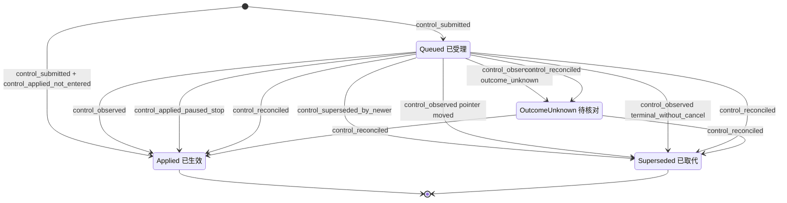

### 7.6 实现对照

状态机目标文件：`src/core/work-graph/state/control-intent-machine.ts`，导出 `transitionControlIntent`、`controlSubmitProblem`（由 `freshSubmitControlProblem` 迁入）、`observationStatusFor`（由 `control-service.ts:217-221` 迁入）、`pointerAfterSubmit`（§6 RUN-12..15 使用）。

| 行号 | 状态机函数 | 调用服务（file） | 已有测试（file） | 计划新增测试（描述） |
| --- | --- | --- | --- | --- |
| CTL-01 | `transitionControlIntent(Absent, control_submitted)`、`controlSubmitProblem` | `control-service.ts` `submitControl` | `tests/work-graph/R4-control-intent.test.ts:404`、`:431`、`:492`；`tests/runtime/R4-control-runtime.test.ts:140`、`:349` | 纯函数表：指针 4 种 × kind 4 种 × Run 节点；Goal 暂停时 resume → busy；continuation 已被消费 → busy；paused-interrupted 的 `Ended` Run 上任意 kind → busy，reason 指向 Task 级继续（7.4，C4） |
| CTL-02 | 同上，加 `control_applied_not_entered` | `submitControl`（同提交执行 §6 RUN-09..11）；`controlIntentSubmittedEventFromEvent` | 需要改断言：`R4-control-intent.test.ts:68`、`:110`、`:159`、`:364`；`tests/composition/R4-control-platform.test.ts:73`（见 §6.6）。仍成立：`:146`、`:229`、`:244` | applied@2 能编码、解码、回放（包括 lookupCommit 命中和确认丢失后的恢复）；平台观察的 codec；与 begin 并发时 CAS |
| CTL-03 | `transitionControlIntent(Queued, control_observed)`、`observationStatusFor` | `recordControlObservation`；`execution-observation.ts` `recordControlAck` | `tests/runtime/R4-control-runtime.test.ts:140`、`:234`、`:423`；`tests/composition/R4-control-runtime-platform.test.ts:121` | 被消费的 pause 遇到未知结果 → `OutcomeUnknown`（今天 codec 拒绝） |
| CTL-04 | `control_superseded_by_newer` | `submitControl`；§6 RUN-09、RUN-23 | `R4-control-intent.test.ts:110`（`:127-129` 需改） | pause→cancel、resume→pause/cancel、YieldedWait 上 pause→resume 时同提交取代；未进入 cancel 时 queued steer 被取代；观察先提交与提交先提交两种竞争顺序 |
| CTL-05 | `control_observed`（指针已移动） | `recordControlObservation` | — | 旧数据中 queued 但指针已移走的 intent → superseded，并保留真实观察 |
| CTL-06 | `control_observed(terminal_without_cancel)` | `execution-observation.ts:609-624`、`:693-703`；codec | — | Run 自然完成时，仍 queued 的指针 pause、未被接受的 steer、被消费的 pause 都 → superseded；yielded 终态时保持 queued |
| CTL-07、CTL-08 | `transitionControlIntent(*, control_reconciled)` | 启动核对（`agent-runtime/run-reconcile.ts`，§6.6）：与 `recordRunResult`/`reconcileRun` 同提交；(e) 单独提交；(f) 与 RUN-24 由 `work-graph/tasks/run-reconcile-service.ts` 的 `reconcileRun` 同提交 | — | 启动核对 × Run 节点 × 有/无对应 Kernel 事件；遗留 queued cancel 落在 `Claimed` 上 → Run 变为 cancelled；`EndedUnknown` 上的 pause/steer → OutcomeUnknown；已 `Ended` 的遗留 queued intent → superseded；另一个 Host 持有实例租约时不核对，intent 全部保持原状（L-10，§12 A8-L2）。CTL-08(f)（`state/control-intent-machine.ts`，与 RUN-24 同提交）：RUN-24 + queued pause → `Applied`（platform_reconcile，kind paused，runOutcome crashed），Kernel 为 paused 与否结果相同，且从不产生 Kernel 来源的 paused 观察；已 applied 的 pause 不写；RUN-24 上被 Kernel 接受的 steer（inputId 匹配）→ `Applied`/steered，未接受的 → `Superseded`；RUN-23 重启变体上被 Kernel 接受的 queued steer → `Applied`/steered，未接受的 → `Superseded`（CTL-04(b)，`supersededBy` 为 cancel）；RUN-19 上的 queued resume → `Superseded`（terminal_without_cancel）；对 RUN-24 的 queued pause 走 (b) 或 (c) → 内部断言 invalid（7.4）。纯函数表放在 `tests/state/control-intent-machine.test.ts`；同提交与回放放在 `tests/work-graph/run-reconcile-service.test.ts`（Run、Attempt、Outbox、Lease、Session 与 queued pause 一次提交；同实例回放不写）。场景：`tests/scenarios/A8-host-restart.test.ts` 的 A8-3l（pause 已 applied，核对后 revision 不变）、A8-3m（Kernel 未到安全点，pause 经 (f) 记为 Applied）、A8-3n（RUN-19 上的 queued resume 经 (c) 记为 Superseded） |
| CTL-09 | duplicate 判定 | `recordControlObservation` | — | 同内容、新身份 → `replayed=true`，不写；内容不同 → revision_conflict |
| CTL-10 | `control_applied_paused_stop` | `reconcileRun(paused_stop)`（§6 RUN-23） | — | 暂停后 cancel：进程内 cleanProof 成立 → Applied；不成立 → 保持 queued；重启后同样 → Applied。LA-7：重启时 Kernel 未暂停、Turn 干净、指针为 queued cancel → Applied，`pausedBy=null`；进程内 Kernel 未暂停 → 不走 CTL-10；有 `running`/`outcome_unknown` 工具 → 不走 CTL-10（RUN-20(i)，CTL-08(d)） |

### 7.7 Runtime 能力上报（D-15）

能力按工作区在 `RuntimeCapabilities` 中以 `{supported, reason}` 上报（`src/core/agent-runtime/contracts.ts:3-10`）。

- 组合根 `src/composition/create-platform.ts:553-569` 覆盖 Runtime 的默认实现；默认实现的 `capabilities` 返回 unsupported（`src/core/agent-runtime/runtime.ts:42-44`）。
- 服务端没有任何行为受这些标志门控（state-writes-other §8）。
- 界面 `src/ui/views.ts:724-734` 展示这些标志，但只在 unsupported 时显示 reason（`:733-734`）。（2026-10-07 简化同步，决定 34：这个旧的能力展示函数 `renderRuntimeCapabilities` 从没被调用，已随简化 G4 删除，现在界面不显示能力。对 supported 项也显示 reason 的能力展示随新界面（E3）交付。）

| 能力 | 今天上报（`create-platform.ts:561-567`） | 今天的实际能力 | 目标上报 | 目标 reason 必须写明的边界 |
| --- | --- | --- | --- | --- |
| `createSession` | supported | 与上报一致（`session-operations.ts:549-690`） | supported（不变） | 持久创建与 Kernel 映射 |
| `readHistory` | supported | 与上报一致 | supported（不变） | 原始 Kernel 历史只读 |
| `continueHistory` | unsupported（`pending`） | 已有，且只在进程内：同一 Session 的新 Run 读 `session_history`（`execution-driver.ts:456-458`）；yield 后的接续领取（`claim-service.ts:590-638`）。Kernel 会话的最后一个 Turn 未结束（paused，或被平台合成结束）时，同一 Kernel 会话拒绝任何新 Turn（`vendor/coding-agent/dist/app/composition/composition-root.js:161-166`、`:172-177`；`tests/kernel/R4a-frozen-public.test.ts:284-315`） | supported | 接续＝新 Run，必要时在新 Session 接原会话已完成的历史；不是原 Turn 的恢复（lead 决定 LA-1（2026-10-03））。(1) 上一个 Turn 有 Kernel 终态时：同 Session 新 Run 接续，以及 yielded 后继 Run。(2) 上一个 Turn 未结束时（类别 `interrupted`，含 paused-interrupted；RUN-23 结束的；RUN-22 认定且 Kernel Turn 未结束的）：新 Run 在新 Session 中运行，模型历史接原会话最后完成的历史边界（`historySource`/`sessionBasis`；两个 Session 须在同一 Kernel 适配器上，否则只靠接续说明），原 Session 记为 `unavailable/kernel_turn_open`。(3) 重新入队产生的 Run 以接续说明开始，标注“接续”，不是原执行恢复（C3）。(4) 重启后由 §6 RD-3 重建 continuation（lead 决定 L-5：只在该 Turn 恰有一个等待中的发信时重建），重建不出或有多个等待发信时记为待核对（§6 RUN-20(iii)） |
| `recoverRun` | unsupported | 不存在：没有启动核对，终态写入受内存证明门约束（`execution-observation.ts:671-673`） | supported，并在 reason 中限定（D-15） | “只做启动核对（D-5/D-6）：已结束的补账；未进入的撤销授权，由同一 claim 重驱；未知的保留（人工认定也须持实例租约，L-1）；干净中断的记为 crashed（RUN-19，类别 `interrupted`，可自动重新入队）；指针为 queued cancel 且 Turn 干净的按取消结束（RUN-23，LA-7）；暂停中（或已请求暂停）的结束为 paused-interrupted（RUN-24），不算失败，释放 Session 与 Lease，等人显式‘继续’，Goal 级暂停由人恢复 Goal 后接续（C4）；接续＝新 Run 加接续说明，在新 Session 中接原会话已完成的历史（LA-1）；不做原 Turn 的 fresh resume（D-17）。核对完成后，持实例租约的 Host 为 desiredState=active、且有待自动处理工作的 Goal 启动既有协作驱动（待自动处理工作：必需 active Task 的 verdict 为 requeue、reverify 或 claim_requeued，或有已领取、已授权或已撤销授权（`Revoked`）、指针不是 paused 的未进入 Run，§12 W-01..W-03、W-05）；受 Host 设置 `automation.resumeOnStartup` 控制，默认开启；关闭时重启后不启动驱动，自动化只在 `workflow/advance`、`workflow/driver-start` 或人工操作时继续；一切经 Workflow 与 owner 守卫，paused-interrupted 仍只允许人工；没有定时调度（lead 决定 LA-6（2026-10-03））。另一个 Host 持有实例租约时不核对、不启动执行驱动，普通读取与 owner 写入照常（L-10）” |
| `safePointPause` | unsupported | 进程内已进入的 Work Run 已有：`before_model` 与工具组屏障（`execution-driver.ts:589-590`、`:674-677`），ack 需要 cleanProof（`execution-observation.ts:565-569`）。未进入的 Run 今天只建围栏、不落地 | supported | 已进入的 Work Run 经活句柄在下一个安全点（模型调用前或工具组之间）暂停；未进入的 Run 由平台直接暂停（D-7）；resume 只在本 Host 进程持有活句柄时沿原 Turn 继续（§6 RUN-14 的 driver 守卫）；Host 重启后，暂停中的 Run 结束为 paused-interrupted（RUN-24，不算失败，C4），只能由人显式“继续”（新 Run 加接续说明，在新 Session 中接原会话已完成的历史，LA-1），从不自动继续；暂停来自 Goal 扇出时，人恢复 Goal 就是这一步，之后由 §2 GOAL-29 接续（C4）；Query 不支持（D-11） |
| `cancel` | unsupported | 进程内已进入的 Work Run 已有（`execution-control.ts:189-197`、`:289-300`；`execution-observation.ts:693-703`）。未进入的 Run 今天不落地（§7 #15）；已在安全点暂停的 Run 今天无法投递（7.3 情形 3） | supported | 活句柄取消；未进入时平台取消（D-7）；已在安全点暂停时，凭退出证明由平台停止（RD-7）；重启核对时，指针为 queued cancel 且 Turn 干净的 Run 不论 Kernel 是否 paused 都由平台停止（RUN-23，LA-7）；证明未完成前保持“停止请求中”；YieldedWait 上的取消只作为接续围栏；Query 不能取消（本批没有 QueryJob close，7.3 情形 1，A.2 5.2 同步）；paused-interrupted 的 Run 已经结束，不能再取消，放弃这项工作改为修改 Task disposition（C7） |
| `nativeCompact` | unsupported | 与上报一致，没有代码路径 | unsupported（不变） | 未实现 |
| `scopedWorkspaceWrites` | unsupported | 不确定：Host 侧只检查 manifest 的 writeScope 是子集（`create-platform.ts:176-179`），Kernel 是否强制子路径未核实 | unsupported（不变） | 未核实 Kernel 强制 |

需要同步改造：

1. 按上表修改 `create-platform.ts:561-567`。不要再用一个共用的 `pending` 常量，每项单独写 reason。
2. `src/ui/views.ts:733-734` 对 supported 的项也要显示 reason。否则 `recoverRun` 的“只做核对”限制会被隐藏为“可用”（MVP-BEHAVIOR §2 `:37`：受理、作用范围与实际效果要分开显示）。（2026-10-07：这个旧渲染函数已删除，见上；本项随新界面（E3）交付。）
3. `tests/composition/R3c-R4b-platform.test.ts:162-165` 断言 `continueHistory: { supported: false }`，需要一起修改；同时断言 `continueHistory`、`recoverRun`、`safePointPause`、`cancel` 为 supported，且 reason 写明上表的边界（C4、LA-1、LA-6、LA-7）。
4. 能力只是工作区级声明，单个 Run 的实际结果仍以 ControlIntent 的状态与观察为准（MVP-BEHAVIOR B08：逐个 Run 显示 unsupported 或 unknown）。
5. **A.2 5.2 同步（D-15 如实，按子步追加）。** 上表“目标 reason 必须写明的边界”是 A.2 结束时的 reason。每一步只上报当时已成立的边界，后面的子步建成哪条边界，就在同一提交追加哪条，并改 `tests/app/A2-runtime-capabilities.test.ts`（其中“尚未建成”的短语表逐步移入肯定断言）。5.2 上报：`continueHistory`：接续＝新 Run，不是原 Turn 的恢复；上一 Turn 有 Kernel 终态时，同 Session 新 Run 接续，含 yielded 后继 Run；上一 Turn 没有 Kernel 终态时，Kernel 拒绝在该 Session 开新 Turn，不提供接续。`safePointPause`：活句柄在下一个安全点暂停，resume 沿原 Turn 重入；未进入的 Run 由平台直接暂停与恢复（D-7）；重启后暂停中的 Run 不核对（见 `recoverRun`）；Query 不支持（D-11）。`cancel`：活句柄取消，停止被证明前保持“停止请求中”；未进入时平台取消（D-7）；已在安全点暂停的 Run 上的 cancel 无法投递，保持“停止请求中”（7.3 情形 3）；YieldedWait 上的取消只作为接续围栏；Query 不能取消（7.3 情形 1）。`recoverRun` 的 reason 写“没有启动核对”。之后：5.4 向 `continueHistory` 追加 (3) 接续说明（C3）。5.6 把 `continueHistory` 的“不提供接续”换成 (2)（新 Session、`kernel_turn_open`；列举时含 RUN-19/24、RUN-23、RUN-22 认定且 Turn 未结束的 Run），并追加 (4)（重建不出时 outcome 记为未知、原因 `continuation_unrebuildable`，保留 Session 与 Lease 直到人工认定，§6 RD-3、RUN-20(iii)）；把 `safePointPause` 的“不核对”换成 RUN-14 守卫、paused-interrupted（C4、LA-1）与 GOAL-29；把 `cancel` 的“无法投递”换成 RD-7，并追加 RUN-23（LA-7）与 C7；同时改写 `recoverRun` 的 reason（核对已存在）。5.7 再按上表把 `recoverRun` 改为 supported。A.2 5.7 同步：`recoverRun` 上报 supported，reason 写明上表的边界中 5.7 时已成立的部分：只做启动核对、不做原 Turn 的 fresh resume（D-17）；持实例租约、在任何执行驱动之前；已结束的补账；未进入的保留 claim（已开始的进入被撤销）并由同一 claim 重驱；干净中断的记为 crashed（类别 `interrupted`，由人重新入队）；queued cancel 且 Turn 干净的按取消结束（RUN-23，LA-7）；暂停中（或已请求暂停）的结束为 paused-interrupted，不算失败，释放 Session 与 Lease，只由人继续或由人恢复 Goal 后接续（C4）；证明不了的记为未知、保留 Session 与 Lease 直到人工认定（认定也须持实例租约，L-1），探针证明不了的保持原样等下次启动（W-07）；接续＝新 Run 加接续说明，在新 Session 中接原会话已完成的历史（LA-1）；核对后为有未进入 Run（指针不是 paused/cancelled）的 active Goal 启动既有协作驱动，受 `automation.resumeOnStartup` 控制（默认开启），一切经 Workflow 与 owner 守卫，paused-interrupted 仍只允许人工，没有定时调度（LA-6）；该设置关闭时核对照常、核对后不启动驱动，自动化只在 `workflow/advance`、`workflow/driver-start` 或人工操作时继续（固定文字，与本 Host 的设置无关）；没有实例租约的 Host 不核对、不启动执行驱动，普通读取与 owner 写入照常（L-10）。reason 按每次读取时 Host 已安装的 `automation.resumeOnStartup` 生成：本 Host 关闭该设置时末尾另加一句“本 Host 已关闭 `automation.resumeOnStartup`”，有无实例租约都成立。上表中尚未成立的两处留给后续子步在同一提交追加：“可自动重新入队”（RUN-19 类别 `interrupted`）与启动重驱的条件 (a)（必需 active Task 的判定为 `requeue`、`claim_requeued`）随 5.8，`reverify` 随 5.9（见 §15.2 的 5.8、5.9 行）；在此之前 `tests/app/A2-runtime-capabilities.test.ts` 的 `RECOVER_RUN_NOT_YET_BUILT` 按子步列出这些短语（5.8：`automatic`、`automation verdict`、`claim_requeued`；5.9：`reverify`）并断言 reason 不含，建成的子步把它们移入肯定断言。


## 8. Session（lifecycle × health × occupancy → availability）

Session 没有单一状态枚举。它有三个独立持久维度，再从三者派生出只读的 `availability`（ORCHESTRATION §2 Session 行、§0.6“状态依据”）。本节只把现有协议转写成可执行表，不改名，也不新增持久字段（例外两处：Query 收束新增的 outcome/closeReason 取值见 SD-4；health 的结论码 `SessionRecord.healthConclusion` 见 SD-2）。今天多个服务分别写 Session 字段，写入点见 8.1 的写入点表。目标是把占用、释放、generation 和持有判定收拢到 `src/core/work-graph/state/session-availability.ts`（D-10），由 claim、执行入口、Query 执行、生命周期和 reconcile 共用。

Query 只在崩溃恢复和 Session 释放范围内进入本规格（D-11），没有单独一节。因此本节另含一个 **QueryRun 收束子机** `transitionQueryRunRecovery`：状态见 8.1 末，事件见 8.2，迁移见 8.3 的 QRR 表，禁止项见 8.4，状态图见 8.5，实现对照见 8.6。

本节依赖的决定（均已定）：D-4（`outcome_unknown` 保留占用，U-4）、D-5/D-6（重启证明，U-5、U-6）、D-7（未进入停止，U-7）、D-18（Host 实例租约，属 U-5）按原推荐（用户 2026-10-03 确认）；D-10、D-11（Query 恢复）、D-17（fresh resume 不做）不变。U-9 已定为 C4：暂停中被 Host 重启打断的 Run 结束为 paused-interrupted，不算失败（§6 RUN-24）。冻结 Kernel 拒绝在留有未结束 Turn 的 Kernel 会话中开新 Turn，所以执行在 Kernel Turn 没有终态时结束（平台合成结束或人工认定）并释放的 Session 写为 `unavailable`、结论码 `kernel_turn_open`，接续改在一个新 Session 中进行，新 Session 带入原 Session 已完成的历史（lead 决定 LA-1（2026-10-03），见 SD-2 和 8.3 表外说明）。这是对用户原话“在原 Session 续跑”的如实偏差，原因见 §0。另依赖 §6 的 RD-1（D-7 也适用于 `Revoked`）和 RD-7（安全点暂停中的已进入 Run 可由平台停止），两者已由 lead 采纳（L-8）；以及 §6 的 RD-3（重启时 Kernel 终态为 yielded：由持久事实重建 continuation 后按原结果入账；只在本 Turn 恰好一条等待发信时重建，否则按 RUN-20(iii) 记为未知，lead 决定 L-5）。lead 决定 L-1（人工认定要求实例租约）和 L-10（租约被另一个存活的 Host 持有时不核对、不启动执行驱动）直接约束本节。

本节在 brief 之外补充的决定（SD-1、SD-2 已由 lead 采纳（L-8）；SD-3..SD-5 按 lead 决定 L-16 采纳，其中 SD-3 从 `Entering` 结束时的记录形状已由 lead 决定 L-2 定稿；SD-2 的 `kernel_turn_open` 来自 lead 决定 LA-1（2026-10-03））：

- **SD-1 空迁移返回 `ok:true`。** 三种情况今天都不拒绝调用方：释放者不是当前持有者、占用已为空、health 同值观察。持有者的其他记录照常提交，只是不写 Session。为保持这一行为，`transitionSession` 对这三种情况返回 `{ok:true, next:state, effects:[]}`（SES-17..19）。brief §1 规定 `ok:false` 必须带 CoreError，会让整个提交失败，因此这里偏离 brief 的形状。**已由 lead 采纳（L-8）**：空迁移按幂等空操作返回 `ok:true`、`effects:[]`，是允许的形状（§1.1）。
- **SD-2 只有确定性的数据状态才写 `unavailable`。** 探针结论分六类（8.2）：`missing`、`damaged` 写 unavailable；`host_config`、`transient`、`cancelled` 不观察，由 Host 报告。这是对 D-10 “映射不可读或缺失 → unavailable”的收窄。依据是 ORCHESTRATION §2 Session 行“进程不存在不等于不可恢复”（`docs/refactor/ORCHESTRATION-STATE-MACHINES.md:271`）。**已由 lead 采纳（L-8）。**
  - **另一个确定性结论 `kernel_turn_open`，不是探针失败（lead 决定 LA-1（2026-10-03））。** 它表示：这个 Session 的 Kernel 会话里最后一个 Turn 没有 Kernel 终态（执行由平台合成结束或经人工认定结束，Kernel 中没有终态），冻结 Kernel 不会再在该会话开新 Turn（`composition-root.js:161-166`、`:172-177`）。它不由探针得出，而由释放占用的同一提交写入：SES-06（RUN-19、RUN-23、RUN-24）、SES-07（RUN-22，Turn 未结束或 Kernel 不可读）、SES-09（QRR-04，Kernel 状态不是终态）、SES-10（QRR-06，同 SES-07）。判定只看 Kernel 事实，不看 Run 的 origin 或错误文本。
  - 三个结论码 `missing`、`damaged`、`kernel_turn_open` 都持久在新增的可选字段 `SessionRecord.healthConclusion`（8.1），供 SES-13 守卫和 Workflow 选 Session 时读取（8.3 表外说明）。`health='available'` 时该字段为 null；旧记录缺省按 null 读。
- **SD-3 Kernel 数据确定性不可读时，已 begin 的执行记为未知。** 条件：探针结论为 `missing` 或 `damaged`，且 Run 的 auth 为 `entering`/`entered`，或 QueryRun 的 phase 为 `entering`/`entered`。
  - Run 侧由 §6 RUN-20 的情形 (ii) 承担：from `Entering`/`Running`；event `reconcile_unknown`（`result={kind:'unknown', reason:'kernel_unreadable:<结论码>', unresolvedToolCallIds:[]}`，`basis=host_instance_takeover`）；guard 为 `hostLease=owned` 且探针结论为 `missing`/`damaged`；to `EndedUnknown`（auth unknown）；effects 为 `attempt:attempt_ended(outcome_unknown)`（从 `Entering` 来时 Attempt 由 claimed 直接结束，不补记进入事实，因为没有 Kernel 历史）、Outbox 保持原值、`record_reconciliation(quarantined/unresolved)`、`kernelSource` 与 `history` 为 null、不释放、`lastEventSeq` 不变。从 `Entering` 来时按 lead 决定 L-2：Attempt 走 §5 ATT-36（claimed → ended(outcome_unknown)，`startedAt=null`），Outbox 走 ATT-37（Run 为 ended+outcome_unknown 期间保持 `pending`）；离开未知时 ATT-29 可用 entering 授权的 consumerId/entryGeneration 从 `pending` 直接 settle。这是 §11 I-6 和 §5.1 配对表中写明的例外。
  - 没有这条出口，已 begin 的 Run 会永远停在 `Entering`/`Running`，Session 永久占用，SES-07 不可达。§6 6.3 表外说明已收窄为“探针结论为 `host_config`/`transient`/`cancelled` 时不迁移”。
  - QueryRun 走 QRR-05，本节自有。
  - 出口：之后某次启动 Kernel 可读并出现终态时，经 `late_evidence`（RUN-21，SES-06；从 `Entering` 来的 Run 此时按 Kernel 证据补记进入事实和 `startedAt`，L-2）或 QRR-03 离开；否则在持实例租约的 Host 上经人工认定（SES-07、SES-10，L-1）。
- **SD-4 Query 的 D-5/D-6/D-4 类比（D-11 细化）。**
  - (a) `entering` 且 Kernel 中没有固定 Turn：收束为 closed，不重新进入。Query 的 entry generation 固定为 1（`src/contracts/query-job.ts:383`），begin 只接受 `prepared`（`query-execution.ts:1000-1005`）。
  - (b) 有 Turn、没有可入账的终态、没有在途工具：收束为 closed，outcome 为 `failed`。
  - (c) 有在途工具：phase 记为 `unknown`，占用保留。
  - (d) `unknown` 的人工出口沿用 `resolveUnknownRun`，扩展为接受 QueryRunRef；与 Run 一样只在持实例租约的 Host 上受理（L-1）。
  - (e) Kernel 状态无法映射为 Query 终态时（`mapOutcome` 返回 null：`created`、`running`、`paused`、`yielded`，见 `query-observation.ts:123-131`），按“没有可入账的终态”处理：全部工具有结果走 (b)，否则走 (c)。
  - 取值：未进入使用新增值 `not_entered`（`QueryRunV1.outcome`，`query-job.ts:72`；`QueryJobV1.closeReason.code`，`:294`）；(b)(d) 使用已有值 `failed`。
- **SD-5 无 Kernel 终态来源的释放（覆盖 `docs/refactor/modules/core/work-graph.md:590` 末句）。** 该句规定“实际进入后的terminal缺来源不能据此释放未知占用”。本节以下几行在实际进入后、没有可入账的 Kernel 终态来源时释放占用：
  - SES-06 的 `reconcile_interrupted_clean`（RUN-19，以及指针为 paused 时的 RUN-24，C4）；依据是 D-6（实例租约接管，加上没有在途工具）。
  - SES-06 的 `stop_paused`（RUN-23）；依据是 §6 RD-7（活句柄退出证明或实例租约接管，Kernel Turn 为 paused，没有在途工具）。按 lead 决定 LA-7（2026-10-03），RUN-23 推广为“排队的 cancel + 干净的 Kernel Turn”：重启时 Kernel 未暂停的干净 Turn 也走这一行（进程内变体仍要求 Kernel 为 paused，§6 RUN-23）。
  - SES-09 的 QRR-04；依据是 SD-4(b)。
  - SES-07、SES-10；依据是 D-4(b) 人工认定（只在持实例租约的 Host 上，L-1）。

  这些决定已采纳（L-16；U-4、U-6 按原推荐，2026-10-03），`work-graph.md:590` 末句要同步改为“……除非有 D-6 的接管证明且没有在途工具，或有 D-4(b) 的人工认定”，列入待同步文档。D-7 和 QRR-01/02 属于未进入，不受该句约束。

### 8.1 持久位置与状态枚举

| 维度 | 记录与字段（file:line） | 代码取值 | 与设计名的对应 |
| --- | --- | --- | --- |
| lifecycle | `SessionRecord.lifecycle`（`src/contracts/core/session.ts:10`），`archivedAt`（`:14`） | `'active' \| 'archived'` | 同名（S6/S7） |
| health | `SessionRecord.health`（`session.ts:10`） | `'available' \| 'recoverable' \| 'unavailable'` | 同名。今天只在创建时写 `available`（`session-directory.ts:915`） |
| health 结论码 | `SessionRecord.healthConclusion`（新增，可选；`session.ts:7-15` 的记录类型） | `null`、`'missing' \| 'damaged' \| 'kernel_turn_open'` | 不是新维度，只说明 `health='unavailable'` 的原因（SD-2）。SES-12、SES-06/07/09/10 写入，SES-13 清除。codec `checkSessionBody` 加枚举校验；缺省按 null。`kernel_turn_open` ⇒ occupancy 为 null（只在释放时写，且之后不能领取） |
| occupancy | `SessionRecord.occupancy`（`session.ts:4-6`、`:12`） | `null`、`{kind:'execution', executionRef: RunRef\|QueryRunRef, generation}`、`{kind:'maintenance', operationRef, generation}` | 同名。`maintenance` 没有写入者 |
| 随占用维护 | `revision`、`lastExecutionRef`、`historyCursor`（`session.ts:8`、`:12-14`） | — | 占用和释放时一起写 |
| 派生（不持久） | `SessionCard.availability`（`src/core/work-graph/model/session-contracts.ts:46`），归约函数 `availabilityOf`（`session-directory.ts:1027-1032`） | `'idle' \| 'busy' \| 'recoverable' \| 'unavailable'` | 设计 §2 的 availability。不可写 |

状态机输入与守卫上下文：

```ts
// src/core/work-graph/state/session-availability.ts（目标）只 import src/contracts
type SessionMachineState = 'absent' | {
  lifecycle: 'active' | 'archived';
  health: 'available' | 'recoverable' | 'unavailable';
  healthConclusion: null | 'missing' | 'damaged' | 'kernel_turn_open'; // SD-2；health=available 时为 null
  occupancy: null | { kind: 'execution' | 'maintenance'; holder: RunRef | QueryRunRef | OperationRef; generation: number };
  revision: number;
};
type SessionProbeVerdict = 'ready' | 'missing' | 'damaged' | 'host_config' | 'transient' | 'cancelled'; // 8.2
type HolderPhase =                                   // 持有者机器节点的归并
  | 'run_starting' | 'run_running' | 'run_ended' | 'run_ended_unknown'   // §6：Ended/YieldedWait → run_ended
  | 'query_claimed' | 'query_prepared' | 'query_entering' | 'query_entered' | 'query_unknown' | 'query_settled';
type SessionGuardContext = {
  caller: 'service' | 'reconcile';                  // reconcile=Host 启动核对；health_observed 与重启释放只接受它
  hostLease: 'owned' | 'held_by_other' | null;      // D-18；caller=reconcile 与人工认定（SES-07、SES-10，L-1）时必填；锁文件不可读按 held_by_other（L-10）
  pin: number | null;                               // 调用方的 Session 版本钉（占用、生命周期、链接事件）
  holder: null | {                                  // 只用于 occupancy_*
    ref: RunRef | QueryRunRef;
    claimGeneration: number;                        // Run：claim.generation；QueryRun：executionState.sessionGeneration
    before: HolderPhase;
    after: HolderPhase;                             // 持有者机器在同一提交中的 to
    kernelTurnSeen: boolean;                        // Kernel 中已有该执行的 Turn
    inputsConfirmed: boolean | 'kernel_unreadable'; // §10.3：Turn 中全部 run.input_accepted 已确认
    historyBoundaryCursor: string | null;           // 完整已结束 Turn 的边界，没有则为 null
    kernelTurnOpen: boolean;                        // 该执行的 Kernel Turn 存在且没有 Kernel 终态；SES-07/SES-10 在 Kernel 不可读时为 true（SD-2）
  };
  probe: SessionProbeVerdict | null;                // 只用于 health_observed
  kernelHeader: null | { activeRunId: string | null }; // 只用于 health_observed：探针为 ready 时读到的 Kernel 会话头，其他结论为 null
  openResponsibleLink: boolean | null;              // 只用于 session_archived
  creation: null | { operationAcceptedAt1: boolean; plannedAbsent: boolean; mappingUnique: boolean; linkTargetsValid: boolean };
  link: null | { exists: boolean; open: boolean; targetValid: boolean; pin: number | null }; // 只用于 work_linked
};
```

Codec `checkSessionBody`（`session-record-codecs.ts:446-482`）只逐字段校验枚举，不校验跨字段约束，例如 archived ⇒ occupancy 为 null。跨字段约束由本节守卫、§11 I-4 和 §14 的写入限制共同保证。

**派生 availability 全组合表。** 归约顺序（`session-directory.ts:1028-1031`）：archived 或 health=unavailable → `unavailable`；否则有占用 → `busy`；否则 health=recoverable → `recoverable`；否则 `idle`。“今天”指当前代码中的生产写入路径，“目标”指本规格实施后。

| # | lifecycle | health | occupancy | availability | 今天可达 | 目标可达 | 说明 |
| --- | --- | --- | --- | --- | --- | --- | --- |
| 1 | active | available | null | idle | 是（SES-01、各释放行） | 是 | 唯一可领取组合 |
| 2 | active | available | execution | busy | 是（SES-02/03） | 是 | Run 为 `outcome_unknown` 时，界面结合 Run 显示“待核对”（D-4）；availability 本身仍为 busy |
| 3 | active | available | maintenance | busy | 否 | 否 | 无写入者（S4/S5 未实现） |
| 4 | active | recoverable | null | recoverable | 否 | 否 | recoverable 无写入者（D-17） |
| 5 | active | recoverable | execution | busy | 否 | 否 | 同上 |
| 6 | active | recoverable | maintenance | busy | 否 | 否 | 同上 |
| 7 | active | unavailable | null | unavailable | 否 | 是 | 两条路径。(1) 从 #2 直接到达：SES-06（RUN-19、23、24）、SES-07、SES-09（QRR-04）、SES-10 在 Kernel Turn 没有 Kernel 终态时，同一提交释放并写结论码 `kernel_turn_open`（SD-2，lead 决定 LA-1（2026-10-03））。(2) 先到 #8，再经不需要 Kernel 的释放（SES-05、SES-07、SES-09 中的 QRR-01、SES-10）。本组合属 8.2 的 (b)，每次启动重验；`kernel_turn_open` 只在 Kernel 会话头 `activeRunId=null` 时经 SES-13 回到 #1，冻结 Kernel 下不会发生（GAP-50）。可用的空闲 Session 不被探测（8.2） |
| 8 | active | unavailable | execution | unavailable | 否 | 是（SES-12） | 持有者未决时 health 变化不释放占用 |
| 9 | active | unavailable | maintenance | unavailable | 否 | 否 | 无 maintenance 写入者 |
| 10 | archived | available | null | unavailable | 是（SES-11） | 是 | 正常归档 |
| 11 | archived | available | execution | unavailable | 否 | 否 | 被归档守卫（`occupancy===null`）和占用守卫（`lifecycle==='active'`）共同排除；codec 不拦截 |
| 12 | archived | available | maintenance | unavailable | 否 | 否 | 同上 |
| 13 | archived | recoverable | null | unavailable | 否 | 否 | recoverable 无写入者 |
| 14 | archived | recoverable | execution | unavailable | 否 | 否 | 同上 |
| 15 | archived | recoverable | maintenance | unavailable | 否 | 否 | 同上 |
| 16 | archived | unavailable | null | unavailable | 否 | 是 | 先到 #7，再 SES-11。归档不检查 health，这一组合合法 |
| 17 | archived | unavailable | execution | unavailable | 否 | 否 | 同 #11 |
| 18 | archived | unavailable | maintenance | unavailable | 否 | 否 | 同 #11 |

**generation 规则（D-10 收拢到 state/）**

- **占用。** `generation = session.revision + 1`，同一提交把 Session 的 `revision` 设为 generation（`claim-service.ts:545`、`:706`；`query-execution.ts:719`、`:794-799`）。revision 单调递增，而占用时 revision 被置为 generation，所以同一 Session 的 generation 严格递增、不会复用。revision 不可读时拒绝 `unavailable`，generation 不是安全整数时拒绝 `invalid`（`claim-service.ts:544`、`:546`；`query-execution.ts:718`、`:720`）。
- **持有判定 `ownsOccupancy(session, holderRef, generation)`。** 条件是 `kind==='execution'`、`executionRef` 相同、`generation` 等于持有者的 claim generation。它只看占用，不看 lifecycle 和 health。今天这个判定复制在两处：`execution-entry-service.ts:1604-1607` 和 `query-execution.ts:935-938`。比较对象是 claim generation，不是当前 revision：工作关联、归档和 health 写入只抬高 revision，不改变 generation。
- **释放。** 写 `revision+1`、`occupancy=null`、`lastExecutionRef=持有者`。`historyCursor` 只在有完整 Turn 边界时前移：Work Run 用 `completedHistoryBoundary.cursor`（`execution-entry-service.ts:1433`），Query 用 `observation.source.cursor`（`query-execution.ts:1410`）。没有终态边界的收束保持原 `historyCursor`，包括 D-7、D-6 的 crashed（RUN-19、RUN-24）、RD-7 的停止（RUN-23，含 lead 决定 LA-7（2026-10-03）推广的未暂停情形）、QRR-01/02/04 和人工认定。“保持”是不改写，不是写 null：今天唯一的释放写入点照抄 `boundary.cursor`（`execution-entry-service.ts:1433`），写 null 会让下一个 Run 退回 `current_turn`，所以释放构造函数要有显式的“不变”分支。持有者的 Kernel Turn 没有 Kernel 终态时（`holder.kernelTurnOpen`），同一次释放还写 `health='unavailable'`、`healthConclusion='kernel_turn_open'`（SD-2）。这与 `docs/refactor/modules/core/work-graph.md:590` 的“非终态/缺口为null”一致；该行末句“实际进入后的terminal缺来源不能据此释放未知占用”被 SD-5 覆盖。

**今天的占用写入点及目标**（编号沿用 state-writes-other §1.2）

| # | 写入点 | 动作 | 目标 |
| --- | --- | --- | --- |
| S-g | `tasks/claim-service.ts:541-546`、`:706-707`（`claimTask`） | 为 Work Run 占用 | 调 `transitionSession(occupancy_acquired)` |
| S-h | `tasks/execution-entry-service.ts:1396`、`:1431-1434`（`recordRunResult`） | 持有时释放 | 调 `transitionSession(occupancy_released)` |
| S-i | `queries/query-execution.ts:715-720`、`:794-799`（`claim`） | 为 QueryRun 占用 | 同 S-g |
| S-j | `queries/query-execution.ts:1408-1411`、`:1420`（`recordObservation` 终态） | 持有时释放 | 同 S-h |

新增的释放路径都经过同一函数，不再在服务里写 Session 字面量（§14）。新增路径包括：D-7 未进入取消、reconcile、`resolveUnknownRun`、QRR 收束。其他 Session 写入点：S-b（创建，`session-directory.ts:910-923`）、S-d（链接，`session-lifecycle.ts:430`）、S-e（归档，`:616-617`）、S-f（重新启用，`:620`）。health 今天没有转换写入点（缺口 SG-1）。

**创建操作的进度不属于本机。** `SessionOperationRecord.phase`（`model/session-contracts.ts:26`）记录创建操作的进度，代码只写 `accepted`（S-a，`session-directory.ts:745`）和 `completed`（S-c，`:927`）；`running/failed/unknown` 没有写入者（缺口 SG-12）。Kernel 会话在这两次提交之间创建（`session-operations.ts:657-679`）。响应丢失时按同一身份重试即可恢复（`:533-537`、`:666-670`）。这个窗口内不存在占用，因此不需要 reconcile。

**QueryRun 收束子机的持久位置（D-11）**

| 字段 | 位置（`src/contracts/query-job.ts`） | 代码取值 | 说明 |
| --- | --- | --- | --- |
| `executionState.phase` | `QueryExecutionStateV1.phase`（`:373`） | `claimed/prepared/entering/entered/unknown/settled` | 进程内依次写入：claimed（`query-execution.ts:777`）、prepared（`:911`）、entering（`:1037`）、entered（`:1325`）、settled（`:1394`）。`unknown` 只有 owner 分支（`:1343`），没有生产写入者 |
| `QueryRunV1.status` | `:69`（类型 `:39`） | `pending/running/answered/closed` | claim 和 prepare 不改，仍为 pending；begin 改为 running（`query-execution.ts:1058`） |
| `QueryRunV1.outcome` | `:72` | `answered/timeout/gap/failed/cancelled`、null；新增 `not_entered` | codec `materials/record-readers.ts:169-172` 需加值 |
| `QueryRunV1.endedAt` | `:71` | null 或时间 | 终态时写（`query-execution.ts:1404`） |
| `QueryJobV1.status` | `:290`（类型 `:187`） | `pending/running/answered/closed` | begin 改为 running（`query-execution.ts:1064`） |
| `QueryJobV1.closeReason` | `:293-296` | null 或 `{code: timeout/gap/failed/stale_source/cancelled, message}`；新增 code `not_entered` | codec `query-record-codecs.ts:293` 需加值 |

```ts
type QueryRecoveryState = {
  phase: QueryExecutionStateV1['phase'];
  runStatus: 'pending' | 'running' | 'answered' | 'closed';
  jobStatus: 'pending' | 'running' | 'answered' | 'closed';
  outcome: QueryRunV1['outcome'] | 'not_entered';
  ended: boolean;                                   // endedAt≠null
};
type QueryRecoveryGuardContext = {
  caller: 'service' | 'reconcile' | 'host_entry';  // host_entry=Host 的 resolveUnknownRun 入口
  hostLease: 'owned' | 'held_by_other' | null;      // R 来源与 QRR-06 必填（D-18、L-1）；锁文件不可读按 held_by_other（L-10）
  probe: SessionProbeVerdict | null;
  kernel: null | {                                  // Runtime 读 Kernel Store 后的分类（agent-runtime/run-reconcile.ts）
    turn: 'absent' | 'present';
    mappedOutcome: 'answered' | 'failed' | 'cancelled' | 'timeout' | null; // mapOutcome（query-observation.ts:123-131）
    boundaryComplete: boolean;
    unresolvedToolCallIds: readonly string[];
  };
  inputsConfirmed: boolean | 'kernel_unreadable';
  actor: 'human' | 'system';
  reason: string | null;
  sessionOwned: boolean;                            // sessionOwnedByQuery（query-execution.ts:935-938）
};
```

不变式：`runStatus∈{answered, closed}` ⇔ `phase==='settled'` ⇔ `ended` 且 `outcome≠null`。今天的终态写入同时写这几个字段（`query-execution.ts:1392-1405`）；咨询读取方同时看 status 和 phase（`business/workflow/consultation.ts:121-122`）。

### 8.2 事件

| 事件名 | 来源 | 载荷要点 | 对应原文编号 |
| --- | --- | --- | --- |
| `session_created` | P（Runtime 建好 Kernel 映射后提交） | `operationRef`（accepted@1）、`sessionRef`、`adapterId`、`kernelSessionId`、`initialLinks` | S2 |
| `occupancy_acquired` | P（与 Run `claim_committed` 或 Query 领取同一事务） | `holder: RunRef \| QueryRunRef`、调用方 Session 版本钉 | T2、S3 |
| `occupancy_released` | K、R、U（由持有者的终态或收束触发，同一事务） | `holder`、`generation`、`historyBoundaryCursor \| null`、持有者同提交后的节点、`kernelTurnOpen`（SD-2） | R5、T5、T10、S8、R2；`kernelTurnOpen` 新增（C4、lead 决定 LA-1（2026-10-03）） |
| `session_archived` | U | `reason`、Session 版本钉 | S6 |
| `session_reactivated` | U | `reason`、Session 版本钉 | S7 |
| `health_observed` | R（仅 reconcile） | `observed: 'available' \| 'unavailable'`、探针结论码、`hostInstanceId`；结论为 `ready` 时另带 Kernel 会话头 `activeRunId`（SES-13 守卫） | S8；`activeRunId` 新增（lead 决定 LA-1（2026-10-03）） |
| `work_linked` | U、P | `target`、`relation`、`active`（开启或关闭）、Session 版本钉与链接版本钉 | S1、S6（工作关联） |
| `query_terminal_observed` | K（进程内 Query 观察者） | Kernel 终态、完整结束边界、可选 Answer | R5（Query 对应） |
| `query_reconcile_terminal` | R | 同上，另带 `hostInstanceId` | S8、D-11 |
| `query_reconcile_not_entered` | R | `hostInstanceId`；phase 为 claimed/prepared，或 entering 且 Kernel 中没有固定 Turn | S8、D-5、D-11 |
| `query_reconcile_interrupted_clean` | R | Turn 存在、没有可入账终态、全部工具有结果；Kernel 状态 | S8、D-6、D-11 |
| `query_reconcile_unknown` | R | 未结算工具 id 列表，或探针结论码（SD-3） | S8、D-6、D-4、D-11 |
| `query_unknown_attested` | U（人类） | 人类 actor、理由、QueryRun 版本钉 | D-4(b) 类比 |

**谁触发占用事件。** `occupancy_*` 不是独立对外 API。持有者所属的机器在同一提交中给出效果意图，例如 `{kind:'release_session', sessionRef, generation, kernelTurnOpen}`（`kernelTurnOpen` 由持有者的迁移行决定，见下表）。服务把效果翻译成 Session 事件，再调用 `transitionSession`。

| 触发方事件 | Session 事件 |
| --- | --- |
| Run `claim_committed`（首次领取、yielded 接续、D-3 重新领取） | `occupancy_acquired(Run)`（SES-02） |
| Query 领取提交（`claimQuery`） | `occupancy_acquired(QueryRun)`（SES-03） |
| Run `terminal_observed`，outcome 已知，含 `yielded`（RUN-07） | `occupancy_released`（SES-04） |
| Run `terminal_observed`，存在未结算工具（RUN-08） | 无（占用保留，D-4） |
| Run `stop_not_entered`，kind=cancel（RUN-09，D-7） | `occupancy_released`（SES-05） |
| Run `reconcile_terminal`、`reconcile_interrupted_clean`、`late_evidence`、`stop_paused`（RUN-17、18、19、21、23、24） | `occupancy_released`（SES-06）；RUN-19、23、24 时 `kernelTurnOpen=true`（Session 同提交写 `unavailable/kernel_turn_open`），RUN-17、18、21 为 false |
| Run `unknown_attested`（RUN-22） | `occupancy_released`（SES-07）；Kernel 可读且 Turn 没有 Kernel 终态，或 Kernel 不可读时 `kernelTurnOpen=true` |
| Run `pause_not_entered`、`resume_not_entered`、`reconcile_not_entered`（RUN-10、11、16） | 无（占用保留：D-5 由同一 claim 重新授权） |
| Run `reconcile_unknown`（RUN-20，含 SD-3 的情形 (ii)） | 无（占用保留，D-4） |
| QueryRun `query_terminal_observed`、`query_reconcile_terminal`（QRR-03） | `occupancy_released`（SES-08） |
| QueryRun `query_reconcile_not_entered`、`query_reconcile_interrupted_clean`（QRR-01、02、04） | `occupancy_released`（SES-09）；QRR-04 且 Kernel 状态为 created/running/paused 时 `kernelTurnOpen=true`，QRR-01/02（没有 Turn）和 Kernel 状态 yielded 时为 false |
| QueryRun `query_unknown_attested`（QRR-06） | `occupancy_released`（SES-10）；`kernelTurnOpen` 同 SES-07 |
| QueryRun `query_reconcile_unknown`（QRR-05） | 无（占用保留） |

**reconcile 检查 health 的范围（D-10）。** 设计 S8 要求“只核对活跃/未完成引用”。每次 Host 启动并取得实例租约后，reconcile 先做 Session health 探针，再分类 Run 和 QueryRun（§12 的核对顺序，L-8）。租约被另一个存活的 Host 持有或锁文件不可读时，本 Host 不运行 reconcile，也不启动执行驱动；普通读取和经 HTTP 的 owner 写入照常，由 RecordStore CAS 保护（L-10）。reconcile 只对两类 Session 发出 `health_observed`：

- (a) 被未决执行引用为占用持有者的 Session。未决执行指 Run 为 `starting`、`running` 或 `ended`+`outcome_unknown`，或 QueryRun 未 settled。
- (b) `lifecycle=active` 且 `health≠available` 的 Session，目的是重验后恢复。包括结论码为 `kernel_turn_open` 的 Session：冻结 Kernel 下它不会恢复，代价是每次启动多一次探针读取；以后 Kernel 若能关闭悬空 Turn，SES-13 会自然放行（GAP-50）。

reconcile 不扫描全部 idle Session，所以经探针的 available → unavailable 只会发生在占用中的 Session 上。另一条 available → unavailable 是释放时的 `kernel_turn_open`（SD-2），不经探针。

**探针（SD-2）。** 探针由 Runtime 执行，复用 `readSessionHistory` 的映射解析（`session-operations.ts:739-803`），但必须跳过 `:760-762` 的 `health==='unavailable'` 短路，否则已经不可用的 Session 永远无法重验。今天这条路径的 CoreError 不区分确定性失败和瞬时失败：数据库文件缺失和 StoreError `not_found` 返回 `not_found`（`:791-792`、`:334`）；其他 StoreError（含 corrupt）、非 StoreError、适配器和映射不符都返回 `unavailable`（`:335`、`:337-338`、`:763-778`）。所以探针直接看失败来源（StoreError 的 code），返回自己的结论码：

| 结论码 | 来源（`session-operations.ts`） | `health_observed` | 执行的处置 |
| --- | --- | --- | --- |
| `ready` | 映射可读且 `kernelSessionId` 匹配；同时读 Kernel 会话头的 `activeRunId`（`composition-root.js:163-165` 判定用的同一字段） | `available`；Session 结论码为 `kernel_turn_open` 且 `activeRunId≠null` 时不观察（SES-13 守卫） | 按 Kernel 内容分类（§6、QRR 表） |
| `missing` | Kernel 数据库文件不存在（`:791-792`）；StoreError `not_found`（`:334`） | `unavailable` | SD-3 |
| `damaged` | StoreError `corrupt`、`version_unsupported`、`invalid_record`（`:335`）；Session 记录引用不符（`:763-765`） | `unavailable` | SD-3 |
| `host_config` | 调用工作区不是可信 Kernel 工作区（`:751`）；Session 不在调用范围（`:758`）；适配器未注册（`:769-771`）；legacy 定位不符（`:774-776`）；store 属于其他工作区（`:777-778`） | 不观察 | 不迁移；Host 报告配置问题。出口是人修正 Host 配置后重启 |
| `transient` | Session 目录读取失败（`:744`）；其他 StoreError，如 `busy`、`closed`、`internal`（`:335`）；非 StoreError，含 EACCES（`:337-338`） | 不观察 | 不迁移；下次启动再核对（SG-9） |
| `cancelled` | `:331`、`:333` | 不观察 | 不迁移 |

`host_config` 的几种情况都由 Host 的注册和调用范围决定，不是 Kernel 数据本身的状态，因此归为一类，不写 health，也不触发 SD-3。修正配置后重启，同一 reconcile 会得到 `ready` 或确定性结论。

### 8.3 迁移表

表中三元组按 `lifecycle / health / occupancy` 书写，`*` 表示不变。`exec(Run,g)` 表示由 Run 以 generation g 持有。

| # | from | event | guard（守卫） | to | effects（同事务副作用意图） | 幂等/重复事件 | 原文编号 | 现状 |
| --- | --- | --- | --- | --- | --- | --- | --- | --- |
| SES-01 | absent | `session_created` | 操作为 accepted@1；planned Session 不存在；Kernel 映射唯一；初始链接目标有效 | `active / available / null`，rev 1 | 操作改为 completed@2；每个初始链接写 `SessionWorkLink`@1（since 绑定提交游标）；事件 `SessionCreated` | 同身份重放原回执（`session-directory.ts:858-862`） | S2 | 已有 `session-directory.ts:866-984` |
| SES-02 | `active / available / null` | `occupancy_acquired(Run)` | 按序：lifecycle=active → health=available → 无占用 → revision 可读 → generation 为安全整数 → 版本钉等于当前 revision（与 `claim-service.ts:541-550` 同序） | `active / available / exec(Run,g)`，`revision=g` | `lastExecutionRef=runRef`；同提交写 Lease、Attempt(claimed)、Run(starting)、Outbox(pending)（§5、§6） | 先查回执重放（`claim-service.ts:501-503`）；并发同身份提交由存储回放（`:747`）；不同内容 → `idempotency_conflict` | T2、S3 | 已有 `claim-service.ts:541-550`、`:706-707` |
| SES-03 | `active / available / null` | `occupancy_acquired(QueryRun)` | 服务先核对 Job/Run/Session 三个版本钉（`query-execution.ts:700-707`），再要求 Job 和 Run 均为 `pending`（`:708-710`），然后调用状态机；Session 守卫顺序同 SES-02 | `active / available / exec(QueryRun,g)` | `lastExecutionRef=queryRunRef`；`executionState.phase=claimed`，记录 `sessionGeneration` | Query 操作回执重放（`query-execution.ts:468-506`） | S3、§5 末段 | 已有 `query-execution.ts:700-720`、`:794-799` |
| SES-04 | `active / * / exec(Run,g)` | `occupancy_released`（Run `terminal_observed`，RUN-07） | `ownsOccupancy(Run,g)`；`holder.after=run_ended`（outcome 已知）；`inputsConfirmed=true`（今天由 `execution-observation.ts:534-537` 保证） | `active / * / null` | rev+1；`lastExecutionRef=runRef`；`historyCursor` 取完整 Turn 边界；同提交写 Run ended、Attempt ended、Outbox settled、Lease 释放 | `recordRunResult` 同身份重放；之后到达的终态由 Run 机器按 duplicate/stale 处理，不再释放 | R5、T5 | 改造 `execution-entry-service.ts:1396`、`:1431-1434` |
| SES-05 | `active / * / exec(Run,g)` | `occupancy_released`（Run `stop_not_entered`，kind=cancel，RUN-09） | `ownsOccupancy`；`holder.after=run_ended`（cancelled）；auth ∈ {none, `authorized`, `revoked`}，从未 entering/entered（D-7、RD-1）；没有 Kernel Turn，无需确认输入 | `active / * / null` | rev+1；`lastExecutionRef=runRef`；`historyCursor` 不变 | 停止意图同身份重放 | R2；R1 原文为“排队项可直接暂停”，扩展到取消来自 D-7；T10 | 新增（缺口 SG-5；D-7） |
| SES-06 | `active / * / exec(Run,g)` | `occupancy_released`（Run `reconcile_terminal`、`reconcile_interrupted_clean`、`late_evidence`、`stop_paused`，RUN-17/18/19/21/23/24） | `ownsOccupancy`；R 来源时 `caller=reconcile` 且 `hostLease=owned`（D-18），K 来源的 `late_evidence` 与 `stop_paused` 由持句柄的 Runtime 提交（`exitProof=live_clean`）；`holder.after=run_ended`；`inputsConfirmed=true`（§10.3）；Kernel 终态为 yielded 时按 §6 RD-3：本 Turn 恰好一条等待发信且 continuation 重建成功，才经 RUN-17/18 到达本行（L-5）；零条或多条等待发信、或重建失败，经 RUN-20(iii) 记为未知、不发本事件；`holder.kernelTurnOpen` 由持有者行决定：RUN-19、RUN-23、RUN-24 为 true（Turn 没有 Kernel 终态），RUN-17/18/21 为 false | RUN-17/18/21：`active / * / null`；RUN-19、RUN-23、RUN-24：`active / unavailable / null`（结论码 `kernel_turn_open`） | rev+1；`lastExecutionRef=runRef`；有可入账的 Kernel 终态边界时前移 `historyCursor`（含重建成功的 yielded）；RUN-19、RUN-23、RUN-24 不前移（保持原值，不写 null）；`kernelTurnOpen=true` 时同提交写 `health='unavailable'`、`healthConclusion='kernel_turn_open'`（SD-2），此后该 Session 不能再被领取，接续在新 Session 中进行（8.3 表外说明） | 按 §6 reconcile 身份 hash(runRef, hostInstanceId) 重放；RUN-21 按原回执重放；RUN-23 按 §6 的身份 hash(runRef, cancel intentRef) 重放；`kernel_turn_open` 与释放在同一提交，重放时一并回放 | S8、R5、A8、C4 | 新增（缺口 SG-7：G2、G3）；RUN-24 与 `kernel_turn_open` 新增（C4、lead 决定 LA-1（2026-10-03）） |
| SES-07 | `active / * / exec(Run,g)` | `occupancy_released`（Run `unknown_attested`，RUN-22） | `ownsOccupancy`；`holder.before=run_ended_unknown`，`after=run_ended`；`hostLease=owned`，只经持实例租约的 Host 入口，未持有时 `busy`（lead 决定 L-1，与 §6 RUN-22 一致）；Kernel 可读时 `inputsConfirmed=true`，不可读时允许 `kernel_unreadable`；`holder.kernelTurnOpen` 取自认定时的 Kernel 读取：Kernel 可读且该 Run 的 Turn 没有 Kernel 终态（如 RUN-20(i) 的未结束 Turn）为 true，Turn 有 Kernel 终态（如 RUN-20(iii) 的 yielded）为 false；Kernel 不可读时为 true（无法证明 Turn 已结束，缺日志不是证明） | `kernelTurnOpen=false`：`active / * / null`；`kernelTurnOpen=true`：`active / unavailable / null`（结论码 `kernel_turn_open`） | rev+1；`lastExecutionRef=runRef`；`historyCursor` 不变；同提交 Run 改为 `crashed`（`resolution: human_attested`）；`kernelTurnOpen=true` 时同提交写 `health='unavailable'`、`healthConclusion='kernel_turn_open'`，Kernel 不可读时覆盖原结论码 `missing`/`damaged`（SD-2） | 同身份重放 | S8（无证据时由人决定） | 新增（D-4(b)；U-4 按原推荐，2026-10-03）；`kernel_turn_open` 新增（lead 决定 LA-1（2026-10-03）） |
| SES-08 | `active / * / exec(QueryRun,g)` | `occupancy_released`（QRR-03） | `ownsQuery`：`generation==executionState.sessionGeneration`；`holder.after=query_settled`；终态带完整结束边界（`query-execution.ts:1370-1372`）；`inputsConfirmed=true`（`query-observation.ts:388-393`）；R 来源时另需 reconcile 与实例租约 | `active / * / null` | rev+1；`lastExecutionRef=queryRunRef`；`historyCursor=observation.source.cursor`；同提交写 QRR-03 的记录 | 按 Kernel 位置身份重放（`query-execution.ts:1296`） | R5（Query 对应）、D-11 | 已有 `query-execution.ts:1408-1411`、`:1420` |
| SES-09 | `active / * / exec(QueryRun,g)` | `occupancy_released`（QRR-01、QRR-02、QRR-04） | `ownsQuery`；`caller=reconcile` 且 `hostLease=owned`；`holder.after=query_settled`（closed）；有 Kernel Turn 时（QRR-04）`inputsConfirmed=true`；`holder.kernelTurnOpen`：QRR-04 且 Kernel 状态为 created/running/paused 时为 true，QRR-01/02（没有 Turn）或 Kernel 状态为 yielded（Kernel 终态）时为 false | `kernelTurnOpen=false`：`active / * / null`；`kernelTurnOpen=true`：`active / unavailable / null`（结论码 `kernel_turn_open`） | rev+1；`lastExecutionRef=queryRunRef`；`historyCursor` 不变；`kernelTurnOpen=true` 时同提交写 `health='unavailable'`、`healthConclusion='kernel_turn_open'`（SD-2：Query 的 Turn 也在该 Session 的 Kernel 会话中执行，`agent-runtime/query-execution.ts:442`） | reconcile 身份 hash(queryRunRef, hostInstanceId) 重放 | S8、D-5、D-6、D-11 | 新增（缺口 SG-6）；QRR-04 的 `kernel_turn_open` 新增（与 lead 决定 LA-1（2026-10-03）同一 Kernel 约束） |
| SES-10 | `active / * / exec(QueryRun,g)` | `occupancy_released`（QRR-06） | `ownsQuery`；`holder.before=query_unknown`，`after=query_settled`；`hostLease=owned`，未持有时 `busy`（同 SES-07，L-1）；Kernel 可读时 `inputsConfirmed=true`，不可读时允许 `kernel_unreadable`；`holder.kernelTurnOpen` 同 SES-07（Turn 没有 Kernel 终态或 Kernel 不可读时为 true） | `kernelTurnOpen=false`：`active / * / null`；`kernelTurnOpen=true`：`active / unavailable / null`（结论码 `kernel_turn_open`） | rev+1；`lastExecutionRef=queryRunRef`；`historyCursor` 不变；`kernelTurnOpen=true` 时同 SES-07 写 `kernel_turn_open` | 同身份重放 | D-4(b) 类比、D-11 | 新增（缺口 SG-6；U-4 按原推荐，2026-10-03）；`kernel_turn_open` 新增（与 lead 决定 LA-1（2026-10-03）同一 Kernel 约束） |
| SES-11 | `active / * / null` | `session_archived` | lifecycle=active；无占用；没有未关闭的 `responsible` task/work 链接 | `archived / * / null` | rev+1；`archivedAt=now`；事件 `SessionArchived`；不改 health、history、links | 同身份重放（`session-lifecycle.ts:683-684`） | S6、§0.6（待命/已暂停 → 归档） | 已有 `session-lifecycle.ts:605-617` |
| SES-12 | `active / available / *` | `health_observed(unavailable)` | `caller=reconcile` 且 `hostLease=owned`；探针结论为 `missing` 或 `damaged`（SD-2） | `active / unavailable / *` | rev+1；`healthConclusion`=探针结论码（`missing`/`damaged`）；占用和 lifecycle 不变，不释放；新事件 `SessionHealthObserved` | 同值观察见 SES-19 | S8、§0.6（状态待核对/不可用） | 新增（缺口 SG-1，属 G3） |
| SES-13 | `active / unavailable / *` | `health_observed(available)` | 同 SES-12；探针结论为 `ready`；当前结论码为 `kernel_turn_open` 时，另需探针读到的 Kernel 会话头 `activeRunId=null`（该会话最后一个 Turn 已有 Kernel 终态）。探针只判断 Kernel 数据可读，不判断 Turn 是否结束，所以不满足时不观察、不写（8.4） | `active / available / *` | rev+1；占用不变；`healthConclusion=null` | 同上 | S8、S7 | 新增（缺口 SG-1）；`kernel_turn_open` 守卫新增（lead 决定 LA-1（2026-10-03）） |
| SES-14 | `archived / * / null` | `session_reactivated` | lifecycle=archived（不核对 Kernel 能力，见缺口 SG-2） | `active / * / null` | rev+1；`archivedAt=null`；事件 `SessionReactivated`；不改 health，availability 由 health 派生 | 同身份重放 | S7 | 已有 `session-lifecycle.ts:618-620` |
| SES-15 | `active / * / *` | `work_linked(open)` | lifecycle=active；目标有效；Session 与链接版本钉 | 维度不变，rev+1 | `SessionWorkLink` rev+1，since 绑定提交游标；事件 `SessionWorkLinkChanged` | 同身份重放 | S1、S6 | 已有 `session-lifecycle.ts:406-417`、`:430-464` |
| SES-16 | `* / * / *` | `work_linked(close)` | 链接存在且未关闭 | 维度不变，rev+1 | until 绑定提交游标 | 同身份重放 | S1、S6 | 已有 `session-lifecycle.ts:418-430` |
| SES-17 | `* / * / exec(H′,g′)`，H′≠H 或 g′≠g | `occupancy_released(H,g)` | 无 | 不变 | `ok:true`、`effects=[]`（SD-1）。服务仍按读取到的 revision 加 Session 守卫；持有者的其他记录照常提交 | 本身是空迁移 | R5（旧 Run 事件不修改继任 Run） | 已有 `execution-entry-service.ts:1396`、`:1417`；`query-execution.ts:1408-1411`、`:1434` |
| SES-18 | `* / * / null` | `occupancy_released` | 无 | 不变 | `ok:true`、`effects=[]`（SD-1） | 重复终态先在持有者机器按 duplicate 处理 | R5 | 已有 `execution-entry-service.ts:1396`、`:1431`（占用为 null 时 `sessionOwnedByRun` 为假，`:1605`）；`query-execution.ts:936`、`:1408-1409` |
| SES-19 | `* / h / *` | `health_observed(h)`（同值） | 同 SES-12 | 不变 | `ok:true`、`effects=[]`，不写记录（SD-1）；结论码不改写，`kernel_turn_open` 遇到 `missing`/`damaged` 探针时保留 | 本身是空迁移 | S8 | 新增 |

表外说明：

- **SES-02 的覆盖面。** 首次领取、yielded 接续（`consumedWait`）和 D-3 重新领取都走这一行，Session 侧守卫相同。同一 Session 可以被同一 Task 的新 Attempt 复用（D-3）；Session 已记为 `kernel_turn_open` 时不能（health 守卫拒绝 `busy`），见下文 `kernel_turn_open` 一条。
- **守卫求值顺序保持今天的 CoreError。** `transitionSession(occupancy_acquired)` 内部固定为：lifecycle（`busy`）→ health（`busy`）→ 占用（`busy`）→ revision 可读（`unavailable`）→ generation 安全（`invalid`）→ 版本钉（`revision_conflict`）。这与 Work 领取一致（`claim-service.ts:541-550`）。Query 领取的服务在调用状态机前已像今天一样核对了三个版本钉（`query-execution.ts:700-707`），所以版本钉过期且 Session 同时忙碌或已归档时，两个服务仍分别返回今天的 `busy` 和 `revision_conflict`。不需要额外的 ctx 选项。
- **SES-04 与 `outcome_unknown`。** “`outcome_unknown` 不释放”这一守卫经 §6 RUN-08 生效：进程内观察到未结算工具时，Run 落到 `EndedUnknown`，同一提交不发 `occupancy_released`；服务若误发，状态机拒绝（8.4）。今天的 `recordRunResult` 路径不会触发它，因为 `terminalFact` 只产出 completed/crashed/cancelled/budget_exhausted/yielded（`execution-entry-service.ts:1640-1670`）。
- **SES-06 与 yielded。** 重启时 Kernel 终态为 yielded，按 §6 RD-3 由持久事实重建 continuation。只有本 Turn 恰好一条带 `waiting:true` 的等待发信时才重建（L-5）：成功则经 RUN-17/18 按 yielded 入账并释放（`historyCursor` 取边界，Run 侧写 continuation）；零条或多条等待发信、或重建失败，都经 RUN-20(iii) 记为未知，不释放。等待消息的去向见 §10.1。
- **`kernel_turn_open`：Kernel Turn 没有终态就释放的 Session 不再执行（lead 决定 LA-1（2026-10-03））。**
  - 事实。冻结 Kernel 在 Kernel 会话头 `activeRunId` 非空、且不是本次 runId 时拒绝开新 Turn，`session_history` 和 `current_turn` 两种模式都一样（`composition-root.js:161-166`、`:172-177`；测试 `tests/kernel/R4a-frozen-public.test.ts:284-315` 已固定这一点）。`activeRunId` 在最后一个 Turn 不是终态时非空，`paused` 不是终态（`session-projection.js:48-50`）。RUN-19、RUN-23、RUN-24 由平台合成结束，Kernel 中没有终态；RUN-22 认定的 Run、QRR-04 和 QRR-06 收束的 QueryRun，Turn 没有终态时也一样。Kernel 也没有不重入就关闭该 Turn 的接口，而重入原 Turn 被 D-17 排除。所以这个 Kernel 会话不能再开新 Turn。
  - 不写的后果。`roleReusable` 会再选中这个 Session；新 Run 提交 begin 后，Kernel 在 `turn.started` 之前抛错，进程内 RUN-16 撤销，Workflow 重驱，形成不调用模型、永远不前进的循环。
  - 写法。SES-06、SES-07、SES-09、SES-10 在 `holder.kernelTurnOpen=true` 时同一提交写 `health='unavailable'`、`healthConclusion='kernel_turn_open'`。availability 随之为 `unavailable`；Workflow 的 `roleReusable`（`business/workflow/workflow.ts:221-228`，要求 `health==='available'`）跳过它；SES-02/SES-03 的 health 守卫拒绝领取（`busy`）。Session 的历史仍可读：接续说明经游标所有者的 `readPositionWindow` 读取，它不看 health（`agent-runtime/session-operations.ts:911-960`）；公开的 `readSessionHistory`（`sessions/history`）对 `healthConclusion='kernel_turn_open'` 的 Session 放行，只读（A.2 5.6，用户 2026-10-05 决定 LD-4：`session-operations.ts:763` 只对结论码不是 `kernel_turn_open` 的 `unavailable` 拒绝；`missing`/`damaged` 照旧拒绝，因为 Kernel 会话读不到）。执行侧守卫不变：领取仍按 SES-02/SES-03 得到 `busy`。测试：`tests/scenarios/A8-host-restart-paused.test.ts`（暂停中被重启打断后历史可读、领取 `busy`）、`tests/scenarios/A8-host-restart.test.ts`（Kernel 库缺失时读取仍拒绝）。
  - 不可回收。只有 Kernel 会话头 `activeRunId` 变为 null，才可经 SES-13 回到 available。冻结 Kernel 下不会发生，每次这样的中断退役一个 Session（GAP-50）。以后若用 Kernel 补丁关闭悬空 Turn，SES-13 的守卫不用改；这不在本批。
  - Workflow 读结论码选 Session（§15 Workflow 步骤）。为 `claim_requeued` 领取时，Workflow 读 afterRun 的 claim Session（`readExecution(...).outbox.claim.sessionRef`）：(a) `roleReusable` 为真 → 在该 Session 领取（前一 Turn 已有终态，同 Session 优先，C3）；(b) 被占用 → 本轮跳过该 Task；(c) `health='unavailable'` 且 `healthConclusion='kernel_turn_open'` → 走 `create_session`（requeue），不复用其他 Task 的 Session；(d) 已归档、角色改变，或因 `missing`/`damaged` 不可用 → `chooseSession(hint=null)`。(c) 必须显式建新 Session：今天的 `chooseSession` 先返回目录里第一张可复用的卡（`workflow.ts:450-487`），而 AgentRuntime `prepare` 只在领取 Session 不是原 Session、其游标为空、两者用同一 Kernel 适配器、且原 Session 的 Kernel 会话可读（经 `kernel-turn-facts.ts` 读到源边界）时，才按 `TaskRequeue.historySource` 填 `PreparedTaskManifestV1.sessionBasis`，用原 Session 已完成的历史作种子（§6 6.1 契约 (e)；Workflow 不传该字段）；原 Kernel 会话不可读时不带种子历史（`session.continuity='other_session'`），接续说明照常组装；落到别的 Task 的 Session 会丢掉原 Session 的全部已完成历史。Workflow 只读结论码，不按 Run 的 origin 或错误文本推断：RUN-23 的 origin 是 `observed`（§13 ND-5），只看 origin 会把它误判为同 Session 可用。§12 的 A8-3l、A8-3n 断言走 (c)、新 Session 带种子历史、原 Session 为 `unavailable/kernel_turn_open`；A8-3q 断言同角色的另一个 Task 不会领取原 Session，也没有 `Entering`→`Revoked` 循环。
- **人工认定要求实例租约（SES-07、SES-10、QRR-06；lead 决定 L-1）。** `resolveUnknownRun` 只在持有实例租约（`hostLease=owned`）的 Host 上受理。租约被另一个存活的 Host 持有或锁文件不可读时返回 `busy`，不改任何事实。这与 §6 RUN-22 和 6.4、§12 HL-02 一致。理由是认定会释放占用和 Lease，只有持租约的 Host 才是核对和驱动执行的那一个；第二个 Host 只提供读取和 owner 写入（L-10）。持有者的 Kernel 执行已经结束，这一证明仍来自进入 `outcome_unknown`/`unknown` 时：进程内的 RUN-08 有 `live_clean` 证明，重启时的 RUN-20（含情形 (ii)）和 QRR-05 有实例租约接管证明。认定与 `late_evidence` 的竞争由 Run/QueryRun 的 CAS 排序。
- **health 不影响占用，但影响后续动作。** health 变化不释放、不抢占。entry、模型和计划写入的读侧屏障在 health≠available 时拒绝 `busy`：`execution-entry-service.ts:1595`、`plan-write-admission.ts:308`。结果是：
  - D-5 中“同一 claim 重新授权”要等 SES-13 重验通过后才能继续；
  - 不可用期间，只有不需要 Kernel 的释放可走：D-7 取消（SES-05）、QRR-01 收束（SES-09）、人工认定（SES-07、SES-10，须在持实例租约的 Host 上，L-1）。
- **映射不可读不是“未进入”的证明（SD-3）。** 同一轮 reconcile 中，如果探针结论为 `missing` 或 `damaged`，Run 和 QueryRun 机器都不得把“读不到 Kernel”当作 D-5 的“没有 Turn”（ORCHESTRATION §3.1：缺日志不是证明）。处置按进入阶段区分：
  - Run 的 auth 为 none、`authorized` 或 `revoked`（从未 begin，或已证明未进入）：Run 不迁移，占用保留。出口是 D-7 取消（SES-05），或映射修复后在下次启动时经 SES-13 重验再继续。
  - Run 的 auth 为 `entering`/`entered`：经 §6 RUN-20(ii) 结束为 `outcome_unknown`，占用和 Lease 保留（D-4）。之后经 `late_evidence`（SES-06）或人工认定（SES-07）离开。
  - QueryRun 为 `claimed`/`prepared`：照常走 QRR-01（SES-09）。QueryRun 为 `entering`/`entered`：走 QRR-05，出口为 QRR-03（SES-08）或 QRR-06（SES-10）。
  - 探针结论为 `host_config`/`transient`/`cancelled`：本轮都不迁移（8.2）。
- **释放前确认输入。** 凡是在 Kernel 已有 Turn 后释放占用的路径（SES-04、06、07、08、09（QRR-04）、10），都要先确认该执行在 Kernel 历史中的全部 `run.input_accepted`，理由与后果见 §10.3。SES-07、SES-10 在 Kernel 不可读时例外。
- **所有占用写入使用同一批 state 函数。** 每次占用写入都在调用方的提交中加 Session 守卫：占用时守卫调用方的版本钉，释放时守卫读取到的 revision。今天的守卫写法保持不变（`claim-service.ts:728`、`execution-entry-service.ts:1417`、`query-execution.ts:1434`）。

**QueryRun 收束子表（`transitionQueryRunRecovery`）。** from 按 `phase（runStatus/jobStatus）` 书写。进程内的 claim、prepare、begin、entered 不在本表，它们只经 SES-03 与 Session 交互。

| # | from | event | guard（守卫） | to | effects（同事务副作用意图） | 幂等/重复事件 | 原文编号 | 现状 |
| --- | --- | --- | --- | --- | --- | --- | --- | --- |
| QRR-01 | `claimed` 或 `prepared`（pending/pending） | `query_reconcile_not_entered` | `caller=reconcile`，`hostLease=owned`；这两个 phase 下没有 Kernel Turn，因为 begin 先提交 entering 再启动 Kernel（`agent-runtime/query-execution.ts:218-232`）；不需要探针结论 | `settled`（closed/closed） | QueryRun：status closed、outcome `not_entered`、endedAt=now、phase settled；QueryJob：status closed、closeReason `{code:'not_entered', message:'host_restart_before_entry'}`、updatedAt；Session 经 SES-09 释放 | 身份 hash(queryRunRef, hostInstanceId)；同一实例重复执行时回放 | S8、D-11 | 新增（缺口 SG-6） |
| QRR-02 | `entering`（running/running） | `query_reconcile_not_entered` | `caller=reconcile`，`hostLease=owned`；探针结论 `ready`；Kernel Store 中没有固定 (kernelSessionId, runId, turnId) 的 Turn（D-5 类比） | `settled`（closed/closed） | 同 QRR-01；不重新进入（SD-4(a)）；`history` 保持原值（null） | 同 QRR-01 | S8、D-5、D-11 | 新增（缺口 SG-6） |
| QRR-03 | `entering`、`entered` 或 `unknown`（running/running） | `query_terminal_observed`（K）或 `query_reconcile_terminal`（R） | entry 身份一致（`query-execution.ts:1310`）；`mappedOutcome≠null`；完整结束边界（`:1370-1372`）；没有缺结果或 outcome_unknown 的工具；`inputsConfirmed=true`；R 来源另需 reconcile 与实例租约 | `settled`（answered 或 closed） | QueryRun：status、outcome、endedAt、phase settled、history；QueryJob：status、answerRefs、closeReason；answered 时写 Answer@1；Session 经 SES-08 释放 | 按 Kernel 位置身份重放（`:1296`）：进程内与重启观察同一终态时得到同一回执 | R5、S8、D-11 | 已有 `query-execution.ts:1358-1440`（今天已接受从 `unknown` 出发） |
| QRR-04 | `entering` 或 `entered`（running/running） | `query_reconcile_interrupted_clean` | `caller=reconcile`，`hostLease=owned`；探针 `ready`；Turn 存在；`mappedOutcome=null`（Kernel 状态为 created/running/paused/yielded，SD-4(e)）；没有缺结果或 outcome_unknown 的工具；`inputsConfirmed=true` | `settled`（closed/closed） | QueryRun：status closed、outcome `failed`、endedAt、phase settled、history 取 Kernel 读到的历史；QueryJob closed，closeReason `{code:'failed', message:'host_interrupted'}`，Kernel 状态为 paused/yielded 时 message 为 `kernel_status:<状态>`；Session 经 SES-09 释放（Kernel 状态为 created/running/paused 时同提交记为 `kernel_turn_open`，yielded 是 Kernel 终态，不记，SD-2） | 同 QRR-01 | S8、D-6、D-11 | 新增（缺口 SG-6）；`kernel_turn_open` 新增（与 lead 决定 LA-1（2026-10-03）同一 Kernel 约束） |
| QRR-05 | `entering` 或 `entered`（running/running） | `query_reconcile_unknown` | `caller=reconcile`，`hostLease=owned`；满足其一：(i) 探针 `ready`、Turn 存在、有工具调用缺结果或为 outcome_unknown（不论 Kernel 状态能否映射）；(ii) 探针 `missing`/`damaged`（SD-3） | `unknown`（status 不变） | phase 改为 `unknown`；`history`：Kernel 可读时取读到的历史，否则保持原值（可能为 null）；记录原因（未结算工具 id 或探针结论码）；Session 不写 | 身份 hash(queryRunRef, hostInstanceId)。不能沿用 `query-execution.ts:1294-1295` 由 Kernel 位置构造的身份，SD-3 时没有位置 | S8、D-6、D-4、D-11 | 新增（缺口 SG-8；`:1340-1357` 的 owner 分支要求 entry 身份与 `observation.history`，重启路径需新写口） |
| QRR-06 | `unknown`（running/running） | `query_unknown_attested` | `caller=host_entry`（`resolveUnknownRun` 接受 QueryRunRef）；actor=human；reason 非空；QueryRun 版本钉一致；`hostLease=owned`，未持有时 `busy`（L-1）；Kernel 可读时 `inputsConfirmed=true` | `settled`（closed/closed） | QueryRun：status closed、outcome `failed`、endedAt、phase settled；QueryJob closed，closeReason `{code:'failed', message:理由}`；事件 actor 为该人类；Session 经 SES-10 释放（Turn 没有 Kernel 终态或 Kernel 不可读时同提交记为 `kernel_turn_open`，SD-2） | 同请求身份重放；指纹只含请求本身（QueryRun、理由、pin），不含 Host 入口读到的 Kernel 事实（`kernelTurnOpen`、`inputsConfirmed`）；Host 入口在租约检查之后、准入与 Kernel 读取之前按身份查回执（A.2 第 6 步同步，lead 决定 LA-8（2026-10-07）） | D-4(b) 类比、D-11 | 新增（U-4 按原推荐，2026-10-03）；`kernel_turn_open` 新增（与 lead 决定 LA-1（2026-10-03）同一 Kernel 约束） |

QRR 表外说明：

- **收束一致性。** 每个收束到 settled 的行都同时写 phase=settled、status、outcome、endedAt（QueryRun）以及 status、closeReason、updatedAt（QueryJob），由 state/ 的记录构造函数 `settleQueryRunRecord` 产出（§14）。不能只改 status 或只改 phase。
- **咨询 Query 收束后不会自动重来。** 咨询 Query 的身份由消息确定（`consultationQueryRefs`，`src/contracts/query-job.ts:30-38`；领取时核对，`query-execution.ts:736-738`）。QRR-01/02/04/06 把它收束为 closed 后，咨询消费者把“已关闭且没有 Answer”的 Query 投影为 `ended`（`business/workflow/consultation.ts:114-122`、`:253-254`），同一身份不会再次提交。要重新咨询，需要新的消息或新的请求。
- **`unknown` 不因接管变为已知。** 与 §6 RD-4 相同：某次启动时 QueryRun 已是 `unknown`，即使 Kernel 可读且没有在途工具，也不走 QRR-01/02/04，出口只有 QRR-03 和 QRR-06。
- **进程内的 paused/yielded Query 仍要等重启。** 进程内观察者遇到无法映射的 Kernel 状态时不写任何东西（`query-observation.ts:395-396`），占用一直保留到下次 Host 启动，由 QRR-04/05 处理（缺口 SG-13）。

### 8.4 明确禁止的迁移

| from | event/目标 | 拒绝原因 | 对外 CoreError | 说明 |
| --- | --- | --- | --- | --- |
| absent | `session_created` 以外的任何事件 | illegal | `not_found` | `claim-service.ts:535`；`query-execution.ts:215`（经 `:87`）；`session-lifecycle.ts:384`、`:593` |
| `archived / * / *` | `occupancy_acquired` | guard_failed | `busy` | `claim-service.ts:541`；`query-execution.ts:715` |
| `* / recoverable 或 unavailable / *` | `occupancy_acquired` | guard_failed | `busy` | `claim-service.ts:542`；`query-execution.ts:716`。含结论码 `kernel_turn_open` 的 Session（SD-2）：领取在这里被拒，Workflow 改走 `create_session`（8.3 表外说明） |
| `* / * / execution 或 maintenance` | `occupancy_acquired` | guard_failed | `busy` | `claim-service.ts:543`；`query-execution.ts:717`；I-4 |
| revision 不是可读的正安全整数 | `occupancy_acquired` | guard_failed | `unavailable` | `claim-service.ts:544`；`query-execution.ts:718` |
| revision+1 不是安全整数 | `occupancy_acquired` | guard_failed | `invalid` | `claim-service.ts:546`；`query-execution.ts:720` |
| 版本钉 ≠ 当前 revision | `occupancy_acquired`、`session_archived`、`session_reactivated`、`work_linked` | stale | `revision_conflict` | `claim-service.ts:550`；`query-execution.ts:700-707`；生命周期类操作由存储 CAS 判定（`session-lifecycle.ts:445`、`:635`） |
| 任意 | `occupancy_acquired(maintenance)` | illegal | `unsupported` | 声明保留，无写入者（`session.ts:6`） |
| `active / * / exec(H,g)`，`holder.after` 为 `run_starting`、`run_running` 或 `query_claimed`..`query_entered` | `occupancy_released` | illegal | 无（没有独立入口，服务内部断言） | 释放只能由持有者自己在同一提交中的结束带出。D-7 的 Run 和 SES-09 的 QueryRun 都在同一提交中结束 |
| `active / * / exec(Run,g)`，`holder.after=run_ended_unknown` | `occupancy_released` | guard_failed | `busy`（仅在被直接调用时） | I-2、D-4：只能经 reconcile 证据（SES-06）或 `resolveUnknownRun`（SES-07）离开 |
| `active / * / exec(QueryRun,g)`，`holder.after=query_unknown` | `occupancy_released` | guard_failed | `busy`（仅在被直接调用时） | I-4、SD-4：只能经 QRR-03（SES-08）或 QRR-06（SES-10）离开 |
| 持有者已 begin，探针结论为 `missing`/`damaged` | 按“未进入”处理（§6 RUN-16、本节 QRR-02） | guard_failed | 无（reconcile 内部判定） | SD-3：缺日志不是证明，改走 RUN-20(ii) 或 QRR-05 |
| 有 Kernel Turn，`holder.inputsConfirmed≠true` | `occupancy_released`（SES-04、06、08、09） | guard_failed | `unavailable` | §10.3；今天的同码拒绝见 `execution-observation.ts:535-536`、`query-observation.ts:391-392`。SES-07、SES-10 在 `kernel_unreadable` 时例外 |
| 探针结论为 `host_config`/`transient`/`cancelled` | 任何 reconcile 释放或 `health_observed` | guard_failed | 无（不迁移，Host 报告） | SD-2 |
| `active / unavailable / null`，结论码 `kernel_turn_open`；探针 `ready`，但 Kernel 会话头 `activeRunId≠null` | `health_observed(available)`（SES-13） | guard_failed | 无（reconcile 内部判定，不写） | SES-13 守卫（lead 决定 LA-1（2026-10-03））。探针只说明 Kernel 数据可读，不说明最后一个 Turn 已结束。放行后 Workflow 会再选中它，Kernel 在 `turn.started` 之前拒绝（`composition-root.js:161-166`），形成不调用模型的重驱循环 |
| 任意 | 不经释放写结论码 `kernel_turn_open`（例如 `health_observed` 带该值） | illegal | 无 | 它不是探针结论，只由 SES-06、SES-07、SES-09、SES-10 在释放的同一提交写入（SD-2） |
| 任意 | 写出 `health='available'` 且结论码≠null，或结论码 `kernel_turn_open` 且 occupancy≠null，或新写出 `health='unavailable'` 且结论码为 null | illegal | 无 | 由 `releaseSessionRecord`、`observeSessionHealthRecord` 保证；codec 只校验枚举（§14）。今天 health 只在创建时写 `available`，没有旧的 unavailable 记录 |
| 实例租约由另一个存活的 Host 持有，或锁文件不可读（按被持有处理，L-10） | `health_observed`、R 来源的释放（SES-06、SES-08 的重启路径、SES-09）、人工认定的释放（SES-07、SES-10，L-1） | guard_failed | `busy` | D-18、L-1、L-10：不改任何事实；该 Host 不运行 reconcile、不启动执行驱动，普通读取和经 HTTP 的 owner 写入照常（RecordStore CAS 保护）。与 §6 6.4 同码 |
| `caller≠reconcile` | `health_observed`、SES-09 | illegal | `forbidden` | 这些事件没有对外入口 |
| 任意 | 因超时、心跳缺失或进程失联而 `occupancy_released` | illegal | 无（不存在该入口） | MVP-BEHAVIOR B10；`IMPLEMENTED-CAPABILITIES.md:254` |
| `archived / * / *` | `session_archived` | illegal | `invalid` | `session-lifecycle.ts:606` |
| `active / * / execution 或 maintenance` | `session_archived` | guard_failed | `busy` | `session-lifecycle.ts:607`；占用中的暂停执行不能靠归档清除（§0.6） |
| `active / * / null`，有未关闭的 responsible task/work 链接 | `session_archived` | guard_failed | `dependency_blocked` | `session-lifecycle.ts:610-615` |
| `active / * / *` | `session_reactivated` | illegal | `invalid` | `session-lifecycle.ts:619` |
| `archived / * / *` | `health_observed` | illegal | `invalid` | reconcile 不探测已归档 Session（8.2）；SES-12/13 的 from 均为 active |
| 任意 | `health_observed(recoverable)` | illegal | `unsupported` | recoverable 无写入者（fresh resume 不做，D-17） |
| `archived / * / *` | `work_linked(open)` | guard_failed | `busy` | `session-lifecycle.ts:407` |
| 链接不存在 | `work_linked(close)` | guard_failed | `not_found` | `session-lifecycle.ts:419` |
| 链接已关闭 | `work_linked(close)` | illegal | `invalid` | `session-lifecycle.ts:420` |
| planned Session 已存在，或操作不是 accepted@1 | `session_created` | stale | `revision_conflict` | `session-directory.ts:866-868`、`:879-880` |
| 任意 | 直接写 `availability` | illegal | 无 | availability 是派生值，没有持久字段（`model/session-contracts.ts:46`） |
| 任意 | 写出 archived 且 occupancy≠null 的记录 | illegal | 无 | 由前述守卫排除；codec 不拦截（`session-record-codecs.ts:446-482`），由 §14 写入限制和 I-4 测试兜底 |

释放者不是持有者、占用已为空、health 同值观察这三种情况不在本表中：它们是 SES-17..19 的空迁移（SD-1）。

**QueryRun 收束子机的禁止项**

| from | event/目标 | 拒绝原因 | 对外 CoreError | 说明 |
| --- | --- | --- | --- | --- |
| `settled` | 任一 QRR 事件（同身份重放除外） | illegal | `busy` | 与今天同码（`query-execution.ts:1341`、`:1359`）；收束不重复 |
| `claimed`/`prepared` | `query_reconcile_terminal`、`_interrupted_clean`、`_unknown` | illegal | `invalid` | 这两个 phase 不可能有 Turn；Kernel 若出现同身份 Turn，就是数据损坏 |
| `entering` | `query_reconcile_not_entered`，探针不是 `ready` 或 Kernel 中有 Turn | guard_failed | `unavailable` | SD-3、work-graph.md:586；与 §6 6.4 的 RUN-16 同码 |
| `entered` | `query_reconcile_not_entered` | illegal | `invalid` | 已观察到进入 |
| `entering`/`entered` | `query_reconcile_interrupted_clean`，但有缺结果或 outcome_unknown 的工具 | guard_failed | 无（reconcile 内部判定） | 改走 QRR-05 |
| `unknown` | `query_reconcile_not_entered`、`query_reconcile_interrupted_clean` | illegal | `busy` | RD-4 类比：出口只有 QRR-03、QRR-06 |
| 非 `unknown` | `query_unknown_attested` | guard_failed | `busy` | 只认定待核对的 QueryRun |
| `unknown` | `query_unknown_attested`，actor 不是 human | guard_failed | `forbidden` | D-4(b) 类比 |
| `unknown` | `query_unknown_attested`，reason 为空 | illegal | `invalid` | 认定必须留下理由 |
| 任意 | R 来源的 QRR 事件或 `query_unknown_attested`（QRR-06），实例租约由另一个存活的 Host 持有或锁文件不可读 | guard_failed | `busy` | D-18、L-1、L-10 |
| 任意 | 写出 status∈{answered, closed} 但 phase≠settled、endedAt=null 或 outcome=null，或反过来 | illegal | 无 | 8.1 不变式；由构造函数 `settleQueryRunRecord` 保证 |
| 任意 | Query 公开 pause/resume/cancel | illegal | `unsupported` | D-11：不提供，能力表照实报告 |

**已知缺口与处置（本规格只修状态机必需的部分）**

| 编号 | 缺口 | 本规格处置 | 理由 |
| --- | --- | --- | --- |
| SG-1 | health 从不转换，S8 未实现（属 G3） | 修复：SES-12、SES-13、SES-19；另由 SES-06、SES-07、SES-09、SES-10 在释放时写 `kernel_turn_open` | D-10、SD-2：探针结论只能由 reconcile 写；`kernel_turn_open` 只由释放占用的同一提交写（lead 决定 LA-1（2026-10-03）） |
| SG-2 | 重新启用不核对真实恢复能力（S7） | 不修，列为已知缺口 | reactivate 不改 health，availability 如实派生；claim 和 entry 都要求 health=available，所以不会发生不安全的写。后续可以在 reactivate 内执行同一探针，并在同一提交写 health |
| SG-3 | 归档不检查 health 或 Run 状态 | 不修 | 依 I-2/I-4，`occupancy===null` 已经蕴含没有未决执行（含 `outcome_unknown`）；归档一个不可用 Session 是合法操作 |
| SG-4 | 生命周期操作按调用方版本钉守卫，而不是读取到的 revision | 保持 | 版本钉不等于当前值时存储 CAS 冲突，结果安全 |
| SG-5 | 未进入的 Run 取消后既不结束也不释放（R1、R2） | 修复：SES-05 | D-7 |
| SG-6 | QueryRun 在领取后、得到终态前没有释放路径，重启后 Session 永久占用 | 修复：SES-09、SES-10，QRR-01、02、04、06 | D-11、SD-4 |
| SG-7 | 重启后 Work Run 终态写入被内存证明卡住（属 G2、G3） | 修复：SES-06 | S8、A8，由 reconcile 提供证据 |
| SG-8 | Query 的 phase `unknown` 没有生产写入者（只有 owner 分支 `query-execution.ts:1340-1357`） | 修复：QRR-05 | SD-3、SD-4 |
| SG-9 | 健康探针只在 Host 启动时运行；结论为 `host_config`/`transient` 时引用该 Session 的执行不迁移。其中有些其实是永久状态，例如持续的 EACCES、StoreError `internal`、被移除的适配器：每次启动都判为不迁移，Session 一直占用 | 不修，记为限制 | reconcile 只在启动时运行一次（brief §5）。出口是人修复环境或配置后重启，Host 报告必须写明原因。后续可增加显式的单 Session 重核操作（同样要求实例租约），或允许人把某个 store 声明为丢失（转为 `missing` 处理） |
| SG-10 | `maintenance` 占用、S4 压缩、S5 重组 | 不做 | 声明保留，无写入者；nativeCompact 仍为 unsupported |
| SG-11 | `recoverable` | 不做 | 依赖 fresh resume（D-17） |
| SG-12 | 创建操作的 `running/failed/unknown` 无写入者；`session-operations.ts:634` 是死分支 | 不在本机 | 属于创建操作进度，不是 Session 状态 |
| SG-13 | 进程内 Query 遇到 paused/yielded 等无法映射的 Kernel 状态时不写，占用保留到下次启动 | 不修，记为限制 | 重启后由 QRR-04/05 收束；进程内不补写口，Query 不提供公开控制（D-11） |

### 8.5 状态图

三个维度彼此独立，各自的转换如下：

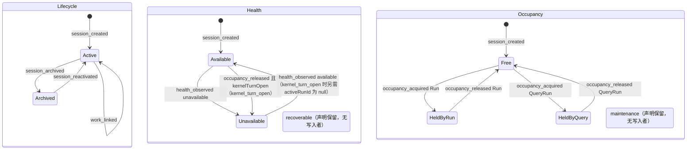

派生 availability 视图（只读，不可写）。空闲 Session 不被探测，所以 Idle 没有 `health_observed` 出边：

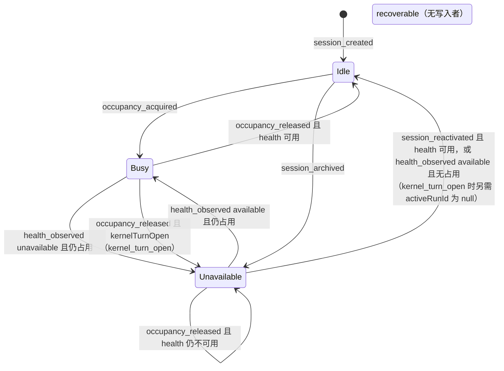

QueryRun 收束子机（只画本节负责的迁移；进程内的 claim、prepare、entered 省略，begin 只画一条说明边）：

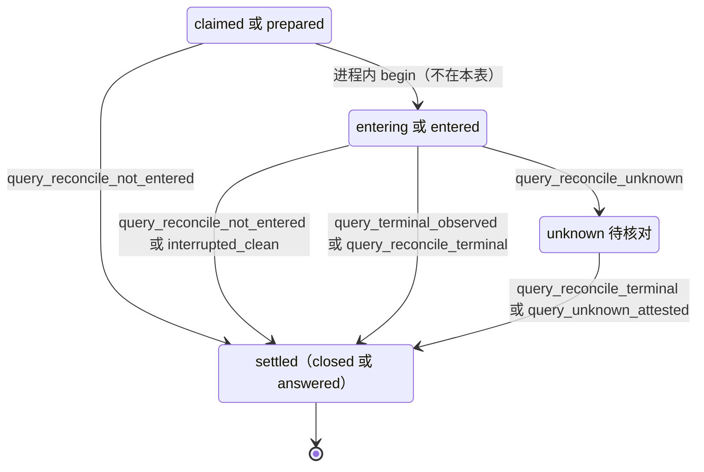

### 8.6 实现对照

状态机目标文件：`src/core/work-graph/state/session-availability.ts`（`transitionSession`）和同目录的 `query-run-recovery.ts`（`transitionQueryRunRecovery`）。

- **记录构造函数（§14）**：`createSessionRecord`、`occupySessionRecord`、`releaseSessionRecord`、`archiveSessionRecord`、`reactivateSessionRecord`、`observeSessionHealthRecord`；Query 侧为 `settleQueryRunRecord`、`markQueryRunUnknownRecord`。服务里写 lifecycle/health/occupancy 以及 QueryRun phase/status/outcome 的对象字面量都改为调用它们：`session-directory.ts:910-923`、`session-lifecycle.ts:616-617`、`:620`、`claim-service.ts:706-707`、`execution-entry-service.ts:1431-1434`、`query-execution.ts:794-799`、`:1343`、`:1392-1411`。
- **结论码字段（SD-2，lead 决定 LA-1（2026-10-03））**：`src/contracts/core/session.ts:7-15` 的 `SessionRecord` 加可选 `healthConclusion?: 'missing' | 'damaged' | 'kernel_turn_open' | null`；`session-record-codecs.ts:446-482` 的 `checkSessionBody` 加枚举校验，缺省按 null。`releaseSessionRecord` 接受 `kernelTurnOpen`，并有显式的“`historyCursor` 不变”分支（不写 null）；`observeSessionHealthRecord` 写入或清除结论码。§14 把该字段列为受保护字段。
- **编码器去重**：`execution-entry-service.ts:1497-1499` 的私有 `encodeSession` 改用 `sessions/session-record-codecs.ts:686` 的 `encodeSessionRecord`。
- **命名冲突**：`session-lifecycle.ts:655` 已有同名私有函数 `transitionSession`（archive/reactivate 的服务流程）。迁移时把它改名为 `runLifecycleTransition`，与 state/ 的导出区分。

| 行号 | 状态机函数（目标：`src/core/work-graph/state/` 中的导出） | 调用服务（file） | 已有测试（file） | 计划新增测试（描述） |
| --- | --- | --- | --- | --- |
| SES-01 | `transitionSession`（session_created）、`createSessionRecord` | `sessions/session-directory.ts` `recordSessionCreated` | `tests/work-graph/R4b-session-directory.test.ts:146`、`:165` | 创建后三维为 active/available/null，availability=idle |
| SES-02 | `transitionSession`（occupancy_acquired）、`nextOccupancyGeneration`、`occupySessionRecord` | `tasks/claim-service.ts` `claimTask` | `tests/work-graph/R4c-task-claim.test.ts:102`、`:240`、`:347`；`tests/work-graph/A1-session-lifecycle.test.ts:252` | 对 18 种组合逐一测占用守卫；验证 generation=revision+1 且 revision 被置为 generation；版本钉过期且 Session 忙碌时仍为 `busy` |
| SES-03 | 同 SES-02 | `queries/query-execution.ts` `claim` | `tests/work-graph/R5b-query-execution.test.ts:100` | Work 与 Query 在同一组合下得到相同结论；版本钉过期且 Session 忙碌时 Query 仍为 `revision_conflict` |
| SES-04 | `transitionSession`（occupancy_released）、`ownsOccupancy`、`releaseSessionRecord` | `tasks/execution-entry-service.ts` `recordRunResult` | `tests/work-graph/B2-execution-result.test.ts:24`、`:65`、`:94`、`:132` | RUN-08 的实时未结算终态不发 `occupancy_released`；服务误发时拒绝 `busy` |
| SES-05 | 同 SES-04 | `tasks/control-service.ts` `submitControl`（D-7 未进入停止，与 §6 RUN-09 同一服务） | — | auth 为 none、authorized、revoked 时 cancel 在同一提交释放，`historyCursor` 不变；pause 不释放 |
| SES-06 | 同 SES-04 | 新 `tasks/run-reconcile-service.ts`（`reconcileRun`）；Kernel 分类在新 `agent-runtime/run-reconcile.ts`；由 `src/app/host.ts` 在 D-18 之后启动时调用；RUN-23 的进程内变体由 `agent-runtime/execution-control.ts` 的 `deliver` 调用 `reconcileRun(paused_stop)`；RUN-17/18/21 经扩展的 `recordRunResult` | — | A8 的三个崩溃点后分别释放或保留；另一个存活 Host 持租约时 `busy` 且不写；`input_accepted` 未确认时 `unavailable` 且不释放；Kernel 终态 yielded：continuation 重建成功则释放并写 continuation，重建失败则不释放（`EndedUnknown`）；本 Turn 有两条等待发信时按重建失败处理，不释放（L-5）；安全点暂停中 cancel（RUN-23）进程内与重启两条路径都释放且 `historyCursor` 不变；RUN-19、RUN-23、RUN-24 释放后 Session 为 `unavailable/kernel_turn_open`，`historyCursor` 与核对前逐字节相同（不是 null），RUN-17/18/21 释放后仍为 available、结论码 null；同一 reconcile 身份重放不重复写 health |
| SES-07 | 同 SES-04 | 新 `tasks/run-reconcile-service.ts` 的 `resolveUnknownRun`，经 `src/app/host.ts` 的人类入口暴露（只在持实例租约时受理，L-1） | — | 记录证明人和原因后释放；Kernel 不可读时仍可认定，后继执行可能再次接受同一消息部分（§10.3）；租约被另一个存活 Host 持有或锁文件不可读时 `busy` 且不写；Turn 没有 Kernel 终态（RUN-20(i) 之后）→ `kernel_turn_open`；Turn 为 yielded 终态（RUN-20(iii) 之后）→ health 不变；Kernel 不可读（RUN-20(ii) 之后）→ 结论码由 `missing`/`damaged` 改为 `kernel_turn_open` |
| SES-08 | 同 SES-04 | `queries/query-execution.ts` `recordObservation`；重启路径经 `agent-runtime/query-observation.ts` | `tests/work-graph/R5b-query-execution.test.ts:100` | 旧 generation 的 Query 终态不释放新持有者；从 `unknown` 出发的终态释放 |
| SES-09 | 同 SES-04，另加 `ownsQuery` | `queries/query-execution.ts` 新 owner 写操作 `reconcileQueryRun`；由 `src/app/host.ts` 启动时调用 | — | QRR-01/02/04 三种收束都释放且 `historyCursor` 不变；无租约时 `busy`；`caller≠reconcile` 时 `forbidden`；QRR-04 在 Kernel 状态为 created/running/paused 时写 `kernel_turn_open`，为 yielded 时不写；QRR-01/02 不写 |
| SES-10 | 同 SES-09 | `src/app/host.ts` 的 `resolveUnknownRun` 对 QueryRunRef 调用 `queries/query-execution.ts` 新增的 `resolveUnknownQueryRun` | — | 只在 QueryRun 为 `unknown` 时释放；释放后 `historyCursor` 不变；未持实例租约时 `busy` 且不写（L-1）；`kernel_turn_open` 的三种情形同 SES-07 |
| SES-11、SES-14 | `transitionSession`（session_archived、session_reactivated）、`archiveSessionRecord`、`reactivateSessionRecord` | `sessions/session-lifecycle.ts` `runTransitionAttempt` | `tests/work-graph/A1-session-lifecycle.test.ts:132`、`:157`、`:287`；`tests/composition/A1-graph-session-platform.test.ts:58` | 重新启用时 health≠available，则 availability=unavailable 且不可领取 |
| SES-12、SES-13、SES-19 | `transitionSession`（health_observed）、`observeSessionHealthRecord` | `sessions/session-lifecycle.ts` 新写口 `recordSessionHealth`；探针为 `agent-runtime/session-operations.ts` 新增的 `probeSessionMapping`，结论为 `ready` 时同时返回 Kernel 会话头 `activeRunId`；由 `src/app/host.ts` 启动时调用 | — | 六类结论码逐一测试：`missing`/`damaged` → unavailable 且占用不变、结论码写入；`host_config`/`transient`/`cancelled` 不写；重验 → available、结论码清为 null；同值为空迁移；租约被另一个存活 Host 持有或锁文件不可读时不运行 reconcile、不写（L-10）；探针绕过 `session-operations.ts:760-762` 的短路；archived Session 被拒；`kernel_turn_open` 的 Session：`ready` 且 `activeRunId≠null` 时不写，`activeRunId=null`（测试替身模拟以后的 Kernel）时回到 available，`missing` 探针为空迁移且保留 `kernel_turn_open`；codec 拒绝未知结论码，旧记录缺字段按 null 读 |
| SES-15、SES-16 | `transitionSession`（work_linked） | `sessions/session-lifecycle.ts` `runLinkAttempt` | `tests/work-graph/A1-session-lifecycle.test.ts:37`、`:206`、`:224` | 关闭不存在的链接得到 `not_found`，关闭已关闭的链接得到 `invalid` |
| SES-17、SES-18 | `transitionSession`（occupancy_released）的空迁移分支 | 同 SES-04、SES-08 | `tests/work-graph/B2-execution-result.test.ts:94` | 返回 `ok:true` 且 `effects=[]`；持有者其他记录照常提交 |
| QRR-01..QRR-06 | `transitionQueryRunRecovery`、`settleQueryRunRecord`、`markQueryRunUnknownRecord` | `queries/query-execution.ts` 的 `recordObservation`（QRR-03）、`reconcileQueryRun`（QRR-01/02/04/05）、`resolveUnknownQueryRun`（QRR-06）；Kernel 分类复用 `agent-runtime/run-reconcile.ts` | `tests/work-graph/R5b-query-execution.test.ts:100`（只覆盖 QRR-03 的进程内路径） | 逐行表驱动；新增取值通过 codec（`query-record-codecs.ts:293`、`materials/record-readers.ts:169-172`）；收束后 phase、status、outcome、endedAt 一致；paused/yielded 的 Kernel 状态按 SD-4(e) 分流；SD-3 时进入 `unknown` 且身份不依赖 Kernel 位置；R 来源各行与 QRR-06 在未持实例租约时 `busy` 且不写（L-1、L-10）；咨询 Query 收束后投影为 `ended`，不再提交 |
| 派生 | `deriveAvailability`（迁自 `session-directory.ts:1027-1032`） | `session-directory.ts` 的 `readSession`、`findSessionsByTarget`、`findSessions`（`:1180`、`:1350`、`:1535`）。以 availability 或 occupancy 作门的消费者：`business/workflow/workflow.ts:221-228`（`roleReusable`）、`:459-460`；`business/workflow/consultation.ts:281`、`:391`；`src/app/host.ts:868`、`:877` | `tests/work-graph/B2-execution-result.test.ts:51`；`tests/composition/AG1-session-discovery.test.ts:119` | 18 种组合的 availability 快照表；Session 为 unavailable 或被 `outcome_unknown` 占用时，Host 注意力递送跳过、咨询返回 waiting、Workflow 报 waiting，都不领取；例外是 claim Session 为 `kernel_turn_open` 的 requeue 领取，Workflow 改走 `create_session`（见“结论码读取”行） |
| 读侧持有校验 | `ownsOccupancy`：只判定占用（kind、executionRef、generation），不看 lifecycle 和 health | `execution-entry-service.ts:1593-1607`；`query-execution.ts:935-938`；`plan-write-admission.ts:306-313`；`communication/mailbox-service.ts:641-647`。lifecycle/health 检查和错误码留在各调用方：entry 与计划写入查两者并返回 `busy`（`execution-entry-service.ts:1594-1595`、`plan-write-admission.ts:307-308`）；邮箱只查 lifecycle、不查 health，返回 `forbidden`（`mailbox-service.ts:641-647`） | `tests/work-graph/C1-session-mailbox.test.ts:364` | 四处读侧改用同一函数后，各自的错误码不变 |
| 结论码读取（8.3 表外说明 `kernel_turn_open`） | 无新状态机函数；读 `SessionCard.record.healthConclusion` | `business/workflow/workflow.ts`：为 `claim_requeued` 领取时按 (a)–(d) 选 Session，(c) 直接走 `create_session`（带 `requeue`），不经 `chooseSession`（`:450-487`）；`roleReusable`（`:221-228`）不改 | `tests/kernel/R4a-frozen-public.test.ts:284-315`（Kernel 拒绝在悬空 Turn 之后开新 Turn） | Workflow 单测：claim Session 为可复用、被占用、`kernel_turn_open`、`missing`/已归档/角色改变时，分别得到原 Session 领取、本轮跳过、`create_session`、`chooseSession(hint=null)`；`tests/scenarios/A8-host-restart.test.ts` 的 A8-3l、A8-3n、A8-3q |

UI 中有两份重复的 availability 文案表：`src/ui/views.ts:516-518` 和 `src/ui/main.ts:5689-5691`。它们只是展示，不属于本机；“待核对”由 UI 组合 availability 与 Run 的 `outcome_unknown` 得出。


## 9. VerificationRound（轮次 + 单项检查）

本节把 §7 V1–V6 转写成两层小状态机：**轮次**（`RoundSnapshot.status` + `outcome`）与**单项检查**（`RoundCheckSnapshot.phase` + `outcome`），外加两类只追加记录 `Evidence` 与 `TaskEvidenceIndex` 的写入规则。轮次结论通过 D-1 的投影输入影响 Task，通过 D-3 的 `TaskRequeue` 或同一 subject 上的**后继轮次**（VR-14）被“超越”。同一 subject 的各轮次组成一条**轮次链**，读者只看链头（VD-14）。本节依赖 D-2（FAIL 结论，U-2，按原推荐）、D-9（Goal 期望状态，U-8，按原推荐）、D-12（启动时 executing→interrupted；同轮不重跑，重跑只在后继轮次，U-15 → (ii)，C5）、D-13（§13 无进展键，随 U-3 → C1 生效）。

本节在 brief 之外补充的决定。标“lead 采纳（L-n）”或“lead 决定（L-n）”的已定稿；VD-9（非 active 时拒绝开轮与起检）和 VD-10（运行中停滞接受到重启）由 brief §2a 定稿；VD-2、VD-3、VD-4、VD-7、VD-8 按附录 A 第 C 节由 L-16 采纳；VD-5 由 L-3、VD-6 由 L-8 定稿。用户 2026-10-03 的决定 C5（U-15 → (ii) 后继轮次；U-10 → (b) gate 重验，同一机制）改写了 VD-1、VD-5、VD-11，并新增 VD-12..VD-15：

- **VD-1 每个 subject 至多一条轮次链，链头唯一（唯一槽已由 lead 采纳，L-8；按用户决定 C5 由“一个轮次”改为“一条链”，U-15 → (ii)）**：新增唯一槽，取代今天“两个 requestId 可建两轮”的情况。槽的 owner 是链头轮次的 refKey，键见 9.1：
  - work：每个 (subject task, subject Run) 一条链，槽键 `verification-round-subject:<project,workspace,goal,task,runId>`。链根由 VR-01 打开（`chain.ordinal=1`），后继轮次只由 VR-14（`reverifyRound`）打开，提交时槽 CAS 旧链头键→新链头键。
  - gate：每个 gate 一条链，槽键 `verification-round-gate:<project,workspace,goal,task>`（不含 runId），锚定开链时选定的首个 producer Run（VD-15）。这一条取代 L-8 原文“同一 producer Run 另可为每个 gate 各有一个 gate 轮次”。
  - **同一 Run 再验：用户决定 C5（U-15 → (ii)，2026-10-03）**。只有链头已 finalized 非 PASS 时，才能在同一 subject 上打开后继轮次（VR-14）；它记 `predecessorRoundRef`，同一提交超越前驱证据（VD-5、VD-12），查询与投影只取链头（VD-14），旧轮次与报告保留不改写。原稿按 (i)“新轮次只在 requeue 之后打开”书写；那样检查中途 Host 崩溃，或 `not_started` 这类与产物无关的 INCONCLUSIVE，都只能 requeue → 新 Run → 新模型调用，与 V6“同轮次恢复或明确新版本轮次”（`ORCHESTRATION-STATE-MACHINES.md:389`）、V5“不能无理由重跑”（`:388`）有偏差。改选 (ii) 后这条偏差关闭（GAP-11）。
  - D-12 不变：interrupted 单项在同一轮次里绝不重跑；重跑只发生在后继轮次，后继轮次重跑全部检查（GAP-53）。
  - **gate 的同一情形**：gate 检查执行中 Host 重启（VR-04）→ gap `interrupted_check` → INCONCLUSIVE；gate 不能 requeue（§4 TASK-16），但可以在 gate 链上开后继轮次：Workflow 自动 VR-14，豁免 `host_interruption`，不计入上限（VD-13）。死路 #9 关闭（§12 C-04）。
- **VD-2 `submitEvidence` 不得写入已 finalized 的轮次**：拒绝码 `busy`，与 `beginCheck`/`recordCheckResult` 一致。（2026-10-07 简化同步，决定 34：`submitEvidence` 与 VR-08 已删除，本条不再有作用对象。已 finalized 的轮次照样拒绝 `beginCheck`、`recordCheckResult` 与 `finalizeChecks`，拒绝码 `busy`。）
- **VD-3 打开轮次要求 subject Run 正常结束**：`ended` + `completed`，`reconciliation` 缺省或为 `done`。这与 Workflow 的 `normalEnd` 一致，今天服务层只查 `ended`。
- **VD-4 PASS ⇒ `gaps=[]`**：结论折叠中任何 gap 都给 INCONCLUSIVE；今天“同一要求另有 PASS 覆盖”时，会出现 PASS 带 `pending_check` gap 的结果（`evidence-service.ts:1007` 不看 gaps）。遗留的“PASS 带 gaps”行不改写，投影按 INCONCLUSIVE 处理（`blocked/round_inconclusive`），类别为 `check_incomplete`，出口为后继轮次（VR-14，C2/C5），人工也可 requeue（TASK-17，死路 #11）。
- **VD-5 requeue 与后继轮次超越旧轮次证据（lead 决定 L-3：存储 id，与 §4 TD-2 同一决定；按 C5 扩展到整条链）**：
  - `requeueTask` 的 `afterRoundRef` 是 afterRun 轮次链的**链头**。同一提交把 `chainEvidenceIds(head)` = `head.chain.supersededEvidenceIds ∪ ids(head.evidenceRefs)`（祖先在前，再接链头的顺序）写入不可变的 `TaskRequeue.supersededEvidenceIds`；遗留无 `chain` 的链头只取 `ids(head.evidenceRefs)`；没有轮次时为 `[]`。这样同一 Run 上更早轮次的证据也退出折叠，否则它们会挡住完成。轮次 finalized 时一次写定 `evidenceRefs`（`evidence-service.ts:1036-1037`），之后不再改写（9.4）。requeue 提交守卫链头 round@rev，并带同 owner 的槽 claim `{expectedOwner: headKey, nextOwner: headKey}`（遗留无槽根为 `null→null`），使并发的后继轮次与 requeue 只有一个能提交（VR-09）。
  - 后继轮次（VR-14）把前驱的证据 id 累计写在**后继自己**的 `chain.supersededEvidenceIds` 上（VD-12），前驱记录不写。
  - completion 折叠前排除 `(∪ 该 Task 全部 TaskRequeue 存储的 supersededEvidenceIds) ∪ 完成轮次的 chain.supersededEvidenceIds`（§4 4.3 末“完成侧的读取、排除与守卫”）。完成轮次必然是链头：只有非 PASS 链头才会有后继。不读 `afterRoundRef` 轮次推导。brief D-3 的记录形状据此补上该字段。
  - 否则 T7 返工或后继轮次之后，新的 PASS 轮次永远被旧 FAIL 证据阻塞。work 与 gate 都适用；gate 不能 requeue，只走链（VD-11、VD-15）。
- **VD-6 运行中的 Host：已证明未启动的单项退回 pending（VR-05；已由 lead 采纳，L-8，含 `check_abandoned` 事件与 VR-13）**：
  - runner 在 begin 之后、`new ProcessSandbox`/`execute` 之前放弃时，同一进程内可证明没有进程启动。这些路径是：root/约束与 ticket 不符（`check-execution.ts:117-120`）、begin 后 root 变化（`:121-124`）、begin 后权限变化（`:125-128`）、`afterBegin` 读取失败（`:129-130`）、调用方已取消（`:134-137`）。
  - 单项 `executing → pending`，清除 invocationId；下一次起检签发新 invocation。没有进程运行过，不算 D-12 的重跑，符合 V6“只补未执行”（`ORCHESTRATION-STATE-MACHINES.md:389`）。记为 interrupted 会把无害的放弃变成 gap → INCONCLUSIVE → requeue → 新模型调用。
  - 例外：ticket 不完整（`:108-109`）由轮次冻结值确定性产生，退回 pending 会反复失败，改记 `interrupted`（VR-13）。
  - 执行中抛出未知错误（`:159-161`）不能证明未启动，保持 executing，等待 VR-04。今天上述路径都让窗口保持“未核对”；D-12 只覆盖重启。
- **VD-7 开轮、查询与完成都用 Goal 当前采用版**：
  - Workflow 开 work 轮次时传 Goal 当前 `activePlanRevision`，不再传 `run.planRef`（`workflow.ts:113`；调用处 `:596`、`:806`、`:814` 需先读 Goal）；
  - `queryOriginalVerification` 只按 `subjectRunRef` + `subject` 匹配，`planRef` 只作校验信息（今天 `evidence-service.ts:634` 还比对 `adoptedPlanRef`；Workflow 查询传 `run.planRef`，`workflow.ts:572`）；
  - `completeTaskStep` 传 Goal 当前 `activePlanRevision`，不再传 `round.adoptedPlanRef`（`workflow.ts:146`；Goal 已在 `:583`、`:840` 读出；为 null 时等待）。completion 只比对当前采用版（`completion.ts:284-286`），不读 `round.adoptedPlanRef`；证据适用性仍按当前采用版判定（`:366-381`）。
  - 理由：Run 领取之后，或开轮之后、completeTask 之前，可能发生合法的未来采用（W16 `applyFutureRevision`；代码注释称 “W1 future apply”，`evidence-service.ts:522-526`）。之后开轮永远得到 `source_stale`（`:398-400`），completeTask 永远得到 `revision_conflict`（Workflow 每次推进都重建同一请求，`workflow.ts:587`、`:844`）。Task 停在 `verifying`，而 §4 不允许从 `verifying` 重入队。W16 不改有 Run 痕迹的 Task 的执行定义（`plan-readers.ts:1269-1297`；C7 只允许改处置，basis 不变），subject task 的定义不变，换用当前版是安全的。
  - C6（U-11 → (b)）以 VD-7 为前提，二者同批实施；`OriginalVerificationQuery.planRef` 改为可选，只作信息：给出时只校验 `round.adoptedPlanRef` 属于同一 Goal，不再要求相等。C5 把查询改成链头读取后仍不按计划匹配：`queryOriginalVerification` 是 `queryRoundChainHead` 的计划无关别名（VD-14）。后继轮次（VR-14）同样按 Goal 当前采用版开轮。C5 的无进展键也不取 `verificationPlan.planDigest` 或轮次 identity 的 `planDigest`/`taskDigest`：它们含 `planRef`/`planRevision` 与整个 `RuntimeTask`（`evidence/verification-plan.ts:107-125`，`evidence-service.ts:498-499`），每次无关采用或 C7 处置变化都会让键看似改变（VD-13）。
- **VD-8 起检遇冻结绑定不符时转 finalize**：
  - 只有三种明确的比较失败按策略视为本轮终止：权限版本 ≠ 冻结值（`evidence-service.ts:689-691`；runner 起检前同一比较 `check-execution.ts:81-83`）、root ≠ 冻结 root（`:692-694`）、source digest ≠ 冻结值（`:697-698`）。冻结值可能恢复（例如内容被还原），但不无界等待。
  - Workflow 不再重试该单项，转 `finalize_checks`，剩余 pending 计为 gap。今天 Workflow 每次推进都重试同一单项，轮次永远 open（`workflow.ts:124-136`、`:824-831`）。
  - 其余 `forbidden`/`source_stale` 一律等待：authorize/resolveRoot 拒绝经 `mapWorkspaceRejection`（`:686-688`、`:124-127`）；executor 不符（`:671`，见死路 #10）；runner 起检前 `mapWorkspaceCode`（`check-execution.ts:78-80`）；capture 失败经 `mapSourceFailure`（`:696`、`:134-137`）。`unavailable`、`unsupported`、`busy`、`revision_conflict` 也等待。
  - `CoreRejection` 没有结构化细分字段（`src/contracts/core/results.ts:18-23`）。三种比较失败需带稳定的 detail 标记（`frozen_permission_changed`、`frozen_root_changed`、`frozen_source_changed`，取自 `transitionCheck` 的 `detail`），Workflow 只按标记判定。
  - **标记放在 `reason` 的固定前缀（lead 决定 L-9），不改 `CoreRejection` 契约**：格式为 `<标记>: <原说明>`，例如 `frozen_root_changed: the current workspace root is not the round fixed root`。`beginCheck`（`evidence-service.ts:689-698`）与 runner 起检前的同一比较（`check-execution.ts:81-83`）都这样写。Workflow 只按 `reason.startsWith('<标记>:')` 判定，不解析其余文字；不带前缀的拒绝一律按等待处理。
- **VD-9 Goal 或 Task 非 active 时不起新进程**：Goal `desiredState≠active` 或 subject task disposition `≠active` 时，`round_opened`、`round_reverified`、`check_begun` 被拒。已开始进程的结果、reconcile 入账、finalize 仍可写，它们只记账。
  - disposition 取自 Goal 当前 `activePlanRevision` 指向的 Plan，不取冻结的 `round.adoptedPlanRef`（W16 修订后的 disposition 只出现在新版）。由读集守卫 Goal@rev 保护（PlanRevision 不可变）。
  - 今天 `openVerification` 已守卫 Goal@rev（`evidence-service.ts:535`），但不读 `desiredState` 与 disposition；`beginCheck` 不读 Goal（`:640-726`，提交只守卫轮次 `:712`）。拒绝码对齐 claim（`claim-service.ts:514`、`:556`）。
  - VD-9 今天尚未实现（`openVerification` 在 `:390-441` 不读 disposition）。C7 的“非 active 任务不起新检查进程”依赖本批实现它；`reverifyRound` 用同一守卫与同一拒绝码。
- **VD-10 记录结果有界重试**：
  - runner 的 `recordCheckResult` 可能遇到两种失败：`revision_conflict`（pin 取自 `afterBegin`，`check-execution.ts:129`、`:172`，并发起检会使它过期）；报告存储 `unavailable`（`evidence-service.ts:778-779`）。
  - 遇到时重读轮次、刷新 pin，用同一 requestId 重试。前次实际已提交时，重试得 `idempotency_conflict`（指纹含 expected，`:750-751`），runner 改为重读轮次。
  - 重试用尽，或执行中抛出未知错误（`check-execution.ts:159-161`）→ 单项保持 executing，直到重启 reconcile（VR-04/VR-06）。这段停滞被接受，需列入 §12。
- **VD-11 gate 非 PASS 的出口：gate 链上的后继轮次（用户决定 C5：U-10 → (b)，2026-10-03）**：今天没有出口。gate 走不了 requeue，原因是：
  - gate 不能 requeue（§4 TASK-16 要求 work；gate + requeue → `invalid`）；
  - gate 槽已被链头占用（VD-1），producer 已 satisfied；
  - 旧 gate 证据留在 gate 自己的 TaskEvidenceIndex（`evidence-service.ts:508-510`、`:1101-1103`；`completion.ts:356-360`），只能由链上的显式超越排除（VD-5）。

  目标出口是在 gate 链上开后继轮次（VR-14，锚定 producer 见 VD-15），由 Workflow 按 gate 判定（§4 TD-9 GV 行）自动发起：
  - gate 链头 **FAIL** → `reverify_round{onlyIfSourceChanged:true}`（GV-9）。来源自上一轮以来已变（例如修复 Task 已运行）→ 后继轮次；未变 → 提交拒绝记录 `source_unchanged`（§4 TASK-28），gate 判定变为 `stopped/gate_needs_fix`（GV-8），Goal 原因列出 `gate_needs_fix` 与失败的 checkId；Goal 中没有 `starting|running` Run、也没有其他待做的自动返工时，标题为 `NEEDS_DECISION`（§2 GOAL-30）。
  - 之后由 agent 或人经既有计划演进路径（W16 未来采用）加一个 required work 修复 Task，承载该 gate 的义务（义务比较不含 `taskIds`，`plan-validation.ts:397-411`；未标 `executionIntent` 的必需 work 必须承载必需义务，`:76-90`）。界面动作“添加修复任务”预填失败的 checkId，并把 gate 轮次的报告引用放进 `PlanChangeReason.sources`（`ArtifactRef[]`）。修复 Task 是首次领取，没有接续说明（C3 只约束 requeue 的 Run）。必需 work 总是先于 gate 执行（`workflow.ts:715-722`）；修复 Run 结束后拒绝过期（`goalEndedRunsAtRefusal`，VD-13），Workflow 重验 gate。本批没有自动起草修复 Task 的机制（GAP-56）；停在 `waiting` 的 driver 只由推进、driver 启动、启动重驱动（lead 决定 LA-6（2026-10-03））或既有注意力触发唤醒（GAP-48）。
  - gate 链头 **INCONCLUSIVE**（含 Host 中断、遗留 PASS 带 gaps）→ 直接 `reverify_round`，不要求来源变化（GV-10）。C5 字面写“gate 非 PASS 且来源变了才自动重验”；C2 把 `check_incomplete` 定为 reverify 类别，字面读法会把一次 Host 中断变成 `NEEDS_DECISION`。lead 按用户总体取向裁定按 C2 处理。
  - gate 链头非 PASS，而 gate 范围内仍有未满足的 required active work Task（修复进行中）→ 判定 `none`，Goal 原因 `gate_fix_in_progress`（GV-5）。
  - 这条出口不需要放宽 W16（U-10 (a) 不采纳）；gate 定义保持冻结（C7 最后一条）。下面两处卡点保留作为不采纳 (a) 的依据。

  brief §2a 设想的 G5 出口（W16 把该 gate 改为 `superseded`/`cancelled` 并加替代 gate）今天不可行，卡在两处：
  1. **W16 拒绝修改任何源 gate（含 disposition）**：`validateFutureObligationCoverage` 比较 gate 的完整冻结定义（`plan-validation.ts:415-434`；冻结定义含整个 `RuntimeTask`，`plan-task-basis.ts:49-54`），不同即 `gate_definition_changed` → `invalid`（`plan-service.ts:1740-1745`），早于 `plan-readers.ts:1269-1297` 的痕迹检查。新增 gate 还必须承载新增义务（`plan-validation.ts:458-471`）。
  2. **Workflow 选择不看 disposition**：只有 work 循环过滤（`workflow.ts:634`）；必需 work 缺口（`:719-721`）、gate 选择（`:726`）与 Goal 完成前提（`:739`）都不过滤。被 superseded 的旧 gate 仍被选中，开轮被拒（VD-1 `busy` 或 VD-9 `invalid`），Workflow 永远等待；被 cancelled 的必需 work 同样让 `:720` 永远等待。

  U-10 原有三个选项：(a) 放宽 W16（GAP-10）；(b) gate 重验，即 U-15 (ii) 的后继轮次（GAP-11）；(c) 本批接受死路，Goal 一直显示 `RUNNING/awaiting_gate`。原稿 lead 建议“本批 (c)，以后 (a)”。**用户 2026-10-03 选定 (b)（C5）**：新增 gate 重验（VR-14），不放宽 W16；GAP-09、GAP-11 关闭，GAP-10 的 (a) 不再需要。

  第 2 处中 `:720`、`:739` 的改动与 U-10 无关，已由 lead 决定（L-15）：跳过 `cancelled`/`superseded`（与 `completion-policy.ts:239` 一致）；只剩 `deferred` 的必需 work 时等待，reason 前缀 `required_task_deferred:`（C7）。今天 W16 已能取消无痕的非 gate work，这一改动对它本来就需要。gate 选择（`:726`）改为 `advanceGate`（VD-15）：gate 已有链时只按链头推进，不再重选 producer。gate 定义冻结，gate 的 disposition 不会改变，`:726` 无需另加过滤。

  gate 失败可见（§2 GOAL-27 不再把它藏成 `RUNNING/awaiting_gate`）：gate 从链头得到投影（§4 P20）与失败事实（`TaskRow.failure`，`subjectKind:'gate'`，`run` 字段取锚定 producer Run，`failureClass = reverifyFailureClass(head)`），GV 行判定自动化是否停下；停下时 §2 GOAL-30 显示 `NEEDS_DECISION`。用 Task 范围句柄（`base.taskId`，`workflow.ts:707-711`）完成修复 Task 时，推进不会走到 gate 步骤；gate 重验等下一次 Goal 级 `select_work`。期间拒绝已过期，gate 判定回到 `reverify`，Goal 显示 `RUNNING`（原因 `auto_rework_pending`），这是接受的过渡。
- **VD-12 后继轮次操作 `reverifyRound`（新增，C5）**：
  - owner 是 WorkGraph evidence 服务：`EvidencePort.reverifyRound(ctx, GraphWrite<ReverifyRoundInput>) → WriteResult<ReverifyOutcomeV1>`；纯决定在 `state/verification-machine.ts`。机器事件 `round_reverified`，持久事件 `VerificationRoundReverified`。不新增聚合。
  - 输入 `ReverifyRoundInput = {predecessorRoundRef, onlyIfSourceChanged?, newInputRefs?: NewBasisInputRefV1[], reason?, note?}`。没有 `trigger` 字段：执行者类别由 `reworkActorClassOf(principal, actor)` 派生，调用方不能指定。`meta.expected = [前驱@rev, TaskReworkRefusal(reverify, 前驱)@k]`，k=0 表示拒绝记录不存在（与 TaskReduction 的 0 pin 同法，`completion.ts:306`、`workflow.ts:144`）。Workflow 的 requestId 由 `predecessorRoundRef` 与这两个 pin 派生：拒绝过期后的重试有新的拒绝 pin，因而有新 requestId，不会重放旧的 `refused` 回执而零写入空转。
  - 结果 `ReverifyOutcomeV1 = {kind:'reverified'; round} | {kind:'refused'; refusal}`。策略拒绝（`auto_rework_cap_reached`、`verification_uncovered`、`source_unchanged`、`no_new_basis`）提交有版本的 `TaskReworkRefusal{operation:'reverify', subjectId: 前驱轮次 id}` 与事件 `TaskReworkRefused`（§4 TASK-28）。这是已提交的结果，不是 CoreError。其余问题 0 commit：`finalize_first:` → `busy`，`round_chain_limit:` → `dependency_blocked`，链无效 → `incomplete`，以及普通的 `forbidden`/`busy`/`invalid`/`revision_conflict`/`unavailable`/`idempotency_conflict`。不提供零提交的预演读取；失败事实读模型读拒绝记录（§4 TD-8）。
  - 同一 subject：后继的 `subject`、`subjectRunRef` 与前驱相同（同一 `ref.projectId/workspaceId/goalId/taskId/runId`，新 `roundId`）。新 Run 不接续旧链：requeue 之后，新 Run 由 VR-01 开新链；被 TaskRequeue 覆盖的 Run 不能再验。
  - 构建与 VR-01 走同一路径（抽出 `prepareRoundOpening`）：当前配置、Goal 当前采用版（VD-7）、新的完整来源捕获（lead 决定 LA-5（2026-10-03）：开轮与重验保留今天的完整捕获；工作区改动超过 64 个文件时捕获不给 digest，开轮与重验都返回 `unavailable`，GAP-54）、新编译，全部单项 `pending`。后继的 executor 对任何主体都取自 `configuration.executor`；“actor = executor”（`evidence-service.ts:385-387`）只留在开轮、起检、记录结果与 finalize 上。Workflow 之后的 `run_check`/`finalize_checks` 仍用 Host 上下文。
  - `chain`：`ordinal = 前驱.ordinal + 1`；`predecessorRoundRef`、`predecessorRevision`；`supersededEvidenceIds = chainEvidenceIds(前驱)`（累计，祖先在前）；`basisDigests = 前驱.basisDigests ++ [本次 digest]`（按序追加；豁免为 `host_interruption`/`not_started` 时可与更早的项重复）；`autoCount`（VD-13）；`reverify` 事实 `{requestedBy, actorClass, failureClass, requestedAt, basis, exemption, sourceChanged, newInputRefs, reason}`。`failureClass = reverifyFailureClass(前驱)`：FAIL → `check_failed`；INCONCLUSIVE 或遗留 PASS 带 gaps → `check_incomplete`。`sourceChanged` = 本次 `sourceDigest` ≠ 前驱 `identity.sourceDigest`。
  - 这条记录就是 C8 要求的“谁、类别、原因、第几次”：谁 = `requestedBy` + `actorClass`；类别 = `failureClass`；原因 = `reason`（Workflow 自动重验写 `auto-reverify:<class>#<autoCount>`）；第几次 = `ordinal` 与 `autoCount`。重验不建 Attempt/Run，不调用模型，也没有接续说明；之后 requeue 的接续说明读上一 Run 的链头，并给出 `checks.roundOrdinal`。
  - 调用者：界面路由 `verification/reverify`（Host actor → `human`；work 标“重新检查”，gate 标“重新验收”）；Workflow 步骤 `reverify_round`，经 `automationContext(owned)` → `system`；`work_run` 主体经 `authorizeDelegatedWrite(…, 'reverify_round')` → `agent`。本批不提供 agent 工具（GAP-46）：AgentRuntime driver 在起跑前拒绝未知工具名（`execution-driver.ts:118-120`），生产 Role 在工具上线前不得授予 `reverify_round`。
  - 人在 Task 上的停止同样约束重验（硬限 3）：`reworkFenceOf(subjectRun, pointerIntent) ≠ 'none'` 且执行者类别不是 `human` → `forbidden`。判定表里围栏行排在重验行之前（§4 TD-9），所以 Workflow 不会提出这一步；守卫在 owner 里再查一次，Agent 也绕不过。gate 没有指针意图，永不被围栏。lead 按用户总体取向裁定。
  - 所有执行者类别都要求 Goal `desiredState='active'`，否则 `busy`（“先恢复 Goal”），与 requeue、“继续”同一条规则（VD-9）。
  - Workflow 处理结果：已提交（`reverified` 或 `refused`）→ `advancing(select_work)`；被拒 `revision_conflict` → `advancing(select_work)`（每次重试都需要另一笔外部写入，不会空转）；其余拒绝 → `waiting`，`reason` 写成 `<代码>: <说明>`（代码取自动化停止原因，§4 TD-9；L-9 的前缀做法，`WorkflowAdvanceValue.reason` 只是字符串，`workflow.ts:163-168`）。
  - 人工说明 `note`：只接受 `human` 类别，否则 `invalid`。owner 在提交前经 `MaterialPort.storeArtifact`（`model/material-contracts.ts:12-14`）把它存为 Artifact（正文不含时间戳，重试时内容相同），引用并入 `newInputRefs`。界面只在 `no_new_basis` 拒绝之后提供显式动作“附上说明作为新依据”；`reason` 永远不计为新依据（硬限 2）。lead 按用户总体取向裁定。
- **VD-13 后继轮次的防空转守卫（新增，C5 + C8，硬限 2、4；规则全文见 §13.7）**：
  - 键 `ReverifyBasisV1`（`state/no-progress.ts` 的 `reverifyBasis`，`actionKind:'reverify'`，与 requeue 的键空间分开）：subject 与锚定 Run id；`failure` = `roundFailureFacts(前驱)` 去掉 `reportRef` 后的非 PASS 单项 `{checkId, phase, outcome, cause}`（按 checkId 排序）与排序去重的 gap codes；`source` = 现在捕获的 `{workspaceRevision, sourceDigest}`；`configuration` = 后继将冻结的 `{configurationRevision, configurationDigest}`；`verificationInputs` = `{basisPlanRef（Task 的有效 basis，L-4）, completionPolicyPin, architectureBaselinePin}`；`newInputDigest` 只算 `NewBasisInputRefV1`（已回复的 SessionMessage、已存储的 Artifact）。ND-9：任务清单、Query 清单、检查报告等平台正文不算新依据，前驱自己的报告也不算（`newBasisInputProblem` → `invalid`）。键不含 id、报告 digest、时间与 `reason`。
  - 比较范围：同一条链上全部更早的重验键（`前驱.chain.basisDigests`）。链上第一次重验总能通过键比较，与 ND-3 让第一次 requeue 通过同理（C2 写的是“同键守卫”）。lead 按用户总体取向裁定。
  - 豁免 `reverifyExemption(前驱)`：
    - `host_interruption`：每个非 PASS 单项都是 `interrupted`、原因 `host_restart`，gap codes ⊆ {`interrupted_check`} → 跳过键与上限。每次出现都需要一次 Host 重启（与 ND-5 一致）。
    - `not_started`：每个非 PASS 单项的原因 ∈ {`host_restart`, `not_started`}，至少一个 `not_started`，gap codes ⊆ {`interrupted_check`} → 跳过键，但计入上限：沙箱 `launch_failed` 可能一直存在。
    - `ticket_invalid`（VR-13，确定性）与 `process_cancelled` 不豁免（lead 按用户总体取向裁定）。遗留单项没有原因，读作 `null`，豁免恒为 `none`。
  - 上限：`TaskAutomationPolicyV1.autoReworkLimit`（默认 `DEFAULT_AUTO_REWORK_LIMIT = 3`，最大 10；Host 设置 `automation.autoReworkLimit`；`automationPolicy()` 在 `create-platform.ts` 注入 evidence 服务）。`autoCount`：类别 `human` 时为 0；豁免 `host_interruption` 时等于 `前驱.autoCount`；否则为 `前驱.autoCount + 1`。计数的自动请求（`system`/`agent`）使 `autoCount > autoReworkLimit` → 拒绝记录 `auto_rework_cap_reached`。存储的这条拒绝不停住判定：判定只由 §4 AV-7a、GV-6 按当前计数与当前上限计算（同 AV-10），上限提高后自动化即可继续。人工不受上限约束，但仍受键约束（硬限 2）。
  - 两个计数器，一个上限（C8）：requeue 计 `TaskRequeue.automation.autoCount`，重验计 `RoundChainV1.autoCount`。人工 requeue 或“继续”重置前者，人工重验重置后者。requeue 开新 Run 与新链，重验计数随之归零，所以每个 Task 的自动重验次数 ≤ 上限 × (1 + 自动 requeue 次数)。gate 链只由人工“重新验收”重置：上限次自动“修复 + 重验”之后由人决定，这是有意停住 agent 的修复循环。人工改处置不重置计数（lead 按用户总体取向裁定）。
  - `onlyIfSourceChanged`：只收窄准入，所以调用方可以设置。为 true、豁免为 `none`、本次捕获的 `sourceDigest` 等于前驱 `identity.sourceDigest` → 拒绝记录 `source_unchanged`。来源 digest 覆盖整个工作区，无关编辑也算变化（GAP-30）。
  - `verification_uncovered`：后继编译后仍有 `uncovered` 要求 → 对所有类别（含人工）拒绝记录 `verification_uncovered`，任何豁免都不跳过。这种轮次 finalize 时每条 uncovered 都成为 gap，永远不能 PASS（`evidence-service.ts:989-992`、`:1000-1007`）；出口是在 Host 设置中登记能覆盖它的检查。链根（VR-01）仍可带 uncovered gap 打开，使失败可见。轮次的 gap code 仍叫 `uncovered_requirement`。
  - 链长上限 `ROUND_CHAIN_MAX = 32` → 0 commit `dependency_blocked`（`round_chain_limit:`）。判定先查这一条（§4 AV-7b、GV-7），自动化不会走到 owner。
  - 拒绝过期：拒绝记录存 `goalEndedRunsAtRefusal`（`countEndedGoalRuns`，在来源捕获之前计数）；`verification_uncovered` 与 `no_new_basis` 另存 `configurationRevision`，其余为 null（lead 决定 LA-4（2026-10-03））。当前 Goal 已结束的 Run 数更大，或当前检查配置版本不同，拒绝即过期，判定回到 `reverify{retryAfterRefusal:true}`。重试带新的拒绝 pin，因而有新指纹与新 requestId（VR-14）。人工编辑与其它 Goal 的 Run 结束不会让拒绝过期（GAP-47）。
  - 检查顺序按 §13.2 的统一顺序，见 VR-14 守卫列。
- **VD-14 读者只看链头（新增，C5）**：纯函数 `roundChainHead(rounds)`（`state/verification-machine.ts`）返回 `none`、`head{head, chain}` 或 `invalid{reason}`。链有效的条件：ordinal 1..n 连续且唯一；k>1 的 `predecessorRoundRef` 指向第 k−1 轮，且它已 finalized 非 PASS；只有链头可以是 `open`；没有 `chain` 的遗留轮次是无槽链根（ordinal 1）。多个根、序号断档、前驱不符 → `invalid`（§11 I-20）。
  - 读取：work 链经 `VerificationRoundBySubject`（上限提高到 `ROUND_CHAIN_MAX + 1`，还有下一页即 `incomplete`）；gate 链经新 lookup `VerificationRoundByTask`。`queryRoundChainHead(subject, subjectRunRef | null)`，gate 传 null；`queryOriginalVerification` 保留为它的计划无关别名（VD-7）。
  - 使用者：Task 投影（§4 P7–P13 读选定 Run 的链头，P10 = 链无效，P20 = gate 链头）；Workflow（`resumeRoundChain`、`advanceGate`）；completion（完成轮次必然是链头，排除集见 VD-5）；失败事实与 Goal 展示（§4 TD-8/TD-9 的 `TaskRow.failure`，work 与 gate 同一条路径，§2 GOAL-30）；接续说明（失败检查取上一 Run 的链头，C3）。
  - 链无效时：投影 `blocked/round_ambiguous`；判定 `stopped/not_reworkable{cause:'round_ambiguous'}`；reverify 与 requeue 都返回 `incomplete`（finalize 解决不了，与 §4 4.4、§13.2 一致）。没有自动出口（GAP-52）。
- **VD-15 gate 链锚定首个 producer Run（新增，C5）**：每个 gate 一条链（VD-1 的 gate 槽）。链根由 VR-01 在 Workflow 当时选定的 producer 上打开（`workflow.ts:728`：`graph.tasks` 中第一个 satisfied 且有执行的 work 行）；之后每次 gate 验收都是这条链上的 VR-14，`subjectRunRef` 始终是这个锚定 Run。
  - 开轮时捕获当前工作区来源（`evidence-service.ts:458`），所以修复后的内容就是被验收的内容。`subjectRunRef` 只是 completion 接受的形式锚点：`completion.ts:344-351` 只要求 producer 是同一 completion Plan 中某个 work Task 的已结束 Run，不要求 `Run.planRef` 等于该 Plan；修复 Task 采用之后、producer Task 改处置（C7）之后都仍成立。
  - gate 已有链时，Workflow 不再重选 producer（`advanceGate`）。否则 `graph.tasks` 的顺序一变，就会在另一个 producer 上开第二条链，旧链的 FAIL 证据留在 gate 的索引里挡住完成。gate 已有链（任一 producer）时再开轮 → `busy` + 当前链头 pin。
  - 报告上显示的是锚定 Run，不是修复 Run；修复由 `sourceChanged` 与来源 digest 证明（GAP-51）。

### 9.1 持久位置与状态枚举

| 维度 | 记录.字段（位置） | 代码枚举（原值） | 说明 |
| --- | --- | --- | --- |
| 轮次状态 | `RoundSnapshot.status`（`src/contracts/verification.ts:141`） | `'open' \| 'finalized'` | codec `ROUND_STATUSES`（`evidence-record-codecs.ts:133`） |
| 轮次结论 | `RoundSnapshot.outcome`（`verification.ts:142`） | `EvidenceOutcome \| null`；`EvidenceOutcome = 'PASS' \| 'FAIL' \| 'INCONCLUSIVE'`（`src/contracts/evidence.ts:61`） | 今天只产出 PASS/INCONCLUSIVE（`evidence-service.ts:1007`） |
| 轮次缺项 | `RoundSnapshot.gaps`（`verification.ts:143`） | `{code,message,coverage?}[]` | code 有 `uncovered_requirement`、`pending_check`、`missing_check`、`evidence_<basis>`、`source_changed`、`source_unavailable` 等；新增 `interrupted_check` |
| 单项阶段 | `RoundCheckSnapshot.phase`（`verification.ts:119`） | `'pending' \| 'executing' \| 'finished' \| 'interrupted'` | `interrupted` 只声明、无写入者（codec `:134`；读于 `evidence-service.ts:956`、`workflow.ts:125`） |
| 单项结果 | `RoundCheckSnapshot.outcome / invocationId / reportRef / sourceStatus`（`verification.ts:120-123`） | outcome 同上；sourceStatus `'matched' \| 'changed' \| 'unavailable' \| 'permission_changed' \| null` | 由 `outcomeFor` 判定（`evidence-service.ts:329-335`） |
| 证据 | `EvidenceSnapshot`（`evidence.ts:97-103`） | kind `'claim' \| 'observation' \| 'verdict'`（`:60`） | 不可变，revision 恒为 1（codec `:256-257`） |
| 任务证据索引 | `TaskEvidenceIndexSnapshot`（`evidence.ts:106-111`），按 `round.ref.taskId` 建键（`evidence-service.ts:1101-1103`） | `revision === evidenceIds.length` | codec 允许 revision 0（`evidence-record-codecs.ts:290-292`）→ 见 VR-10..VR-12。gate 轮次写入 gate 自己的索引 |
| work 轮次链查找（改造，C5） | lookup `VerificationRoundBySubject`（`evidence-record-codecs.ts:446`、`:458-461`） | 路径 `ref.projectId/workspaceId/goalId/taskId/runId` | 只是候选索引，不唯一。今天多于 1 条即返回 `incomplete`（`evidence-service.ts:610-625`，`limit: 2`）。C5 之后同一 subject Run 的整条链都在这一组：读取上限提高到 `ROUND_CHAIN_MAX + 1`（33），还有下一页即 `incomplete`；链头由 `roundChainHead` 判定，链无效时返回 `incomplete`（VD-14）。遗留轮次没有槽，VR-01 也查它 |
| gate 轮次链查找（新增，C5） | lookup `VerificationRoundByTask`（新增，注册在 `evidence-record-codecs.ts:458-461`） | 路径 `ref.projectId/workspaceId/goalId/taskId` | gate 链按 gate 读取，不含 runId（VD-15）。gate 开链（VR-01）要求查得 0 行，兼容无槽遗留 gate 轮次 |
| 轮次槽（新增，L-8；C5 改为链头） | record store 的唯一 claim（owner CAS，`src/core/record-store/ports.ts:55-60`、`:84-89`） | work 键 `verification-round-subject:<project,workspace,goal,task,runId>`；gate 键 `verification-round-gate:<project,workspace,goal,task>`；owner = 链头轮次的 refKey | VR-01 `null→新键`；VR-14 旧链头键→新链头键（遗留无槽链头为 `null→新键`）；requeue（VR-09）带同 owner 守卫 `{headKey→headKey}`（遗留为 `null→null`）。没有读取 claim 的接口：谁是链头，提交前由 lookup + `roundChainHead` 判定，提交时只由 CAS 保证。`unique_conflict` 由 evidence 服务自己映射，不走通用映射（`execution-entry-service.ts:125` 是 Kernel 槽的措辞） |
| 轮次链（新增，C5） | `RoundSnapshot.chain?: RoundChainV1`（`verification.ts`） | `{schemaVersion:1, ordinal, predecessorRoundRef, predecessorRevision, supersededEvidenceIds, basisDigests, autoCount, reverify}`；`reverify: RoundReverifyFactV1 \| null = {requestedBy, actorClass: ReworkActorClass, failureClass, requestedAt, basis: ReverifyBasisV1, exemption, sourceChanged, newInputRefs: NewBasisInputRefV1[], reason}`；`exemption: 'none' \| 'host_interruption' \| 'not_started'` | A.2 之后写的每个轮次都带（VR-01 写 ordinal 1）；缺省 = 遗留无槽链根（ordinal 1）。`ordinal` 是位置，`autoCount` 是计数（VD-13），两者不混用。`actorClass` 由 `reworkActorClassOf` 派生，不是输入。codec 今天用 `hasOnlyKeys` 拒绝未知顶层键（`evidence-record-codecs.ts:165-169`），需放行 `chain` 并校验形状；`requestedBy` 可以是 agent，用单独的校验，不放宽事件 actor 的 `actorProblem`（`:113-118`） |
| 单项未完成原因（新增，C5） | `RoundCheckSnapshot.incompleteCause?: RoundCheckIncompleteCause \| null`（`verification.ts`） | `'host_restart' \| 'ticket_invalid' \| 'not_started' \| 'source_not_matched' \| 'process_timed_out' \| 'process_cancelled' \| 'process_abnormal'` | 今天快照不存 INCONCLUSIVE 的原因，只有 phase/outcome/reportRef/sourceStatus（`verification.ts:115-124`）。前两个由 VR-04、VR-13 写（phase `interrupted`）；后五个由 VR-03 在 outcome 为 INCONCLUSIVE 时按 `outcomeFor` 的次序写（`evidence-service.ts:329-335`）。豁免（VD-13）、两种无进展键与失败事实都读它。遗留行缺省，读作 `null` |
| 返工拒绝记录（reverify 侧，新增，C1/C5） | `TaskReworkRefusalSnapshotV1`（§4 TASK-28），ref `TaskReworkRefusalRef{…, operation:'reverify', subjectId: 前驱轮次 id}` | code ∈ {`no_new_basis`, `auto_rework_cap_reached`, `source_unchanged`, `verification_uncovered`} | 版本化 `@k → @k+1`，由 `reverifyRound` 在策略拒绝时提交（VD-12）。它不是轮次记录：轮次侧只读它，作为判定输入（§4 AV-7c、GV-8）与重试 pin（VR-14） |

codec 没有跨字段校验（`roundSnapshotProblem` `evidence-record-codecs.ts:163-198`：open 带非空 outcome 也能解码）。目标不变式由 `state/` 构造器保证；为兼容旧行，解码器保持宽松：

- 轮次：`open` ⇒ `outcome=null`；`finalized` ⇒ `outcome≠null`，且没有 `executing` 单项（I-7）；`PASS` ⇒ `gaps=[]`，且每个必需检查都是 `finished` + `PASS` + `sourceStatus='matched'`。
- 单项：`pending` ⇒ invocationId、outcome、reportRef、sourceStatus 全为 null；`executing`/`interrupted` ⇒ `invocationId≠null`、`outcome=null`、`reportRef=null`、`sourceStatus=null`（起检只写 phase 与 invocationId，`evidence-service.ts:706`；sourceStatus 只在记录结果时写，`:781`）；`finished` ⇒ 四者全非 null。
- 单项原因（只约束新行）：`interrupted` ⇒ `incompleteCause ∈ {host_restart, ticket_invalid}`；`finished` 且 INCONCLUSIVE ⇒ `incompleteCause ∈ {not_started, source_not_matched, process_timed_out, process_cancelled, process_abnormal}`；`pending`、`executing`，以及 `finished` 且 PASS/FAIL ⇒ `null` 或缺省。
- 轮次链（形状）：`ordinal ≥ 1`；`predecessorRoundRef = null` ⇔ `ordinal = 1` ⇔ `reverify = null`；ordinal 1 时 `supersededEvidenceIds = []`、`basisDigests = []`、`autoCount = 0`。跨记录的链线性（序号连续、前驱是第 k−1 轮且已 finalized 非 PASS、只有链头可以 open、`supersededEvidenceIds` 累计）由 `roundChainHead` 判定，由 §11 I-20 检查；codec 只校验形状。

**设计名映射**：设计 §2 第 272 行只规定复用这些名称。“只用于显示、由代码字段派生、不持久化”是本节的决定。

| 设计名（ORCHESTRATION §2） | 由代码字段派生 |
| --- | --- |
| `rejected` | `openVerification` 被拒（`incomplete`/`source_stale`/`forbidden`/`unsupported`…）：**不建记录**，只在 Workflow 回执中可见（见 9.3 末“死路与出口”#2）。`reverifyRound` 被拒也不建轮次：策略拒绝提交 `TaskReworkRefusal`（VD-12），读模型可见；其余拒绝 0 commit，只在回执中可见 |
| `incomplete` | `status=open`，没有 `executing`，且不满足下面 `interrupted` 的条件：仍有 pending（不论是否已有 interrupted 单项，Workflow 会继续跑这些 pending），或全部 finished 待汇合 |
| `running` | `status=open`，至少一个单项 `executing` |
| `interrupted` | `status=open`，至少一个单项 `interrupted`，且没有 `executing`、没有 `pending`。与 Task 投影 `blocked/check_interrupted` 的条件一致 |
| `completed` | `status=finalized`。结论另看 `outcome`；`completed` 不保证 PASS |

被后继轮次取代的旧轮次（已 finalized 非 PASS、不是链头，VR-15）仍显示为 `completed`，界面另标“已被第 n 轮取代”。这一标记由 `roundChainHead` 派生、不持久化，不新增设计名。显示只读链头决定当前状态；旧轮次与报告默认折叠，可按需展开。

### 9.2 事件

| 事件名 | 来源 | 载荷要点 | 对应原文编号 |
| --- | --- | --- | --- |
| `round_opened` | U/P（Workflow `open_checks`，Host executor 身份） | `subjectRunRef`、`subject`、`planRef`（Goal 当前采用版，VD-7）、`gateSubject?`、requestId → 链根轮次（`chain.ordinal=1`，C5） | V1、T6 |
| `check_begun` | P（检查 runner） | `roundRef`@rev、`checkId`、requestId → 冻结 ticket（`invocationId`、配置/root/source digest） | V2 |
| `check_result_recorded` | C（沙箱进程观察） | `roundRef`@rev、`checkId`、`invocationId`、`CheckProcessObservation`；INCONCLUSIVE 时服务派生 `incompleteCause`（C5） | V2 |
| `check_interrupted` | R（启动 reconcile，持 D-18 实例租约，VR-04）；P（runner 拿到不完整 ticket，VR-13） | `roundRef`、`checkId`、`invocationId`、`cause: host_restart \| ticket_invalid`（同值写入 `incompleteCause`，C5）、`hostInstanceId`（仅 R） | V6、D-12 |
| `check_abandoned` | P（runner 证明进程未启动，VD-6） | `roundRef`@rev、`checkId`、`invocationId`、`cause: caller_cancelled \| root_changed \| permission_changed \| read_failed` | V6（只补未执行）、VD-6（lead 采纳，L-8） |
| `check_report_booked` | R | `roundRef`、`checkId`、`invocationId`、`hostInstanceId`、已定位的 `reportRef`（正文含原 observation/sourceStatus/outcome） | V6、D-12；A.2 5.6 同步：随 VR-06 删除（GAP-24 出口前没有按 origin requestId 查正文的读口），GAP-24 出口时重新加入 |
| `evidence_submitted` | U/P（Host executor 提交声明） | `roundRef`、`claim` 文本 | V3（仅执行者声明，非审阅）；2026-10-07 简化同步（决定 34）：随 VR-08 与 `submitEvidence` 删除。已存的 `EvidenceAdmitted` 事件格式保留，轮次事件照常解码 |
| `round_finalized` | C（检查结论汇合；由 Workflow `finalize_checks` 以 Host executor 身份提交，与 §4 一致） | `roundRef`@rev、`reviewerEvidence`（必须为空，D-16） | V4、D-2 |
| `round_reverified`（新增，C5） | U（人经界面路由 `verification/reverify`；Agent 经 `work_run` 准入，`authorizeDelegatedWrite(…, 'reverify_round')`）/ P（Workflow `reverify_round`，`automationContext(owned)`）。来源标记按 §1.3：人与 Agent 的意图为 U，平台自动化为 P | `predecessorRoundRef`@rev、`TaskReworkRefusal(reverify, 前驱)`@k（0 = 不存在）、`onlyIfSourceChanged?`、`newInputRefs?`、`reason?`、`note?`（仅 human）、requestId → `ReverifyOutcomeV1`：后继轮次（ordinal n+1）或拒绝记录。执行者类别由 `reworkActorClassOf` 派生，载荷里没有 `trigger` | V6（“明确新版本轮次”）、V5（不无理由重跑）、T7（不建新 Run） |
| 外部：Run `run_ended` | §4 归并的 K/R/U 事件 | VR-01 只接受结果为 `completed`，来自 `terminal_observed`、`reconcile_terminal` 或 `late_evidence`；`unknown_attested` 只给 `crashed`，不满足 | VR-01 前置条件，本机不迁移 |
| 外部：Goal `goal_pause_requested` / `goal_cancel_requested` / `goal_resume_requested` | U（§2） | 新 `desiredState` | VD-9 守卫输入，本机不迁移 |
| 外部：Task `disposition_changed` | U（§3/§4：W16，以及有痕任务的处置变更 TASK-19，C7） | 新 disposition | VD-9 守卫输入（含 `round_reverified`）；gate 定义冻结，不会改处置（VD-11） |
| 外部：Task `task_requeued` | U/P（§4；人与 Agent 为 U，Workflow 自动返工与 Goal 恢复扇出为 P，C1/C8） | `afterRunRef`、`afterRoundRef`（afterRun 的轮次链头，C5）、`supersededEvidenceIds = chainEvidenceIds(链头)`（L-3）、basis | T7 → VR-09 |
| 外部：Task `task_rework_refused`（新增，C1/C5） | U/P（同 `round_reverified`；由 `reverifyRound` 在策略拒绝时提交） | `TaskReworkRefusal{operation:'reverify', subjectId: 前驱轮次 id}@k+1`：code、reason、`goalEndedRunsAtRefusal`、`configurationRevision`（仅依赖配置的拒绝，lead 决定 LA-4（2026-10-03））、basis digest（取过来源时） | 本机不迁移（轮次不写）；§4 TASK-28 |
| 外部：Task `task_completed` | C/P（§4） | 读取 finalized PASS 轮次（必须是链头）；折叠前排除 VD-5 的超越证据 | V5，本机不迁移 |

没有 T（超时）事件：单项超时属于进程观察（`timedOut` ⇒ INCONCLUSIVE，`evidence-service.ts:332`），轮次没有时间触发的迁移。

### 9.3 迁移表

| # | from | event | guard（守卫） | to | effects（同事务副作用意图） | 幂等/重复事件 | 原文编号 | 现状 |
| --- | --- | --- | --- | --- | --- | --- | --- | --- |
| VR-01 | ∅（该 subject 还没有轮次链：work 按 (subject task, subject Run)，gate 按 gate 本身，VD-1） | `round_opened` | 调用方 = 配置 executor；`planRef` = Goal 当前采用版（VD-7）；Goal `desiredState=active`，subject task disposition `active`（VD-9）；subject Run `ended`+`completed`，reconciliation 缺省或 `done`（VD-3）；该 Run 未被 TaskRequeue 覆盖；task basis 可解析；source 完整捕获（lead 决定 LA-5（2026-10-03））与 VerificationPlan 编译成功；槽为空：work 槽空且 `VerificationRoundBySubject` 查得 0 行，gate 槽空且 `VerificationRoundByTask` 查得 0 行（兼容无槽遗留轮次；gate 在任一 producer 上已有链都算占用，VD-15） | `open`（链根），outcome=null，全部单项 `pending`，`gaps`=uncovered | 写 Round@1，带 `chain = {schemaVersion:1, ordinal:1, predecessorRoundRef:null, predecessorRevision:null, supersededEvidenceIds:[], basisDigests:[], autoCount:0, reverify:null}`（C5）；claim 槽 `null→roundKey`（work 键 `verification-round-subject:<project,workspace,goal,task,runId>`，gate 键 `verification-round-gate:<project,workspace,goal,task>`）；读集守卫 Goal/Plan/Workspace/Run/policy/baseline；事件 `VerificationRoundOpened`；work Task 投影保持 `verifying`，gate 由 `pending` 转 `verifying`（§4 P20、TASK-30） | 同 requestId 同指纹 → 原回执（`evidence-service.ts:368-373`）；另一 requestId 且已有链 → `busy` + current=链头 pin。并发时 store 的 `unique_conflict` 由本服务重读 lookup 后同样返回，不走通用映射（`:550` → `execution-entry-service.ts:125`） | V1、T6 | 改造 `evidence-service.ts:337-560`（`:441` 只查 ended；`:543-546` claims 为空；已守卫 Goal@rev `:535`，但无 desiredState/disposition 守卫；不写 `chain`）。读取、捕获与编译部分（`:374-517`）抽成 `prepareRoundOpening`，与 VR-14 共用 |
| VR-02 | 单项 `pending`（轮次 open） | `check_begun` | pin = round.revision；executor 一致；Goal `desiredState=active`、subject task 在 Goal 当前采用版中 disposition `active`（VD-9，读集守卫 Goal@rev）；Host 权限版本、root、source digest 都等于冻结值（`:685-699`），不符时 detail 带 VD-8 标记，服务把它写成 `reason` 前缀（L-9） | 单项 `executing`（新 invocationId） | round rev+1；事件 `VerificationCheckBegun`（冻结 ticket） | 同 requestId → 原 ticket；回放的 ticket 不是执行许可（`check-execution.ts:103-106`） | V2 | 改造 `evidence-service.ts:640-726`（加 Goal 读取、VD-9 守卫与 Goal@rev 守卫；今天提交只守卫轮次 `:712`） |
| VR-03 | 单项 `executing` | `check_result_recorded` | 轮次 open；invocationId 匹配；pin = round.revision | 单项 `finished`，outcome = `outcomeFor`；INCONCLUSIVE 时带 `incompleteCause` | 报告正文先存（事务外、内容寻址）；写 outcome/reportRef/sourceStatus；outcome 为 INCONCLUSIVE 时按 `outcomeFor` 的次序写 `incompleteCause`（C5）：observation `not_started` → `not_started`；否则 sourceStatus≠`matched` → `source_not_matched`；否则 `timedOut` → `process_timed_out`；`cancelled` → `process_cancelled`；signal 非空、exitCode 为 null 或 `effects.workspaceRevision` 为 null → `process_abnormal`。PASS/FAIL 写 null；round rev+1；事件 `VerificationCheckResultRecorded` | 同 requestId 同指纹 → 原回执；已 finished → `busy`（`:767`）；runner 有界重试（VD-10），前次已提交则得 `idempotency_conflict` 后重读 | V2 | 改造 `check-execution.ts:169-174`（今天不重试）；`evidence-service.ts:728-800` 改为经 `transitionCheck` 判定，`outcomeFor`（`:329-335`）移入 state/；今天不存原因（`:780-781`） |
| VR-04 | 单项 `executing` | `check_interrupted`（R） | 持有 D-18 实例租约（旧进程已消失 ⇒ `bwrap --die-with-parent` 已终止检查进程，`vendor/coding-agent/dist/sandbox/process/process-sandbox.js:264`）；VR-06 不适用；轮次 open。不做 executor 检查：守卫是实例租约，actor 记为 Host system actor + `hostInstanceId`（Host 执行者配置变了也能核对，见死路 #10） | 单项 `interrupted`（保留 invocationId；outcome/reportRef/sourceStatus 为 null；`incompleteCause='host_restart'`，C5） | round rev+1；事件 `VerificationCheckInterrupted{cause:host_restart, hostInstanceId}`；不启动任何进程。重跑只在 finalize 后由 Workflow 在后继轮次进行（VR-14，豁免 `host_interruption`），reconcile 本身不重验 | 核对身份 = hash(roundRef, checkId, invocationId, hostInstanceId)，与 §6 RUN-16 同法，cause 与 hostInstanceId 都在身份内：同一实例重复 → 原回执；另一实例或重读后单项已不是 executing（已 interrupted/finished）→ 机器按 9.4 拒绝，reconcile 视为已处理并跳过，不报 `idempotency_conflict` | V6、D-12（缺口 G3） | 新增 |
| VR-05 | 单项 `executing` | `check_abandoned`（P） | runner 在同一进程内证明进程未启动：begin 之后、`new ProcessSandbox`/`execute` 之前放弃（VD-6 所列五条路径，`check-execution.ts:117-137`）；invocationId 匹配；重读轮次后 pin = round.revision，重读失败则不写 | 单项 `pending`（清除 invocationId） | round rev+1；事件 `VerificationCheckAbandoned{cause}`；runner 仍返回原拒绝，Workflow 进入等待，不在同一次推进中重新起检 | 身份 = (roundRef, checkId, invocationId)，先查回执：重复 → 原回执。一个 invocation 只走一条路径，cause 不会不同 | V6、VD-6 | 改造 `check-execution.ts:117-137` |
| VR-13 | 单项 `executing` | `check_interrupted`（P） | runner 拿到的 ticket 不完整（`check-execution.ts:108-109`），进程未启动；invocationId 匹配；pin = round.revision | 单项 `interrupted`（`incompleteCause='ticket_invalid'`，C5） | round rev+1；事件 `VerificationCheckInterrupted{cause:ticket_invalid}`。ticket 由冻结值确定性生成，不退回 pending，避免反复起检；后继轮次对它不豁免（VD-13） | 同 VR-05 | V6、VD-6 | 改造 `check-execution.ts:108-109` |
| VR-06 | 单项 `executing` | `check_report_booked`（R） | 持实例租约（同 VR-04，不做 executor 检查）；按 origin requestId `r3e-check-result-<invocationId>` 定位到已存报告，报告中的 roundRef/checkId/invocationId 一致；同一 requestId 的各份正文 (sourceStatus, outcome) 一致，不一致时改走 VR-04（注 1）；前置能力未就绪时本行不可达 | 单项 `finished`（outcome/sourceStatus 取报告中的原值） | round rev+1；事件 `VerificationCheckReportBooked`；不重新评估 source、不重跑 | 同 VR-04 | V6、D-12 | 新增；A.2 5.6 同步：本批没有计划接入前置能力（GAP-24），本行、事件 `VerificationCheckReportBooked` 与 `check_report_booked` 一并删除，核对一律走 VR-04；GAP-24 出口时重新加行与事件（须 lead 确认） |
| VR-07 | 轮次 `open`（无 executing 单项） | `round_finalized` | pin = round.revision；executor 一致；没有 `executing`（`interrupted`、`pending` 允许，计为 gap）；`reviewerEvidence` 为空 | `finalized`，outcome 由 D-2 折叠得出（见下） | round rev+1（status/outcome/gaps/evidenceRefs）；写 k 条 verdict Evidence@1；TaskEvidenceIndex 按 VR-10..VR-12；读集守卫 Goal/采用 Plan/subject Run（新增，state-writes-other #8）；事件 `VerificationRoundFinalized`；向 Task 投影送 `round_finalized`（work 为选定 Run 的 Task；gate 为 gate 自己，§4 P20）。折叠不看 `incompleteCause`，豁免只在后继轮次读单项原因（VD-13） | 同 requestId → 原回执；已 finalized → `busy`（`:903`）。Workflow 收到 `finalize_checks` 的这个 `busy` 时按陈旧重放处理，转 `select_work` 重读链头 | V4、D-2 | 改造 `evidence-service.ts:870-1065`（`:956-958`、`:1001-1007`、`:1030-1046`）；`workflow.ts:833-845`（今天非 PASS 即 `waiting`，`:837-838`） |
| VR-08 | 轮次 `open` | `evidence_submitted` | executor 一致；轮次有必需覆盖；**轮次 open**（VD-2）；round 守卫 = 读到的 revision（新增） | `open`（轮次记录不改写） | Evidence@1（kind `claim`、`INCONCLUSIVE`，折叠中中性，`tasks/evidence-coverage.ts:101`、`:110`）；index 按 VR-10..VR-12；事件 `EvidenceAdmitted` | 同 requestId → 原回执 | V3（仅执行者声明，非审阅） | 改造 `evidence-service.ts:802-868`（`:827-832` 无状态检查，`:847-850` 未守卫轮次）；**2026-10-07 简化同步（决定 34）：本行删除。** 没有路由、Workflow 步骤或工具调用 `submitEvidence`。它和本行、事件 `evidence_submitted`、效果 `admit_claim_evidence`、`requiredRoundCoverage` 一起删除。保留已存格式：`EvidenceAdmitted` 事件（轮次事件按它解码）和 Evidence 的 `claim` 种类（`tasks/evidence-coverage.ts` 照常折叠）。独立 Reviewer 以后写自己的证据时另加行（GAP-01） |
| VR-09 | work 轮次链头 `finalized`（FAIL、INCONCLUSIVE，或遗留的 PASS 带 gaps） | `task_requeued`（Task 机） | `TaskRequeue.afterRoundRef` = afterRun 轮次链的链头（VD-14），链有效且链头已 finalized；requeue 提交守卫链头 round@rev，并带同 owner 的槽 claim `{expectedOwner: headKey, nextOwner: headKey}`（遗留无槽链头为 `null→null`）。链头 round@rev 守卫单独发现不了并发的后继轮次（VR-14 不写前驱），槽守卫补上这一点 | 链头 `finalized`（记录不变）；整条链的证据视为 superseded | 轮次与槽都不写。同一提交中 TaskRequeue 存 `supersededEvidenceIds = chainEvidenceIds(链头)`：`链头.chain.supersededEvidenceIds ∪ ids(链头.evidenceRefs)`，祖先在前（遗留无 `chain` 的链头只取 `ids(evidenceRefs)`；L-3，§4 TD-2，C5 扩展）。completion 折叠前排除各 TaskRequeue 存储 id 的并集，再加完成轮次的 `chain.supersededEvidenceIds`，不读 `afterRoundRef` 轮次推导（VD-5） | 重复 requeue 由 Task 机与 §13 处理：同一 afterRun 已有 TaskRequeue → `revision_conflict` + current=[TaskRequeue@1]（§4 4.4）。requeue 读后、提交前有后继轮次提交 → 槽守卫失败 → `revision_conflict`；反过来，重验遇已有 TaskRequeue 也得 `revision_conflict`（VR-14）。两者只有一个能提交 | T7（缺口 G6）、C5 | 新增 |
| VR-14 | 链头 `finalized`，outcome 为 FAIL、INCONCLUSIVE，或遗留的 PASS 带 gaps（work：选定 Run 的链；gate：该 gate 的链） | `round_reverified`（新增，C5） | 按 §13.2 的统一顺序，前一步不通过就不做后一步：<br>1. 回执：同 requestId 先重放；Agent 先经 `identifyDelegatedWriter` 识别（同 W2）。<br>2. 主体准入，得出执行者类别 `reworkActorClassOf(principal, actor)`：Host 主体经 `bindTrustedContext`（`execution-entry-service.ts:223-229`）；`work_run` 主体经 `authorizeDelegatedWrite(…, 'reverify_round')`（活的已进入 Run、同 project/workspace/Goal、角色授权），否则 `forbidden` 或 `busy`（与 `authorizeDelegatedWrite` 的返回一致）。不查“actor = executor”（VD-12）。<br>3. 状态前置，次序同 §13.2 第 3 点第 3 步：`predecessorRoundRef` 不是链头（lookup + `roundChainHead`，提交时由槽 CAS 保证）→ `revision_conflict` + 链头 pin；subject Run（gate 为锚定 producer Run）须 `ended`+`completed`、reconciliation 缺省或 `done`（VD-3），`runUnresolvedBlocker` 成立 → `busy`，其余不符 → `forbidden`（同 VR-01）；链无效 → `incomplete`；链头 `open` → `busy`（`finalize_first:`）；`ordinal + 1 > ROUND_CHAIN_MAX`（32）→ `dependency_blocked`（`round_chain_limit:`）；链头 PASS 且 `gaps=[]` → `invalid`；subject task 在 Goal 当前采用版中 disposition 不是 `active` → `invalid`（VD-9）；gate：VR-01 的 gate/producer 检查（`evidence-service.ts:415-436`）对锚定 producer 不成立 → 同 VR-01 的码；work：该 Run 已有 TaskRequeue → `revision_conflict` + current=[TaskRequeue@1]。<br>4. Goal `desiredState=active`，否则 `busy`（VD-9）。<br>5. 权限：`reworkFenceOf(subjectRun, pointerIntent) ≠ 'none'` 且类别 ≠ `human` → `forbidden`（gate 无指针，VD-12）；带 `note` 且类别 ≠ `human` → `invalid`；`newInputRefs` 未通过 `newBasisInputProblem`（ND-9）→ `invalid`。<br>6. 预算：只用于 requeue，重验没有这一步。<br>7. 上限：类别为 `system`/`agent`、豁免 ≠ `host_interruption`，且 `前驱.autoCount + 1 > autoReworkLimit`（VD-13）。<br>8. `countEndedGoalRuns`（在捕获之前）；第 7 步的上限拒绝也先读取它写入 `goalEndedRunsAtRefusal` 再提交，上限拒绝不捕获（同 §13.2 第 3 点第 8 步）。<br>9. 解析配置与权限、完整来源捕获（lead 决定 LA-5（2026-10-03））、编译，失败码同 VR-01（捕获失败 `unavailable`）。人工 `note` 在这一步之后、键比较之前存为 Artifact，引用并入 `newInputRefs`。<br>10. `verification_uncovered`（编译仍有 uncovered，不看类别、不看豁免）；然后 `source_unchanged`（仅 `onlyIfSourceChanged`、豁免为 `none`、`sourceDigest` 等于前驱 `identity.sourceDigest`）。<br>11. 键：`ReverifyBasisV1.digest ∉ 前驱.chain.basisDigests`，豁免 ≠ `none` 时跳过（VD-13）。<br>12. 提交：后继轮次与拒绝记录二者只写其一。<br>第 7、10、11 步不通过时提交拒绝记录；其余失败一律 0 commit。步骤编号与 §13.2 第 3 点的各步相同 | 通过：新链头 `open`（ordinal n+1，全部单项 `pending`，`gaps`=uncovered），前驱不变（VR-15）。策略拒绝：轮次不变 | 通过：写后继 Round@1（`subject`、`subjectRunRef` 同前驱，新 `roundId`；当前配置与 executor、Goal 当前采用版；`chain` 按 VD-12：`supersededEvidenceIds = chainEvidenceIds(前驱)`、`basisDigests` 累计、`autoCount`、`reverify` 事实）；claim 槽 `前驱键→后继键`（遗留无槽前驱为 `null→后继键`）；守卫：后继 key null、前驱@rev、拒绝记录@k（k=0 守卫 null）、Goal@rev、当前采用 Plan@rev、Workspace@rev、subject Run@rev、policy/baseline，work 另加 TaskRequeue(subject Run) key null；人工 `note` 在提交前存为 Artifact；事件 `VerificationRoundReverified`（事件 actor 是提交用的 Host 身份，Agent 记在 `chain.reverify.requestedBy`）；Task 重投影为 `verifying`（work §4 TASK-29，gate TASK-30）。<br>策略拒绝：写 `TaskReworkRefusal{operation:'reverify', subjectId: 前驱 id}@k+1`（code、reason、`goalEndedRunsAtRefusal`、依赖配置时的 `configurationRevision`）与事件 `TaskReworkRefused`，返回已提交的 `refused`；不写轮次、不动槽（§4 TASK-28） | 身份 `r3e-reverify:` + hash(actor, project, workspace, requestId)；指纹 `{kind, predecessorRoundRef, onlyIfSourceChanged, newInputRefs, reason, note, expected}`。同身份同指纹 → 重放原结果（`reverified` 与 `refused` 都重放）；同身份不同指纹 → `idempotency_conflict`；后继已存在时另一 requestId 仍指向旧链头 → `revision_conflict` + 链头 pin；两次并发重验，或重验与 requeue 并发，由槽 CAS 与 TaskRequeue key 只让一个提交（A.2 5.9 第一部分同步：重验的拒绝与 requeue 之间另由 requeue 守卫的链头拒绝记录 @k，见 §13.2 第 5 点）。拒绝过期后的重试带新的拒绝 pin，是新指纹与新 requestId（VD-13） | V6（“明确新版本轮次”）、V5、T7；C5、C8 | 新增（`evidence-service.ts`，复用 `:374-517` 的开轮管线） |
| VR-15 | 轮次 `finalized` 非 PASS，且是链头（作为前驱） | `round_reverified`（VR-14 已提交） | VR-14 已提交 | `finalized`（记录不变；不再是链头，显示为“已被第 n+1 轮取代”） | 不写。它的证据 id 记在后继的 `chain.supersededEvidenceIds` 上，completion 据此排除；报告与证据保留，可按需查看 | — | V4、V6 | 新增（C5） |
| VR-10 | index ∅（无记录） | `evidence_submitted` / `round_finalized` 追加 k≥1 | 守卫 `null`（记录不存在） | index@k | 写 TaskEvidenceIndex revision=k，ids 按准入顺序 | 随宿主操作回执 | V3、V4（索引随声明与汇合追加） | 改造 `evidence-service.ts:845-850`、`:1033-1044`；2026-10-07：VR-08 删除后只由 `round_finalized` 追加（决定 34） |
| VR-11 | index@n（n≥1，或遗留 @0） | 追加 k≥1 | 守卫 = 存储的 revision。按“记录是否存在”判断，不按 `revision===0` 推断 | index@n+k | 写 revision=n+k（遗留 @0 行由此修复） | 同上 | V3、V4 | 改造 `evidence-service.ts:849`、`:1044`；`readIndex`（`:1101-1117`）需返回 `exists` |
| VR-12 | 任意 | 追加 k=0（零快照 finalize） | — | 不变 | **不写** index，也不新建 @0 行 | — | V4 | 改造 `evidence-service.ts:1033-1035`（今天写 @0，形成陷阱） |

**D-2 结论折叠**（纯函数 `finalizeRoundOutcome`，VR-07 使用）：

1. 若有单项 `executing` → 拒绝 `incomplete`，不 finalize。
2. 逐项形成候选：
   - `pending` → gap `pending_check`（含 VD-8 起检被拒后未执行的单项）；
   - `interrupted` → gap `interrupted_check`（新增）；
   - `finished` → 一条 verdict 候选。适用性按 basis 判定（`tasks/evidence-coverage.ts:153-199`）；source 不再当前时为 `STALE`（`evidence-service.ts:986`）。
3. 存在“适用（APPLICABLE）且 outcome=FAIL”的候选 → **FAIL**。显式失败优先于缺项。
4. 否则，以下任一情况 → **INCONCLUSIVE**：gaps 非空；任一必需 requirement 无适用 PASS 覆盖；存在适用的 INCONCLUSIVE。
5. 否则 → **PASS**。因此 PASS ⇒ `gaps=[]`（VD-4），与消费方一致（`workflow.ts:579`、`:837`，`completion.ts:321`）。准入规则不变：适用 PASS 覆盖项与阻塞项各写一条 Evidence。`FinalizedChecks.applicable = (outcome==='PASS')`。

**Workflow 推进顺序**（`nextAfterRound`，`workflow.ts:124-136`，目标）：有 `executing` → 等待；否则有 `pending` → 先跑，单项 interrupted 之后也一样（V6“只补未执行”）；否则 → finalize（只剩 interrupted 单项时也 finalize，判定为 `reverify{needsFinalize:true}`，§4 TD-9）。interrupted 单项本身不重跑（D-12），重跑只在后继轮次（VR-14）。VR-05 退回的 pending 在下一次推进时照常起检；起检遇 VD-8 的三种标记 → finalize。

**finalize 之后**（C5、C8，改造 `workflow.ts:833-845`）：PASS → `complete_task`（`planRef` 取 Goal 当前采用版，VD-7）；非 PASS → `advancing(select_work)`，不再 `waiting`（今天 `:837-838`），下一步由 Task 的自动化判定（§4 TD-9）给出：

- work 链头 INCONCLUSIVE 或遗留 PASS 带 gaps（`check_incomplete`）→ `reverify_round`（AV 表的重验行），不自动 requeue（C2）；
- work 链头 FAIL（`check_failed`）→ 走 requeue（C2、C8）。Workflow 不自动重验 FAIL 的 work 链头；人或 Agent 仍可显式重验（VR-14）；
- gate → `advanceGate`（替换 `:724-736`）：没有链 → 在当时选定的 producer 上 `open_checks`（`:728`）；链头 `open` → `nextAfterRound`；PASS → `complete_task`；非 PASS 按 gate 判定（§4 GV 行）：FAIL → `reverify_round{onlyIfSourceChanged:true}`（GV-9）；INCONCLUSIVE → `reverify_round`（GV-10）；命中 GV-5（修复进行中）或 GV-6..GV-8（停下）时不发出重验。已有链时不再重选 producer（VD-15）。

`resumeOriginalRound`（`:565-599`）改为 `resumeRoundChain`：读选定 Run 的链头，不再在“finalized 非 PASS”处等待（今天 `:578-582`；注释 `:556-564` 一并改写）。`reverify_round` 与 `requeue_task` 两步用 `automationContext(owned)`，其余步骤（含之后的 `run_check`、`finalize_checks`）仍用 Host 上下文。结果映射见 VD-12。

**轮次 → Task 投影**（D-1 的输入；原因码按 §4 TD-1，INCONCLUSIVE 的唯一原因码是 `round_inconclusive`，已由 lead 采纳，L-8）：

| 选定 Run（§4 选定规则，`plan-readers.ts:1111-1125`）的 work 轮次链头（C5，VD-14） | D-1 投影 | 显式原因 | §4 |
| --- | --- | --- | --- |
| 无轮次链（Run `ended/completed`） | `verifying` | `awaiting_verification` | P11 |
| 链无效（遗留多根、序号断档、前驱不符） | `blocked` | `round_ambiguous` | P10 |
| `open`，无 interrupted | `verifying` | `verification_running` | P12 |
| `open` 的后继轮次（ordinal n>1），无 interrupted | `verifying` | `verification_running`（detail 带 `ordinal`、`predecessorRoundRef`） | P12；由 VR-14 进入（TASK-29） |
| `open`，有 interrupted，且仍有 pending 或 executing | `verifying` | `verification_running`（detail 列出 interrupted checkId） | P12 |
| `open`，有 interrupted，无 pending、无 executing | `blocked` | `check_interrupted`（下一步 finalize） | P9 |
| `finalized PASS`，`gaps=[]`，无适用 TaskReduction | `verifying` | `awaiting_completion` | P13 |
| `finalized PASS`，且有 satisfied TaskReduction | `satisfied` | — | P1 |
| `finalized FAIL` | `failed` | `check_failed`（失败 checkId） | P7 |
| `finalized INCONCLUSIVE` | `blocked` | `round_inconclusive`（gap codes） | P8 |
| `finalized PASS` 但 `gaps` 非空（VD-4 之前写入的遗留行） | `blocked` | `round_inconclusive`（gap codes） | P8（§4 已含此情形；P13 要求 `gaps=[]`）；若投影为 `verifying` 则无出口（`completion.ts:321`、`workflow.ts:579`） |
| 被 TaskRequeue 覆盖（VR-09） | `pending` | `requeued` | P4 |

这样划分后，中断之后投影单调变化：`verifying` → `blocked/check_interrupted` → finalize 后 `blocked` 或 `failed`，不会在 blocked 与 verifying 之间来回跳。后继轮次是另一个轮次：链头换成新的 `open` 轮次后，投影回到 `verifying`（§4 TASK-29、TASK-30），新轮次内同样单调。

轮次经 `VerificationRoundBySubject` 读入 `projectTaskPhase` 的 facts，由 `roundChainHead` 取链头（今天投影完全不读轮次，`plan-readers.ts:1145-1154`）。gate 没有自己的 Run（`r4c-run-by-task` 按 `task.taskId` 建索引，`plan-readers.ts:265`，gate 轮次的 Run 归属 producer），所以 gate 按自己的链头投影（§4 P20，C5）：链经 `VerificationRoundByTask` 读取，映射与上表相同，`detail.gate=true`；没有链时落到 P16 `pending`。gate 的失败事实（`TaskRow.failure`，`subjectKind:'gate'`）与自动化判定（§4 GV 行）也从这条链头得出，失败在 Goal 上可见（§2 GOAL-30，VD-11）。原稿的显示缺口（GAP-09）由此关闭。gate 轮次仍不进入 producer 的投影。

**requeue（D-3）的轮次侧前置条件**：

- 选定 Run 若有轮次链，链必须有效，链头已 `finalized` 为 FAIL、INCONCLUSIVE，或遗留的 PASS 带 gaps（C5：读链头，不再要求“恰好一个轮次”）。
  - 链头 `open` 时拒绝：投影 `verifying` 或 `blocked/check_interrupted` → `guard_failed`/`busy`（§4 4.4，“暂时不行”，`finalize_first:`）。
  - 链无效 → `guard_failed`/`incomplete`（`round_ambiguous`；finalize 解决不了，与 §4 4.4 一致）。
  - 链头 `finalized PASS` 且 `gaps=[]` → `guard_failed`/`busy`（投影 `verifying/awaiting_completion`，同 §4 4.4 的 `verifying` 行）。
  - 链头 INCONCLUSIVE 或遗留 PASS 带 gaps（`check_incomplete`）：只有人工可以 requeue（§4 TASK-17）；系统与 Agent 得 `invalid`，应走重验（C2）。保留人工这个出口是 lead 按用户总体取向裁定。
  - requeue 读取之后、提交之前有后继轮次提交：由 VR-09 的槽守卫得 `revision_conflict`，重读后按新链头判定。
- D-1 把 open+interrupted 投影为 `blocked`，但不能据此跳过 finalize。
- 失败事实由纯函数 `roundFailureFacts(round)`（`state/no-progress.ts`）给出：每个非 PASS 单项一条 `FailingCheckFactV1 = {checkId, phase, outcome, cause, reportRef}`（`cause` 即 `incompleteCause`，遗留行为 `null`；中断或未执行的单项 outcome 为 `null`），以及排序去重的 gap codes。§13 的 requeue 键与 VD-13 的重验键、读模型 `TaskFailureFactsV1` 与接续说明（C3）都用这一个函数：
  - 两种键用的内容与 §13.1 一致：去掉 `reportRef` 后按 checkId 排序的 `{checkId, phase, outcome, cause}`，以及 gap codes；
  - 不含 invocationId、reportRef digest、时间戳。报告正文含 `invocationId`、`recordedAt`（`evidence-service.ts:283-289`），observation 含 `startedAt`/`finishedAt`（`check-execution.ts:147-148`），每次 digest 都不同；
  - 来源版本不在失败事实内，由 §13 在 requeue 时用只取 digest 的捕获单独取得（§13 ND-2，lead 决定 LA-5（2026-10-03））；重验用开轮同样的完整捕获（VD-12）。

**检查链的死路与出口**

| # | 停滞点 | 今天的结果 | 目标出口 | 决定 |
| --- | --- | --- | --- | --- |
| 1 | 开轮被拒：`planRef` 不是当前采用版 | Workflow 每次传 `run.planRef`，永远 `source_stale`（`workflow.ts:113`、`:595-596`；`evidence-service.ts:398-400`） | 开轮传当前采用版；查询不按 planRef 匹配 | VD-7 |
| 2 | 开轮被拒：环境或配置（无配置 `unsupported` `:381`；executor/权限 `forbidden` `:385-387`、`:450-452`；编译 `incomplete`/`invalid` `:476-480`、`:485`） | 不建记录；Task `verifying/awaiting_verification`；原因只在 Workflow 回执 | 修好 Host 配置后 Workflow 重试开轮；义务或计划问题走 G5。不 requeue：新 Run 会遇同样拒绝，白耗模型调用 | 配置等待，列入 §12；显示缺口：投影没有持久事实，分不清“未开轮”与“开轮被拒” |
| 3 | 起检遇冻结绑定明确不符（权限版本 `:689-691`、root `:692-694`、source digest `:697-698`；runner 起检前 `check-execution.ts:81-83`） | Workflow 每次重试同一单项，轮次永远 open | Workflow 转 finalize → INCONCLUSIVE（`check_incomplete`）→ 自动重验（VR-14），后继轮次冻结当时的权限、root 与来源；人工也可 requeue（TASK-17）。其他 `forbidden`/`source_stale` 仍等待 | VD-8；C5 |
| 4 | 起检前沙箱不可用（`check-execution.ts:86-99`，`unsupported`） | 单项保持 pending，Workflow 等待 | 不变：环境修好后继续；不转 finalize | 环境等待，列入 §12 |
| 5 | 进程已结束但结果未入账，或执行中未知错误 | 单项 executing 到下次重启，Task `verifying/verification_running` | 有界重试（VD-10）；仍失败则接受停滞，到重启由 VR-04/VR-06 处理 | VD-10；列入 §12 |
| 6 | gate 轮次非 PASS | 无出口：W16 拒绝修改源 gate（`plan-validation.ts:430-433`）；即使允许，Workflow 仍选旧 gate（`workflow.ts:726`），并在 `:739` 等待 | gate 链上的后继轮次（VR-14，锚定首个 producer，VD-15）：链头 INCONCLUSIVE → 自动重验（GV-10）；链头 FAIL 且来源已变 → 自动重验（GV-9）；来源未变 → 拒绝记录 `source_unchanged` → 判定 `stopped/gate_needs_fix`，Goal 列出原因与失败 checkId（§2 GOAL-30）→ agent 或人经 W16 加修复 Task（界面“添加修复任务”）→ 修复 Run 结束后拒绝过期 → 自动重验。W16 不放宽 | 用户决定 C5（U-10 → (b)，VD-11）；没有自动起草修复 Task 的机制（GAP-56） |
| 7 | 同一 Run 再验 | 不可能 | 后继轮次（VR-14）：链头 finalized 非 PASS 时，人、系统与 Agent 都可发起，受 VD-13 的键、豁免与上限约束；新 Run 仍只能经 requeue | 用户决定 C5（U-15 → (ii)，VD-1、VD-12） |
| 8 | 开轮之后、completeTask 之前发生合法的未来采用（W16） | Workflow 每次用 `round.adoptedPlanRef` 重建 `complete_task`（`workflow.ts:146`、`:587`、`:844`），`completion.ts:284-286` 永远 `revision_conflict`；Task 停在 `verifying/awaiting_completion`，不能 requeue | `completeTaskStep` 传 Goal 当前采用版 | VD-7 |
| 9 | gate 检查执行中 Host 重启 | 今天：单项 executing 无人核对，轮次永远 open | 目标：VR-04 → finalize INCONCLUSIVE（单项原因 `host_restart`）→ Workflow 在 gate 链上自动重验（VR-14，豁免 `host_interruption`：跳过键，不计入上限）→ 全部检查重跑 → PASS 后完成 gate。work Task 同样如此。reconcile 本身仍不重跑 | 用户决定 C5；死路关闭（§12 C-04） |
| 10 | 开轮后 Host 执行者身份改变（执行者冻结在轮次中，`evidence-service.ts:516`） | begin、record、submit、finalize 都 `forbidden`（`:671`、`:764`、`:830`、`:904`；submit 已于 2026-10-07 删除，决定 34），轮次永远 open | 恢复 Host 配置后继续；reconcile（VR-04/VR-06）不受影响，但 finalize 仍被拒 | 配置等待，列入 §12 |
| 11 | 遗留的 PASS 带 gaps 轮次（VD-4 之前写入） | completion 拒绝（`completion.ts:321`），Workflow 等待（`workflow.ts:579`），无出口 | 投影 `blocked/round_inconclusive`，类别 `check_incomplete`：自动重验（VR-14）；人工也可 requeue（TASK-17） | VD-4、C5；遗留数据缺口 |
| 12 | 编译后仍有 uncovered 要求（没有已登记的检查能覆盖某条必需要求） | 链根带 `uncovered_requirement` gap 打开，永远不能 PASS（`evidence-service.ts:989-992`、`:1000-1007`），无出口 | 重验对所有类别（含人工）提交拒绝记录 `verification_uncovered`，不跑任何检查进程；判定 `stopped/verification_uncovered`，Goal 显示“没有能覆盖该要求的检查，需要先登记检查”。在 Host 设置中登记能覆盖它的检查后，检查配置版本改变，拒绝过期，Workflow 重验 | VD-13；lead 决定 LA-4（2026-10-03） |
| 13 | 自动化停下：自动重验到达上限（`auto_rework_cap_reached`），或同键没有新依据（`no_new_basis`） | （新机制） | 判定 `stopped`，Goal 显示原因（§2 GOAL-30）。人工“重新检查”/“重新验收”不受上限约束，仍受键约束；`no_new_basis` 之后可用显式动作“附上说明作为新依据”。work Task 另可人工 requeue；Run 结束或配置变化使拒绝过期后自动重试 | C8、VD-13；硬限 2、4 |

**注 1（D-12 报告入账的可实现性）**：

- 报告正文存在内容寻址的 body store 中：表结构 `artifacts(key, record)`（`sqlite-body-store.ts:81`），键 = `contentType|digest|size`（`body-codec.ts:148-150`），没有按 origin 或 invocation 的查找。
- 正文内含 `recordedAt`（`evidence-service.ts:288`），reconcile 无法重算它的地址。
- 因此 VR-06 需要先新增“按 origin requestId 查正文”的能力。runner 的 requestId 是确定的：`r3e-check-result-<invocationId>`（`check-execution.ts:171`）。
- VD-10 的重试沿用同一 requestId，可能留下多份正文。各份的 observation 相同，但每次尝试都重新评估 source（`evidence-service.ts:772-773`），正文含各自的 sourceStatus、outcome 和 recordedAt（`:283-289`），内容寻址下每次都另存一份（`body-codec.ts:148-150`）。所以各份可能在 PASS 与 INCONCLUSIVE 之间不同。
- 选择规则是确定的：同一 requestId 的各份正文 (sourceStatus, outcome) 全部一致 → 按该值入账（VR-06）；不一致 → 不挑选，走 VR-04（interrupted）。
- 在提供这项能力之前，VR-06 不可达，reconcile 一律走 VR-04（结论为 gap，不伪造）。

### 9.4 明确禁止的迁移

| from | event/目标 | 拒绝原因 | 对外 CoreError | 说明 |
| --- | --- | --- | --- | --- |
| subject 已有轮次链（work 槽或 gate 槽被占，或 lookup 有遗留行；gate 在任一 producer 上已有链也算） | `round_opened`（另一 requestId） | `guard_failed` | `busy`（+ current 链头 pin） | VD-1、VD-15。同一 subject 上的新轮次只能经 VR-14 打开。并发时 `unique_conflict` 由 evidence 服务重读后返回同样结果；遗留行构成无效链 → `incomplete` |
| subject Run 非 `ended`，或 outcome≠`completed` | `round_opened` | `guard_failed` | `forbidden` | 今天只拒非 ended（`evidence-service.ts:441`）；outcome_unknown/crashed/cancelled/yielded 不验收 |
| subject Run 已被 TaskRequeue 覆盖 | `round_opened` | `guard_failed` | `forbidden` | VR-01 守卫；返工的产出属于新 Run |
| `planRef` ≠ Goal 当前采用版 | `round_opened` | `stale` | `source_stale` | 保留现有码（`:398-400`），不改为 `revision_conflict`；Workflow 按 VD-7 传当前版 |
| gate 开轮：subject 不是采用版中声明种类的 gate | `round_opened` | `guard_failed` | `invalid` | `:422-425` |
| gate 开轮：producer Run 不是同 Goal、同 Plan 的 work Run，或属于另一 workspace | `round_opened` | `guard_failed` | `forbidden` | `:426-436`；work 开轮时 subject 不是 Run 的 task 同码（`:437-440`） |
| Goal `desiredState≠active` | `round_opened` / `round_reverified` / `check_begun` | `guard_failed` | `busy` | VD-9；对齐 `claim-service.ts:514`。重验对所有执行者类别都如此，含人工（“先恢复 Goal”；人的暂停优先，硬限 3）。结果入账、reconcile、finalize 不受限 |
| subject task 在 Goal 当前采用版中 disposition `≠active` | `round_opened` / `round_reverified` / `check_begun` | `guard_failed` | `invalid` | VD-9、C7；对齐 `claim-service.ts:556` |
| 调用方不是轮次 executor | 任一写（VR-04、VR-06 的 reconcile 除外，其守卫是实例租约；VR-14 除外，后继的 executor 取自配置，调用方按 VR-14 第 2 步准入） | `guard_failed` | `forbidden` | `:385-387`、`:671`、`:764`、`:830`、`:904` |
| checkId 不在轮次中 | `check_begun` / `check_result_recorded` / `check_abandoned` / `check_interrupted` / `check_report_booked` | `illegal` | `invalid` | `:673`、`:766` |
| 轮次 `finalized` | `check_begun` / `check_result_recorded` / `check_abandoned` / `check_interrupted` / `check_report_booked` | `illegal` | `busy` | 保留 `:670`、`:763`；I-7 |
| 轮次 `finalized` | `evidence_submitted` | `illegal` | `busy` | VD-2；今天允许（state-writes-other #7）；2026-10-07 随 VR-08 删除（决定 34） |
| 轮次没有必需覆盖 | `evidence_submitted` | `guard_failed` | `incomplete` | `:831-832`；2026-10-07 随 VR-08 删除（决定 34） |
| 轮次 `finalized` | `round_finalized`（另一 requestId） | `illegal` | `busy` | `:903` |
| 轮次 `finalized` | 回到 `open`，或改写 outcome（含经重验改写前驱） | `illegal` | `invalid` | 返工 = 新 Run 新链（requeue，VR-09），或同一 subject 的后继轮次（VR-14，C5）。两者都写新记录，前驱从不被写，旧轮次只追加不改写 |
| 单项 `executing` / `finished` | `check_begun` | `illegal` | `busy` | `:677` |
| 单项 `interrupted` | `check_begun`（同轮重跑） | `illegal` | `busy` | D-12：同轮次绝不重跑；重跑只发生在后继轮次（VR-14，C5） |
| 单项 `pending` / `finished` | `check_result_recorded`（另一 requestId） | `illegal` | `busy` | `:767`。pending 未起检，不能跳过 executing；finished 已入账。同 requestId 由回执重放（VR-03） |
| 单项 `interrupted` | `check_result_recorded`（迟到结果） | `stale` | `busy` | `:767` 先查 phase，在 `:778` 存正文之前就拒绝，不存正文；崩溃前已存的正文只作历史，不入账、不改结论 |
| 单项 `interrupted` | `check_report_booked`（之后才找到报告） | `stale` | `busy` | 不升级为 finished；报告只作历史（D-12“否则保持 interrupted”） |
| 单项 `pending` | `check_report_booked` | `illegal` | `invalid` | 没有 invocation，无报告可入账 |
| 单项 `finished` | `check_report_booked` | `illegal` | `busy` | 已入账；同 `:767` |
| 单项 `executing` | `check_report_booked`，报告中的 roundRef/checkId/invocationId 与单项不符 | `guard_failed` | `invalid` | VR-06 守卫；不入账，改走 VR-04（A.2 5.6 同步：`check_report_booked` 各行随 VR-06 删除，GAP-24） |
| 单项 `executing` | `check_result_recorded` / `check_abandoned`（invocationId 不符） | `guard_failed` | `forbidden` | `:768` |
| 单项 `executing` | `check_abandoned`，但 `execute` 已调用（不能证明未启动） | `guard_failed` | `unavailable` | VD-6；执行中抛出未知错误保持 executing，等待 VR-04 |
| 单项 `pending` / `finished` | `check_interrupted` | `illegal` | `invalid` | 只有 executing 窗口可被中断 |
| 单项 `pending` / `finished` / `interrupted` | `check_abandoned` | `illegal` | `invalid` | 只有 executing 窗口可退回；interrupted 不退回 pending（D-12） |
| 单项 `executing` | `check_interrupted`（R），实例租约由另一个存活的 Host 持有 | `guard_failed` | `busy` | D-18：不改任何事实；与 §6 6.4、§8 8.4 同码 |
| 单项 `executing` | `check_interrupted`（P），缺 ticket 无效证明（例如执行中抛出未知错误） | `guard_failed` | `unavailable` | 保持 executing，等待重启后的 VR-04，不伪造 |
| 轮次含 `executing` 单项 | `round_finalized` | `guard_failed` | `incomplete` | 改造 `:956-958`：今天 `interrupted` 也拒绝；目标只拒 executing，interrupted 计为 gap `interrupted_check` |
| 任意 | `round_finalized` 带 `reviewerEvidence` | `guard_failed` | `unsupported` | `:881-883`；V3/独立 Reviewer 按 D-16 仍暂缓（C8 只采纳自动返工） |
| pin 已过期 | 任一写 | `stale` | `revision_conflict` | `:674-676`、`:769-771`、`:905-907` |
| 链头 `open`，投影 `verifying` | `task_requeued` | `guard_failed` | `busy` | 与 §4 4.4 `verifying` 行一致；先 finalize |
| 链头 `open`，投影 `blocked/check_interrupted` | `task_requeued` | `guard_failed` | `busy` | 与 §4 4.4 一致；先 finalize |
| 选定 Run 的轮次链无效 | `task_requeued` | `guard_failed` | `incomplete` | `round_ambiguous`（§4 4.4；VD-14）。finalize 解决不了，与重验对无效链的码一致 |
| 链头 `finalized PASS` 且 `gaps=[]` | `task_requeued` | `guard_failed` | `busy` | 投影 `verifying/awaiting_completion`（§4 4.4 `verifying` 行）；PASS 不返工。遗留的 PASS 带 gaps 可 requeue（死路 #11） |
| 链头 INCONCLUSIVE 或遗留 PASS 带 gaps，执行者类别为 `system` 或 `agent` | `task_requeued` | `guard_failed` | `invalid` | C2：`check_incomplete` 走重验（VR-14）；只有人工可以 requeue（§4 TASK-17） |
| requeue 读取之后，后继轮次已提交（槽 owner 已变） | `task_requeued` | `stale` | `revision_conflict` | VR-09 的同 owner 槽守卫；重读后按新链头判定 |
| 链头 `open` | `round_reverified` | `guard_failed` | `busy`（`finalize_first:`） | 先 finalize（VR-07）。Workflow 的判定为 `reverify{needsFinalize:true}` 时先提交 `finalize_checks` |
| 链头 `finalized PASS` 且 `gaps=[]` | `round_reverified` | `illegal` | `invalid` | PASS 走完成，不再验。遗留的 PASS 带 gaps 可以重验（VD-4） |
| `predecessorRoundRef` 不是链头（槽 owner 已移走） | `round_reverified` | `stale` | `revision_conflict`（+ 链头 pin） | 另一个流程已重验；重读链头 |
| 轮次链无效（遗留多根、序号断档、前驱不符） | `round_reverified` | `guard_failed` | `incomplete` | VD-14；没有自动出口（GAP-52） |
| subject Run 已被 TaskRequeue 覆盖 | `round_reverified` | `stale` | `revision_conflict`（current=[TaskRequeue@1]） | 别的操作者已推进到新 Run，新 Run 由 VR-01 开新链。与“同一 afterRun 再次 requeue”同码（§4 4.4），Workflow、Goal 恢复扇出与界面（“已在接续”）读同一个码 |
| `reworkFenceOf(subjectRun, pointerIntent) ≠ 'none'`，执行者类别 ≠ `human` | `round_reverified` | `guard_failed` | `forbidden` | 硬限 3（VD-12）；gate 没有指针意图，不受围栏 |
| `work_run` 主体未通过准入（Run 已结束、属于另一 Goal、角色未授权） | `round_reverified` | `guard_failed` | `forbidden` 或 `busy`，与 `authorizeDelegatedWrite` 的返回一致 | `authorizeDelegatedWrite(…, 'reverify_round')`；同 §4 4.4 requeue 的准入行 |
| 带 `note`，执行者类别 ≠ `human` | `round_reverified` | `illegal` | `invalid` | VD-12 |
| `newInputRefs` 含平台正文（任务清单、Query 清单、检查报告，含前驱自己的报告），或含未回复的消息、未存储的 Artifact | `round_reverified` | `guard_failed` | `invalid` | §13 ND-9，`newBasisInputProblem`；不做键比较 |
| `ordinal + 1 > ROUND_CHAIN_MAX`（32） | `round_reverified` | `guard_failed` | `dependency_blocked`（`round_chain_limit:`） | 0 commit。判定先以 `stopped/not_reworkable{cause:'round_chain_limit'}` 停下（§4 AV、GV 表），自动化不会走到 owner |
| 配置不可解析、权限不符、来源捕获或编译失败 | `round_reverified` | `guard_failed` | 同 VR-01（`unsupported` / `forbidden` / `unavailable` / `incomplete` / `invalid`） | 0 commit，不写拒绝记录 |
| 自动请求（`system`/`agent`）且 `autoCount` 将超过 `autoReworkLimit` | `round_reverified` | `guard_failed`（策略） | 无：提交拒绝记录 `auto_rework_cap_reached`，返回已提交的 `refused` | → §4 TASK-28。不是 CoreError（§1.2）；豁免 `host_interruption` 不计入 |
| 编译后仍有 uncovered 要求 | `round_reverified` | `guard_failed`（策略） | 无：提交拒绝记录 `verification_uncovered` | → §4 TASK-28。对人工也拒绝；任何豁免都不跳过（VD-13） |
| `onlyIfSourceChanged`，豁免为 `none`，来源未变 | `round_reverified` | `guard_failed`（策略） | 无：提交拒绝记录 `source_unchanged` | → §4 TASK-28。gate 判定显示为 `stopped/gate_needs_fix`（GV-8） |
| 键与链上更早的某个重验键相同，豁免为 `none` | `round_reverified` | `guard_failed`（策略） | 无：提交拒绝记录 `no_new_basis` | → §4 TASK-28。硬限 2：人工也一样；`reason` 不算新依据 |
| TaskEvidenceIndex | 写 revision 0，或对已存在的行用 null 守卫 | `illegal`（构造器拒绝） | `invalid` | VR-10..VR-12 不变式 |

遗留库中同一 Run 的多个无槽轮次（A.2 之前写入）构成无效链，不自动修复：查询返回 `incomplete`（`:623-625`），投影为 `round_ambiguous`，判定 `stopped/not_reworkable{cause:'round_ambiguous'}`，requeue 与重验都返回 `incomplete`。这列为遗留数据缺口（GAP-52）。单个没有 `chain` 的遗留轮次是有效链根（ordinal 1），可以正常重验，槽为 `null→后继键`。

### 9.5 状态图

轮次：

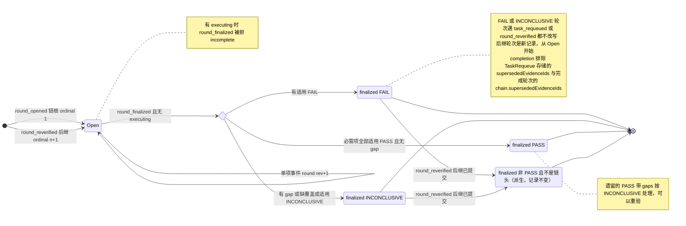

轮次链（同一 subject 的槽，C5）：

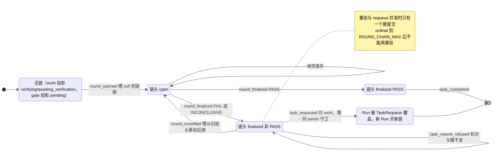

单项（轮次 open 期间）：

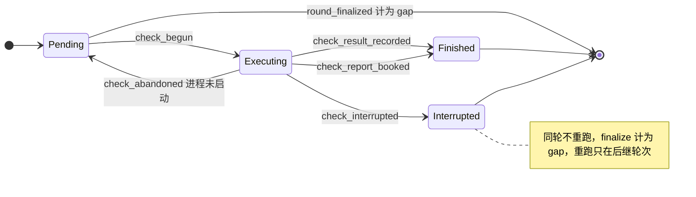

TaskEvidenceIndex 的写入不变式：

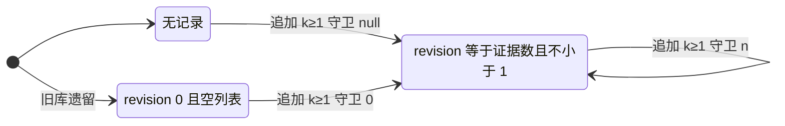

### 9.6 实现对照

状态机文件：`src/core/work-graph/state/verification-machine.ts`。

简化（2026-10-07，不改行为）：`verification-machine.ts` 另导出 `reverifyCapExceeded`（VD-13 的自动重验上限，Host 中断豁免不计）和 `roundChainFull`（I-20 的链长上限）。VR-14 和 `task-failure.ts` 的 AV-7a/7b、GV-6/7 共用这两条，不再各算一遍。

| 行号 | 状态机函数（目标：src/core/work-graph/state/<file>.ts 中的导出） | 调用服务（file） | 已有测试（file） | 计划新增测试（描述） |
| --- | --- | --- | --- | --- |
| VR-01 | `transitionRound(state, {kind:'round_opened'}, ctx)`；`roundSlotKey(subject)`（work 键与 gate 键两种）；`buildOpenedRound(...)`（写 `chain` ordinal 1） | `evidence/evidence-service.ts`：`openVerification` 加槽（work/gate 键）、lookup 0 行（gate 另查 `VerificationRoundByTask`）与 VD-9 守卫，写 `chain`，自行映射 `unique_conflict`；读取、捕获与编译（`:374-517`）抽成 `prepareRoundOpening`，与 VR-14 共用（完整捕获，lead 决定 LA-5（2026-10-03））；`queryOriginalVerification`（`:586-638`）改为 `queryRoundChainHead` 的计划无关别名，`OriginalVerificationQuery.planRef` 改为可选，只校验 `round.adoptedPlanRef` 属于同一 Goal（`model/evidence-contracts.ts:49-53`，VD-7、C6）。`persistence/evidence-record-codecs.ts`：`roundSnapshotProblem`（`:284-321`）放行并校验 `chain`，`checkSnapshotProblem`（`:187-208`）校验 `incompleteCause`，新 lookup `VerificationRoundByTask`（`:635`、`:652-653`）。`business/workflow/workflow.ts`：`openWorkChecksStep`（`:112-115`）带 Goal 当前采用版，调用处 `:596`（`resumeRoundChain` 从 `selectNext` 取 `graph.plan.ref`）、`:806`、`:814`（今天不读 Goal：先 `queryGoal`，`activePlanRevision` 为 null 时 `waiting`）；查询（`:572`）不传 `planRef`；gate 开轮（`:724-736`）改为 `advanceGate`，已有链时不再 `open_checks` | `tests/work-graph/R3e-evidence.test.ts:70`、`:273`；`:307-311`（**需改**：同一 Run 第二次开轮今天提交新轮次，改为 `busy`；改写为 finalize 后 `reverifyRound`，后继冻结新配置）；`tests/composition/R5c-workflow-platform.test.ts:470`；`tests/work-graph/R3e-completion.test.ts:97-125`、`tests/composition/R3e-completion-platform.test.ts:72-107`（同一 producer Run 上一个 work 轮次加一个 gate 轮次，槽键不同，预期不变，实施时复核） | 两个 flowId 对同一 Run 开轮 → 第二个得 `busy` + current；并发开轮只成一轮；遗留无槽轮次 → `busy`；subject Run 为 `cancelled`/`outcome_unknown` → 拒绝；领取后 W16 未来采用，Run 结束仍能开轮并完成；Goal `paused` → `busy`；新轮次带 `chain` ordinal 1；gate 已在另一个 producer 上有链 → `busy` + 链头 pin，即使 `graph.tasks` 顺序把另一个已满足的 work 行排在前面，Workflow 也不再 `open_checks`；`queryOriginalVerification` 不带 `planRef`，在新的计划版本生效后仍返回旧版本下打开的轮次（C6）；构建 `open_checks` 的三条路径（resume、start、observe）都带当前采用版。A.2 5.3 同步：链查询（work 查 `VerificationRoundBySubject`，gate 查 `VerificationRoundByTask`，上限 `ROUND_CHAIN_MAX + 1`）在采集来源之前；已有链（含遗留无槽链根）→ `busy` + 链头 pin，链无效 → `incomplete`；start 与 observe 共用 `openChecksAfterRun`，测试覆盖 resume 与 start 两条路径 |
| VR-02 | `transitionCheck(check, {kind:'check_begun'}, ctx)` | `evidence-service.ts` `beginCheck`（加 Goal、disposition 读取与守卫）；`agent-runtime/check-execution.ts` | `R3e-evidence.test.ts:118`、`:183`；`tests/composition/R3e-command-check-platform.test.ts:144`（并发只跑一个进程） | 机表：pending→executing，其它 phase 一律拒绝（`interrupted` 也拒绝）；Goal 暂停后起检 → `busy`，进程计数不变；subject task 只在当前采用版中为 superseded → `invalid` |
| VR-03 | `transitionCheck(..., {kind:'check_result_recorded'})`；`outcomeFor` 移入 state，同时给出 `incompleteCause` | `evidence-service.ts` `recordCheckResult`（写 `incompleteCause`，`:780-781`）；`check-execution.ts:169-174` 有界重试（VD-10） | `R3e-evidence.test.ts:118`、`:183`；`R3e-command-check-platform.test.ts:81` | 对 interrupted 单项迟到的结果 → `busy`，结论不变；并发起检使 pin 过期后重试成功入账；前次已提交时重试 → 重读得 finished；`incompleteCause` 派生：`not_started`、sourceStatus `changed` → `source_not_matched`、`timedOut` → `process_timed_out`、`cancelled` → `process_cancelled`、signal `SIGKILL` / exitCode null / workspaceRevision null → `process_abnormal`，PASS/FAIL → null（服务层：不同失败方式各一例） |
| VR-04 | `transitionCheck(..., {kind:'check_interrupted', cause:'host_restart'})`（写 `incompleteCause='host_restart'`）；新 port 操作 `interruptCheck`；新事件 `VerificationCheckInterrupted` 加入 `VerificationRoundEvent` 联合（`evidence-record-codecs.ts:66-71`）与 `VERIFICATION_ROUND_EVENT_TYPES`（`:73-79`，schema 注册经 `:455-457` 自动带上） | `src/app/host.ts` 启动时在 D-18 之后调用新 `src/core/agent-runtime/check-reconcile.ts`：枚举 executing 单项，调 `interruptCheck`/`bookCheckReport`。新增 lookup `VerificationRoundByStatus`（路径 `ref.projectId/ref.workspaceId/status`），注册在 `evidence-record-codecs.ts:458-461` | `R3e-command-check-platform.test.ts:144`（组合根层不跑 reconcile，仍断言 executing，保持有效） | Host 重启并接管陈旧租约 → executing 变 interrupted（`incompleteCause='host_restart'`），进程计数不变；另一 Host 存活 → 不变；同一实例重复 reconcile → 回放；另一实例遇已 interrupted → 跳过、不报错；Host 执行者配置变化后重启 → 仍能标记 interrupted |
| VR-05 | `transitionCheck(..., {kind:'check_abandoned', cause})`；新 port 操作 `abandonCheck`；新事件 `VerificationCheckAbandoned`（注册同 VR-04） | `check-execution.ts:117-137` 的五条早退路径重读轮次后调用 `abandonCheck`（finishing signal，同 `:168`），仍返回原拒绝 | — | begin 后调用方取消 → 单项回到 pending、无 gap，下一次推进起检得新 invocationId 并照常入账；begin 后 root 变化 → pending → 下一次起检得 `frozen_root_changed` → finalize INCONCLUSIVE；execute 抛出未知错误 → 仍为 executing。A.2 5.3 同步：`abandonCheck` 是 `EvidencePort` 的可选成员，输入 `AbandonCheckInput`（`model/evidence-contracts.ts`），runner 的 requestId 为 `r3e-check-abandon-<invocationId>` |
| VR-13 | `transitionCheck(..., {kind:'check_interrupted', cause:'ticket_invalid'})`（写 `incompleteCause='ticket_invalid'`）；port 操作 `interruptCheck` | `check-execution.ts:108-109` | — | ticket 不完整 → interrupted（`incompleteCause='ticket_invalid'`），Workflow 不再起检该单项，finalize 计 gap `interrupted_check`；之后的重验不豁免，受键与上限约束。A.2 5.3 同步：`interruptCheck` 是 `EvidencePort` 的可选成员，输入 `InterruptCheckInput`，runner 的 requestId 为 `r3e-check-interrupt-<invocationId>`；中断后 runner 仍返回原来的 `unavailable`，Workflow 等待一次推进，下一次选择照跑剩余 pending |
| VR-06 | `transitionCheck(..., {kind:'check_report_booked'})`；新 port 操作 `bookCheckReport`；新事件 `VerificationCheckReportBooked`（注册同 VR-04） | `check-reconcile.ts`；body store 新增按 origin requestId 的查找（注 1） | — | 报告已存而提交前崩溃 → 入账 finished，不重跑（前置能力就绪后）；同一 requestId 两份正文 outcome 不同 → interrupted；报告身份与单项不符 → 不入账；已 interrupted 后才找到报告 → `busy`，不升级。A.2 5.6 同步：VR-06 删除（GAP-24），以上用例待 GAP-24 出口 |
| VR-07 | `transitionRound(..., {kind:'round_finalized'})`；`finalizeRoundOutcome(input)`；`buildFinalizedRound(...)`；`displayRoundStatus(round)` | `evidence-service.ts` `finalizeChecks`；`workflow.ts` `nextAfterRound`（`:124-136`：只有 executing 才等待，pending 先跑，之后 finalize）；`performStep` 的 `finalize_checks` 分支（`:833-845`）：非 PASS → `advancing(select_work)`，`busy`（已 finalized，陈旧重放）→ `select_work` | `R3e-evidence.test.ts:183`（executing ⇒ `incomplete`，保持）、`:228`；`R5c-workflow-platform.test.ts:604`、`:617`（**需改**：真实 FAIL 检查改为断言 `outcome:'FAIL'`）；`R5c-workflow-platform.test.ts:602-607`（**需改**：非 PASS 的 `finalize_checks` 今天断言 `state:'waiting', next:null`，改为 `advance` 且 `next.kind === 'select_work'`）；`R5c-workflow-platform.test.ts:609-615`（含 `:445-446` 的说明）**需改**：`afterFail` 返回 `perform requeue_task`（判定 `requeue`，类别 `check_failed`，C8，见 §15 第 7 步）；`:616-618`（不开替代轮次，FAIL 不自动重验，C5）保持通过；`tests/work-graph/R3e-evidence-coverage.test.ts:53`、`:68` | 机表：FAIL 优先；interrupted → gap `interrupted_check` → INCONCLUSIVE；pending 加上同一要求的另一 PASS → INCONCLUSIVE（VD-4）；finalize 与 Plan 采用并发 → `revision_conflict`；中断后剩余 pending 照跑，投影单调；Workflow：finalize 非 PASS → `select_work`；`finalize_checks` 得“已 finalized”的 `busy` → `select_work`。A.2 5.3 同步：本步落地机表、D-2 折叠、`nextAfterRound` 的顺序与读集守卫（效果 `guard_finalize_read_set`：Goal、轮次采用版、与之不同时的当前采用版、subject Run，均为读到的版本；subject Run 不可读 → `unavailable`，不提交）；两条 Workflow 映射与 `R5c-workflow-platform.test.ts:602-615` 的改写在 5.8（非 PASS 按判定）与 5.9（`busy`），本步仍等待 |
| VR-08 | `transitionRound(..., {kind:'evidence_submitted'})` | `evidence-service.ts` `submitEvidence` | 无（`tests/business/R5c-workflow.test.ts:65` 只是 stub） | finalized 后提交 → `busy`；提交与 finalize 并发 → 只有一个成功。A.2 5.3 同步：轮次守卫写作效果 `guard_round_unchanged{revision}`（轮次按读到的版本守卫，不改写）。2026-10-07 简化同步（决定 34）：本行删除，见 §9.3 VR-08；`guard_round_unchanged` 留给 VR-09 |
| VR-09 | `chainEvidenceIds(head)`（`head.chain.supersededEvidenceIds ∪ ids(head.evidenceRefs)`，供 §4 `write_task_requeue` 存入，L-3；取代原稿的 `supersededEvidenceIdsOf(round)`）；`evidenceSupersededByRequeue(requeues)`（各 TaskRequeue 存储 id 的并集）；`roundFailureFacts(round)`（`state/no-progress.ts`，给出 `FailingCheckFactV1[]` 与 gap codes；§13 两种键、读模型与接续说明共用） | `tasks/requeue-service.ts`（新，D-3）写 `afterRoundRef`（链头）与 `supersededEvidenceIds = chainEvidenceIds(链头)`，守卫链头 round@rev 与同 owner 槽 claim；`tasks/completion.ts`：读该 Task 的 TaskRequeue（§4 4.3 末），在 `:356-381` 折叠前排除 `∪ TaskRequeue.supersededEvidenceIds ∪ round.chain.supersededEvidenceIds`，不读 afterRound 轮次，`selectEffectiveEvidenceSet` 本身不变 | `R3e-evidence-coverage.test.ts:68`（折叠不删阻塞，保持）；`tests/work-graph/R3e-completion.test.ts:87` | Run1 轮次 FAIL → requeue → Run2 轮次 PASS → `completeTask` 成功；Run1 链 R1→R2 后 requeue：存储的 `supersededEvidenceIds` 含 R1 与 R2 的全部 id，顺序为祖先在前，无轮次时为 `[]`；不 requeue 时旧 FAIL 仍阻塞；链头 open 时 requeue → 拒绝；遗留 PASS 带 gaps → 可 requeue；同一失败两次的 `roundFailureFacts` 相同（不含 id、digest、时间），超时与未启动给出不同的 `cause`；重验与 requeue 竞态：requeue 读后插入一次后继轮次提交 → requeue 得 `revision_conflict`（槽守卫），反过来 → 重验得 `revision_conflict`（TaskRequeue key 守卫） |
| VR-14（owner） | `transitionRound(head, {kind:'round_reverified'}, ctx)`（两次纯比较：捕获前做 VR-14 第 3–7 步，捕获与编译后做第 10–11 步）；`buildSuccessorRound(...)`（含 `autoCount` 的计算）；`roundChainHead(rounds)`；`chainEvidenceIds(head)`；`reverifyFailureClass(head)`；`reverifyExemption(pred)`；`reverifyBasis(input)`（`state/no-progress.ts`，与 `noProgressKey` 同文件）；拒绝记录构造器 `newTaskReworkRefusalRecord`（`state/task-failure.ts`，§4 TASK-28） | `evidence/evidence-service.ts`：新 `reverifyRound`（回执 → 准入 → lookup 读链与链头，读 subject Run、Goal、拒绝记录与 TaskRequeue → 机器预检（VR-14 第 3–7 步：状态前置、Goal、权限与围栏、上限；第 3–5 步不通过即 0 commit 返回）→ `countEndedGoalRuns`（第 8 步，在捕获之前；上限不通过时计数后即提交拒绝记录，不捕获）→ `prepareRoundOpening`（第 9 步：完整捕获与编译，executor 取自配置）→ 机器（第 10–11 步：`verification_uncovered`、`source_unchanged`、键）→ 带槽 CAS 提交后继，或提交拒绝记录；`unique_conflict` 自行映射为 `revision_conflict` + 链头 pin）；新 `queryRoundChainHead`；依赖 `automationPolicy()`（与 requeue 服务同一个，在 `src/composition/create-platform.ts` 注入）与 `MaterialPort.storeArtifact`（存 `note`）；Agent 准入用 `tasks/plan-write-admission.ts` 的 `authorizeDelegatedWrite`，`DelegatedWriteOperation` 加 `'reverify_round'`。`evidence-record-codecs.ts`：事件 `VerificationRoundReverified` 加入 `VerificationRoundEvent` 联合（`:66-71`）与 `VERIFICATION_ROUND_EVENT_TYPES`（`:73-79`）；`TaskReworkRefusal@1` 与事件 `TaskReworkRefused` 与 requeue 的拒绝共用一次注册（§4） | 无 | 单元 `tests/state/verification-chain.test.ts`：`roundChainHead`（无链；单个遗留根；1..3 → 第 3 轮；两根、序号断档、前驱不符、序号重复、gate 链出现两个 runId → invalid）；`transitionRound(round_reverified)` 状态×事件穷举（FAIL / INCONCLUSIVE / 遗留 PASS 带 gaps 可以；open → `busy`；PASS → `invalid`；非链头 → `revision_conflict`；Goal 暂停 → `busy`；处置 superseded → `invalid`；已有 TaskRequeue → `revision_conflict`；围栏且非人工 → `forbidden`）；`buildSuccessorRound`（ordinal、前驱、R1→R2→R3 的累计 id 按序、`basisDigests` 按序追加（豁免为 `host_interruption`/`not_started` 时可与更早的项重复）、全部 pending、`reverify` 事实）；`reverifyExemption`（只有 host_restart → `host_interruption`；只有 not_started 或两者混合 → `not_started`；ticket_invalid、超时、`process_cancelled`、多一条 `uncovered_requirement` gap → `none`）；`reverifyBasis` 与 id、报告 digest、时间、`reason`、单项顺序无关，随来源、配置、policy pin、单项原因、新输入变化，且不含 `planDigest`/`taskDigest`（无关采用与 TASK-19 处置变化前后键相同）；键：与第 2 轮基础相同 → `no_new_basis`，S1→S2→S1 → 拒绝，新输入 → 通过，`host_interruption` 连续两次同键 → 通过；上限：`not_started` 计数，3 次自动通过、第 4 次 `auto_rework_cap_reached`，人工之后 `autoCount` 归零，`host_interruption` 不增计数；`onlyIfSourceChanged`：未变且豁免 `none` → `source_unchanged`，未变但 `host_interruption` → 通过；`reverifyFailureClass` 不受调用方影响。服务 `tests/work-graph/R3e-reverify.test.ts`：finalize INCONCLUSIVE → 重验 → 后继 open、ordinal 2、前驱逐字节不变，`queryRoundChainHead` 与 `queryOriginalVerification` 返回后继；同 requestId 重放（`reverified` 与 `refused` 都重放），旧链头上另一 requestId → `revision_conflict`，并发两次只成一次；后继冻结当前配置；R1 FAIL、改文件、重验 → R2 PASS → `completeTask` 成功并排除 R1 的阻塞证据，对照：不重验时旧 FAIL 仍阻塞；gate：`onlyIfSourceChanged` 且无改动 → 拒绝记录 `source_unchanged`，改动后通过 → PASS → gate 完成用锚定 producer；遗留无 `chain` 根 → `null→后继键` 成功，两根 → `incomplete`；Agent：同 Goal 活 Run 准入，`actorClass:'agent'`，事件 actor 为 Host 身份，另一 Goal 或已结束 Run → `forbidden`；Workflow 主体 → `actorClass:'system'`，`reason` 为 `auto-reverify:<class>#<autoCount>`；Goal 暂停 → `busy`，Goal 已取消 → `busy`，链头 open → `busy finalize_first:`；策略拒绝写 `TaskReworkRefusal@k+1` 并返回 `refused`，基础设施拒绝 0 commit（账本游标不变）；`verification_uncovered` 对人工也拒绝、不跑检查进程，登记覆盖检查后配置版本变化 → 拒绝过期 → 通过（lead 决定 LA-4（2026-10-03））；`note`：同键无 note → `no_new_basis`，带 note → 通过且 `newInputRefs` 含存储的 Artifact，同一段 note 再来 → 同键拒绝，非人工带 note → `invalid`；引用前驱自己的检查报告 → `invalid`（ND-9）；拒绝过期后的重试带新 pin → 新指纹，不重放旧 `refused`；Goal 暂停时后继 open 且有 pending → `beginCheck` `busy`，进程计数不变，恢复后照常；codec：带 `chain`（ordinal 2、`requestedBy` 为 agent）与 `incompleteCause` 的轮次往返，遗留轮次可解码，ordinal 1 却带前驱 → 拒绝 |
| VR-14（Workflow 与入口） | —（Workflow、路由与界面改造，无机器函数） | `business/workflow/contracts.ts`：`WorkflowCalls.reverify_round`（`:37-48`）。`workflow.ts`：`performStep` 新分支 `reverify_round`，经 `automationContext(owned)`；requestId 由 `predecessorRoundRef` 与前驱、拒绝两个 pin 派生；结果映射见 VD-12；`resumeOriginalRound` → `resumeRoundChain`，gate 步骤 → `advanceGate`。`src/app/core-http-types.ts:74`、`core-routes.ts:152-216` 与 dispatch：路由 `verification/reverify`（`graph_write`，owner `evidence.reverifyRound`）。界面：`src/ui/main.ts:1015-1020` 的 `GRAPH_WRITE_ROUTES` 与 `ROUTE_LABELS`（`:1023`）加该路由；Task 详情显示轮次链（默认折叠；每轮 ordinal、结论、失败检查与报告链接、执行者类别、失败类别、`sourceChanged`）；按钮 work 为“重新检查”、gate 为“重新验收”；`no_new_basis` 拒绝后提供“附上说明作为新依据”；链头 open 且只剩 interrupted 时按钮换成“继续推进”（`workflow/advance`，没有 finalize 路由）；`verification_uncovered` 拒绝链接到 Host 检查设置；Goal 上 gate 失败提供“重新验收”与“添加修复任务”（预填失败 checkId，报告引用放进 `PlanChangeReason.sources`） | `tests/business/R5c-workflow.test.ts` | work 链头 INCONCLUSIVE → `select_work` 给出 `reverify_round`，提交后 `select_work` 选中后继并 `run_check`；work 链头 FAIL → 没有 `reverify_round`；gate 无链 → 在 `:728` 的 producer 上 `open_checks`，有链 → 从不 `open_checks`（即使 `graph.tasks` 顺序变了），FAIL → `reverify_round{onlyIfSourceChanged:true}`，`refused source_unchanged` → `select_work` 后判定 `stopped/gate_needs_fix`，INCONCLUSIVE → 不带来源条件，PASS → `complete_task`；gate FAIL 时有待做的修复 Task → 先选修复 Task；客户端重贴的 `perform reverify_round` 仍记为 `system`；Task 范围句柄完成修复 Task 后不进入 gate 步骤；被拒 `revision_conflict` → `select_work`，其他拒绝 → `waiting` 且 `reason` 以 G3 代码开头。运行时：生产 Role 授予 `requeue_task` 或 `reverify_round` 时，driver 起跑前按未知工具名拒绝（`execution-driver.ts:118-120`；一个负向测试覆盖两个名字，GAP-46）。场景：A10-R5（work 检查中 Host 重启 → 重启后 finalize INCONCLUSIVE → 自动重验，豁免、`autoCount` 0 → PASS → Task 满足，首个 Run 之后 0 次模型调用）；A10-R6（gate 检查中重启 → 在锚定 producer 上自动重验 → PASS → Goal COMPLETED）；`C5-gate-fix`（work 满足后改工作区使 gate 检查 FAIL → `source_unchanged` → Goal 显示 `gate_needs_fix` 与失败 checkId → 人经 W16 加承载 gate 义务的必需修复 Task → 修复 Run 修好文件、修复轮次 PASS → gate 自动重验，`sourceChanged:true`、`failureClass:'check_failed'` → PASS → COMPLETED，旧 gate 轮次与报告仍可读；对照：修复不改文件时修复 Task 自己的轮次 FAIL，gate 不再验，Goal 原因来自修复 Task；另一 Task 同时持有已领取的 Run，W16 不影响它，C6）；`C5-reverify-guards`（uncovered → 0 次重验、0 个检查进程，登记覆盖检查后下一次推进重验；超时且工作区每轮变化 → 3 次自动重验后 `auto_rework_cap_reached`，人工随后可重验；`launch_failed` → 跳过键但到上限停；超时且无改动 → 1 次自动重验后 `no_new_basis`）；`C5-gate-fix-open`（gate 轮次 open 时采用修复 Task → 先跑修复 → gate 剩余单项 `frozen_source_changed` → INCONCLUSIVE → 重验 → COMPLETED，修复 Run 之外 0 次模型调用） |
| VR-15 | 无独立函数：“非链头”由 `roundChainHead` 派生；`displayRoundStatus(round)` 仍给 `completed`，界面另标“已被第 n 轮取代” | `tasks/completion.ts`（排除后继的 `chain.supersededEvidenceIds`）；界面轮次历史 | 无 | 重验后前驱记录逐字节不变；completion 排除前驱证据；前驱的报告仍可按需读取 |
| VR-10..VR-12 | `nextTaskEvidenceIndex({exists, revision, ids}, appended)` → `{write:false}` 或 `{record, guard}` | `evidence-service.ts` `submitEvidence`（2026-10-07 已删除，决定 34）/`finalizeChecks`/`readIndex` | 无 | 全部 STALE 时 finalize（零快照）→ 不建 index 行，随后 submit（2026-10-07 已删除，决定 34）/finalize 成功；遗留 @0 行在下一次追加时修复；`completion.ts` 的 `collectEvidenceKeys`（`:622-656`）读遗留 @0 行不报错 |
| 出口 #3（VD-8） | `beginRefusalIsPermanent(rejection)`：只有 `reason` 以 `frozen_permission_changed:`、`frozen_root_changed:`、`frozen_source_changed:` 开头的拒绝 → true（L-9 固定前缀） | `evidence-service.ts` `beginCheck`（`:689-698`）与 `check-execution.ts:81-83` 把标记写成 `reason` 前缀；`workflow.ts` `performStep` 的 `run_check` 分支（`:824-831`）：标记命中时读轮次并提交 `finalize_checks` | — | 开轮后 root 或来源 digest 变化 → 剩余单项不再重试，轮次 INCONCLUSIVE，Task `blocked/round_inconclusive`，Workflow 自动重验（人工也可 requeue）；authorize 暂时拒绝（`forbidden` 无标记）→ 仍等待；capture 失败（`source_stale` 无标记）→ 仍等待；沙箱不可用 → 仍等待 |
| 完成（VD-7，死路 #8） | —（Workflow 改造，无机器函数） | `workflow.ts` `completeTaskStep`（`:137-148`）：`planRef` 取 `goal.activePlanRevision`，不再取 `round.adoptedPlanRef`，为 null 时等待；调用处 `:587`、`:844` 已读出 Goal。`tasks/completion.ts`：完成轮次必然是链头（只有非 PASS 链头才会有后继），`:321` 的 PASS 检查已足够，不另加链头检查。A.2 5.3 同步（更正）：按 §4.4 TASK-14 另加了投影与链头守卫（`taskCompletionProjectionProblem`，`TaskCompletionFacts.chainHead`）。遗留的无槽第二链根使链无效（P10），其中的 PASS 轮次不是有效链头，只靠 PASS 检查会放行；投影为 `failed`/`blocked` 时 `illegal`/`incomplete`，轮次不是所选 Run 的链头时 `guard_failed`/`incomplete` | `tests/composition/R5c-workflow-platform.test.ts`（今天没有断言 `open_checks`/`complete_task` 的 `planRef`，VD-7 不改变已有断言） | 开轮之后、completeTask 之前发生 W16 未来采用 → Task 仍完成（不得 `revision_conflict`）；gate 轮次同样适用；用已被取代的前驱轮次完成 → 拒绝（它不是 PASS） |
| Workflow 选择（VD-11，L-15） | —（Workflow 改造，无机器函数） | `workflow.ts` `selectNext`（`:715-742`）：`:720`、`:739` 跳过 `cancelled`/`superseded`（同 `completion-policy.ts:239`，L-15）；只剩 `deferred` 的必需 work、且没有别的可领取工作时 → `waiting`，`reason` 前缀 `required_task_deferred:`（C7），`describeGap`（`:198-211`）先写处置；显式 Task 句柄（`:709-711`）指向 `cancelled`/`superseded` 的 Task → `completed`，指向 `deferred` 的 Task → `waiting`，前缀都是 `task_not_active:`（早先的 `satisfied` 检查 `:622-627` 仍在前）；gate 步骤（`:724-736`）改为 `advanceGate`（VD-15）。U-10 (a) 不采纳，`:726` 不另加处置过滤（gate 定义冻结） | `tests/business/R5c-workflow.test.ts` | 必需 work 被 cancelled → 不再等待它；必需 work 被 deferred → `waiting` 且前缀 `required_task_deferred:`；显式句柄指向 cancelled 的 Task → `completed` 且前缀 `task_not_active:`；gate 已有链时 `advanceGate` 只按链头推进 |
| 投影 | `roundTaskSignal(rounds)`（作为 `projectTaskPhase` 的输入；先经 `roundChainHead` 取链头，链无效给 `round_ambiguous`） | `tasks/plan-readers.ts`：`readCanonicalTaskFacts`（`:996-1175`）在同一读取窗口内读选定 Run 的链（`VerificationRoundBySubject`）与 gate 的链（`VerificationRoundByTask`），折叠（`:1150-1154`）改由 state/task-machine 调用；失败事实 `TaskRow.failure` 用同一链头（§4 TD-8） | `tests/work-graph/R3c-canonical-task-state.test.ts` | 按“轮次 → Task 投影”表逐行断言（含 open+interrupted+pending → `verifying`、遗留 PASS 带 gaps → `blocked/round_inconclusive`、open 的后继轮次 → `verifying` 且 detail 带 `ordinal`、链无效 → `blocked/round_ambiguous`）；gate 按 P20 逐行（无链 → `pending`，open → `verifying`，FAIL → `failed`，INCONCLUSIVE → `blocked`，PASS → `verifying/awaiting_completion`）；gate 轮次不改变 producer 的投影 |

构造器约束（§14）：`buildOpenedRound`、`buildSuccessorRound`、`withCheckPhase`、`buildFinalizedRound`、`nextTaskEvidenceIndex` 只从 `state/` 导出。`RoundSnapshot.chain` 只由 `buildOpenedRound`（ordinal 1）与 `buildSuccessorRound` 写入；`RoundCheckSnapshot.incompleteCause` 只经 `withCheckPhase` 写入；reverify 的拒绝记录只经 `newTaskReworkRefusalRecord`（§4）构造。`evidence-record-codecs.ts` 的解码函数在白名单内。


## 10. Message

消息是收件 Session 收到的一条陈述，不是任务义务。收件人忙或已归档都照常收信；收信不会唤醒执行、不会抢占，也不会建立任务依赖（`src/core/work-graph/model/communication-contracts.ts:6-11`）。本节把邮箱的六个写入点（state-writes-other §2，M-a…M-f）转写为单调状态机。消息状态只有 `pending/read/responded`。“已交付”“等待”“已落实”都用其他事实表达，不新增消息状态（ORCHESTRATION §0.2“确认层次”、§2 消息行）。

本节依赖的决定（2026-10-03 已确认，D-6、D-4(b) 按原推荐）：D-17（不做“让出前即持久化的等待关联”）、D-6（重启补账，U-6）、D-4(b)（人工认定，Kernel 可能不可读；属 U-4；只经持实例租约的 Host 入口，lead 决定 L-1），以及 §6 的 RD-3（重启时 Kernel 终态为 yielded：由持久事实重建 continuation 后按原结果入账；只在本 Turn 恰好一条等待发信时重建，否则记为未知，lead 决定 L-5）。

### 10.1 持久位置与状态枚举

| 字段 | 位置（file:line） | 取值 | 可变性 |
| --- | --- | --- | --- |
| `status` | `SessionMessage.status`（`model/communication-contracts.ts:104`），类型定义在 `:88` | `'pending' \| 'read' \| 'responded'` | 只能单调前进 |
| `readAt` | `:105` | `null \| string` | ack 时写入；回复时若仍为空则回填 |
| `response` | `:106`，类型 `MessageResponse` 在 `:81-86` | `null \| {sender: work_run \| query_run, bodyRef, sourceRef, respondedAt}` | 单槽，只写一次 |
| `replyMode`、`intent`、`needsReply`、`waitAfterSend` | `:113-119`；意图类型见 `src/contracts/core/session-message.ts:22`、`:25-29` | `'wait'`；`notify/inquiry/action_request`；boolean | 发送时固定，之后不变 |
| `acceptedInputs[]` | `:132-138` | `{inputId, part: message \| response, executionRef, kernel{…position}, acceptedAt}` | 只追加 |
| `consultationDerivation` | `:139-144` | `{childSessionRef, sourceSessionRef, sourceKernel, throughPosition}` | 只写一次，先写者胜 |
| `sender`、`recipient`、`bodyRef`、`sourceRef`、`createdAt` | `:99-103` | sender 为 `host`（`:36-39`）或 `work_run`（`:46-52`） | 不可变 |

- 状态机输入状态：`MessageMachineState = absent | { status, hasReadAt, hasResponse, acceptedInputIds, hasDerivation, revision }`。
- 守卫上下文（IO 留在服务，服务把读取和授权结果填进来）：

```ts
// src/core/work-graph/state/message-machine.ts（目标）只 import src/contracts
type MessageGuardContext = {
  principal: 'host' | 'work_run' | 'other';
  workRunAuthorization: 'ok' | CoreRejection | null;  // authorizeNewWorkRunAction 的结果（mailbox-service.ts:615-741）；Host 调用为 null
  callerIsRecipient: boolean | null;                   // ack/respond：调用方 Session 是收件人
  recipientScope: 'same_workspace' | 'other_workspace' | 'other_project' | null; // 只用于 message_sent
  sendFlags: { needsReply: boolean; waitAfterSend: boolean; replyMode: 'wait' | null; pinCount: number } | null;
  pins: { count: number; matchesMessage: boolean; revision: number | null }; // ack/respond/derive 要求恰好一个指向本消息的版本钉
  bodyBounded: boolean | null;
  queryAnswer: null | {                                // 只用于 MSG-06
    bindingMatches: boolean;                           // 咨询绑定与消息、原收件人、derivation 来源一致
    jobAnsweredWithAnswer: boolean;
    runSettledAnswered: boolean;
    answeringSessionIsClaimSession: boolean;
  };
  inputAccepted: null | {                              // 只用于 MSG-07/08
    observerOwnsExecution: boolean;                    // work_run 只能确认自己的 Run；Host 恒为 true
    kernelMatches: boolean;                            // 等于执行记录中固定的 Kernel 身份
    executionSessionMatches: boolean;                  // part=message：收件人；part=response：原发信 Session
    inputIdTakenByOtherEvent: boolean;
  };
  consumedWait: null | { responseRefMatches: boolean; sameWorkspace: boolean }; // 只用于 MSG-10
};
```

- Codec `checkSessionMessageBody` 校验三元组一致（`message-record-codecs.ts:377-386`）：pending ⇒ readAt 与 response 都为空；read ⇒ 有 readAt、无 response；responded ⇒ 有 response。Codec 不校验两件事：responded ⇒ readAt 非空，以及状态单调。这两条由本机和记录构造函数保证（§11 I-8）。记录 schema 在提交时由存储校验（`record-codec.ts:379`）。

**设计名与代码的对应**

| 设计名（§2、§0.2） | 代码表达 | 说明 |
| --- | --- | --- |
| 已持久发送／消息已保存 | 记录存在，`status:'pending'` | M1 |
| 可读取 | 任一 status | 读操作不改状态（`model/communication-contracts.ts:167-171`），M2 |
| 已确认接收（已读） | `status:'read'` 加 `readAt` | M3 `ackMessage`；已读不等于已处理 |
| 已交付（进入执行） | `acceptedInputs[]` 中 `part:'message'` 的条目 | 来自 Kernel `run.input_accepted` 的观察，与 status 无关 |
| 实际答复／正式回复 | `status:'responded'` 加单槽 `response` | M3；回复可以由 work_run 写出，也可以来自正式 Query Answer |
| 回复已被原发信方的执行消费 | `acceptedInputs[]` 中 `part:'response'` 的条目 | 原发信 Session 的后继执行 |
| 相关行动已落实 | 不记在消息上 | 由 Run、控制和 Task 事实表达（§0.2） |
| 等待 | 不是消息状态 | 见下文 |

**等待怎样表达（D-17 缺口）**

1. **发送时的意图。** `needsReply`、`waitAfterSend`、`replyMode` 在发送时归一化（`mailbox-service.ts:1072-1077`）后固定。`waitAfterSend` 与 `needsReply=false` 不能同时出现，服务（`:1075-1077`）和 codec（`message-record-codecs.ts:325-327`）都会拒绝。
2. **执行中的等待登记只在内存。** 登记链路是 `communication-tools.ts:243-247` → `execution-driver.ts:328-331`（`handle.waitMessage`）。工具组屏障在 `after_group` 时让出（`execution-driver.ts:678-680`）。
3. **只有 yielded 终态会把等待写入持久记录。** `execution-control.ts:220-232` 构造 `RunContinuationV1{kind:'wait_reply', messageRef}`，经 `execution-observation.ts:647`、`:658` 交给 `recordRunResult`，写入 `Run.continuation`。yielded 终态必须带 continuation，否则 `recordRunResult` 拒绝（`execution-entry-service.ts:1373-1378`）。
4. **等待何时算满足。** 条件是消息为 `responded`，且 `response.bodyRef` 等于后继领取中 `consumedWait.responseRef`。后继领取写 `Run.consumedWait`，并在同一提交里守卫消息 revision（`claim-service.ts:590-638`、`:703`、`:731`）。`read` 状态或 `acceptedInputs` 都不满足等待（M3：“读取/接收确认不能解除等待”）。
5. **缺口（state-writes-other §7 #21，D-17 不做）。**
   - Host 若在发信成功后、yielded 终态提交前崩溃，进程内的等待登记会丢失：消息仍带 `waitAfterSend:true`，但 Run 上没有 continuation。
   - 重启补账分两种情况：
     - (a) Kernel 历史已有 `yielded` 终态（D-6）：进程内句柄上的 continuation（`execution-control.ts:220-232`）已经丢失，按现有 `recordRunResult` 会被拒为 `invalid`（`execution-entry-service.ts:1374-1376`）。本规格采用 §6 RD-3：Kernel 原历史中本 Turn 恰好有一条带 `waiting:true` 的 `send_session_message` 工具结果时（L-5），以它加上已存 `SessionMessage`（`sender.runRef`、`generation`、`waitAfterSend` 一致）重建 continuation，再经 RUN-17/18 按 yielded 入账并释放（Session 侧见 §8 SES-06），之后的回复照常触发接续领取（MSG-10）。重建不出时（含本 Turn 有零条或多条等待发信）经 RUN-20(iii) 记为 `outcome_unknown`，保留占用。
     - (b) Kernel 尚未 yield（D-17 真正的缺口，§12 W-18）：没有 yielded 终态，Run 按 RUN-19 记为 `crashed` 或按 RUN-20 记为未知，等待关联丢失。
   - 这条等待消息本身不变：仍是原来的 `pending`/`read`/`responded`，`waitAfterSend:true` 保留。情况 (b) 下之后到达的回复照常写入单槽（MSG-04..06），但没有 Run 的 continuation 指向它，所以不会触发接续领取，MSG-10 不会被调用。Task 按 §4 投影为 failed（RUN-19）或 blocked（RUN-20）。RUN-19（以及 Kernel Turn 未结束时的 RUN-22）之后原 Session 为 `unavailable/kernel_turn_open`，经 D-3 重新入队的新 Run 在新 Session 中运行（lead 决定 LA-1（2026-10-03），§16 GAP-50），输入供给不会提供发给原 Session 的这条回复；只有 requeue 把它列入 `newInputRefs` 时，接续说明才内联其正文（C3，§16 GAP-04）。
   - RD-3 不按 outbox 查找等待消息：该 Run 可能发出多条 `waitAfterSend` 消息，只有 Kernel 历史中的工具结果位置能指出是哪一条。进程内的取法也不唯一：`waitRegistered` 只记第一条（`execution-driver.ts:329`），continuation 取的 `waitHandle.waitMessage` 每次被覆盖（`:330`）。因此按 lead 决定 L-5，只在本 Turn 恰好一条等待发信时重建；多条时不猜，按重建失败经 §6 RUN-20(iii) 记为 `outcome_unknown`，保留占用和 Lease，出口为人工认定（RUN-22，须在持实例租约的 Host 上，L-1）。这些等待消息本身不变；认定之后与情形 (b) 相同：没有 continuation 指向回复，回复不触发接续领取。
   - 本节不新增消息侧的等待状态。

### 10.2 事件

| 事件名 | 来源 | 载荷要点 | 对应原文编号 |
| --- | --- | --- | --- |
| `message_sent` | U（Host 操作者或 Host 注意力递送，`src/app/host.ts:958-961`）、P（work_run 通信工具） | `recipient`、正文（先存成 `bodyRef`）、`intent/needsReply/waitAfterSend/replyMode`、发信 principal | M1 |
| `message_read` | P（work_run 工具 `ackMessage`） | `messageRef`，恰好一个消息版本钉 | M3 |
| `message_responded` | P（work_run 文本回复）；P（Host 关联正式 Query Answer） | `messageRef`、版本钉，以及 `text` 或 `answerRef` | M3、§0.1 A′ |
| `input_accepted` | K（Kernel `run.input_accepted`，由 Runtime 观察者提交，`agent-runtime/execution-inputs.ts:151-174`） | `messageRef`、`part`、`executionRef`、`kernel{adapterId, kernelSessionId, runId, turnId, position}` | M3（接收确认与响应分别记录）、§0.2 确认层次 |
| `consultation_derived` | P（Host 咨询消费者，`business/workflow/consultation.ts:368-379`） | `messageRef`、版本钉、`derivation` | §0.1 A′ |
| `task_claimed`（Task 投影事件，此处只读） | P | 接续领取中的 `consumedWait{runRef, messageRef, responseRef}` | M3（推进适用等待） |

- 没有 T（超时）来源的事件：M5 超时、失联、重定向目前没有写入者。
- 没有 R（重启）专用事件：reconcile 只会以同一身份重放 `input_accepted`（见 10.3 表后说明）。
- 实例租约被另一个存活的 Host 持有（或锁文件不可读）时，该 Host 不运行 reconcile，也不启动注意力递送等执行驱动，因此不会产生注意力递送的 `message_sent`（`src/app/host.ts:958-961`）。Host 操作者经 HTTP 的发信（MSG-01）和各读操作照常，由 RecordStore CAS 保护（lead 决定 L-10）。

### 10.3 迁移表

| # | from | event | guard（守卫） | to | effects（同事务副作用意图） | 幂等/重复事件 | 原文编号 | 现状 |
| --- | --- | --- | --- | --- | --- | --- | --- | --- |
| MSG-01 | absent | `message_sent`（Host 发信） | 可信 Host principal；收件 Session 在同一项目和工作区（忙碌或归档都可以）；发送标志合法；不带版本钉 | `pending`，rev 1 | 提交前先存正文（事务外）；写 `SessionMessage`，`readAt=null`、`response=null`；事件 `SessionMessageSent`；消息守卫为 `null` | 同身份同内容 → 重放；同身份不同内容 → `idempotency_conflict` | M1 | 已有 `mailbox-service.ts:1082-1083`、`:1126-1178` |
| MSG-02 | absent | `message_sent`（work_run 发信） | 同 MSG-01，另须通过 `authorizeNewWorkRunAction`：Run 为 running 且无 outcome；发信 Session 为 active 且由本 Run 的 generation 占用；Lease 未释放；V2 entered；角色核对 | `pending` | 同 MSG-01，并在同一提交守卫 Run、Session、Lease 和角色事实。若 `waitAfterSend`，Runtime 另在内存登记等待（不在本提交，D-17） | 同 MSG-01 | M1 | 已有 `mailbox-service.ts:1084-1124`、`:615-741` |
| MSG-03 | `pending` | `message_read` | principal 为 work_run；恰好一个版本钉；通过 `authorizeNewWorkRunAction`；调用方 Session 是收件人 | `read` | `readAt=now`，rev+1；事件 `SessionMessageRead`；守卫消息版本钉及授权事实 | 先查回执（`:1584-1586`）；未命中但状态已不是 pending → 再查一次，仍无则拒绝 | M3 | 已有 `mailbox-service.ts:1559-1624` |
| MSG-04 | `pending` | `message_responded`（work_run） | 同 MSG-03；正文有界 | `responded` | 提交前先存回复正文；写 `response{sender: work_run}`；`readAt ??= respondedAt`；rev+1；事件 `SessionMessageResponded` | 同身份重放；单槽只写一次 | M3 | 已有 `mailbox-service.ts:1629-1713` |
| MSG-05 | `read` | `message_responded`（work_run） | 同 MSG-04 | `responded` | 同 MSG-04（`readAt` 保持原值） | 同 MSG-04 | M3 | 已有 `mailbox-service.ts:1691-1697` |
| MSG-06 | `pending` 或 `read` | `message_responded`（query_run，由 Host 关联正式 Answer） | Host principal；咨询绑定与本消息、原收件人及 derivation 来源一致；QueryJob 为 answered 且列有该 Answer；QueryRun 已 settled 且 outcome 为 answered；作答 Session 是领取 Session；正文有界 | `responded` | `response{sender: query_run, generation}`；正文沿用 Answer 的原始来源；`readAt ??=`；只守卫消息版本钉 | 同身份重放（`:1838-1840`）；与 MSG-04/05 抢同一单槽时先到者胜 | M3、§0.1 A′ | 已有 `mailbox-service.ts:1726-1880` |
| MSG-07 | 任一 s | `input_accepted`（part=message） | principal 为 work_run（只能确认自己的 Run）或 Host；Kernel 身份等于执行记录中持久的身份；执行 Session 是收件人；该 inputId 尚未被接受 | s（不变） | 向 `acceptedInputs` 追加一条，rev+1；事件 `SessionMessageInputAccepted`；按读取到的 revision 守卫消息 | 身份键为 (messageRef, part, executionRef, kernel)，与观察者是谁无关（`:1996-1998`），重复即重放 | M3、§0.2 | 已有 `mailbox-service.ts:1947-2064` |
| MSG-08 | `responded` | `input_accepted`（part=response） | 同 MSG-07，但要求 `response≠null`，原发信人为 work_run，且执行 Session 是原发信 Session | `responded` | 同 MSG-07 | 同 MSG-07 | M3（回复关联原请求） | 已有 `mailbox-service.ts:2030-2033`、`:2045-2047` |
| MSG-09 | 任一 s | `consultation_derived` | Host principal；derivation 为对象，形状由 codec 在提交时校验；此前没有 derivation；恰好一个版本钉 | s（不变） | 写 `consultationDerivation`，rev+1；事件 `SessionMessageConsultationDerived`；只守卫消息版本钉 | 同身份重放（`:1912-1914`）；先写者胜 | §0.1 A′ | 已有 `mailbox-service.ts:1885-1942` |
| MSG-10 | `responded` | `task_claimed`（接续领取读取等待是否满足） | `status==='responded'` 且 `response≠null`；`response.bodyRef` 等于 `consumedWait.responseRef`；同一工作区 | `responded`（只读） | 领取提交守卫消息 revision；回复后再追加 `acceptedInputs` 会让并发领取得到 CAS 冲突 | 随领取回执重放 | M3（推进适用等待） | 已有 `claim-service.ts:619-638` |

表外说明：

- **释放前先补记输入。** 凡是在 Kernel 已有 Turn 后释放占用的路径，释放前都要先用同一函数重放 Kernel 历史中的 `run.input_accepted`。这不只适用于 Kernel 终态入账（含 RD-3 重建后的 yielded），也包括 D-6 的 crashed（RUN-19）、RD-7 的暂停中停止（RUN-23）、Query 的 interrupted_clean 和人工认定，即 §8 的 SES-04、06、07、08、09（QRR-04）、10。这个前置条件今天已经在两处生效：`execution-observation.ts:534-537` 和 `query-observation.ts:391-393`。重放靠 MSG-07/08 的身份键做到幂等，所以重启后不会重复追加。reconcile 不会重发、ack 或回复任何消息。
- **Kernel 不可读时的人工认定会造成重复投递。** §8 SES-07、SES-10（包括 SD-3 之后的认定）允许在 Kernel 不可读时释放。这时 Kernel 已接受、但还没确认的输入无法补记。后继执行的输入供给只跳过 `acceptedInputs` 中已记录的 inputId（`execution-inputs.ts:48-49`、`:74`、`:84`），所以可能再次接受同一消息部分，即至少一次投递。认定入口（只在持实例租约的 Host 上受理，L-1）要向操作者说明这一后果。
- **两个回复写入方。** MSG-04/05（work_run 文本回复）和 MSG-06（Host 关联 Query Answer）抢同一个单槽，都按消息版本钉做 CAS。若失败方在胜方提交前已读取消息，它在提交时遇到 CAS 冲突，再查回执没有命中，于是得到 `revision_conflict`。若失败方在胜方提交后才读取，它看到 `responded`，得到 `invalid`。两种情况都不覆盖胜方，胜方的同身份请求可以重放（`tests/work-graph/C1-session-mailbox.test.ts:376`）。
- **回复不要求收件人仍为 active。** MSG-06 的 Host 路径不检查收件 Session 的 lifecycle，归档不影响收件箱。work_run 路径要求的是“调用方”Session 为 active（`mailbox-service.ts:641`）。

### 10.4 明确禁止的迁移

| from | event/目标 | 拒绝原因 | 对外 CoreError | 说明 |
| --- | --- | --- | --- | --- |
| `read` 或 `responded` | 回到 `pending` | illegal | 无（没有入口） | I-8：状态不倒退；没有写入者 |
| `responded` | 回到 `read` | illegal | 无 | 同上 |
| `read` 或 `responded` | `message_read` | illegal | `invalid` | `mailbox-service.ts:1598-1605`；先按同身份重放 |
| `responded` | `message_responded`（任何发信者） | illegal | `invalid`；并发失败方可能得到 `revision_conflict` | `:1670-1675`、`:1841-1844`；单槽先到者胜 |
| absent | `message_read`、`message_responded`、`consultation_derived`、`input_accepted` | illegal | `not_found` | `:1594-1595`、`:1666-1667`、`:1763-1764`、`:1915-1916`、`:2002-2003`，经 `mapReadResult`（`:139`） |
| 任一 | Host 调用 `message_read` 或文本 `message_responded` | guard_failed | `forbidden` | `:1562`、`:1632`；Host 只能经 MSG-06 关联正式 Answer |
| 任一 | work_run 关联 Query Answer（MSG-06）或写 `consultation_derived`（MSG-09） | guard_failed | `forbidden` | `:1732`、`:1891`；两者只接受 Host principal |
| 任一 | 调用方 Session 不是收件人时 `message_read` 或 `message_responded` | guard_failed | `forbidden` | `:1597`、`:1669` |
| 任一 | work_run 的 Run 未运行、已终态、Lease 已释放或 Session 不是本 generation 占用时 send/ack/respond | guard_failed | `forbidden` | `:639-656`；原回执仍可重放（`C1-session-mailbox.test.ts:333`） |
| `pending` 或 `read` | `message_responded`（query_run），但 Query 未以 answered settled 或绑定不符 | guard_failed | `forbidden` | `:1780-1819` |
| 任一 | ack、respond 或 derive 未带恰好一个指向本消息的版本钉 | illegal | `invalid` | `:282-288` |
| 版本钉 ≠ 当前 revision | `message_read`、`message_responded`、`consultation_derived` | stale | `revision_conflict` | 存储 CAS |
| absent | `message_sent` 带版本钉 | illegal | `invalid` | `:1078` |
| absent | `message_sent` 同时设 `waitAfterSend` 与 `needsReply=false` | illegal | `invalid` | `:1075-1077` |
| absent | `message_sent` 的发信 principal 不是 host 或 work_run | illegal | `unsupported` | `:1091-1093` |
| absent | `message_sent` 的收件 Session 属于其他项目 | guard_failed | `forbidden` | `:1051`；先于工作区检查 |
| absent | `message_sent` 的收件 Session 不在本工作区 | guard_failed | `not_found` | `:1132-1134` |
| 任一 | `input_accepted` 的 inputId 已被另一事件记录 | guard_failed | `invalid`（沿用现有码） | `:2037-2042`。身份键含 executionRef 和 Kernel 位置（`:1996`），另一事件是不同身份，不是重复；这是 inputId 唯一性守卫 |
| 任一 | `input_accepted` 的 Kernel 身份或执行 Session 不符 | guard_failed | `forbidden` | `:2023-2036` |
| 任一 | work_run 为别的执行确认 `input_accepted` | guard_failed | `forbidden` | `:1981-1983` |
| 任一 | `input_accepted` 改变 `status` 或 `readAt` | illegal | 无 | 交付、已读、处理是三件事（M3）；该事件只追加 |
| 已有 derivation | `consultation_derived` | illegal | `invalid` | `:1918-1921`；先写者胜 |
| `pending` 或 `read` | 把 `message_read` 或 `input_accepted` 当作等待已满足 | guard_failed | `busy`（接续领取） | `claim-service.ts:630-632`：只有 responded 满足等待 |
| absent | `task_claimed`：接续领取引用的等待消息不存在 | guard_failed | `busy` | `claim-service.ts:626` |
| `responded` | `task_claimed`：`consumedWait.responseRef` ≠ `response.bodyRef` | guard_failed | `forbidden` | `claim-service.ts:633-635`；不信任调用方给的 responseRef |
| `responded` | `task_claimed`：等待消息不在绑定工作区 | guard_failed | `forbidden` | `claim-service.ts:636` |
| 任一 | 读操作（`readInbox`、`readMessage`、`readMessageBody`、`readOutbox`）改变 status | illegal | 无 | `model/communication-contracts.ts:167-171` |
| 任一 | 因超时或失联自动改变消息状态或取消等待 | illegal | 无 | M5 只允许确定性提醒和显式处置；本规格不提供写入者 |

**守卫缺口与处置（只修状态机必需的部分）**

| 缺口（state-writes-other §7） | 本规格处置 | 理由 |
| --- | --- | --- |
| #5(a) `recordInputAccepted` 忽略调用方版本钉，按读取到的 revision 守卫 | 不修 | 这是追加型观察。身份键、inputId 唯一和读取 revision 的 CAS 已足以防止重复和丢写 |
| #5(b) 不守卫读取的 Run 或 QueryRun 事实 | 不修 | 它核对的是 begin 时固定的 Kernel 身份（`auth.kernel`、`executionHistory.kernel`、`entry.kernel`）和 claim Session，两者都不可变 |
| #5(c) 不检查消息 status | 不修（设计如此） | 交付观察与 status 无关；`part=response` 已要求 `response≠null`，等价于 responded |
| #5(d) 接受 Host principal，并以 `systemActor` 记为发送者 | 不修 | Runtime 观察者（含 Query 观察者，`query-observation.ts:391`）以可信 Host 身份运行；work_run 只能确认自己的 Run |
| #6(a) `respondFromQueryAnswer` 的 `guards: []` | 不修 | 它读取的 QueryJob（answered）、QueryRun（settled）和 Answer（rev 1）都已是终态或不可变，读后不会再变；消息本身按版本钉做 CAS |
| #6(b) `recordConsultationDerivation` 的 `guards: []` | 不修 | derivation 只写一次，按消息版本钉 CAS，先写者胜 |
| #6(c) `recordConsultationDerivation` 在服务内只检查 `isObject` | 列为已知缺口 | 形状由 codec 在提交时校验（`message-record-codecs.ts:352-371`）。子 Session 是否存在、角色和来源边界未在服务内核对，但只有 Host 能调用，且 Query 领取时会再次核对咨询绑定（`query-execution.ts:723-740`） |
| #20 子 Session 与 derivation 分两次提交 | 列为已知缺口 | 确定性 requestId 让重试复用同一子 Session（`consultation.ts:358-379`） |
| #21 等待关联只经 yielded 终态持久化 | 列为已知缺口（D-17） | 见 10.1；本规格不新增消息等待状态 |
| G11 正式 wait/subscription 与调度唤醒 | 列为已知缺口 | `IMPLEMENTED-CAPABILITIES.md:162`、`:252` |
| M5 超时、失联、重定向 | 列为已知缺口 | 没有路由或等待处置记录 |
| 正文在事务外先存 | 保持 | 孤儿正文不会被发布（`C1-session-mailbox.test.ts:417`） |

### 10.5 状态图

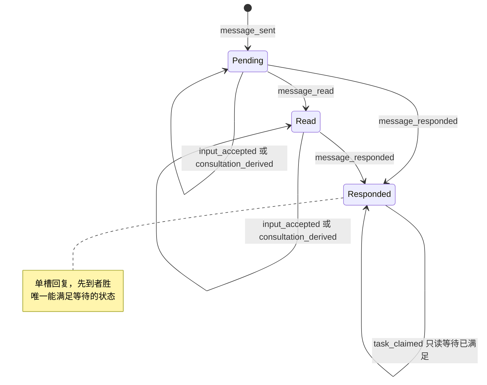

### 10.6 实现对照

| 行号 | 状态机函数（目标：`src/core/work-graph/state/message-machine.ts` 中的导出） | 调用服务（file） | 已有测试（file） | 计划新增测试（描述） |
| --- | --- | --- | --- | --- |
| MSG-01、MSG-02 | `transitionMessage`（message_sent）、`createSessionMessageRecord` | `communication/mailbox-service.ts` `sendMessage` | `tests/work-graph/C1-session-mailbox.test.ts:53`、`:107`、`:128`、`:172`；`tests/app/orchestration-mechanism.test.ts:169`、`:181`、`:189`、`:208` | 发送标志组合表（含 `waitAfterSend` 与 `needsReply=false` 的拒绝） |
| MSG-03 | `transitionMessage`（message_read）、`nextSessionMessageRecord` | `mailbox-service.ts` `ackMessage` | `C1-session-mailbox.test.ts:90`、`:188`、`:333` | read 或 responded 再 ack 得到 `invalid`；同身份重放 |
| MSG-04、MSG-05 | `transitionMessage`（message_responded） | `mailbox-service.ts` `respondMessage` | `C1-session-mailbox.test.ts:188`、`:376` | pending 直接 responded 时回填 `readAt`（I-8） |
| MSG-06 | 同上 | `mailbox-service.ts` `respondFromQueryAnswer`（经 `business/workflow/consultation.ts`） | `tests/app/AG2-consultation.test.ts:330`、`:518` | Answer 关联与 work_run 回复竞争，先到者胜 |
| MSG-07、MSG-08 | `transitionMessage`（input_accepted） | `mailbox-service.ts` `recordInputAccepted`（由 `agent-runtime/execution-inputs.ts:151-174` 调用） | `tests/app/orchestration-mechanism.test.ts:331`、`:402` | 任一 status 下追加都不改 status；同 inputId 来自另一事件得到 `invalid`；重启补账重放不追加重复条目 |
| MSG-09 | `transitionMessage`（consultation_derived） | `mailbox-service.ts` `recordConsultationDerivation` | `tests/app/orchestration-mechanism.test.ts:402`（断言在 `:470-471`） | 第二个不同 derivation 被拒（先写者胜）；work_run 调用得到 `forbidden` |
| MSG-10 | `messageSatisfiesWait`（只读谓词） | `tasks/claim-service.ts:619-638` | `tests/app/AG2b-collaboration.test.ts:150` | read 状态或只有 `acceptedInputs` 时不满足等待（`busy`） |
| 全部 | 单调性与 I-8 检查 | — | `C1-session-mailbox.test.ts:188` | 对所有事件序列做属性测试：状态不倒退；responded ⇒ `readAt≠null` 且 `response≠null` |

§14 的写入限制要求：`mailbox-service.ts` 中写 `status`、`readAt`、`response` 的对象字面量（`:1149-1165`、`:1608`、`:1691-1697`、`:1857-1863`）改为调用 `state/message-machine.ts` 的记录构造函数。`acceptedInputs` 和 `consultationDerivation` 不是状态字段，但为保持单一构造点，也一并迁入。`message-record-codecs.ts` 的解码函数在豁免名单内。


## 11. 跨状态机不变量

本节的不变量只对**持久记录**表述：在一次 RecordStore 读取窗口内读到的全部记录（I-9、I-18 另读事件日志）。它们不依赖进程内句柄，因此重启前后都必须成立。每条不变量给出三样东西：

- **形式化表述**：用下面的记号写成对记录集合的断言。
- **可能破坏它的迁移**：列出行号，以及守住它的机制（同一提交、CAS 守卫、状态机守卫）。
- **检查方式**：不变量测试中的断言函数名。函数都在 `tests/state/invariants.ts`（测试目录 `tests/state/`、`tests/scenarios/` 已由 lead 采纳，L-8），签名为 `(world: InvariantWorld, prev?: InvariantWorld, step?: FuzzStep) => InvariantViolation[]`，由 `checkAllInvariants` 汇总调用。

I-1..I-9 来自 brief §4，措辞按各节已定的状态和事件细化。I-10..I-15 是各节已经写出、纳入同一检查框架的补充不变量。

I-16..I-22 是本批新增的不变量，依据用户 2026-10-03 的决定 C1–C8 与 lead 决定 LA-1..LA-7（2026-10-03）。I-12 按同批决定合并改写。这八条的全文在 11.12（I-12）与 11.13..11.19（I-16..I-22），11.10 表中只留摘要。同批决定还给 I-3、I-7、I-9、I-15 补了条款，并在 I-1、I-2、I-5 的“可能破坏它的迁移”中补入新行 RUN-24。操作者类别一律按 `reworkActorClassOf` 的规则判定（11.0 的 `actorClass`），任何一条都不用 `ActorRef.kind==='human'`。

### 11.0 记号

| 记号 | 含义 |
| --- | --- |
| `runs`、`attempts`、`outboxes`、`leases`、`sessions`、`queryRuns`、`intents`、`rounds`、`messages`、`goals`、`goalPhases`、`reductions`、`requeues`、`refusals`、`plans` | 窗口内该类型的全部记录。`refusals` 是返工拒绝记录 TaskReworkRefusal（C1、C8；重入队与重新检查共用，§4 TASK-28）。`plans` 是 PlanRevision，含 `taskStateBasis` 与 `dispositionRecord`（C7）。另读事件日志 `events`（I-9、I-18，见 11.11） |
| `claimOf(r)` | Run r 的不可变领取：其 Attempt 对应 Outbox 的 `claim`（`TaskClaim`，`src/contracts/core/task-claim.ts:15-26`），含 `sessionRef`、`generation` |
| `known(o)` | `o ∉ {null, 'outcome_unknown'}` |
| `holds(s, x, g)` | `s.occupancy?.kind='execution' ∧ s.occupancy.executionRef=x ∧ s.occupancy.generation=g`，即 §8 的 `ownsOccupancy` |
| `leaseHeldBy(l, r)` | `l.release` 不存在 `∧ l.holderRunId=r.ref.runId ∧ l.attemptId=r.attemptId`，即 §6 的 `leaseOwnedByRun` |
| `phase(t)`、`cause(t)` | `projectTaskPhase(facts(t))` 的结果（§4 P1–P20；gate 按自己的轮次链头投影，P20） |
| `unresolved(r)` | `r.status ∈ {starting, running} ∨ r.outcome='outcome_unknown'` |
| `qUnresolved(q)` | `q.executionState` 存在且 `q.executionState.phase ≠ 'settled'` |
| `gen(h)` | Run：`claimOf(h).generation`；QueryRun：`executionState.sessionGeneration` |
| `active(g)` | Goal g 的活动计划（`goal.activePlanRevision` 指向的 PlanRevision） |
| `disp_P(t)`、`basis_P(t)`、`def_P(t)` | Task t 在计划 P 中的 disposition、有效 basis（`buildEffectiveTaskBasis`，L-4）与执行定义。执行定义是 §3 `executionDefinitionsAgree` 比较的冻结定义，不含 `disposition`、`replacedByTaskId` |
| `selected(t)` | Task t 的选定 Run（§4.1 的选定规则）；没有 Run 时为 null |
| `pointer(r)` | `r.controlState?.intentRef` 指向的 ControlIntent；没有指针时为 null。Run 结束后指针不再改变，之后的控制提交得到 `busy`（§7） |
| `fence(r)` | `reworkFenceOf(r, pointer(r))`（`state/task-failure.ts`）：`none`、`human_only` 或 `human_or_goal_resume`；`r` 为 null 时为 `none` |
| `actorClass(x)` | 对记录中保存的 `requestedBy`（PlanRevision 处置记录取 `actor`）按 `reworkActorClassOf` 的同一规则分类：`kind='agent'`（只由 `work_run` 准入产生）→ `agent`；`isAutomationActor`（与 `PLATFORM_AUTOMATION_ACTORS` 某成员规范相等）→ `system`；其余 → `human`，即操作者，包括以 `kind:'system'` 启动的 Host |
| `requeueOf(r)` | `afterRunId = r.ref.runId` 的 TaskRequeue；没有时为 null |
| `chainOf(x)`、`head(x)` | subject x 的全部轮次，以及对它们求 `roundChainHead` 的结果（`none`、`head`、`invalid`，§9 VD-14）。work 的 x 是 (task, Run)，槽键 `verification-round-subject:`；gate 的 x 是 gate Task，槽键 `verification-round-gate:`。`head(r)` 指 Run r 的 work 链 |
| `chainEvidenceIds(v)` | `v.chain.supersededEvidenceIds ∪ ids(v.evidenceRefs)`，即 v 所在链到 v 为止全部轮次的证据 id（§4 TD-2） |
| `countEndedGoalRuns(g)` | Goal g 中 `status='ended'` 的 Run 数，不按计划或 Task 过滤（§13 ND-8） |

### 11.1 I-1 Task running 与唯一 open Attempt 配对（D-14）

本条按 D-14 把任务书的措辞适配到代码（`claimed`↔`starting`，`started`↔`running`）。这一措辞按原推荐采纳（U-14，用户 2026-10-03 确认）。

**形式化。** 对每个 work Task t（按 taskId 汇总全部计划版本的 Run，读取窗口与选定 Run 规则相同）：

- `O(t) = { a ∈ attempts : a.ref.taskId=t ∧ a.status ∈ {claimed, started} }`，且 `|O(t)| ≤ 1`；
- `phase(t)='running' ⇔ |O(t)|=1`；
- 若 `O(t)={a}`，r 为 a 的 Run：`(a.status='claimed' ∧ r.status='starting') ∨ (a.status='started' ∧ r.status='running')`，且 `leaseHeldBy(lease(t), r)`。

`claimed` 配 `starting` 时，r 的授权可以是 none、`authorized`、`entering`，或 D-5 之后的 `revoked`（§5.1 配对表）。

**可能破坏它的迁移与守法。**

| 行号 | 风险 | 守法 |
| --- | --- | --- |
| RUN-01、TASK-01/02/03、ATT-01/14/15/16 | 第二个 open Attempt | 租约 CAS（∅ 或 `@k` 且已有 `release`）；租约 held 时 ATT-17 返回 `busy`；TASK-03 要求 `requeueRef` 覆盖选定 Run |
| RUN-05、ATT-02、ATT-26 | Attempt 与 Run 只改其一 | 同一提交；ATT-02 新增显式守卫 Attempt=`claimed` |
| RUN-07/08/09/17–20/23/24、ATT-05–10/31/32/35/36 | Run 已结束而 Attempt 仍 open | `attemptEventFromRunEvent` 从同一个 Run 事件派生 Attempt 事件，Run、Attempt、Outbox、Lease 在同一提交写入，各带 CAS |
| RUN-16、ATT-04 | 撤销授权后误建 Attempt | ATT-04 不写 Attempt；新 Attempt 只能来自 TASK-03（§13.5） |

**检查。** `checkI1RunningPairing(world)`；与 §5.6 的 `checkAttemptPairing` 共用配对表。

### 11.2 I-2 Run 结束与占用、租约的释放

**形式化。** 对每个 `r ∈ runs` 且 `r.status='ended'`，取 `s = session(claimOf(r).sessionRef)`、`l = lease(r.task)`：

- `known(r.outcome) ⇒ ¬holds(s, r.ref, claimOf(r).generation) ∧ ¬leaseHeldBy(l, r)`；
- `r.outcome='outcome_unknown' ⇒ holds(s, r.ref, claimOf(r).generation) ∧ leaseHeldBy(l, r)`。

Query 类比（§8 D-11）：`q.executionState.phase='settled' ⇒ ¬holds(s_q, q.ref, gen(q))`；`phase='unknown' ⇒ holds(s_q, q.ref, gen(q))`。

**可能破坏它的迁移与守法。**

| 行号 | 风险 | 守法 |
| --- | --- | --- |
| RUN-07/09/17/18/19/21/22/23/24、SES-04/05/06/07 | 结束已知却漏释放 | 释放是 Run 迁移的效果意图（`release_session`、`release_lease`），与 Run 同一提交。RUN-19/23/24 的释放保持 `historyCursor`，并在同一提交把 Session 写为 `unavailable/kernel_turn_open`；RUN-22 在 Turn 没有 Kernel 终态或 Kernel 不可读时同样写（SES-07）（§8，lead 决定 LA-1（2026-10-03）） |
| RUN-08、RUN-20、ATT-07/10/20/28/32/34/36/37 | 未知时误释放 | Run 机器对这两行不产出释放意图；Session 机器在 `holder.after=run_ended_unknown` 时拒绝 `occupancy_released`（§8.4） |
| SES-17、SES-18、ATT-19 | 旧代际终态释放新持有者 | 释放要求持有关系成立，否则为空迁移；Session、Lease 按读到的 revision 加 CAS（`execution-entry-service.ts:1412-1423`） |
| QRR-01/02/03/04/06、SES-08/09/10 | Query 收束漏释放 | `settleQueryRunRecord` 与 SES-08/09/10 同一提交 |
| QRR-05 | Query 未知时误释放 | QRR-05 不写 Session |

**检查。** `checkI2ReleaseMatchesOutcome(world)`。

### 11.3 I-3 GoalPhase COMPLETED 有正式依据

**形式化。** 对每个 `gp ∈ goalPhases`，若 `gp.phase='COMPLETED'` 且 `gp.planRef = goal.activePlanRevision`（`selectedPlanMatches`；采用新计划后旧 COMPLETED 失效属于 D-17 范围外，此时本条不检查）：

- 活动计划 P 中，每个 `requirementLevel='required'` 且 `disposition ∉ {cancelled, superseded}` 的 Task t：
  - `phase(t)='satisfied'`，即 P1 命中一条适用的 `TaskReduction(phase='satisfied')`；
  - 该 Reduction 的完成审计引用一个 `status='finalized' ∧ outcome='PASS' ∧ gaps=[]` 的轮次：work Task 的轮次 `subjectRunRef` 是它的生产 Run，gate 是 gate 轮次；轮次 `evidenceRefs` 覆盖 t 承载的义务。
  - 该轮次是其 subject 的轮次链头（`head`，§9 VD-14，C5）。只有 finalized 非 PASS 的链头才有后继，所以 PASS 轮次总是链头。折叠前排除的证据是该 Task 全部 TaskRequeue 的 `supersededEvidenceIds` 与该轮次 `chain.supersededEvidenceIds` 的并集（§4 TD-2）。
- `goal.desiredState='active'`。
- 步骤局部条款（只在提交 `goal_completed` 的那一步检查）：该 Goal 的所有 Run 都不满足 `unresolved(r)`，也没有 `runUnresolvedBlocker`（由 `completion-policy.ts:64-81` 的 `runBlocker` 移到 `state/`，§4 TD-8）。不作为全程条款，因为 optional Task 在 Goal 完成后仍可能被领取。

**可能破坏它的迁移与守法。**

| 行号 | 风险 | 守法 |
| --- | --- | --- |
| GOAL-07、GOAL-08 | 证据不足就完成 | 同一提交内 `evaluateGoalCompletion`（`completion-policy.ts:209-279`），CAS Goal@rev 与 GoalPhase |
| TASK-14/15/24 | Reduction 引用非 PASS 轮次、非链头轮次或旧失败 | TASK-14 守卫：投影为 `verifying`、轮次主体是选定 Run、完成轮次是链头（VD-14）、排除 TaskRequeue 与轮次链超越的证据（TD-2/VD-5；读取已存的 `TaskRequeue.supersededEvidenceIds`，lead 决定 L-3；以及完成轮次的 `chain.supersededEvidenceIds`，C5） |
| TASK-16/17/27、VR-14 | 已满足的 Task 被重入队或重新检查 | `satisfied` 上的 `task_requeued` 为 illegal（§4.4）；VR-14 只接受 finalized 非 PASS 的链头（§9） |
| GOAL-04/06 | paused 或 cancelled 与 COMPLETED 并存 | GOAL-04/06 对 GoalPhase 加只读 CAS；GoalPhase 对应活动计划时暂停和取消为 illegal（§2.4） |
| PLAN-05（W16，含 TASK-19 只改处置） | 新计划使旧完成失去对应 | `selectedPlanMatches` 变为 false，本条不再检查；由 GOAL-08 重新完成 |

**检查。** `checkI3GoalCompletionBacked(world, step)`。

### 11.4 I-4 一个 Session 至多一个写入型执行

**形式化。** 对每个 `s ∈ sessions`：

- `W(s) = { r ∈ runs : claimOf(r).sessionRef=s.ref ∧ unresolved(r) } ∪ { q ∈ queryRuns : q.executionState.sessionRef=s.ref ∧ qUnresolved(q) }`；
- `|W(s)| ≤ 1`；
- `W(s)={h} ⇒ holds(s, h.ref, gen(h))`；
- `W(s)=∅ ⇒ s.occupancy=null`（`maintenance` 没有写入者）；
- `s.lifecycle='archived' ⇒ s.occupancy=null`。

**可能破坏它的迁移与守法。**

| 行号 | 风险 | 守法 |
| --- | --- | --- |
| SES-02、SES-03、RUN-01 | 两个执行同时占用 | 占用守卫顺序 lifecycle → health → 无占用 → revision → generation → 版本钉（§8.3 表后）；Session CAS |
| SES-04–10、QRR-01–06 | 持有者结束而占用残留，或未结束先释放 | 释放只由持有者的结束在同一提交带出（§8.4）；I-2 |
| SES-11 | 归档占用中的 Session | 归档守卫 `occupancy=null`（`session-lifecycle.ts:607`） |
| SES-12、SES-13 | health 变化改了占用 | health 迁移不写 occupancy |

**检查。** `checkI4SingleWriterPerSession(world)`。

### 11.5 I-5 每个 Run 至多一个 queued 的指针意图

**形式化。** 对每个 `r ∈ runs`：

- `Q(r) = { i ∈ intents : i.runRef=r.ref ∧ i.kind ∈ {pause, cancel, resume} ∧ i.status='queued' }`，且 `|Q(r)| ≤ 1`；
- `Q(r)={i} ⇒ r.controlState.intentRef=i.ref ∧ r.controlState.desiredState=i.desiredState`；
- 对每个 `i.status='superseded'`：`r.controlState?.intentRef ≠ i.ref`；
- 每个 `kind='steer' ∧ status='queued'` 的 intent 都在 `r.controlInputs` 中。

D-8 之前写入的遗留数据可能有指针已移走、仍为 queued 的 intent（CTL-05 的兼容路径）。检查把它们报为 `legacy`，不算违规；fuzz 从空库开始，不会出现。

**可能破坏它的迁移与守法。**

| 行号 | 风险 | 守法 |
| --- | --- | --- |
| RUN-12–15、CTL-01 | 新指针意图入列，旧的仍 queued | CTL-04 在同一提交把旧的 queued 指针意图改为 `superseded`，并加旧意图的 CAS |
| RUN-09/10/11、CTL-02 | 平台直接生效时留下旧 queued | 同上；RUN-09 另把 queued steer 取代 |
| RUN-23、CTL-10 | 暂停中（或按 LA-7 重启时 Turn 干净）取消留下 queued steer | 同一提交：重启变体中 Kernel 已接受的 steer（inputId 为 `control:<sha(intentRef)>`）→ `Applied`（CTL-08(b)）；其余（含进程内变体的全部 queued steer）→ `Superseded`（CTL-04(b)，`supersededBy` 为该 cancel）；两类正文都进入接续说明（C3） |
| RUN-24、CTL-08(b)/(c)/(f) | 暂停中被 Host 重启打断，留下 queued pause 或 queued steer | 同一提交：queued pause → `Applied`（CTL-08(f)，`platform_reconcile`）；queued steer 按 Kernel 是否已接受 → `Applied` 或 `Superseded`（CTL-08(b)/(c)），被取代的 steer 正文由接续说明带入（C3、C4） |
| CTL-03/05/06/07/08/09 | 观察改动指针 | 观察只写 intent，Run 只作 CAS 守卫（`control-service.ts:602-610`） |

**检查。** `checkI5SingleQueuedPointerIntent(world)`。

### 11.6 I-6 Attempt、Run、Outbox、Lease 的结束一致

**形式化。** 对每个 `a ∈ attempts`，r 为其 Run，o 为其 Outbox：

- `a.status='ended' ⇔ r.status='ended'`，且此时 `a.endOutcome = r.outcome`；
- `a.status='claimed' ⇒ r.status='starting'`；`a.status='started' ⇒ r.status='running'`；
- `o.status='settled' ⇔ (r.status='ended' ∧ known(r.outcome))`；
- `o.status='entered' ⇒ (r.status='running' ∨ (r.outcome='outcome_unknown' ∧ a.startedAt≠null))`；
- `o.status='pending' ⇒ (r.status='starting' ∨ (r.outcome='outcome_unknown' ∧ a.startedAt=null))`。

第二个析取项是明确的例外（lead 决定 L-2）：§6 RUN-20(ii) 从 `Entering` 结束为 `outcome_unknown`，探针为 `missing`/`damaged`，没有 Kernel Turn 可补记进入事实。这时：

- Attempt `claimed→ended(outcome_unknown)`，`startedAt=null`（§5 ATT-36）；Run 的 `startedAt` 也为 null；
- Outbox 保持 `pending`（ATT-37），这是 §5 AD-1 的例外，也写在 §5.1 配对表中；
- 只能经 RUN-21/22 离开：ATT-29 把 Outbox 从 `pending` 直接结算为 `settled`，`consumerId`/`entryGeneration` 取自 Run 的授权；RUN-21 同提交补记 Run 与 Attempt 的 `startedAt`（ATT-11），RUN-22 不补记。

因此未知期间 `startedAt` 是否为 null 恰好区分 Outbox 是 `entered` 还是 `pending`。

对每个 `l ∈ leases` 且 `l.release` 存在：`r' = run(l.release.runRef)` 满足 `r'.status='ended' ∧ known(r'.outcome) ∧ l.holderRunId=r'.ref.runId`。

**可能破坏它的迁移与守法。**

| 行号 | 风险 | 守法 |
| --- | --- | --- |
| RUN-21/22、ATT-11/12/22/29 | 解决未知时只改 Run，Attempt 仍为 unknown；或 ATT-37 之后的 `pending` Outbox 留在 `pending` | Attempt `endOutcome` 与 Run outcome 在同一提交改写（ATT-11 revision+1）；ATT-29 从 `entered` 或 `pending` 都结算为 `settled` |
| RUN-08/20、ATT-07/10/32/36、AD-1 | Outbox 提前 `settled` | Outbox 在 `outcome_unknown` 下保持 `entered`（ATT-28/34）或 `pending`（ATT-37） |
| RUN-20(ii)、ATT-36/37 | 没有 Turn 证据时把 Outbox 推进为 `entered`，或凭空补记 `startedAt` | ATT-37 不写 Outbox；`startedAt` 只在 RUN-21 带 Kernel Turn 开始时间时补记（L-2） |
| RUN-09、ATT-05/23/30 | 未进入取消时 Outbox 无法结算 | AD-2 的 `dispatchState.schemaVersion:2` 变体 |
| ATT-18/19/23 | 释放戳与持有者不一致 | 释放戳取自原 claim；`leaseOwnedByRun` 不成立时为空迁移 |

**检查。** `checkI6EndingConsistency(world)`。

### 11.7 I-7 轮次与单项检查的一致

**形式化。** 对每个 `v ∈ rounds`：

- `v.status='open' ⇒ v.outcome=null`；`v.status='finalized' ⇒ v.outcome≠null ∧ ∀c∈v.checks: c.phase≠'executing'`；
- `v.outcome='PASS' ⇒ v.gaps=[] ∧` 每个必需检查 `c.phase='finished' ∧ c.outcome='PASS' ∧ c.sourceStatus='matched'`；
- `v.outcome='FAIL' ⇒` 至少一个适用的 `finished` 单项 `outcome='FAIL'`（D-2）；
- 单项形状：`pending` 时 invocationId、outcome、reportRef、sourceStatus 全为 null；`executing`/`interrupted` 时只有 invocationId 非 null；`finished` 时四者全非 null（§9.1）。
- 单项原因（C5，§9.1）：`incompleteCause` 非 null 当且仅当 `phase='interrupted'`，或 `phase='finished' ∧ outcome='INCONCLUSIVE'`；`interrupted ⇒ incompleteCause ∈ {host_restart, ticket_invalid}`；`finished ∧ INCONCLUSIVE ⇒ incompleteCause ∈ {not_started, source_not_matched, process_timed_out, process_cancelled, process_abnormal}`。本条只约束新行：没有该字段的遗留单项读作 `null`，不合本条时报为 `legacy`。

跨步条款（`prev → next`）：finalized 轮次的 status、outcome、gaps、evidenceRefs 不再改变；`interrupted`、`finished` 单项（含 `incompleteCause`）不再改变；`executing → pending` 只经 VR-05。任一轮次的 `chain` 写入后不再改变；开后继轮次（VR-14）的提交不写前驱，前驱只作读集守卫（链结构见 I-20）。VD-4 之前遗留的“PASS 带 gaps”报为 `legacy`。

**可能破坏它的迁移与守法。**

| 行号 | 风险 | 守法 |
| --- | --- | --- |
| VR-07 | 带 executing 汇合；FAIL 被写成 INCONCLUSIVE；PASS 带 gap | 拒绝 executing（`incomplete`）；`finalizeRoundOutcome` 的 D-2 折叠 |
| VR-03、VR-06 | 迟到结果改写 interrupted 单项 | interrupted 上的结果与报告入账为 stale（§9.4） |
| VR-02 | 同轮重跑 interrupted 单项 | `check_begun` 只接受 `pending`（D-12） |
| VR-04、VR-13、VR-05（`check_abandoned`；VR-05、VR-13 已由 lead 采纳，L-8） | 中断或退回时残留结果字段 | 构造器 `withCheckPhase` 按阶段清空字段 |
| VR-03、VR-04、VR-13 | 单项原因与阶段、结论不符 | `recordCheckResult` 按 `outcomeFor` 的判定次序写原因（VR-03）；VR-04 写 `host_restart`，VR-13 写 `ticket_invalid`；`withCheckPhase` 按阶段写入或清空原因（C5） |
| VR-14 | 开后继轮次时改写前驱 | 只写后继 Round@1 与槽 CAS；前驱只作 head@rev 读集守卫（§9，C5） |

**检查。** `checkI7RoundConsistency(world, prev)`。

### 11.8 I-8 消息状态单调、回复完整

**形式化。** 对每个 `m ∈ messages`：

- `m.status='pending' ⇒ m.readAt=null ∧ m.response=null`；`'read' ⇒ m.readAt≠null ∧ m.response=null`；`'responded' ⇒ m.readAt≠null ∧ m.response≠null`。
- 跨步条款：状态序 `pending < read < responded` 不倒退；`response` 一经写入不再改变；`acceptedInputs` 只追加；`consultationDerivation` 只写一次。

**可能破坏它的迁移与守法。**

| 行号 | 风险 | 守法 |
| --- | --- | --- |
| MSG-04、MSG-06 | 从 `pending` 直接回复时 `readAt` 为空 | `readAt ??= respondedAt` |
| MSG-04/05/06 | 两个回复写入方覆盖 | 单槽，按消息版本钉 CAS，先到者胜 |
| MSG-07/08/09 | 交付观察或派生改了 status | 这些行只追加，status 不变（§10.4） |

**检查。** `checkI8MessageMonotone(world, prev)`。

### 11.9 I-9 Goal 停止之后不再有新领取

**形式化（对事件日志）。** 对每个 `TaskClaimed` 事件 e（Goal g，提交游标 c(e)）：g 在游标 c(e) 之前最后一个 `GoalCreated` 或 `GoalDesiredStateChanged` 事件的 `to` 为 `active`。等价地：`desiredState≠active` 的那次提交之后、下一次回到 `active` 之前，没有该 Goal 的领取提交。

同一形式适用于其他“新进程”写入：`ExecutionEntryAuthorized`（RUN-02/03）、`VerificationRoundOpened` 与 `VerificationCheckBegun`（VR-01/02，VD-9），以及单个 Run 的 resume（RUN-11、RUN-14，D-9）。

本批起，返工写入也用同一形式：`TaskRequeued`（TASK-16/17/27、GOAL-29）、`TaskReworkRefused`（TASK-28）与 `VerificationRoundReverified`（VR-14）只在 Goal 为 `active` 时提交。所有者的统一检查顺序在类别与政策检查之前要求 Goal `active`，对 human、system、agent 一样，人工重入队也不例外（lead 按用户总体取向裁定）。TASK-19 是计划采用，不是返工，不在此列（Goal `paused` 时允许）。

**可能破坏它的迁移与守法。**

| 行号 | 风险 | 守法 |
| --- | --- | --- |
| RUN-01、TASK-01/02/03 | 与 GOAL-04/06 并发的领取落在暂停之后 | 领取检查 `desiredState`（`claim-service.ts:514`）并对 Goal@rev 加 CAS（`:725`），GOAL-04/06 使 Goal revision +1 |
| RUN-02/03 | 授权落在暂停之后 | `execution-entry-service.ts:939` 检查，`:988` 对 Goal 加 CAS |
| VR-01、VR-02 | 暂停后起检 | VD-9 守卫与 Goal@rev 读集守卫 |
| RUN-11、RUN-14、CTL-01/02 | 单个 Run 的 resume 绕过 Goal 暂停 | resume 守卫 Goal `desiredState=active`，并对 Goal 加 CAS |
| TASK-16/17/27/28、GOAL-29、VR-14 | Goal 暂停或取消之后返工 | 统一检查顺序的 Goal 一步：`desiredState≠active` → `busy`「先恢复 Goal」；Goal@rev 进入读集守卫（requeue 的 `meta.expected` 钉 Goal@rev，VR-14 守卫 Goal@rev）。启动重驱动只处理 `desiredState='active'` 的 Goal（lead 决定 LA-6（2026-10-03）） |
| RUN-04 | begin 落在暂停之后 | 未加守卫（§2.4 的提议不采纳，lead 决定 L-6，GAP-15）。已授权的 Run 仍可进入，由 GOAL-11 的安全点控制收尾，不违反本条（本条只约束领取、授权、起检、resume） |

**检查。** `checkI9NoAdmissionAfterGoalStop(events)`。

### 11.10 补充不变量（各节已写）

| 编号 | 形式化 | 来源与守法 | 检查 |
| --- | --- | --- | --- |
| I-10 | 每个 V2 授权的 Run 落在 §6.1 的八种机器状态之一（status、outcome、授权 phase 的组合）；`continuation` 存在 ⇔ `outcome='yielded'`；`outcome='failed'` 从不出现 | §6.1、6.4；构造器只产出合法组合（§14） | `checkI10RunNodeShape` |
| I-11 | QueryRun：`status ∈ {answered, closed} ⇔ executionState.phase='settled' ⇔ endedAt≠null ∧ outcome≠null` | §8.1；`settleQueryRunRecord` | `checkI11QueryRunSettlement` |
| I-12 | 每个已结束 Run 至多一条 TaskRequeue；其 `afterRunRef` 的 outcome 已知，若为 `yielded` 则指针为 `cancelled`；`afterRoundRef` 是该 Run 已 finalized 的轮次链头，`supersededEvidenceIds` 是整条链的证据；类别、中断子类、停止者、键比较方式、自动计数与预算都等于从持久事实复算的值；新 Run 的 `requeueRef` 指向覆盖前一选定 Run 的那条，该 Run 一经授权即绑定接续说明。本批合并改写（C1–C5、C8），全文见 11.12 | §4 TASK-03/16/17/27/28、§2 GOAL-29、§9 VR-09/VR-14；TaskRequeue 键 CAS null，以及轮次槽的同主守卫 | `checkI12RequeueFacts` |
| I-13 | TaskEvidenceIndex：记录存在 ⇒ `revision = evidenceIds.length ≥ 1`（遗留 @0 报为 `legacy`） | §9 VR-10..VR-12 | `checkI13EvidenceIndex` |
| I-14 | GoalPhase 对应活动计划 ⇒ `goal.desiredState='active'` | §2 GOAL-04/06 的 GoalPhase CAS，GOAL-07 的期望状态守卫 | `checkI14CompletedGoalIsActive` |
| I-15 | 记录只前进：Run `starting → running → ended`（`Entering → Revoked → Authorized` 只经 RUN-16/03）；Attempt、Outbox、ControlIntent 终态不回退（`OutcomeUnknown` 只经 CTL-07）；`EndedUnknown` 只经 RUN-21/22 离开；PlanRevision（含 `dispositionRecord`）、Evidence、TaskRequeue 不可变；TaskReworkRefusal 只经 `@k→@k+1` 前进（I-18）；轮次的 `chain`、Run 的 `terminalPayload` 与 `inputBinding`（含 `continuationBriefDigest`）写入一次后不变 | 各节 N.4；§14 的构造函数（C1–C5、C7 新增字段） | `checkI15Monotone(world, prev)` |
| I-16 | 暂停中被重启打断的 Run（`isPausedInterrupted`）：outcome `crashed`，指针仍是该 pause intent 且已 `applied`；RUN-23 的取消不带 `pausedIntentRef`；未被接续时 Task 投影 `blocked/paused_interrupted`。新增（C4），全文见 11.13 | §6 RUN-19/23/24、§7 CTL-08(f)、§4 P19 | `checkI16PausedInterrupted` |
| I-17 | 人停下的工作只由人重新开始：`fence ≠ 'none'` 时，重入队、重新检查、改有痕 Task 的处置，以及为载体全被围住的义务另加载体，都只能由 `human` 做（`human_or_goal_resume` 另允许 Goal 恢复扇出接续）。新增（硬性限制 3、C1、C5、C7），全文见 11.14 | §4 TASK-16/17/27、§9 VR-14、§3 TASK-19 守卫 7 与守卫 9 | `checkI17HumanStopRespected` |
| I-18 | 返工拒绝记录：revision 等于事件数，代码与操作相容，水位不减，只落在当时的选定 Run 或链头上，上限拒绝只针对自动化。新增（C1、C8；两种操作共用），全文见 11.15 | §4 TASK-28、§9 VR-14、§13 ND-7/ND-8 | `checkI18RefusalLog` |
| I-19 | 已授权的 Run：有 `requeueRef` ⇔ `inputBinding` 带接续说明摘要，摘要与 manifest 中的说明一致。新增（C3），全文见 11.16 | §6 RUN-02/03 | `checkI19ContinuationBriefBinding` |
| I-20 | 每个 subject 的轮次组成一条线性链：序号连续、前驱已 finalized 非 PASS、只有链头可 open、超越证据累计、键无重复（豁免除外）、计数可复算；每个 gate 至多一条链。新增（C5），全文见 11.17 | §9 VR-01/09/14 | `checkI20RoundChain` |
| I-21 | 活动计划中非 active 的 Task 没有未结束的 Run，租约已释放；领取、授权、返工、开轮、起检都只发生在 active 的 Task 上。新增（C7），全文见 11.18 | §3 PLAN-05、§4 TASK-01/02/03/18/19、§6 RUN-02/03、§9 VD-9 | `checkI21NonActiveTaskQuiescent` |
| I-22 | Task 一旦有 Run，活动计划中它的执行定义与有效 basis 与每个 Run 的领取计划一致。新增（C6、C7），全文见 11.19 | §3 PLAN-05 的无痕规则与只改处置 | `checkI22TracedBasisFrozen` |

### 11.11 检查框架

- `readInvariantWorld(store, projectId)`：在一次读取窗口内读出 11.0 的全部记录，并读出事件日志中的 `TaskClaimed`、`ExecutionEntryAuthorized`、`GoalCreated`、`GoalDesiredStateChanged`、`VerificationRoundOpened`、`VerificationCheckBegun`、`TaskRequeued`、`TaskReworkRefused`、`VerificationRoundReverified` 和控制提交事件。
- `checkAllInvariants(world, prev, step)`：依次调用 I-1..I-22 的检查，返回违规列表。每条违规带不变量编号、记录 ref 和一句说明。
- `step`（`FuzzStep`）给出本步的操作种类、操作者 actor 与该步生效的 `automationPolicy()`。步骤局部条款（I-3、I-12、I-17、I-18、I-20、I-21）只在给出 `step` 且操作种类匹配时检查；跨步条款（I-7、I-8、I-15、I-18、I-19）只在给出 `prev` 时检查。
- 调用点：
  - 带种子的随机测试 `tests/state/invariants-fuzz.test.ts`（§15）：每一步提交之后调用。本批（C1–C8、LA-1..LA-7）在原有操作之外加入以下随机操作，全部用 fake Kernel，不调用模型：
    - 重新入队，三类操作者各自生成：`human`（Host 操作者 actor；另有一组种子用 `kind:'system'` 启动 actor 的 Host，验证它仍是操作者）；`system`（`WORKFLOW_AUTOMATION_ACTOR` 经 `automationContext`，以及带 `trigger{kind:'goal_resume'}` 的 `GOAL_FAN_OUT_ACTOR`）；`agent`（`work_run` 主体，经 W2 夹具授予 `requeue_task`，重新检查时授予 `reverify_round`，然后直接调用 WorkGraph 所有者；AgentRuntime 不认识这两个工具名，GAP-46）。同时随机生成“继续”（paused-interrupted 上的人工 requeue），以及应被拒的组合：围栏下的 system 或 agent、Goal 非 active、agent 带 `budget`、过期的 `afterRunRef`。这些组合必须 0 commit。
    - 政策拒绝：requeue 的 `budget_not_increased`、`auto_rework_cap_reached`、`no_new_basis`；reverify 的 `no_new_basis`、`auto_rework_cap_reached`、`source_unchanged`、`verification_uncovered`。随后随机让同一 Goal 的另一个 Run 结束，或改检查配置（只对记了 `configurationRevision` 的 reverify 拒绝），使拒绝过期，自动化重试一次；另随机只改动工作区文件，这时拒绝不过期（GAP-47）。
    - 上限变化：两步之间随机经 `registerAutomationPolicy` 把 `autoReworkLimit` 改为 0..10 之间的值。已写入的 TaskRequeue 保留写入时的上限（I-12）；重新检查按该步生效的上限检查（I-20 的步骤局部条款）。
    - 重新检查：work 链与 gate 链，三类操作者，带或不带 `onlyIfSourceChanged`、`newInputRefs`、人工 `note`；与同一 Run 上的 requeue 交错。
    - W16 只改处置：对随机 Task（含有痕的失败 Task）在四个 disposition 值之间改变，采用者为三类之一；以及为某个义务新增 active 载体（§3 守卫 9）。
    - 控制：Run 的 pause、cancel、resume；Goal 的暂停、恢复、取消，包括恢复后 GOAL-29 的接续。
    - 重启：丢弃全部句柄后在同一存储上核对（§12.1），覆盖安全点暂停中的 Run（RUN-24）、指针为 queued cancel 的 Run（RUN-23）和普通中断（RUN-19）。
    - 启动重驱动：核对完成后，持实例租约的 Host 按 §12.1 的启动重驱动步骤启动协作驱动（`resumeOnStartup` 随机为 true 或 false），驱动推进到 `waiting` 为止（lead 决定 LA-6（2026-10-03））。
    - 接续说明的完整序列：requeue → 领取 → prepare → 授权 → 重启 → 重驱（I-19）。

    每一步之后 I-1..I-22 都必须成立。
  - 场景测试 A1、A4、A7、A8、A10、A11，以及本批的 C3-*、C5-*、C6-*、C7-*、C8-* 场景（含 `C8-auto-rework-cap`、`C8-human-stop-respected`、`C8-budget`）：每个场景结束时调用。A8 在重建 Host 并核对之后调用一次，启动重驱动之后再调用一次。
  - 各状态机的穷尽测试只断言本机的记录级部分（例如 §5.6 的 `checkAttemptPairing`），不读全库。
- 失败时打印种子、步号和到该步为止的操作序列，便于重放。

本批新增或改写的检查如下。fuzz 与全部场景测试都经 `checkAllInvariants` 调用它们，表中只列专门制造该情形的测试：

| 不变量 | 检查函数（`tests/state/invariants.ts`） | 专门制造该情形的测试 | 实施步骤（§15） |
| --- | --- | --- | --- |
| I-12 | `checkI12RequeueFacts(world, prev, step)` | fuzz 的三类操作者重入队与上限变化；A1、A8-3r；`C8-auto-rework-cap`、`C8-budget` | 5.4、5.8、5.9 |
| I-16 | `checkI16PausedInterrupted(world)` | fuzz 的重启；A8-3l..A8-3q | 5.6 |
| I-17 | `checkI17HumanStopRespected(world, prev, step)` | fuzz 的围栏组合与 W16；`C8-human-stop-respected`；C7-* | 5.4、5.9、5.10 |
| I-18 | `checkI18RefusalLog(world, prev, step)` | fuzz 的政策拒绝与过期重试；`C8-auto-rework-cap`、`C8-budget`；C5-* | 5.4、5.9 |
| I-19 | `checkI19ContinuationBriefBinding(world, prev)` | fuzz 的接续说明序列；A8-3l、A8-3n；C3-* | 5.4 |
| I-20 | `checkI20RoundChain(world, prev, step)` | fuzz 的重新检查；A10；C5-* | 5.3、5.9 |
| I-21 | `checkI21NonActiveTaskQuiescent(world, prev, step)` | fuzz 的 W16 只改处置；C7-* | 5.5（VD-9 部分）、5.10 |
| I-22 | `checkI22TracedBasisFrozen(world)` | fuzz 的 W16；C6-*、C7-* | 5.4b、5.10 |

### 11.12 I-12 重入队事实（合并改写）

依据：原 I-12（§4 TASK-03/16/17，D-3），按用户决定 C1（操作者与结构化失败事实）、C2（失败类别）、C3（接续说明）、C4（“继续”）、C5（链头与累积证据）、C8（自动计数与上限）扩展；历史来源按 lead 决定 LA-1（2026-10-03）。现状：今天没有 TaskRequeue，本条随 §15 第 5.4 步实现。

**形式化。** 对每个 `rq ∈ requeues`，记 `r = run(rq.afterRunRef)`，t 为 `rq.task` 所指的 Task：

1. 唯一与已知结果：同一 `afterRunId` 至多一条（记录键）；`r.status='ended' ∧ known(r.outcome)`，且 `rq.afterOutcome = r.outcome`；`r.outcome='yielded' ⇒ r.controlState.desiredState='cancelled'`（P17）。
2. 链头与证据（C5）：`rq.afterRoundRef = null ⇔ head(r)=none`。否则 `head(r)` 有效，链头就是 `rq.afterRoundRef`，它已 `finalized`，且不是 `PASS ∧ gaps=[]`。`rq.supersededEvidenceIds = chainEvidenceIds(rq.afterRoundRef)`，没有轮次时为 `[]`（TD-2）。重入队之后这条链不再增长，所以本款在之后任何时刻都成立。
3. 类别（C2、C4）：`rq.failureClass` 等于 `deriveReworkClass` 对 r、`pointer(r)`、`head(r)` 的结果。这些输入在 Run 结束、链头 finalized 之后不再改变，所以任何时刻都能复算。`rq.interruption ≠ null ⇔ rq.failureClass='interrupted'`；`rq.interruption='paused' ⇔ isPausedInterrupted(r)`。`rq.failureClass='check_incomplete' ⇒ actorClass(rq)='human'`：system 与 agent 对这一类别走重新检查，人工仍可重新入队（TASK-17，lead 按用户总体取向裁定）。`rq.failureClass='cancelled' ⇒ actorClass(rq) ≠ 'agent'`：C2 对取消只列 human 或 system（§4.3 矩阵）。
4. 停止者：`pointer(r)` 的 kind 为 pause 或 cancel 时，`rq.stopIntentRef = pointer(r).ref`，`rq.stopRequester = stopRequesterOf(pointer(r))`；否则两者为 null 与 `'none'`。
5. 键比较的记录（§13 ND-5、ND-6）：`rq.basisComparison='skipped_interrupted' ⇔ rq.failureClass='interrupted'`；`rq.basisComparison='skipped_human_cancel' ⇔ rq.failureClass='cancelled' ∧ actorClass(rq)='human'`；其余为 `'compared'`。为 `'compared'` 时，`rq.basis.digest` 与 t 沿 Run 链（`requeueRef`、`consumedWait`）在它之前的每条 TaskRequeue 的 `basis.digest` 都不同（ND-3）。
6. 操作者与触发（C1）：`actorClass(rq)='agent' ⇔ rq.agentProvenance ≠ null`。`rq.trigger` 存在 ⇔ `rq.requestedBy` 与 `GOAL_FAN_OUT_ACTOR` 规范相等；这时 `rq.trigger.kind='goal_resume'`、`rq.interruption='paused'`、`rq.stopRequester='goal_fan_out'`（GOAL-29）。
7. 自动计数（C8）：
   - `rq.automation.automatic ⇔ actorClass(rq) ∈ {system, agent}`；
   - `rq.automation.counted ⇔ rq.automation.automatic ∧ rq.failureClass ≠ 'interrupted'`；
   - `rq.automation.cap ≠ null ⇔ rq.automation.automatic`，且 `cap ≤ 10`；
   - `rq.automation.autoCount` 等于复算值：从 r 起，沿 `consumedWait` 回溯到第一个带 `requeueRef` 的 Run，取那条 TaskRequeue 的 `autoCount` 为 `prev`，找不到时 `prev = 0`；`actorClass(rq)='human'` 时为 0，`counted` 时为 `prev + 1`，其余为 `prev`；
   - `rq.automation.counted ⇒ rq.automation.autoCount ≤ rq.automation.cap`。`cap` 是写入时的 `autoReworkLimit`，之后改设置不影响本款。
8. 预算（C2）：`rq.budget ≠ null ⇒ actorClass(rq) ≠ 'agent'`；`r.outcome='budget_exhausted' ⇒ (rq.budget ≠ null ∧ rq.budget.tokenBudget > r.budget.tokenBudget) ∨ rq.newInputRefs ≠ []`。本款与 §4 G-BUDGET 一样比 C2 字面的“更大的预算（或新依据）”窄：改过的文件不单独放行同预算的重新入队（预算检查先于来源采集，且没有 Run 结束时的来源检查点，GAP-49；§0.7）。人工 `note` 存成的 Artifact 引用在提交前加入 `newInputRefs`（§13.1），由第二项覆盖。
9. 领取与接续说明（TASK-03、C3）：`requeueRef = rq.ref` 的 Run 至多一个。若有这样的 Run r′：r′ 属于 t，`r′.consumedWait = null`，其 Attempt 记录同一 `requeueRef`；`rq.budget ≠ null ⇒` `r′.budget` 与 `rq.budget` 规范相等；r′ 一经授权即绑定接续说明（I-19）。
10. 历史来源（lead 决定 LA-1（2026-10-03））：r 进入过 Kernel 时，`rq.historySource ≠ null ⇒ rq.historySource.sessionRef = claimOf(r).sessionRef`；r 未进入 Kernel 时，`rq.historySource` 等于 `r.requeueRef` 所指 TaskRequeue 的 `historySource`，`r.requeueRef = null` 时为 null。那条 TaskRequeue 已按同一规则写定，所以只读一跳，不设跳数上限。例：r1 在 S1 中被中断（`kernel_turn_open`），接续 r2 在新 Session S2 中领取，未进入 Kernel 就被停下（D-7、RUN-09）；r2 之后的 TaskRequeue 仍带 S1 的历史来源，Workflow 复用 S2（cursor 为 null）时，r3 照样以 r1 的已完成历史做种子（§6 契约 (e) 的 `sessionBasis`）。若这里为 null，r3 只带当前 Turn，r1 的历史丢失，违反 LA-1。

步骤局部条款（只在提交 `task_requeued` 的那一步检查，读 `prev`）：r 是 `prev` 中 t 的选定 Run；`prev` 中 `requeueOf(r) = null`；`runUnresolvedBlocker(r)` 不成立；t 在活动计划中的 disposition 为 `active`；Goal 为 `active`。

谁可以重新入队被人停下的 Task 见 I-17；被拒的请求见 I-18。

**可能破坏它的迁移与守法。**

| 行号 | 风险 | 守法 |
| --- | --- | --- |
| TASK-16/17/27、GOAL-29（`task_requeued`） | 同一 Run 两条；覆盖的不是选定 Run；类别、停止者、计数或历史来源与事实不符 | TaskRequeue 键 CAS null，并发的第二个得到 `revision_conflict`；`afterRunRef` 不是当前选定 Run 时为 0 commit 的 `revision_conflict`，不写拒绝记录（lead 合并裁定（2026-10-03））；类别、停止者、计数、`historySource` 由 `state/task-failure.ts` 的纯函数从同一定向读取窗口的持久事实派生（指针 intent 在窗口之后读取，Run 已结束，其请求字段不可变，§4.3），调用方不能提供；记录由构造函数一次写全（§14） |
| VR-14 与 requeue 交错 | 重入队之后链又增长，`afterRoundRef` 不再是链头 | requeue 提交带链头 head@rev 与槽的同主守卫 `{expectedOwner: headKey, nextOwner: headKey}`（遗留根为 `null→null`）；VR-14 守卫 TaskRequeue(subject Run) 键为 null；两者只有一个能提交（§9 VR-09、VR-14） |
| TASK-28（`task_rework_refused`） | 应被拒的请求写成了 TaskRequeue | 预算 → 上限 → 键 依次检查，任一不过只写拒绝记录（§13 ND-7、ND-8） |
| TASK-03（带 `requeueRef` 的 `task_claimed`） | 同一 TaskRequeue 领取两次；领取预算与钉住的预算不同 | 租约 CAS；`requeue.budget ≠ null` 时领取预算必须规范相等，否则 `invalid` |
| RUN-02 | requeue Run 没有接续说明就进入 Kernel | `continuationBrief ∈ {absent_ok, bound}`（§6，I-19） |

**检查。** `checkI12RequeueFacts(world, prev, step)`。

### 11.13 I-16 暂停中被重启打断的 Run（C4）

依据：新增（用户决定 C4；RUN-23 的推广按 lead 决定 LA-7（2026-10-03））。现状：今天暂停中的 Run 在 Host 重启后不结束，一直占用 Session 与租约（§4 P19 的今日值）；本条随 §15 第 5.6 步实现。

**形式化。** 对每个 `r ∈ runs` 且 `r.reconciliation.observation.kind='interrupted_clean'`，记 `p = observation.pausedIntentRef`：

- `p ≠ null ⇒ r.outcome='crashed' ∧ r.controlState.desiredState='paused' ∧ r.controlState.intentRef = p`，且 p 指向的 intent `kind='pause' ∧ status='applied'`。即 `isPausedInterrupted(r)` 与指针、pause intent 三者一致（§6 RUN-24，§7 CTL-08(f)）。
- `r.outcome='cancelled' ⇒ p = null`：RUN-23 是用户的取消，不是暂停。`r.outcome='crashed' ∧ p = null` 是 RUN-19 的普通中断。
- 投影：若 `isPausedInterrupted(r)`，r 是其 Task t 的选定 Run，`requeueOf(r) = null`，且 t 没有适用的 TaskReduction，则 `phase(t)='blocked' ∧ cause(t)='paused_interrupted'`（§4 P19，界面“已暂停，可继续”），不是 `failed`。
- 接续：`requeueOf(r)` 存在时，它的 `interruption='paused'`（I-12），操作者是人或 Goal 恢复扇出（I-17）。没有自动继续。

释放的 Session 在同一提交写为 `unavailable/kernel_turn_open`（§8，lead 决定 LA-1（2026-10-03））。这个组合由 §8 的守卫与穷尽测试约束，不另设不变量（§14）。

**可能破坏它的迁移与守法。**

| 行号 | 风险 | 守法 |
| --- | --- | --- |
| RUN-24（R，`reconcile_interrupted_clean`） | 结束标记、指针与 pause intent 不一致 | 同一提交：Run 结束为 `crashed`，`pausedIntentRef = controlState.intentRef`；queued pause → `Applied`（CTL-08(f)，`platform_reconcile`），已 applied 的不改写；指针 ControlIntent@rev 进入 CAS；Run 结束的构造函数不产出 `pausedIntentRef≠null` 且 outcome 为 `cancelled` 的组合（§14） |
| RUN-19、RUN-23 | 把暂停记成普通中断或取消，或反过来 | 机器按核对时的指针选行：指针 paused（intent queued 或 applied）→ RUN-24；queued cancel 且 Kernel Turn 干净 → RUN-23，`pausedIntentRef=null`（lead 决定 LA-7（2026-10-03））；其余 → RUN-19 |
| CTL-08(b)/(c) | 核对把 pause 记为取代，界面显示“停止请求已被取代”，而 Task 显示“已暂停” | RUN-24 时 queued pause 一律走 CTL-08(f)，不走 (b)/(c)（§7） |
| RUN-11/14、CTL-01 | 重启后对已结束的 Run 恢复原 Turn，或改动其指针 | 已结束 Run 的控制提交得到 `busy`；driver 的 `resumeEntered` 要求本进程登记过句柄（§6 RUN-14 的 driver 守卫）；原 Turn 不做 fresh resume（D-17） |

**检查。** `checkI16PausedInterrupted(world)`。

### 11.14 I-17 人停下的工作只由人重新开始（硬性限制 3）

依据：新增（硬性限制 3；用户决定 C1、C2、C4、C5、C7）。围栏对全部失败类别都适用，并且同样挡住自动重新检查（lead 按用户总体取向裁定）；并行载体防护按 lead 决定 LA-3（2026-10-03）。现状：今天没有自动返工，也没有有痕 Task 的处置变化；本条随 §15 第 5.4、5.9、5.10 步实现。

围栏只看 `fence(r) = reworkFenceOf(r, pointer(r))`（§1）：r 的指针是操作者的 pause 或 cancel 时为 `human_only`；r 是 paused-interrupted 时，暂停来自 Goal 暂停扇出则为 `human_or_goal_resume`，否则为 `human_only`；其余为 `none`。

**形式化。**

- 对每个 `rq ∈ requeues`，`r = run(rq.afterRunRef)`：
  - `fence(r)='human_only' ⇒ actorClass(rq)='human'`；
  - `fence(r)='human_or_goal_resume' ⇒ actorClass(rq)='human' ∨ (rq.requestedBy 与 GOAL_FAN_OUT_ACTOR 规范相等 ∧ rq.trigger.kind='goal_resume')`；
  - 由此 `rq.automation.automatic ⇒ fence(r)='none' ∨ rq.trigger.kind='goal_resume'`：不存在“指针是操作者的 pause 或 cancel，却由 Workflow 或 agent 重新入队”的记录。
- 对每个 work 轮次 v 且 `v.chain.reverify ≠ null`，`s = run(v.subjectRunRef)`：`fence(s) ≠ 'none' ⇒ v.chain.reverify.actorClass='human'`。gate 轮次不检查：gate 没有指针，永远不被围住。
- 步骤局部条款（只在提交 PLAN-05 的那一步检查，读 `prev`；只在 `step` 的采用者 `actorClass ∈ {system, agent}` 时检查）：
  - 本次新写入（`setIn` 等于本次采用的计划）且 `traced=true` 的每个 `dispositionRecord` 条目，其 Task t 在 `prev` 中 `fence(selected(t))='none'`（§3 TASK-19 守卫 7）；
  - 对每个获得新 active work 载体的义务 O：O 在 source 计划中的 active work 载体为空，或其中至少一个载体 c 满足 `fence(selected(c))='none'`（§3 守卫 9）。

Goal 层面的对应规则在 §2 GOAL-05：人暂停的 Goal 只能由人恢复（lead 决定 LA-7（2026-10-03））。它是 `human_or_goal_resume` 安全的前提：Goal 恢复扇出（GOAL-29）只在 Goal 已恢复为 `active` 之后接续扇出暂停，而人暂停的 Goal 只有人能恢复，所以系统不能借扇出间接解除人的暂停。启动重驱动不改变本条：它只经 Workflow 与所有者守卫推进，被围住的 Task 的判定是 `stopped/task_paused` 或 `stopped/task_cancelled`（§4 AV-4，lead 决定 LA-6（2026-10-03））。

**可能破坏它的迁移与守法。**

| 行号 | 风险 | 守法 |
| --- | --- | --- |
| TASK-16/17/27（`task_requeued`） | Workflow 或 agent 重新入队被人停下的 Task | 统一检查顺序（§13.2）的类别与权限一步：`fence ≠ 'none'` 且类别不是 `human` → `forbidden`；`human_or_goal_resume` 另放行带合法 `trigger{kind:'goal_resume'}` 的 `GOAL_FAN_OUT_ACTOR`（GOAL-29），trigger 由服务重算核对；Run 已结束，指针不再改变，intent 的请求字段不可变，所以指针 intent 在读取窗口之后读取即可（§4.3） |
| VR-14（`round_reverified`） | 自动重新检查被人停下的 Task | VR-14 守卫：subject Run 的 `fence ≠ 'none'` 且类别不是 `human` → `forbidden`（§9） |
| PLAN-05（TASK-19 守卫 7、守卫 9） | agent 或系统改被围住的有痕 Task 的处置，或为被围住的义务另加载体 | 守卫 7、守卫 9 → `forbidden`；读到的选中 Run、Lease、指针 ControlIntent 进入同一提交的守卫，并发的人工暂停或取消使采用得到 `revision_conflict`（§3） |
| CTL-01（控制提交） | Run 结束后改动指针，使围栏消失 | 已结束的 Run 不再接受控制提交（`busy`），指针保留为历史（§7） |
| `reworkActorClassOf` | 以 `kind:'system'` 启动的 Host 的操作者被当成自动化，或自动化被当成人 | 分类只按 `PLATFORM_AUTOMATION_ACTORS` 的封闭列表；`automationContext` 只用于 `requeue_task` 与 `reverify_round` 两步（§1、§4 TD-6） |

**检查。** `checkI17HumanStopRespected(world, prev, step)`。

### 11.15 I-18 返工拒绝记录（C1、C8）

依据：新增（用户决定 C1“最近一次重入队/重新检查的拒绝”、C8；硬性限制 2、4）。重入队与重新检查共用一种记录（lead 合并裁定（2026-10-03））；依赖配置的拒绝另存配置版本（lead 决定 LA-4（2026-10-03））。现状：今天拒绝不入账；本条随 §15 第 5.4、5.9 步实现。

**形式化。** 对每个 `f ∈ refusals`，g 为它所在的 Goal：

- 版本：`f.revision` 等于事件日志中该 ref 的 `TaskReworkRefused` 事件数，这些事件的 revision 依次为 1..`f.revision`。
- 代码与操作（§13 ND-8）：`budget_not_increased` 只用于 `operation='requeue'`；`source_unchanged`、`verification_uncovered` 只用于 `operation='reverify'`；`no_new_basis`、`auto_rework_cap_reached` 两种操作都可以。
- 对象：`operation='requeue' ⇒ f.ref.subjectId = f.afterRunRef.runId`。`operation='reverify' ⇒ f.subjectRoundRef` 的 roundId 等于 `f.ref.subjectId`，该轮次已 `finalized` 且不是 `PASS ∧ gaps=[]`，`f.failureClass = reverifyFailureClass(该轮次)`。
- 结果已知（硬性限制 1）：`run(f.afterRunRef)` 已结束且 `known(outcome)`；`f.failureClass ≠ 'interrupted'`（这一类别跳过预算、上限与键，不会被政策拒绝）。
- 上限只拒绝自动化：`f.code='auto_rework_cap_reached' ⇒ actorClass(f) ∈ {system, agent}`。人工重新入队的计数为 0，人工重新检查不受上限约束。
- 键相同：`operation='requeue' ∧ f.code='no_new_basis' ⇒ f.matchedRequeueRef` 指向同一 Task 的一条 TaskRequeue，且其 `basis.digest = f.basisDigest`。
- 过期水位：`f.goalEndedRunsAtRefusal ≤ countEndedGoalRuns(g)`；`f.configurationRevision ≠ null ⇔ operation='reverify' ∧ f.code ∈ {verification_uncovered, no_new_basis}`。

跨步条款（`prev → next`）：拒绝记录只经 `task_rework_refused` 改变，每次 revision +1；同一 ref 的 `goalEndedRunsAtRefusal` 不减。

步骤局部条款（只在提交 `task_rework_refused` 的那一步检查，读 `prev`）：

- requeue：`f.afterRunRef` 是 `prev` 中该 Task 的选定 Run，且 `prev` 中没有 `requeueOf(run(f.afterRunRef))`；
- reverify：`f.subjectRoundRef` 是 `prev` 中其 subject 的链头；work 的 subject Run 在 `prev` 中没有 TaskRequeue；
- 两者：Goal 为 `active`；该步除拒绝记录外不写 Run、Attempt、Lease、Session、轮次与 TaskRequeue。

**可能破坏它的迁移与守法。**

| 行号 | 风险 | 守法 |
| --- | --- | --- |
| TASK-28（`task_rework_refused`，两种操作） | 拒绝落在过期的 Run 或链头上；拒绝与 requeue 或后继轮次同时提交；版本跳号 | 读集与 TASK-16（或 VR-14）相同，另加 refusal（∅ 或 @k）；并发的拒绝、requeue 或后继 → `revision_conflict`；过期请求在状态检查得到 0 commit 的 `revision_conflict`，不写拒绝（lead 合并裁定（2026-10-03））；构造函数 `newTaskReworkRefusalRecord` 每个 revision 一次写全（§14） |
| 权限、状态与暂时性问题 | 被写成拒绝记录 | 只有五个政策代码入账；`forbidden`、`busy`（含 `finalize_first:`）、`invalid`、`incomplete`、`unavailable`、`revision_conflict`、`idempotency_conflict` 与 `round_chain_limit:` 都是 0 commit（§13 ND-8） |
| 过期之后的重试 | 用旧 requestId 重放旧的 `refused` 回执，形成零写入热循环 | `meta.expected` 钉 `TaskReworkRefusal@k`（0 表示不存在），Workflow 的 requestId 由它派生，过期后的重试有新指纹（§13、§9 VR-14） |
| 水位计数 | 读写两边数的 Run 集合不同，拒绝永不过期 | 读写共用 `countEndedGoalRuns`（Goal 的全部 Run，不按计划或 Task 过滤），并在取来源之前计数（§13 ND-7） |

**检查。** `checkI18RefusalLog(world, prev, step)`。

### 11.16 I-19 接续说明绑定（C3）

依据：新增（用户决定 C3）。现状：今天 Run 没有 `requeueRef`，也没有接续说明；本条随 §15 第 5.4 步与 C1 的重新入队同步实现。

**形式化。** 对每个带 V2 授权的 `r ∈ runs`（`r.inputBinding` 存在）：

- `r.requeueRef ≠ null ⇔ r.inputBinding.continuationBriefDigest ≠ null`；
- `r.consumedWait ≠ null ⇒ r.inputBinding.continuationBriefDigest = null`：续接领取走 W2，不带接续说明。
- 读取 manifest 正文时（测试夹具读内容寻址的 manifest Artifact）：`continuationBriefDigest(manifest.continuationBrief) = r.inputBinding.continuationBriefDigest`；`manifest.continuationBrief.runRef = claimOf(r).runRef`，`manifest.continuationBrief.requeueRef = r.requeueRef`；`manifest.input` 以 `"\n\n"` 加 `renderContinuationBriefZh(brief, digest)` 结尾，其第二行是 `continuationBriefMarker(digest)`（§6.1 契约 (e)）。

跨步条款：`inputBinding`（含摘要）由 RUN-02 写一次，之后不变；RUN-03 的重新授权与重启后的重驱（`rehydratePreparedExecution`）都不改写它。

范围：requeue Run 在 `Claimed` 时被 D-7 停止，没有授权也没有绑定，不在本条范围内，这是有意的。旧数据没有 `requeueRef`（字段本批新增，TD-3），所以本条在旧库上不需要迁移。前提是 C3 与 C1 的 TASK-03 在同一子步骤实施（§15 第 5.4 步）。

**可能破坏它的迁移与守法。**

| 行号 | 风险 | 守法 |
| --- | --- | --- |
| RUN-02 | requeue Run 没有说明就进入 Kernel；普通 Run 带说明 | `RunGuardContext.continuationBrief ∈ {absent_ok, bound}`，`missing`、`unexpected`、`mismatch` 都拒绝（§6 RUN-02） |
| RUN-03、§12 W-02/W-03 的重驱 | 重新授权或重启后换了说明 | RUN-03 不改写 `inputBinding`；driver 先与持久绑定比较（`rehydratePreparedExecution`），不重新 prepare（§6、§12） |
| TASK-03 | 带 `requeueRef` 的 Run 缺说明（两半分批上线） | 重新入队的领取与说明组装在 §15 同一子步骤实施 |

**检查。** `checkI19ContinuationBriefBinding(world, prev)`。

### 11.17 I-20 轮次链线性（C5）

依据：新增（用户决定 C5；计数与上限按 C8，两个计数器共用一个上限）。现状：今天开轮不写槽，同一 Run 的两个 requestId 会开出两个轮次（`evidence-service.ts:508-510`、`:543-546`），也没有链；本条随 §15 第 5.3 步（槽与链根）与第 5.9 步（后继）实现。

**形式化。** 对每个 subject x（work 为 (task, Run)，gate 为 gate Task），记 `C = chainOf(x)`：

- 有 `chain` 字段的轮次 ordinal 为 1..n，连续且唯一，`n ≤ ROUND_CHAIN_MAX`（32）。
- ordinal 1：`predecessorRoundRef = null`、`predecessorRevision = null`、`reverify = null`、`supersededEvidenceIds = []`、`basisDigests = []`、`autoCount = 0`。
- ordinal k>1：`predecessorRoundRef` 指向 ordinal k−1 的轮次 u；`predecessorRevision = u.revision`；u 已 `finalized`，且不是 `PASS ∧ gaps=[]`；后继与 u 的 `subjectRunRef` 相同（gate 链为锚定的 producer Run）。
- 只有链头可以是 `open`。
- `supersededEvidenceIds(k) = chainEvidenceIds(u)`：前 k−1 轮全部 `evidenceRefs` 的 id，祖先在前。
- `basisDigests(k) = basisDigests(k−1) ++ [reverify.basis.digest]`。`reverify.exemption='none'` 时，该 digest 不在 `basisDigests(k−1)` 中（§13.7）。
- 重验事实可复算：`reverify.failureClass = reverifyFailureClass(u)`；`reverify.exemption = reverifyExemption(u)`；`reverify.sourceChanged ⇔ reverify.basis.source.sourceDigest ≠ u.identity.sourceDigest`；`reverify.actorClass = actorClass(reverify)`。
- 计数：`actorClass(reverify)='human'` 时 `autoCount(k) = 0`；`reverify.exemption='host_interruption'` 时 `autoCount(k) = autoCount(k−1)`；其余 `autoCount(k) = autoCount(k−1) + 1`。任何轮次 `autoCount ≤ 10`。
- 每个 gate 至多一条链：全部 producer 合计只有一个链根（§9 VD-15）。
- work 链被 TaskRequeue 覆盖后不再增长：`requeueOf(subject Run)` 存在时，其 `afterRoundRef` 就是链头（I-12 第 2 款）。

步骤局部条款（只在提交 `round_reverified` 的那一步检查，读 `prev`）：前驱是 `prev` 中的链头，且已 finalized 非 PASS；Goal 为 `active`，subject Task 的 disposition 为 `active`；`actorClass(reverify) ≠ 'human'` 且豁免不是 `host_interruption` 时，`autoCount ≤` 该步生效的 `autoReworkLimit`。

没有 `chain` 字段的遗留轮次是无槽链根（ordinal 1）。同一 subject 有多个遗留根时报为 `legacy`，不算违规；投影为 `round_ambiguous`，没有自动出口（GAP-52）。

**可能破坏它的迁移与守法。**

| 行号 | 风险 | 守法 |
| --- | --- | --- |
| VR-01（`round_opened`） | 同一 subject 第二个链根 | 槽 claim `null→roundKey`；work 要求 `VerificationRoundBySubject` 0 行，gate 要求 `VerificationRoundByTask` 0 行；写 `chain` ordinal 1（§9） |
| VR-14（`round_reverified`） | 同一前驱两个后继；跳号；在 open 或 PASS 链头上开后继 | 槽 CAS `headKey→succKey`（遗留根 `null→succKey`），`unique_conflict` 由本服务映射为 `revision_conflict` 加当前链头 pin；守卫 head@rev；机器只接受 finalized 非 PASS 的链头；`buildSuccessorRound` 一次写全 `chain`（§14） |
| VR-14 的防护 | 键不变的空转后继；计数失控 | 键与 `前驱.chain.basisDigests` 比较，只有豁免跳过；自动请求受上限约束；链长上限（§13.7） |
| TASK-16/17（VR-09） | 重入队之后链继续增长 | requeue 的槽同主守卫与 VR-14 的 TaskRequeue 键守卫（I-12） |
| TASK-14/15（完成） | 用非链头或链上旧证据完成 | 完成轮次必须是链头，折叠前排除 `chain.supersededEvidenceIds`（§9 VD-5、VD-14；I-3） |

**检查。** `checkI20RoundChain(world, prev, step)`。

### 11.18 I-21 非 active 的 Task 保持静止（C7）

依据：新增（用户决定 C7）。现状：领取已检查 disposition（`claim-service.ts:556`）；开轮与起检的 disposition 守卫（VD-9）与有痕 Task 的处置变化本批实现（§15 第 5.5、5.10 步）。

**形式化。** 对每个 Goal g 与 `active(g)` 中每个 `disp_{active(g)}(t) ≠ 'active'` 的 Task t：

- t 没有满足 `unresolved(r)` 的 Run；`lease(t)` 不存在，或已有 `release`。
- 步骤局部条款（读 `step`；`InvariantWorld` 不记录“领取与采用谁先谁后”，所以这一部分按步骤检查）：在提交 `task_claimed`、`entry_authorized`、`task_requeued`、`task_rework_refused`、`round_opened`、`check_begun` 或 `round_reverified` 的那一步，t 在 Goal 当时活动计划中的 disposition 为 `active`。

本条不禁止非 active 的 Task 带着 TaskRequeue：先重入队、后延后时就是这样（§3 3.3 第 2 点）；恢复为 active 后再用这个 `requeueRef` 领取。

同样不禁止非 active 的 Task 带着未 finalized 的验收轮次，包括 VR-14 先于 TASK-19 提交的后继轮次（§3 3.3 第 6 点：未结束或未 finalized 的验收轮次不阻止处置变化）。这时已开始进程的结果、核对与 finalize 仍可写；新的 `check_begun`、`round_opened`、`round_reverified` 由 VD-9 拒绝（上面的步骤局部条款）；恢复为 active 后经 VD-7 接回原轮次。检查函数与 fuzz 断言不得把这种状态当作违反。

**可能破坏它的迁移与守法。**

| 行号 | 风险 | 守法 |
| --- | --- | --- |
| TASK-01/02/03（领取） | 领取非 active 的 Task | 领取守卫 disposition `active`（`claim-service.ts:556`），否则 `invalid`（`task_not_active`） |
| PLAN-05（TASK-18/19） | 把有未结束 Run 或持有租约的 Task 改为非 active | 无痕 Task：Lease ∅；有痕 Task：TASK-19 守卫 1、2、2b、4（Run 都已结束、没有 `outcome_unknown` 或其它未核对的 Run、租约已释放）；读到的 Run@rev、Lease@k 进入同一提交（§3） |
| RUN-02/03（授权） | 旧计划上的领取在 Task 被延后之后进入 Kernel | 只有活动计划中该 Task 为 work 且 `active` 时，`entryPlan` 才是 `active_plan` 或 `carried_unchanged`（C6，§6 契约 (g)） |
| TASK-16/17/27/28、VR-01/02/14 | 对非 active 的 Task 返工、开轮或起检 | 统一检查顺序的状态一步：disposition ≠ `active` → `invalid`；VD-9 守卫开轮与起检（§9） |

**检查。** `checkI21NonActiveTaskQuiescent(world, prev, step)`。

### 11.19 I-22 有痕 Task 的执行定义与 basis 冻结（C6、C7）

依据：新增（用户决定 C6、C7）。它是 C6 放宽 W3 与 C7 只改处置共同的安全依据。现状：无痕规则今天已有（`plan-readers.ts:1269-1297`）；只改处置的 basis 继承随 §15 第 5.10 步实现。

**形式化。** 对每个 Goal g、每个 `r ∈ runs`（r 属于 Task t，领取计划为 `r.planRef`）：

- `basis_{active(g)}(t) = basis_{r.planRef}(t)`；
- `executionDefinitionsAgree(def_{active(g)}(t), def_{r.planRef}(t))`。

即 Task 一旦有 Run，之后任何计划版本都不改它的执行定义与有效 basis；只改处置（TASK-19）继承 basis。由此在干净数据上：`entryPlanVerdict` 对旧计划上的领取只会是 `active_plan` 或 `carried_unchanged`（`changed` 分支走不到，§3 3.3 第 5 点）；§13 键的 `plan` 分量对有痕 Task 恒定，处置变化不是新依据（§13.4 #26）。

旧数据：领取计划中该 Task 的 basis 不可解析，或存在非首次采用、却没有 `taskStateBasis` 的 v2 计划（W1 之前的采用）时，报为 `legacy`，不算违规；读取侧已把这类 Run 投影为 P15 `origin_unresolvable`。

**可能破坏它的迁移与守法。**

| 行号 | 风险 | 守法 |
| --- | --- | --- |
| PLAN-05（`changedTaskIds ∪ addedTaskIds`） | 改有痕 Task 的执行定义 | 无痕规则：有 Run、Lease 或 Reduction 的 Task 不能出现在 `changedTaskIds` 中（`plan-readers.ts:1269-1297`） |
| PLAN-05（`dispositionOnlyTaskIds`，TASK-18/19） | 只改处置却换了 basis 或定义 | 只改处置的 Task 取 source 定义，只替换 `disposition`、`replacedByTaskId`，继承 source basis；判定用 `executionDefinitionsAgree`（§3） |
| RUN-02/03（C6） | 旧计划上的领取在定义已变后进入 Kernel | `entryPlanVerdict` 为 `changed` → `revision_conflict`，为 `unavailable` → `unavailable`（§6 契约 (g)） |

**检查。** `checkI22TracedBasisFrozen(world)`。


## 12. 崩溃恢复矩阵

本节把 ORCHESTRATION §3.1 的提交与执行规则表展开成“崩溃点 → 重启后看到的持久事实 → 核对做什么”。依据的决定是 D-4、D-5、D-6、D-11、D-12、D-18（U-4、U-5（含 D-18）、U-6 按原推荐确认；U-15 已定为后继轮次（C5），D-12 的“同一轮次内不重跑”不变，重跑只发生在核对之后的后继轮次，见 C-04；D-11 按 brief 列在规格头部），以及 §6 的 RD-3、RD-4、RD-7（RD-7 已由 lead 采纳，L-8），§8 的 SD-2（已由 lead 采纳，L-8）、SD-3、SD-4。直接约束本节的 lead 决定：L-1（人工认定要求实例租约）、L-2（从 `Entering` 结束为未知且没有 Turn 时的 ATT-36、ATT-37）、L-5（yielded 只在恰好一条等待发信时重建 continuation）、L-10（第二个 Host 不核对、不启动执行驱动），以及 lead 决定 LA-1（2026-10-03：Kernel Turn 没有终止就被平台结束的 Run，接续只能在新 Session 中进行，历史接原会话最后完成的边界）、LA-6（2026-10-03：核对之后的启动重驱，12.1 第 6b 步）、LA-7（2026-10-03：Kernel `pending` 的工具调用计为未开始；RUN-23 推广到非暂停的干净 Turn）。§6 RD-6（重启时安全点暂停中的 Run）即 U-9，已定为 C4（选项 (c)）：这样的 Run 结束为 paused-interrupted，不算失败，只能由人“继续”；暂停来自 Goal 扇出时，由人恢复 Goal 带动接续（W-20、GOAL-29）。本次修订另按 C2（失败类别）、C3（接续说明）、C5（后继轮次）、C6（W3 接受较早计划）、C8（自动返工）补写 W-01..W-03 的说明，新增 W-20..W-25、CI-11、G-04..G-06、C-05、C-06。

核对的总原则（brief §5、ORCHESTRATION §3.1）：

- 核对只读 Kernel Store 和平台记录，然后把结论入账。它**绝不**启动 Kernel Turn、重跑工具或检查、重发消息。
- 能确认的结果按原结果补账；确认未进入的，由同一个 claim 继续原来的待办；无法确认的如实记为未知，并保留占用。
- 进程不存在不等于不可恢复，读不到日志也不等于没有执行（ORCHESTRATION §2 Session 行、§3.1）。
- 核对本身不做返工。重新入队（C1、C8）、后继轮次（C5）和接续都在核对之后进行：自动的由 Workflow 推进（含 12.1 第 6b 步的启动重驱，lead 决定 LA-6），人工的经界面路由，Goal 恢复带动的接续经 GOAL-29；每一步都经 owner 守卫。

### 12.1 核对流程（每次 Host 启动一次，先于任何新执行）

插入位置：`createLocalWorkbenchHost`（`src/app/host.ts:210`）。实例租约在创建平台（`:332`）之前取得；核对在平台创建之后、创建协作驱动（`:355`）和开始监听之前运行。Workflow、协作驱动和注意力递送都在核对完成之后才启动；没有取得租约时一律不启动（lead 决定 L-10，12.8）。

| 步 | 动作 | 写入行号 | 说明 |
| --- | --- | --- | --- |
| 0 | 取得 Host 实例租约（D-18）：在 `sqliteDirectory` 下以 `O_EXCL` 创建锁文件，内容 `{pid, hostInstanceId, startedAt}` | — | 锁被存活进程持有或锁文件不可读：不核对、不改任何事实、不启动执行驱动；普通读取和 owner 写入照常（L-10，12.8 HL-02、HL-07） |
| 1 | 探测 Session 映射：只探测被未决执行占用的 Session，以及 `active` 且 `health≠available` 的 Session（§8.2）。先于 Run 分类（核对顺序已由 lead 采纳，L-8） | SES-12、SES-13、SES-19 | 结论码用 §8.2 的六类：`ready`、`missing`、`damaged`、`host_config`、`transient`、`cancelled` |
| 2 | 枚举 Work Run：`status ∈ {starting, running}`，以及 `ended` 且 `outcome_unknown`；由 `agent-runtime/run-reconcile.ts` 读 Kernel 并分类 | RUN-16..21、RUN-23、RUN-24；随行 ATT、SES-06（RUN-19、RUN-23、RUN-24 同提交把 Session 记为 `unavailable/kernel_turn_open`，LA-1）、CTL-07/08/10 | 每个 Run 一笔提交；Run、Attempt、Outbox、Lease、Session、ControlIntent 在同一提交。Runtime 分类器不看平台指针；干净中断走 RUN-19 还是 RUN-24，由 WorkGraph 按指针是否为 paused 决定（W-11、W-20） |
| 3 | 枚举未 settled 的 QueryRun | QRR-01..05；SES-08（QRR-03）、SES-09（QRR-01/02/04） | 同一分类器 |
| 4 | 枚举 `executing` 的检查单项 | VR-04、VR-06 | `agent-runtime/check-reconcile.ts`。A.2 5.6 同步：只有 VR-04（VR-06 删除，GAP-24）；第 4 步在 `src/app/startup-reconcile.ts` 经 evidence `interruptCheck(cause host_restart)` 完成，没有单独的 `check-reconcile.ts`；写入以 Host 自己的系统 actor（`HOST_RECONCILE_ACTOR`）加 `hostInstanceId` 记录 |
| 5 | 收尾已结束 Run 上遗留的 queued ControlIntent | CTL-08(e) | 单独提交，以 Run 为 CAS 守卫 |
| 6 | 重驱 Goal 扇出 | Goal≠active：GOAL-16、GOAL-28；Goal 为 `active`：GOAL-14（指针仍是较早暂停 epoch 扇出意图的未进入 Run）、GOAL-29（扇出暂停的 paused-interrupted Run） | 按 §2.3 的重驱协议。在第 2 步之后运行，所以同一次启动里经 RUN-24 结束、而 Goal 已经恢复的 Run，当次就由 GOAL-29 接续（G-04）。GOAL-29 只接续 Goal 扇出暂停；用户单独的暂停仍等人“继续”（C4） |
| 6b | 选出需要启动重驱的 Goal（lead 决定 LA-6） | — | 只读。第 7 步放行、协作驱动创建（`host.ts:355`）之后，为选出的 Goal 启动已有的协作驱动；条件与约束见下文“启动重驱” |
| 7 | 写出核对报告（未迁移的对象及原因），然后放行新执行 | — | 报告中列出 `host_config`、`transient` 等未迁移项 |

所有 R 来源的提交都带 `basis = {kind:'host_instance_takeover', hostInstanceId}`。核对身份为 `hash(对象 ref, hostInstanceId)`（VR-04 另含 checkId、invocationId；RUN-16 另含 entryGeneration）：同一实例重复执行时回放原回执；后续实例遇到已处理的对象时跳过。

**启动重驱（lead 决定 LA-6、LA-7，2026-10-03）**

- **时机与执行者。** 第 0..6 步完成、第 7 步写出报告并放行之后，由持有实例租约的 Host 执行（L-10）。没有租约的 Host 不做（HL-02）。驱动以 Host 上下文启动，与 `workflow/driver-start` 相同；其中的返工步骤（`requeue_task`、`reverify_round`）由 Workflow 改用 `automationContext`。
- **选哪些 Goal。** 第 6b 步对每个 `desiredState='active'` 的 Goal 重新读一次 Task 事实，满足任一条件就为它启动已有的协作驱动：
  - (a) 有必需的 `active` Task，其 `TaskAutomationVerdictV1` 为 `requeue`、`reverify` 或 `claim_requeued`；
  - (b) 有待同一 claim 重驱的未进入 Run（W-01、W-02）。W-03 以及本次经 W-05 撤销授权的 Run 同样未进入，由 RUN-03 重新授权，一并计入。指针为 paused 的未进入 Run 不计入：Workflow 不重驱它们（`workflow.ts:551`），Goal 为 `active` 时由第 6 步的 GOAL-14 先恢复。
- **开关。** `TaskAutomationPolicyV1.resumeOnStartup`，即 Host 设置 `automation.resumeOnStartup`，默认 `true`。为 `false` 时第 6b 步不启动任何驱动，自动化等下一次 `workflow/advance` 或 `workflow/driver-start`。
- **不是盲目重启。** 驱动只调用 Workflow，每一步都经 owner 守卫：Goal 为 `active`、人工停止围栏（`reworkFenceOf`）、自动返工上限、§13 无进展防护。paused-interrupted 的 Task 判定为 `stopped/task_paused`，不满足 (a)，仍只能由人“继续”，或在 Goal 恢复时由第 6 步的 GOAL-29 接续 Goal 扇出暂停的那些（C4）。`outcome_unknown` 不是类别，也不满足 (a)（硬限制 1）。
- **幂等。** 选择是对持久事实的只读计算。驱动的每一步用确定性 requestId，所以重复启动（例如紧接着再重启一次）只会重放已有回执，或发现判定已经变化。
- **GOAL-14 的重启重驱属于本协议（LA-7）。** Goal 为 `active` 时，第 6 步按 §2.3 的重驱协议补交恢复扇出；已进入的 Run 在第 2 步已经结束，不再提交 resume（会得 `busy`），指针 paused 的改由 GOAL-29 接续，指针不是 paused 的由自动化接续（§2 GOAL-14）。
- **没有周期调度器。** 驱动在 `waiting` 停下后，只由 `workflow/advance`、`workflow/driver-start`、本启动重驱，以及已有的注意力触发（注意力递送与续接唤醒）唤醒。§16 GAP-48 收窄为这一条。实现见 §15 第 5.6、5.8 步。

### 12.2 Work Run：A8 的三个崩溃点

- **A8-1 进入 Kernel 之前**：begin 尚未提交。Run 为 `Claimed`、`Authorized` 或 `Revoked`。
- **A8-2 是否进入不明**：begin 已提交（`Entering`），进入事实尚未入账。
- **A8-3 已有副作用、结果未入账**：进入已入账（`Running`），Kernel 可能已执行工具甚至到达终态，但终态尚未入账。从 `Entering` 读到 Kernel Turn 的情形，核对结果与 A8-3 相同（RUN-17/19/20/23/24 同提交补记进入事实）。

| # | 崩溃点 | 重启后看到的持久事实 | reconcile 动作 | 结果状态 | 是否释放占用 | 证明依据 | 测试 |
| --- | --- | --- | --- | --- | --- | --- | --- |
| W-01 | A8-1：领取已提交，未授权 | Run `starting`、无授权；Attempt `claimed`；Outbox `pending`；Lease held；Session 被本代际占用 | 不迁移。核对后 Workflow 按同一 claim 重驱：RUN-02 → RUN-04；启动重驱会选中它（12.1 第 6b 步）。requeue Run（带 `requeueRef`）：Workflow 重新 prepare，接续说明重新组装，可能因工作区变化而不同；此时还没有固定（W-24）。claim 的计划早于活动计划（重启前后有过无关的 W16）时，RUN-02 的放宽守卫照常放行（C6）；只有该任务被改变（数据损坏）时返回 `revision_conflict`，出口为 RUN-09 加重新入队 | `Claimed` | 否（同一 claim 继续） | begin 先提交、再调用 Kernel（ORCHESTRATION §3.1；`execution-driver.ts:409-442`）；没有 begin 就没有 Kernel 调用 | A8-1a |
| W-02 | A8-1：已授权，未 begin | 同 W-01，授权 V2 `authorized` | 不迁移。同一 consumer 复用已持久的 permit（`execution-driver.ts:402-404`）；Workflow 需改为也重驱 `Authorized`（`workflow.ts:538-553` 今天只接受无授权）。重驱用 `rehydratePreparedExecution`（由 Run 的 envelope、inputBinding、claim 重建），不重新 prepare；对已有 inputBinding 的 Run 调用 prepare 也只返回重建值；requeue Run 的接续说明摘要不变（I-19）。begin（RUN-04）不检查计划，无关的计划采用不影响重驱（C6） | `Authorized` | 否 | 同 W-01 | A8-1b |
| W-03 | A8-1：较早实例已撤销授权，未再授权 | 授权 `revoked`，带 `reconciliation(done/not_entered)` | 不迁移。RUN-03 以 entryGeneration+1 重新授权，不新建 Attempt（ATT-04）。重驱同 W-02，用 `rehydratePreparedExecution`，接续说明摘要不变（I-19）；RUN-03 的计划守卫按 C6 放宽，同 W-01 | `Revoked` → `Authorized` | 否 | D-5 的证明已在较早实例入账 | A8-1c |
| W-04 | A8-1：W-01..W-03 上另有遗留的 queued pause 或 cancel | 指针指向 queued intent | CTL-08(a)：cancel 走 RUN-09，pause 走 RUN-10，都是 R 来源（指针不变，queued intent 变为 Applied）；resume 在 Goal 为 active 时走 RUN-11（R 来源），否则保持 queued | cancel → `Ended(cancelled)`；pause → 节点不变、指针 paused | cancel 释放（SES-05、ATT-23）；pause 不释放 | 未进入，D-7；RD-1 | A8-1d |
| W-05 | A8-2：begin 已提交 | 授权 `entering`；Attempt `claimed`；Outbox `pending`；探针 `ready`；Kernel Store 中没有固定 (kernelSessionId, runId, turnId) 的 Turn | RUN-16：撤销授权；Attempt、Outbox、Lease、Session 不写（ATT-04、ATT-21、ATT-25）；之后同 W-03。指针为 queued cancel 时同提交走 RUN-09，为 queued pause 时走 RUN-10（都是 R 来源） | `Revoked` | 否（同一 claim 继续）；同提交 cancel 时释放 | D-5：实例租约接管证明旧进程已不在，Kernel 先写 Turn 再执行；`kernelProbe=ready` 且无 Turn | A8-2a |
| W-06 | A8-2 | 同 W-05，但探针 `missing` 或 `damaged` | RUN-20(ii)：结束为未知，没有 Turn 可补记进入事实；Attempt `claimed→ended(outcome_unknown)`、`startedAt=null`（ATT-36），Outbox 保持 `pending`（ATT-37），lead 决定 L-2；SES-12 把 health 写为 `unavailable` | `EndedUnknown` | 否 | SD-3：读不到不是“未进入”的证明 | A8-2b |
| W-07 | A8-2 或 A8-3 | 探针 `host_config`、`transient` 或 `cancelled` | 不迁移，写入核对报告；下次启动再核对 | 原节点 | 否 | SD-2；“Kernel 暂时查不到”不是证明 | A8-2c |
| W-08 | A8-2，Turn 已执行 | `Entering`；Kernel Turn 存在 | 按 W-09..W-13、W-20 的同一规则分类；同提交补记进入事实（`startedAt`=Turn 开始时间，ATT-31..34） | 同 W-09..W-13、W-20 | 同 W-09..W-13、W-20 | 同 W-09..W-13、W-20 | A8-2d |
| W-09 | A8-3：Kernel 已有终态（非 yielded） | `Running`；Kernel Turn 有终态事件；工具全部有确定结果；`run.input_accepted` 可确认 | 先补记输入（MSG-07/08 同身份重放），再 RUN-18（从 `Entering` 来时为 RUN-17），经扩展的 `recordRunResult` 按原结果入账，写 `terminalPayload`（§6 契约 (f)）；ATT-08/18/27；CTL-08(b)(c) | `Ended`（Kernel 给出的 outcome） | 是（SES-06，historyCursor 取完整边界） | D-6：Kernel 原历史中的终态 | A8-3a |
| W-10 | A8-3：Kernel 终态为 yielded | 同 W-09，终态为 yielded | 按 RD-3 由持久事实重建 continuation，只在本 Turn 恰好一条等待发信时重建（lead 决定 L-5）：成功走 RUN-18/17（写 continuation，写 `terminalPayload`，§6 契约 (f)）；失败（含零条或多条等待发信）走 RUN-20(iii) | 成功：`YieldedWait`；失败：`EndedUnknown`（原因 `continuation_unrebuildable`） | 成功：是；失败：否 | RD-3 的三项重建依据 | A8-3b（另含一例：同一 Turn 两条等待发信 → `EndedUnknown`） |
| W-11 | A8-3：没有终态，没有在途工具，指针不是 paused | `Running`；Turn 存在且无终态（Kernel 可为 `paused`，例如暂停确认之后又提交了 resume）；没有 `running` 或 `outcome_unknown` 的工具调用（Kernel `pending`，即已声明未开始的调用，计为未开始，LA-7）；`run.input_accepted` 可确认；指针不是 paused，也不是 queued cancel | RUN-19：合成 `run_crashed`（error 一律为 `host_interrupted`）；`record_reconciliation(done/interrupted_clean{event, lastPosition, kernelPaused, pausedIntentRef:null})`，写 `terminalPayload`；ATT-09；CTL-08(b)(c)（queued resume 记为 `superseded`，`terminal_without_cancel`）；SES-06（historyCursor 保持原值）并把 Session 记为 `unavailable/kernel_turn_open`（LA-1） | `Ended(crashed)`，origin `host_interrupted`；Task 投影 `failed/run_failed`，失败类别 `interrupted`（`interruption='executing'`）。人、系统、Agent 都可重新入队，不需要新依据，不计入自动返工上限（C2）；接续在新 Session 中进行（见下文“核对之后的接续”） | 是（historyCursor 不前移、保持原值；该 Session 不再承载执行） | D-6：实例租约接管加没有在途工具（U-6 按原推荐） | A8-3c、A8-3n |
| W-12 | A8-3：cancel 已入列，Turn 干净 | `Running`；Kernel Turn 无终态（`paused`，或其他非终态：LA-7 把 RUN-23 推广到非暂停情形）；没有 `running` 或 `outcome_unknown` 的工具调用（`pending` 计为未开始）；指针为 queued cancel | RUN-23：合成 `run_cancelled`；写 `terminalPayload`；ATT-35；SES-06 并把 Session 记为 `unavailable/kernel_turn_open`（LA-1）；CTL-10 把 cancel 记为 Applied；queued steer：Kernel 已接受的按 CTL-08(b) 记为 Applied，其余按 CTL-04(b) 记为 Superseded，正文进入接续说明（C3） | `Ended(cancelled)`，origin `observed`（ND-5）；Task 投影 `failed/run_failed`，失败类别 `cancelled`；取消请求者为人时只有人能重新入队（C2，硬限制 3） | 是 | RD-7；D-6（实例租约接管加没有在途工具） | A8-3d（另含 Kernel 非暂停的变体） |
| W-20 | A8-3：暂停中，或已请求暂停 | `Running` 或 `Entering`（Turn 已存在）；Turn 无终态（Kernel `paused`，或尚未到安全点）；没有 `running` 或 `outcome_unknown` 的工具调用（`pending` 计为未开始，LA-7）；`run.input_accepted` 可确认；指针为 `paused`（pause intent 为 applied 或 queued；queued cancel 先走 W-12） | RUN-24：合成 `run_crashed`（error `host_interrupted_while_paused`，只用于显示和审计，逻辑不读它）；`record_reconciliation(done/interrupted_clean{event, lastPosition, kernelPaused, pausedIntentRef})`，`pausedIntentRef` 取指针 intent；写 `terminalPayload`；ATT-09（从 `Entering` 来时同提交补记进入事实，ATT-31、ATT-33）；Outbox settled；SES-06（historyCursor 保持原值）并把 Session 记为 `unavailable/kernel_turn_open`（LA-1）；指针不变；applied 的 pause 不改，queued 的 pause 见 CI-11；queued steer 走 CTL-08(b) 或 (c) | `Ended(crashed)`，paused-interrupted（`isPausedInterrupted`）；Task 投影 `blocked/paused_interrupted`，显示“已暂停，可继续”（P19、TASK-26）；不自动接续；Goal 为 `active` 时 Goal 显示列出原因 `task_paused`（GOAL-30），Goal 暂停时为 PAUSED，`runStops` 为 `paused_interrupted` | 是（Lease 与占用释放；historyCursor 保持原值；该 Session 不再承载执行） | D-6：实例租约接管加没有在途工具；C4 | A8-3l、A8-3m、A8-3o |
| W-13 | A8-3：有在途工具 | Turn 存在；至少一个工具调用为 `running`（已开始、缺结果）或 `outcome_unknown`；只有 `pending`（已声明未开始）不算在途（LA-7） | RUN-20(i)：`record_reconciliation(quarantined/unresolved{observedThroughPosition, unresolvedToolCallIds})`；ATT-10；CTL-08(d) | `EndedUnknown`；Task 投影 `blocked/run_outcome_unknown`；界面显示“待核对” | 否（Session、Lease 都保留，D-4） | 无法确认的如实记为未知（A8） | A8-3e |
| W-14 | A8-3 | 同 W-09..W-13、W-20，但探针 `missing` 或 `damaged` | 同 W-06 | `EndedUnknown` | 否 | SD-3 | A8-3f |
| W-15 | 此前已经是未知 | `EndedUnknown`，带已记录的窗口 | 有 RD-4 意义上的新 Kernel 事实（终态位置超出 `observedThroughPosition`，原未结算工具都已有确定结果）：RUN-21（ATT-11/22/29、CTL-07），写 `terminalPayload`（§6 契约 (f)）。W-06 之后的 Run（窗口为 null）同提交补记 Run 与 Attempt 的 `startedAt` 和 history，Outbox 从 `pending` 直接结算（L-2）。没有新事实：不迁移。之后只能由人在持实例租约的 Host 上经 RUN-22 认定（L-1），同提交写 `terminalPayload`=`{error:'human_attested: '+reason}`（§6 契约 (f)）；认定时该 Turn 没有 Kernel 终态或 Kernel 不可读的，同提交把 Session 记为 `unavailable/kernel_turn_open`（§6 RUN-22、§8 SES-07），之后的重新入队在新 Session 接续（LA-1） | 有新事实：`Ended` 或 `YieldedWait`；否则 `EndedUnknown` | 有新事实时释放；否则不释放 | RD-4：重启接管只证明“没有在途工具”，不证明副作用已知 | A8-3g |
| W-16 | 结束后控制收尾前 | `Ended`（不含 `YieldedWait`）；仍有 queued 指针 intent 或 queued steer | CTL-08(e)：有对应 Kernel 事件按观察映射，没有则记 `superseded`（`terminal_without_cancel`） | intent 结束；Run 不变 | 不涉及 | 终态已入账；CD-4 | A8-3h |
| W-17 | 让出等待中 | `YieldedWait`，可能有 queued intent | 不迁移；intent 保持为接续围栏（§7.3 情形 6） | `YieldedWait` | 已在终态时释放 | — | A8-3i |
| W-18 | 发信之后、让出之前（D-17 缺口） | `Running`；消息已持久（`waitAfterSend:true`）；Kernel Turn 无 yielded 终态 | 按 W-11、W-20 或 W-13 处理；消息不变，等待关联丢失 | `Ended(crashed)`（W-20 时为 paused-interrupted）或 `EndedUnknown` | 同 W-11、W-20 或 W-13 | §6 RD-3 末项；§10.1 #5 | A8-3j |
| W-19 | 进程内未知终态提交后、观察写入前 | `EndedUnknown`；被消费或指针指向的 intent 仍为 queued | CTL-08(d)：记 `OutcomeUnknown` | intent `OutcomeUnknown` | 否 | CD-2 | A8-3k |
| W-21 | 重新入队（自动或人工）已提交、领取之前 | TaskRequeue@1 存在；没有带该 `requeueRef` 的 Run | 核对不动作。Workflow 无状态（`workflow.ts:25-34`）：下一次推进时判定为 `claim_requeued`，带 `requeueRef` 领取；启动重驱按条件 (a) 选中该 Goal（12.1 第 6b 步）。Session 按 afterRun 的领取 Session 选：可复用 → 在原 Session；被占用 → 本轮跳过；结论码为 `kernel_turn_open` → `create_session{requeue}`；已归档、角色改变，或因 `missing`/`damaged` 不可用 → `chooseSession(hint=null)`（LA-1，§8） | Task `pending/requeued`；领取后新 Run 为 `Claimed`，prepare 时带接续说明（C3） | 不涉及（TaskRequeue 不占用 Session 和 Lease） | TaskRequeue 是持久事实；带 `requeueRef` 的领取按 TASK-03 至多成功一次；C1、C8 | A8-R1 |
| W-22 | 返工拒绝已提交之后 | `TaskReworkRefusal@k`（operation 为 `requeue` 或 `reverify`） | 核对不动作。判定保持 `stopped/<code>`，直到拒绝过期：同一 Goal 结束的 Run 数超过 `goalEndedRunsAtRefusal`（本次核对结束的 Run 同样计入，所以重启可能让拒绝过期一次），或依赖配置的 reverify 拒绝所记的 `configurationRevision` 与当前配置不同（LA-4）。过期后判定回到 `requeue` 或 `reverify`（`retryAfterRefusal:true`），自动化重试一次 | 未过期：原因留在 Goal 显示上，没有活动 Run 也没有待执行的自动判定时为 NEEDS_DECISION（GOAL-30）；过期：重试 | 不涉及 | 拒绝是持久记录（ND-8、I-18）；C1、C8 | A8-R2 |
| W-23 | requeue 或返工拒绝的提交中途 | 无（单笔事务回滚，不留部分写入） | 不需要核对。Workflow 的 requestId 由 pin 推出（含拒绝 pin `TaskReworkRefusal@k`），重启后同一身份重试得到原回执；人工请求同样按同一身份重试 | 原状 | 不涉及 | 单笔提交（12.9“单笔提交中途崩溃”）；C1 | A4 |
| W-24 | requeue Run 授权（RUN-02）之前：prepare 已存 manifest，Host 停止 | Run `Claimed`，带 `requeueRef`；manifest Artifact 已存，但 Run 没有引用它 | 不迁移。Workflow 重新 prepare（W-01），接续说明重新组装。孤立的 manifest 是按内容寻址的正文，无害；事实不变时得到同一正文（`replayed`） | `Claimed` | 否 | 按内容寻址的 `bodies.put`（`execution-preparation.ts:298-311`）；C3 | C3-R1 |
| W-25 | 重启后 prepare 组装接续说明时，事实来源 Run 的 Kernel 探针为 `transient`、`cancelled` 或 `host_config` | Run `Claimed`，带 `requeueRef` | 不迁移。prepare 返回 `unavailable`，不固定降级的接续说明；下一次推进时重试，Workflow 显示等待原因 | `Claimed` | 否 | SD-2：暂时读不到或 Host 配置问题都不是证据；C3 | C3-R2 |

不在启动核对中迁移的情形：V1 旧授权（只读历史，报告为 unsupported）；`Claimed`/`Authorized` 上出现同身份 Kernel Turn（数据损坏，报告且不改，§6.4）。

**核对之后的接续（C2、C3、C4，lead 决定 LA-1）**

- 核对只结束 Run，不重新入队。之后谁能接续，看平台推导的失败类别（C2，调用方不能指定）：W-11 为 `interrupted`（`interruption='executing'`），人、系统、Agent 都可以；W-20 为 `interrupted`（`interruption='paused'`），只有人能“继续”，Goal 扇出暂停的由人恢复 Goal 后经 GOAL-29 接续（C4）；W-12 为 `cancelled`，取消请求者为人时只有人可以，其他请求者（Goal 扇出、系统）时人或系统可以，Agent 不可以；W-06、W-13、W-14 的 `outcome_unknown` 不是类别，先等新证据或人工认定（硬限制 1）。
- 人工停止围栏（硬限制 3）：`reworkFenceOf='human_only'`（afterRun 的指针 intent 是人请求的 pause 或 cancel，或暂停中中断且请求者不是 Goal 扇出）时，只有人能重新入队或重新检查，不论类别；`reworkFenceOf='human_or_goal_resume'`（Goal 扇出暂停后被重启打断）另允许 GOAL-29 以 `GOAL_FAN_OUT_ACTOR` 接续，Workflow 仍不重新入队它（§4 矩阵、I-17）。每个返工操作都要求 Goal 为 `active`，否则 `busy`。
- Session：Kernel Turn 没有终止就被平台结束的 Run（W-11、W-12、W-20，以及 Turn 没有 Kernel 终态或 Kernel 不可读时的 RUN-22）不能在原 Session 接续。冻结 Kernel 拒绝在最后一个 Turn 未终止的 Kernel 会话中开新 Turn（`composition-root.js:161-166`、`:172-177`；`tests/kernel/R4a-frozen-public.test.ts:284-315`）。这些 Run 的核对提交把原 Session 记为 `unavailable/kernel_turn_open`，它的历史仍可读。Workflow 遇到 `claim_requeued` 时按 W-21 的规则选 Session，结论码为 `kernel_turn_open` 时执行 `create_session{requeue}`，不复用别的 Task 的 Session。新 Session 的第一个 Run 由 AgentRuntime `prepare` 依据 `TaskRequeue.historySource` 填写 `sessionBasis`，模型历史接原会话最后完成的边界（原 Kernel 会话不可读时不填，只靠接续说明，§6 契约 (e)）；被中断的回合不在历史里，由接续说明补足（C3）。这偏离了 C4 原文“在原 Session 续跑”，原因见 §0 和 §16 GAP-50。Kernel 终态正常的类别（例如 `check_failed`）仍优先在原 Session 接续。
- 界面把这样的 Run 标为“接续”，不写“原执行恢复”。

**进程内的同类收尾（不需要重启）**

| 情形 | 行号 | 证明 |
| --- | --- | --- |
| Kernel 调用在 `turn.started` 之前失败，Run 停在 `entering` | RUN-16 的进程内变体 | `live_clean`：本次 Kernel 调用已退出、资源已关闭，且 Kernel Store 中没有 Turn |
| 终态带未结算工具 | RUN-08 | `live_clean` |
| 安全点暂停后 cancel | RUN-23 的进程内变体、CTL-10；Kernel Turn 仍停在 `paused`，所以同样把 Session 记为 `unavailable/kernel_turn_open`（LA-1） | 句柄 `kernelExited && resourcesClosed.status==='completed'`（`execution-control.ts:233-244`） |
| 同进程后续观察到新证据 | RUN-21 | `live_clean` 加 RD-4 |

### 12.3 QueryRun（D-11）

| # | 崩溃点 | 重启后看到的持久事实 | reconcile 动作 | 结果状态 | 是否释放占用 | 证明依据 | 测试 |
| --- | --- | --- | --- | --- | --- | --- | --- |
| Q-01 | 领取或准备之后、begin 之前 | phase `claimed` 或 `prepared`；QueryJob、QueryRun 为 `pending` | QRR-01：收束为 closed，outcome `not_entered`，closeReason `not_entered` | `settled`（closed） | 是（SES-09） | begin 先提交 `entering` 再启动 Kernel（`agent-runtime/query-execution.ts:218-232`）；不需要探针 | A8-Q1 |
| Q-02 | begin 之后，Kernel 无 Turn | phase `entering`；探针 `ready`；没有固定 Turn | QRR-02：收束为 closed，不重新进入（entry generation 固定为 1） | `settled`（closed） | 是（SES-09） | D-5 类比 | A8-Q2 |
| Q-03 | Kernel 已有终态 | phase `entering`、`entered` 或 `unknown`；Kernel 终态可映射；边界完整；输入可确认 | QRR-03（R 来源）：按原结果入账，answered 时写 Answer | `settled`（answered 或 closed） | 是（SES-08） | D-6 类比 | A8-Q3 |
| Q-04 | 没有可入账终态，工具全部有结果 | phase `entering` 或 `entered`；Kernel 状态为 created、running、paused 或 yielded | QRR-04：closed，outcome `failed` | `settled`（closed） | 是（SES-09；Kernel 状态为 created、running、paused 时同提交把 Session 记为 `unavailable/kernel_turn_open`，§8 SD-2） | SD-4(b)(e) | A8-Q4 |
| Q-05 | 有在途工具，或 Kernel 数据确定性不可读 | 工具缺结果；或探针 `missing`/`damaged` | QRR-05：phase 记为 `unknown` | `unknown` | 否 | SD-3、SD-4(c) | A8-Q5 |
| Q-06 | 此前已为 `unknown` | phase `unknown` | 只有 QRR-03（新终态）能离开，或由人经 QRR-06 认定；不走 QRR-01/02/04 | `unknown` 或 `settled` | 只在离开时释放 | RD-4 类比 | A8-Q6 |
| Q-07 | 任意 | 探针 `host_config`、`transient` 或 `cancelled` | 不迁移，写入核对报告 | 原状 | 否 | SD-2 | A8-Q7 |

咨询 Query 收束为 closed 后，咨询消费者把它投影为 `ended`，同一消息身份不会再次提交（§8.3 QRR 表外说明）。

### 12.4 检查单项（D-12）

| # | 崩溃点 | 重启后看到的持久事实 | reconcile 动作 | 结果状态 | 是否释放占用 | 证明依据 | 测试 |
| --- | --- | --- | --- | --- | --- | --- | --- |
| C-01 | 起检之后、进程结束之前 | 单项 `executing`，带 invocationId；轮次 `open` | VR-04：单项记为 `interrupted`（cause `host_restart`）；不启动任何进程 | 单项 `interrupted`；剩余 pending 照常执行，之后 finalize 把它计为 gap `interrupted_check` → INCONCLUSIVE（VR-07） | 不涉及 | 实例租约接管 ⇒ 旧进程已死 ⇒ `bwrap --die-with-parent` 已终止检查进程（`vendor/coding-agent/patches/sandbox/process/process-sandbox.ts:339`） | A10-R1 |
| C-02 | 报告正文已存、结果未入账 | 单项 `executing`；按 origin requestId `r3e-check-result-<invocationId>`（`check-execution.ts:171`）能找到报告，且各份正文的 (sourceStatus, outcome) 一致 | VR-06：按报告中的原值入账为 `finished`，不重新评估 source | 单项 `finished` | 不涉及 | 原报告；前置能力（按 origin 查正文，§9 注 1）就绪前不可达，一律走 C-01。A.2 5.6 同步：VR-06 已删除（GAP-24），C-02 按 C-01 处理 | A10-R2（GAP-24 出口前断言 VR-04 路径） |
| C-03 | 同 C-02，但各份正文不一致或身份不符 | 同 C-02 | 不挑选，走 VR-04 | 单项 `interrupted` | 不涉及 | §9 注 1 的选择规则 | A10-R3（同上，断言 VR-04 路径） |
| C-04 | 中断之后 | 单项 `interrupted`（`incompleteCause='host_restart'`） | 核对不重跑（D-12，同一轮次内不重跑）。核对之后由 Workflow 处理：仍有 pending 的先照常执行；只剩 interrupted 时判定为 `reverify{needsFinalize:true}`，先 finalize（VR-07），再经 VR-14 开后继轮次，全部检查重跑（C5）。全部非 PASS 单项都是 `host_restart` 中断、缺口只有 `interrupted_check` 时，这次 reverify 豁免（`host_interruption`）：不比较键，不计入自动返工上限（13.7）。人工停止围栏下的 Task 不自动重新检查。来源捕获失败（例如改动超过 64 个文件）时 reverify 返回 `unavailable`，Workflow 等待（§16 GAP-54） | Task 投影：仍有 pending 或 executing 时为 `verifying`，否则为 `blocked/check_interrupted`；finalize 后只有中断缺口时为 `blocked/round_inconclusive`（类别 `check_incomplete`，自动 reverify），另有检查 FAIL 时为 `failed/check_failed`（走重新入队，C2）；后继轮次开出后为 `verifying/verification_running`（TASK-29） | 不涉及 | §4 投影单调；C5 | A10-R4、A10-R5 |
| C-05 | reverify 提交中途 | 无（后继轮次、槽位 CAS、前驱证据的超越 id、事件在同一笔事务，回滚后不留部分写入） | 不需要核对。Workflow 用同一 requestId 重试得到原回执；requestId 由前驱轮次 pin 和 reverify 拒绝 pin 推出（13.7） | 原状 | 不涉及 | 单笔提交；C5 | A4 |
| C-06 | 后继轮次的检查执行中 | 后继轮次（序号 n≥2）的单项 `executing` | 对该后继轮次按 C-01（VR-04）；之后同 C-04：非 PASS 单项仍全部是 `host_restart` 中断时，再开一个豁免的后继轮次（序号 n+1），否则按 13.7 计数并比较键。序号达到 `ROUND_CHAIN_MAX`（32）后判定为 `stopped/not_reworkable{cause:'round_chain_limit'}`，不再自动开轮 | 同 C-01、C-04 | 不涉及 | 同 C-01；轮次链线性（I-20）；C5 | A10-R5（第二次重启的变体） |

**运行中 Host 的停滞（不需要重启，但只有重启能解开）**

| 情形 | 今天的结果 | 目标 | 依据 |
| --- | --- | --- | --- |
| 进程已结束但结果入账失败（pin 过期或报告存储 `unavailable`） | 单项 `executing` 直到重启 | runner 有界重试（VD-10）；仍失败则接受停滞，到下次启动由 C-01/C-02 处理 | VD-10 |
| 执行中抛出未知错误（`check-execution.ts:159-161`） | 同上 | 不能证明未启动，保持 `executing` 到重启 | VD-6、VD-10 |
| begin 之后、进程启动之前放弃 | 单项 `executing` | VR-05 退回 `pending`；ticket 不完整时 VR-13 记 `interrupted` | VD-6 |

**gate 检查中断（§9 死路 #9，C5 之后不再是死路）**：核对按 C-01 记为 `interrupted`，本身不做任何额外动作（不重跑检查）。核对之后，Workflow 依 gate 判定（GV-3、GV-10）先 finalize 为 INCONCLUSIVE，再在 gate 链锚定的首个 producer Run 上经 VR-14 开豁免的后继轮次（不计入上限）；后继轮次在开轮时捕获当前工作区。PASS 后 gate 完成（TASK-15）。期间 gate 投影来自链头（P20），Goal 显示 `RUNNING/gate_verifying`，不再停在 `awaiting_gate`（GOAL-27）。§16 GAP-09 关闭。gate 链的自动计数只由人工“重新验收”重置（13.7）。

**配置或环境等待（不迁移，Host 报告原因）**：开轮被拒（无配置、executor、权限、编译问题，§9 死路 #2）；起检前沙箱不可用（#4）；开轮后 Host 执行者身份改变（#10）。这些情况由人修好配置或环境后，Workflow 按原轮次继续；核对不处理它们。

### 12.5 queued ControlIntent，按核对后的 Run 状态

行号前缀 CI，与 §11 的不变量 I-1..I-22 区分。

| # | 核对后的 Run 状态 | intent | reconcile 动作 | 结果状态 | 依据 | 测试 |
| --- | --- | --- | --- | --- | --- | --- |
| CI-01 | `Claimed`、`Authorized`、`Revoked` | queued pause 或 cancel | CTL-08(a)，同提交 RUN-09/10 | `Applied`（platform_not_entered） | D-7、RD-1 | A8-1d |
| CI-02 | 同上 | queued resume | Goal 为 active：CTL-08(a) + RUN-11；否则保持 queued | `Applied` 或 `Queued` | D-9 | A8-1d |
| CI-03 | 本次结束为已知终态（RUN-17/18/19/24，非 yielded） | queued 指针 intent（RUN-24 的 queued pause 见 CI-11）、queued steer | CTL-08(b)：Kernel 历史有对应控制事件，按观察映射；(c)：没有，记 `superseded`（terminal_without_cancel） | `Applied` 或 `Superseded` | D-8、CD-4 | A8-3a、A8-3c |
| CI-04 | `Running` 或 `Entering`（Turn 已存在，重启变体，LA-7），Kernel Turn 无终态且没有在途工具（`paused`，或按 LA-7 推广的非暂停情形），指针为 queued cancel | queued cancel | CTL-10，同提交 RUN-23 | `Applied`（platform_paused_stop） | RD-7、LA-7 | A8-3d |
| CI-05 | `EndedUnknown`（本次 RUN-20，或此前 RUN-08） | 任意 kind 的 queued intent | CTL-08(d) | `OutcomeUnknown` | CD-2 | A8-3e、A8-3k |
| CI-06 | `EndedUnknown`，之后有新证据 | `OutcomeUnknown` | CTL-07，与 RUN-21 同提交 | `Applied` 或 `Superseded` | D-8 | A8-3g |
| CI-07 | `EndedUnknown`，人工认定 | `OutcomeUnknown` | 不迁移（RUN-22 不改 intent） | `OutcomeUnknown` | §6 RUN-22 | A8-3g |
| CI-08 | 此前已 `Ended` | queued | CTL-08(e) | `Applied` 或 `Superseded` | CD-4 | A8-3h |
| CI-09 | `YieldedWait` | queued | 不迁移（接续围栏） | `Queued` | §7.3 情形 6 | A8-3i |
| CI-10 | 探针 `host_config`、`transient`、`cancelled` 使 Run 未迁移 | queued | 不迁移 | `Queued` | SD-2 | A8-2c |
| CI-11 | 本次经 RUN-24 结束（paused-interrupted，W-20） | queued 指针 pause | 一律 CTL-08(f)（`platform_reconcile`，kind `paused`，detail `{hostInstanceId, runOutcome:'crashed'}`），不论 Kernel 是否已到 paused：Kernel 的 `run.paused` 不带 intent 身份，重启后没有活句柄，不能证明由该 intent 引起，所以不走 (b)（§7 CTL-08 的归属规则）；Kernel 是否到达安全点记在 `interrupted_clean.kernelPaused`。已 applied 的 pause 不改写 | `Applied`（`platform_reconcile` 的 `paused`） | C4 | A8-3m |

### 12.6 Session health（D-10）

| # | 情形 | 探针结论 | reconcile 动作 | 结果 | 是否释放占用 | 依据 | 测试 |
| --- | --- | --- | --- | --- | --- | --- | --- |
| H-01 | 被未决执行占用，或 `active` 且 `health≠available` | `ready` | 已是 available：空迁移（SES-19）；否则 SES-13 写 `available`。结论码为 `kernel_turn_open` 时，只有 Kernel 会话头 `activeRunId=null`（最后一个 Turn 已终止）才写；否则不写，保持 `unavailable`（§8 SES-13 守卫，LA-1） | `available`（`kernel_turn_open` 且 Turn 未终止时不变） | 否（health 不改占用） | S8、S7 | A8-H1（另含 `kernel_turn_open` 的 Session：探针 `ready` 但 Turn 未终止 → 不写） |
| H-02 | 同上 | `missing`、`damaged` | SES-12 写 `unavailable`；持有者按 W-06/W-14、Q-05 处理 | `unavailable`；availability `unavailable` | 否 | SD-2、SD-3 | A8-H2 |
| H-03 | 同上 | `host_config`、`transient`、`cancelled` | 不写，报告 | 原值 | 否 | SD-2；SG-9 | A8-H3 |
| H-04 | 空闲、`health=available` 的 Session | 不探测 | — | 原值 | — | 只核对活跃或未完成的引用（S8） | A8-H4（断言探针调用次数为 0） |
| H-05 | `archived` | 不探测 | — | 原值 | — | §8.4 | A8-H4 |

health 为 `unavailable` 时，只有不需要 Kernel 的释放能走：D-7 取消（SES-05）、QRR-01（SES-09）、人工认定（SES-07、SES-10；须在持实例租约的 Host 上，L-1）。D-5 的同一 claim 重新授权要等 SES-13 重验通过。

结论码为 `kernel_turn_open` 的 Session（W-11、W-12、W-20；Turn 没有 Kernel 终态或 Kernel 不可读时的 RUN-22；QueryRun 的 QRR-04（Kernel 状态为 created、running、paused）与 QRR-06，见 §8 SD-2）不再承载执行：`roleReusable` 跳过它，直接领取得到 `busy`。它的历史仍可读，作为接续 Session 的历史来源（LA-1，12.2“核对之后的接续”）。每次这样的中断都会让一个 Session 退役（§16 GAP-50）。

### 12.7 Goal 扇出

| # | 崩溃点 | 重启后看到的持久事实 | reconcile 动作 | 结果状态 | 依据 | 测试 |
| --- | --- | --- | --- | --- | --- | --- |
| G-01 | 期望状态已提交、扇出未发出（包括期望状态是在不持租约的第二个 Host 上提交的，L-10） | Goal `paused`/`cancelled`@e（epoch e 即 `desiredStateRevision`，D-9 的记录形状，已由 lead 采纳，L-8）；某个受影响 Run 没有本 epoch 的扇出意图 | GOAL-16：按确定性 intentRef 读取，不存在则补交（未进入的走 GOAL-09/10，含第 2 步经 W-05 撤销授权的 Run）。已进入、Kernel 可读的 Run 在第 2 步已经结束，不在扇出集合（§2.3 只含 `starting\|running`）：Turn 干净时按 W-11 结束为普通中断（对照 G-05）。只有第 2 步未迁移的已进入 Run（W-07）补交 queued 意图，下次核对时随该 Run 的分类收尾：Turn 干净时 pause 走 W-20（RUN-24、CI-11），cancel 走 W-12（RUN-23、CI-04）；其他情形按届时对应的 W-05..W-14 行 | 每个 Run 至多一个本 epoch 的意图 | §2.3 重驱协议 | A7-G2 |
| G-02 | 扇出已落库、确认未返回 | 本 epoch 的意图已存在 | 跳过，不重交（避免 Run pin 变化导致 `idempotency_conflict`） | 原意图 | §2.3 | A7-G2 |
| G-03 | Goal 已恢复，暂停意图为 `outcome_unknown` | 意图 `OutcomeUnknown` | 不提交 resume，等 CTL-07 结算后按 GOAL-14 重试 | 原状 | GOAL-28 | A7-G3 |
| G-04 | Goal 已恢复（epoch e′），其扇出暂停的 Run 已是 paused-interrupted，恢复扇出的重新入队尚未提交 | Goal `active@e′`；Task `blocked/paused_interrupted`；afterRun 没有 TaskRequeue | 第 6 步按 GOAL-29 重驱：先读 afterRun 的 TaskRequeue 键；不存在 → 以 `GOAL_FAN_OUT_ACTOR` 带 `trigger{kind:'goal_resume', goalRef, resumedEpoch:e′, pausedEpoch}` 调 `requeueTask`；存在（例如人已先“继续”）→ 视为已完成，跳过 | 恰好一条 TaskRequeue（类别 `interrupted`，`interruption='paused'`）；之后按 12.2“核对之后的接续”在新 Session 领取 | GOAL-29；C4 | A7-G6 |
| G-05 | Goal 暂停 @e，扇出 pause 已提交（queued），Host 停止时 Run 尚未到安全点 | Goal `paused@e`；Run `Running`，指针为 queued 的扇出 pause；Turn 干净 | 第 2 步按 W-20：RUN-24（`kernelPaused:false`）；pause 经 CTL-08(f) 记为 `Applied`（CI-11） | Task `blocked/paused_interrupted`；人恢复 Goal 后由 GOAL-29 接续。对照：扇出 pause 在停机前尚未提交的（G-01），第 2 步按 W-11 结束为普通中断（`failed/run_failed`，类别 `interrupted`），Goal 恢复后可自动重新入队；两者显示不同，核对顺序不因此改变（扇出重驱仍在第 6 步） | C4 | A7-G4b |
| G-06 | 多个 epoch：pause@e0 → 重启（paused-interrupted）→ resume@e1 时 GOAL-29 丢失 → pause@e2 → resume@e3 | Goal `active@e3`；Run 指针仍是 e0 的扇出 pause intent；没有 TaskRequeue | GOAL-29 重驱对 E < e3 做有界重算，找到与指针 intent 相等的扇出 pause ref（`pausedEpoch=e0`），并核对其 `requestedBy=GOAL_FAN_OUT_ACTOR` | 恰好一条 TaskRequeue | GOAL-29；C4 | A7-G7 |

### 12.8 两个 Host 实例（D-18）

行号前缀 HL（Host 实例租约），与 lead 决定 L-1..L-12 区分。

| # | 启动时看到的锁文件 | 动作 | 结果 | 依据 | 测试 |
| --- | --- | --- | --- | --- | --- |
| HL-01 | 不存在 | `O_EXCL` 创建，写入 `{pid, hostInstanceId, startedAt}` | 本 Host 持有租约，执行 12.1 | D-18 | A8-L1 |
| HL-02 | 存在，`process.kill(pid, 0)` 表明 pid 存活 | 不核对；不改任何事实；不启动任何执行驱动（核对必须先于新执行，brief §5）：协作驱动（含启动重驱，12.1 第 6b 步）、注意力递送（`host.ts:897` 起的循环）、Workflow 推进、Goal 扇出，也不进入 Kernel（HL-07）；报告另一个 Host 持有存储。普通读取和经 HTTP 的 owner 写入照常（lead 决定 L-10） | 全部未决事实保持原状；R 事件返回 guard_failed（`busy`，§6.4、§8.4）；人工认定（RUN-22、QRR-06）同样要求租约，返回 `busy`（lead 决定 L-1） | D-18、L-1、L-10 | A8-L2 |
| HL-03 | 存在，pid 已死 | 视为陈旧租约，接管（原子替换为本实例内容） | 接管本身就是 D-5、D-6、D-11、D-12 所需的“旧进程已不在”证明 | D-18 | A8-L3 |
| HL-04 | 存在但内容不可读或损坏 | 按被持有处理，同 HL-02（lead 决定 L-10）；报告需要人工确认后删除 | 不改事实；读取与 owner 写入照常 | 安全方向：宁可不核对，也不误判旧进程已死 | A8-L4 |
| HL-05 | pid 被无关进程复用 | 判为存活，同 HL-02 | 不改事实；需要人工删除锁文件 | 同上 | A8-L5（锁文件写入一个存活的无关进程 pid，例如测试进程自身） |
| HL-06 | Host 正常关闭 | `close()`（`host.ts:994-1003`）在关闭平台之后删除锁文件。只删除本实例持有的锁（内容中的 `hostInstanceId` 等于本实例）；未取得租约的 Host（HL-02、HL-04、HL-05）关闭时不碰锁文件 | 下次启动为 HL-01 | D-18 | A8-L1；A8-L6（未持租约的 Host 关闭后锁文件原样保留） |
| HL-07 | 未持租约的 Host 运行期间（HL-02、HL-04、HL-05 之后）收到请求 | 普通读取照常。经 HTTP 的 owner 写入（领取、提交控制、发信、计划、`setGoalControl` 等）照常受理，由 RecordStore CAS 和各状态机守卫保护：未进入 Run 的 pause/cancel 经 D-7 直接生效（RUN-09/10 的 U 来源不要求租约）；已进入 Run 的控制保持 queued，由持租约 Host 的活句柄投递；Goal 期望状态立即阻止新领取，逐 Run 扇出由持租约的 Host 执行（GOAL-16、G-01）。会进入 Kernel 或启动执行驱动的入口（`executions/start`、`queries/start`、`workflow/advance`、`workflow/consultation`、`workflow/driver-start`，`src/app/core-routes.ts:156`、`:194`、`:199-201`）以及 `resolveUnknownRun` 返回 `busy` | 本 Host 不使任何 Run 进入 `Entering`，也不使任何 QueryRun 进入 `entering`；已进入或可能已进入的执行，其结果只由持租约的 Host 入账 | lead 决定 L-10、L-1。D-5、D-6、D-11 的“旧进程已不在”证明要求只有持租约的 Host 进入 Kernel；否则持租约的 Host 重启核对时，可能把另一个仍存活进程中的在途调用判为“未进入”或“中断” | A8-L6 |

本产品是单机、本地、单用户使用，不做分布式锁。HL-02、HL-04、HL-05 时 Host 提供普通读取和 owner 写入，但不核对、不执行（lead 决定 L-10，HL-07；§16 GAP-20 据此列为已知限制）。

### 12.9 不在核对范围（如实报告）

| 对象 | 现状 | 处置 |
| --- | --- | --- |
| 模型预算预留（RT5） | 跨进程预留没有恢复 | D-17，§16 |
| 让出之前的等待关联 | 只在内存中，崩溃即丢失 | D-17；见 W-18 |
| 原 Kernel Turn 的 fresh resume | 不做 | D-17。暂停中的 Run 经 RUN-24 结束为 paused-interrupted（W-20，不算失败，C4）；人工“继续”＝新 Run 加接续说明，模型上下文接原会话最后完成的历史边界。新 Run 在新 Session 中执行，因为 Kernel 拒绝在有未结束 Turn 的同一 Kernel 会话中开新 Turn（LA-1，§16 GAP-50） |
| 接续说明（C3） | 由 AgentRuntime `prepare` 从持久事实组装，不是核对的一部分 | 不重放上一次执行，也不读取被中断回合之外的 Kernel 内容；只读取 Kernel 原历史并分类，与核对用同一读取器 `kernel-turn-facts.ts`。组装时探针不可用见 W-25 |
| 周期调度 | 没有。核对之后的自动化只由 `workflow/advance`、`workflow/driver-start`、启动重驱（12.1 第 6b 步）和已有的注意力触发推进；驱动停在 `waiting` 后不会自己醒来 | 不加调度器（AGENTS.md 第 4、5 条）。§16 GAP-48 收窄为“停在 `waiting` 的驱动只由上述触发唤醒”（lead 决定 LA-6） |
| 单笔提交中途崩溃（领取、发信、记录结果、requeue、reverify、返工拒绝等） | 事务回滚，不留部分写入 | 不需要核对；调用方按同一身份重试得到原回执（A4；W-23、C-05） |
| Session 创建操作（SG-12） | 两次提交之间创建 Kernel 会话 | 按同一身份重试恢复；不存在占用，不需要核对 |

### 12.10 场景测试 A8（关闭并重建 Host 与 SQLite）

测试文件 `tests/scenarios/A8-host-restart.test.ts`（目录 `tests/scenarios/` 已由 lead 采纳，L-8），沿用 `tests/app/R6-host.test.ts:391-419` 重开同一 ledger 与 Kernel 目录的做法，只用 fake 或回放 Kernel（A8-3l..A8-3q 例外，用冻结 Kernel 加脚本化模型，见下文），不调用真实模型。2026-10-07 补注（第 7 步）：第 6 步按崩溃点把下表的用例分到五个文件（`A8-host-restart.test.ts`、`-entry`、`-lease`、`-paused`、`-rework`），另有 `-attestation`；哪组在哪个文件见 §15.3 开头的补注。

每个用例的步骤：

1. 在临时 `sqliteDirectory` 与 Kernel 目录上创建 Host，驱动到目标崩溃点。崩溃点由故障注入决定（例如 fake Kernel 在指定事件后挂起，或在 begin 提交后抛出）。
2. 模拟崩溃：不调用 `close()`；停止定时器，关闭 SQLite 连接；把锁文件留在原处，并改写为一个已退出子进程的 pid。
3. 在同一目录上重建 Host 与 SQLite。新 Host 接管陈旧租约（HL-03），运行核对。
4. 断言：
   - 结果状态与本节矩阵的对应行一致；
   - 核对期间 Kernel Turn 启动次数、provider 请求次数、检查进程启动次数都为 0；
   - I-1..I-22 全部成立（§11）；
   - 同一身份的请求得到原回执；
   - 再次重启（同一数据、新实例）后不产生新的写入。
5. 启动重驱（12.1 第 6b 步）在核对之后才启动驱动。只断言核对结论的用例把 `automation.resumeOnStartup` 设为 `false`，使启动重驱的新执行不混入第 4 步的计数；专门断言启动重驱的用例（见下文）保留默认值 `true`。

| 用例 | 对应行 |
| --- | --- |
| A8-1a..A8-1d | W-01..W-04、CI-01、CI-02 |
| A8-2a..A8-2d | W-05..W-08、CI-10 |
| A8-3a..A8-3k | W-09..W-19、CI-03..CI-09 |
| A8-3l..A8-3q | W-20、W-11（A8-3n）、CI-11；12.2“核对之后的接续” |
| A8-R1、A8-R2 | W-21、W-22 |
| A8-Q1..A8-Q7 | Q-01..Q-07 |
| A8-H1..A8-H4 | H-01..H-05 |
| A8-L1..A8-L6 | HL-01..HL-07 |

W-23、C-05 由 A4（同身份重试）覆盖。W-24、W-25 的用例 C3-R1、C3-R2 放在 `tests/scenarios/C3-brief-idempotency.test.ts`，做法与上面相同。

**A8-3l..A8-3r、A8-R1、A8-R2 与启动重驱的断言。** A8-3l..A8-3q 要验证 Kernel 对未结束 Turn 的拒绝，所以用冻结 Kernel 加脚本化模型（`tests/helpers/B2-runtime-fixture.ts` 的 `createScriptedModel`），仍不调用真实模型。`C3-interrupted-brief` 的断言并入 A8-3l 和 A8-3n。

- **A8-3l（W-20，人工暂停后崩溃）。**
  1. 同一 Session 先完成另一个 Task 的 Run0（为断言历史接续）。脚本化模型对本 Task 发出两组串行工具调用；第 1 组执行中由人 pause 并投递；Kernel 在第 2 组之前暂停。断言 intent `applied`、Run `running`、指针 paused、占用保留。
  2. 崩溃、重开、核对。断言：Run `ended/crashed`，`reconciliation.observation={kind:'interrupted_clean', kernelPaused:true, pausedIntentRef:<该 pause>}`；pause intent 版本不变；Attempt `ended(crashed)`；Outbox settled；Lease 释放；Session 占用为 null、`historyCursor` 不变、`health='unavailable'`、结论码 `kernel_turn_open`；Task `blocked/paused_interrupted`；Goal `NEEDS_DECISION/task_paused`；核对期间 Kernel Turn 启动 0 次、provider 请求 0 次。
  3. 启动重驱不选中该 Goal（判定为 `stopped/task_paused`）。再调三次 `workflow/advance`：没有 TaskRequeue，没有新 Run，provider 请求数不变。系统 actor 与 Agent 的 requeue 都得到 `forbidden`。
  4. 人工 `tasks/requeue`（按钮“继续”）提交成功。TaskRequeue 带 `failureClass='interrupted'`、`interruption='paused'`，`historySource` 为旧 Session 与旧 cursor。Workflow 判定 `claim_requeued`，读到 afterRun 领取 Session 的结论码 `kernel_turn_open`，执行 `create_session{requeue}`（不复用其他 Session），在新 Session 带 `requeueRef` 领取；新 Run 没有 `controlState`。
  5. AgentRuntime `prepare` 填写 `sessionBasis`（旧 Kernel 会话、旧 cursor）；接续说明含上一次 Run、类别 `interrupted`/`paused`、最后完成的历史位置、第 1 组已确认、第 2 组“没有执行”、固定说明“文件可能已经变化”，`session.continuity='other_session_seeded'`。第一次 provider 请求含 Run0 的完成 Turn 和接续说明，不含暂停的 Turn。旧 Kernel 会话的记录逐字节不变（`activeRunId` 仍是暂停的 run）。界面标为“接续”。
  6. 负对照：在 fixture 中绕过 `kernel_turn_open`，强行在旧 Session 领取并启动，冻结 Kernel 抛出“仍有活动 Run”，没有追加 `turn.started`。
  7. 再次重开、不做改动：核对 0 写入。
- **A8-3m（W-20，pause 已入列、未到安全点）。** 第 1 组完成并持久后，注入一个永不返回的 `sourceAuthority`，阻塞安全点的 `decide` 读取（`execution-control.ts:253`）；第 2 组为 `pending`。此时提交人工 pause（queued），然后崩溃、重开。期望：RUN-24，`kernelPaused:false`；pause 经 CTL-08(f) 记为 `Applied`（`platform_reconcile`，CI-11）；Task `blocked/paused_interrupted`；Session `unavailable/kernel_turn_open`。
- **A8-3n（W-11，Kernel 暂停后提交 resume、重入前崩溃；并入 `C3-interrupted-brief`）。** 同一 Session 先完成 Run0。Run1 完成一次编辑（第 1 组），Kernel 在第 2 组前暂停，用户提交 resume（queued），重入前崩溃。期望：RUN-19；resume 记为 `superseded`（`terminal_without_cancel`）；Task `failed/run_failed`，类别 `interrupted`；Session `unavailable/kernel_turn_open`。不调用 `workflow/advance`：启动重驱选中该 Goal，Workflow 以 `WORKFLOW_AUTOMATION_ACTOR` 重新入队（不计数，`automation.autoCount` 不变，不比较键），判定 `claim_requeued`，执行 `create_session{requeue}`，在新 Session 领取。Run2 的接续说明列出已确认的编辑和没有执行的调用，并说明上一次回合不在历史里；`continuity='other_session_seeded'`；Run2 的请求含 Run0 的完成 Turn，不含 Run1 被中断的 Turn；Run2 到达 `turn.started`，没有因“仍有活动 Run”被拒。真实模型调用 0 次。变体：`automation.resumeOnStartup=false` 时重开后没有 TaskRequeue，直到一次 `workflow/advance`。
- **A8-3o。** 同 A8-3l，但用正常的 `host.close()`（HL-06）代替崩溃，结果相同。
- **A8-3p。** 接 A8-3l：Run2 在新 Session 完成；同一新 Session 的 Run3 用该 Session 自己的 cursor。断言 Run3 的前缀含 Run2 的 Turn，不含接入的前缀，也不含暂停的 Turn；恢复时不报 `conflict`。接入的前缀只到达接续 Session 的第一个 Run（Run2）。这个用例固定 §16 GAP-50 (ii) 已核实的限制：冻结 Kernel 只按该 Session 自己的记录恢复历史。以后 Kernel 补丁保留了接入的前缀，这条断言就会失败，那时本条与 GAP-50 一起改（lead 决定 LA-9（2026-10-07））。
- **A8-3r（I-12 第 10 款）。** 接 A8-3l 第 4 步：接续 Run r2 在新 Session S2 领取后、进入 Kernel 前由人取消（D-7、RUN-09）；人再重新入队（类别 `cancelled`，人工不比较键）。断言新 TaskRequeue 的 `historySource` 等于上一条 TaskRequeue 的值（旧 Session、旧 cursor），不是 null；Workflow 在 S2 领取（可复用，cursor 为 null）；`prepare` 仍以旧 Session 已完成的历史填 `sessionBasis`，`continuity='other_session_seeded'`；第一次 provider 请求含 Run0 的完成 Turn。
- **A8-3q。** Goal 有两个 Task：A 为 paused-interrupted，旧 Session 为 `kernel_turn_open`；B 为 `pending`（首次领取，无 Run），角色相同，领取经 `chooseSession`/`roleReusable`。Workflow 把 B 领取到另一个可用或新建的 Session，从不用 A 的旧 Session；没有 `Entering`→`Revoked` 循环：entry generation 保持 1，`reconcile_not_entered` 写入 0 次。
- **A8-R1（W-21）。** 自动重新入队提交后、领取前崩溃。重开后不调用 `workflow/advance`，启动重驱带 `requeueRef` 领取，恰好一个新 Run。变体：`automation.resumeOnStartup=false` 时直到 `workflow/advance` 才领取。
- **A8-R2（W-22）。** 拒绝提交后重开：判定仍为 `stopped`，启动重驱不选中该 Goal，`workflow/advance` 0 写入。
- **A8-1a、A8-1b、A8-1c 补充。** 启动重驱在没有 `workflow/advance` 的情况下按同一 claim 重驱 W-01、W-02、W-03 的 Run。requeue Run 变体：W-01 重新 prepare（接续说明可变）；W-02、W-03 用 `rehydratePreparedExecution`，`continuationBriefDigest` 不变（I-19）。claim 计划早于活动计划（中间有无关的 W16）时 RUN-02、RUN-03 照常放行（C6）。

检查单项的恢复用例 A10-R1..A10-R6 放在 `tests/scenarios/A10-check-recovery.test.ts`：A10-R5 为工作 Task 检查中断 → 重启 → finalize INCONCLUSIVE → 豁免的自动 reverify → 后继轮次 PASS → Task satisfied，第一次 Run 之后 0 次模型调用，另含后继轮次检查中再次重启的变体（C-06）；A10-R6 为 gate 检查中断 → 在锚定 producer 上自动 reverify → PASS → Goal COMPLETED。Goal 扇出用例 A7-G2..A7-G7 放在 `tests/scenarios/A7-control.test.ts`：A7-G4 为 Goal 暂停 → 扇出 pause applied → 停机重开 → paused-interrupted，Goal 暂停期间人工单独“继续”得到 `busy`，人恢复 Goal 后 GOAL-29 以 `GOAL_FAN_OUT_ACTOR` 带 `goal_resume` 重新入队，Workflow 在新 Session 领取（`create_session{requeue}`，历史接入），接续说明存在（W-20、GOAL-29）；A7-G4b 对应 G-05；A7-G5 为用户单独暂停后 Goal 暂停（GOAL-13 不扇出）→ 停机重开 → Goal 恢复，Task 仍为 paused-interrupted，直到人点“继续”才有 TaskRequeue；A7-G6 对应 G-04；A7-G7 对应 G-06。做法与上面相同。


## 13. ORCHESTRATION §9/A11 无进展防护

本节落实以下要求：

- ORCHESTRATION §9（`:405-418`）与 A11（`:454`）；
- MVP-BEHAVIOR B10（`MVP-BEHAVIOR.md:184`）与 B04（`:125`）。

要求的内容是：同一动作、同一来源版本、同一已知失败、且没有新输入时，不自动再次执行；返回已有失败和“没有新依据”的解释；不新增通用 CoreError（ORCHESTRATION §9 `:411`）。依据决定 D-13（用户 2026-10-03 确认维持）。

本批的用户决定（DECISIONS 2026-10-03）对本节有以下约束：

- 硬性限制 2：本防护对 human、system、agent 三类操作者同样适用；自由文本说明永远不是新依据；改过的文件、不同的失败、已回复的消息、新存储的 Artifact（含 Agent 写下的诊断）是新依据。唯一的具体例外是 C2 的人工重新入队已取消的 Task（ND-6）。
- 硬性限制 4 与 C8：自动返工另有上限，默认每个 Task 3 次（ND-7、13.7）。
- C1、C8：政策拒绝要入账，供编排读取和 Goal 显示（ND-8）。拒绝作为已提交的 `refused` 值返回，仍不是 CoreError（§1.2）。
- C2、C5：`check_incomplete` 与 gate 非 PASS 的返工路径是后继检查轮次（reverify），它有自己的有界防护（13.7）。

去重依据保持局部、可解释（ORCHESTRATION §9 `:418`），只在两个返工入口计算：Task 进入新 Attempt 的唯一入口 `requeueTask`（13.1–13.6），以及同一 Run 开后继检查轮次的 `reverifyRound`（13.7，C5）。不给所有请求计算全仓指纹。

本节对 D-13 原文做了以下调整。ND-1、ND-2 已由 brief §2a 采纳；ND-4、ND-5 已由 lead 决定（L-12、L-8）；ND-3 已由 lead 决定（L-14）；ND-6..ND-9 是本批新增（C1、C2、C3、C8 与硬性限制 2、4）；13.7 是本批新增的后继轮次防护（C5）。键中的计划组成按 lead 决定 L-4 取 Task 的有效 basis 计划（见 13.1）：

- **ND-1 失败指纹不含报告正文 digest。** 报告正文写入了 `roundRef`、`invocationId`、`subjectRunRef` 和 `recordedAt`（`evidence-service.ts:283-289`），每轮的 digest 必然不同。若计入这些 digest，键永远不会相等，防护形同虚设。改为只用 `(checkId, outcome)` 和 gap codes（brief §2a 已采纳）。本批按 C1 的结构化失败原因再加入单项的 `phase` 与 `cause`（见 13.1 `failure.checks`），这两项同样每轮可比，不含 id 和时间。
- **ND-2 来源版本取 requeue 时的值，而不是失败时的值。** 两个原因：
  - crash、cancel、budget 失败没有轮次，因而没有失败时的 `sourceDigest`；
  - 失败之后人或其他 Run 改过文件，本来就应算作新依据。

  做法是：requeue 服务经与 `openVerification` 相同的 `workspaceHost` 和工作区读取器（`evidence-service.ts:446-459`）当场取得来源版本，但只取 digest，不计算改动范围（lead 决定 LA-5（2026-10-03），见 13.1 `source`）。reverify 则在请求时做完整捕获，这次捕获同时用于开后继轮次（13.7）。
- **ND-3 与该 Task 的全部既有 TaskRequeue 比较，而不只是上一次。** D-13 只写了“与上一次 requeue/attempt 相同”。
  - 理由：文件经历 S1→S2→S1 往返、失败相同时，与上一次（S2）比较会放行，形成两状态循环；与全部比较才能挡住。
  - 代价：很久以前的某个键可能被合法地再次遇到（例如回退到旧版本后重试同一失败），这时需要新输入才能放行：已回复的消息，或已存储的材料（含 Agent 写下的诊断）。自由文本 `reason` 不算，人工也一样（硬性限制 2）。人工的出口是显式动作“附上说明作为新依据”：说明由 owner 存为 Artifact 后作为新输入（13.1 `newInputDigest` 的 `note`）。
  - 只与上一次比较是备选，未采用（lead 决定 L-14）。
- **ND-4 来源版本是整个工作区的 digest（已知局限；lead 决定 L-12：A.2 按整个工作区，按范围捕获列为缺口 GAP-30，以后再做）。**
  - 问题：同一工作区允许多个并行写执行（ORCHESTRATION `:258`）。任何无关写入都会改变 digest，使 requeue 看起来有新依据。因此在并发写入期间不能保证 A11（`:454`），键也不完全是局部的（`:418`）。
  - 今天没有按范围的捕获：`VerificationRoundSourcePort.capture(root)` 只对整个根（`src/contracts/verification-context.ts:44-46`）；Task 的 `scope` 只有 goal/stage/module（`src/contracts/plan.ts:9-18`），没有文件级写范围。
  - 本规格按整个工作区计算。失效方向是放行：不会把合法重试误判成重复（满足 `:418`），代价是并发写入期间防护变弱。13.6 用测试记录这一行为。
  - 以后的做法（不在 A.2）：新增按路径集合的捕获，把 `source` 限定为 Task 的写范围或失败检查的输入。这需要新的捕获能力和 Task 写范围。
- **ND-5 失败指纹记录失败来源，平台中断不参与比较（已由 lead 采纳，L-8）。**
  - 这一条改动了 brief §2a 固定的指纹字段（{checkId, outcome}、gap codes、Run 终态 outcome），lead 已签字（L-8）。
  - 理由：§6 RUN-19 在重启时，把“Turn 存在、没有终态、工具都有结果”的 Run 合成为 `crashed`（error=`host_interrupted`）。（RD-3 不重建 continuation 的让出，即 Turn 不是恰好一个等待发送（L-5）或重建失败，经 §6 RUN-20(iii) 记为 `outcome_unknown`，先被 §4 4.4 以 `busy` 拒绝，不进入比较。）这类失败不是动作本身的“已知失败”（ORCHESTRATION §9 `:411`）。如果它和 Kernel 报告的 `crashed` 指纹相同，连续两次 Host 重启后 Workflow 的重试会被判为“没有新依据”，而 Workflow 无法提供新输入来解除。
  - 做法：
    - 新增 `failure.origin`，由 Run 的 `reconciliation` 派生：`observation.kind='interrupted_clean'` 且 outcome 为 `crashed`（RUN-19，含 RUN-24 的 paused-interrupted，C4）为 `host_interrupted`；`observation.kind='human_attested'`（RUN-22）为 `human_attested`；其余为 `observed`，包括 Kernel 终态、D-7 未进入取消，以及 RUN-23 的核对时取消（排队中的 cancel 且 Kernel Turn 干净，暂停与否都适用，lead 决定 LA-7（2026-10-03）；它也写 `interrupted_clean`，但 outcome 为 `cancelled`，是用户的取消）；
    - afterRun 的 origin 为 `host_interrupted` 时跳过键比较，但仍写入 `basis`，便于追溯。
    - paused-interrupted 的“继续”只允许人工，或 Goal 恢复扇出（GOAL-29）；这一权限检查（13.2 第 3 点第 5 步）先于键比较，所以系统或 Agent 的请求先得到 `forbidden`，不会走到“跳过比较”。Goal 暂停时，任何类别都先在第 4 步得到 `busy`（先恢复 Goal）。
  - §6 已用 `reconciliation.observation` 显式标记合成终态（6.1 契约 (a)），不靠 error 文本识别。
  - 残余风险：动作本身导致 Host 崩溃时会被反复重试。每次重试都需要一次 Host 重启，不会形成热循环，而且界面可见。
- **ND-6 按失败类别跳过比较（新增，C2）。**
  - 键比较在两种情况下跳过：
    - class `interrupted`（含 paused-interrupted）：即 ND-5；
    - class `cancelled`，且本次 requeue 的操作者类别为 `human`（`reworkActorClassOf`）。C2 规定人工重新入队已取消的 Task 不需要新依据；是谁取消的不影响这一条。
  - 跳过时仍计算并保存键，记录 `basisComparison: 'compared' | 'skipped_interrupted' | 'skipped_human_cancel'`，便于追溯，也供以后的比较使用。
  - 与硬性限制 2 的关系：硬性限制 2 说本防护对 human、system、agent 同样适用，C2 说人工重新入队已取消的 Task 不需要新依据，两者字面上冲突。C2 是针对这一类别的具体规则，优先适用。除这一条外，三类操作者的比较规则完全相同：系统重新入队已取消的 Task 照常比较；Agent 不能重新入队已取消的 Task（C2，§4 TD-6）。
- **ND-7 政策检查的次序：预算 → 上限 → 键（新增，C2、C8、硬性限制 4）。**
  - 预算（仅 requeue）：class `run_failed` 且 afterRun 为 `budget_exhausted` 时，请求的 `budget.tokenBudget` 必须大于 afterRun 的预算，或请求带有新输入（`newInputRefs` 或人工 `note`，13.2 第 3 点第 6 步）；否则拒绝 `budget_not_increased`（C2）。
  - 上限：计入的自动 requeue 次数 `automation.autoCount` 超过 `automationPolicy().autoReworkLimit`（默认 `DEFAULT_AUTO_REWORK_LIMIT = 3`，Host 设置 `automation.autoReworkLimit`）时拒绝 `auto_rework_cap_reached`（C8）。计数沿该 Task 的 Run 链，从上一次人工 requeue 或“继续”算起；人工 requeue 记为 0；`interrupted` 不计入。reverify 有自己的计数（13.7）。
  - 上限在键之前检查，所以上限拒绝不需要取来源，工作区不可读时也能停下。
  - 取来源之前先记录 Goal 已结束 Run 数（`countEndedGoalRuns`），ND-8 的过期水位要求这个次序。
  - reverify 在取来源之后、键比较之前还有两项检查：`verification_uncovered`，然后 `source_unchanged`（13.7）。
  - 任一项不通过即提交拒绝（ND-8），不做后面的检查。全部次序见 13.2 第 3 点。
- **ND-8 政策拒绝入账（新增，C1、C8）。**
  - 政策拒绝的代码只有五个：`no_new_basis`、`auto_rework_cap_reached`、`budget_not_increased`（仅 requeue）、`source_unchanged`（仅 reverify，且请求带 `onlyIfSourceChanged`）、`verification_uncovered`（仅 reverify）。
  - requeue 与 reverify 的这些拒绝都提交一条版本化记录 `TaskReworkRefusalSnapshotV1`（ref `TaskReworkRefusalRef{…, operation:'requeue'|'reverify', subjectId}`，`TaskReworkRefusal@k → @k+1`），事件 `TaskReworkRefused`，机器事件 `task_rework_refused`（§4 TASK-28），并作为已提交的 `refused` 值返回（13.3、13.7）。它不是 CoreError（§1.2）。
  - 理由：
    - Workflow 无状态，`select_work` 只读。拒绝若不入账，下一次 `select_work` 看到同一判定，会再次提出同一步：返回 `waiting` 时整条 Goal 流程停在这个 Task 上；返回 `advancing` 时驱动零写入热循环，因为驱动没有步数上限。
    - C1 要求读模型给出“最近一次 requeue/reverify 拒绝（代码与原因）”；C8 要求 Goal 显示自动化停下的原因。两者都只能从持久事实计算。
  - 过期水位：记录 `goalEndedRunsAtRefusal`，由 `countEndedGoalRuns` 在取来源之前计数（ND-7）。当前 Goal 已结束 Run 数更大时拒绝过期，读模型重新给出 `requeue` 或 `reverify`（`retryAfterRefusal:true`），自动化重试一次；仍被拒则写 `@k+1`，再次停下。重试次数以 Run 结束次数为界，不依赖时钟。依赖配置的 reverify 拒绝另存 `configurationRevision`（13.7，lead 决定 LA-4（2026-10-03））。
  - 人工改文件、其他 Goal 的 Run 结束不会使拒绝过期（GAP-47）。人工改动之后再操作时，改动按 ND-2 计为来源变化。
  - 权限、状态和暂时性问题仍是 0 commit 的 `rejected`，不写拒绝记录：`forbidden`、`busy`（含 `finalize_first:`）、`invalid`、`incomplete`、`unavailable`、`revision_conflict`、`idempotency_conflict`，以及 reverify 的 `dependency_blocked`（`round_chain_limit:`，13.7）。
- **ND-9 平台生成的正文不是新依据（新增，C3、硬性限制 2；requeue 与 reverify 都适用）。**
  - `newInputRefs` 拒绝以下内容类型的 Artifact，返回 `invalid`、0 commit，不进行键比较：
    - 任务执行 manifest：WorkGraph 的 `MANIFEST_CONTENT_TYPE`（`execution-entry-service.ts:850`）。它与 Runtime 的 `PREPARED_MANIFEST_CONTENT_TYPE`（`execution-preparation.ts:32`）同值，但 WorkGraph 不得 import Runtime 常量；
    - Query manifest：`QUERY_MANIFEST_CONTENT_TYPE`（`work-graph/queries/query-execution.ts:57`）；
    - 检查报告：`REPORT_CONTENT_TYPE`（`evidence-service.ts:70`，今天未导出）。
  - 三个常量移到 `src/contracts` 各声明一次，由 `newBasisInputProblem` 统一使用。
  - 理由：这些正文每次执行都不同。若能作为新依据，每次 requeue → Run → manifest 都会产生一个“新 Artifact”，自动化可以绕过硬性限制 2 无限循环；reverify 引用前驱轮次自己的检查报告，也会凭空得到新依据。检查报告的内容已经以单项事实计入 `failure.checks`（ND-1）。
  - 接续说明（C3）由既有事实推导，从不进入 `newInputDigest`。

### 13.1 守护键 `NoProgressKeyV1`

纯函数 `noProgressKey(input)`，位于 `state/no-progress.ts`，只 import `src/contracts`。同一文件的纯函数 `roundFailureFacts(round)` 给出轮次的失败单项（`FailingCheckFactV1[]`）与 gap codes；本键、13.7 的 reverify 键、读模型 `TaskFailureFactsV1` 与接续说明都用它，键中不含 `reportRef`。新输入的类型 `NewBasisInputRefV1` 与校验函数 `newBasisInputProblem` 位于 `src/contracts/no-progress.ts`，requeue 与 reverify 两个服务共用。

| 组成 | 取值 | 来源 | 说明 |
| --- | --- | --- | --- |
| `taskRef` | `TaskTriple` | 请求 | — |
| `actionKind` | `'requeue'` | 固定值 | 本表是 requeue 的键。人工、Workflow（C8）与 Agent（C1）的 requeue，包括“继续”（TASK-27）与 Goal 恢复扇出（GOAL-29），都调用 `requeueTask`，共用这一个键空间。reverify 的键是 13.7 的 `ReverifyBasisV1`（`actionKind:'reverify'`），两个键空间互不比较 |
| `failure.outcome` | afterRun 的已知 outcome | Run（§6） | 不能是 `outcome_unknown`，也不能有 `runUnresolvedBlocker` 的其他情况（隔离、核对未决、授权未知）；这些先被 13.2 第 3 点以 `busy` 拒绝，不进入比较（硬性限制 1）。§4 P17（让出等待被取消）时为 `yielded` |
| `failure.origin` | `observed` / `host_interrupted` / `human_attested` | Run 的 `reconciliation`（§6 RUN-19、RUN-22、RUN-24） | ND-5（已由 lead 采纳，L-8）。RUN-24 的 paused-interrupted 为 `host_interrupted`（C4） |
| `failure.exhaustedTokenBudget` | afterRun 为 `budget_exhausted` 时取 `afterRun.budget.tokenBudget`；其他 outcome 为 `null` | Run（§6） | 新增（C2）。每次在更大的预算下耗尽，都是不同的失败（硬性限制 2）。没有这一项时，第二次提高预算会被 `no_new_basis` 挡住：两次耗尽的其他组成都相同。在同一预算下无改动地再次耗尽，仍被拒绝（13.4 #16） |
| `failure.checks` | `roundFailureFacts(head)` 的单项，去掉 `reportRef`：`[{checkId, phase, outcome, cause}]`，按 checkId 排序。单项为 outcome 不是 PASS 的检查，含 outcome 为 `null` 的中断或未执行项 | afterRun 的轮次链头（C5，§9 VD-14）的 `RoundCheckSnapshot`（`verification.ts:115-124`）及其 `incompleteCause` | 没有轮次时为 `[]`。报告 digest 不计入（ND-1）。`phase` 与 `cause` 是新增项（C1）；旧数据没有 `incompleteCause` 的单项读作 `cause: null` |
| `failure.gapCodes` | 链头 `gaps[].code`，排序 | `RoundSnapshot.gaps`（`verification.ts:143`） | 没有轮次时为 `[]` |
| `source` | `{workspaceRevision, sourceDigest}` | requeue 服务经 `workspaceHost.resolveRoot` 读取根目录，再做只取 digest 的捕获（ND-2） | 整个工作区（ND-4）。只取 digest 的捕获与 `VerificationRoundSourcePort.capture` 用同一个工作区快照 digest（`verification-workspace-reader.ts:25`、`:60-65`），所以与轮次的 `identity.sourceDigest` 可以直接比较；它不计算相对 HEAD 的改动范围，因此不受 `CHANGE_SCOPE_MAX_FILES`（64）的限制（`:58`）（lead 决定 LA-5（2026-10-03））。轮次开启（VR-01）与 reverify 仍用完整捕获（GAP-54）。不可读时整个请求返回 `unavailable`，不按“相同”处理 |
| `plan` | `basisPlanRef`：该 Task 的有效 basis 计划（`PlanRevisionRef`，`src/contracts/plan.ts:77-81`） | 读 `Goal.activePlanRevision`（`ledger.ts:61`）指向的 Plan，取 `buildEffectiveTaskBasis(plan).get(taskId)`（`plan-task-basis.ts:89-103`） | lead 决定 L-4（与 §3 3.3 第 4 点一致）。不取 `Goal.activePlanRevision` 本身：有痕任务的定义与 basis 被无痕规则冻结（§3 3.3 第 1 点），W16 采用其他任务时它沿用原 basis（`buildTargetTaskBasis`，`plan-task-basis.ts:107-140`），所以与该 Task 无关的采用不改变此项，也就不能绕过防护。§4 TASK-19（C7）只改处置、不改 basis，因此处置变化（含延后后再恢复）不是新依据（13.4 #26）；只有改变执行定义的采用才改变 basis，而有痕任务的执行定义不能改，所以有痕任务的此项恒定。basis 不可解析时整个请求返回 `incomplete`（同 `evidence-service.ts:407-410`、§4 4.4 `origin_unresolvable`），不按“相同”处理 |
| `newInputDigest` | 对已核实引用按序 canonical 后取 `sha256`；没有引用时为 `null` | 请求中的 `newInputRefs: NewBasisInputRefV1[]`，由 `newBasisInputProblem` 逐项核实；人工 `note` 存成的 Artifact 引用也加入其中 | 可接受的引用只有两种（硬性限制 2）：<br>• 已 `responded` 的 SessionMessage；<br>• 已存储的 Artifact（含 Agent 写下的诊断），但不能是平台每次执行生成的正文（ND-9）。<br>任何操作者类别的自由文本 `reason` 都不计入，人工也一样。<br>人工的唯一出口是可选输入 `note`：只接受操作者类别 `human`，其他类别带 `note` 返回 `invalid`。owner 在提交前经 `MaterialPort.storeArtifact`（`src/core/work-graph/model/material-contracts.ts:12-14`）把说明存为 Artifact，引用加入 `newInputRefs`。Artifact 按正文与内容类型去重，相同的正文与内容类型保留首次记录的引用（`src/contracts/artifact.ts:8-17`），所以同一段说明再次提交得到同一引用，不是新依据。界面只在 `no_new_basis` 拒绝之后，以显式动作“附上说明作为新依据”提供 `note`；`reason` 输入框标注“说明不计为新依据”（lead 按用户总体取向裁定） |
| `digest` | 对以上各项 `canonicalJson` 后取 `sha256` | — | 不含 `afterRunRef`、`afterRoundRef`、`reason`、`requestedBy`、时间。每个新 Run 的 id 都不同，若计入 id，键永远不会相等。也不含操作者类别、请求的 `budget`、`trigger` 与自动计数：人工、系统与 Agent 面对同一事实得到同一个键（硬性限制 2） |

### 13.2 检查位置与顺序

1. **两个检查点。**
   - requeue（含“继续”与 Goal 恢复扇出）：`requeueTask` 服务（`tasks/requeue-service.ts`，见 §4 4.3）。
     - 服务计算键，把以下内容放入 `TaskGuardContext`，再调用 `transitionTask(task_requeued)`：
       - `currentBasisDigest`；
       - `priorRequeueBasisDigests`：该 Task 的全部既有 TaskRequeue 记录，在同一事实窗口内读取，key 为每个已结束 Run 的 `afterRunId`；
       - afterRun 的 `failure.origin`（ND-5）；
       - 操作者类别（`reworkActorClassOf`）、失败类别（`deriveReworkClass`）与 `reworkFenceOf` 的结果（ND-6、§4 TD-8）；
       - 预算与上限的事实：afterRun 的预算、请求的 `budget`、`automation.autoCount`、`automationPolicy().autoReworkLimit`（ND-7）；
       - 该 afterRun 的拒绝记录 `TaskReworkRefusal(requeue, afterRun)@k`，不存在时 k=0（ND-8）。
     - 政策检查（ND-7 的预算、上限与键）不通过时，服务改用 `transitionTask(task_rework_refused)`（§4 TASK-28）提交拒绝记录；全部通过时提交 `task_requeued`（TASK-16、17、27）。
   - reverify：`reverifyRound` 服务（`evidence/evidence-service.ts`），键与豁免见 13.7，机器事件 `round_reverified`（§9 VR-14）或 `task_rework_refused`。A.2 5.9 第一部分同步：reverify 的策略拒绝也由 VR-14 的 `round_reverified` 一并判定（效果 `refuse_reverify`），owner 经 `taskReworkRefusalEffects`（`newTaskReworkRefusalRecord`）写入拒绝记录；VR-14 的读集里没有该 Task 的 TaskState，所以 task-machine 对 operation `reverify` 的 `task_rework_refused` 返回 `illegal`/`invalid`，只判定 requeue 的拒绝。
   - 两处机器的守卫都只做比较，不做 IO。
2. **比较范围：该 Task 的全部既有 TaskRequeue（ND-3）。**
   - 范围包含上一次，所以覆盖 D-13 中“与上一次相同”的要求；同时也能挡住 S1→S2→S1 这样的往返。
   - 第一次 requeue 没有可比对象，总是通过：失败本身相对首次 Attempt 就是新信息。
   - 跳过比较的两种情况：class `interrupted`，即 afterRun 的 origin 为 `host_interrupted`（ND-5，L-8，含 RUN-24 的 paused-interrupted）；class `cancelled` 且操作者类别为 `human`（ND-6，C2）。跳过时键照样计算并写入 `basis`，`basisComparison` 记明原因。
   - reverify 的比较范围是同一条轮次链上更早的重验键，不与 requeue 的键互相比较（13.7）。
3. **判定顺序（requeue、继续、reverify 共用一个次序）。**
   1. 查找回执：命中即重放原回执（包括已提交的 `refused` 值）。Agent 路径先 `identify`，与 W2 相同。
   2. 主体准入，得到操作者类别 `reworkActorClassOf(principal, actor)`。Agent 经 `authorizeDelegatedWrite(…, 'requeue_task' | 'reverify_round')`：Run 必须在运行且已进入、Session 被它占用、Lease 由它持有、manifest 授予该工具、同一 Goal；不满足返回 `forbidden` 或 `busy`。
   3. 状态前置条件（§4 4.3 TASK-16、17、27 与 4.4；reverify 见 §9 VR-14 与 9.4），按以下次序：
      - 请求的对象不是选定 Run（requeue）或不是链头（reverify）→ `revision_conflict`，`current` 带当前的选定 Run 或链头；
      - Run 为 `running` → `busy`；
      - `runUnresolvedBlocker` 成立（`outcome_unknown`、隔离、核对未决、授权未知）→ `busy`（先核对，硬性限制 1）；
      - 轮次链无效（`round_ambiguous`）→ `incomplete`，requeue 与 reverify 相同（§4 4.4、TASK-16；§9 VR-14）。链无效时没有链头，所以这一条先于下一条；
      - 轮次链头为 `open` → `busy`（reason 前缀 `finalize_first:`）；
      - reverify 时链长已到 `ROUND_CHAIN_MAX` → `dependency_blocked`（`round_chain_limit:`，13.7）；
      - `blocked/continuation_paused` → `busy`（出口是恢复控制，不是 requeue）；
      - `ready`、`satisfied` → `invalid`；
      - 链头为 `finalized PASS` 且 `gaps=[]`：requeue → `busy`（投影 `verifying/awaiting_completion`，§4 4.4 `verifying` 行、§9 9.4），reverify → `invalid`（§9 VR-14 第 3 步、9.4）。requeue 时尚无轮次链（投影 `verifying/awaiting_verification`，§4 P11）同样 → `busy`；
      - Task 的 disposition 不是 `active` → `invalid`（非 active 的 Task 保持静止，§11 I-21，C7）；
      - 选定 Run 存在而该 Task 的有效 basis 不可解析 → `incomplete`（13.1 `plan`）。P15（`origin_unresolvable`，没有选定 Run）在本列表第一条就得到 `revision_conflict`（§4 4.4）；
      - gate 上的 requeue → `invalid`（gate 只走 reverify）；
      - 选定 Run 已有 TaskRequeue → `revision_conflict`，`current=[TaskRequeue@1]`：另一个操作者已经接续了。Workflow 回到 `select_work` 后看到 `claim_requeued`，Goal 恢复扇出把它当作已完成，界面显示“已在接续”。reverify 对已被 TaskRequeue 覆盖的 Run 同样如此。
   4. Goal 的 `desiredState` 必须是 `active`，否则 `busy`（先恢复 Goal）。对所有操作者类别、所有返工操作都一样，人工 requeue 也不例外（lead 按用户总体取向裁定）。
   5. 失败类别与权限矩阵（§4 TD-6、TD-8；reverify 见 §9 VR-14）：
      - 不允许的类别 → `forbidden`。其中包括人工停止的围栏（硬性限制 3）：`reworkFenceOf='human_only'` 且操作者类别不是 `human` → `forbidden`；`reworkFenceOf='human_or_goal_resume'`（Goal 扇出暂停的 paused-interrupted Run）只放行 `human` 与带合法 `trigger{kind:'goal_resume'}` 的 `GOAL_FAN_OUT_ACTOR`（GOAL-29），其他一律 `forbidden`。对 reverify 同样适用：gate 没有控制指针，不受围栏；work 轮次的主体 Run 已 `completed`，不会是暂停中中断，所以只剩第一种情形（13.7 第 10 点）；
      - `check_incomplete` 由 system 或 agent 请求 requeue → `invalid`（改走 reverify，C2）；
      - Agent 带 `budget`、非 `human` 带 `note` → `invalid`；
      - `GOAL_FAN_OUT_ACTOR` 不带有效的 `trigger{kind:'goal_resume'}` → `forbidden`；`trigger` 已过时 → `revision_conflict`；
      - `newInputRefs` 逐项经 `newBasisInputProblem` 核实，不合格（含平台正文，ND-9）→ `invalid`。
   6. 预算（仅 requeue）：不满足 ND-7 → 提交拒绝 `budget_not_increased`。人工 `note`（第 5 步已确认操作者类别为 `human`）在本步计为新输入；它要到第 9 步之后才存为 Artifact，但不改变本步结论。
   7. 上限：`interrupted` 与 reverify 的 `host_interruption` 豁免跳过这一步，`human` 不受上限约束；计数的自动请求超过上限 → 提交拒绝 `auto_rework_cap_reached`。
   8. 计数 Goal 已结束的 Run：`countEndedGoalRuns`，写入拒绝记录的 `goalEndedRunsAtRefusal`（ND-8）。必须在取来源之前。第 6、7 步不通过时，也先读取 `countEndedGoalRuns` 写入拒绝记录再提交；这两种拒绝不采集来源，所以不受“先计数后采集”的次序约束。
   9. 取来源：requeue 只取 digest（LA-5）；reverify 做完整捕获并编译后继的验证计划。失败 → `unavailable`。人工 `note` 在这一步之后、第 11 步之前由 owner 存为 Artifact，引用并入 `newInputRefs`（内容寻址，重存同一正文得到同一引用；之后被拒或提交失败时留下的正文无害）。
   10. 仅 reverify：先 `verification_uncovered`，再 `source_unchanged`（仅当请求带 `onlyIfSourceChanged`）→ 提交拒绝（13.7）。
   11. 键比较。以下情况跳过：class `interrupted`（ND-5）、人工重新入队已取消的 Task（ND-6）、reverify 的前驱属于豁免（13.7）。键与既有键相同且没有新输入 → 提交拒绝 `no_new_basis`。
   12. 提交：TaskRequeue@1（或后继轮次）与拒绝记录二者只写其一。

   第 6、7、10、11 步的政策失败提交拒绝记录（ND-8、13.3），其余失败都是 0 commit 的 `rejected`。

   因此：结果未知时总是先回答“先核对”（ORCHESTRATION §9 `:413`），不会回答“没有新依据”；Goal 暂停时总是先回答“先恢复 Goal”。例如 13.4 #24 的“system 不带 trigger 继续”在 Goal 为 `active` 时得到 `forbidden`，在 Goal 暂停时得到 `busy`。
4. **`claimTask` 不再检查一次。** 新 Attempt 只能来自带 `requeueRef` 的领取（TASK-03），而 requeue 已经通过了本防护。
5. **提交时的竞态与重试身份。**
   - 键比较依据的既有 TaskRequeue 以 `@1` 守卫，新记录的 key 以 `null` 守卫。并发的两次 requeue 只有一个能提交，另一个得到 `revision_conflict`（`current=[TaskRequeue@1]`）；重读后再判定。
   - 拒绝记录以 `@k` 守卫（不存在时以 `null` 守卫），所以并发的一次 requeue 与一次拒绝也只有一个提交。
   - requeue 还对 afterRun 的轮次槽做同主人 CAS 守卫（`{expectedOwner: 链头键, nextOwner: 链头键}`，遗留链根为 `null→null`，§9 VR-09）；reverify 守卫 `TaskRequeue(该 Run)=null`。所以同一 Run 上并发的 requeue 与 reverify 只有一个提交。A.2 5.9 第一部分同步：reverify 的拒绝以同主人持有链头的槽，与 requeue 的同主人 CAS 不冲突，所以 requeue 另按读到的版本守卫链头的 `TaskReworkRefusal(reverify, 链头)@k`（不存在为 null）；并发的拒绝与 requeue 同样只有一个提交，先提交的拒绝不阻止之后的 requeue。
   - requeue 的 `meta.expected = [Goal@rev, afterRun@rev, TaskReworkRefusal(requeue, afterRun)@k]`，k=0 表示拒绝记录不存在（同 `completion.ts:306` 的做法）。Workflow 的 requestId 由这些版本钉派生，因此拒绝过期后的重试是新的身份，不会重放旧的 `refused` 回执。reverify 用同样的做法（13.7）。

### 13.3 返回内容

| 情况 | 机器结果 | 对外返回 |
| --- | --- | --- |
| 键与某条既有 TaskRequeue 相同，且没有新输入 | `task_rework_refused`，code `no_new_basis`（§4 TASK-28） | `{status:'committed', value:{kind:'refused', refusal}}`。`refusal` 是 `TaskReworkRefusalSnapshotV1`：`code:'no_new_basis'`、`reason:'no new basis: same failure, source, plan as TaskRequeue <id>; supply new input or change the method'`、`matchedRequeueRef`（相同键的 TaskRequeue，取代原来的 `current`）、`basisDigest`、`source`、`goalEndedRunsAtRefusal`、`requestedBy`。1 commit：`TaskReworkRefusal@k → @k+1`（首次为 `∅ → @1`）与事件 `TaskReworkRefused`。Task 的 phase 与 cause 不变 |
| 自动返工已到上限 | `task_rework_refused`，code `auto_rework_cap_reached` | 同上，`basisDigest`、`source`、`matchedRequeueRef` 为 `null`（上限先于取来源，ND-7） |
| `budget_exhausted` 之后既没有更大的预算，也没有新输入 | `task_rework_refused`，code `budget_not_increased` | 同上，`basisDigest`、`source`、`matchedRequeueRef` 为 `null` |
| reverify 的政策拒绝（`no_new_basis`、`auto_rework_cap_reached`、`source_unchanged`、`verification_uncovered`） | `task_rework_refused`（`operation:'reverify'`） | `{status:'committed', value:{kind:'refused', refusal}}`（`ReverifyOutcomeV1`），见 13.7 |
| 与 ORCHESTRATION §3.1、§9 `:411` 的关系 | — | 不新增 CoreError，也不新增回执协议。原稿是“拒绝不入账、0 commit”；为满足 C1、C8，政策拒绝改为入账（ND-8）。`refused` 是一次普通写入的已提交值，有普通的回执身份（actor、requestId），不是 CoreError（§1.2）。它仍满足 `:411`：返回已有失败（`matchedRequeueRef`、afterRun）和“没有新依据”的解释，不再执行。前提是 `TaskRequeueRef` 与 `TaskReworkRefusalRef` 已加入 `AggregateRef`（`ledger.ts:46`，见 §4 4.1） |
| 权限、状态和暂时性问题 | 对应的 CoreError | `{status:'rejected', …}`，0 commit，不写拒绝记录（ND-8）。`current` 沿用 `CoreRejection.current`（`src/contracts/core/results.ts:18-23`），例如重复的 requeue 得到 `revision_conflict`、`current=[TaskRequeue@1]`（13.2 第 3 点） |
| 同一 requestId 再次请求 | — | 回执重放：返回同一个 `refused` 值（从 `TaskReworkRefused` 事件恢复），不产生写入。新的 requestId 而事实不变时再次被拒，写 `@k+1` |
| 自动化是否会反复提出 | — | 不会。失败事实读模型读拒绝记录，判定变为 `stopped`（§4 TD-9），Workflow 跳过该 Task，其他 Task 照常推进。只有拒绝过期（ND-8）后才重试一次，重试带新的拒绝版本钉（13.2 第 5 点） |
| 展示 | — | `TaskRow.phaseCause` 保持原值（`check_failed` 等）。最近一次 requeue 与 reverify 拒绝（代码与原因）由 `TaskRow.failure`（§4 TD-8）给出；自动化停下时 Goal 显示 `NEEDS_DECISION` 及原因码（§2 GOAL-30）。拒绝不改写 Task 的任何记录 |

### 13.4 示例：合法重试与被拒的重复

表中“拒绝”后不写代码，或写政策拒绝代码（ND-8 的五个）时，指政策拒绝：提交拒绝记录并返回已提交的 `refused` 值（13.3），不写代码的都是 `no_new_basis`。写 `busy`、`invalid`、`forbidden` 等 CoreError 代码的，是 0 commit 的 `rejected`，不写拒绝记录。除另行注明，操作者可以是三类中的任一类，结果相同（硬性限制 2）。

| # | 场景 | 与既有键的差异 | 结果 |
| --- | --- | --- | --- |
| 1 | Run1 的检查 c1 FAIL，首次 requeue | 没有既有 TaskRequeue | 通过，Task 变为 `pending` |
| 2 | Run2 没改文件，c1 以同样方式 FAIL，再次 requeue | failure、source、plan、newInput 全部相同 | 拒绝，`no_new_basis`（`matchedRequeueRef` 指向第一次 requeue） |
| 3 | Run2 改了文件，c1 仍然 FAIL | `sourceDigest` 不同 | 通过（有实际修改，ORCHESTRATION §9 `:414`） |
| 4 | 同 #2，但用户回复了新说明，并作为 `newInputRefs` 引用 | `newInputDigest` 不同 | 通过 |
| 5 | 同 #2，Agent 只换了 `reason` 文本 | `reason` 不计入键 | 拒绝 |
| 6 | 同 #2，但期间采用了与该 Task 无关的新 Plan 修订（W16 没有改该 Task） | 该 Task 的有效 basis 计划不变（L-4） | 拒绝，`no_new_basis`（无关采用不是新依据；只有改变该 Task 执行定义的采用才算，而有痕任务的执行定义不能改，见 §3 3.3；只改处置也不算，见 #26） |
| 7 | Run2 的 c1 转为 PASS，但 c2 FAIL | `failure.checks` 不同 | 通过 |
| 8 | Run2 以 `outcome_unknown` 结束 | 不进入比较 | 拒绝，`busy`（先核对） |
| 9 | Run1 因 Kernel 报告的错误 crashed（没有轮次，origin=`observed`），没有任何改动后 Run2 又因 Kernel 错误 crashed | failure（含 origin）、source 相同 | 第二次 requeue 被拒绝 |
| 10 | 文件经历 S1→S2→S1 往返，失败相同 | 与第一次 requeue 的键相同 | 拒绝（ND-3，与任一既有键比较） |
| 11 | 用户在失败之后手工修改了文件，然后 requeue | `sourceDigest` 不同（ND-2） | 通过 |
| 12 | Run1、Run2 都被 Host 重启中断（RUN-19，origin=`host_interrupted`），其间没有改动 | 跳过比较 | 通过（ND-5，L-8） |
| 13 | Run1 被 Host 重启中断并已 requeue；Run2 因 Kernel 错误 crashed，来源未变 | `failure.origin` 不同 | 通过（ND-5，L-8） |
| 14 | 同 #2，但两次 requeue 之间另一个 Run 在同一工作区改了无关文件 | `sourceDigest` 不同 | 通过（ND-4 的已知局限） |
| 15 | 检查连续四次 FAIL，每次 Run 都改了文件；每次由 Workflow 或 Agent 自动 requeue | 键各不相同；第 4 次自动请求的 `automation.autoCount` 为 4，大于上限 3 | 第 1–3 次通过；第 4 次自动请求被拒，`auto_rework_cap_reached`（ND-7，C8）。Workflow 不会发出这次请求，因为判定已是 `stopped/auto_rework_cap_reached`（§4 AV-8），所以实际只有 Agent 会收到这条拒绝。之后人工 requeue 通过并把计数记为 0，自动化最多再做上限次 |
| 16 | Run1 在预算 100k 处耗尽 → 以 200k requeue；Run2 在 200k 处耗尽，没改文件 → 以 400k requeue；Run3 在 400k 处耗尽，没改文件 → 再以 400k requeue | 第二次与第一次的 `failure.exhaustedTokenBudget` 不同（200k 与 100k） | 前两次通过（第一次没有既有键；第二次是不同的失败）；第三次被拒，`budget_not_increased`（预算先于键检查，ND-7） |
| 17 | Run 被 Host 重启中断（RUN-19，class `interrupted`），Workflow 自动 requeue | 跳过比较 | 通过（ND-5）；`automation.autoCount` 不增加（ND-7）。之后的 `check_failed` 自动 requeue 照常计数 |
| 18 | 人工取消了正在执行的 Run，文件未改 | 人工 requeue 跳过比较（ND-6） | Workflow 的判定为 `stopped/task_cancelled`，不自动 requeue；system 或 Agent 请求 → `forbidden`（硬性限制 3）；人工 requeue → 通过，`basisComparison:'skipped_human_cancel'` |
| 19 | Run 以 `budget_exhausted` 结束 | requeue 没有更大的预算，也没有新输入 | 被拒，`budget_not_increased`；判定为 `stopped/budget_exhausted`。人调大 Workflow 绑定的预算后，Workflow 以该预算 requeue → 通过，领取的预算等于 TaskRequeue 钉住的预算（§4 TASK-03） |
| 20 | 同 #2，Agent 在 `newInputRefs` 中引用一份新存储的诊断 Artifact；下一次同样失败时又引用同一份 | 第一次 `newInputDigest` 不同；第二次与第一次相同 | 第一次通过；第二次被拒，`no_new_basis` |
| 21 | 同 #2 被拒之后，同一 Goal 中另一个 Task 的 Run 结束，且没改文件 | 键不变；当前 Goal 已结束 Run 数大于 `goalEndedRunsAtRefusal` | 拒绝过期，Workflow 重试一次（新的拒绝版本钉，新的 requestId），再次被拒，写拒绝记录 @2，然后停下，不循环（ND-8）。若那个 Run 改了文件，重试按 ND-4 通过 |
| 22 | 同 #2，人只在 `reason` 中写了说明 | `reason` 不计入键 | 仍被拒（硬性限制 2）。人改用显式动作“附上说明作为新依据”（`note`）→ 说明存为 Artifact，`newInputDigest` 不同，通过；下一次同样失败附同一段说明 → 同一个 Artifact 引用，被拒 |
| 23 | 暂停中的 Run 被 Host 重启打断（RUN-24，paused-interrupted），人工“继续”，文件未改 | 跳过比较（class `interrupted`） | 通过（ND-5，C4） |
| 24 | 同 #23，但由 `system` 请求，且不带 `goal_resume` trigger | 不进入比较 | Goal 为 `active` 时 `forbidden`，在任何键比较之前（13.2 第 3 点第 5 步）；Goal 暂停时 `busy` |
| 25 | 同 #2，requeue 只引用 Run2 的任务执行 manifest Artifact 作为新输入 | 不进入比较 | `invalid`（ND-9）。引用 Query manifest 或检查报告 Artifact 时相同 |
| 26 | 同 #2，但两次 requeue 之间该 Task 先被延后、又被恢复（§4 TASK-19 两次），失败与来源都没变 | 处置变化不改有效 basis（13.1 `plan`） | 被拒，`no_new_basis` |

### 13.5 机械重试如何排除

结构性的排除依据：对一个已经有 Run 的 Task，只有带 `requeueRef` 的领取能给出新 Attempt（TASK-03），而 `requeueRef` 只能由 `requeueTask` 产生。因此，“新 Attempt 是否受本防护约束”与“是否经过 `requeueTask`”是同一件事。下列重试都复用原 claim、Attempt 或操作身份，从类型上就无法触发本防护。表末两行是本批新增的返工入口（C5、C8），它们受防护约束，列在这里以便对照。

| 重试 | 不受约束的原因 | 依据 |
| --- | --- | --- |
| D-5 证明未进入后，同一 claim 以 `entryGeneration+1` 重新授权 | 不调用 `requeueTask`；Attempt 保持 `claimed`（ATT-04） | ORCHESTRATION §9 `:412`、D-5 |
| Workflow 对未受理的 `starting` Run 重新 prepare | 同一个 Run 和 claim（`workflow.ts:538-553`、`:641-644`） | ORCHESTRATION §3.1 `:297` |
| `startRun` 重复调用时 authorize 和 begin 的回执重放；begin 重放后只观察 | 同一操作身份（`execution-driver.ts:409-442`） | ORCHESTRATION §3.1 `:293` |
| 模型请求遇到 provider 暂时故障 | 今天没有任何 provider 重试：Kernel 的 provider 客户端设 `maxRetries: 0`（`vendor/coding-agent/dist/model/providers/openai/openai-model-client.js:13`、`deepseek/deepseek-model-client.js:12`）；重放或丢失响应也不重试（`src/core/agent-runtime/model-call-access.ts:8`）。若以后加入，只能在 Run 内部进行，每次模型请求单独取得并消费一次许可（`src/core/work-graph/tasks/model-call-service.ts:88`、`:176`），不经 `requeueTask` | ORCHESTRATION §9 `:412` |
| 续接领取（`consumedWait`） | 走 W2，不走 requeue；已回复的消息本身就是新依据 | TASK-02 |
| 同一 requestId 的回执重放 | 不产生新写入 | ORCHESTRATION §3.1 `:293` |
| reconcile 补记原结果 | 不重跑工具，只记账（ORCHESTRATION §3.1 `:299`）；不产生 Attempt | A8、D-6 |
| Workflow 自动返工（新增，C8） | 受约束：经 `requeueTask`，与人工、Agent 共用同一键空间与守卫；另受自动返工上限（ND-7）。Host 重启后的重新驱动（lead 决定 LA-6（2026-10-03））也走这里，不是另一个入口 | C2、C8、硬性限制 2、4 |
| 后继轮次（§9 VR-14，新增，C5） | 受约束：不产生 Attempt、Run 或模型调用，不经 `requeueTask`；有自己的键、豁免和计数（13.7） | C2、C5、C8 |

### 13.6 实现对照

| 项 | 位置（目标） | 调用服务 | 已有测试 | 计划新增测试 |
| --- | --- | --- | --- | --- |
| `noProgressKey` | `state/no-progress.ts`（新增） | `tasks/requeue-service.ts` | 无 | `tests/state/no-progress.test.ts`：键稳定性：id、reason、时间、报告正文都不影响 `digest`；操作者类别、请求的 `budget`、`trigger`、自动计数也不影响（硬性限制 2）；单项排序无关；单项的 `phase` 与 `cause` 参与 digest，旧数据没有 `incompleteCause` 读作 `null`；两个只差 `budget.tokenBudget` 的 `budget_exhausted` afterRun 给出不同 digest，其他 outcome 的 `exhaustedTokenBudget` 为 `null`；origin 由 `reconciliation` 派生，RUN-24 为 `host_interrupted`（ND-5）；`plan` 取有效 basis：同一 Task 在无关 W16 采用前后、在只改处置的 TASK-19 前后键都相同，basis 不可解析返回 `incomplete`（L-4，C7） |
| `roundFailureFacts` | `state/no-progress.ts`（新增） | `tasks/requeue-service.ts`；`evidence/evidence-service.ts`（13.7）；`state/task-failure.ts` 的 `buildTaskFailureFacts`（读模型与接续说明的失败检查） | 无 | `tests/state/no-progress.test.ts`：给出全部非 PASS 单项，含 `interrupted` 与 outcome 为 `null` 的项；按 checkId 排序；gap codes 排序去重；键用的版本不含 `reportRef`，读模型版本含 |
| `NewBasisInputRefV1`、`newBasisInputProblem`、平台正文的内容类型常量（ND-9） | `src/contracts/no-progress.ts`（新增）；`MANIFEST_CONTENT_TYPE`、`QUERY_MANIFEST_CONTENT_TYPE`、`REPORT_CONTENT_TYPE` 移入 `src/contracts` | `tasks/requeue-service.ts`；`evidence/evidence-service.ts` | 无 | 已回复的 SessionMessage、已存储的 Artifact 通过；未回复的消息、未存储的 Artifact → `invalid`；三种平台正文 → `invalid`，不进行键比较（13.4 #25）；两个服务对同一输入给出同一结论 |
| 守卫 | `state/task-machine.ts` `transitionTask`（`task_requeued`、`task_rework_refused`） | `tasks/requeue-service.ts` | 无 | `tests/state/task-machine.test.ts`：13.4 逐行；ND-6 两种跳过与 `basisComparison` 的取值；系统重新入队已取消的 Task 照常比较；ND-7 的次序：预算 → 上限 → 键；`outcome_unknown` 与其他 `runUnresolvedBlocker` 情况在任何政策步骤之前返回 `busy`；Agent 带 `budget`、非人工带 `note` → `invalid` |
| 拒绝记录（ND-8） | `TaskReworkRefusalRef`、`TaskReworkRefusalSnapshotV1`（`src/contracts/task-requeue.ts`）；`newTaskReworkRefusalRecord`、`countEndedGoalRuns`（`state/task-failure.ts`）；schema `TaskReworkRefusal@1` 与事件 `TaskReworkRefused@1` 随 claim 记录的 schema 注册 | `tasks/requeue-service.ts`；`evidence/evidence-service.ts`；读模型 `tasks/plan-readers.ts` | 无 | `tests/work-graph/requeue-service.test.ts`：政策拒绝提交 @1，同一 requestId 重放同一个 `refused` 值；新 requestId、事实不变 → @2；并发的 requeue 与拒绝只有一个提交；上限拒绝不取来源（假捕获端口调用次数为 0）；`countEndedGoalRuns` 在捕获之前调用，另一个 Task 的 Run 恰在两者之间结束时拒绝之后会过期（只多一次重试，不丢唤醒）；读与写对同一组原始候选 Run 计数相同，含所选计划之外的 Task 的 Run；过期后判定为 `requeue{retryAfterRefusal:true}`；codec 往返 |
| 读取与来源捕获 | `tasks/requeue-service.ts`（新增），复用 `workspaceHost` 端口；只取 digest 的捕获加在 `src/core/workspace/verification-workspace-reader.ts`（与 `capture` 用同一个快照 digest，不算改动范围，LA-5） | 组合根接线（`create-platform.ts`，与 evidence 服务共用同一个读取器实例） | 无 | 来源不可读返回 `unavailable`；改动超过 64 个文件时 requeue 仍得到 digest，开轮与 reverify 仍返回 `unavailable`（GAP-54）；同一工作区下只取 digest 的结果等于完整捕获的 `sourceDigest`；两次并发 requeue 只有一次 commit，另一次 `revision_conflict` 且 `current=[TaskRequeue@1]`；政策拒绝 1 commit，`matchedRequeueRef` 指向相同键的 TaskRequeue |
| 人工 `note` 存为 Artifact | `tasks/requeue-service.ts`、`evidence/evidence-service.ts`，经 `MaterialPort.storeArtifact`（`model/material-contracts.ts:12-14`） | 界面动作“附上说明作为新依据”（`src/ui/main.ts`） | 无 | 非人工带 `note` → `invalid`；人工首次 → 提交，`newInputRefs` 含存好的 Artifact 引用；同一段说明再用 → 同一引用，被拒 `no_new_basis`（13.4 #22）；`reason` 改写不改变键 |
| 13.7 后继轮次的防护 | `reverifyBasis`（`state/no-progress.ts`）；`reverifyExemption`、`reverifyFailureClass`（`state/verification-machine.ts`）；`transitionRound`（`round_reverified`） | `evidence/evidence-service.ts` 的 `reverifyRound`；Workflow 步骤 `reverify_round` | 无 | `tests/state/verification-chain.test.ts`：13.7 的示例逐行；豁免的判定（只有 `host_restart` → `host_interruption`；含 `not_started` → `not_started`；`ticket_invalid`、`process_cancelled`、超时 → `none`；另有 `uncovered_requirement` gap → `none`）；计数推导；`ROUND_CHAIN_MAX`。`tests/work-graph/R3e-reverify.test.ts`：四种政策拒绝都提交 `TaskReworkRefusal{operation:'reverify'}`，同一 requestId 重放；配置版本变化后 `verification_uncovered` 拒绝过期；拒绝 pin 改变时 requestId 改变；Run 已被 TaskRequeue 覆盖 → `revision_conflict`、`current=[TaskRequeue@1]`；人工停止过的 Run 由 Agent 或 system 请求 → `forbidden` |
| 与 E03、A11 的组合 | 端到端，无新增导出 | `workflow.ts`；`tasks/requeue-service.ts`；`evidence/evidence-service.ts`；路由 `tasks/requeue`、`verification/reverify` | `tests/composition/R5c-workflow-platform.test.ts`（在此扩展） | `tests/scenarios/A11-no-progress.test.ts`：同一失败重复两轮后不再出现新的 Attempt 或模型调用，第二次 requeue 写拒绝记录 @1，没有活动 Run 时 Goal 为 `NEEDS_DECISION/no_new_basis`；两次 requeue 之间只有与该 Task 无关的 W16 采用时，第二次仍被拒（L-4）；有新输入时继续；两次 requeue 之间另一个 Run 改了无关文件时第二次通过（记录 ND-4 局限）；#21 的两种变体（另一个 Run 不改文件 → @2 后停下；改了文件 → 重试通过）；#25 只引用 manifest → `invalid`，没有新 Attempt 与模型调用。`tests/scenarios/C8-auto-rework-cap.test.ts`、`C8-human-stop-respected.test.ts`、`C8-budget.test.ts`：#15、#18、#19；`tests/scenarios/C7-defer-reactivate.test.ts`：#26；`tests/scenarios/C5-reverify-guards.test.ts`：13.7 的 uncovered、上限、`not_started`、同键 |

### 13.7 后继轮次（reverify）的防护（新增，C5、C8）

本小节是 §9 VD-13 的全文。它落实 C5 的防空转要求（来源 digest、冻结的检查配置和失败事实都没变时拒绝，只有中断或未开始的缺口除外）、C2 的“reverify 有自己的有界防护”、C8 的上限，以及硬性限制 1–4。

检查点是 evidence 服务的 `reverifyRound`（§9 VR-14）。reverify 不建 Attempt 或 Run，不调用模型。它只在同一 subject（work Task 与它的选定 Run，或 gate 与锚定 producer Run）上、链头已 finalized 非 PASS 时，开一个后继轮次，重跑全部检查（GAP-53）。判定次序与 requeue 共用 13.2 第 3 点：上限（第 7 步）→ 计数 Goal 已结束的 Run（第 8 步）→ 完整捕获与编译（第 9 步）→ `verification_uncovered`，然后 `source_unchanged`（第 10 步）→ 键（第 11 步）。

1. **键 `ReverifyBasisV1`。** 纯函数 `reverifyBasis(input)`，与 `noProgressKey` 同在 `state/no-progress.ts`，`actionKind:'reverify'`。它与 requeue 的键空间互不比较。

   | 组成 | 取值 | 说明 |
   | --- | --- | --- |
   | `subject`、`subjectRunId` | Task 三元组；work 取选定 Run 的 id，gate 取锚定 producer Run 的 id（§9 VD-15） | — |
   | `failure` | `roundFailureFacts(前驱)` 去掉 `reportRef`：`[{checkId, phase, outcome, cause}]` 按 checkId 排序，加排序去重的 gap codes | 与 13.1 `failure.checks`、`failure.gapCodes` 是同一个函数（ND-1）。轮次没有 Run 终态，所以没有 `failure.outcome`、`origin`、`exhaustedTokenBudget` |
   | `source` | 现在捕获的 `{workspaceRevision, sourceDigest}` | 完整捕获，同一次捕获用于开后继轮次（lead 决定 LA-5（2026-10-03））。改动超过 64 个文件时返回 `unavailable`（GAP-54）。范围是整个工作区（ND-4、GAP-30） |
   | `configuration` | 后继将冻结的 `{configurationRevision, configurationDigest}` | 即 C5 的“冻结的检查配置”。登记或修改检查都会改变它 |
   | `verificationInputs` | `{basisPlanRef, completionPolicyPin, architectureBaselinePin}` | `basisPlanRef` 与 13.1 `plan` 相同（L-4）。不取 `verificationPlan.planDigest` 或轮次 identity 的 `planDigest`/`taskDigest`：它们含 `planRef` 与整个 `RuntimeTask`，无关采用或只改处置都会让键看似改变（§9 VD-7、VD-13） |
   | `newInputDigest` | 规则与 13.1 相同 | 只算 `NewBasisInputRefV1`。ND-9 适用：前驱自己的检查报告 Artifact 不是新依据（`invalid`）。人工 `note` 存为 Artifact 后并入 |
   | `digest` | 对以上各项 `canonicalJson` 后取 `sha256` | 不含 id、报告 digest、时间、`reason`、操作者类别、`autoCount` 与 `onlyIfSourceChanged` |

2. **比较范围。**
   - 与同一条轮次链上全部更早的重验键比较（`前驱.chain.basisDigests`，累计）。这与 ND-3 同理，能挡住 S1→S2→S1 的往返。
   - 链上第一次重验没有可比的旧键，总能通过键比较。C2 写的是“同键守卫”，与 ND-3 让第一次 requeue 通过一致（lead 按用户总体取向裁定）。
   - requeue 开新 Run，新 Run 由 VR-01 开新链，比较范围随之重新开始。旧链的键留在旧轮次上，不再参与比较。
   - 键相同且没有新输入 → 拒绝 `no_new_basis`，reason 写明与第几轮（ordinal k）的键相同。
3. **豁免 `reverifyExemption(前驱)`**（`state/verification-machine.ts`）。它只看前驱非 PASS 单项的 `incompleteCause` 与 gap codes：
   - `host_interruption`：每个非 PASS 单项都是 `interrupted`、原因 `host_restart`，且 gap codes ⊆ {`interrupted_check`}。跳过键比较，也不计入上限。Host 中断不是产物的性质（C5）；每次出现都需要一次 Host 重启，不会形成热循环（与 ND-5 同理）。
   - `not_started`：每个非 PASS 单项的原因 ∈ {`host_restart`, `not_started`}，至少一个 `not_started`，且 gap codes ⊆ {`interrupted_check`}。跳过键比较，但计入上限：沙箱的 `launch_failed` 可能一直存在，不计数就会在不调用模型的情况下无限开轮。
   - 其余为 `none`。`ticket_invalid`（VR-13，确定性）与 `process_cancelled`（没有 Host 重启也会反复出现）不豁免（lead 按用户总体取向裁定）。遗留单项没有原因，读作 `null`，豁免恒为 `none`。
   - 豁免不跳过 `verification_uncovered`（第 6 点），也不跳过人工停止的围栏（第 10 点）。
4. **上限：计数单独，上限共用（C8）。**
   - 计数 `RoundChainV1.autoCount`：操作者类别为 `human` 时记为 0；豁免为 `host_interruption` 时等于 `前驱.chain.autoCount`；否则为 `前驱.chain.autoCount + 1`。遗留链根读作 0。
   - 类别为 `system` 或 `agent`、豁免不是 `host_interruption`、且新的 `autoCount` 大于 `automationPolicy().autoReworkLimit` → 拒绝 `auto_rework_cap_reached`（`operation:'reverify'`）。上限默认 `DEFAULT_AUTO_REWORK_LIMIT = 3`，最大 10，Host 设置 `automation.autoReworkLimit`；evidence 服务注入与 requeue 服务同一个 `automationPolicy()`。人工不受上限约束，但仍受键约束（硬性限制 2）。
   - 与 requeue 的计数分开：人工 requeue 或“继续”只重置 `TaskRequeue.automation.autoCount`；人工重新检查只重置本链的 `autoCount`；人工改处置两个都不重置（lead 按用户总体取向裁定）。
   - requeue 开新 Run 与新链，重验计数随之从 0 开始。所以每个 Task 的自动重验次数 ≤ 上限 × (1 + 自动 requeue 次数)，有界。
   - gate 链只由人工“重新验收”重置。上限次自动“修复 + 重验”之后由人决定，这是有意停住 Agent 的修复循环。
   - 判定先查这一条（§4 AV-7a、GV-6），所以 Workflow 不会发出必然被上限拒绝的请求；实际只有 Agent 会收到这条拒绝。存储的 `auto_rework_cap_reached` 重验拒绝不停住判定：上限只由 AV-7a、GV-6 按当前 `chain.autoCount` 与当前上限计算，上限提高后自动化即可继续，不必等拒绝过期（§4 AV-7c、GV-8，同 AV-10）。
5. **`onlyIfSourceChanged`。**
   - 可选输入。它只收窄准入，所以调用方可以设置。
   - 为 true、豁免为 `none`、本次捕获的 `sourceDigest` 等于前驱的 `identity.sourceDigest` → 拒绝 `source_unchanged`。
   - Workflow 对 gate 的 FAIL 链头带上它（§4 GV-9）：gate FAIL 只有来源变了才值得重验（C5）。这条拒绝对应的停止原因是 `gate_needs_fix`，Goal 显示需要添加修复任务（§2 GOAL-30）。只有 gate 链头为 FAIL 时这条拒绝才停住判定（§4 GV-8）；work 链头，以及 INCONCLUSIVE（或遗留 PASS 带 gaps）的 gate 链头上的 `source_unchanged` 拒绝只可能来自显式带该标志的人工或 Agent 请求，不停住判定，自动化照常按 §4 AV-7d、GV-10 重验。
   - digest 覆盖整个工作区，无关编辑也算变化（GAP-30）；由上限兜底。
6. **`verification_uncovered`。**
   - 后继的验证计划编译后仍有 `uncovered` 要求 → 对任何类别（含人工）拒绝 `verification_uncovered`，任何豁免都不跳过。
   - 理由：这样的轮次 finalize 时每条 uncovered 都成为 gap，永远不能 PASS（`evidence-service.ts:989-992`、`:1000-1007`），重跑是必然的空转。
   - 出口是在 Host 设置中登记能覆盖它的检查；检查配置版本随之改变，拒绝过期（第 8 点）。
   - 链根（VR-01）仍可带 uncovered gap 打开，使失败可见。轮次上的 gap code 仍叫 `uncovered_requirement`。
7. **链长上限 `ROUND_CHAIN_MAX = 32`。**
   - `前驱.chain.ordinal + 1 > ROUND_CHAIN_MAX` → 0 commit 的 `dependency_blocked`（reason 前缀 `round_chain_limit:`），不写拒绝记录：这是链的状态，不是政策。
   - 判定先查这一条（§4 AV-7b、GV-7，结果 `stopped/not_reworkable{cause:'round_chain_limit'}`），所以 Workflow 不会停在这个 0 commit 拒绝上。
   - 上限通常更早停下自动化；只有人反复带新依据重验才会走到这里。读取链的 lookup 上限为 `ROUND_CHAIN_MAX + 1`（§9 VD-14）。
8. **拒绝入账与过期（ND-8）。**
   - 键比较与第 4、5、6 点的拒绝都提交 `TaskReworkRefusal{operation:'reverify', subjectId: 前驱轮次 id}@k → @k+1` 与事件 `TaskReworkRefused`（§4 TASK-28），返回已提交的 `{kind:'refused', refusal}`（`ReverifyOutcomeV1`）。轮次与槽都不动。同一 requestId 重放同一个 `refused` 值。
   - 不提供零提交的预演读取。失败事实读模型（§4 TD-8）读这条记录；Goal 显示读读模型，不用结构上的替代判断。
   - 记录 `goalEndedRunsAtRefusal`（13.2 第 3 点第 8 步，在捕获之前计数）。`verification_uncovered` 与 `no_new_basis` 另存当时的 `configurationRevision`，其余为 `null`（lead 决定 LA-4（2026-10-03））。
   - 过期条件：当前 Goal 已结束的 Run 数大于 `goalEndedRunsAtRefusal`；或记录存了 `configurationRevision`，而当前检查配置版本与它不同。plan 服务的读路径在组合根注入既有的 `configurationFor(scope)` 来读当前版本（LA-4）。
   - 过期后判定回到 `reverify{retryAfterRefusal:true}`，自动化重试一次；仍被拒则写 @k+1，再次停下。例如 gate 的 `source_unchanged` 拒绝在修复 Task 的 Run 结束后过期。
   - 人工编辑与其他 Goal 的 Run 结束不会让拒绝过期（GAP-47）；人可以直接按“重新检查”或“重新验收”。
9. **重试身份。**
   - `meta.expected = [前驱@rev, TaskReworkRefusal(reverify, 前驱)@k]`，k=0 表示拒绝记录不存在（同 `completion.ts:306`）。Workflow 的 requestId 由这两个版本钉派生。
   - 理由：拒绝入账之后，过期的拒绝会让判定重新给出 `reverify`。若 requestId 只由前驱派生，重试会重放旧的 `refused` 回执；Workflow 回到 `select_work`，判定不变，又得到同一个 requestId，形成零写入的热循环。带上拒绝的版本，重试是新身份；再次被拒写 @k+1，判定变为 `stopped`。
   - requeue 用同样的做法（13.2 第 5 点）。
10. **与 requeue 相同的其他守卫。**
    - 人工停止的围栏：`reworkFenceOf(subject Run, 指针意图) ≠ 'none'` 且类别不是 `human` → `forbidden`（硬性限制 3）。reverify 不调用模型，但自动化同样不在人停下的 Task 上动作，规则只有一条。gate 没有控制指针，不受围栏。
    - Goal 必须是 `active`，否则 `busy`（13.2 第 3 点第 4 步）。
    - `outcome_unknown` 不会出现在轮次的 subject 上，因为轮次只在 `completed` 的 Run 上打开；若出现，`runUnresolvedBlocker` 先返回 `busy`（硬性限制 1）。
    - 人工 `note` 只接受 `human` 类别；`reason` 永远不计入键。
11. **记录。** 后继轮次的 `chain.reverify` 就是 C8 要求的自动动作记录：
    - 谁 = `requestedBy` 与 `actorClass`；
    - 类别 = `failureClass` = `reverifyFailureClass(前驱)`：FAIL → `check_failed`；INCONCLUSIVE 或遗留 PASS 带 gaps → `check_incomplete`；
    - 原因 = `reason`，Workflow 自动重验写 `auto-reverify:<class>#<autoCount>`；
    - 第几次 = `ordinal` 与 `autoCount`。

    reverify 没有接续说明。

示例（编号与 13.4 无关；逐行进入 13.6 的测试）：

| 场景 | 结果 |
| --- | --- |
| work Task 的检查执行中 Host 重启 → finalize 为 INCONCLUSIVE（原因 `host_restart`）→ Workflow 自动 reverify | 豁免 `host_interruption`：不比键、不计数，通过；后继轮次重跑全部检查 |
| 检查超时，INCONCLUSIVE，工作区没变，自动 reverify；后继轮次又以同样方式超时，再次自动 reverify | 第一次通过（链上没有旧键）；第二次的键等于第一次 → 拒绝 `no_new_basis`，判定 `stopped/no_new_basis` |
| 同上，但每两轮之间工作区都变了 | 自动 reverify 第 1–3 次通过；之后判定 `stopped/auto_rework_cap_reached{operation:'reverify'}`，不再发出请求。人工“重新检查”→ `autoCount` 记为 0，通过 |
| 沙箱一直 `launch_failed`（`not_started`） | 自动 reverify 第 1–3 次通过（跳过键比较，但计数），之后被上限停住 |
| 后继编译仍有 uncovered 要求 | 任何类别都被拒 `verification_uncovered`，人工与 Host 中断后的重验也一样。登记能覆盖它的检查后配置版本改变，拒绝过期，自动重试通过 |
| gate 链头 FAIL，来源没变，Workflow 带 `onlyIfSourceChanged` 自动 reverify | 拒绝 `source_unchanged`，判定 `stopped/gate_needs_fix`；Goal 内没有 `starting\|running` 的 Run、也没有判定待执行的 required Task 时 Goal 为 `NEEDS_DECISION/gate_needs_fix`，否则 headline 落到后面的行（通常为 `RUNNING`），该原因照样列出（§2 GOAL-30）。修复 Task 完成（其 Run 结束）后拒绝过期，重试时来源已变，通过 |
| gate 链头 INCONCLUSIVE | 不要求来源变化，自动 reverify（§4 GV-10，lead 按用户总体取向裁定） |
| reverify 只引用前驱自己的检查报告 Artifact 作为新输入 | `invalid`（ND-9），不进入比较 |
| 同键被拒后，人用“附上说明作为新依据”提交 `note` | 通过；下一次同样失败附同一段说明 → 同一个 Artifact 引用，被拒 `no_new_basis` |
| 人工停止的围栏成立（`reworkFenceOf ≠ 'none'`）时，Agent 或 system 请求 reverify | `forbidden` |
| 该 Run 已被 TaskRequeue 覆盖 | `revision_conflict`，`current=[TaskRequeue@1]`（13.2 第 3 点） |


## 14. 自动检查：状态只经 work-graph/state/ 写入

A.2 第 2 项要求“服务只通过状态机改状态”，并且能被自动检查（brief §3）。做法分两部分：

1. 生命周期字段只能由 `src/core/work-graph/state/` 导出的记录构造函数写出。一个类型感知的架构测试在 `state/` 之外发现对这些字段的写入时失败。
2. `check:architecture`（`scripts/check-boundaries.mjs`）保证 `state/` 是纯的：只依赖 `src/contracts/`，没有 IO。

两部分都在 A.2 第 3 步（服务改为调用状态机）完成之后加入，此时违规数应为 0，不设基线豁免。

2026-10-03 用户决定 C1–C8 与 lead 决定 LA-1、LA-4（2026-10-03）带来的新记录与新字段，在 14.1 中标“新增”并注明来源。它们的类型与兼容解码在 §15 第 1 步加入，那时还没有写入者；第 4 步加入 14.3 的测试时，受保护类型表已包含它们，新解码函数已登记在 14.2；写入者在第 5 步的对应子步落地，只经 14.1 列出的 `state/` 构造函数写出。所以违规数始终为 0，同样不设豁免。

### 14.1 受保护的记录类型与字段

“受保护字段”指决定生命周期的字段。只读字段（ref、不可变输入、时间戳之外的正文）不受限。

| 记录类型 | 声明位置 | 受保护字段 | `state/` 中的构造函数（各节已定） |
| --- | --- | --- | --- |
| `RunSnapshot` | `src/contracts/dispatch.ts:146` | `status`（:172）、`outcome`（:173）、`executionAuthorization`（:151）、`controlState`（:153）、`controlInputs`（:189）、`reconciliation`（:149；含新增的观察 `interrupted_clean{event, lastPosition, kernelPaused, pausedIntentRef}`，C4）、`continuation`（:185）、`consumedWait`（:187）、`startedAt`/`endedAt`（:190-191）、`executionHistory`（:148，RUN-06）、事件水位 `lastEventSeq`/`lastRuntimeEventId`/`lastFactEventId`、新增 `requeueRef`、新增 `terminalPayload`（C1：结构化的结束细节，与已知 outcome 同一提交只写一次，§6.1 契约 (f)） | `run-machine.ts`：`transitionRun`（§6.6）。三个 Run 结束写操作都经它得到记录，自己不写字段：<br>• `recordRunResult`：RUN-07、RUN-17、RUN-18、RUN-21 的 `terminalPayload`（今天的字面量在 `execution-entry-service.ts:1400-1404`）；<br>• `reconcileRun`（`tasks/run-reconcile-service.ts`）：RUN-19、RUN-23、RUN-24 的 `terminalPayload` 与 `interrupted_clean`；<br>• `resolveUnknownRun`：RUN-22 的 `terminalPayload`。<br>RUN-08、RUN-20（结束为 outcome_unknown）和 RUN-09（未进入取消）不写 `terminalPayload` |
| `TaskAttemptSnapshot` | `dispatch.ts:365` | `status`（:372）、`startedAt`（:373）、`endedAt`（:374）、`endOutcome`（:375）、新增 `requeueRef` | `attempt-machine.ts`（§5.6） |
| `TaskLeaseSnapshot` | `dispatch.ts:354` | `holderRunId`（:358）、`attemptId`、`release`（:363） | `attempt-machine.ts` |
| `TaskClaimOutbox`（DispatchOutboxEntry） | `src/core/work-graph/model/claim-contracts.ts:78` | `status`（:82）、`dispatchState`（:88） | `attempt-machine.ts` |
| `TaskReductionSnapshot` | `src/contracts/reduction.ts:54` | `phase`（:64） | `task-machine.ts`（§4.6） |
| `TaskRequeueSnapshotV1`（新增，D-3；U-3 已按 C1 定，字段另按 C2、C3、C4、C8 扩展） | `src/contracts/task-requeue.ts`（拟） | 整条记录（不可变，只能创建），即 §4.1 字段表的全部字段，包括：lead 决定 L-3 存储的 `supersededEvidenceIds`（等于 `chainEvidenceIds(head)`，覆盖 afterRun 整条轮次链，C5）、`afterRunRef`、`afterRoundRef`（链头）、`basis`、`newInputRefs`（`NewBasisInputRefV1[]`）；以及新增的派生字段 `failureClass`（`ReworkFailureClass`，C2：由平台派生，调用方不能设）、`interruption`（C4）、`stopIntentRef` 与 `stopRequester`（`StopRequester`）、`trigger`（只用于 `goal_resume`）、`basisComparison`、`automation{automatic, counted, autoCount, cap}`（C8）、`historySource`（C3；lead 决定 LA-1（2026-10-03））；新增的输入字段 `budget`（可选；agent 不得提供；非空时钉住 TASK-03 领取的预算；`budget_exhausted` 时参与 G-BUDGET）与 `agentProvenance`（只在 agent 时非空）；`requestedBy` 可为 human、system 或 agent 的 ActorRef（C1） | `task-machine.ts`：`newTaskRequeueRecord`（§4.1 字段表，TASK-16/17/27）。派生值只取自 `state/` 的纯函数（`deriveReworkClass`、`stopRequesterOf` 在 `task-failure.ts`，键比较在 `no-progress.ts`），不取调用方输入 |
| `TaskReworkRefusalSnapshotV1`（新增，C1、C5、C8） | `src/contracts/task-requeue.ts`（拟）；引用 `TaskReworkRefusalRef{…, operation:'requeue'\|'reverify', subjectId}` | 整条记录。记录有版本：同一引用每次拒绝写下一个 revision，每个 revision 一次写全。包括拒绝码 `code`（`no_new_basis`、`auto_rework_cap_reached`、`budget_not_increased`、`source_unchanged`、`verification_uncovered`）、`failureClass`、陈旧水位 `goalEndedRunsAtRefusal`，以及配置相关的 reverify 拒绝存储的 `configurationRevision`（lead 决定 LA-4（2026-10-03）） | `task-failure.ts`：`newTaskReworkRefusalRecord`（TASK-28）。requeue 的拒绝由 `tasks/requeue-service.ts` 调用，reverify 的拒绝由 `evidence-service.ts` 的 `reverifyRound` 调用 |
| `ControlIntentSnapshotV1` | `src/contracts/control-intent.ts:75` | `status`、`observation`、`revision`（:76-81）。C4 只给 `observation` 增加取值：CTL-08(f) 的平台核对结论 `paused`（RUN-24），不新增字段 | `control-intent-machine.ts`（§7.6） |
| `SessionRecord` | `src/contracts/core/session.ts:7` | `lifecycle`、`health`（:10）、`occupancy`（:12）、`archivedAt`（:14），以及随占用维护的 `lastExecutionRef`、`historyCursor`。新增 `healthConclusion`（可选，`null \| 'missing' \| 'damaged' \| 'kernel_turn_open'`，§8 SD-2）：<br>• `kernel_turn_open`（C4；lead 决定 LA-1（2026-10-03））只在释放占用的同一提交写入，同时写 `health='unavailable'`，`historyCursor` 保持不变：SES-06（RUN-19、RUN-23、RUN-24）、SES-07（RUN-22，Turn 未结束或 Kernel 不可读）、SES-09（QRR-04）、SES-10（QRR-06）；<br>• `missing`/`damaged` 由 SES-12 写，SES-13 清除为 null | `session-availability.ts`：`createSessionRecord`、`occupySessionRecord`、`releaseSessionRecord`、`archiveSessionRecord`、`reactivateSessionRecord`、`observeSessionHealthRecord`（§8.6）。`kernel_turn_open` 只经 `releaseSessionRecord` 写出；`kernel_turn_open` 的清除（SES-13，探针 ready 且 Kernel 会话头 `activeRunId=null`）同样只经 `observeSessionHealthRecord`，同时写 `health='available'`；`missing`/`damaged` 的写入与清除为 null 只经 `observeSessionHealthRecord`（SES-07 在 Kernel 不可读时把它们改写为 `kernel_turn_open`，也经 `releaseSessionRecord`） |
| `RoundSnapshot` | `src/contracts/verification.ts:126` | `status`（:141）、`outcome`（:142）、`gaps`（:143）、`evidenceRefs`（:144）、`checks`、新增 `chain`（`RoundChainV1`，C5：`ordinal`、`predecessorRoundRef`、`predecessorRevision`、累计的 `supersededEvidenceIds`、`basisDigests`、`autoCount`、`reverify` 事实；轮次创建时写一次，之后各构造函数原样带出）。前驱轮次在 VR-14 时不改写（VR-15），它的证据 id 记在后继的 `chain.supersededEvidenceIds` 上 | `verification-machine.ts`：`buildOpenedRound`（VR-01 写 `chain.ordinal=1`）、`withCheckPhase`、`buildFinalizedRound`、新增 `buildSuccessorRound`（VR-14，C5）（§9.6） |
| `RoundCheckSnapshot` | `verification.ts:115` | `phase`（:119）、`invocationId`、`outcome`、`reportRef`、`sourceStatus`（:120-123）、新增 `incompleteCause`（`RoundCheckIncompleteCause`，C1、C5；VR-03、VR-04、VR-13 写入） | `withCheckPhase` |
| `TaskEvidenceIndexSnapshot` | `src/contracts/evidence.ts:106` | `revision`、`evidenceIds` | `nextTaskEvidenceIndex`（§9 VR-10..12） |
| `SessionMessage` | `src/core/work-graph/model/communication-contracts.ts:95` | `status`（:104）、`readAt`（:105）、`response`（:106）；另把 `acceptedInputs`、`consultationDerivation` 一并迁入（§10.6） | `message-machine.ts`：`createSessionMessageRecord`、`nextSessionMessageRecord` |
| `GoalSnapshot` | `src/contracts/ledger.ts:55` | `desiredState`（:59）、新增 `desiredStateRevision`、`activePlanRevision`（:61）；新增 `desiredStateRequestedBy`（`ActorRef \| null`；lead 决定 LA-7（2026-10-03）：GOAL-05 据此判定人工暂停只能由人恢复；只由 GOAL-04…06 写入，计划采用不改它，旧记录解码为 null） | `goal-machine.ts`：`newGoalSnapshot`（写 null）、`nextGoalPointer`、`nextGoalDesiredState`（§2.6） |
| `GoalPhaseSnapshot` | `src/contracts/goal-phase.ts:22` | `phase`（:28）、`planRef`、`adoptedTaskReductions` | `buildGoalPhaseSnapshot` |
| `PlanProposal` | `src/core/work-graph/model/plan-contracts.ts:39` | `status`（:42） | `plan-machine.ts`：`newCandidateProposal`、`acceptProposalRecord`（§3.6） |
| `QueryRunV1` | `src/contracts/query-job.ts:57` | `status`（:69）、`endedAt`（:71）、`outcome`（:72）。`executionState`（:64）整体不受保护，其中的 `phase` 按下一行受保护：用量与准入只展开旧状态、改写 `requests`，不改 phase（`query-execution.ts:1162`、`:1244`），不算违规 | `query-run-recovery.ts`（§8.6 列出收束的两个；为使 14.3 的违规数为 0，另补前两个）：<br>• `newPendingQueryRecords`：提交时的 pending@1 QueryJob 与 QueryRun（`query-job-service.ts:758-789`），回执重放 `recoverOriginalRecord`（`:508-523`）共用；<br>• `advanceQueryExecutionRecord`：phase `claimed`、`prepared`、`entering`、`entered`，含 entering 时 QueryRun 与 QueryJob 的 `status:'running'`（`query-execution.ts:775-792`、`:909-914`、`:1035-1064`、`:1325-1326`）；<br>• `markQueryRunUnknownRecord`：phase `unknown`（今天的 owner 分支 `:1343-1344`，以及重启核对 QRR-05）；<br>• `settleQueryRunRecord`：收束（`:1377-1411`，QRR-01..04、QRR-06） |
| `QueryExecutionStateV1` | `query-job.ts:371` | `phase`（:373） | 同上 |
| `QueryJobV1` | `query-job.ts:283` | `status`（:290）、`closeReason`（:293；§8 SD-4 新增 code `not_entered`） | 同上 |
| 投影 `CanonicalTaskState` | `src/core/work-graph/tasks/plan-readers.ts:726-733` | `effectivePhase`、新增 `phaseCause`（含 C4 的原因码 `paused_interrupted`；`detail` 含 C5 的 `ordinal`、`predecessorRoundRef`、`gate`） | 只由 `projectTaskPhase`（`task-machine.ts`）产出 |
| 读模型 `TaskFailureFactsV1`（新增，C1；挂在 `TaskRow.failure`，不存储） | `src/contracts/task-failure.ts`（拟） | `failureClass`（C2：平台派生）、`automation`（含 `verdict`：`TaskAutomationVerdictV1`）、`requeueActors`、`reverifyActors`、`notReworkableCause` | 只由 `buildTaskFailureFacts`（`state/task-failure.ts`）产出；work 与 gate 两种 `subjectKind` 都走它（§4 TD-8 的 FC 行、TD-9 的 AV 与 GV 行） |

不受保护（说明原因）：

- `RuntimeTask.phase`/`disposition`（`src/contracts/plan.ts:41-42`）：计划定义，不是运行状态（D-1）；变更由计划采用的守卫约束（§3.3）。`tasks/evidence-coverage.ts:50-58` 的 `missingDefinition` 因此不算违规。
- `MaterialAccessGrant` 的 `revocation`、配置与架构的活动指针、`ModelBudget` 的 meter 状态：这些对象不在本规格的状态机集合中（见 §16）。（2026-10-07，决定 34：授权写入方已删除，不会再写入授权或撤销。）
- `PlanRevisionSnapshot`：不可变，提交层已有目标键 ∅ 守卫。C7 新增的 `dispositionRecord` 也属此类：它与 `taskStateBasis` 一样归编译器所有，由 `tasks/plan-commit-compiler.ts` 在采用提交中写一次并逐版带出；草稿或提案带有该字段时 codec 拒绝（`plan-record-codecs.ts`）。所以它不进入 14.3 的扫描，编译器写它不算违规。处置变更是否允许，由 `state/plan-machine.ts` 的 `tracedDispositionChangeProblem` 判定（TASK-19）。
- `RunSnapshot.inputBinding.continuationBriefDigest`（C3）：属于不可变输入，由 RUN-02 写一次（§6.1）。接续说明正文 `ContinuationBriefV1` 和 `sessionBasis` 在 Prepared manifest（`PreparedTaskManifestV1`）里，manifest 是内容寻址的 Artifact，不是状态机记录。“已授权的 Run 有 `requeueRef` 当且仅当有摘要”由 §11 I-19 在运行时检查。
- `TaskAutomationPolicyV1`（Host 设置 `automation.autoReworkLimit`，C8；`automation.resumeOnStartup`，lead 决定 LA-6（2026-10-03））：配置，不在本规格的状态机集合中。`TaskReworkSummaryV1`（`TaskRow.rework`）：展示摘要，不决定生命周期。

### 14.2 允许名单

允许名单里的代码在反序列化，不做迁移。名单按“文件 + 函数名”精确匹配，不按目录整体豁免。

| 文件 | 允许的函数 | 理由 |
| --- | --- | --- |
| `persistence/record-codecs.ts` | `decodeGoalSnapshot`（:390）、`decodeGoalCreatedEvent`（:412）、`goalSnapshotFromCreatedEvent`（:447） | 解码；最后一个从原始 `GoalCreated` 事件重建创建快照，用于回执重放 |
| `persistence/control-record-codecs.ts` | `decodeControlIntentSnapshot`（:337）、`controlIntentSubmittedEventFromEvent`（:350）、`controlIntentObservedEventFromEvent`（:406） | 解码与回放 |
| `persistence/execution-entry-codecs.ts` | `*EventFromEvent`（:392、:404、:435、:450）、`*Problem` 校验函数 | 解码与校验 |
| `tasks/claim-record-codecs.ts` | `decodeTaskAttemptSnapshot`（:158）、`decodeDispatchOutboxEntry`（:209）、`taskClaimedEventFromEvent`（:267）；新增 `TaskRequeue@1`、`TaskReworkRefusal@1` 的快照解码函数和 `TaskRequeued`、`TaskReworkRefused` 的事件还原函数（拟名 `decodeTaskRequeueSnapshot`、`decodeTaskReworkRefusalSnapshot`、`taskRequeuedEventFromEvent`、`taskReworkRefusedEventFromEvent`；两种 schema 随 `TASK_CLAIM_RECORD_SCHEMAS` 注册，`:309-312`，落地时按实际函数名登记） | 解码；新增两种记录的解码与回执重放（C1） |
| `tasks/completion-record-codecs.ts` | `decodeGoalPhaseSnapshot`（:226）、`completionEventFromEvent`（:253） | 解码 |
| `persistence/plan-record-codecs.ts` | `decodePlanProposalRecord`（:825，含遗留候选解码为 `candidate`）、`decodePlanRevisionSnapshot`（:850）、`decodePlanProposalRecordedEvent`（:856）、`decodePlanRevisionAcceptedEvent`（:862） | 解码 |
| `sessions/session-record-codecs.ts` | `decodeSessionRecord`（:736）、`decodeSessionOperationRecord`（:728）、`decodeSessionWorkLink`（:744）、`sessionCreatedPayloadFromEvent`（:775）、`check*` 校验函数 | 解码与校验；§8 SD-2 新增的 `healthConclusion` 由 `decodeSessionRecord` 解码、`checkSessionBody` 校验枚举，不新增名单项 |
| `sessions/message-record-codecs.ts` | `decodeSessionMessageRecord`（:559）、`sessionMessageFromEvent`（:571）、`check*` | 解码与回放 |
| `persistence/evidence-record-codecs.ts` | `decodeVerificationRoundSnapshot`（:344）、`decodeEvidenceSnapshot`（:397）、`decodeTaskEvidenceIndexSnapshot`（:429）、`verificationRoundEventFromEvent`（:461） | 解码；C5 新增的 `chain`、`incompleteCause` 和事件 `VerificationRoundReverified` 由这几个函数解码，不新增名单项 |
| `queries/query-record-codecs.ts` | `decodeQueryJobSnapshot`（:476）、`decodeQueryRunSnapshotRecord`（:718）及各 `decode*Event` | 解码 |
| `materials/record-readers.ts` | `validateRunSnapshot`（:251）、`validateQueryRunSnapshot`（:337） | 只校验，不构造；C1 的 `terminalPayload` 与 C4 的 `interrupted_clean` 新字段也由 `validateRunSnapshot` 校验，不新增名单项 |

不进入允许名单、必须改为调用 `state/` 构造函数的非持久构造：

- `queries/query-job-service.ts:508-523`（`recoverOriginalRecord`，回执重放时重建 pending@1 的 QueryJob/QueryRun）：与创建写入 `:765`、`:783` 共用 `state/` 的同一个构造函数 `newPendingQueryRecords`（14.1）。
- 各服务私有的记录编码器（`claim-service.ts:711-716`、`control-service.ts:115-117`、`execution-entry-service.ts:1485-1499`、`execution-history-binding.ts:147-148`）：编码器本身只序列化，不违规；但传给它们的记录必须来自 `state/` 构造函数。§8.6 已要求把 `execution-entry-service.ts` 的私有 `encodeSession` 换成 `encodeSessionRecord`。
- 2026-10-03 决定（C1–C8）带来的新写入口（新增）：
  - `tasks/requeue-service.ts`（TASK-16/17/27/28）只经 `newTaskRequeueRecord`、`newTaskReworkRefusalRecord` 写记录；
  - `evidence-service.ts` 的 `reverifyRound`（VR-14）只经 `buildSuccessorRound` 写后继轮次，拒绝经 `newTaskReworkRefusalRecord`；
  - 三个 Run 结束写操作 `recordRunResult`、`reconcileRun`（RUN-19、RUN-23、RUN-24）、`resolveUnknownRun`（RUN-22）写 `terminalPayload` 与 `interrupted_clean` 时只用 `run-machine.ts` 的 `transitionRun` 给出的记录；同一提交里 Session 的 `kernel_turn_open` 只经 `session-availability.ts` 的 `releaseSessionRecord`，QRR-04、QRR-06 的释放也一样；
  - GOAL-29 的驱动与启动后重新驱动（lead 决定 LA-6（2026-10-03），§12.1）只调用 `requeueTask`、`reverifyRound` 等 owner 操作，不自己写记录。

### 14.3 类型感知测试怎样找出违规

测试文件 `tests/architecture/state-writes.test.ts`，用 TypeScript checker 扫描 `src/` 下全部 `.ts` 文件（以 `tsconfig.json` 的编译选项建 `Program`，只取 `src/` 的源文件；`tests/` 中的夹具不扫描）。

**识别受保护类型。** 按“声明文件 + 类型名”识别 14.1 的类型。判断一个类型 T 是否受保护时，展开以下结构：联合与交叉的每个成员；`Partial`、`Readonly`、`Pick`、`Omit`、`Required` 的类型参数（经 `aliasSymbol`/`aliasTypeArguments`）；数组与只读数组的元素类型；嵌套属性（例如 `RoundSnapshot.checks` 的元素 `RoundCheckSnapshot`）。

**四条规则。** 对 `state/` 之外、且不在 14.2 允许名单函数体内的代码：

| 规则 | 识别方式 | 典型命中 |
| --- | --- | --- |
| R1 字面量带受保护上下文类型 | `ObjectLiteralExpression` 的 `checker.getContextualType(node)` 是受保护类型，且字面量中有受保护字段的 `PropertyAssignment` 或 `ShorthandPropertyAssignment`。上下文类型覆盖带类型标注的变量、返回语句、调用参数、`as`/`satisfies` | `claim-service.ts:701`（Run `status:'starting'`）、`:705`（Attempt）、`:707`（Session `occupancy`） |
| R2 展开后覆盖受保护字段 | 字面量中有 `SpreadAssignment`，被展开表达式的类型是受保护类型，且之后又写了受保护字段。不论字面量有没有上下文类型 | `execution-entry-service.ts:1236`、`:1400`（`{...nextRun, status: …}`）、`:1433`（Session `occupancy: null`）；`execution-history-binding.ts:146`（`executionHistory`） |
| R3 属性赋值 | `BinaryExpression`（`=`、`??=` 等）或 `delete`，左侧是 `PropertyAccessExpression`/`ElementAccessExpression`，对象类型是受保护类型，属性是受保护字段 | 对已解码记录的就地修改 |
| R4 `Object.assign` 与工具函数 | `Object.assign(target, …)` 的 target 是受保护类型，且源对象带受保护字段；以及参数类型为 `Partial<受保护类型>` 的私有 helper 的调用点 | `evidence-service.ts:149-151` 的 `withCheck` 及其调用 `:706`、`:781` |

`state/` 内部的写入不受限。投影字段 `CanonicalTaskState.effectivePhase` 只按 R1/R2 检查，允许写入的位置只有 `projectTaskPhase`。读模型 `TaskFailureFactsV1` 的受保护字段同样只按 R1/R2 检查，允许写入的位置只有 `buildTaskFailureFacts`（C2：失败类别由平台派生）。

**输出。** 每条违规一行：`<file>:<line>: <Type>.<field> written outside work-graph/state/ (use <constructor>)`。测试断言违规列表为空。

**测试自身的用例**（与 `tests/architecture/boundaries.test.ts` 相同，用临时夹具目录）：

- R1–R4 各一个应命中的夹具，一个类型别名或联合包装后的夹具；
- 2026-10-03 决定（C1–C8）新增的受保护项各一个应命中的夹具：服务里的 `TaskReworkRefusalSnapshotV1` 字面量、展开旧 `TaskRequeueSnapshotV1` 后改写 `failureClass`、展开旧轮次后改写 `chain`、给检查写 `incompleteCause`、在 `{...run, …}` 中写 `terminalPayload`、在服务里写带 `interrupted_clean` 的 `reconciliation`、在 `{...session, …}` 中写 `healthConclusion: 'kernel_turn_open'`、在服务里构造带 `failureClass` 的 `TaskFailureFactsV1`、在 `{...goal, …}` 中写 `desiredStateRequestedBy`（LA-7）；
- 允许名单内的解码函数不命中；同文件中不在名单内的函数命中；
- `state/` 内的同样写法不命中；
- 只读访问（`run.status === 'ended'`）不命中。

### 14.4 `check:architecture` 对 `state/` 新增的规则

`state/` 必须是纯的（brief §1）。今天 `check-boundaries.mjs` 对产品源码放行所有 `node:` 内建模块（`:418`），只拒绝 `node:module`（`:417`），所以要加一条显式规则。

- **规则内容。** `src/core/work-graph/state/` 中的文件只能：
  - import `src/contracts/` 下的文件（类型或值）；
  - import `state/` 内的其他文件。

  以下都报错：任何 `node:` 内建模块、任何包（含 `typescript`）、Kernel 公开入口、`work-graph/` 的其他子目录，以及 `src/` 之外的路径。
- **声明位置。** 规则写在单一来源 `docs/refactor/module-target.json`（任务 C）中，不在脚本里硬编码。先用 `pureDirectories`、任务 D 后改为 `pure: true` 的做法已由 lead 采纳（L-8）：
  - 任务 D 的 WorkGraph 子模块落地之后：子模块条目 `{ "id": "state", "path": "state/", "dependencies": [], "pure": true }`（任务 D 的 TARGET-DAG 已为 `state` 预留无依赖条目）。`pure: true` 表示除 `src/contracts/` 和声明的子模块依赖之外，不允许任何 import。
  - 任务 D 之前：WorkGraph 还没有子模块划分，单独声明 `state/` 会使其余文件因“没有子模块归属”失败（`check-boundaries.mjs:382`）。因此先加顶层可选字段 `"pureDirectories": ["src/core/work-graph/state/"]`，语义与 `pure: true` 相同。任务 D 落地时删除该字段，改用子模块条目。
  - 两种写法都由 `loadModuleTarget` 校验：路径存在、已规范化、位于某个模块之内。
  - 2026-10-07 注：任务 D 落地后，子模块规则已写进 `module-target.json`（002e7b28），但换成 `pure: true` 这一步还没做：检查器还不认 `pure` 字段，所以 state 的纯度仍由 `pureDirectories` 管，含义不变。这一步留在收尾，先改检查器和它的测试，见 [STATUS](STATUS.md)“剩余”。
- **报告格式。** 沿用现有格式，例如 `core/work-graph/state/run-machine.ts:3: pure directory may not import node:fs`。
- **检查器自身的测试**（`tests/architecture/boundaries.test.ts` 增加）：`state/` 文件 import `node:crypto`、`typescript`、`../tasks/x.js` 时报错；import `../../../contracts/dispatch.js` 时通过；`pureDirectories` 指向不存在的路径时报 module-target 错误。

### 14.5 与其他约束的关系

- 状态机函数不做 IO，也不读时钟。`now`、`hostInstanceId` 等都经 ctx 或事件载荷传入；纯度由 14.4 保证，可测性由 §15 的穷尽测试保证。
- 记录构造函数只产出合法组合：例如 Run 只产出 §6.1 的八种机器状态，Session 不产出 `archived` 且有占用的记录；QueryRun 收束同时写 phase、status、outcome、endedAt，同一提交中的 QueryJob 同时写 status、closeReason、updatedAt（§8 收束一致性、SD-4、SD-5）；TaskRequeue 一次写全，包括存储的 `supersededEvidenceIds`（L-3）。§11 的 I-10、I-11 在运行时再验证一次。2026-10-03 决定（C1–C8）新增或扩展的构造函数同样只产出合法组合，并由 §11 对应的不变式在运行时复验：`newTaskReworkRefusalRecord` 每个 revision 一次写全（I-18）；`buildSuccessorRound` 的 `chain` 与前驱相接，`ordinal` 连续、`supersededEvidenceIds` 累计（I-20）；Run 结束构造不产出 `interrupted_clean.pausedIntentRef` 非空且 outcome 为 `cancelled` 的组合（I-16）；requeue Run 的授权同时写 `inputBinding.continuationBriefDigest`（I-19）。`releaseSessionRecord` 只在释放占用的同一记录里写 `healthConclusion='kernel_turn_open'`，同时 `health='unavailable'`、`occupancy=null`、`historyCursor` 不变（§8 SD-2）；这个组合没有单独的不变式编号，由 §8 的守卫与 `tests/state/session-availability.test.ts` 的穷尽测试约束。
- 解码保持宽松，兼容旧行（§9.1、§8.1）：遗留数据由不变量检查报为 `legacy`，不在解码时拒绝。


## 15. 实现顺序与对照汇总

本节给出 A.2 的实施顺序，以及全部行号到状态机文件、服务文件和测试的对照。前提：

- lead 已定的 L-1..L-16（含 L-8 已采纳的各节补充决定，以及 L-16：附录 A 第 C 节的各节补充决定按默认做法实施）直接实施，不再重开；
- 用户已于 2026-10-03 答复 U-1..U-15：U-1、U-2、U-4..U-8、U-14 按原推荐；U-3 → C1、C2；U-9 → C4（选项 (c)）；U-10、U-15 → C5；U-11 → C6；U-12 → C7；U-13 → C8（自动返工；独立 Reviewer 仍暂缓）。lead 另定 LA-1..LA-7（2026-10-03）。这些都属于本批（A.2），按 15.2 实施；不再有“未确认前按现状保持”的行；
- 本批不做的只有独立 Reviewer（D-16 的另一半，§16.1）、agent 的返工工具入口（GAP-46，owner 已接受 agent），以及 D-17 列出的范围外项。

### 15.1 文件命名

`src/core/work-graph/state/` 中每个对象一个文件，只 import `src/contracts`（§14.4）：

| 文件 | 对象 | 任务书中的示例名 |
| --- | --- | --- |
| `goal-machine.ts` | Goal 期望状态、GoalPhase、展示归约（§2） | `goal-phase.ts`（改名，避免与 `src/contracts/goal-phase.ts` 撞名） |
| `plan-machine.ts` | PlanProposal、PlanRevision（§3） | — |
| `task-machine.ts` | Task 投影与合法性（§4） | 同名 |
| `no-progress.ts` | §13 无进展键（含 `roundFailureFacts`、13.7 的后继轮次键 `reverifyBasis`） | — |
| `task-failure.ts` | Task 失败类别（§4 TD-8 的 FC 表，`deriveReworkClass`）、自动化判定（TD-9 的 AV、GV 表，`automationVerdict`）、失败事实读模型（`buildTaskFailureFacts`）、`stopRequesterOf`、`reworkFenceOf`、`countEndedGoalRuns`、TaskReworkRefusal 的记录构造函数 `newTaskReworkRefusalRecord`（C1、C2、C8） | — |
| `attempt-machine.ts` | TaskAttempt、TaskLease、DispatchOutbox（§5） | 同名 |
| `run-machine.ts` | Run（§6） | 同名 |
| `control-intent-machine.ts` | ControlIntent（§7） | `control-machine.ts` |
| `session-availability.ts` | Session（§8） | 同名 |
| `query-run-recovery.ts` | QueryRun 收束子机（§8），以及 QueryRun/QueryJob 生命周期字段的记录构造函数（§14.1） | — |
| `verification-machine.ts` | 轮次、单项、证据索引（§9） | `verification-round-machine.ts` |
| `message-machine.ts` | SessionMessage（§10） | — |

每个文件导出 `transition*`（brief §1 的统一形态）和本对象的记录构造函数。不变量检查在 `tests/state/invariants.ts`（§11.11），不进入产品代码。

`task-failure.ts` 是例外：它不对应一个可写对象，只导出纯推导（失败类别、判定、读模型）和 TaskReworkRefusal 的构造函数；Task 的迁移仍在 `task-machine.ts`，TASK-16/17/03/27/28 的守卫调用它。本批其余新增的纯函数放在已有文件中：

- `run-machine.ts`：`isPausedInterrupted`（C4），以及从 `tasks/completion-policy.ts:61-81` 移入的 `runUnresolvedBlocker`（`completion-policy.ts` 改为 import 它；FC-2、GOAL-23、TASK-19 与 VR-14 共用）；
- `verification-machine.ts`：轮次链函数 `roundChainHead`、`buildSuccessorRound`、`chainEvidenceIds`、`reverifyExemption`、`reverifyFailureClass`（C5）；
- `plan-machine.ts`：`tracedDispositionChangeProblem`（C7），以及 W16 守卫 9 的 `parallelCarrierFenceProblem`（并行承载防护，lead 决定 LA-3（2026-10-03））；
- `goal-machine.ts`：GOAL-29 的选择函数与 GOAL-30；`GOAL_FAN_OUT_ACTOR` 只从 `src/contracts/task-requeue.ts` 再导出。

### 15.2 实施顺序

每一步结束时都要通过 `npm run typecheck`、`npm run check:architecture`，以及该步涉及的测试。第 7 步结束时跑全量测试。

**第 0 步：记录决定。** 用户 2026-10-03 对 U-1..U-15 的答复（C1..C8 与按原推荐的各项）已写进规格头部（§0.4）与附录 A，lead 决定 L-1..L-16 与 LA-1..LA-7 已写进附录 B；lead 按用户总体取向裁定的解释（例如人工停止围栏对所有类别生效、NEEDS_DECISION 只在 Goal 内没有自动动作可做时成为标题、人工 `note` 存为材料后可作新依据）也已写进各节。实施时不再有待确认项。各节之间曾经不一致的条目已按 lead 决定定稿（例如 L-1 人工认定须持实例租约、L-2 新增 ATT-36/37、L-3 存储 `supersededEvidenceIds`、L-10 第二个 Host 不核对也不启动执行驱动、lead 决定 LA-1（2026-10-03）上一 Turn 没有 Kernel 终态时接续 Run 在新 Session 中继续），实施时不再重开。本次修订新增的行号、不变量号、缺口号与场景名以各节正文为准，本节只引用。

**第 1 步：契约扩展（只加类型和兼容解码，不改行为）。**

- 类型：
  - `RunReconciliationV1` 扩展（§6.1 契约 (a)；`interrupted_clean` 另带 `lastPosition`、`kernelPaused`、`pausedIntentRef`，C4）；`RunSnapshot.requeueRef`、`TaskAttemptSnapshot.requeueRef`；`RunSnapshot.terminalPayload?`（有界的终态载荷，C1，§6.1）；
  - `ControlPlatformObservationV1`（§7.1 CD-1）；
  - `dispatchState.schemaVersion:2`（§5 AD-2）；
  - `TaskRequeueSnapshotV1`（含 lead 决定 L-3 存储的 `supersededEvidenceIds`，取值为链头的 `chainEvidenceIds`；C1..C4 另加 `failureClass`、`interruption`、`stopIntentRef`、`stopRequester`、`trigger?`、`basisComparison`、`newInputRefs`、`budget`、`agentProvenance`、`automation{automatic, counted, autoCount, cap}`、`historySource`；`requestedBy` 可为 human、system 或 agent 的 ActorRef）、`TaskRequeueRef` 加入 `AggregateRef`（§4.1）；
  - `GoalSnapshot.desiredState` 三值、`desiredStateRevision` 与 `desiredStateRequestedBy`（`ActorRef | null`，GOAL-05，lead 决定 LA-7（2026-10-03））（§2.1、D-9）；
  - QueryRun outcome 与 closeReason 新值 `not_entered`（§8.1）；
  - gap code `interrupted_check`（§9.1）；`TaskPhaseCauseCode`（§4 TD-1；另加 `paused_interrupted`，C4）；`phaseCause.detail` 另加 `{ordinal, predecessorRoundRef?, gate?}`（C5）。
- 类型（2026-10-03 决定新增）：
  - `src/contracts/task-requeue.ts`：`ReworkFailureClass`、`ReworkActorClass` 与 `reworkActorClassOf`、`StopRequester`、`WORKFLOW_AUTOMATION_ACTOR`、`GOAL_FAN_OUT_ACTOR`、`PLATFORM_AUTOMATION_ACTORS`、`isAutomationActor`；`TaskReworkRefusalSnapshotV1`（含 `goalEndedRunsAtRefusal`；与配置有关的 reverify 拒绝另存 `configurationRevision`，lead 决定 LA-4（2026-10-03））与 `TaskReworkRefusalRef`（`operation:'requeue'|'reverify'`，加入 `AggregateRef`）；`TaskRequeueOutcomeV1`；`TaskAutomationPolicyV1{schemaVersion:1, autoReworkLimit, resumeOnStartup}`、`DEFAULT_AUTO_REWORK_LIMIT = 3`（最大 10；`resumeOnStartup` 默认 true，lead 决定 LA-6（2026-10-03））（C1、C2、C8）；
  - `src/contracts/task-failure.ts`：`TaskFailureFactsV1`、`TaskReworkSummaryV1`、`TaskAutomationVerdictV1`、`FailingCheckFactV1` 与自动化停止原因码（§4 TD-9）（C1、C8）；
  - `src/contracts/no-progress.ts`：`NewBasisInputRefV1`、`newBasisInputProblem`，以及平台正文的内容类型常量 `MANIFEST_CONTENT_TYPE`、`QUERY_MANIFEST_CONTENT_TYPE`、`REPORT_CONTENT_TYPE`（§13 ND-9；WorkGraph 不 import Runtime 的同值常量）；
  - `src/contracts/continuation-brief.ts`：`ContinuationBriefV1`、`CONTINUATION_BRIEF_LIMITS`、`continuationBriefDigest`、`continuationBriefMarker`、`continuationBriefShapeProblem`、`renderContinuationBriefZh`、`SourceChangeVerdictV1`、`compareSourceCheckpoints`（C3；都是纯函数，WorkGraph 的读模型与 RUN-02 守卫共用）；
  - `src/contracts/delegated-write.ts`：`DelegatedWriteProvenanceV1`（`PlanWriteProvenanceV1` 保留为别名）；
  - `src/contracts/dispatch.ts`：`RuntimeInputBindingV1.continuationBriefDigest?`；`src/contracts/core/prepared-execution.ts`：`PreparedTaskManifestV1.continuationBrief?`、`sessionBasis?`（C3、lead 决定 LA-1（2026-10-03））；
  - §13.1 的 `NoProgressKeyV1`：`failure.checks` 每项加 `phase`、`cause`，`failure` 加 `exhaustedTokenBudget`，`actionKind` 加 `'reverify'`（C1、C5）；
  - `src/contracts/verification.ts`：`RoundSnapshot.chain: RoundChainV1`（`ordinal`、`predecessorRoundRef`、`predecessorRevision`、`supersededEvidenceIds`、`basisDigests`、`autoCount`、`reverify`）、`RoundReverifyFactV1`（含派生的 `actorClass`）、`ReverifyBasisV1`、`ReverifyExemption`、`RoundCheckSnapshot.incompleteCause: RoundCheckIncompleteCause`（7 个值）（C5）；
  - `src/contracts/plan.ts`：`TaskDispositionChangeV1`、`PlanRevisionSnapshot.dispositionRecord?`（C7）；
  - WorkGraph 端口与读模型：`DelegatedWriteOperation`（`plan-write-admission.ts`，加 `'requeue_task'`、`'reverify_round'`）；`RequeueTaskInput`（含 `note?`、`trigger?`）、`TaskClaimPort.requeueTask?`、`ClaimTaskInput.requeueRef?`；`ReverifyRoundInput`（含 `onlyIfSourceChanged?`、`note?`）、`ReverifyOutcomeV1`、`EvidencePort.reverifyRound`、`queryRoundChainHead`，`OriginalVerificationQuery.planRef` 改为可选（VD-7）；`TaskRow.failure?`、`TaskRow.rework?`、`TaskRow.dispositionChange?`；`PlanChangeReason.affectedTaskIds?`；`ExecutionReadPort.readContinuationBasis?`、`RuntimeExecutionPort.readContinuationBrief?`；`SessionRecord.healthConclusion?`（`null | 'missing' | 'damaged' | 'kernel_turn_open'`，§8 SD-2；`kernel_turn_open` 按 lead 决定 LA-1（2026-10-03）），codec `checkSessionBody` 加枚举校验，缺省按 null；
  - Workflow 与 Host：`WorkflowCalls.requeue_task`、`WorkflowCalls.reverify_round`、`create_session` 的可选 `requeue`；Host 设置 `PersistedSettingsV1.automation?`、`HostSettingsSnapshot.automation?`（可选，旧设置文件与测试中的快照字面量仍有效）。UI 需要的新类型只经 `src/app/core-http-types.ts` 的 type-only 再导出进入 UI（UI 不 import `src/contracts` 的值）。
- 事件类型：`GoalDesiredStateChanged`、`TaskRequeued`、`SessionHealthObserved`、`VerificationCheckInterrupted`、`VerificationCheckAbandoned`、`VerificationCheckReportBooked`；另加 `TaskReworkRefused`、`VerificationRoundReverified`；`ExecutionEntryAuthorized` 事件的可选 `activePlanRef`（C6）。
- 解码器接受新值和新可选字段，旧行原样可读。新增 lookup：`VerificationRoundByStatus`（§9.6 VR-04）、`VerificationRoundByTask`（gate 链，C5）；`VerificationRoundBySubject` 的读取上限改为 `ROUND_CHAIN_MAX + 1`。`TaskReworkRefusal@1`（带版本，每次拒绝 revision +1）与 TaskRequeue 一起注册在 claim 记录 schema 中；`inputBindingProblem` 允许 `continuationBriefDigest`；`dispositionRecord` 由编译器写，草稿或提案带它即拒绝。
- 测试：各 codec 的往返测试，其中 TaskRequeue 覆盖 `supersededEvidenceIds` 非空与空数组两种情形；旧库夹具仍可读。另加：TaskReworkRefusal 连续两个 revision 的往返；带 `chain`（序号 2，`reverify.requestedBy` 为 agent）与 `incompleteCause` 的轮次往返，没有这两个字段的旧轮次仍可读，`chain.ordinal=1` 而 `predecessorRoundRef` 非空的轮次被拒；Run 带与不带 `terminalPayload`；`interrupted_clean` 缺 `kernelPaused` 或 `pausedIntentRef` 的 Run 被拒；`continuationBriefDigest` 不是 sha256 的 inputBinding 被拒；没有 `automation` 的设置文件读出默认值；Goal 带与不带 `desiredStateRequestedBy` 的往返（旧记录解码为 null），`GoalDesiredStateChanged` 回执重放恢复同一 `desiredStateRequestedBy`（LA-7）。

**第 2 步：纯状态机与穷尽测试。**

- 按依赖顺序实现：`session-availability` → `attempt-machine` → `run-machine` → `control-intent-machine` → `verification-machine` → `no-progress` → `task-failure` → `task-machine`（含 `projectTaskPhase`）→ `message-machine` → `plan-machine` → `goal-machine` → `query-run-recovery`。`no-progress` 与 `task-failure` 提前，因为 TASK-16/17/03/27/28 的守卫、W16 守卫 7 与 9、GOAL-30 都调用它们（`task-failure.test.ts` 也在本步：FC、AV、GV 表逐行）。
- 表驱动，`never` 穷尽检查。每个文件一个 `tests/state/<文件名>.test.ts`，对每个 (state, event) 组合：
  - 合法组合断言 `next` 和 `effects`；没有状态变化的幂等迁移断言 `ok:true` 且 `effects:[]`（SD-1，已由 lead 采纳，L-8）；
  - 非法组合断言 `reason` 和 `code`（N.4 表）。
- “现状”为“新增”的行在本步不实现，相应事件返回 illegal。“现状”为“改造”且会改变对外结果的行（例如 P5–P13 的投影、VR-07 的 FAIL、CTL-04 的同提交取代），本步先按今天的结果实现；第 5 步再在同一提交中把该行改为目标结果，并改对应断言。这样第 3 步可以证明重构不改行为，产品代码里也不留特性开关。

**第 3 步：服务改为调用状态机（行为不变）。**

- 每个写入点按 brief §1 改造：读取记录 → 构造 state 与 ctx → 调用 `transition*` → 写 `next`，并把 `effects` 翻译成同一个 RecordStore 提交中的记录。CAS 守卫与回执查找的位置不变。
- 写入点清单见状态写入盘点：W1–W16、S-a..S-j、M-a..M-f、V-a..V-e、Q-a..Q-g。逐服务提交，每个提交只改一个服务，已有测试必须不改断言地通过。
- 同时消除重复的私有记录编码（§14.2），并把 `session-lifecycle.ts:655` 的私有 `transitionSession` 改名为 `runLifecycleTransition`（§8.6）。
- 本步还做三处不改行为的移动，已有测试不改断言：`tasks/completion-policy.ts:61-81` 的 `runBlocker` 移到 `state/run-machine.ts`，名为 `runUnresolvedBlocker`，`completion-policy.ts` 改为 import 它；`plan-readers.ts:811-938` 的 `planFactsEntry`、`verifyBasisDelegation`、`originVerdict` 移到 `tasks/plan-task-basis.ts` 导出，其中 `planFactsEntry` 改名 `planTaskFacts`，`originVerdict` 改名 `taskOriginVerdict`（§3.3；定义比较的放宽在 5.4b 才改）；`rt/execution-observation.ts:107-131` 的 Kernel 记录解码与 Turn 归约移到新 `rt/kernel-turn-facts.ts`，观察器改为 import（核对与接续说明共用同一读取器）。

**第 4 步：写入限制检查。**

- 新增 `tests/architecture/state-writes.test.ts`（§14.3）和 `check:architecture` 的纯度规则（§14.4；任务 D 前用 `pureDirectories`，之后改为 `pure: true`，L-8）。违规数必须为 0，包括 QueryRun/QueryJob 的生命周期字段、TaskRequeue、TaskReworkRefusal、`RoundSnapshot.chain`、`RoundCheckSnapshot.incompleteCause`、`RunSnapshot.terminalPayload` 与 `interrupted_clean` 观察，以及 `SessionRecord.healthConclusion`（§14.1）。`PlanRevisionSnapshot.dispositionRecord` 归编译器所有，不进入扫描（§14.1 “不受保护”）。

**第 5 步：新行为。** 每项都经状态机，按以下顺序，因为后项依赖前项：

2026-10-07 补注（第 7 步）：第 5 步只做了后端（HANDOFF 用户决定第 3 条）。下表 5.1–5.10 各行写到的界面内容（界面动作、按钮、标记、设置和显示规则）本批都没有做，随新界面（E3）交付；逐条清单见 [E3-UI-ITEMS.md](design/orchestration-2026-10/E3-UI-ITEMS.md)，另见 5.7 行末的补注。

| 子步 | 内容 | 行号 | 依赖的决定 |
| --- | --- | --- | --- |
| 5.1 | 控制：未进入停止、同提交取代、平台观察 codec、终态后收尾、观察的状态守卫、continuation 已消费后拒收控制、resume 的 Goal 守卫 | RUN-09..15、CTL-01..06、CTL-09、ATT-05/23/30、SES-05 | D-7（U-7）、D-8、CD-1..4、RD-1（L-8）、RD-8 |
| 5.2 | 能力上报（第一部分）：`continueHistory`、`safePointPause`、`cancel` 改为 supported，每项写明 reason（文本按 §7.7：接续＝新 Run；上一 Turn 没有 Kernel 终态时，在新 Session 中接原会话已完成的历史）；界面对 supported 项也显示 reason。A.2 5.2 同步：按 D-15 只上报当时已成立的边界，上面的新 Session 一句随 5.6 落地，其余见 §7.7 第 5 项 | §7.7 | D-15；lead 决定 LA-1（2026-10-03） |
| 5.3 | Task 投影与检查：投影目标值、FAIL 结论、轮次唯一槽、VD-2..VD-10、证据索引。另加 C5 的第一部分：VR-01 写主体槽与 `chain`（序号 1；gate 槽不含 runId，锚定首个 producer Run，gate 已有链时开轮返回 `busy`）；投影、完成与 Workflow 经 `roundChainHead` 读链头（此时链长为 1）；VR-03、VR-04、VR-13 写 `incompleteCause`。以及 VD-7（C6 的前提）：Workflow 开轮与完成取 Goal 当前的活动计划，`queryOriginalVerification` 不按计划匹配（`OriginalVerificationQuery.planRef` 可选），读取上限为 `ROUND_CHAIN_MAX + 1`。A.2 5.3 同步：范围内有几项依赖后续子步的写入者或事实，随该子步落地，本步不写：VR-04 的 `incompleteCause='host_restart'`（实例租约，5.6；本步写入 `incompleteCause` 的是 VR-03 与 VR-13）；VR-01 的 TaskRequeue 覆盖守卫（5.4，见该行）；VR-01/VR-02 的 VD-9 守卫与 VR-02 的 Goal@rev 读集守卫（5.5）；P4（5.4）。VR-07 的 Workflow 映射（`finalize_checks` 非 PASS → `select_work`，5.8 按判定改写；已 finalized 的 `busy` → `select_work`，5.9）本步仍为等待。2026-10-07 简化同步（决定 34）：VR-08 与 `submitEvidence` 已删除，VD-2 只剩对开始检查、记录结果、汇合的拒绝 | P1–P18、TASK-04..13、TASK-20..23、VR-01..08（VR-08 于 2026-10-07 删除，决定 34）、VR-10..13、I-20（槽与链根） | D-1 与 TD-5（U-1）、D-2（U-2）、D-12 与 VD-1（U-15 → C5 (ii)；VD-1 的单槽已由 lead 采纳，L-8）、TD-1（L-8）、VD-2..VD-10、VD-7（L-16）、VD-14、VD-15（C5） |
| 5.4 | T7、A11 与 C1、C2、C3（同一子步落地：I-19 要求带 `requeueRef` 的 Run 一经授权就绑定接续说明）。**重新入队：** TaskRequeue（全部新字段；`supersededEvidenceIds` 取链头的 `chainEvidenceIds`，L-3）；`requeueTask` 服务按 §13.2 的统一检查顺序；三类操作者由 `reworkActorClassOf` 判定，agent 经 `authorizeDelegatedWrite('requeue_task')` 准入（agent 的工具入口不在本批，GAP-46）；按类别的权限矩阵与人工停止围栏（`reworkFenceOf`）；预算钉住（TASK-03）；`autoCount` 与上限（requeue 服务先注入带默认值的 `automationPolicy()`，Host 设置接线在 5.6）；策略拒绝提交为 TaskReworkRefusal（TASK-28），先用 `countEndedGoalRuns` 计数，再采集来源；键只用 `sourceDigest`，采集不受 64 个变化文件上限（lead 决定 LA-5（2026-10-03））；新依据只收 `NewBasisInputRefV1`（ND-9），人工 `note` 由 owner 存为 Artifact 后计入；`tasks/requeue` 路由与界面动作（重新入队 / 继续）；Workflow 对 `pending/requeued` 的 Task 带 `requeueRef` 领取：afterRun 的领取 Session 可复用时就在该 Session，被占用时本轮跳过，归档、角色不符，或因 `missing`/`damaged` 不可用（`healthConclusion ∈ {missing, damaged}`）时 `chooseSession(hint=null)`（§4 4.3、§8 8.3、§12 W-21；结论码 `kernel_turn_open` 走 `create_session{requeue}`，在 5.6 落地）；完成时排除 TaskRequeue 与轮次链上被超越的证据。**失败事实：** TD-8 的 FC 表（`deriveReworkClass`）与读模型 `TaskRow.failure`、`TaskRow.rework`（`buildTaskFailureFacts`；本步不含 AV 判定）；`recordRunResult` 在 RUN-07 的同一提交写 `terminalPayload`（C1），读模型的错误文本依次取 `terminalPayload`、核对事件载荷、Kernel `run.failed`。**接续说明：** `readContinuationBasis`，AgentRuntime 汇集事实并组装 `ContinuationBriefV1`，`buildInput` 追加末节；`prepare` 对已有 inputBinding 的 Run 返回 `rehydratePreparedExecution`；RUN-02 的 `continuationBrief` 守卫，RUN-03 的绑定逐字段相等；driver 在执行读取之后先比较已固定的绑定；`executions/brief` 读取路由，界面显示“接续”标记；`continueHistory` 的 reason 追加接续说明（§7.7 第 5 项）。A.2 5.3 同步：VR-01 的“该 Run 未被 TaskRequeue 覆盖”守卫（已被覆盖 → `guard_failed`/`forbidden`，§9.3 VR-01、§9.4）没有在 5.3 落地（当时没有 TaskRequeue 写入者），随本步的 TaskRequeue 写入者一起落地，否则被重新入队的 Run 仍可开新链。A.2 5.4 同步：`historySource` 由 `state/task-failure.ts` 的 `requeueHistorySourceOf` 在 `newTaskRequeueRecord` 内派生（进入过 Kernel 时取 `executionHistory` 的 Session、Kernel 标识与 `endPosition`；未进入时一跳复制 `requeueRef` 所指 TaskRequeue 的来源，该记录未读到时为 null），调用方不再提供；TASK-28 的事件带指针 intent，按 TASK-16 的同一矩阵与人工停止围栏重判，并要求拒绝码与事实相符（`budget_not_increased` 只在 `budget_exhausted` 之后，`no_new_basis` 只在参与比较的键等于更早的键时）；重新入队与拒绝两种提交都守卫 Workspace@rev，并都带 VR-09 的链头守卫与同 owner 槽 CAS；读模型新增 `TaskRow.requeueBudget`（覆盖选定 Run 的 TaskRequeue 钉住的预算），Workflow 以 `requeueBudget ?? binding.budget` 领取（复用原 Session 与 `create_session{requeue}` 两条路径）；W-21 按读取结果分支：可复用 → 原 Session；已归档、换了工作区、角色不符、`missing`/`damaged` 不可用或 `not_found` → `chooseSession(hint=null)`；被占用 → 本轮跳过；`cancelled`/`forbidden` → 该拒绝；其它状态或读取失败（含 5.6 之前的 `kernel_turn_open`）→ 等待；ND-9 的 `session_message` 新输入跨项目或工作区时在任何读取之前 `forbidden`，同范围的经 mailbox owner 读取（适用其读者规则），`readContinuationBasis` 不读其它范围的消息；接续说明的 `acceptedInputs.messages` 取上一 Run 的 Turn 中来源为 SessionMessage 的 `run.input_accepted`，与已应用的 steer 一样只在 continuity 不是 `same_session_history` 时列出，各至多 16 条（契约未定上限，取与 `newInputs` 相同的界），其余计入 `…Omitted`；`executions/brief` 对不完整的 RunRef 返回 `invalid`。留待 lead 决定：读模型的 `kernelRunFailedError` 仍为 null（5.4 之前结束的 Run 没有 `terminalPayload`，错误来源为 `not_recorded`）；任一选定 Run 的指针 intent 读不出时，整个 Goal 的 `tasks/query` 为 `unavailable` | TASK-03、TASK-14、TASK-16、TASK-17、TASK-28、ATT-16、VR-09、RUN-02、RUN-03（接续说明部分）、RUN-07（`terminalPayload`）、FC-1..FC-17、§13（13.1–13.3、ND-6..ND-9、§13.4 #25）、I-12、I-17、I-18、I-19、W-23..W-25 | D-3、TD-3、TD-6（U-3 → C1）、TD-8（C2）、D-13、TD-2（L-3）、L-4、ND-1..ND-4、ND-5（L-8）、C1、C2、C3、lead 决定 LA-5（2026-10-03） |
| 5.4b | C6：放宽 W3。`authorizeRuntimeEntry` 保留指针相等的快路；claim 计划早于活动计划时，`entryPlanVerdict` 判断 Task 的有效 basis 与执行定义（`executionDefinitionsAgree`）在活动计划中未变且仍是 `work`/`active`，`carried_unchanged` 放行，事件带 `activePlanRef`，读集守卫加活动计划与 basis 源；RUN-03 重新授权用同一判定。外部材料：Run 读者授权的有效性也按 basis 判定，判定函数 `isTaskCarriedUnchanged` 在组合根注入 `materials/`（materials 不 import `tasks/`），lead 决定 LA-2（2026-10-03）。依赖 5.3 的 VD-7。A.2 5.4b 同步：读取放在新文件 `tasks/entry-plan-reader.ts`（`readEntryPlanVerdict`、`createTaskCarriedUnchanged`），纯函数 `entryPlanVerdict`、`executionDefinitionsAgree` 在 `plan-task-basis.ts`，谓词类型 `TaskCarriedUnchanged` 在 `materials/record-ports.ts`，注入点 `create-platform.ts:294` 现为 `:363`；`verifyBasisDelegation`、`taskOriginVerdict` 与 `tasks/evidence-coverage.ts` 改用 `executionDefinitionsAgree`，未来修订校验（`plan-validation.ts`，含 gate 冻结）仍用 `frozenTaskDefinitionsAgree`（只改处置随 5.10）。判定中规格未写明的边：Goal 没有活动计划 → `changed`（不读计划）；claim 计划不早于活动计划 → `changed`；计划属于另一 Goal → `unavailable`；work/`active` 检查在 basis 链与来源判定之后（链损坏时即使 Task 已延后也是 `unavailable`）。拒绝文本：`changed` 为 “the Goal active Plan no longer carries this Task unchanged; cancel the claim and requeue the Task”，`unavailable` 为 “the Task basis in the Goal active Plan cannot be resolved”，服务在括号中追加判定原因，两者都零写入；Goal 守卫先于计划读取。读集：先读活动计划，再读两边计划为该 Task 所列的 basis 来源（两次 `readOriginPlans`），只在 `carried_unchanged` 时返回守卫。LA-2 只对 Run 读者放宽（QueryRun 读者仍要求精确指针）；谓词同时返回它读到的不可变计划，M2 facts 与发放提交都钉住它们（与 W3 读集规则一致）；读不出计划时 M2 facts 整次调用为 `unavailable`、发放为 `unavailable`、普通 `openArtifact` 视为授权不当前（`source_stale`）；`not_carried` 时发放为 `revision_conflict`（附原因）。发放服务与 M2 facts 服务必须注入谓词；`createMaterialAccessResolver` 的谓词参数与 `sourceApplicability` 一样可选，只供从不采用第二个计划的测试夹具使用。RUN-03 本步只落计划部分（同一判定，守卫在起始类别分支之后）；Revoked → Authorized、driver 与 `rehydratePreparedExecution` 的重驱随 5.6。测试位置：纯判定与 W3/W4 服务用例在 `tests/work-graph/A2-entry-plan.test.ts`（不在 `tests/state/plan-task-basis.test.ts`、`B2-execution-entry.test.ts`），平台用例在 `tests/scenarios/C6-unrelated-adoption.test.ts`，`B2-material-admission.test.ts` 加 LA-2 两例。与 §3.6 所列用例的差别：服务层“预置 P2 改了 title → revision_conflict”未做，干净数据上只有伪造的计划能走到 `changed`（I-22，AGENTS.md 第 4 条），由纯判定与 Run 机测试覆盖，服务对 `changed` 与 `unavailable` 走同一映射分支；服务层 `unavailable` 由存储读不到活动计划的读取故障驱动（不改任何存储记录）；“无关 W16 后 RUN-03 重新授权（代际 +1）”随 5.6。留到第 6 步：`checkI22TracedBasisFrozen`（以及 I-19、I-20 的检查器）随第 6 步的不变量框架（`readInvariantWorld`、`checkAllInvariants`）落地，含 §11.19 的旧数据豁免；场景 `C6-unrelated-adoption.test.ts`（含 W-01 重启变体）也在第 6 步。2026-10-07 补注（决定 34）：LA-2 的发放一半（`grant-service.ts` 的 `readerPlanCurrent`，连同整个授权写入方）和 `B2-material-admission.test.ts` 已删除，因为授权写入方从没有生产调用方；LA-2 的读取一半随后删除（同日已删：resolver 的 `currentBasisValid`、M2 材料事实服务、`createTaskCarriedUnchanged` 和类型 `TaskCarriedUnchanged`，测试 `M2-material-read-facts.test.ts` 和 `A2-entry-plan.test.ts` 里的 LA-2 用例）。本行的 W3 放宽部分保留 | RUN-02、RUN-03（计划部分）、RUN-04（注）、W-01..W-03（注）、I-22 | C6（U-11 → (b)）、VD-7、lead 决定 LA-2（2026-10-03） |
| 5.5 | G7：期望状态（含 `desiredStateRevision`，L-8）、`setGoalControl`、扇出驱动、展示归约、VD-9 守卫（`openVerification`、`beginCheck` 读 Goal `desiredState` 与主体 disposition，今天代码中没有）；人工暂停的 Goal 只由人工恢复（GOAL-05，按 `reworkActorClassOf`）。A.2 5.5 同步：服务在新文件 `tasks/goal-control.ts`（`setGoalControlFromHost`，注册为 `GoalTaskPort.setGoalControl`）；扇出驱动在新文件 `src/app/goal-fan-out-driver.ts`（`createGoalFanOutDriver`，Host 装配、随 Host 关闭）；Host 路由 `goals/control`（graph write：Goal 提交加本 epoch 的扇出报告）与 `goals/display`（plain）。展示读取 `readGoalDisplayFacts` 落为 `PlanTaskPort.queryGoalDisplay`，另带 `liveRuns`，以及只在 Goal 为 `active` 时给出的 `resumePending`（指针仍是 Goal 扇出暂停（任意状态）或仍排队的扇出恢复的活动 Run；不属于 `reduceGoalDisplay`，`runStops` 仍只在非 active 时输出，这样恢复后仍在等待的 Run 不会不可见）；Host 的 `readGoalDisplay` 加能力报告（`runStops` 顺序 3）和本 Host 失败的原 Turn 重入 `reentryFailures`（内存，不持久，只对仍在等待恢复的 Run 显示）。扇出集合单独读取 `queryGoalLiveRuns`（`readGoalPlanWindow` + `readCanonicalTaskFacts` 的 `runsByTaskId` 中 `starting\|running` 的 Run，按计划任务顺序），不读展示事实，展示事实损坏不阻止已提交的 Goal 控制到达各 Run。GoalPhase pin 可选：`meta.expected` 恰为 Goal pin，可另加 GoalPhase pin（0 = 无）；省略时 pause/cancel 的提交仍按读到的值 CAS GoalPhase（∅ 或 @r），所以并发 `completeGoal` 仍不会落成 paused + COMPLETED；GoalPhase pin 过期为 `revision_conflict`，`current` 为 GoalPhase@r（无记录时 r=0）（与 GOAL-04 “GoalPhase pin 等于读到的值”的差别：调用方通常只持 Goal 版本，安全性不变）。（2026-10-07 补注（第 7 步，决定 29）：GoalPhase pin 改为必填，上句的“可选”“省略时”不再成立。`meta.expected` 必须恰为 Goal pin 和 GoalPhase pin（没有 GoalPhase 记录时为 0），暂停、恢复、取消都要带；缺了（只带 Goal pin、带两个 Goal pin，或多带别的 pin）是 `invalid`（“meta.expected must pin the Goal and its GoalPhase (0 = none stored)”），在调用者检查之后、回执查找之前判定，与 requeue、reverify 缺必需钉相同，不读记录、不写入、不留回执。暂停、取消的 GoalPhase pin 仍须等于读到的值，过期仍为 `revision_conflict`，`current` 同上，提交仍 CAS GoalPhase；恢复带上但不比较（GOAL-05 不变）。owner 去掉了“没给 GoalPhase pin 就按读到的值守卫”的回退；状态机输入 `GoalControlRequest.expectedGoalPhaseRevision` 本来就是必填，没改。这样对着过期画面点的取消不会作用到新状态上。指纹里两个 pin 按 Goal、GoalPhase 的固定顺序，与 requeue、reverify 排序后的 pin 一样，所以只换了 pin 的先后的重发仍得到原回执；按 [Goal, GoalPhase] 顺序提交过的回执指纹不变。e070284b 之前只带 Goal pin 提交的控制，丢了回执后原样重发是 `invalid`，带上两个 pin 用同一 requestId 重发是 `idempotency_conflict`；存下的记录不变，当时也没有生产调用方发过 Goal 控制。页面的 GoalPhase pin 今天从 `tasks/query` 的 `completion` 取（`goals/display` 不返回它），要和页面显示的状态一起读，见 `docs/refactor/design/orchestration-2026-10/E3-UI-ITEMS.md` 5.5-1。提交 e070284b、45f2c012。）§2.4 拒绝顺序：调用者类别（非 Host → `forbidden`）→ Goal 不存在 → cancelled 各行（cancel → `busy`，pause/resume → `invalid`）→ 已为活动计划完成（pause/cancel → `invalid`）→ 重复暂停、active 上恢复（`busy`）→ LA-7（`forbidden`）→ Goal pin → GoalPhase pin；（2026-10-07 补注（第 7 步，决定 29）：缺 GoalPhase pin 是输入检查，在调用者检查（非 Host → `forbidden`）之后、回执查找和其余全部守卫之前判 `invalid`；例如对 active 的 Goal 发不带 GoalPhase pin 的恢复，得到的是 `invalid`，不是 `busy`。上面这个顺序里的“GoalPhase pin”指 pin 过期。）GOAL-07/08 的期望状态守卫最先（`busy`），第二次 COMPLETED 在 GoalPhase pin 之后（`busy`）。拒绝文本：“a Goal control is accepted only from the trusted Host context”、“the Goal is already cancelled”、“the Goal is cancelled (terminal); a {control} has no effect”、“the Goal is completed for its active Plan; it has no work to stop”、“the Goal is already paused”、“the Goal is not paused”、“an operator paused this Goal; only an operator resumes it”、“the Goal is {state}; a Goal that is not active is not completed”、“the Goal is already completed for its active Plan”，共享文本 `GOAL_CANCELLED_PLAN_DETAIL` “the Goal is cancelled; its plan can no longer change”（PLAN-01..05 与 TASK-19 守卫 8），VD-9 “the Goal is {state}; no new check process starts until the Goal is resumed”，Workflow “the Goal is {state}; no work is selected while the Goal is not active”。Goal fence：`submitControl` 的 `meta.expected` 为 Run pin 加可选的该 Run 所属 Goal pin（只读 CAS，不写 Goal），只在给出时进入 fingerprint（已有 fingerprint 不变），另一 Goal 的 pin 不是 fence（`invalid`）；新导出 `controlIntentRefFor(actor, scope, requestId)`。重驱：确定性意图已存在时不重交；它仍为 `queued` 且 Run 未结束时再次投递，排队的 resume 再次重新进入原 Turn（与操作者逐 Run 恢复同一个 `startRun`，requestId `goal-fan-out-start:<requestId>`；同一进程内同一意图不并发重入；被拒或抛出的重入记入 `reentryFailures`，下一次扇出再试）。GOAL-14 “驱动等观察到达后重试”与 GOAL-28 “核对结果出来后重试”：resume 行遇到本 Goal 较早 epoch 的扇出暂停为 `queued` 或 `outcome_unknown` 时登记观察，Host 的提交观察器（与 change feed 同一个 `RecordCommitObserver` 接缝）看到该项目的 ControlIntent 提交就重读这些意图，状态变化即对 Goal 当前 epoch 重跑一次扇出；登记后立即再读一次，覆盖读指针与登记之间落地的观察；没有周期调度器（GAP-48），重启后的重驱仍是 5.6 的 GOAL-16。逐 Run 的扇出在驱动自己的 signal 上运行（HTTP 请求中断不使它半途停止），Goal 提交仍用请求的 signal；原 Turn 的重入在后台用它自己的 signal（中止它会取消 Kernel Turn）；`close()` 等待进行中的扇出、观察检查与重入。VD-9：VR-01 读 Goal 后立即判 Goal（`busy`），读计划后判主体 disposition（`invalid`），已有的开轮读集守卫 Goal@rev；VR-02 新效果 `guard_begin_read_set`，读集守卫 Goal@rev 与当前活动计划@rev（只在 Goal 为 active 时读计划），判定在任何 Host IO 之前；D-9：`taskRow` 传入真实期望状态（`eligibility.ts` 接收 `GoalDesiredState`），Workflow `selectNext` 在 Goal 非 active 时等待且不尝试领取。`runStops` 顺序 3 只取能力报告，“投递返回 unsupported”不作为显示输入（逐 Run 投递答复在扇出报告中）；从未进入的 Run 恒为 supported（D-7，平台自己控制）；`runStops` 覆盖每个 Task 的选定 Run 加活动计划的全部活动 Run；gate 覆盖（`coveredTaskIds`）按 Task 作用域（goal：全部 work；stage：该阶段；module：该模块）。测试位置：`tests/work-graph/A2-goal-control.test.ts`（服务、回执重放原快照、LA-7、D-9 claim `busy` 且零写入、Goal fence，以及三个竞态：`completeGoal` 落在暂停的读与提交之间 → 暂停 `revision_conflict`、无回执；暂停落在 `completeGoal` 的读与提交之间 → 完成 `revision_conflict`；暂停落在 `beginCheck` 的活动读取与提交之间 → `revision_conflict`、不发 ticket）（2026-10-07 补注（第 7 步，决定 29）：同一文件加缺 GoalPhase pin 一例：暂停、恢复、取消只带 Goal pin，或带两个 Goal pin，都得 `invalid`，Goal 不变，账本游标不动（没有提交，也就没有 `GoalDesiredStateChanged`）；同一 requestId 带齐两个 pin 是新请求并提交（`replayed:false`，说明没留回执）；这个已提交的身份再不带 GoalPhase pin 发一次仍是 `invalid`，不是重放（pin 检查在回执查找之前）。回执重放一例另加：换了 pin 的先后重发，得到原快照（45f2c012）。其它调用 Goal 控制的测试都改为带读到的 GoalPhase pin。）、`tests/app/goal-fan-out-driver.test.ts`（扇出行、过期 fence、GOAL-28、只读受影响集合，以及替身上的重驱、观察重试、重入失败显示与不重复重入）、`tests/scenarios/A7-control.test.ts`（真实 Host/HTTP：暂停/恢复/取消、VD-9、活动 Turn 的 GOAL-11/14、暂停仍排队时发出的恢复在暂停落地后由驱动完成）。留到 5.6：GOAL-16（启动重驱，持实例租约）与 GOAL-29；`driver.fanOut` 是 5.6 调用的幂等扇出 | GOAL-04..06、GOAL-09..28、I-21（VD-9 部分） | D-9（U-8）、lead 决定 LA-7（2026-10-03） |
| 5.6 | S8 与 A8：实例租约（L-10：未取得租约的 Host 不核对、不启动执行驱动，普通读取与经 HTTP 的 owner 写入照常；锁文件不可读视为被占用）→ 探针与 health（先于 Run 分类，L-8）→ Run 核对（含扩展的 `recordRunResult`、新的 `reconcileRun`；`Entering` 且 Kernel 不可读时走 ATT-36/37，L-2；yielded 只在恰有一个等待发信时重建 continuation，L-5）→ 进程内未知终态 → 暂停中停止 → 撤销后重新授权与 Workflow 重驱 → QueryRun 收束 → 检查核对 → 人工认定（须持实例租约，否则 `busy`，L-1；解决时 ATT-29 可从 `pending` 结算 Outbox、RUN-21 补记 `startedAt`，L-2）→ 控制核对 → 扇出重驱。另加 C4 与接续 Session（依赖 5.4）：Run 核对按指针拆分，指针 paused 走 RUN-24（`crashed` + `interrupted_clean{kernelPaused, pausedIntentRef}`，P19、TASK-26 投影为“已暂停，可继续”，CTL-08(f) 结算排队的 pause），其余干净中断走 RUN-19；Kernel `pending` 的工具调用按未开始计，RUN-23 推广为“排队的 cancel + 干净的 Kernel Turn”；RUN-17..19、RUN-21..24 写 `terminalPayload`（RUN-20 结束为未知，不写）；Kernel Turn 未结束的 Session 同一提交标 `unavailable/kernel_turn_open`（SES-06/07/09/10），SES-13 的 `ready` 探针不清除它；RUN-14 的 driver 守卫：本进程没有活句柄时不沿原 Turn 重入；“继续”＝TASK-27（`requeueTask`，类别 `interrupted`、`interruption:'paused'`，只限人工）；GOAL-29：人恢复 Goal 后，扇出驱动以 `GOAL_FAN_OUT_ACTOR` 和 `goal_resume` 触发接续，重启时一并重驱；Workflow 遇到结论码 `kernel_turn_open` 的领取 Session 时改为 `create_session{requeue}`，AgentRuntime `prepare` 由 `historySource` 填 `sessionBasis`，driver 经 `session_history.sourceSessionId` 接原会话已完成的历史；启动重驱的第一部分（§12.1 第 6b 步）：核对完成后，持实例租约的 Host 为有 W-01..W-03、W-05 未进入 Run（指针不是 paused）待同一 claim 重驱的 active Goal 启动协作驱动，受 `resumeOnStartup` 控制；`TaskAutomationPolicyV1`（`autoReworkLimit`、`resumeOnStartup`）的 Host 设置读取、`installFromSettings` → `registerAutomationPolicy` 接线与默认值（3 / `true`）在本子步落地，A8 的用例据此把 `resumeOnStartup` 设为 `false`（§12.10 第 5 步）；能力上报的 reason 追加本步建成的边界，并改写 `recoverRun` 的 reason（§7.7 第 5 项）。A.2 5.6 同步：实例租约在新文件 `src/app/host-instance-lease.ts`（`host-instance.lock` 放在 SQLite 目录，内存库视为持有）；启动核对在新文件 `src/app/startup-reconcile.ts`（`runStartupReconcile`，报告经 Host 路由 `host/reconcile-report` 读取），它在设置恢复之后运行（设置恢复登记各工作区的 Kernel Store 并安装自动化策略），仍在执行驱动、注意力投递和 HTTP 服务之前；空账本（首次启动）不核对。Run 核对：Kernel 分类在 `agent-runtime/run-reconcile.ts`，写入在 `tasks/run-reconcile-service.ts`（`reconcileRun`、`resolveUnknownRun`、`reconcileRunControls`），探针为 `SessionHistoryCursorOwner.probe`，health 写入在 `sessions/session-health.ts`；人工认定路由 `executions/resolve-unknown`、`queries/resolve-unknown`（graph write，无租约的 Host 答 `busy`）。实现细节：HL-03 的接管先把陈旧锁 `rename` 到旁边（同一文件只有一个竞争者能移走），核对内容后删除，再以 `link` 独占创建新锁（锁内容先写入本实例的文件，不会被读到半写状态）；把别的 Host 刚建的锁移走的竞争者用 `link` 放回并答“被占用”；三个以上 Host 同时启动时放回那一步仍可能交错，本地锁不处理（§12.8 单机）。核对的写入以 Host 自己的系统 actor（`HOST_RECONCILE_ACTOR`）记录，启动重驱仍以 Host actor 启动驱动；Host 启动后新打开的工作区在服务执行之前按同样步骤核对，结果并入报告。候选集只按未结工作枚举：`starting`/`running` 的 Run、`outcome_unknown` 的 Run（索引 `a2-run-by-workspace-outcome`）、仍为 queued 的 ControlIntent 所指的 Run（索引 `a2-control-by-workspace-status`），不再扫描全部已结束 Run；Session 分页到上限仍未读完、V1 旧授权的 `starting` Run（unsupported，不计入第 6b 步）都写入报告。第 2 步：Kernel 终态在 `input_accepted` 未确认时不入账（报告 left，`recordRunResult` 的 RUN-17/18/21 守卫也取 Runtime 带来的确认）；yielded 终态按 RD-3 从 Kernel 历史中 `send_session_message` 带 `waiting:true` 的结果取等待发信，核对已存消息的 sender（本 Run、claim 代际、`waitAfterSend`），`recordRunResult` 在同一提交读取该消息并加版本守卫；终态 Turn 不完整而没有可列出的工具调用 id 时（RUN-20(i) 需要 id）不写，报告 left；RUN-20(ii) 之后 Kernel 仍无该 Turn 时报告 left（W-15）。无 Kernel 终态的结束（RUN-19/20/23/24）不前移 Run 的 locator，Kernel 已接受的 queued steer 的 steered 观察取核对读到的位置为窗口上界。第 5 步：只处理指针 intent 仍 queued 的未进入 Run 和已结束 Run（`YieldedWait` 报告为围栏，left），已结束、已进入的 Run 有 queued steer 时先读其 Kernel Turn，被接受的记 steered（CTL-08(e) 同 (b)）；读不到则 left；RUN-11 (R) 读取 Goal 并在同一提交守卫其版本，Goal 不是 active 时 resume 保持 queued（报告 left）。第 6 步重启时的恢复扇出不对第 2 步留下的已进入 Run 补交 resume（§2.3 第 2 步）；GOAL-29 的接续结果区分 `already_continued` 与 `stale`，接续读取失败写入 `problem`。CTL-08 在 7.4 加节点 × 观察守卫（`platform_not_entered` 只在未进入的 Run 上，cancel 的同提交结束除外；`outcome_unknown` 只在 `EndedUnknown` 上；其余只在已结束的 Run 上，CTL-07 另允许 RUN-21 结束出的 `YieldedWait`）。QRR-05 的原因写入 `executionState.unknown`（未结算的工具 id 或探针结论码），报告与认定面板读取它；QRR-06 的版本钉须恰为该 QueryRun，原因最长 2000 字符。人工认定的 Host 入口先做不写入的准入（本 Host 的租约、非空原因、目标确为未知、版本钉），再读 Kernel 事实；探针只有 `missing`/`damaged` 时按 Kernel 不可读处理，`host_config`/`transient`/`cancelled` 或可读 Kernel 的窗口读取失败一律答 `unavailable`，不写。RUN-14：本进程没有该 Run 活句柄时 `executions/start` 答 `busy`。接续 Session 的 `sessionBasis` 取 `historySource` 指名的 Session（请求链上的祖先，链外则按其固定身份读取），接续说明随之写 `other_session_seeded` 与 `seededFrom`（领取 Session 是从未进入的 afterRun 的 Session 时同样如此，A8-3r）。与本行的差别：QRR-03 在重启时走现有的 `observeQuery` owner 路径（与进程内同一 Kernel 位置身份），不另写核对入口；进程内的 RUN-21 接在 Runtime 的 `observeRun`（读到 `outcome_unknown` 的 Run 时按 RD-4 检查新终态，以 `live_clean` 入账）；VR-06 没有按 origin requestId 查报告正文的读口（§9 注 1、GAP-24），删除该行与事件，核对一律走 VR-04（须 lead 确认 GAP-24 即“本批没有计划接入”）；CTL-10 的 `pausedBy` 在进程内取活句柄消费的 pause，重启时为 null（见 §7 CTL-10 同步说明）。`requeueTask` 的 `goal_resume` 触发检查放在操作者 × 类别矩阵之后（非扇出操作者带触发仍先得到 `invalid`）。读模型选定 Run 时 TaskLease 持有者不再因记录顺序被别的 Run 顶替（固定时钟下重启用例暴露的旧错误）。LD-4（用户 2026-10-05）：公开历史读取对 `kernel_turn_open` 的 Session 放行，只读（§8 SES-06 表外说明）。集成测试：`tests/scenarios/A8-host-restart.test.ts`（W-14/RUN-22/SES-07、W-07/H-03 与认定 `unavailable`、W-15 与可读 Kernel 上的认定；Host 在 Turn 中崩溃：W-11 与 CTL-08(b) steered、W-12（LA-7）；第 5 步 yielded 等待的围栏（W-17，left）；第 6b 步重驱与 `resumeOnStartup`）；`tests/scenarios/A8-host-restart-paused.test.ts`（W-20/RUN-24/P19/TASK-27、H-04 与再次启动 0 写入（SES-13）、C8 设置安装；G-05/W-20/CTL-08(f)；LA-1 历史接续与 A8-3r）；`tests/scenarios/A8-host-restart-lease.test.ts`（HL-02/HL-04/HL-07；Q-01、Q-04、Q-05 与 QRR-06）；`tests/scenarios/A7-control.test.ts`（进程内 G-04/GOAL-29、重启时 G-04/G-06 经无租约 Host 恢复与 W-21；进程内 RUN-23/CTL-10）；`tests/scenarios/A10-check-recovery.test.ts`（VR-04/C-01）；`tests/runtime/A2-reconcile-runtime.test.ts`（进程内 RUN-16 后 RUN-03、W-05 与 CTL-08(a)、W-13/CTL-08(d) 后 W-15 的 RUN-21、进程内 RUN-21、W-09 与输入确认守卫、RUN-14、第 5 步 CTL-08(e)/(c)）；`tests/composition/A2-reconcile-classifier-platform.test.ts`（W-10 重建与 RD-3 第 2 项、C8 策略）；`tests/app/A2-host-instance-lease.test.ts`（HL-01..HL-06、并发接管、写失败）；`tests/runtime/R4-control-runtime.test.ts` 的进程内 RUN-08 断言 | RUN-03、RUN-08、RUN-14（driver 守卫）、RUN-16..24、ATT-04、ATT-07..12、ATT-20..22、ATT-28/29、ATT-31..37、SES-06..10、SES-12/13/19、QRR-01..06、VR-04、VR-06、CTL-07/08/10、P19、TASK-06、TASK-26、TASK-27、GOAL-14、GOAL-16、GOAL-29、W-11、W-20、CI-11、G-04..G-06、I-16、§13.4 #23、#24 | D-4（U-4）、D-5 与 D-18（U-5）、D-6（U-6）、D-11、D-12（U-15 → C5）、RD-6（U-9 → C4 选项 (c)）、RD-2..RD-5、RD-7（L-8）、SD-1 与 SD-2（均 L-8）、SD-3..SD-5、L-1、L-2、L-5、L-10、C3、C4、C8（自动化策略接线）、lead 决定 LA-1、LA-6、LA-7（2026-10-03） |
| 5.7 | 能力上报（第二部分）：`recoverRun` 改为 supported，reason 写明“只做启动核对，不做原 Turn 的 fresh resume；暂停中的 Run 重启后结束为“已暂停，可继续”，由人继续”；`automation.resumeOnStartup` 关闭时另写明核对后不自动重驱。A.2 5.7 同步：`src/composition/create-platform.ts` 的 `workspaceRuntimeCapabilities` 按 §7.7 第 5 项的 5.7 同步上报（reason 固定写明该设置关闭时的行为；按每次读取时已安装的 `automation.resumeOnStartup`，本 Host 关闭时另加一句，有无实例租约都成立；“可自动重新入队”与启动重驱的判定条件随 5.8、`reverify` 随 5.9 追加，见这两行的“能力上报”）；没有状态机行，也没有 5.7 的 production-reach 清单项，`CLOSED_SUBSTEPS` 加入 5.7；测试：`tests/app/A2-runtime-capabilities.test.ts`（真实 Host、SQLite、`runtime/capabilities`；设置关闭与打开各启动一次，关闭时另起一个无实例租约的 Host，报告相同）、`tests/composition/R3c-R4b-platform.test.ts`（§15.2 第 7 步所列，断言 `recoverRun` supported，reason 依次写明 D-17、LA-7、C4、LA-1、LA-6 的边界，§7.7 第 3 项）；界面项记入 E3 清单（LD-2）。2026-10-07 补注（第 7 步）：LD-2 即“第 5 步只做后端”（HANDOFF 用户决定第 3 条）。本表 5.1–5.10 各行里的界面内容（界面动作、按钮、标记和显示规则），以及 §7.7 两处“随新界面（E3）交付”的能力展示，本批都没有做，随新界面交付。逐子步记下的界面待办（这里说的 E3 清单）原在 lead 会话临时目录 `a2/step5/UI-FOR-E3.md`，现在移入仓库：[E3-UI-ITEMS.md](design/orchestration-2026-10/E3-UI-ITEMS.md)，E3 以那份为准 | §7.7 | D-15、C4、lead 决定 LA-6（2026-10-03） |
| 5.8 | C8 自动返工（依赖 5.4、5.6）。TD-9 的 AV 判定（`automationVerdict`）写入 `TaskRow.failure.automation.verdict`（AV-7a..AV-7d 在 5.9 接上；在此之前 `check_incomplete` 判定为 `none`，与今天一样等待）。Workflow 按判定行动：`requeue` 以 `automationContext` 执行 `requeue_task`（`expected` 含 `TaskReworkRefusal@k` 钉，k=0 表示不存在；reason `auto-rework:<class>#<autoCount>`）；`claim_requeued` 按 5.4/5.6 的领取 Session 规则；`stopped` 只跳过该 Task 的返工（requeue、reverify、按 requeueRef 领取）；已完成 Run 的开轮、起检、汇合与完成照常进行，其它 Task 继续（lead 决定，A.2 5.8 同步：AV-4 按行序保留，见 §4 TD-9）；`stopped/budget_exhausted` 且配置的绑定预算更大时带该预算 requeue。结果映射：提交（requeued 或 refused）与 `revision_conflict` → `select_work`，其它拒绝 → `waiting('<code>: …')`；`finalize_checks` 非 PASS、`start`/`observe` 以失败结束 → `select_work`；Goal 不是 active → `waiting`。Host 设置 `automation.autoReworkLimit`、`automation.resumeOnStartup`：`automation/save` 路由与设置页输入（读取设置与 `installFromSettings` → `registerAutomationPolicy` 的接线已在 5.6）。Goal 展示：GOAL-24/25/27 改造，新增 GOAL-30（NEEDS_DECISION 与原因码）。界面显示失败事实、自动返工 n/上限、最近一次拒绝与返工历史。启动重驱的第二部分：有必需 active Task 判定为 `requeue`、`reverify` 或 `claim_requeued` 的 active Goal 也启动协作驱动。能力上报（A.2 5.7 同步，§7.7 第 5 项）：同一提交向 `recoverRun` 的 reason 追加“干净中断可自动重新入队”（RUN-19，类别 `interrupted`）与启动重驱条件 (a) 中 Workflow 已能执行的判定（`requeue`、`claim_requeued`），并把 `tests/app/A2-runtime-capabilities.test.ts` 中 `RECOVER_RUN_NOT_YET_BUILT['5.8']` 的否定断言换成对这些边界的肯定断言。A.2 5.8 第一部分同步：判定由 `tasks/plan-service.ts` 的 `taskFailureRead` 以 `automationVerdict` 按同一组失败事实与读取时已安装的策略计算，后继轮次行 AV-7a..AV-7d 在读模型中仍给 `none`（5.9 接上）；`tasks/query`、`queryReadyTasks` 与 `goals/display`（`reduceGoalDisplay` 自第 2 步已按目标实现）读同一判定（因此在第二部分提交之前，FAIL 或崩溃的 Task 使 Goal 标题为 GOAL-27 RUNNING `auto_rework_pending`“等待推进”而不是 GOAL-24 FAILED，而推进尚不会重新入队；这是两次提交之间的已知过渡，由第二部分消除；`tests/app/A2-automation-verdict.test.ts` 第 1 个测试固定了这一过渡，第二部分有意改写这些断言）；结果映射中不依赖 `requeue_task` 的部分已接上：`finalize_checks` 非 PASS → `select_work`，`start`/`observe` 返回的 Run 以 `crashed`、`failed`、`budget_exhausted` 或 `cancelled` 结束且 `runUnresolvedBlocker` 为空 → `select_work`，以这些结果结束但仍有未核对项（隔离或未解决的核对、`unknown`/`quarantined` 的进入授权）时以 `runUnresolvedBlocker` 的文字等待（硬限制 1），仍未结束、`yielded`、未知结果以及 `completed` 但核对未完成的结束仍为 `waiting`（带 `normalEnd` 的原因）；Goal 不是 active 时 `selectNext` 自 5.5 起返回 `waiting`。`automation/save` 的请求体是完整策略（`autoReworkLimit` 为 0..10 的整数，`resumeOnStartup` 为布尔值），写入私有设置文件后推给 Host（`installFromSettings` → `registerAutomationPolicy`），不重启即生效；各设置路由返回的快照带 `automation`：它是已保存的策略（从未保存时为默认值，文件不补写），不是 Host 已生效的确认；保存回答 `unavailable`（已保存、Host 配置未确认）时 Host 可能仍按旧策略运行，重试同一次保存才装上。Workflow 按判定行动、`requeue_task` 的结果映射、GOAL-24/25/27/30 的测试、启动重驱的第二部分与能力上报属于第二部分。A.2 5.8 第二部分同步：`selectNext` 对每个 work Task 先读 `TaskRow.failure.automation.verdict`，再走原有规则。`requeue` 返回 `requeue_task`：经 `automationContext` 以 `WORKFLOW_AUTOMATION_ACTOR` 调用 owner；afterRun 取失败事实的 `runRef`/`runRevision`；`expected` 为 `[Goal@rev, afterRun@rev, TaskReworkRefusal(requeue, afterRunId)@k]`，k 取 `automation.lastRefusal.revision`，没有拒绝时为 0，requestId 只由请求本身（Goal、步骤种类、输入与这三个钉）派生，前缀 `wf-auto:`，不含 flow 与操作者，所以任何驱动（之后的推进、丢失回执后重启的启动重驱）重试同一请求都得到原回执（W-23），拒绝过期后的重试带新的钉与新的 requestId（§13.4 #21）；reason 为 `auto-rework:<class>#<n>`，n 为这次重入队写入的自动计数（`requeueAutoCount + 1`，类别 `interrupted` 不加一）。`stopped/budget_exhausted` 且该 Task 绑定的 `budget.tokenBudget` 大于 `detail.minTokenBudgetExclusive` 时同样返回，带该绑定预算（§13.4 #19）。已重入队的 Task（P4）只在判定为 `claim_requeued` 时领取，其它判定一律不领取；`stopped` 的 Task 继续走原有规则（已完成 Run 的轮次照常开轮、起检、汇合与完成，失败的 Task 被跳过，其它 Task 继续）；只有 `stopped/not_reworkable{cause:'round_ambiguous'}`（FC-11、P10：链无效，VD-14 不在其上开或续任何轮次，GAP-52）不读该 Task 的 Run 与轮次链，直接跳过它，其它 Task 继续；`reverify` 留给 5.9。claim owner 未发布 `requeueTask` 时不选自动重入队，`perform requeue_task` 返回 `unsupported`。结果映射：提交（`requeued` 或 `refused`）与被拒的 `revision_conflict` → `select_work`，其它拒绝 → `waiting('<code>: <reason>')`。启动重驱第 6b 步：条件 (a) 在第 1..6 步之后经 `queryTaskGraph` 重新读取活动计划，选出 required、`active` 且判定满足 `isPendingVerdict`（`requeue`、`reverify`、`claim_requeued`；与 GOAL-30 的 headline 规则同一谓词，由 `state/goal-machine.ts` 导出）的 Task；读取失败写入报告的 `problems`；`redriveGoals[].taskIds` 为 (a) 与 (b) 的并集。`recoverRun` 的 reason 追加“干净中断由自动化自动重新入队，不计入自动返工上限，人也可以重新入队”与条件 (a)（`requeue`、`claim_requeued`）；`RECOVER_RUN_NOT_YET_BUILT` 只剩 5.9 的 `reverify`。第一部分所说的过渡已消除：FAIL 后 Goal 标题为 GOAL-27 `auto_rework_pending`“等待推进”即目标状态，下一次推进执行 `requeue_task`。GOAL-24 只是防御性兜底：Goal 为 `active` 时，失败的 required、`active` work Task 的判定总是待执行或 `stopped`，经平台不会成为标题（`tests/state/goal-machine.test.ts` 覆盖该行）；GOAL-25、GOAL-27、GOAL-30 经平台的测试为 `tests/app/A2-automation-verdict.test.ts`、`tests/scenarios/A1-rework-same-session.test.ts`、`tests/scenarios/A11-no-progress.test.ts` 与 `tests/scenarios/C8-budget.test.ts`；AV-4 经选择路径（`select_work` 为被围栏 Task 的已完成 Run 开轮）由 `tests/scenarios/C8-human-stop-respected.test.ts` 覆盖，W-23 的跨 flow 回执重放由 `tests/scenarios/A8-host-restart.test.ts` 覆盖，启动重驱条件 (a) 的选取规则（只取 required、`active` 的 Task；读取失败写入 `problems`）由 `tests/app/A2-startup-redrive-select.test.ts` 覆盖 | AV-0..AV-6、AV-8..AV-12、GOAL-24、GOAL-25、GOAL-27、GOAL-30、W-21、W-22、I-12（`automation` 计数部分）、§13.4 #15–#22 | C8（U-13）、D-16 的自动重新入队部分、lead 决定 LA-6（2026-10-03） |
| 5.9 | C5 重新检查（依赖 5.8）。`reverifyRound`：后继轮次 @1，槽从旧链头 CAS 到新键，`chain` 序号 +1，带 `predecessorRoundRef`、累积的 `supersededEvidenceIds` 与 `basisDigests`、`autoCount`、`reverify` 事实（`actorClass` 由平台派生）；`reverifyBasis` 键与豁免、`onlyIfSourceChanged`、`verification_uncovered`、`ROUND_CHAIN_MAX`；后继轮次的执行者一律取配置的 executor；人工 `note`；策略拒绝提交为 TaskReworkRefusal（`operation:'reverify'`），与配置有关的拒绝存 `configurationRevision`，plan-service 读路径经注入的 `configurationFor(scope)` 判断过期（lead 决定 LA-4（2026-10-03））。`verification/reverify` 路由与“重新检查 / 重新验收”按钮。Workflow `reverify_round` 步：`automationContext`，`expected` 含前驱轮次与拒绝记录两个钉，requestId 由这两个钉派生，reason `auto-reverify:<class>#<autoCount>`；结果映射同 5.8：提交（`reverified` 或 `refused`）与 `revision_conflict` → `select_work`（后继轮次随后由 `run_check` 推进），其它拒绝 → `waiting('<code>: …')`；`finalize_checks` 对已 finalize 的轮次得到 `busy` 时回到 `select_work`（陈旧重放）。gate：链头投影（P20、TASK-30），gate 的 `TaskRow.failure` 与 GV 判定，Goal 原因 `gate_verifying`、`gate_fix_in_progress`、`gate_needs_fix`；界面“添加修复任务”预填失败检查，并把报告引用放进 `PlanChangeReason.sources`（修复 Task 是首次领取，没有接续说明）。work Task 接上 AV-7a..AV-7d。能力上报（A.2 5.7 同步，§7.7 第 5 项）：同一提交向 `recoverRun` 的 reason 的启动重驱条件 (a) 追加 `reverify`，并把 `tests/app/A2-runtime-capabilities.test.ts` 中 `RECOVER_RUN_NOT_YET_BUILT['5.9']` 的否定断言换成肯定断言。A.2 5.9 第一部分同步（`reverifyRound`、后继轮次、键与豁免、拒绝、`verification/reverify`；Workflow `reverify_round`、gate 链头投影与 GV、Goal gate 原因、AV-7a..AV-7d 与能力上报属于第二部分）：owner 为 `evidence/evidence-service.ts` 的 `reverifyRound`，与 VR-01 共用 `prepareRoundOpening`（钉住的策略与基线、配置的根与授权、Workspace 版本、完整捕获、编译、轮次 identity）；后继的 executor 取当前配置，Host 侧的授权与捕获也以该 executor 身份进行。次序：回执 → 准入（Host 主体：人工 `human`、平台自动化 actor `system`；`work_run` 主体经 `identifyDelegatedWriter`、同 Goal、`authorizeDelegatedWrite(…, 'reverify_round')` 为 `agent`；没有该准入依赖时拒绝 Agent）→ 读前驱、它的链（work 按 subject Run，gate 按 gate）、Goal 与当前采用版、subject Run（gate 为锚定 producer），work 另读 TaskRequeue 覆盖与指针意图 → `reverifyAdmissionProblem`（第 3 步；第 4–5 步是 `reworkPermission` 的回答，作为事实交给机器，矩阵只在 `task-failure.ts` 一处）→ 拒绝钉 → 新输入（ND-9，与 requeue 共用 `newBasisInputsProblem`；没有 mailbox 依赖时 session_message 为 `unsupported`）→ 上限（`reverifyCapRefusal`，不捕获）→ `countEndedGoalRuns` → 当前配置 → `prepareRoundOpening` → 人工 `note` 存为 Artifact 并入新输入 → `reverifyBasis` → `transitionRound(round_reverified)`（`verification_uncovered`、`source_unchanged`、键）→ 一次提交。`meta.expected` 必须有前驱钉，拒绝钉可选（0 表示不存在），与 requeue 相同；身份 `r3e-reverify:`，指纹含排序后的钉。提交后继：后继 CAS null、前驱按读到的 revision 守卫、Goal、当前采用 Plan、subject Run、work 的 TaskRequeue 键 null、Workspace、策略与基线、拒绝记录 @k（不存在为 null）与 Agent 准入守卫，槽 前驱键 → 后继键（遗留无槽前驱为 null → 后继键）；事件 `VerificationRoundReverified` 的 actor 是 Host 调用者，Agent 调用时为配置的 executor（Agent 记在 `chain.reverify.requestedBy`）。策略拒绝由 VR-14 一并判定（效果 `refuse_reverify`），owner 经 `taskReworkRefusalEffects` 写 `TaskReworkRefusal@k+1` 与 `TaskReworkRefused`（actor 为请求者），守卫同一读集并以同 owner 持有前驱的槽（前驱键 → 前驱键），因此同一前驱的后继与拒绝只提交其一；requeue 的提交按读到的版本守卫该链头的 `TaskReworkRefusal(reverify, 链头)@k`（不存在为 null），拒绝守卫 TaskRequeue 键 null，所以并发的拒绝与 requeue 也只提交其一（§13.2 第 5 点），先提交的拒绝不阻止之后的 requeue。task-machine 对 operation `reverify` 的 `task_rework_refused` 返回 `illegal`/`invalid`（TASK-28 的 reverify 部分由 VR-14 写入，phase 与原因不变）；TASK-29 在 task-machine 中按重投影实现（P12，detail 带 `ordinal` 与 `predecessorRoundRef`）；TASK-30 留给第二部分。拒绝原因：上限为 “automatic reverify n of round … exceeds the cap k”，`no_new_basis` 写明与打开第 k 轮的键相同。读模型：`readCanonicalTaskFacts` 在同一窗口读每个 finalized 非 PASS 链头的 reverify 拒绝（`reverifyRefusalsByRoundId`，不进 `reworkGuards`；只有 requeue 的提交按它守卫链头的这条记录），plan-service 经注入的 `configurationFor(scope)`（组合根与 evidence 服务共用同一个解析器）取当前检查配置版本判断过期（LA-4），`TaskRow.failure.automation.lastReverifyRefusal` 由此可见；`TaskRow.failure.round` 增加 `revision`（链头当前的修订号，§4 TD-8），界面的“重新检查”用 `roundRef` 与它组成 `meta.expected` 的前驱钉；AV-7a..AV-7d 仍读 `none`。路由 `verification/reverify`（graph_write，owner `evidence.reverifyRound`）；`src/ui/api/routes.ts` 只加标签。测试：`tests/state/verification-machine.test.ts`（VR-14 行与守卫次序）、`tests/work-graph/R3e-reverify.test.ts`（内存与 SQLite：后继、VD-5 完成、四种策略拒绝与拒绝钉、gate、遗留根、两次重验与重验对 requeue 的竞态、拒绝与 requeue 的两种提交次序、I-12、Goal 暂停与取消、executor 授权与提交前 Workspace 变化、Agent 及其 Run 在提交前结束）、`tests/composition/A2-reverify-platform.test.ts`、`tests/scenarios/C5-reverify-guards.test.ts`（§13.7 与 LA-4 的已提交拒绝及其过期）、`tests/scenarios/C8-human-stop-respected.test.ts`（被自然完成取代的人工暂停：自动化 `forbidden`，人工得后继）、`tests/app/A2-reverify-route.test.ts`；`tests/work-graph/R3e-evidence.test.ts` 按第 7 步清单改写。A.2 5.9 第二部分同步（Workflow `reverify_round`、gate 链头投影与 GV、Goal gate 原因、AV-7a..AV-7d、能力上报；本步之后 5.9 列入 `CLOSED_SUBSTEPS`）：（1）Workflow：`selectNext` 对 work Task 先 `automaticRequeue`，再 `automaticReverify`：判定 `reverify` 且 `needsFinalize=false` 时执行 `reverify_round`；`needsFinalize=true`（FC-13）时不发请求，由 `resumeRoundChain` 先 finalize 开着的链头，下一次选择再重验。gate 在 `advanceGate` 中先读 gate 行的判定：链头已 finalized 且判定为 `reverify`（GV-9 带 `onlyIfSourceChanged:true`，GV-10 不带）时执行 `reverify_round`；判定为 `stopped` 且链头 finalized 非 PASS 时 `waiting`，reason 为 `<停止原因>: the goal gate <id> is not re-verified automatically; <建议>`，建议随停止原因而定：`gate_needs_fix`、`no_new_basis`、`auto_rework_cap_reached` 为 `a person decides (add a fix Task, or re-verify)`，`verification_uncovered` 为 `register a check that covers the requirement in the Host settings`（§13.7 第 6 点），`not_reworkable`（这里只会是 `round_chain_limit`：链无效时没有链头，不在此等待）为 `its round chain cannot grow; a person decides`，其它为 `a person decides`；GV-3 的开着链头同样先经链头推进 finalize。请求（`reverifyRoundStep`）：`predecessorRoundRef` 与前驱钉取 `TaskRow.failure.round.{roundRef, revision}`，拒绝钉取 `automation.lastReverifyRefusal.revision`（没有为 0），Workflow 两个钉都发；requestId 与 5.8 的 requeue 用同一个 `automaticGraphWrite`（`wf-auto:` + 请求本身的哈希，不含 flow 与操作者）；reason 的计数用新导出的 `successorAutoCount`（VR-14 的记录也用它）与 `reverifyExemptionOfFacts`（`reverifyExemption` 的事实形式，读 `failingChecks`、`gapCodes`），豁免 `host_interruption` 时计数不变。经 `automationContext(owned)` 调用；`committed`（`reverified` 或 `refused`）与 `revision_conflict` → `select_work`，其它拒绝 → `waiting('<code>: <reason>')`；evidence 端口没有 `reverifyRound` 时从不选这一步，直接执行得 `unsupported`。work Task 的链头已 finalized 非 PASS、而判定没有引出返工（`stopped`）时跳过该 Task，其它 Task 继续（`headFinalizedNonPass`）；读模型链头为 finalized 非 PASS 的 work Task 在 `resumeRoundChain` 之前要么执行返工，要么被跳过（无论判定为何，evidence 端口有没有 `reverifyRound`）；所以 `continueRoundChain` 对 finalized 非 PASS 链头的等待只在两种情况下出现：gate 的 evidence 端口没有 `reverifyRound`，或链读与读模型不一致（两次读之间链头移动）。`finalize_checks` 得 `busy` 时 Workflow 重读该轮次，已 finalized（陈旧重放）才回到 `select_work`，否则照常 `waiting`（§9.6 VR-07 行；避免在别的 `busy` 上空转）。`WorkflowPendingStepKind` 删除，`WorkflowStepKind` 即 `keyof WorkflowCalls`。（2）P20：`classifyTaskPhase` 在 P1 之后对 gate 求值，链头按 P7–P13 的同一映射，行为 P20，`detail` 总带 `gate:true` 与 `ordinal`（链根也带 1），后继另带 `predecessorRoundRef`；链无效为 `blocked/round_ambiguous`，`detail` 只有 `gate:true`；没有链落到 P15/P16。TASK-30：gate 的轮次事件在事件之后的链头就是事件的轮次时重投影，否则只作历史；`check_interrupted` 的 gate 上 PASS 的 finalize 同 P9 拒绝（VD-4）。TASK-15：`taskCompletionProjectionProblem` 对 gate 同样要求投影为 `verifying` 或 `satisfied`，且轮次是 gate 链头，拒绝文本为 “the specified round is not the head of the gate round chain”；完成侧不变（`completionPhaseFacts` 读 `roundsByTaskId`，排除本轮的 `chain.supersededEvidenceIds`）。（3）读取：`readCanonicalTaskFacts` 为每个选中的 gate 在同一窗口经 `VerificationRoundByTask` 读链（新 `readGateRoundChain`，与 `readRunRoundChain` 同样的拒绝：lookup 未注册视为没有，损坏、不属于该 gate 或超过 `ROUND_CHAIN_MAX + 1` 时整次读取拒绝），放入 `roundsByTaskId`、`chainsByTaskId`，链头的 reverify 拒绝同 work 链头一起读；lookup 需要的 workspace 取自 Goal 记录（`workspaceRef` 创建后不变），只在选中 gate 时于窗口外读一次；gate 链不进守卫。（4）读模型：`taskFailureRead` 对 gate 构造 `GateFailureInputV1`：`anchorRun` 按链头 `subjectRunRef` 在本窗口读到的 Run 中查找（找不到为 null），`fixInProgress` = gate 覆盖范围（`gateCoverage`：goal/stage/module）内有 required、`active` 且未满足的 work Task（GV-5）；work 与 gate 都直接取 `automationVerdict` 的判定，5.8 的 AV-7 暂存（`SUCCESSOR_ROUND_ROWS`）删除。Goal 展示的 gate 原因（`gate_verifying`、`gate_fix_in_progress`、`gate_needs_fix`、`awaiting_gate`）由既有的 `reduceGoalDisplay` 从 gate 行得出；`gateStateOf` 只在 gate 没有失败事实（没有链，GV-1）时给 `awaiting_gate`，链无效（GV-2：有失败事实而 `round` 为 null）时不给 gate 状态，只由 GOAL-30 显示 `not_reworkable{round_ambiguous}`（GOAL-27：`awaiting_gate` 只表示 gate 尚无轮次链），也不算 GOAL-25 (b) 的 gate 进展。（5）启动重驱条件 (a) 读同一判定，所以 `reverify` 的必需 active Task（work 或 gate）也选中其 Goal；`recoverRun` 的 reason 改为 “a required active Task whose automation verdict is requeue, reverify or claim_requeued”，`A2-runtime-capabilities.test.ts` 的 `RECOVER_RUN_NOT_YET_BUILT`（只剩 `5.9`）改为肯定断言后删除。（6）删除：`state/transition.ts` 的 `notYet`（TASK-30 是最后一个用它的行）及两处 import；只为它服务的测试代码一并删除：`tests/state/run-machine.test.ts` 的 `notYet` 期望助手、`Expect` 的 `row` 成员及其两条断言，`tests/state/verification-machine.test.ts` 的 `notYet` 期望成员及 “not implemented before A.2 step 5” 断言。测试：`tests/business/A2-workflow-reverify.test.ts`（选择与请求、W-23 身份、豁免计数、过期拒绝钉、`needsFinalize`、跳过、GV-9、GV-10（不带来源条件）、GV-3（gate 的 `needsFinalize` 先 finalize）、GV-8 与按停止原因的等待文本、结果映射、无端口、finalize `busy`）、`tests/work-graph/A2-gate-chain-facts.test.ts`（内存与 SQLite：P20、TASK-30、gate 失败事实与 GV-3′/5/9/8/4、Goal gate 原因、TASK-15 只认链头并排除前驱证据；遗留两根 → P20 `round_ambiguous` 与 GV-2，work 已满足时 Goal 为 NEEDS_DECISION/GOAL-30 `not_reworkable`、没有 `awaiting_gate`；先加后取消的修复任务 → GV-5 再回到 GV-9（GV-5 只算 `active` 的 work）；gate 链中主体不符的行 → 整次读取 `unavailable`）、`tests/state/goal-machine.test.ts`（GV-2 的 gate 只给 `not_reworkable`）、`tests/scenarios/C5-gate-fix.test.ts`（gate FAIL → 自动 `source_unchanged` → `gate_needs_fix` 与 NEEDS_DECISION → W16 加修复任务（报告放进 `PlanChangeReason.sources`）→ `gate_fix_in_progress` → 修复 Run 后拒绝过期、自动重验、`gate_verifying` → PASS → COMPLETED，2 次模型调用）、`tests/app/A2-automation-verdict.test.ts`（AV-7d 经 Host：`reverify` 判定、GOAL-27、自动 `reverify_round` 后完成 Goal）；按本步改变的断言：`A2-verification-chain-platform.test.ts` 的 VR-05、VD-8（下一次选择给出 `reverify_round`），`tests/scenarios/C5-reverify-guards.test.ts` 的 VR-03（再加 `no_new_basis` 的断言），`tests/scenarios/A10-check-recovery.test.ts` 的 VR-04（关闭启动重驱并断言 `redriveGoals`），`tests/state/task-machine.test.ts` 的 P20/TASK-15/TASK-30 | VR-14、VR-15、P20、TASK-15、TASK-29、TASK-30、AV-7a..AV-7d、GV-0..GV-10、TASK-28（reverify 拒绝）、C-04..C-06、I-12（`afterRoundRef` 为链头、`supersededEvidenceIds` 为整条链部分）、I-17、I-18、I-20（reverify 部分）、§13.7 | C5（U-10 → (b)、U-15 → (ii)）、VD-11..VD-15、lead 决定 LA-4（2026-10-03） |
| 5.10 | C7 有痕 Task 改处置（依赖 5.4 的人工停止围栏与 5.8 的 GOAL-30）：未来计划差异分出 `dispositionOnlyTaskIds`；`tracedDispositionChangeProblem`（守卫见 §3）；`PlanChangeReason.affectedTaskIds` 必须列出受影响的 task id；编译器以 source 定义只替换 `disposition`/`replacedByTaskId` 写入，继承 basis，写 `dispositionRecord`；`TaskRow.dispositionChange`；W16 守卫 9 `parallelCarrierFenceProblem`；Workflow 跳过非 active Task，原因前缀 `required_task_deferred:`、`task_not_active:`；GOAL-25 跳过 cancelled/superseded，GOAL-30 的 `required_task_deferred` 原因；界面“延后 / 恢复 / 取消”动作；whiteboard 工具说明写明 `affectedTaskIds` 与只改处置的规则。A.2 5.10 同步（本步之后 5.10 列入 `CLOSED_SUBSTEPS`；allowlist 中 9 条 `substep:"5.10"` 的条目都已接通，已删除）：（1）差异：`deriveFuturePlanDelta` 把执行定义不同（`executionDefinitionsAgree`，含所列义务）的已有任务放进 `changedTaskIds`；执行定义相同而 `disposition` 或 `replacedByTaskId` 不同（缺省与 null 视为相同）的放进 `dispositionOnlyTaskIds`；另给出 `dispositionChanges`（`disposition` 或 `replacedByTaskId` 改变的每个已有任务，改变执行定义的也算，按 taskId 排序）与 `carrierRemovals`（离开了 source 义务 `taskIds` 的改变任务，供无痕规则的提示用）。`replacedByTaskId` 校验是新函数 `replacementIssues`，并入 `validateFutureObligationCoverage`，问题码 `unsupported_execution_change`。（2）只换替代任务（任务保持 `superseded`，`replacedByTaskId` 改指另一个任务）也是处置变化：发 `disposition_changed`，`dispositionRecord` 记一条 `from = to = superseded` 的条目；记录 codec 只对 `superseded` 接受 `from === to`；TASK-18/19 在新旧 `replacedByTaskId` 不同时接受 `to` 等于当前 disposition（Task 机的事实带 source 定义的 `replacedByTaskId`），相同时仍为 `illegal`/`invalid`“the disposition is already …”。（3）计划机：PLAN-01/02/03 在范围检查之后（Agent 在来源检查之后）由 `reasonShapeStep` 拒绝带 `dispositionRecord` 的 draft 与不合规的 `reason.affectedTaskIds`（不是数组、空 id、重复、不是 draft 中的任务、超过 200 个），均为 `guard_failed`/`invalid`。PLAN-05 在 draft 校验之后依次判：无痕规则（改变与新增的任务；有痕任务离开了某个义务的 `taskIds` 时，拒绝原因附上 “; a traced task may change only its disposition or replacedByTaskId: keep it in obligations[O].taskIds and add the replacement task as another carrier”，不论是否还改了别的）→ TASK-19 `tracedDispositionChangeProblem`（守卫 5 经 `PlanGuardProblem.reason` 为 `illegal`/`invalid`，其余为 `guard_failed`）→ 采用者类别为 `agent`/`system` 时守卫 9 `parallelCarrierFenceProblem`。`FutureAdoptionFacts` 新增 `adopterClass`、`dispositionTaskFacts`、`sourceCarriers`、`carrierFacts`，未读的事实使后续守卫等待。（4）效果：构建带 `dispositionOnlyTaskIds`；每个处置变化一个 `change_task_disposition{change:{taskId, from, to, replacedByTaskId, traced}}`（在 `move_goal_pointer` 之后），owner 把它交给 Task 机（TASK-18/19），Task 机的 `record_disposition_change` 就是编译器写的 `dispositionRecord` 条目；守卫依次为：改变、新增与无痕只改处置任务的 Lease ∅/Reduction ∅，有痕只改处置任务的 `task_facts`，守卫 9 读到的载体的 `carrier_facts`，最后目标 Plan ∅。`task_facts` 与 `carrier_facts` 都钉住定向读取读到的全部内容（每个 Run@rev、Lease @k 或 ∅、Reduction @rev 或 ∅、选中 Run 的指针 ControlIntent@rev），所以守卫 9 比 §3.3 PLAN-05 效果栏所列（选中 Run@rev、Lease、指针 ControlIntent@rev）多钉了其余 Run 与 Reduction。TaskRequeue、轮次与槽不钉（§3.3 第 2 点）。（5）Task 机：`TaskGuardContext.trace`（`TaskTrace`）换成 `disposition: TaskDispositionFacts \| null`（`facts`、Goal `desiredState`、`affectedTaskIds`、source 定义的 `replacedByTaskId`）；TASK-18、TASK-19 先做 gate 检查，再对这一个任务求 `tracedDispositionChangeProblem`（守卫 8 对每个任务，1–7 对有痕任务），接受时效果为 `[write_plan_revision, record_disposition_change, move_goal_pointer]`，phase 与原因不变；§4.4 中 TASK-19 排除的投影由事实拒绝（P2、P3、P5、P18 为 `busy`，P1 为 `illegal`/`invalid`）。计划机先按规格顺序判同一组守卫，Task 机在 `planCommitOf` 中逐任务再判。（6）读取与服务：新 `readDispositionChangeTaskFacts`（每个任务在 source Plan 上做一次定向 `readCanonicalTaskFacts`，再读选中 Run 的指针意图），返回 `TracedTaskFactsV1`、投影输入与记录守卫；`applyFutureRevision` 在无痕规则通过之后才读只改处置的任务，类别为 `agent`/`system` 时再读守卫 9 的载体（`parallelCarrierFactTaskIds`，操作者不读）；采用者类别为 `reworkActorClassOf(principal, actor)`（Host 为绑定的 host 主体，Agent 为 work Run 主体），得 null 时 `forbidden` “the plan adopter has no rework actor class”。编译器：只改处置的任务按 source 定义写入，只换 `disposition`/`replacedByTaskId`（不取候选的 assignment 与输入），它不在 `changedTaskIds` 中，所以 basis 继承；`dispositionRecord` = source 的条目再覆盖本次的变化（`setIn`、`proposalRef`、`reason{text, sources, affectedTaskIds ?? []}`、`actor` 为采用者），按 taskId 排序，没有条目时缺省。`TaskRow.dispositionChange` 取所读 Plan 中该任务的条目。（7）Workflow（L-15）：步骤 2–4 的必需集合与 `describeGap` 不算 cancelled/superseded 的任务（不等它们，完成提议也不需要它们）；缺口文本先写 `<id>: deferred`；未完成的必需工作只剩延后的时为 `waiting('required_task_deferred: …')`；显式句柄指向非 active 任务时（在已满足检查之后）为 `task_not_active: …`（cancelled/superseded 为 `completed`，deferred 为 `waiting`）。GOAL-25、GOAL-30 与 AV-1 在 5.5/5.8 已到目标，本步的集成测试端到端经过它们。（8）whiteboard 工具说明写明有痕任务的执行定义冻结、`reason.affectedTaskIds`、替代并新增载体（旧任务留在义务 `taskIds` 中）、唯一载体规则与自己运行中的任务、人工停止的限制；`dispositionRecord` 列入草稿要去掉的字段，reason 结构写明 `affectedTaskIds?`。（9）删除：`TaskTrace` 及 `onDispositionChanged` 中三个 `revision_conflict` 拒绝（5.10 之前 TASK-19 的替身）与只测它们的测试；实现时加的采用者类别一致性检查（Agent 采用 ⇔ `agent`，规格没有，生产上到不了）在终审中删除，连同它的机器测试。（10）测试位置与 §3.6/§4.6/§9.6 所列不同：服务级 `tests/work-graph/A2-disposition-change.test.ts`（差异与 `replacedByTaskId` 规则、TASK-18/19 的提交与拒绝、换替代任务、显式 null 不算变化、无痕规则提示、守卫 1、2、4、5、TASK-19 读取与提交之间的领取竞争、Goal 暂停仍可采用（S17）、以 `kind:'system'` 启动的 Host 操作者为 `human`（S21）、自动化 actor 的守卫 7 与 9、守卫 9 读取与提交之间的人工停止竞争 → `revision_conflict`、重读 → `forbidden`；W2 夹具上的 Agent：改自己运行中的任务 `busy`、延后 Run 已结束的兄弟任务提交并记 agent 为 actor、人工停止的兄弟任务守卫 7 与 9 均 `forbidden` 而操作者经 `plans/apply` 采用同一候选），Workflow `tests/business/A2-workflow-disposition.test.ts`，平台 `tests/scenarios/C7-supersede-failed-task.test.ts` 与 `tests/scenarios/C7-defer-reactivate.test.ts`（两条集成测试，各在一个文件；第一条另有 W16 之后的 requeue 得 `invalid` `task_not_active`，第二条从带 `dispositionRecord` 的 Plan 复制草稿再提议，即 PLAN-02），以及状态机测试。按本步改变的既有断言：`tests/state/plan-machine.test.ts`（§3.4 的两行、PLAN-05 的只改处置改走 TASK-19）、`tests/state/task-machine.test.ts`（TASK-18/19），`tests/work-graph/W1-future-plan.test.ts` 场景 9 的 `task-order`（离开义务的有痕任务的拒绝带上提示）。留待第 6 步或以后：I-17/I-21/I-22 检查器与 C7 场景文件；TASK-19 与 requeue 真正并发的两种顺序（平台上没有可插入的提交点，只测了 W16 之后的 requeue）及与 `submitControl` 的并发（指针意图已钉住，未做竞争测试）；S15（延后期间带 `requeueRef` 直接领取 → `invalid`，集成测试只显示 Workflow 等待）；R3e-evidence-coverage（恢复后证据仍为 APPLICABLE）；服务级的守卫 2b、3（机器测试已覆盖） | TASK-18、TASK-19、PLAN-05、W16 守卫 7 与 9、I-17（守卫 7、9 部分）、I-21、I-22（只改处置的 basis 继承部分）、§13.4 #26 | C7（U-12）、TD-4、L-15、lead 决定 LA-3（2026-10-03） |

子步之间的依赖：5.4 依赖 5.3 的链头与槽；5.4b 依赖 5.3 的 VD-7；5.6 依赖 5.4（“继续”就是 requeue）；5.8 依赖 5.4 与 5.6；5.9 依赖 5.8（`automationContext`、判定与 GOAL-30）；5.10 依赖 5.4 与 5.8。本批每个子步都已有决定；不在本批的只有独立 Reviewer（§16.1）和 agent 的返工工具入口（GAP-46：owner 已接受 agent，但生产角色不得授予 `requeue_task`、`reverify_round`，因为 AgentRuntime 在启动时拒绝它不认识的工具名）。

**第 6 步：场景测试与不变量随机测试。** 只用 fake 或回放 Kernel，不调用真实模型。

| 测试文件 | 场景 | 要点 |
| --- | --- | --- |
| `tests/scenarios/A1-rework-same-session.test.ts` | A1（C8 自动返工） | 同一 Session：真实注册的检查 FAIL → Workflow 自动 requeue（`WORKFLOW_AUTOMATION_ACTOR`，类别 `check_failed`，`autoCount` 1）→ Run2 → PASS → satisfied；Session ID 不变（上一 Turn 有 Kernel 终态；对 `interrupted` 等上一 Turn 未结束的类别不成立，见 A8）；旧 Attempt、Run、轮次保留；只加入增量输入；TaskRequeue@1 存储的 `supersededEvidenceIds` 等于 Run1 链头的 `chainEvidenceIds`，完成时按该存储列表排除（L-3）；Run2 的首个模型请求含接续说明（失败 checkId、报告引用、Run1 改动过的文件、“检查开始 → 重新入队”的来源比较、固定说明），`executions/brief` 返回的摘要等于 `inputBinding.continuationBriefDigest`，Kernel `turn.started` 的用户消息含标记行；Goal 原因含 `auto_rework_count{n:1, cap:3}` |
| `tests/scenarios/A4-duplicate-receipts.test.ts` | A4 | 领取、发信、记录结果、控制、requeue（含提交的拒绝）、reverify、核对的同身份重复与确认丢失：得到原回执，拒绝的重放仍是同一个 `refused` 值；Kernel 启动、消息与结果写入次数不增加；requeue 与 reverify 的提交中途崩溃（W-23、C-05）后，同一请求得到原回执 |
| `tests/scenarios/A7-control.test.ts` | A7 与 G7 | 未进入与已进入的 Run 各一，pause、resume、cancel、steer；迟到 ack 不覆盖新控制；不支持的控制明确返回；Goal 暂停、恢复、取消的扇出（A7-G1..G3）；人暂停的 Goal 只由人恢复（GOAL-05，lead 决定 LA-7（2026-10-03））；Goal 扇出暂停后重启 → “已暂停，可继续” → Goal 暂停期间单独继续返回 `busy` → 人恢复 Goal → GOAL-29 以 `GOAL_FAN_OUT_ACTOR` 写恰好一条 TaskRequeue，Workflow 在新 Session 接续并带接续说明（A7-G4、A7-G4b）；人单独暂停的 Task 在 Goal 恢复后仍保持暂停，直到人点继续（A7-G5）；Goal 恢复提交与 GOAL-29 之间崩溃，或多次暂停/恢复后，仍恰好一条 TaskRequeue（A7-G6、A7-G7）。为缩短运行时间，GOAL-29 的两例另放在 `A7-control-goal29.test.ts` |
| `tests/scenarios/A8-host-restart.test.ts` | A8 | 三个崩溃点，关闭并重建 Host 与 SQLite（§12.10 的全部用例）。包括：`Entering` 且 Kernel 不可读 → Attempt 走 ATT-36、Outbox 按 ATT-37 保持 `pending`，之后解决时 ATT-29 从 `pending` 结算（L-2）；无实例租约的人工认定返回 `busy`（L-1）；多个等待发信时不重建 continuation（L-5）；第二个 Host 不核对、不启动执行驱动，普通读取与 owner 写入照常（L-10）。C4（A8-3l..A8-3q）：暂停中重启 → RUN-24，Task “已暂停，可继续”，Goal `NEEDS_DECISION/task_paused`，核对期间模型调用 0；推进三次不写 TaskRequeue，system 与 agent 的 requeue 返回 `forbidden`；人工继续 → 领取 Session 与原 Session 不同、角色相同，原 Session 为 `unavailable/kernel_turn_open`，原 Kernel 会话记录不变；接续说明列出已确认的工具调用和已声明未执行的调用，`continuity='other_session_seeded'`，模型请求含原会话更早已完成的 Turn、不含被中断的 Turn（原 `C3-interrupted-brief` 的断言并入 A8-3l、A8-3n）；强行在原 Session 开 Turn 时 Kernel 拒绝（反向对照）；普通 `interrupted`（RUN-19，A8-3n）→ 不调用 `workflow/advance`，启动重驱（`resumeOnStartup=true`）选中该 Goal 后自动 requeue，不计入上限、不比较键，换到新 Session；`resumeOnStartup=false` 时直到一次 `workflow/advance` 才 requeue；另一个同角色 Task 不会领取到这个 Session（A8-3q）。C8：自动 requeue 与领取之间崩溃 → 重开后带 `requeueRef` 领取，恰好一个新 Run（A8-R1）；拒绝后重启仍为 `stopped`，推进 0 写入（A8-R2）。启动重驱（lead 决定 LA-6（2026-10-03））：`resumeOnStartup` 为 true 时，核对后对有可推进事项的 active Goal 启动协作驱动，不需要人工推进；为 false 时不启动；“已暂停，可继续”的 Task 不被重驱触动。用例按崩溃点分在五个文件：本文件、`A8-host-restart-entry.test.ts`、`A8-host-restart-lease.test.ts`、`A8-host-restart-rework.test.ts` 和 `A8-host-restart-paused.test.ts`（C4 的 A8-3l..A8-3r）；另有 `A8-host-restart-attestation.test.ts`，直接调用两个认定所有者，固定幂等指纹（lead 决定 LA-8（2026-10-07））。2026-10-07 补注（第 7 步）：“§12.10 的全部用例”不完全成立：A8-1d、A8-3j、A8-3k 没有测试写到，A8-3e（W-13）在 `tests/runtime/A2-reconcile-runtime.test.ts`，见 §15.3 开头的补注 |
| `tests/scenarios/A10-check-recovery.test.ts` | A10 | 两项 PASS、一项缺失 → INCONCLUSIVE，不完成；检查执行中重启 → interrupted，不重跑（A10-R1..R4）；重启后 Workflow 先 finalize 为 INCONCLUSIVE（`host_restart`），再自动 reverify（豁免，不计数）→ 后继轮次 PASS → satisfied，第一个 Run 之后模型调用 0（A10-R5；另含后继轮次检查中再次重启的变体，C-06）；gate 检查执行中重启 → 在锚定的 producer Run 上自动 reverify → PASS → Goal COMPLETED（A10-R6） |
| `tests/scenarios/A11-no-progress.test.ts` | A11 | §13.4 的示例逐行（含 L-4：无关的计划采用不改变键，不能绕过守卫；#15..#26）；同一失败重复两轮后不再出现新 Attempt 或模型调用：第二次 requeue 提交拒绝 `no_new_basis`（refusal@1），没有活动 Run 时 Goal 为 `NEEDS_DECISION/no_new_basis`；另一个 Task 的 Run 结束且不改文件 → 拒绝过期 → 重试一次 → refusal@2 → 停止，不循环（改文件的变体则通过）；只把 Run2 的 manifest 或检查报告当新输入 → `invalid`（ND-9） |
| `tests/scenarios/C3-paused-continue-brief.test.ts` | C3 与 C4 | 暂停于安全点 → 重启 → 人工继续 → Run2 的接续说明 `interruption.kind='paused'`、`pausedBy='human'`，含从未被接受的 steer 文本；agent 的继续 → `forbidden`，没有接续说明，也没有 Run |
| `tests/scenarios/C3-brief-idempotency.test.ts` | C3 | 授权前崩溃（W-24，C3-R1）后重新 prepare：工作区未变时 manifest 摘要相同，来源摘要变了则不同，两者都可授权（Run 仍 `Claimed`）；授权后崩溃（W-02）Workflow 重建得到相同摘要；RUN-16 → `Revoked` → RUN-03 摘要不变；prepare 时 Kernel `transient`（W-25，C3-R2）→ 不改状态，下次推进重试 |
| `tests/scenarios/C3-workspace-changed.test.ts` | C3 | requeue 时来源摘要为 D1、prepare 时为 D2 → 接续说明写“重新入队 → 本次执行开始前：有变化（具体文件无法从持久记录确定）”，并列出未提交的文件（GAP-49） |
| `tests/scenarios/C3-not-entered-chain.test.ts` | C3 | Run1 改文件、检查 FAIL → requeue → Run2 `Claimed` 时被人取消（D-7，没有 Kernel Turn）→ 人工 requeue → Run3 的接续说明写明 Run2 未进入 Kernel，并列出“来自更早的 Run Run1”的失败检查与改动文件；模型调用只有 Run1 与 Run3 的 |
| `tests/scenarios/C3-reply-other-session.test.ts` | C3 | Run1 发信并让出，等待中被人取消（P17），回复到达后 requeue：Run2 在同一 Session 时，回复只经 `run.input_accepted` 进入一次，接续说明只列引用；Run2 在另一个 Session 时，接续说明内联有界的回复正文 |
| `tests/scenarios/C5-gate-fix.test.ts` | C5 | gate 检查 FAIL → Workflow `reverify_round{onlyIfSourceChanged}` 提交拒绝 `source_unchanged` → 判定 `stopped/gate_needs_fix`，Goal `NEEDS_DECISION/gate_needs_fix` 并列出失败检查 → 人经计划采用加入承载 gate 义务的必需修复 Task（界面“添加修复任务”，报告引用进 `PlanChangeReason.sources`）→ 修复 Task 运行（首次领取，没有接续说明），其轮次 PASS → 拒绝过期 → gate 自动 reverify（`sourceChanged:true`，类别 `check_failed`）→ PASS → Goal COMPLETED；旧 gate 轮次与报告仍可读，gate 完成排除了第一轮的 FAIL 证据。对照：修复没修好时，修复 Task 自己的轮次 FAIL，gate 不再重新验收，Goal 的原因来自修复 Task |
| `tests/scenarios/C5-gate-fix-open.test.ts` | C5 | gate 轮次仍 `open`、检查待执行时采用修复 Task → Workflow 先运行修复 → gate 待执行的检查得到 `frozen_source_changed`（VD-8）→ finalize INCONCLUSIVE → reverify（无来源条件）→ PASS → Goal COMPLETED；除修复 Run 外没有额外模型调用 |
| `tests/scenarios/C5-reverify-guards.test.ts` | C5 | (a) 要求没有检查能覆盖 → 0 次 reverify，提交拒绝 `verification_uncovered`，Goal `NEEDS_DECISION/verification_uncovered`，检查进程数不变；登记覆盖它的检查后，下次推进即 reverify。(b) 超时检查、每轮之间工作区都变 → 自动 reverify 3 次后为 `stopped/auto_rework_cap_reached{operation:'reverify'}`；之后人工重新检查允许，并把计数归零。(c) `not_started`：豁免键比较但计数，到上限停止。(d) 超时且工作区不变 → 恰好一次自动 reverify，然后提交拒绝 `no_new_basis{operation:'reverify'}`，Goal `NEEDS_DECISION/no_new_basis` |
| `tests/scenarios/C6-unrelated-adoption.test.ts` | C6 | Workflow 领取 T1 后，另一个 Task 的运行中 Run（变体：Host `plans/apply`）采用加入 T3 的 P2；T1 保留 Session 与 Lease，授权、进入、完成，检查按 P2 开轮，PASS → satisfied；Goal 从不 `FAILED`，不写 TaskRequeue，T1 的无进展键不变，`checkAllInvariants` 通过；变体：领取与授权之间 Host 重启（W-01）；变体：T1 经授权读取外部材料，同样放行（lead 决定 LA-2（2026-10-03））。2026-10-07（决定 34）：最后这个变体随授权写入方删除，不再是第 6 步的场景要求；其余用例不变 |
| `tests/scenarios/C7-supersede-failed-task.test.ts` | C7 | T 检查 FAIL → 自动返工到上限 → Goal `NEEDS_DECISION`；协调 Task 的运行中 Run 提出 P2（T superseded → T2，T2 成为义务 O 的新必需载体，T 仍留在 O 的 taskIds，`affectedTaskIds:[T]`）并采用（变体：agent 提出、人经 `plans/apply` 采用）→ Goal 离开 `NEEDS_DECISION` → Workflow 选择 T2 → PASS → gate → Goal COMPLETED；T 的 Run 与轮次仍可列出，T 行显示 `failed/check_failed` 与 `superseded → T2`；I-3、I-21、I-22 成立 |
| `tests/scenarios/C7-defer-reactivate.test.ts` | C7 | T 的必需义务另由 gate 承载；已 requeue 的 T 被延后 → Workflow 跳过，Goal `NEEDS_DECISION/required_task_deferred`；人恢复 T → Workflow 用已存的 `requeueRef` 领取；同一失败没有新输入时仍被拒绝（#26） |
| `tests/scenarios/C8-auto-rework-cap.test.ts` | C8 | 每个 Run 用两次模型回复（写入内容不同的文件，再给最终文本），检查一直 `exit 1`：自动 requeue 第 1、2、3 次后判定 `stopped/auto_rework_cap_reached`，不发第 4 次调用，也不写拒绝记录；该 Task 恰好 4 个 Run，模型调用 8 次；Goal `NEEDS_DECISION/auto_rework_cap_reached`，之后推进 0 调用、0 写入；上限改为 5（`automation/save` 或 `registerAutomationPolicy`）→ 不需人工，下次推进再自动 requeue 两次，共 6 个 Run 后再次停止；人工 `tasks/requeue` → 存 `{automatic:false, autoCount:0}`，计数归零 |
| `tests/scenarios/C8-human-stop-respected.test.ts` | C8 与硬限制 3 | 人取消（驱动停止或 `controls/submit`）→ `stopped/task_cancelled`；Workflow 推进：0 条 TaskRequeue、0 次模型调用；system 与 agent 的 requeue → `forbidden`；人工 requeue（文件未变）→ 通过（ND-6）；变体：crashed Run 上的人工暂停指针，结果相同；变体：Host 以 `{kind:'system'}` 启动，操作者经 `controls/submit` 取消，仍得到 `stopped/task_cancelled`，Workflow 的 requeue 仍 `forbidden`；agent 经 W16 为现有载体全部被人工停止的义务新增并行载体 → `forbidden`，人工采用允许（lead 决定 LA-3（2026-10-03）） |
| `tests/scenarios/C8-budget.test.ts` | C8 | Run 以 `budget_exhausted` 结束 → `stopped/budget_exhausted`，推进 0 调用；`registerWorkflowBinding` 提高 `tokenBudget` → 下次推进带该预算 requeue，领取与新 Run 的预算都等于它 |
| `tests/state/invariants-fuzz.test.ts` | 不变量 | 固定的一组种子；随机操作序列包括领取、授权、begin、进入、各种终态、控制、模拟重启（丢弃句柄后在同一存储上核对）、开轮、起检、结果、中断、汇合、完成、requeue（human、system、agent 三类）与拒绝、上限变更、reverify、只改处置的 W16、Goal 控制与恢复后的接续、发信与回复；每步之后调用 `checkAllInvariants`（含 I-16..I-22） |

`tests/composition/` 中已有 `A1-graph-session-platform.test.ts`，其中 A1 指 Session 生命周期，与 ORCHESTRATION §11 的 A1 无关。所以场景测试放在新目录 `tests/scenarios/`，避免重名。新目录 `tests/state/` 与 `tests/scenarios/` 已由 lead 采纳（L-8）。2026-10-03 决定新增的场景以决定编号作前缀（C3-、C5-、C6-、C7-、C8-），不占用 ORCHESTRATION 的场景号 A1–A12（A12 不在本批，GAP-44）。

**A.2 第 6 步 同步**（人工认定的同请求身份重放，提议 P-1、P-2，lead 决定 LA-8（2026-10-07）采纳）：§6 RUN-22 与 §8 QRR-06 的“原回执回放”按 §12.10 第 4 步“同一身份的请求得到原回执”实现。Host 入口在租约检查之后、pin 与状态的准入和 Kernel 读取之前，先按请求身份向所有者查原回执；没有实例租约的 Host 仍返回 `busy`（L-1）。幂等指纹只含请求本身（Run 或 QueryRun、理由、pin），不含 Host 入口读到的 Kernel 事实（`kernelTurnOpen`、`inputsConfirmed`），所以 Kernel 读法不同的同身份重试也得到原回执；同身份不同内容仍为 `idempotency_conflict`（§1.2）。见 `A8-host-restart-entry.test.ts`（A8-2b）与 `A8-host-restart-lease.test.ts`（Q-05、QRR-06）。两个所有者本身在 `A8-host-restart-attestation.test.ts`：先按一种 Kernel 读法提交，再用同一身份、相反的读法重试，得到原回执且不写入；同一身份换理由得到 `idempotency_conflict`。

**A.2 第 6 步收尾同步**（测试文件名，2026-10-07）：第 6 步把 `tests/app/`、`tests/composition/` 中的一些集成用例移进了 `tests/scenarios/`，每个用例只留一份。上文第 5 步各行和 §8 LD-4 说明里的测试文件名已改为移入后的文件；每个用例的去向写在第 6 步各提交的说明里。

**简化同步**（精确输入，决定 34，lead 决定 LA-11（2026-10-07））：按计划“精确输入”读材料的路径已删除（准备阶段的读取、`readTaskInput`、入口与模型屏障的外部材料准入），`tests/work-graph/R3c-task-inputs.test.ts` 随之删除。计划写了精确输入的 Task 现在照常启动，不带这份输入，不再停在 `waiting`。“消费时检查精确输入”（决定 11）由编排设计的第 3 片重建。lead 同日批准改一处断言：`tests/composition/R3c-R4b-platform.test.ts` 关闭后的排空探针从 `readTaskInput` 改为 `queryGoalDisplay`。

**简化同步**（材料授权的读取侧，决定 34，2026-10-07）：授权 resolver、授权记录的格式和两个按读者找授权的索引、M2 材料事实服务、LA-2 的谓词 `createTaskCarriedUnchanged` 已删除；`tests/work-graph/M2-material-read-facts.test.ts` 和 `A2-entry-plan.test.ts` 里的 LA-2 用例随之删除。Run 和 QueryRun 读者只能读自己的材料，而且不能按 `current` 读；读别人的材料一律 `forbidden`，和以前没有授权时一样，只是拒绝文字变了。`tests/work-graph/R3b-material-applicability.test.ts` 的两个授权用例改写：一个断言读者只能读自己的材料，一个直接断言保留下来的 source pin 核对（编辑文件后不再是当前的）。lead 同日批准这次改写。取得 source pin 的两个文件（`material-source-provider.ts`、`source-applicability.ts`）保留、不构造，留给编排设计第 3 片（lead 决定，2026-10-07）。

**简化同步**（两个没人调用的 port 操作，决定 34，2026-10-07）：`EvidencePort.submitEvidence`（执行者提交声明）和 `TaskClaimPort.readTaskClaim`（按 outbox 读 claim）已删除，没有路由、Workflow 步骤或工具调用它们。随之删除 §9 的机器行 VR-08、事件 `evidence_submitted`（§4 对它只做重投影，一并去掉）、效果 `admit_claim_evidence` 和 `requiredRoundCoverage`。已存格式保留：`EvidenceAdmitted` 事件和 Evidence 的 `claim` 种类。VR-08 的用例删除。lead 同日批准改两处探针：`tests/composition/R3c-R4b-platform.test.ts` 关闭和重开后的读回从 `readTaskClaim` 改为 `executions.readExecution`；`tests/work-graph/R4c-task-claim.test.ts` 的读回改为同一请求的 `claimTask` 重放。领取结果仍由 `claimTask` 返回，执行读取（`executions/read`）也带出 claim。

**第 7 步：全量测试与文档。**

- 全量测试通过。
- 需要改断言的已有测试（它们原本断言的是缺陷行为，A.2 报告中逐条列出）：
  - `tests/work-graph/R4-control-intent.test.ts:68-109`、`:110-141`（含 `:127-129`、`:138-140`）、`:159-171`（`:170`）、`:364-376`：D-7、D-8；
  - `tests/composition/R4-control-platform.test.ts:73-101`：D-7；
  - `tests/work-graph/B2-execution-result.test.ts:57`：`blocked` 改为 `verifying`（D-1）；
  - `tests/composition/R5c-workflow-platform.test.ts:604`、`:617`：真实 FAIL 检查改为断言 `outcome:'FAIL'`（D-2）；
  - `tests/composition/R5c-workflow-platform.test.ts:602-607`：FAIL 轮次的 `finalize_checks` 今天返回 `state:'waiting', next:null`，改为 `state:'advance'`、`next.kind==='select_work'`（非 PASS 收尾回到选择，C8、C5）；
  - `tests/composition/R5c-workflow-platform.test.ts:609-615`（含 `:445-446` 的说明注释）：“finalized 非 PASS 轮次等待、不增加模型调用”改为：`afterFail` 返回 `perform requeue_task`（判定 `requeue`，类别 `check_failed`，C8）。测试或者再给一条脚本回复并断言自动返工（claim、prepare、start 之后模型调用为 3），或者在 `requeue_task` 之后停止并断言 TaskRequeue@1（`requestedBy` 为 `WORKFLOW_AUTOMATION_ACTOR`，`autoCount` 1）；`:616-618`（不开替代轮次）保持通过；
  - `tests/work-graph/R3e-evidence.test.ts:307-311`：同一 Run 第二次 `openVerification` 今天提交一个用新配置的新轮次，改为 `busy`（VR-01 槽）；改写为先 finalize 第 1 轮，再 `reverifyRound`，断言后继轮次带新配置（C5，VD-1）；
  - 用 `toEqual` 比较 `RoundSnapshot` 字面量的测试：新轮次带 `chain`，INCONCLUSIVE 检查带 `incompleteCause`，字面量要补上（实施时搜索轮次字面量逐一处理，C5）；
  - `tests/composition/R3c-R4b-platform.test.ts:162-165`：`continueHistory` 改为 supported（D-15）；另断言 `recoverRun`、`safePointPause`、`cancel` 为 supported 且 reason 写明 §7.7 的边界（C4、lead 决定 LA-1、LA-6、LA-7（2026-10-03））。
- 不改断言、但须复跑确认的已有测试：
  - `tests/business/R5c-workflow.test.ts:82`（`claims: fixture.service`）：`requeueTask` 是可选成员，照常编译；
  - `tests/app/AG2b-collaboration.test.ts:378-466`：停止在 Host 操作者下取消让出等待，类别 `cancelled`、请求者 human，判定为 `stopped/task_cancelled`；测试内不再推进，断言不变；确认后续推进不依赖 `workflow.ts:206` 的旧等待文本；
  - `tests/app/orchestration-mechanism.test.ts`：没有失败 Run 的用例，复跑即可；
  - `tests/app/settings-ui.test.ts:38`、`:93`、`:146`：`HostSettingsSnapshot.automation` 是可选字段，字面量照常通过类型检查，`:146` 要求界面控制器不往存储的快照里注入默认值；
  - `tests/work-graph/R3e-completion.test.ts:97-125`、`tests/composition/R3e-completion-platform.test.ts:72-107`：同一 producer Run 上一个 work 轮次加一个 gate 轮次，两者槽键不同，预期不变；
  - `tests/kernel/R4a-frozen-public.test.ts:284-315`（Kernel 拒绝在有未结束 Turn 的会话中开新 Turn，是 lead 决定 LA-1（2026-10-03）的依据）、`tests/runtime/R4-control-runtime.test.ts:140-231`、`:395-421`（进程内暂停不变）与 `:423` 起（Kernel 记录的取消之后可开下一个 Turn）：必须保持通过；
  - 接续说明（C3）、计划放宽（C6、C7）不改已有断言：已有测试都不产生带 `requeueRef` 的 Run，也不改有痕 Task 的处置。
- 2026-10-07 补注（第 7 步）：上面两张清单已对照现在的测试逐条核对，所列文件都还在，没有被删或移走。
  - 需要改断言的各条都已在第 5 步改好：`R4-control-intent.test.ts` 的四处和 `R4-control-platform.test.ts:73-101` 在 5.1（4fa117bc）；`B2-execution-result.test.ts:57` 在 5.3（dc74d6f3）；`R5c-workflow-platform.test.ts` 的 `outcome:'FAIL'` 在 5.3（dc74d6f3），非 PASS 收尾回到 `select_work` 在 5.8 第一部分（482436bd），`afterFail` 返回 `perform requeue_task` 在 5.8 第二部分（ecde0e95，取第二种写法：执行 `requeue_task` 后停止，断言 Workflow 自动化操作者写的 TaskRequeue@1、`autoCount` 1，模型调用仍为 2，原轮次不变）；`R3e-evidence.test.ts:307-311` 的 `busy` 在 5.3（dc74d6f3），先 finalize 第 1 轮再 `reverifyRound` 的改写在 5.9 第一部分（928f68e6）；这个文件读报告正文的两处另随简化 G3（77b517a2）从删掉的 `materialFacts.openArtifactFacts` 改为 `materials.openArtifact`，期望值不变；`R3c-R4b-platform.test.ts:162-165` 的 `continueHistory`、`safePointPause`、`cancel` 在 5.2（eef6e1ee），`recoverRun` 在 5.7（44987744）；这个文件的探针另经 lead 批准随简化改过，见上文“精确输入”和“两个没人调用的 port 操作”两条简化同步。`RoundSnapshot` 字面量这一条：没有需要改的已有测试，它们比较轮次时用读回值或 `toMatchObject`，带 `chain`、`incompleteCause` 的字面量都在本批新写的测试里。
  - 不改断言的各条，所列区段原有断言的期望值都没改。本批对这些文件的改动是：`R5c-workflow.test.ts` 的替身随简化 G8 去掉 `submitEvidence`（5c27918b）；`AG2b-collaboration.test.ts` 有两处把立即计数改为等待（31474d5，测试时序，期望值不变），一处在所列区段里，另一处在区段之前；`R4-control-runtime.test.ts` 在所列区段里把三行 `expect` 改为先取出观察、加类型收窄再比较（760e35c，期望值不变），加了新依赖（4fa117bc），5.6 在所列区段之外加了 RUN-08 的断言（cf22f5a9）。其余文件本批没有改动。
  - 各文件的行号已随改动漂移，上面保留 2026-10-03 时的行号。
  - 全量测试在简化完成后的 7f137117 上跑：216 个测试文件、5,244 项全部通过，两张清单里的测试都在其中。
  - 第 6 步把一些集成用例移进了 `tests/scenarios/`（见上文“第 6 步收尾同步”），重启用例分在 `A8-host-restart.test.ts` 等五个文件（见第 6 步 A8 行和 §15.3 开头的补注）。这些移动不涉及上面两张清单。
- 更新 HANDOFF 与 IMPLEMENTED-CAPABILITIES 的对应条目（RT6、RT10、WG5 等），如实写明 §16 的剩余缺口。另写 STATUS.md（文档，不属于本规格），写明用户可见的偏差：上一 Turn 未结束时“接续”在新 Session 中接原会话的历史（lead 决定 LA-1（2026-10-03）、GAP-50），没有定时调度、停在 `waiting` 的驱动只由推进、驱动启动、启动重驱或已有提醒触发唤醒（GAP-48），没有轮次的 Run 级失败在第一次拒绝采集之前“失败后源码是否变化”为 `unknown`（GAP-49，TD-8），agent 可调用的返工工具本批不开放（GAP-46），以及预算耗尽后同预算的重新入队不因文件改动而放行（比 C2 字面窄，§4 G-BUDGET）；即 §0.7“如实说明的限制”的五项。

### 15.3 行号对照汇总

缩写：

- state 文件相对 `src/core/work-graph/state/`；
- `wg/` = `src/core/work-graph/`，`rt/` = `src/core/agent-runtime/`，`wf/` = `src/business/workflow/`，`app/` = `src/app/`；
- 测试相对 `tests/`。

每一行另有 `tests/state/<state 文件名>.test.ts` 中的穷尽测试，表中不再重复。测试列写“已有”测试与新增的场景测试；“新”表示只有穷尽测试和该节 N.6 描述的新增服务测试。

2026-10-07 补注（第 7 步）：下表写于实施之前，有些测试文件后来移动或没有建。下表的原文不改。写到没有建的文件名的各行，以及用例在别的文件里的 TASK-27、TASK-28、RUN-24，另加了简短补注；A8 用例的去向只写在下面第一条，其余写作 `A8-host-restart.test.ts（A8-xx）` 的各行不逐行另注。

- **重启场景分成了五个文件**（第 6 步，按崩溃点分组，各文件开头写明分组）。下表写作 `scenarios/A8-host-restart.test.ts（A8-xx）` 的用例，现在：A8-2a..A8-2d 和 A8-1b、A8-1c 在 `scenarios/A8-host-restart-entry.test.ts`；A8-3l..A8-3r 在 `scenarios/A8-host-restart-paused.test.ts`；A8-R1、A8-R2 在 `scenarios/A8-host-restart-rework.test.ts`；A8-L*、A8-Q* 和 A8-H4 在 `scenarios/A8-host-restart-lease.test.ts`；人工认定两个所有者的幂等指纹在 `scenarios/A8-host-restart-attestation.test.ts`（LA-8）；A8-1a、A8-3a..A8-3i（A8-3e 除外，见下）留在 `scenarios/A8-host-restart.test.ts`（A8-1a 的 requeue 变体在 entry 文件；这里另有一例 A8-2c 与 A8-3g 合在一起的用例）。§12.10 的编号 A8-1d、A8-3e、A8-3j、A8-3k、A8-H1..A8-H3 在测试里没有出现。其中 A8-3e 和 A8-H1..A8-H3 的用例按矩阵行号标注：A8-3e 就是 W-13，在 `runtime/A2-reconcile-runtime.test.ts` 的 W-13 用例里；H-01..H-03 在 entry 文件等处。A8-1d（W-04、CI-01、CI-02）、A8-3j（W-18）、A8-3k（W-19、CI-05）两种编号都没有任何测试写到，第 6 步 A8 行说的“§12.10 的全部用例”对这三组不成立。没写编号的用例是否覆盖了它们，没有逐例核对。顺带看到的只有部分覆盖：`runtime/A2-reconcile-runtime.test.ts` 的 W-05 用例里，排队的 cancel 让一个从没进入、已被收回的 Run 在重启时同一提交结束（CTL-08(a) 经 RUN-09 (R)，和 W-04、CI-01 里 cancel 的处理相同，但这个 Run 崩溃时在 `Entering`，不是 W-01..W-03 的状态）；它的 W-13 用例里，排队的 steer 在同一提交记为 `outcome_unknown`（CTL-08(d)，是 CI-05 里“本次 RUN-20”的情形）。W-18 按 W-11、W-20 或 W-13 处理，这三行都有用例。
- **计划的测试文件名，实施时没有建。** 下表和 §3.6、§4.6、§5.6、§6.6、§7.6、§9.6、§13.6 里的这些文件不存在，现有的相关用例在：
  - `work-graph/requeue-service.test.ts`、`work-graph/requeue-agent-admission.test.ts` → `work-graph/A2-requeue-service.test.ts`（含 agent 准入）和 `composition/A2-requeue-platform.test.ts`；
  - `work-graph/requeue-continue.test.ts` → `runtime/A2-reconcile-runtime.test.ts`（TASK-27 的拒绝）、`scenarios/A7-control.test.ts`（Goal 不是 active 时 `busy`）、`scenarios/A8-host-restart-paused.test.ts`、`scenarios/C3-paused-continue-brief.test.ts`；
  - `work-graph/task-failure-facts.test.ts` → `state/task-failure.test.ts`（FC、AV、GV 表逐行和 `buildTaskFailureFacts`）、`composition/A2-requeue-platform.test.ts`（经 `queryTaskGraph` 的 `TaskRow.failure`）、`work-graph/A2-gate-chain-facts.test.ts`（gate 的失败事实）、`app/A2-automation-verdict.test.ts`（经 Host 的判定）；
  - `state/plan-task-basis.test.ts` → `work-graph/A2-entry-plan.test.ts`（§15.2 5.4b 行已写明）；`state/plan-validation.test.ts` → `work-graph/A2-disposition-change.test.ts` 和 `state/plan-machine.test.ts`（5.10 行已写明）；
  - `work-graph/run-reconcile-service.test.ts`、`runtime/run-reconcile.test.ts` → `runtime/A2-reconcile-runtime.test.ts` 和 `composition/A2-reconcile-classifier-platform.test.ts`；
  - `state/verification-chain.test.ts` → `state/verification-machine.test.ts`（链函数与豁免）和 `state/no-progress.test.ts`（13.7 的示例）；
  - `contracts/continuation-brief.test.ts` → `contracts/A2-rework-contract-helpers.test.ts`；`runtime/continuation-brief-assemble.test.ts` → `runtime/C3-brief-timeline.test.ts`（组装的工作区时间线，LA-10）和 `scenarios/C3-*.test.ts`；`runtime/continuation-prepare-failures.test.ts`（W-25）→ `scenarios/C3-brief-idempotency.test.ts`；`runtime/kernel-turn-facts.test.ts`、`work-graph/continuation-basis-read.test.ts` 没有单独的文件，经重启与接续的场景测试覆盖（ND-9 的范围检查在 `work-graph/A2-requeue-service.test.ts`）。
- **简化删掉的五个测试文件**（`M1-material-grants`、`B2-material-admission`、`R3c-task-inputs`、`M2-material-read-facts`、`exploration-source-applicability`）：规格里提到它们的地方都已标注日期；最后一个规格没有提到。
- **删掉的状态机行**只有两行：VR-06（5.6，cf22f5a9）和 VR-08（简化 G8，5c27918b），§9.3、§9.6 和下表都已标注。其余各行在 `state/` 或 `tests/state/` 里都还有。逐 Run 的 Goal 扇出行 GOAL-09..16、GOAL-28 的行号不在 `state/` 的代码里，出现在扇出驱动 `app/goal-fan-out-driver.ts`、`app/startup-reconcile.ts`、`wg/tasks/control-service.ts` 等服务代码和它们的测试里：这些行由扇出驱动执行，逐 Run 的写入走 RUN-10..15 与 CTL 各行，GOAL-15 的显示用 `goal-machine.ts` 的 `projectGoalRunStop`。核对脚本和输出在 lead 会话临时目录 `a2/step7/spec-rowcheck/`。

| 行号 | state 文件 | 服务文件 | 测试 |
| --- | --- | --- | --- |
| GOAL-01 | goal-machine.ts | wg/tasks/task-service.ts → wg/persistence/commit-compiler.ts | work-graph/goal-independent.test.ts；work-graph/R3a-goal-replay-boundaries.test.ts |
| GOAL-02 | goal-machine.ts | wg/tasks/plan-service.ts → wg/tasks/plan-commit-compiler.ts | work-graph/R3c-plan-adoption.test.ts；work-graph/W2-agent-whiteboard.test.ts |
| GOAL-03 | goal-machine.ts | wg/tasks/plan-service.ts → wg/tasks/plan-commit-compiler.ts | work-graph/W1-future-plan.test.ts |
| GOAL-04 | goal-machine.ts | wg/tasks/task-service.ts（新 `setGoalControl`）；app/core-routes.ts。2026-10-07 补注（第 7 步）：服务实际在 wg/tasks/goal-control.ts（§15.2 第 5.5 行已写明），缺 GoalPhase pin 的输入检查（决定 29）也在这里 | 新；scenarios/A7-control.test.ts。2026-10-07 补注（第 7 步，决定 29）：领域用例在 work-graph/A2-goal-control.test.ts，含缺 GoalPhase pin 一例 |
| GOAL-05 | goal-machine.ts（人暂停的 Goal 只由人恢复，按 `reworkActorClassOf`，lead 决定 LA-7（2026-10-03）） | 同 GOAL-04 | 新；scenarios/A7-control.test.ts |
| GOAL-06 | goal-machine.ts | 同 GOAL-04 | 新；scenarios/A7-control.test.ts |
| GOAL-07 | goal-machine.ts | wg/tasks/completion.ts | work-graph/R3e-completion.test.ts；composition/R3e-completion-platform.test.ts |
| GOAL-08 | goal-machine.ts | wg/tasks/completion.ts | work-graph/R3e-completion.test.ts |
| GOAL-09 | goal-machine.ts（`goalFanOutRequestId`）；run-machine.ts | app/ 新扇出驱动 → wg/tasks/control-service.ts | work-graph/R4-control-intent.test.ts；scenarios/A7-control.test.ts |
| GOAL-10 | 同 GOAL-09 | 同 GOAL-09 | 同 GOAL-09 |
| GOAL-11 | 同 GOAL-09 | 同 GOAL-09；`controls/deliver` | composition/R4-control-platform.test.ts；scenarios/A7-control.test.ts |
| GOAL-12 | goal-machine.ts | app/ 扇出驱动 | scenarios/A7-control.test.ts |
| GOAL-13 | goal-machine.ts；control-intent-machine.ts | app/ 扇出驱动 → wg/tasks/control-service.ts | scenarios/A7-control.test.ts |
| GOAL-14 | 同 GOAL-09 | 同 GOAL-09；重启后由 §12.1 第 6 步按 §2.3 的重驱协议补交（启动重驱协议，lead 决定 LA-6、LA-7（2026-10-03））；Run 已结束为 paused-interrupted 时不提交 resume，改走 GOAL-29 | scenarios/A7-control.test.ts；scenarios/A8-host-restart.test.ts |
| GOAL-15 | goal-machine.ts（`projectGoalRunStop`） | app/ 扇出驱动 | scenarios/A7-control.test.ts |
| GOAL-16 | goal-machine.ts | app/ 扇出驱动（启动核对步 6） | scenarios/A7-control.test.ts（A7-G2） |
| GOAL-17 | goal-machine.ts（`reduceGoalDisplay`） | wg/tasks/plan-service.ts（新 `readGoalDisplayFacts`，读扩展的 `readCanonicalTaskFacts` 与 `buildTaskFailureFacts`）；src/ui/views.ts | 新 |
| GOAL-18 | 同 GOAL-17 | 同 GOAL-17 | 新 |
| GOAL-19 | 同 GOAL-17 | 同 GOAL-17 | 新（断言永不产出） |
| GOAL-20 | 同 GOAL-17 | 同 GOAL-17 | 新 |
| GOAL-21 | 同 GOAL-17 | 同 GOAL-17 | 新 |
| GOAL-22 | 同 GOAL-17 | 同 GOAL-17 | 新 |
| GOAL-23 | 同 GOAL-17 | 同 GOAL-17 | 新 |
| GOAL-24 | 同 GOAL-17（只看 work；判定待自动处理或已停止的 Task 不计入，C8） | 同 GOAL-17 | 新；scenarios/C8-auto-rework-cap.test.ts |
| GOAL-25 | 同 GOAL-17（排除判定待处理或已停止、`paused_interrupted`、gate 等待中/验收中/修复中的 Task；“required 未全部满足”跳过 cancelled/superseded，C8、C7） | 同 GOAL-17 | 新；scenarios/C7-supersede-failed-task.test.ts |
| GOAL-26 | 同 GOAL-17 | 同 GOAL-17 | 新 |
| GOAL-27 | 同 GOAL-17（原因加 `auto_rework_pending`、`auto_rework_count`、`gate_verifying`、`gate_fix_in_progress`；`awaiting_gate` 只用于 gate 还没有链，C8、C5） | 同 GOAL-17 | 新；scenarios/A1-rework-same-session.test.ts；scenarios/C5-gate-fix.test.ts |
| GOAL-28 | goal-machine.ts | app/ 扇出驱动 | scenarios/A7-control.test.ts（A7-G3） |
| GOAL-29 | goal-machine.ts（Goal 恢复后接续的选择函数；`GOAL_FAN_OUT_ACTOR` 从 `src/contracts/task-requeue.ts` 再导出） | app/ 扇出驱动（Goal 恢复提交之后，以及 §12.1 第 6 步的扇出重驱；不属于第 6b 步的启动重驱）→ wg/tasks/requeue-service.ts（`requeueTask`，`goal_resume` 触发） | app/goal-fan-out-driver.test.ts；scenarios/A7-control.test.ts（A7-G4、A7-G4b、A7-G6、A7-G7） |
| GOAL-30 | goal-machine.ts（`reduceGoalDisplay`；NEEDS_DECISION 的原因与标题规则） | 同 GOAL-17 | 新；scenarios/C8-auto-rework-cap.test.ts；scenarios/C5-gate-fix.test.ts；scenarios/C7-defer-reactivate.test.ts；scenarios/A8-host-restart.test.ts（A8-3l） |
| PLAN-01 | plan-machine.ts | wg/tasks/plan-service.ts | work-graph/R3c-plan-adoption.test.ts；work-graph/W1-future-plan.test.ts |
| PLAN-02 | plan-machine.ts | wg/tasks/plan-service.ts；wg/tasks/plan-write-admission.ts | work-graph/W2-agent-whiteboard.test.ts |
| PLAN-03 | plan-machine.ts | wg/tasks/plan-service.ts | work-graph/R5b-initial-plan.test.ts |
| PLAN-04 | plan-machine.ts | wg/tasks/plan-service.ts → wg/tasks/plan-commit-compiler.ts | work-graph/R3c-plan-adoption.test.ts；work-graph/R5b-initial-plan.test.ts |
| PLAN-05 | plan-machine.ts（含 `futureChangeTraceProblem`；只改处置的有痕 Task 用 `tracedDispositionChangeProblem`，C7；W16 守卫 9 `parallelCarrierFenceProblem`，lead 决定 LA-3（2026-10-03）） | wg/tasks/plan-service.ts → wg/tasks/plan-commit-compiler.ts（`dispositionRecord`）；wg/tasks/plan-validation.ts（`dispositionOnlyTaskIds`）；wg/tasks/plan-readers.ts（`readDispositionChangeTaskFacts`） | work-graph/W1-future-plan.test.ts；work-graph/W2-future-intent.test.ts；work-graph/W2-agent-whiteboard.test.ts；scenarios/C7-supersede-failed-task.test.ts；scenarios/C8-human-stop-respected.test.ts |
| PLAN-06 | plan-machine.ts（`derivePlanProposalStatus`） | wg/tasks/plan-readers.ts；wg/tasks/plan-service.ts | work-graph/W1-future-plan.test.ts；work-graph/R3c-plan-adoption.test.ts |
| PLAN-07 | plan-machine.ts | —（只拒绝） | 新 |
| PLAN-08 | plan-machine.ts（`derivePlanRevisionStatus`） | wg/tasks/plan-service.ts | work-graph/W1-future-plan.test.ts |
| PLAN-09 | 同 PLAN-08 | 同 PLAN-08 | work-graph/W1-future-plan.test.ts |
| P1–P18 | task-machine.ts（`projectTaskPhase`；P7–P13 读选定 Run 的轮次链头，P6 不含 paused-interrupted） | wg/tasks/plan-readers.ts（`readCanonicalTaskFacts`，同一窗口读链头、TaskRequeue、TaskReworkRefusal 与指针意图） | work-graph/R3c-canonical-task-state.test.ts；work-graph/W1-future-plan.test.ts；work-graph/B2-execution-result.test.ts（`:57` 改断言） |
| P19 | task-machine.ts（`projectTaskPhase`，`isPausedInterrupted`） | 同 P1–P18 | scenarios/A8-host-restart.test.ts（A8-3l、A8-3m、A8-3o） |
| P20 | task-machine.ts（gate 的链头投影） | wg/tasks/plan-readers.ts（`VerificationRoundByTask`） | scenarios/C5-gate-fix.test.ts；scenarios/A10-check-recovery.test.ts（A10-R6） |
| FC-1..FC-17 | task-failure.ts（`deriveReworkClass`） | wg/tasks/requeue-service.ts（守卫）；wg/tasks/plan-service.ts（`taskRow` 的 `TaskRow.failure`） | work-graph/task-failure-facts.test.ts；scenarios/A8-host-restart.test.ts。2026-10-07 补注（第 7 步）：task-failure-facts 没有建，FC 表逐行在 state/task-failure.test.ts，经 `queryTaskGraph` 的 `TaskRow.failure` 在 composition/A2-requeue-platform.test.ts |
| AV-0..AV-12（含 AV-7a..AV-7d） | task-failure.ts（`automationVerdict`、`buildTaskFailureFacts`） | wg/tasks/plan-service.ts（`taskRow`）；wf/workflow.ts（`selectNext` 按判定行动） | work-graph/task-failure-facts.test.ts；business/R5c-workflow.test.ts；scenarios/C8-auto-rework-cap.test.ts。2026-10-07 补注（第 7 步）：task-failure-facts 没有建，AV 表逐行在 state/task-failure.test.ts，经 Host 的判定在 app/A2-automation-verdict.test.ts，Workflow 按判定行动在 business/A2-workflow-auto-rework.test.ts |
| GV-0..GV-10 | task-failure.ts（gate 判定） | 同 AV-0..AV-12 | business/R5c-workflow.test.ts；scenarios/C5-gate-fix.test.ts；scenarios/C5-reverify-guards.test.ts |
| TASK-01 | task-machine.ts | wg/tasks/claim-service.ts | work-graph/R4c-task-claim.test.ts；work-graph/R4c-task-claim-concurrency.test.ts |
| TASK-02 | task-machine.ts | wg/tasks/claim-service.ts | app/AG2b-collaboration.test.ts |
| TASK-03 | task-machine.ts（TaskRequeue 的 `budget` 非空时钉住领取预算） | wg/tasks/claim-service.ts；wf/workflow.ts | work-graph/R4c-task-claim.test.ts；work-graph/R4c-task-claim-boundaries.test.ts；scenarios/A1-rework-same-session.test.ts；scenarios/C8-budget.test.ts |
| TASK-04 | task-machine.ts | wg/tasks/plan-readers.ts（只读投影） | work-graph/B2-execution-result.test.ts |
| TASK-05 | 同 TASK-04 | 同 TASK-04 | work-graph/B2-execution-result.test.ts |
| TASK-06 | 同 TASK-04（结束的不是 paused-interrupted） | 同 TASK-04 | 新；scenarios/A8-host-restart.test.ts（A8-3n） |
| TASK-07 | 同 TASK-04 | 同 TASK-04 | scenarios/A8-host-restart.test.ts |
| TASK-08 | 同 TASK-04 | 同 TASK-04 | scenarios/A8-host-restart.test.ts |
| TASK-09 | 同 TASK-04 | 同 TASK-04 | scenarios/A10-check-recovery.test.ts |
| TASK-10 | 同 TASK-04 | 同 TASK-04 | composition/R5c-workflow-platform.test.ts |
| TASK-11 | 同 TASK-04 | 同 TASK-04 | scenarios/A10-check-recovery.test.ts |
| TASK-12 | 同 TASK-04 | 同 TASK-04 | scenarios/A10-check-recovery.test.ts |
| TASK-13 | 同 TASK-04 | 同 TASK-04 | 新 |
| TASK-14 | task-machine.ts | wg/tasks/completion.ts（排除 TaskRequeue 存储的 `supersededEvidenceIds` 与轮次 `chain.supersededEvidenceIds` 的并集，L-3、C5） | work-graph/R3e-completion.test.ts；work-graph/R3e-reverify.test.ts；scenarios/A1-rework-same-session.test.ts |
| TASK-15 | task-machine.ts（gate 从 P20 的 `verifying(awaiting_completion)` 完成） | wg/tasks/completion.ts | work-graph/R3e-completion.test.ts；scenarios/C5-gate-fix.test.ts |
| TASK-16 | task-machine.ts（含 `newTaskRequeueRecord`，存储 `supersededEvidenceIds`，L-3）；task-failure.ts（类别、`reworkFenceOf`、`autoCount`）；no-progress.ts | wg/tasks/requeue-service.ts（新）；wg/tasks/plan-write-admission.ts（`authorizeDelegatedWrite('requeue_task')`）；app/core-routes.ts（`tasks/requeue`）；src/ui/main.ts | work-graph/requeue-service.test.ts；work-graph/requeue-agent-admission.test.ts；scenarios/A1-rework-same-session.test.ts；scenarios/A11-no-progress.test.ts；scenarios/C8-human-stop-respected.test.ts。2026-10-07 补注（第 7 步）：前两个文件没有建，用例在 work-graph/A2-requeue-service.test.ts（含 agent 准入）和 composition/A2-requeue-platform.test.ts |
| TASK-17 | 同 TASK-16（只限 actor 类别 `human`） | 同 TASK-16 | work-graph/requeue-service.test.ts；scenarios/A11-no-progress.test.ts。2026-10-07 补注（第 7 步）：requeue-service 没有建，用例在 work-graph/A2-requeue-service.test.ts 和 composition/A2-requeue-platform.test.ts |
| TASK-18 | task-machine.ts（只改处置时继承 basis） | wg/tasks/plan-service.ts；wg/tasks/plan-commit-compiler.ts | work-graph/W1-future-plan.test.ts |
| TASK-19 | task-machine.ts；plan-machine.ts（`tracedDispositionChangeProblem`） | wg/tasks/plan-service.ts（`applyFutureRevision`）；wg/tasks/plan-readers.ts（`readDispositionChangeTaskFacts`）；wg/tasks/plan-commit-compiler.ts（`dispositionRecord`）；wg/tasks/plan-validation.ts；src/ui/main.ts（延后 / 恢复 / 取消） | work-graph/W1-future-plan.test.ts；work-graph/W2-agent-whiteboard.test.ts；scenarios/C7-supersede-failed-task.test.ts；scenarios/C7-defer-reactivate.test.ts |
| TASK-20 | task-machine.ts | wg/tasks/plan-readers.ts | 新 |
| TASK-21 | 同 TASK-20 | 同 TASK-20 | 新 |
| TASK-22 | 同 TASK-20 | 同 TASK-20 | scenarios/A7-control.test.ts |
| TASK-23 | 同 TASK-20 | 同 TASK-20 | scenarios/A7-control.test.ts |
| TASK-24 | task-machine.ts | wg/tasks/completion.ts | work-graph/R3e-completion.test.ts |
| TASK-25 | task-machine.ts | wg/tasks/plan-service.ts（W15、W16） | work-graph/W1-future-plan.test.ts |
| TASK-26 | task-machine.ts | wg/tasks/plan-readers.ts（只读投影） | scenarios/A8-host-restart.test.ts（A8-3l） |
| TASK-27 | task-machine.ts；task-failure.ts（`reworkFenceOf`） | wg/tasks/requeue-service.ts；src/ui/main.ts（“继续”按钮） | work-graph/requeue-continue.test.ts；scenarios/A8-host-restart.test.ts（A8-3l）；scenarios/C3-paused-continue-brief.test.ts。2026-10-07 补注（第 7 步）：requeue-continue 没有建，继续的规则在 runtime/A2-reconcile-runtime.test.ts（TASK-27 的拒绝）和 scenarios/A7-control.test.ts（Goal 不是 active 时 `busy`）；A8-3l 现在在 scenarios/A8-host-restart-paused.test.ts |
| TASK-28 | task-machine.ts（requeue 的拒绝；reverify 的拒绝由 verification-machine.ts 的 VR-14 判定，A.2 5.9 第一部分同步）；task-failure.ts（`newTaskReworkRefusalRecord`） | wg/tasks/requeue-service.ts；wg/evidence/evidence-service.ts（reverify 的拒绝） | work-graph/requeue-service.test.ts；work-graph/R3e-reverify.test.ts；scenarios/A11-no-progress.test.ts；scenarios/A8-host-restart.test.ts（A8-R2）。2026-10-07 补注（第 7 步）：requeue-service 没有建，requeue 的拒绝在 work-graph/A2-requeue-service.test.ts 和 composition/A2-requeue-platform.test.ts；A8-R2 现在在 scenarios/A8-host-restart-rework.test.ts |
| TASK-29 | task-machine.ts | wg/tasks/plan-readers.ts（只读投影） | work-graph/R3e-reverify.test.ts；scenarios/A10-check-recovery.test.ts（A10-R5） |
| TASK-30 | task-machine.ts | wg/tasks/plan-readers.ts（只读投影） | scenarios/C5-gate-fix.test.ts；scenarios/A10-check-recovery.test.ts（A10-R6） |
| ATT-01 | attempt-machine.ts | wg/tasks/claim-service.ts | work-graph/R4c-task-claim.test.ts；work-graph/R4c-task-claim-concurrency.test.ts |
| ATT-02 | attempt-machine.ts | wg/tasks/execution-entry-service.ts（`recordExecutionEntered`） | work-graph/B2-execution-entry.test.ts |
| ATT-03 | attempt-machine.ts | wg/tasks/execution-entry-service.ts；wg/tasks/execution-history-service.ts；wg/tasks/control-service.ts | work-graph/B2-execution-entry.test.ts |
| ATT-04 | attempt-machine.ts | wg/tasks/run-reconcile-service.ts（新） | scenarios/A8-host-restart.test.ts |
| ATT-05 | attempt-machine.ts | wg/tasks/control-service.ts（`submitControl`） | scenarios/A7-control.test.ts |
| ATT-06 | attempt-machine.ts | wg/tasks/execution-entry-service.ts（`recordRunResult`） | work-graph/B2-execution-result.test.ts |
| ATT-07 | attempt-machine.ts | rt/execution-observation.ts → 扩展的 `recordRunResult`（带 `unresolvedToolCallIds`，§6 RD-5） | runtime/R4-control-runtime.test.ts |
| ATT-08 | attempt-machine.ts | wg/tasks/execution-entry-service.ts（扩展的 `recordRunResult`）；rt/run-reconcile.ts | scenarios/A8-host-restart.test.ts |
| ATT-09 | attempt-machine.ts（来源另含 RUN-24） | wg/tasks/run-reconcile-service.ts；rt/run-reconcile.ts | scenarios/A8-host-restart.test.ts（含 A8-3l） |
| ATT-10 | attempt-machine.ts | 同 ATT-09 | scenarios/A8-host-restart.test.ts |
| ATT-11 | attempt-machine.ts | wg/tasks/execution-entry-service.ts（`recordRunResult`） | scenarios/A8-host-restart.test.ts |
| ATT-12 | attempt-machine.ts | wg/tasks/run-reconcile-service.ts（`resolveUnknownRun`，须持实例租约，L-1）；app/host.ts | scenarios/A8-host-restart.test.ts（含 A8-L2：无租约 → `busy`） |
| ATT-13 | attempt-machine.ts | `recordRunResult`、`reconcileRun` | work-graph/B2-execution-result.test.ts |
| ATT-14 | attempt-machine.ts | wg/tasks/claim-service.ts | work-graph/R4c-task-claim.test.ts |
| ATT-15 | attempt-machine.ts | wg/tasks/claim-service.ts | app/AG2b-collaboration.test.ts |
| ATT-16 | attempt-machine.ts | wg/tasks/claim-service.ts | scenarios/A1-rework-same-session.test.ts；scenarios/C8-auto-rework-cap.test.ts |
| ATT-17 | attempt-machine.ts | wg/tasks/claim-service.ts | work-graph/R4c-task-claim.test.ts；work-graph/R4c-task-claim-concurrency.test.ts |
| ATT-18 | attempt-machine.ts | wg/tasks/execution-entry-service.ts | work-graph/B2-execution-result.test.ts |
| ATT-19 | attempt-machine.ts | wg/tasks/execution-entry-service.ts | work-graph/B2-execution-result.test.ts（`:94`） |
| ATT-20 | attempt-machine.ts | 同 ATT-07、ATT-10 | scenarios/A8-host-restart.test.ts |
| ATT-21 | attempt-machine.ts | wg/tasks/run-reconcile-service.ts | scenarios/A8-host-restart.test.ts |
| ATT-22 | attempt-machine.ts | 同 ATT-11、ATT-12 | scenarios/A8-host-restart.test.ts |
| ATT-23 | attempt-machine.ts | wg/tasks/control-service.ts | scenarios/A7-control.test.ts |
| ATT-24 | attempt-machine.ts | wg/tasks/claim-service.ts | work-graph/R4c-task-claim.test.ts |
| ATT-25 | attempt-machine.ts | 同 ATT-03；wg/tasks/run-reconcile-service.ts | work-graph/B2-execution-entry.test.ts |
| ATT-26 | attempt-machine.ts | wg/tasks/execution-entry-service.ts | work-graph/B2-execution-entry.test.ts |
| ATT-27 | attempt-machine.ts | wg/tasks/execution-entry-service.ts | work-graph/B2-execution-result.test.ts |
| ATT-28 | attempt-machine.ts | 同 ATT-07 | 新 |
| ATT-29 | attempt-machine.ts（L-2：也可从 `pending` 结算，取 entering 授权的 `consumerId`、`entryGeneration`） | 同 ATT-11、ATT-12 | scenarios/A8-host-restart.test.ts（A8-3g；另加 A8-2b 之后解决、Outbox 从 `pending` 结算的用例） |
| ATT-30 | attempt-machine.ts | wg/tasks/control-service.ts；wg/persistence/execution-entry-codecs.ts | 新（AD-2 编解码） |
| ATT-31 | attempt-machine.ts（来源另含 RUN-24 从 `Entering` 结束） | `recordRunResult`、`reconcileRun`；rt/run-reconcile.ts | scenarios/A8-host-restart.test.ts（A8-2d） |
| ATT-32 | attempt-machine.ts | 同 ATT-31 | scenarios/A8-host-restart.test.ts（A8-2d） |
| ATT-33 | attempt-machine.ts（来源另含 RUN-24 从 `Entering` 结束） | 同 ATT-31 | scenarios/A8-host-restart.test.ts（A8-2d） |
| ATT-34 | attempt-machine.ts | 同 ATT-31 | scenarios/A8-host-restart.test.ts（A8-2d） |
| ATT-35 | attempt-machine.ts | `reconcileRun(paused_stop)`：rt/execution-control.ts（进程内）、rt/run-reconcile.ts（重启） | scenarios/A7-control.test.ts；scenarios/A8-host-restart.test.ts（A8-3d） |
| ATT-36 | attempt-machine.ts（L-2：`claimed` → `ended(outcome_unknown)`，`startedAt` 为 null） | wg/tasks/run-reconcile-service.ts（`reconcileRun`）；rt/run-reconcile.ts（§6 RUN-20(ii) 从 `Entering`） | scenarios/A8-host-restart.test.ts（A8-2b） |
| ATT-37 | attempt-machine.ts（L-2：Run 为 ended 且 `outcome_unknown` 期间 Outbox 保持 `pending`） | 同 ATT-36 | scenarios/A8-host-restart.test.ts（A8-2b） |
| RUN-01 | run-machine.ts | wg/tasks/claim-service.ts | work-graph/R4c-task-claim.test.ts；work-graph/R4c-task-claim-concurrency.test.ts |
| RUN-02 | run-machine.ts（含 `runControlFence`；ctx 的 `continuationBrief`（C3）与 `entryPlan`（C6）） | wg/tasks/execution-entry-service.ts（`authorizeRuntimeEntry`、`manifestAgainstPrepared`）；wg/tasks/plan-task-basis.ts（`entryPlanVerdict`、`executionDefinitionsAgree`）；wg/persistence/execution-entry-codecs.ts（`continuationBriefDigest`、事件的 `activePlanRef`）；rt/execution-preparation.ts（接续说明） | work-graph/B2-execution-entry.test.ts；runtime/B2-runtime-execution.test.ts；state/plan-task-basis.test.ts（`entryPlanVerdict`、`executionDefinitionsAgree`）；scenarios/C6-unrelated-adoption.test.ts。2026-10-07 补注（第 7 步）：state/plan-task-basis.test.ts 没有建，这两个判定的用例在 work-graph/A2-entry-plan.test.ts（见 §15.2 5.4b） |
| RUN-03 | run-machine.ts（绑定逐字段相等；放宽的计划守卫同 RUN-02） | wg/tasks/execution-entry-service.ts；rt/execution-driver.ts（已固定绑定的预检）；rt/execution-preparation.ts（`rehydratePreparedExecution`）；wf/workflow.ts | scenarios/A8-host-restart.test.ts（A8-1c、A8-2a）；scenarios/C3-brief-idempotency.test.ts |
| RUN-04 | run-machine.ts | wg/tasks/execution-entry-service.ts（`beginRuntimeEntry`）；wg/materials/grant-service.ts（2026-10-07 已删除，决定 34）、wg/materials/applicability.ts（Run 读者授权按 basis 判定，判定函数由 src/composition/create-platform.ts 注入，lead 决定 LA-2（2026-10-03）；2026-10-07 随授权读取侧删除，决定 34） | work-graph/B2-execution-entry.test.ts；work-graph/B2-material-admission.test.ts（2026-10-07 已删除） |
| RUN-05 | run-machine.ts | wg/tasks/execution-entry-service.ts（`recordExecutionEntered`） | work-graph/B2-execution-entry.test.ts；work-graph/R4-control-intent.test.ts |
| RUN-06 | run-machine.ts | wg/tasks/execution-history-service.ts；wg/tasks/execution-history-binding.ts | work-graph/R4c-execution-history-index.test.ts |
| RUN-07 | run-machine.ts（`terminalOutcomeOf`、`leaseOwnedByRun`） | wg/tasks/execution-entry-service.ts（`recordRunResult`，同一提交写 `terminalPayload`，C1）；rt/execution-observation.ts | work-graph/B2-execution-result.test.ts；runtime/B2-runtime-execution.test.ts |
| RUN-08 | run-machine.ts | rt/execution-observation.ts → 扩展的 `recordRunResult` | runtime/R4-control-runtime.test.ts |
| RUN-09 | run-machine.ts | wg/tasks/control-service.ts（`submitControl`） | work-graph/R4-control-intent.test.ts（改断言）；composition/R4-control-platform.test.ts（改断言）；scenarios/A7-control.test.ts |
| RUN-10 | run-machine.ts | 同 RUN-09 | work-graph/R4-control-intent.test.ts（改断言）；scenarios/A7-control.test.ts |
| RUN-11 | run-machine.ts | 同 RUN-09 | scenarios/A7-control.test.ts |
| RUN-12 | run-machine.ts；control-intent-machine.ts（`pointerAfterSubmit`） | wg/tasks/control-service.ts | work-graph/R4-control-intent.test.ts；runtime/R4-control-runtime.test.ts |
| RUN-13 | 同 RUN-12 | 同 RUN-12 | 同 RUN-12 |
| RUN-14 | 同 RUN-12 | 同 RUN-12；rt/execution-driver.ts（本进程没有活句柄时不沿原 Turn 重入） | 同 RUN-12；runtime/R4-control-runtime.test.ts（新实例收到 resume → `busy`，Kernel Turn 启动 0 次） |
| RUN-15 | 同 RUN-12 | 同 RUN-12 | work-graph/R4-control-intent.test.ts |
| RUN-16 | run-machine.ts | wg/tasks/run-reconcile-service.ts（`reconcileRun`）；rt/run-reconcile.ts；app/host.ts；rt/execution-driver.ts（进程内变体） | runtime/B2-runtime-execution.test.ts；scenarios/A8-host-restart.test.ts（A8-2a） |
| RUN-17 | run-machine.ts | 扩展的 `recordRunResult`；rt/run-reconcile.ts；app/host.ts | scenarios/A8-host-restart.test.ts（A8-2d、A8-3b） |
| RUN-18 | run-machine.ts | 同 RUN-17 | scenarios/A8-host-restart.test.ts（A8-3a、A8-3b） |
| RUN-19 | run-machine.ts（指针不是 paused；Kernel `pending` 的工具调用按未开始计，lead 决定 LA-7（2026-10-03）） | wg/tasks/run-reconcile-service.ts（同一提交写 `terminalPayload` 与 Session `kernel_turn_open`）；rt/run-reconcile.ts（与接续说明共用 rt/kernel-turn-facts.ts） | scenarios/A8-host-restart.test.ts（A8-3c、A8-3n） |
| RUN-20 | run-machine.ts | 同 RUN-19 | scenarios/A8-host-restart.test.ts（A8-2b、A8-3e、A8-3f） |
| RUN-21 | run-machine.ts（L-2：从 RUN-20(ii) 来时按 Kernel 证据补记 `startedAt`） | wg/tasks/execution-entry-service.ts（`recordRunResult`） | scenarios/A8-host-restart.test.ts（A8-3g） |
| RUN-22 | run-machine.ts（写 `terminalPayload`；Kernel Turn 未结束时同一提交标 Session `kernel_turn_open`） | wg/tasks/run-reconcile-service.ts（`resolveUnknownRun`，须持实例租约，否则 `busy`，L-1）；app/host.ts | scenarios/A8-host-restart.test.ts（A8-3g）；scenarios/A8-host-restart-lease.test.ts（A8-L2：无租约 → `busy`）；scenarios/A8-host-restart-entry.test.ts（A8-2b：同身份重放）；scenarios/A8-host-restart-attestation.test.ts（所有者的幂等指纹，LA-8） |
| RUN-23 | run-machine.ts（推广为“排队的 cancel + 干净的 Kernel Turn”，不论 Kernel 是否暂停，lead 决定 LA-7（2026-10-03）；写 `terminalPayload` 与 Session `kernel_turn_open`） | `reconcileRun(paused_stop)`：rt/execution-control.ts（进程内）、rt/run-reconcile.ts（重启） | scenarios/A7-control.test.ts；scenarios/A8-host-restart.test.ts（A8-3d） |
| RUN-24 | run-machine.ts（`isPausedInterrupted`） | wg/tasks/run-reconcile-service.ts（`reconcileRun`；同一提交写 `terminalPayload`、Session `kernel_turn_open`，排队的 pause 一律按 CTL-08(f) 结算（不走 (b)，§7 7.4、CI-11）；排队的 steer 按 CTL-08(b) 或 (c)）；rt/run-reconcile.ts | work-graph/run-reconcile-service.test.ts；runtime/run-reconcile.test.ts；scenarios/A8-host-restart.test.ts（A8-3l、A8-3m、A8-3o）。2026-10-07 补注（第 7 步）：前两个文件没有建，用例在 runtime/A2-reconcile-runtime.test.ts；A8-3l、A8-3m、A8-3o 现在在 scenarios/A8-host-restart-paused.test.ts |
| CTL-01 | control-intent-machine.ts（`controlSubmitProblem`） | wg/tasks/control-service.ts（`submitControl`） | work-graph/R4-control-intent.test.ts；runtime/R4-control-runtime.test.ts |
| CTL-02 | control-intent-machine.ts | wg/tasks/control-service.ts；wg/persistence/control-record-codecs.ts | work-graph/R4-control-intent.test.ts（改断言）；composition/R4-control-platform.test.ts（改断言） |
| CTL-03 | control-intent-machine.ts（`observationStatusFor`） | wg/tasks/control-service.ts（`recordControlObservation`）；rt/execution-observation.ts | runtime/R4-control-runtime.test.ts；composition/R4-control-runtime-platform.test.ts |
| CTL-04 | control-intent-machine.ts | wg/tasks/control-service.ts | work-graph/R4-control-intent.test.ts（`:127-129` 改断言）；scenarios/A7-control.test.ts |
| CTL-05 | control-intent-machine.ts | wg/tasks/control-service.ts（`recordControlObservation`） | 新 |
| CTL-06 | control-intent-machine.ts | rt/execution-observation.ts；wg/persistence/control-record-codecs.ts | scenarios/A7-control.test.ts |
| CTL-07 | control-intent-machine.ts | `recordRunResult`（与 RUN-21 同提交） | scenarios/A8-host-restart.test.ts（A8-3g） |
| CTL-08 | control-intent-machine.ts（含 (f)：RUN-24 结束时仍排队的 pause → `Applied`，C4） | rt/run-reconcile.ts；`recordRunResult`、`reconcileRun` | scenarios/A8-host-restart.test.ts（A8-1d、A8-3a、A8-3e、A8-3h、A8-3m） |
| CTL-09 | control-intent-machine.ts | wg/tasks/control-service.ts（`recordControlObservation`） | scenarios/A7-control.test.ts |
| CTL-10 | control-intent-machine.ts | `reconcileRun(paused_stop)` | scenarios/A7-control.test.ts；scenarios/A8-host-restart.test.ts（A8-3d） |
| SES-01 | session-availability.ts（`createSessionRecord`） | wg/sessions/session-directory.ts | work-graph/R4b-session-directory.test.ts |
| SES-02 | session-availability.ts（`occupySessionRecord`） | wg/tasks/claim-service.ts | work-graph/R4c-task-claim.test.ts；work-graph/A1-session-lifecycle.test.ts |
| SES-03 | session-availability.ts | wg/queries/query-execution.ts（`claim`） | work-graph/R5b-query-execution.test.ts |
| SES-04 | session-availability.ts（`releaseSessionRecord`、`ownsOccupancy`） | wg/tasks/execution-entry-service.ts（`recordRunResult`） | work-graph/B2-execution-result.test.ts |
| SES-05 | session-availability.ts | wg/tasks/control-service.ts | scenarios/A7-control.test.ts |
| SES-06 | session-availability.ts（RUN-19/23/24 时同一提交写 `health:'unavailable'`、结论码 `kernel_turn_open`，`historyCursor` 保留） | wg/tasks/run-reconcile-service.ts；rt/run-reconcile.ts；app/host.ts | scenarios/A8-host-restart.test.ts（含 A8-3l、A8-3q） |
| SES-07 | session-availability.ts（RUN-22 落在未结束的 Kernel Turn 上时同样写 `kernel_turn_open`） | wg/tasks/run-reconcile-service.ts（`resolveUnknownRun`，须持实例租约，L-1）；app/host.ts | scenarios/A8-host-restart.test.ts（A8-3g；A8-L2） |
| SES-08 | session-availability.ts | wg/queries/query-execution.ts（`recordObservation`）；rt/query-observation.ts | work-graph/R5b-query-execution.test.ts；scenarios/A8-host-restart.test.ts（A8-Q3） |
| SES-09 | session-availability.ts（QRR-04 的 Kernel Turn 未结束时同一提交写 `kernel_turn_open`，lead 决定 LA-1（2026-10-03）） | wg/queries/query-execution.ts（新 `reconcileQueryRun`）；app/host.ts | scenarios/A8-host-restart.test.ts（A8-Q1、Q2、Q4） |
| SES-10 | session-availability.ts（同 SES-07 写 `kernel_turn_open`） | wg/queries/query-execution.ts（新 `resolveUnknownQueryRun`，须持实例租约，L-1）；app/host.ts | scenarios/A8-host-restart.test.ts（A8-Q6；A8-L2） |
| SES-11 | session-availability.ts（`archiveSessionRecord`） | wg/sessions/session-lifecycle.ts | work-graph/A1-session-lifecycle.test.ts；composition/A1-graph-session-platform.test.ts |
| SES-12 | session-availability.ts（`observeSessionHealthRecord`） | wg/sessions/session-lifecycle.ts（新 `recordSessionHealth`）；rt/session-operations.ts（新 `probeSessionMapping`）；app/host.ts | scenarios/A8-host-restart.test.ts（A8-H2） |
| SES-13 | 同 SES-12（结论码为 `kernel_turn_open` 时，只有 Kernel 会话头 `activeRunId` 为 null 才回到 available） | 同 SES-12 | scenarios/A8-host-restart.test.ts（A8-H1） |
| SES-14 | session-availability.ts（`reactivateSessionRecord`） | wg/sessions/session-lifecycle.ts | work-graph/A1-session-lifecycle.test.ts |
| SES-15 | session-availability.ts | wg/sessions/session-lifecycle.ts（`runLinkAttempt`） | work-graph/A1-session-lifecycle.test.ts |
| SES-16 | session-availability.ts | 同 SES-15 | work-graph/A1-session-lifecycle.test.ts |
| SES-17 | session-availability.ts | 同 SES-04、SES-08 | work-graph/B2-execution-result.test.ts（`:94`） |
| SES-18 | session-availability.ts | 同 SES-04、SES-08 | work-graph/B2-execution-result.test.ts |
| SES-19 | session-availability.ts | 同 SES-12 | scenarios/A8-host-restart.test.ts（A8-H1） |
| QRR-01 | query-run-recovery.ts（`settleQueryRunRecord`） | wg/queries/query-execution.ts（`reconcileQueryRun`）；rt/run-reconcile.ts | scenarios/A8-host-restart.test.ts（A8-Q1） |
| QRR-02 | query-run-recovery.ts | 同 QRR-01 | scenarios/A8-host-restart.test.ts（A8-Q2） |
| QRR-03 | query-run-recovery.ts | wg/queries/query-execution.ts（`recordObservation`） | work-graph/R5b-query-execution.test.ts；scenarios/A8-host-restart.test.ts（A8-Q3） |
| QRR-04 | query-run-recovery.ts | 同 QRR-01 | scenarios/A8-host-restart.test.ts（A8-Q4） |
| QRR-05 | query-run-recovery.ts（`markQueryRunUnknownRecord`） | 同 QRR-01 | scenarios/A8-host-restart.test.ts（A8-Q5） |
| QRR-06 | query-run-recovery.ts | wg/queries/query-execution.ts（`resolveUnknownQueryRun`，须持实例租约，否则 `busy`，L-1）；app/host.ts | scenarios/A8-host-restart-lease.test.ts（A8-Q6；A8-L2）；scenarios/A8-host-restart-attestation.test.ts（所有者的幂等指纹，LA-8） |
| VR-01 | verification-machine.ts（`buildOpenedRound`、`roundSlotKey`、`roundChainHead`；写 `chain` 序号 1，gate 槽锚定首个 producer Run） | wg/evidence/evidence-service.ts（`openVerification`、`queryRoundChainHead`；`queryOriginalVerification` 不按计划匹配，VD-7）；wf/workflow.ts（开轮与完成取 Goal 当前活动计划） | work-graph/R3e-evidence.test.ts（`:307-311` 改写）；composition/R5c-workflow-platform.test.ts；business/R5c-workflow.test.ts |
| VR-02 | verification-machine.ts（`transitionCheck`） | wg/evidence/evidence-service.ts（`beginCheck`）；rt/check-execution.ts | work-graph/R3e-evidence.test.ts；composition/R3e-command-check-platform.test.ts |
| VR-03 | verification-machine.ts（含 `outcomeFor`；INCONCLUSIVE 时写 `incompleteCause`） | wg/evidence/evidence-service.ts（`recordCheckResult`）；rt/check-execution.ts | work-graph/R3e-evidence.test.ts；composition/R3e-command-check-platform.test.ts |
| VR-04 | verification-machine.ts（`incompleteCause:'host_restart'`） | rt/check-reconcile.ts（新）→ 新 port `interruptCheck`；app/host.ts。2026-10-07 补注（第 7 步）：没有建 rt/check-reconcile.ts，启动核对的第 4 步在 app/startup-reconcile.ts 调用 `interruptCheck` | composition/R3e-command-check-platform.test.ts；scenarios/A10-check-recovery.test.ts（A10-R1） |
| VR-05 | verification-machine.ts | rt/check-execution.ts → 新 port `abandonCheck` | 新 |
| VR-06 | verification-machine.ts | rt/check-reconcile.ts → 新 port `bookCheckReport` | scenarios/A10-check-recovery.test.ts（A10-R2、R3）。A.2 5.6 同步：本行已删除（GAP-24 出口时恢复）；A10-R2、R3 在此之前断言 VR-04 路径 |
| VR-07 | verification-machine.ts（`finalizeRoundOutcome`、`buildFinalizedRound`） | wg/evidence/evidence-service.ts（`finalizeChecks`）；wf/workflow.ts（`nextAfterRound`；非 PASS 收尾后回到 `select_work`） | work-graph/R3e-evidence.test.ts；work-graph/R3e-evidence-coverage.test.ts；composition/R5c-workflow-platform.test.ts（`:602-607`、`:604`、`:617` 改断言）；scenarios/A10-check-recovery.test.ts |
| VR-08 | verification-machine.ts | wg/evidence/evidence-service.ts（`submitEvidence`） | 新。2026-10-07 简化同步：本行已删除（决定 34，见 §9.3 VR-08） |
| VR-09 | verification-machine.ts（`evidenceSupersededByRequeue(requeues)` 读 TaskRequeue 存储的 `supersededEvidenceIds`，不由 `afterRoundRef` 推导，L-3；`chainEvidenceIds`） | wg/tasks/requeue-service.ts（写入时存链头的 `chainEvidenceIds`，并以同主人的槽 CAS 守卫链头）；wg/tasks/completion.ts | work-graph/R3e-evidence-coverage.test.ts；work-graph/R3e-completion.test.ts；work-graph/requeue-service.test.ts（requeue 与 reverify 竞争）；scenarios/A1-rework-same-session.test.ts。2026-10-07 补注（第 7 步）：requeue-service 没有建，requeue 与 reverify 的竞争在 work-graph/R3e-reverify.test.ts，requeue 与拒绝的竞争在 work-graph/A2-requeue-service.test.ts |
| VR-10 | verification-machine.ts（`nextTaskEvidenceIndex`） | wg/evidence/evidence-service.ts | 新 |
| VR-11 | 同 VR-10 | 同 VR-10 | 新 |
| VR-12 | 同 VR-10 | 同 VR-10 | 新 |
| VR-13 | verification-machine.ts（`incompleteCause:'ticket_invalid'`） | rt/check-execution.ts → `interruptCheck` | 新 |
| VR-14 | verification-machine.ts（`round_reverified`、`buildSuccessorRound`、`reverifyExemption`、`reverifyFailureClass`）；no-progress.ts（`reverifyBasis`）；task-failure.ts（拒绝记录） | wg/evidence/evidence-service.ts（`reverifyRound`）；wg/tasks/plan-write-admission.ts（`authorizeDelegatedWrite('reverify_round')`）；app/core-routes.ts（`verification/reverify`）；wf/workflow.ts（`reverify_round`）；src/ui/main.ts | work-graph/R3e-reverify.test.ts；business/R5c-workflow.test.ts；scenarios/A10-check-recovery.test.ts（A10-R5、R6）；scenarios/C5-gate-fix.test.ts；scenarios/C5-reverify-guards.test.ts |
| VR-15 | 同 VR-14 | 同 VR-14 | work-graph/R3e-reverify.test.ts |
| MSG-01 | message-machine.ts（`createSessionMessageRecord`） | wg/communication/mailbox-service.ts（`sendMessage`） | work-graph/C1-session-mailbox.test.ts；app/orchestration-mechanism.test.ts |
| MSG-02 | 同 MSG-01 | 同 MSG-01 | 同 MSG-01 |
| MSG-03 | message-machine.ts（`nextSessionMessageRecord`） | wg/communication/mailbox-service.ts（`ackMessage`） | work-graph/C1-session-mailbox.test.ts |
| MSG-04 | message-machine.ts | wg/communication/mailbox-service.ts（`respondMessage`） | work-graph/C1-session-mailbox.test.ts |
| MSG-05 | 同 MSG-04 | 同 MSG-04 | work-graph/C1-session-mailbox.test.ts |
| MSG-06 | message-machine.ts | wg/communication/mailbox-service.ts（`respondFromQueryAnswer`）；wf/consultation.ts | app/AG2-consultation.test.ts |
| MSG-07 | message-machine.ts | wg/communication/mailbox-service.ts（`recordInputAccepted`）；rt/execution-inputs.ts | app/orchestration-mechanism.test.ts；scenarios/A8-host-restart.test.ts |
| MSG-08 | 同 MSG-07 | 同 MSG-07 | app/orchestration-mechanism.test.ts |
| MSG-09 | message-machine.ts | wg/communication/mailbox-service.ts（`recordConsultationDerivation`） | app/orchestration-mechanism.test.ts |
| MSG-10 | message-machine.ts（`messageSatisfiesWait`） | wg/tasks/claim-service.ts | app/AG2b-collaboration.test.ts |
| §13 键 | no-progress.ts（`noProgressKey`；计划分量取 Task 的有效 basis 计划，L-4；`roundFailureFacts`；13.7 的 `reverifyBasis`）；src/contracts/no-progress.ts（`newBasisInputProblem`，ND-9） | wg/tasks/requeue-service.ts（键只用 `sourceDigest` 的读取，lead 决定 LA-5（2026-10-03））；wg/evidence/evidence-service.ts | scenarios/A11-no-progress.test.ts；scenarios/C5-reverify-guards.test.ts；scenarios/C8-auto-rework-cap.test.ts |
| §7.7 能力 | — | src/composition/create-platform.ts；界面展示随 E3（原 src/ui/views.ts 的旧渲染函数 2026-10-07 已删除，决定 34） | composition/R3c-R4b-platform.test.ts（`:162-165` 改断言；另断言 `recoverRun`、`safePointPause`、`cancel` 的 reason） |
| §11 不变量 | —（`tests/state/invariants.ts`，含 I-16..I-22） | — | state/invariants-fuzz.test.ts；全部场景测试 |
| 接续说明（C3） | run-machine.ts（RUN-02 的 `continuationBrief`） | src/contracts/continuation-brief.ts；wg/tasks/continuation-basis-reader.ts（`readContinuationBasis`）；rt/kernel-turn-facts.ts；rt/continuation-facts.ts；rt/continuation-brief.ts；rt/execution-preparation.ts；rt/execution-driver.ts；app/core-routes.ts（`executions/brief`）；src/ui/views.ts | contracts/continuation-brief.test.ts；runtime/continuation-brief-assemble.test.ts；runtime/kernel-turn-facts.test.ts；runtime/continuation-prepare-failures.test.ts；work-graph/continuation-basis-read.test.ts；scenarios/A1-rework-same-session.test.ts；scenarios/C3-*.test.ts。2026-10-07 补注（第 7 步）：前五个测试文件都没有建。现有用例：contracts/A2-rework-contract-helpers.test.ts（摘要、标记、形状、来源比较、中文渲染）、runtime/C3-brief-timeline.test.ts（组装的工作区时间线，LA-10）、scenarios/C3-brief-idempotency.test.ts（W-24、W-25）、scenarios/A1-rework-same-session.test.ts 和其余 scenarios/C3-*.test.ts；Kernel Turn 事实和 `readContinuationBasis` 没有单独的测试文件。服务文件列也有计划名：`readContinuationBasis` 在 wg/tasks/run-state-service.ts，组装在 rt/continuation-brief-assembly.ts，没有 wg/tasks/continuation-basis-reader.ts、rt/continuation-facts.ts、rt/continuation-brief.ts |
| 委托写入准入（C1、C5） | — | wg/tasks/plan-write-admission.ts（`identifyDelegatedWriter`、`authorizeDelegatedWrite`，旧名保留为别名） | work-graph/requeue-agent-admission.test.ts；work-graph/R3e-reverify.test.ts；runtime/ 的反向用例：授予 `requeue_task` 或 `reverify_round` 的 Run 启动时得到 `unsupported`，模型调用 0 次（GAP-46）。2026-10-07 补注（第 7 步）：requeue-agent-admission 没有建，agent 的 requeue 准入在 work-graph/A2-requeue-service.test.ts；runtime/ 的反向用例没有写，见 §16.4 GAP-46 的补注 |
| Workflow 自动返工（C8、C5） | — | wf/workflow.ts（`automationContext`、`requeue_task`、`reverify_round`、领取 Session 选择、结果映射）；wf/contracts.ts | business/R5c-workflow.test.ts；composition/R5c-workflow-platform.test.ts（改断言）；scenarios/C8-*.test.ts |
| Host 设置 `automation`（C8，lead 决定 LA-6（2026-10-03）） | — | app/host-settings.ts（`automation/save`）；app/host.ts（`installFromSettings`）；src/composition/create-platform.ts（`registerAutomationPolicy`）；src/ui/settings.ts | app/host-settings.test.ts；app/settings-ui.test.ts |
| 启动重驱（§12.1 第 6b 步，lead 决定 LA-6（2026-10-03）） | — | app/host.ts；app/collaboration-driver.ts | scenarios/A8-host-restart.test.ts |
| §12 新增恢复行（W-20..W-25、CI-11、G-04..G-06、C-05、C-06） | 同各行依据的状态机行 | 同各行依据的状态机行 | scenarios/A8-host-restart.test.ts；scenarios/A7-control.test.ts；scenarios/A4-duplicate-receipts.test.ts；scenarios/C3-brief-idempotency.test.ts |
| §14 写入限制 | 全部 state 文件 | scripts/check-boundaries.mjs；docs/refactor/module-target.json | architecture/state-writes.test.ts；architecture/boundaries.test.ts |


## 16. 不在本批范围 / 剩余缺口

本节列出 A.2 实施后仍然存在的缺口，分四类：

- 16.1：可选、仍暂缓的（D-16 中只剩独立 Reviewer；Workflow 自动返工已由 C8 定为本批做）；
- 16.2：明确不在范围内的（D-17，含 lead 决定 L-7 补入的一项），以及 D-17 在冻结 Kernel 下的后果（GAP-50，lead 决定 LA-1（2026-10-03））；
- 16.3：各节原先提出的开放项。2026-10-03 已全部决定，保留编号，写明决定和落点；
- 16.4：实施后仍存在的已知限制与遗留数据，含 lead 已决定“本批不做”的条目，以及本批新机制（C1..C8）自身的限制。

U-n 是规格头部决定表的编号。2026-10-03 用户已逐项决定：C1..C8 改变了 U-3、U-9..U-13、U-15，其余按原推荐（§0.4、附录 A）。L-n 与 LA-n 是 lead 的实现层决定。HANDOFF 与 IMPLEMENTED-CAPABILITIES 更新时，要把这些条目如实写成“未做”或“有限制”，不得写成已完成。

编号变化（2026-10-03）：GAP-02、GAP-09、GAP-10、GAP-11、GAP-12、GAP-13 关闭，GAP-18 并入 GAP-46；这些编号保留原文要点并注明关闭依据，不再复用。新增 GAP-46..GAP-54 与 GAP-56：GAP-50 是 D-17 的后果，列在 16.2，其余列在 16.4。不设 GAP-55：agent 或 system 经 W16 为一项义务新增载体 Task，而该义务现有的 active work 载体（gate 不计入）全部被人工停止（`reworkFenceOf ≠ 'none'`）时，由 §3 W16 守卫 9（并行载体防护）直接拒绝为 `forbidden`（lead 决定 LA-3（2026-10-03））。

### 16.1 可选，仍暂缓（D-16）

**U-13（已决定，C8）：** Workflow 自动返工本批做：按 C2/C5 自动 requeue 或 reverify；每次自动动作都留记录（谁、类别、原因、第几次），显示在 Task 详情和 Goal 上；受自动返工上限约束（默认 3，Host 设置 `automation.autoReworkLimit`）。自动化停下时 Goal 显示 `NEEDS_DECISION`（需要你决定）并带原因码（§2 GOAL-30）；提醒只在界面和 Goal 状态，本批不发聊天消息。D-16 中只有独立 Reviewer 仍暂缓（GAP-01）。

| 编号 | 内容 | 现状与影响 | 确认后的落点 |
| --- | --- | --- | --- |
| GAP-01 | 独立 Reviewer 与返工环（V3 加 T7 自动化） | `round_finalized` 的 `reviewerEvidence` 必须为空，否则返回 `unsupported`（§9 VR-07）；`evidence_submitted` 只是执行者自己的声明，不算审阅（2026-10-07：`evidence_submitted` 与 VR-08 已删除，决定 34）。2026-10-07 补注（第 7 步）：材料授权也已随简化删除（决定 34），一个 Run 只能读自己的材料；以后的 Reviewer 要读被审 Run 的材料，得另想办法（STATUS.md 缺口“材料授权”） | 新增 Reviewer 的选择与提交路径；轮次汇合接受审阅证据；Reviewer 写自己的证据时，检查状态机另加一行 |
| GAP-02 | Workflow 自动返工（已关闭，C8） | 原缺口：`requeueTask` 只接受 human，`system` 返回 `forbidden`，E03 只能由界面人工“重新入队”驱动。本批实现：`requeueTask` 接受 human、system、agent 三类操作者，类别只由 `reworkActorClassOf` 判定（C1，§4 TD-6）。Workflow 以 `WORKFLOW_AUTOMATION_ACTOR` 执行 `requeue_task` 与 `reverify_round`，按 Task 的自动化判定（§4 TD-9 的 AV/GV 表）选动作；与人工入口共用 §13 的无进展键和守卫，另受自动返工上限（`TaskAutomationPolicyV1`，§13 ND-7、13.7）。E03 不再需要人工驱动 | 本批 §15 第 5.8 步（自动化）、第 5.9 步（reverify）；agent 的工具入口见 GAP-46 |

### 16.2 明确不在范围内（D-17）

D-17 原列表六项为 GAP-03…08；lead 决定 L-7 把 GAP-41 补入这一列表。GAP-50 是 D-17 第三项（不做原 Kernel Turn 的 fresh resume）在冻结 Kernel 下的直接后果，按 lead 决定 LA-1（2026-10-03）列在这里。

| 编号 | 缺口 | 在本规格中的表现 | 出口 |
| --- | --- | --- | --- |
| GAP-03 | RT5：模型预算的跨进程预留恢复 | Work Run 的 meter 不持久化；重启后预留不核对（§12.9） | 另立任务 |
| GAP-04 | 让出之前就持久化的等待关联（state-writes-other §7 #21） | 发信之后、让出之前崩溃时，等待关联丢失，Run 按 RUN-19 记为 `crashed` 或按 RUN-20 记为未知（§12 W-18，§10.1）；之后到达的回复不会触发接续领取 | 不在本批。requeue 后由接续 Run 接手；上一 Turn 没有 Kernel 终态时（RUN-19、RUN-22），接续在新 Session 中运行（lead 决定 LA-1（2026-10-03），GAP-50），输入通道不会提供发给原 Session 的回复。只有某次 requeue 把该回复列入 `newInputRefs` 时，接续说明才内联它的正文（C3） |
| GAP-05 | 重启后沿原 Kernel Turn 的 fresh resume | `recoverRun` 只报告为“启动核对”（D-15）。暂停中的已进入 Run：原稿按 RD-6 记为 `crashed`，用户看到的“已暂停”变为“失败”。用户决定 C4（U-9 → 新选项 (c)）后不算失败：启动核对经 RUN-24 结束该 Run，标为暂停中被中断（`isPausedInterrupted`），暂停意图保持 applied，释放 Session 占用与 Lease；Task 投影为 `blocked/paused_interrupted`，显示“已暂停，可继续”（P19、TASK-26），不是 `failed`；不自动继续 | 原 Turn 的 fresh resume 仍不做（D-17）。“继续”＝类别 `interrupted`（`interruption:'paused'`）的 `requeueTask`，带接续说明（C3），只能由人发起（TASK-27）；暂停来自 Goal 暂停扇出时，人恢复 Goal 即带动继续（GOAL-29）。原 Turn 没有结束，继续在一个链接原 Session 的新 Session 中运行，模型历史接原 Session 最后完成的边界（lead 决定 LA-1（2026-10-03），GAP-50）。执行中被中断的 Run（RUN-19，类别 `interrupted`）在没有人工停止（`reworkFenceOf='none'`）时可由 Workflow 自动重新入队，同样带接续说明、在新 Session 中运行 |
| GAP-06 | Query 的公开 pause/resume | 能力上报为 unsupported（D-11）；Query 的停止只走 QueryJob close（A.2 5.2 同步：本批没有 QueryJob close 的写入者与路由，Query 的公开停止同属本项，7.3 情形 1） | — |
| GAP-07 | 采用新计划后旧 GoalPhase 失效 | 旧 COMPLETED 记录保留，只由 `selectedPlanMatches` 在显示上区分（GOAL-08）；§11 I-3 只检查对应活动计划的完成。2026-10-07 补注（第 7 步）：第 6 步修好了 Workflow 走这个出口的路径（b65666a6）。以前 Workflow 提议 `complete_goal` 时把 GoalPhase 钉在版本 0，Goal 完成过一次之后提议总是过期，采用新计划后 Goal 再也完成不了；现在钉在它读到的版本。旧 COMPLETED 仍只在显示上区分 | GOAL-08 对新计划重新完成 |
| GAP-08 | PlanProposal `rejected` 的写入者 | PLAN-07 返回 `unsupported`；候选只能过期（派生 `stale`），不能显式拒绝 | 通用决定提交接通之后 |
| GAP-41 | Goal 显示与 G7 扇出不枚举 QueryRun（lead 决定 L-7 列入 D-17） | 没有按 Goal 读取 QueryRun 的索引，Query 也没有公开暂停（GAP-06）；扇出集合只含 Work Run，`runStops` 与展示归约都看不到 Query（§2.3） | 增加按 Goal 读取 QueryRun 的索引；暂停另需 GAP-06 |
| GAP-50 | 打开的 Kernel Turn 之后不能在同一 Session 接续（lead 决定 LA-1（2026-10-03）；新增，C3、C4） | 冻结 Kernel 拒绝在最后一个 Turn 没有终态的 Kernel 会话里开新 Turn（`vendor/coding-agent/dist/app/composition/composition-root.js:161-166`、`:172-177`；`tests/kernel/R4a-frozen-public.test.ts:284-315`）。所以经 RUN-19、RUN-22（人工认定时 Turn 仍未结束）、RUN-23、RUN-24 结束的 Run，接续在一个链接原 Session 的新 Session 中运行：新 Session 以原 Session 最后完成的历史边界做种子（`TaskRequeue.historySource` → manifest 的 `sessionBasis`，由 AgentRuntime `prepare` 填写），被中断的那个 Turn 只由接续说明承载；原 Session 标为 `unavailable`，结论码 `kernel_turn_open`（§8），Workflow 读到这个结论码时 `create_session`，不复用其他 Task 的 Session。上一 Turn 已有终态的类别仍优先同一 Session。这是对用户原话“在原 Session 续跑”（C4）的如实偏差。剩余：(i) 种子要求两个 Session 在同一个 Kernel 适配器上（`composition-root.js:151`），否则接续只靠接续说明；(ii) 已核实：种子 Session 之后的 Turn 只保留该 Session 自己的 Turn，不保留种子前缀（冻结 Kernel 只按一个 Session 的记录恢复历史，`vendor/coding-agent/dist/app/composition/composition-root.js:158-170`；种子前缀只到达接续 Session 的第一个 Run，§12.10 A8-3p）；Kernel 补丁以后做，不在本批（lead 决定 LA-9（2026-10-07））；(iii) 每次这样的中断退役一个 Session（`kernel_turn_open` 只在 Kernel 会话头 `activeRunId=null` 时经 SES-13 回到 available，冻结 Kernel 下不会发生），Session 会累积 | 以后给 Kernel 打补丁，不重新进入就能关闭悬空 Turn；之后 SES-13 自然放行。不在本批 |

### 16.3 各节提出的开放项（2026-10-03 已全部决定）

原稿把这些项列为待用户决定，未确认前按“未决定时的后果”实施。2026-10-03 用户确认了全部 U 项（§0.4、附录 A）：U-3、U-10、U-11、U-12、U-15 按用户决定 C1、C5、C6、C7 改变，U-8 按原推荐。GAP-16（Q-CTL-1）和 GAP-17（ND-3）没有 U 编号，由 lead 决定 L-13、L-14 裁定；GAP-10 的第二处改动由 L-15 裁定（附录 B）。下表保留编号和原开放项，写明最终决定、落点，以及仍然存在的后果；标“关闭”的不再是缺口。U-13 在 16.1，U-9 在 GAP-05。U-1、U-2、U-4..U-7、U-14 直接对应 brief 的 D-n，按原推荐采纳，只列在 §0.4 与附录 A，这里不另设 GAP 编号。

| 编号 | 原开放项（来源） | 决定 | 落点与剩余后果 |
| --- | --- | --- | --- |
| GAP-09 | **U-10** 失败 gate 的出口，以及 gate 轮次的显示。原选项：(a) 放宽 W16，允许无痕 gate 改处置（GAP-10）；(b) 以后继轮次作为 gate 重验（GAP-11）；(c) 本批接受这条死路。原稿 lead 建议本批取 (c)。原后果：gate 一直显示 `pending`，非 PASS 的 gate 没有出口，Goal 一直显示 `RUNNING/awaiting_gate`（§9 死路 #6、#9）（brief §2a、§2.1、§3.3、§4、§9 VD-11） | 用户决定 C5（U-10 → (b)）：gate 非 PASS 时经后继轮次重新验收（`reverifyRound`，VR-14），与 U-15 同一机制；不放宽 W16，gate 定义仍冻结 | **关闭。** gate 按自己的轮次链头投影（§4 P20、TASK-30）；失败事实在 `TaskRow.failure`（`subjectKind:'gate'`）上，GV 行给出自动化判定（§4 TD-9）。源码自该轮之后有变化时自动重新验收；没有变化时 Goal 显示 `NEEDS_DECISION`（原因 `gate_needs_fix`，列出失败的检查，§2 GOAL-30），由 Agent 或人经现有计划演进路径（W16）新增必需 work 修复 Task，它满足后再重新验收；gate 的 INCONCLUSIVE 不要求源码变化即自动重新验收。§15 第 5.9 步。剩余限制：GAP-51、GAP-52、GAP-53、GAP-56 |
| GAP-10 | U-10 选项 (a) 需要的两项改动（§9 VD-11）：W16 放宽，无痕的源 gate 可改为 `superseded`/`cancelled`；Workflow 选择跳过非 active 的 Task。原后果：W16 一改 gate 就报 `gate_definition_changed`；被取消的必需 work 让 Workflow 一直等待（§3.3、§9 VD-11） | 第一项不再需要：U-10 选 (b)（C5），W16 不放宽。第二项由 lead 决定 L-15 采纳（与 gate 无关的正确性修复） | **关闭。** 第二项落在 §9.6“Workflow 选择（VD-11，L-15）”一行，§15 第 5.10 步。非 active 的 Task 判定为 `none`，处置与 `dispositionChange` 显示在 phase 旁（§4 TD-9）；必需 Task 被延后时 Goal 显示 `NEEDS_DECISION`（`required_task_deferred`，§2 GOAL-30） |
| GAP-11 | **U-15** 同一 Run 的后继轮次（V6“同轮次恢复或明确新版本轮次”）。原稿按 D-12/VD-1：interrupted 单项不在同一轮次重跑，新轮次只在 requeue 之后；原稿 lead 建议后继轮次暂不做。原后果：检查中断或与产物无关的 INCONCLUSIVE 只能 requeue，代价是一次新的模型执行（§9 VD-1、brief §2a） | 用户决定 C5（U-15 → (ii)）：链头已 finalized 非 PASS 时，`reverifyRound` 为同一 subject 开后继轮次，记 `predecessorRoundRef`，同一提交超越前驱证据；读取与投影只用链头。D-12 不变：中断的单项不在同一轮次重跑 | **关闭。** §9 VR-14、VR-15、VD-12..VD-15；防空转守卫见 §13 13.7。work Task 的 `check_incomplete` 由 Workflow 自动重新检查，不新开模型执行（§4 TD-9 AV-7a..AV-7d）。§15 第 5.9 步。剩余限制：GAP-52、GAP-53、GAP-54 |
| GAP-12 | **U-12** 有执行痕迹的 Task 改 disposition（§4 TD-4、TASK-19、§3.3 第 6 点）。原稿中 lead 的建议是暂缓。原后果：有痕任务的义务或范围不能经计划改变，只能停在 `failed`/`blocked`，或取消整个 Goal | 用户决定 C7：允许。经采用新的不可变计划修订完成（只追加），旧的 Run、Attempt、轮次和证据仍可读并保持关联；原因必填并写明受影响的 task id（`PlanChangeReason.affectedTaskIds`）；前提：没有打开的 Run、没有 `outcome_unknown`、Lease 空闲、未满足；只改 disposition，改义务＝supersede 旧 Task 并新增 Task；gate 定义仍冻结 | **关闭。** §4 TASK-18/19、TD-4；§3 W16 守卫 7（人工停止的 Task 只有人能改处置，硬性限制 3）与守卫 9（并行载体防护，lead 决定 LA-3（2026-10-03））；I-21、I-22。§15 第 5.10 步 |
| GAP-13 | **U-11** 无关的 W16 使“已领取、未授权”的 Run 在 W3 卡住。原选项：(a) 保持今天；(b) 该任务的有效 basis 与冻结定义都没变时，W3 接受旧计划上的 claim。原稿 lead 建议默认 (a)。原后果：只能 D-7 取消 → `failed` → requeue，Goal 显示 FAILED，并消耗一次无进展键（§3.3 第 5 点） | 用户决定 C6（U-11 → (b)）：Task 的有效 basis 与冻结定义在活动计划中未变（`originVerdict` 为 accepted）时，W3 接受钉在旧计划上的 claim；不取消、不 requeue、不误报失败。读外部材料的 Run 同样适用：材料授权按依据判断，判断谓词在组合时注入，materials 不引用 tasks/（lead 决定 LA-2（2026-10-03））。2026-10-07（决定 34）：材料授权写入方已删除，没有经授权读外部材料的 Run，关闭不受影响 | **关闭。** §6 RUN-02/03（`RunGuardContext.entryPlan`、`entryPlanVerdict`、`executionDefinitionsAgree`），与 §9 VD-7 一起交付；§15 第 5.4b 步 |
| GAP-16 | `YieldedWait` 上的控制意图是否由平台直接记为 applied（Q-CTL-1，§7.3 情形 6） | lead 决定 L-13：保持 queued，作为接续围栏（附录 B） | 后果保留：意图一直 queued，界面一直显示“停止请求中”；投影已按 §4 TD-5 处理（让出等待上的 cancel 计为类别 `cancelled`，C2） |
| GAP-17 | 无进展键的比较范围：与该 Task 全部既有 TaskRequeue 比较，还是只比上一次（§13 ND-3） | lead 决定 L-14：与全部既有键比较。跳过比较的只有类别 `interrupted`（即平台中断，`failure.origin=host_interrupted`，L-8、ND-5）和人工 requeue 的 `cancelled`（C2，ND-6） | 后果保留（§13 ND-3）：文件经历 S1→S2→S1 往返、失败相同时被挡住；回退到旧版本后重试同一失败，需要新输入才放行：已回复的消息，或已存储的材料（含 Agent 写下的诊断、人经“附上说明作为新依据”存为 Artifact 的说明）。自由文本 `reason` 不算，人工也一样（硬性限制 2） |
| GAP-18 | **U-3 的一部分** `requeueTask` 的操作者（§4 TD-6）。原稿：人经界面或路由开放；system 只在 D-16 确认之后；Agent 不开放 | 用户决定 C1：human、system、agent 三类操作者都接受，类别只由 `reworkActorClassOf` 判定；agent 为绑定其当前活 Run 的 `work_run` 主体，准入与 agent 写计划相同（`authorizeDelegatedWrite`）。每个失败类别允许谁触发见 §4 4.3“操作者与失败类别”矩阵（C2） | **并入 GAP-46。** owner 操作与状态机本批接受 agent；Workflow 的 system 入口本批接通（GAP-02）；agent 可调用的工具入口尚未开放，见 GAP-46 |
| GAP-19 | **U-8** D-9 目标暂停/取消（G7），含两处展示映射：`outcome_unknown` → `NEEDS_DECISION`（GOAL-23，沿用旧归约证据）；“指针为 null 且有待决初始候选” → `NEEDS_DECISION`（GOAL-21，扩展旧语义）（§2 引言、2.1 表后说明、GOAL-21、GOAL-23） | 按原推荐：采纳 D-9 与 GOAL-23；GOAL-21 不采纳。细化（lead 决定 LA-7（2026-10-03））：人暂停的 Goal 只能由人恢复（GOAL-05）；GOAL-14 的重启后重新驱动即 lead 决定 LA-6（2026-10-03） | D-9 与 GOAL-23 本批实现（§2，§15 第 5.5 步）。剩余后果：待决的初始候选按原语义归为 `PLANNING/initial_plan_pending`，不显示为 `NEEDS_DECISION` |

原 16.3 中已由 lead 决定的条目：

- GAP-14（PLAN-01 的 `basedOn` 守卫，L-11）、GAP-15（`entry_begun` 不检查 Goal，L-6）、GAP-20（第二个 Host，L-10）改列为 16.4 的已知限制；
- GAP-21 已由 L-9 解决：VD-8 的标记以固定前缀放在 `reason` 中，不改 `CoreRejection` 契约（§9 VD-8）。编号不再复用。

### 16.4 实施后仍存在的已知限制

**计划与目标**

| 编号 | 限制 | 来源 | 出口 |
| --- | --- | --- | --- |
| GAP-14 | PLAN-01 不检查 `basedOn`（lead 决定 L-11：A.2 不加守卫）。指向尚不存在的 planId 的候选先派生为 `stale`，该 planId 之后被采用时，它会重新成为待决 | §3.1、§3.5 | 之后给 PLAN-01 加「`basedOn` 为 null 或本 Goal 已有的 PlanRevision」守卫 |
| GAP-15 | `entry_begun`（RUN-04，W4）不检查 Goal `desiredState`（lead 决定 L-6：不采纳）。已授权的 Run 可以在扇出落地前进入 Kernel，之后由安全点控制收尾，结果仍正确 | §2.4 表后说明、§6 RUN-04 | 不计划改动：claim 与授权的期望状态守卫加上 I-9 已足够 |

2026-10-07 补注（lead 决定 LA-11，决定 34）：计划的精确输入（`inputRequirements`）现在没有任何执行路径读取。写了精确输入的 Task 照常启动，不带这份输入。出口：编排设计的第 3 片重建“消费时检查精确输入”（决定 11，仍是未完成的 MVP 项）。

**恢复与核对**

| 编号 | 限制 | 来源 | 出口 |
| --- | --- | --- | --- |
| GAP-20 | 第二个 Host（lead 决定 L-10）：另一个存活的 Host 持有实例租约时，它不核对，也不启动任何执行驱动（协作、attention、Workflow 推进、Goal 扇出，以及启动后重新驱动，lead 决定 LA-6（2026-10-03））；普通读取和经 HTTP 的 owner 写入照常可用，由 RecordStore CAS 保护（人工认定 `resolveUnknownRun` 除外：它要求持有租约，否则返回 `busy`，L-1）；锁文件不可读时按“已被占用”处理。在它上面提交的 `setGoalControl` 立即阻止新领取，但逐 Run 扇出只由持有租约的 Host 执行，本规格只保证在其重启核对时补交（GOAL-16） | §12.8 HL-02、HL-04；§2.3；§12.1 第 6b 步 | 需要及时停止时，在持有租约的 Host 上操作 |
| GAP-22 | 探针结论为 `host_config`、`transient`、`cancelled` 时不迁移；其中有些其实是永久状态（持续的 EACCES、StoreError `internal`、被移除的适配器），引用该 Session 的执行会一直占用 | §8 SG-9 | 人修好环境或配置后重启；后续可加单 Session 重核，或允许人把某个 store 声明为丢失 |
| GAP-23 | 核对只在 Host 启动时运行一次；运行中的检查入账失败或执行中出现未知错误时，单项停在 `executing` 直到重启 | §9 VD-10 | 重启后由 VR-04/VR-06 处理（A.2 5.6 同步：VR-06 已删除，GAP-24 出口前一律 VR-04） |
| GAP-24 | VR-06（按已存报告补账）需要先给 body store 增加“按 origin requestId 查正文”的能力；在此之前一律走 VR-04 | §9 注 1 | 增加该查找能力 |
| GAP-25 | 人工认定在 Kernel 不可读时释放占用，已被 Kernel 接受但未确认的输入可能被后继执行再次接受（至少一次投递） | §10.3 | 认定入口向操作者说明这一后果 |
| GAP-26 | `Authorized` 的 Run 只有同一 consumerId 才能复用 permit（`execution-driver.ts:402-404`）；重启后 consumerId 不同时只能 D-7 取消。2026-10-07 补注（第 7 步）：缩小。Host 的 Workflow 用配置里的 consumerId，没配置时是固定的 `local-workbench-consumer`（`src/app/host.ts:421`），重启前后不变；5.6 起启动重驱也接着跑已授权、未 begin 的 Run（W-02，`tests/scenarios/A8-host-restart-entry.test.ts` 的 A8-1b）。仍成立的只剩重启前后改了 consumerId 配置的情形：driver 返回 `busy`（现在是 `execution-driver.ts:324`、`:437`） | §6.3 表外说明 | Workflow 使用跨重启稳定的 consumerId |
| GAP-27 | 实例租约用 `process.kill(pid, 0)` 判断存活；pid 被无关进程复用时，Host 拒绝核对 | D-18、§12.8 HL-05 | 人工确认后删除锁文件；只在单机环境成立，不做分布式锁 |
| GAP-28 | 进程内的 paused/yielded Query 不写任何东西，占用保留到下次 Host 启动 | §8 SG-13 | 重启后由 QRR-04/05 收束 |
| GAP-29 | 重新启用 Session 不核对真实恢复能力 | §8 SG-2 | health 不变、availability 如实派生，不会发生不安全的写；后续可在重新启用时执行同一探针 |

**无进展防护**

| 编号 | 限制 | 来源 | 出口 |
| --- | --- | --- | --- |
| GAP-30 | 来源版本是整个工作区的 digest；并发写入期间，无关文件的改动会让 requeue 看起来有新依据（lead 决定 L-12：列为缺口，之后再做）。重新检查（C5）同样受影响：无关的编辑也会让 `onlyIfSourceChanged` 成立、改变重新检查的键，gate 可能在没有相关修复时自动重新验收；次数受自动返工上限约束（§13 13.7） | §13 ND-4、13.7；§9 VR-14 | 按路径集合捕获（需要新的捕获能力和 Task 写范围） |
| GAP-47 | 政策拒绝（`TaskReworkRefusal`）的过期只看两样：本 Goal 已结束的 Run 数（`goalEndedRunsAtRefusal`，`countEndedGoalRuns`），以及依赖配置的重新检查拒绝所存的 `configurationRevision`（计划服务读路径经组合注入 `configurationFor(scope)`，lead 决定 LA-4（2026-10-03））。人工改文件、其他 Goal 的 Run 结束不会让拒绝过期，自动化不会因此重试（新增，C1、C8） | §13 ND-8、13.7；§9 VR-14；§4 TD-9 | 人在界面上重新入队或重新检查：人工改动按 ND-2 计为来源变化，键不同即放行 |
| GAP-54 | 轮次开启（VR-01）与重新检查（`reverifyRound`）仍用完整的源码采集：相对 HEAD 改动超过 64 个文件（`CHANGE_SCOPE_MAX_FILES`）时，采集在算出 digest 之前就返回 `incomplete/source_unavailable`（`src/core/workspace/verification-workspace-reader.ts:58`），开轮与重新检查都返回 `unavailable`。requeue 的无进展键已改用只取 digest 的采集，不受此限（lead 决定 LA-5（2026-10-03））（新增，C5） | §9 VR-01、VR-14；§13 13.1 `source` | 提交或减少未提交的改动后重试 |

**检查与证据**

| 编号 | 限制 | 来源 | 出口 |
| --- | --- | --- | --- |
| GAP-31 | 开轮被拒不建记录，投影分不清“未开轮”与“开轮被拒”。重新检查（C5）的政策拒绝已入账（`TaskReworkRefusal`，§13 ND-8），开轮被拒仍不入账 | §9 死路 #2 | 原因只在 Workflow 回执中可见 |
| GAP-32 | 开轮后 Host 执行者身份改变，begin、record、submit（2026-10-07 随 VR-08 删除，决定 34）、finalize 都返回 `forbidden` | §9 死路 #10 | 恢复 Host 配置 |
| GAP-33 | 遗留数据：同一 Run 有多个不成链的轮次（详见 GAP-52）；VD-4 之前写入的“PASS 带 gaps”（按 `check_incomplete` 处理，可自动重新检查）；revision 为 0 的证据索引；D-8 之前遗留的 queued 意图。另有一项迁移行为：升级前遗留的 `failed` Task（结果已知），升级后第一次推进时就按判定进入自动返工，受自动返工上限约束（§0.7 解释 9） | §9、§7 CTL-05、§11；§4 TD-9 | 不自动修复；不变量检查报为 `legacy`；@0 索引在下一次追加时修复。遗留 failed Task 的自动返工是有意的行为，不加守卫 |
| GAP-51 | gate 的轮次链锚定在第一个 producer Run 上，每个 gate 至多一条链。修复 Task 运行之后，重新验收的报告上显示的仍是锚定 Run，不是修复 Run；修复由 `sourceChanged` 与轮次的来源 digest 证明（新增，C5） | §9 VR-01、VR-14；§4 P20 | 不计划改动：轮次的来源 digest 证明实际验收的内容 |
| GAP-52 | 遗留数据：同一 Run 上有多个不成链的轮次（`predecessorRoundRef` 之前写入的多个根）。链头无法确定：投影 `blocked/round_ambiguous`，判定 `stopped/not_reworkable{cause:'round_ambiguous'}`，reverify 与 requeue 都以 0 commit 拒绝（码见 §4 4.4、§9 9.4）；没有自动出口（新增，C5） | §9 VD-14；§4 TD-9；§11 I-20 | 不自动修复；不变量检查报为 `legacy`。人可经 TASK-19 改处置（C7） |
| GAP-53 | 后继轮次重跑全部检查，不沿用前驱中已通过的单项（D-12 不变）；代价是检查时间，不涉及模型调用（新增，C5） | §9 VR-14、VD-12 | 以后再考虑沿用前驱中仍然有效的单项结果 |

**自动返工与接续（本批新机制）**

| 编号 | 限制 | 来源 | 出口 |
| --- | --- | --- | --- |
| GAP-46 | agent 可调用的返工工具（`requeue_task`、`reverify_round`）本批不开放。owner 操作和状态机已接受 agent：`work_run` 主体经 `authorizeDelegatedWrite` 准入，类别为 `agent`。但 AgentRuntime driver 在起跑前拒绝未知工具名（`src/core/agent-runtime/execution-driver.ts:118-120`），所以生产 Role 在工具上线前不得授予这两个名字。WorkGraph 的领域测试经 W2 的测试授权覆盖 agent 路径；一条 Runtime 负向测试同时覆盖两个名字。原 GAP-18 并入本条（新增，C1）。2026-10-07 补注（第 7 步）：限制本身不变。上句说的 Runtime 负向测试没有写：测试里没有让 driver 拒绝这两个工具名的用例。现在的覆盖在准入一层：Host 的授权里没有 `requeue_task`，agent 的 requeue 得到 `forbidden`（`tests/scenarios/C8-human-stop-respected.test.ts`、`C3-paused-continue-brief.test.ts`，以及随机测试）；领域测试用测试授权走 agent 路径（`tests/work-graph/A2-requeue-service.test.ts`、`R3e-reverify.test.ts`） | §4 TD-6、4.3；§9 VR-14 | 以后的编排批次把两个工具加入 Runtime 工具表 |
| GAP-48 | 没有定时调度。自动返工只在这些时机进行：推进（advance）、协作驱动启动、启动后重新驱动（Host 设置 `automation.resumeOnStartup`，默认 `true`）、现有的关注触发。协作驱动停在 `waiting` 之后，只有这些触发能唤醒它。在此之前，判定为 `requeue`、`reverify` 或 `claim_requeued` 的 Task 让 Goal 保持 `RUNNING`（原因 `auto_rework_pending`），表示等待下一次推进，不表示正在执行。`automation.resumeOnStartup` 关闭时，重启后只在推进或人工操作时继续，§7.7 `recoverRun` 的 reason 写明这一点（新增，C8；按 lead 决定 LA-6（2026-10-03）缩小：重启后的重新驱动已在本批） | §12.1 第 6b 步（启动重驱）；§2 GOAL-14、GOAL-27；§7.7 | 人在界面上推进。定时调度不在本批范围，不提议 |
| GAP-49 | 接续说明（C3）中的“上一 Run 结束以来的工作区改动”没有逐文件清单。说明给出：上一 Run 经工具改过的路径；各持久检查点之间源码 digest 是否变化（`SourceChangeVerdictV1`：`changed`、`unchanged`、`unknown`）；以及“上一 Run 结束 → 第一个检查点”这段没有观察的窗口，明确写出，从不声称“没有变化”。失败事实的 `source.sinceFailure` 在没有轮次的 Run 级失败、且还没有拒绝采集时如实为 `unknown`（§4 TD-8）（新增，C1、C3）。2026-10-07 补注（第 7 步）：缺口不变。第 6 步收尾定了上一 Run 没有进入 Kernel 时的写法（lead 决定 LA-10（2026-10-07））：检查点和没有观察的窗口都从给出失败事实的那个更早 Run 算起，时间不会倒着走 | §6 契约 (e)；§4 TD-8 | 在 Run 结束（或核对）时持久化源码检查点：Git 工作区存 `{baseCommit, 改动路径→blobId}`，之后再比较 |
| GAP-56 | 本批没有自动提出修复 Task 的角色，也不会唤醒任何 Agent 去做（C8 的提醒只有界面和 Goal 状态）。gate 非 PASS 且源码自该轮之后没有变化时，Goal 显示 `NEEDS_DECISION`（`gate_needs_fix`，列出失败的检查）；修复 Task 由 Agent 或人经现有计划演进路径（W16）新增。界面动作“添加修复任务”预填失败的检查 id，并把 gate 轮次的报告引用放进 `PlanChangeReason.sources`；修复 Task 是首次领取，不带接续说明（新增，C5、C8） | §2 GOAL-30；§4 TD-9 GV 行；§9 VR-14 | 以后的编排批次增加修复 Task 的提出者 |

**通信**

| 编号 | 限制 | 来源 | 出口 |
| --- | --- | --- | --- |
| GAP-34 | 正式的 wait/subscription 与调度唤醒（G11）；消息超时、失联、重定向（M5） | §10.4 | 没有写入者 |
| GAP-35 | `recordConsultationDerivation` 在服务内只检查是否为对象；子 Session 与 derivation 分两次提交 | §10.4（state-writes-other §7 #6(c)、#20） | 只有 Host 能调用，Query 领取时会再次核对咨询绑定；确定性 requestId 让重试复用同一子 Session |

**只声明、没有写入者**

| 编号 | 对象 | 来源 |
| --- | --- | --- |
| GAP-36 | Run outcome `failed`（Kernel `failed` 映射为 `crashed`）；指针 `steered`；`reconciliation.status='cancelled'` | §6.1 |
| GAP-37 | Session `maintenance` 占用、`recoverable` health；S4 压缩、S5 重组；`nativeCompact` 仍为 unsupported | §8 SG-10、SG-11、§7.7 |
| GAP-38 | Goal `ACCEPTED_PARTIAL`；`UserDecisionOutcome`（通用决定提交） | §2、§3.1 |
| GAP-39 | Session 创建操作的 `running`/`failed`/`unknown` 进度 | §8 SG-12 |

**范围之外的写入者与显示**

| 编号 | 缺口 | 来源 |
| --- | --- | --- |
| GAP-40 | `MaterialAccessGrant` 的撤销、配置与架构的活动指针、`ModelBudget` 的 meter 状态不在本规格的状态机集合中，也不受 §14 写入限制约束。2026-10-07（决定 34）：授权写入方已删除，不会再写入授权的撤销；其余两项不变 | state-writes-other A1–A3；§14.1 |
| GAP-42 | `scopedWorkspaceWrites` 仍为 unsupported：Kernel 是否强制子路径未核实 | §7.7 |
| GAP-43 | 界面里有两份重复的 availability 文案表（`src/ui/views.ts:516-518`、`src/ui/main.ts:5689-5691`）。2026-10-07 补注（第 7 步）：任务 E 拆分前端后，两份表现在在 `src/ui/views/sessions/render.ts:23-25` 和 `src/ui/views/sessions/labels.ts:42-44`，措辞也不一样（“可用/忙碌中”和“待命/工作中”）；仍是两份，随新界面（E3）处理 | §8.6 |

**验收场景与文档同步**

| 编号 | 缺口 | 来源 |
| --- | --- | --- |
| GAP-44 | ORCHESTRATION §11 的 A2、A3、A5、A6、A9、A12 不在 A.2 的场景测试范围内（任务书只要求 A1、A4、A7、A8、A10、A11） | 任务书 A.2 第 4 项 |
| GAP-45 | A.2 实施时要同步的文档（相关决定已于 2026-10-03 确认）：`docs/refactor/modules/core/work-graph.md:590` 末句（§8 SD-5）、§6.3 的授权阶段名、`CORE-DATA-OPERATIONS.md` 中的 `requeueTask`、`reconcileRun`、`resolveUnknownRun`、`setGoalControl`，以及本次新增的 `reverifyRound`、有痕 Task 的处置修改（TASK-19）、Host 设置 `automation.autoReworkLimit` 与 `automation.resumeOnStartup`；`ORCHESTRATION-STATE-MACHINES.md` 共同状态表“用户已暂停 → 准备/工作中”一行（`:228`，“同 Task 新 Run 接续”）按 LA-1（用户 2026-10-05 确认）写明 Session 的选择：上一 Turn 在 Kernel 中已有终态（如 yielded）时在同一 Session 接续；没有终态（Host 重启时 Turn 未结束、暂停中被中断、人工认定时 Turn 未结束或 Kernel 不可读）时，在一个关联原 Session、带入其已完成历史的新 Session 中接续，原 Session 记为 `unavailable/kernel_turn_open`（该行 2026-10-05 已更正，A.2 5.6 核对与本处一致）。2026-10-07 补注（第 7 步，决定 29）：`CORE-DATA-OPERATIONS.md` §6.2 已补 `setGoalControl` 一行，写明两个 pin 都必填；本条其余各项这次没有核对 | §8 SD-5、§4、§6；§3、§9、§12.1；LA-1 |


## 附录 A　决定全文（2026-10-03 已确认）

lead 已定的实现层决定 L-1..L-12 不在此列。用户已于 2026-10-03 逐项决定 U-1..U-15：U-1、U-2、U-4..U-8、U-14 按原推荐；U-3、U-9..U-13、U-15 按用户决定 C1..C8 改变（§0.4）。各项保留 A.1 的说明、选项、lead 推荐和影响，供追溯；“选项”一行标出所选，**用户决定（2026-10-03）** 一行写最终决定、对应的 C 项和合并后另涉及的行。lead 决定 LA-1..LA-7（2026-10-03）见 §0.7，全文见附录 B；lead 按用户总体取向裁定的 10 项解释见 §0.7。A.1 时这里写的“未确认前，A.2 按现状或各节默认做法实施（§15 第 0 步、§16.3）”不再适用：实施时没有待确认项。行号指规格中的迁移行、投影行和恢复矩阵行。

### A. 编号决定 U-1..U-15

**U-1　D-1 Task 投影变化（含 TD-5）**
- 说明：Task phase 仍然只是投影。Run `completed` 但没有 TaskReduction → `verifying`；`crashed`/`cancelled`/`budget_exhausted` 或轮次 FAIL → `failed`；unknown、INCONCLUSIVE、interrupted → `blocked`，并带明确原因。让出等待上的 cancel → `failed`，pause → `blocked`（TD-5）。
- 选项（已选 (1)）：(1) 采纳；(2) 保持今天的投影：Run 结束后（yielded 除外）一律投影为 `blocked`；unknown 因为不落盘，仍显示为 `running`；P17/P18 仍为 `ready`，但领取恒为 `busy`。
- lead 推荐：采纳。
- 影响：§4 P3、P6、P8、P9、P11、P12、P13、P17、P18；TASK-05、06、07、09、11、12、13、21、22、23；GOAL-24、GOAL-25 的 headline；改断言 `B2-execution-result.test.ts:57`。
- **用户决定（2026-10-03）：** 按原推荐采纳 (1)，含 TD-5。其后的 C 项在这套投影上加行：P19 `blocked/paused_interrupted`（C4，TD-7）；P20 gate 按轮次链头投影（C5）；P7–P13 改读选定 Run 的轮次链头（C5）；新迁移 TASK-26（C4）、TASK-29、TASK-30（C5）。GOAL-24、GOAL-25 的 headline 另受 GOAL-30（NEEDS_DECISION，C8）约束：判定为待自动执行或已停下的 Task，以及暂停中被中断的 Task，不再让 Goal 显示 FAILED/BLOCKED。

**U-2　D-2 轮次结论 FAIL**
- 说明：适用的检查 FAIL 时，轮次 finalize 为 `FAIL`。今天会得到 INCONCLUSIVE。
- 选项（已选 (1)）：(1) 采纳；(2) 保持 INCONCLUSIVE。
- lead 推荐：采纳。
- 影响：VR-07（`finalizeRoundOutcome`）、P7、TASK-10、§11 I-7 的 FAIL 条款；改断言 `R5c-workflow-platform.test.ts:604`、`:617`。
- **用户决定（2026-10-03）：** 按原推荐采纳 (1)。FAIL 之后的出口按 C2、C5：work Task 的类别为 `check_failed`，走重新入队（TD-8、TD-9）；gate 的 FAIL 链头只在源码变化时自动重新验收（GV-9）。P7 改读轮次链头（C5）。

**U-3　D-3 `requeueTask` 重新入队，及操作者范围（TD-6）**
- 说明：新增不可变的 TaskRequeue 事实，之后可以领取新的 Attempt 和 Run，同一 Session 可以复用。返工受 D-13 无进展键约束。存储 `supersededEvidenceIds` 已由 L-3 定稿，键的计划分量已由 L-4 定稿。
- 选项（已选 (2)：采纳，操作者范围按 C1 另定）：(1) 采纳，操作者为 human（界面或路由）、system（D-16 之后）、agent（不开放）；(2) 采纳，但另行规定操作者范围；(3) 不采纳：failed 的 Task 永远不能返工，E03 无法通过。
- lead 推荐：采纳；human 现在开放，system 等 D-16 确认后开放，agent 不开放。
- 影响：TASK-03、TASK-16、TASK-17、TASK-14（排除被超越的证据）、P4、RUN-01（requeue 领取守卫）、ATT-16、VR-09、I-12、§13 全节（`noProgressKey`、13.4 示例）、GAP-18。
- **用户决定（2026-10-03，C1、C2；接续说明见 C3，自动返工见 U-13/C8）：** 采纳，选 (2)，操作者范围扩大为三类。
  - 操作者一律由 `reworkActorClassOf(principal, actor)` 分类为 `ReworkActorClass`。`human`：Host 主体，actor 不在 `PLATFORM_AUTOMATION_ACTORS` 中（界面或路由；以 `kind:'system'` 启动的 Host 的操作者也算 human）。`system`：`WORKFLOW_AUTOMATION_ACTOR`（Workflow 经 `automationContext` 调用）；`GOAL_FAN_OUT_ACTOR` 作为重新入队的操作者只用于 `goal_resume`（GOAL-29）。`agent`：`work_run` 主体，绑定它当前的活 Run，经 `authorizeDelegatedWrite(..., 'requeue_task')` 准入，与 agent 写计划同一模式。本批接通 Workflow 自动重新入队；agent 可调用的工具入口以后由编排接入（GAP-46，代替 GAP-18），owner 操作和状态机现在就接受 agent。
  - 失败类别 `ReworkFailureClass` 由平台推导（`deriveReworkClass`，TD-8 FC-*），调用方不能指定：`interrupted`、`cancelled`、`check_failed`、`run_failed`、`check_incomplete`。`outcome_unknown` 不是类别，返回 `busy`（硬性限制 1）。
  - 各类的可触发者（C2）：`interrupted` 人、系统、agent，暂停中被中断的只限人（U-9）；`cancelled` 取消请求者是人时只限人，系统请求的停止由人或系统；`check_failed`、`run_failed` 人、系统、agent；`check_incomplete` 走重新检查（C5），人、系统、agent 都可触发；人另可重新入队已 finalize 的 `check_incomplete`（TASK-17；lead 按用户总体取向裁定，§0.7 解释 5）。
  - 新依据（§13）：`check_failed`、`run_failed` 需要，`budget_exhausted` 另需更大的预算或新依据；`cancelled` 由系统重新入队时需要，由人重新入队时不需要（ND-6）；`interrupted` 不需要（ND-5）。自由文本不算新依据（硬性限制 2）。重新入队的无进展键只取源码摘要，不受 64 个改动文件的上限（lead 决定 LA-5（2026-10-03））。
  - 人停下的围栏：选定 Run 的控制指针是人发起的 pause 或 cancel 时（`reworkFenceOf='human_only'`），只有人能重新入队；Goal 暂停扇出的 pause 遇到 Host 重启而成为 paused-interrupted 的 Run（`reworkFenceOf='human_or_goal_resume'`）另允许人恢复 Goal 后由 GOAL-29 以 `GOAL_FAN_OUT_ACTOR` 接续，Workflow 仍不重新入队它（U-9；硬性限制 3；§0.7 解释 1）。所有返工操作都要求 Goal 为 `active`，否则 `busy`（§0.7 解释 10）。
  - 策略拒绝（`no_new_basis`、`auto_rework_cap_reached`、`budget_not_increased`）提交持久的 `TaskReworkRefusal`（TASK-28，机器事件 `task_rework_refused`），结果为 `{kind:'refused'}`，不是 CoreError。
  - 编排按 Task 读取结构化的失败事实 `TaskFailureFactsV1`（`TaskRow.failure`，只读投影，不是新的可变状态）和自动化判定 `TaskAutomationVerdictV1`（TD-9）。
  - 合并后另涉及：TD-6（改写）、TD-8、TD-9、TASK-03（钉 `budget`；领取后的 Run 带接续说明，C3）、TASK-16、TASK-17、TASK-28、RUN-02、RUN-03（接续说明绑定，C3）、VR-09（链头与整条链的证据 id，C5）、I-12、I-17、I-18、I-19、§13 ND-6..ND-9 与 13.1–13.4、§12 W-21..W-25、GAP-46、GAP-47、GAP-49。

**U-4　D-4 持久的 `outcome_unknown`，以及人工认定 `resolveUnknownRun`**
- 说明：未知结果真实落盘为 Run `ended` + `outcome_unknown`，Session 占用和 Lease 都保留，界面显示“待核对”。离开只有两条路：Kernel 新证据，或人工认定为 `crashed`。人工认定须在持实例租约的 Host 上进行（L-1）。
- 选项（已选 (1)）：(1) 两条出口都采纳；(2) 只采纳 Kernel 证据出口，Kernel 一直不可读时永久占用；(3) 保持今天：Run 停在 `running`，不写结果。
- lead 推荐：采纳 (1)。
- 影响：RUN-08、RUN-20、RUN-21、RUN-22；ATT-07、ATT-10、ATT-11、ATT-12、ATT-20、ATT-22、ATT-28、ATT-29、ATT-32、ATT-34、ATT-36、ATT-37；SES-07、SES-10；QRR-05、QRR-06；P3、TASK-07、TASK-08；GOAL-23；CTL-03（unknown 分支）、CTL-07、CTL-08(d)；I-2；W-13、W-15、CI-05..CI-07。
- **用户决定（2026-10-03）：** 按原推荐采纳 (1)。`outcome_unknown` 从不自动重试（硬性限制 1）：失败事实中为不可返工原因 `run_outcome_unknown`（FC-2，用移到 `state/` 的 `runUnresolvedBlocker` 判定），自动化判定为 `stopped/unknown_outcome`（AV-2），重新入队和重新检查都返回 `busy`；Goal 上仍由 GOAL-23 显示 NEEDS_DECISION。人工认定为 `crashed` 之后按 `run_failed` 处理（来源 `human_attested`）。经 RUN-22 结束时写 `RunSnapshot.terminalPayload`；Kernel Turn 仍未结束时，Session 标为 `unavailable`（`kernel_turn_open`），接续在新 Session 中（lead 决定 LA-1（2026-10-03））。

**U-5　D-5 与 D-18：重启时“未进入”的证明，以及 Host 实例租约**
- 说明：Host 启动时用 `O_EXCL` 锁文件取得实例租约，接管已死 pid 即证明旧进程不在。授权为 `entering`、Kernel Store 中没有该 Turn、并且持有租约时，判为未进入：撤销授权，同一 claim 以 entryGeneration+1 重新授权，不新建 Attempt。
- 选项（已选 (1)）：(1) 采纳；(2) 不采纳：没有 Turn 的 `Entering` Run 无法证明未进入，只能一直停留或交人工处理。D-6 的重启核对同样依赖实例租约。
- lead 推荐：采纳。
- 影响：RUN-16、RUN-03、ATT-04、ATT-21、ATT-25、QRR-02、W-05、HL-01..HL-07、§12.1 第 0 步；所有 R 来源行的 `hostLease` 守卫：RUN-17..20、SES-06、SES-09、SES-12、SES-13、VR-04、VR-06、CTL-08、GOAL-16。
- **用户决定（2026-10-03）：** 按原推荐采纳 (1)。新增的 R 来源行 RUN-24（C4）同样要求 `hostLease=owned`。实例租约另用于启动后的重新驱动：启动核对完成后，持租约的 Host 为有可推进事项的 active Goal 启动现有协作驱动（`TaskAutomationPolicyV1.resumeOnStartup`，Host 设置 `automation.resumeOnStartup`，默认 `true`；lead 决定 LA-6（2026-10-03），§12.1、GOAL-14）。

**U-6　D-6 有 Kernel Turn 但没有终态时的收尾**
- 说明：Kernel 有终态时按原结果补账。没有终态时，看工具调用：全部工具都有结果 → `crashed` 并释放；有在途工具 → `outcome_unknown`。
- 选项（已选 (1)）：(1) 采纳；(2) 一律记为 unknown，更保守，但每次都要人工认定。
- lead 推荐：采纳。
- 影响：RUN-17、RUN-18、RUN-19、RUN-20(i)；ATT-08、ATT-09、ATT-31、ATT-33；SES-06；QRR-03（R 来源）、QRR-04；CTL-08(b)(c)；W-08..W-12；P6 的 `host_interrupted`；§13 ND-5。
- **用户决定（2026-10-03）：** 按原推荐采纳 (1)。细化（lead 决定 LA-7（2026-10-03））：RUN-19 中 Kernel 已声明、从未开始的 `pending` 工具调用按未开始计（与 RUN-23、RUN-24 一致）；RUN-23 推广为“排队的 cancel + 干净的 Kernel Turn”，不论是否暂停。指针为 paused 时不走 RUN-19，改走 RUN-24（C4，见 U-9）。RUN-19 结束的 Run 返工类别为 `interrupted`（来源 `host_interrupted`），可自动重新入队，不需要新依据，不计入上限（C2）。RUN-19、RUN-23、RUN-24 在同一提交中写 `RunSnapshot.terminalPayload`，并把 Session 标为 `unavailable`（`kernel_turn_open`）；接续在新 Session 中，带入原 Session 已完成的历史（lead 决定 LA-1（2026-10-03），GAP-50）。

**U-7　D-7 未进入的 Run 由平台直接停止**
- 说明：Run 为 `starting`、授权为 none/authorized/revoked 时，cancel 直接结束 Run 并释放占用，pause/resume 直接生效，intent 记为 `applied`。授权为 `entering` 时仍须经 Kernel 或核对。
- 选项（已选 (1)）：(1) 采纳；(2) 保持今天：intent 一直 queued，未进入的 Run 无法取消。
- lead 推荐：采纳。
- 影响：RUN-09、RUN-10、RUN-11、CTL-02、CTL-04(b)、ATT-05、ATT-23、ATT-30（AD-2）、SES-05、GOAL-09、GOAL-10、W-04、CI-01、CI-02；改断言 `R4-control-intent.test.ts`、`R4-control-platform.test.ts:73-101`。
- **用户决定（2026-10-03）：** 按原推荐采纳 (1)。经 D-7 停止的未进入 Run 结束为 `cancelled`（ND-5 来源 `observed`），返工类别为 `cancelled`（C2）：取消请求者是人时只有人能重新入队；系统请求的停止（例如 Goal 扇出）由人或系统重新入队，系统须满足 §13。

**U-8　D-9 Goal 暂停与取消（G7），以及两处展示映射**
- 说明：`desiredState` 扩展为 active/paused/cancelled。提交后立即阻止新领取，再逐 Run 扇出控制意图。单个 Run 的 resume 不能绕过 Goal 暂停。
- 选项（已选：(1) 采纳 D-9；(2) 采纳 GOAL-23；(3) 不采纳 GOAL-21）：(1) 采纳 D-9；(2) 展示映射 `outcome_unknown` → `NEEDS_DECISION`（GOAL-23）采纳或不采纳；(3) “指针为 null 且有待决初始候选” → `NEEDS_DECISION`（GOAL-21）采纳或不采纳。
- lead 推荐：采纳 D-9 与 GOAL-23；GOAL-21 暂不采纳，即归为 `PLANNING/initial_plan_pending`。
- 影响：GOAL-04..06、GOAL-07（新增期望状态守卫）、GOAL-09..16、GOAL-28、GOAL-17..27；RUN-11、RUN-14、CTL-01、CTL-02（resume 守卫）；VR-01、VR-02（VD-9）；PLAN-01、02、04、05（cancelled 守卫）；I-9、I-14；G-01..G-03。
- **用户决定（2026-10-03）：** 按原推荐：采纳 D-9 与 GOAL-23；GOAL-21 不采纳，归为 `PLANNING/initial_plan_pending`。细化：人暂停的 Goal 只能由人（按 `reworkActorClassOf` 分类）恢复（GOAL-05，lead 决定 LA-7（2026-10-03），硬性限制 3）；启动核对之后对 active Goal 的重新驱动见 GOAL-14 与 §12.1（lead 决定 LA-6（2026-10-03））。所有返工操作（重新入队、继续、重新检查）对任何操作者都要求 Goal 为 `active`，否则 `busy`“先恢复 Goal”；TASK-19 是计划采用，Goal 暂停时仍可做（lead 按用户总体取向裁定，§0.7 解释 10）。合并后另涉及：GOAL-29（人恢复 Goal 后，以 `GOAL_FAN_OUT_ACTOR` 带 `trigger{kind:'goal_resume'}` 继续因 Goal 扇出暂停、又在重启时结束的 Task，C4）；GOAL-30（NEEDS_DECISION 合并为一行，C8）；AV-0、GV-0（Goal 不是 `active` 时判定为 `none`）；§12 G-04..G-06。

**U-9　RD-6 重启时处于安全点暂停的已进入 Run**
- 说明：原 Turn 的 fresh resume 不在范围内（D-17），因此用户的“已暂停”重启后无法恢复原 Turn。
- 选项（(a)、(b) 均未选；用户定为新选项 (c)，见下）：(a) 记为 `crashed`（error 为 `host_interrupted_while_paused`），释放占用，之后可 requeue；(b) 保持 `Running`、指针 paused，只能由用户 cancel 经 RUN-23 收尾，期间一直占用。
- lead 推荐：(a)。
- 影响：RUN-19（paused 情形）、W-11、P6 的 detail、RUN-14（选 (b) 时没有活句柄要拒绝 resume）、RUN-23、§7.7 `recoverRun` 的 reason、GAP-05。
- **用户决定（2026-10-03，C4）：** 新选项 (c)：暂停中的 Run 遇到 Host 重启不算失败。
  - 启动核对经新行 RUN-24 结束该 Run：outcome `crashed`，`reconciliation` 为 done / `interrupted_clean{event, lastPosition, kernelPaused, pausedIntentRef}`，`pausedIntentRef≠null` 即“暂停中被中断”（`isPausedInterrupted(run)`）。Kernel Turn 已不在，原 Turn 的 fresh resume 仍不在范围内（D-17）。机制上与 (a) 相近（Run 结束并释放），区别是 Task 不投影为 `failed`，也不自动继续。
  - 已生效的暂停意图保持 Applied；仍 queued 的暂停意图补记为 Applied（CTL-08(f)，不走 (b)）。Session 占用与 Lease 在同一提交中释放。
  - Task 投影为 P19 `blocked/paused_interrupted`，界面显示“已暂停，可继续”（TD-7、TASK-26）；Goal 上 `runStops` 为 `paused_interrupted`，Goal 为 `active` 时列出原因 `task_paused`。
  - 不自动继续（暂停是用户的意图）。“继续”＝`requeueTask`，类别 `interrupted`、`interruption:'paused'`，带接续说明（C3），只能由人发起（TASK-27）；不需要新依据，不计入上限。暂停来自 Goal 暂停扇出时，人恢复 Goal 即带动继续：GOAL-29 以 `GOAL_FAN_OUT_ACTOR` 带 `trigger{kind:'goal_resume'}` 重新入队。Goal 已恢复为 `active` 而这一步没有落地时，Task 判定为 `stopped/task_paused`，可见，人可以点“继续”。启动后的重新驱动（LA-6）不继续这类 Task。
  - **与用户原话的偏差（lead 决定 LA-1（2026-10-03））：** C4 写的是在原 Session 中继续。冻结 Kernel 在 Kernel 会话最后一个 Turn 没有终态时拒绝开新 Turn（`vendor/coding-agent/dist/app/composition/composition-root.js:161-166`、`:172-177`；`tests/kernel/R4a-frozen-public.test.ts:284-315` 固定了这一行为），而暂停中的 Turn 没有终态。所以“继续”的新 Run 在一个新 Session 中运行：新 Session 链接旧 Session，模型历史以旧 Session 最后一个已完成的边界做种子（`TaskRequeue.historySource`，由 AgentRuntime `prepare` 填入 `PreparedTaskManifestV1.sessionBasis`）；被中断的那个 Turn 不在任何后续历史中，由接续说明承载。旧 Session 标为 `unavailable`（`kernel_turn_open`），不再用于执行；Workflow 领取时读到这个结论码就 `create_session`，不复用其他 Task 的 Session。经 RUN-19、RUN-22（Kernel Turn 未结束时）、RUN-23 结束的 Run 同样如此；上一 Turn 已有终态的类别仍优先同一 Session。界面标“接续”，不写“原执行恢复”。用 Kernel 补丁收掉悬空 Turn 是以后可能的改进，不在本批（GAP-50）。
  - 合并后另涉及：RUN-24（新增）、RUN-19（指针为 paused 时改走 RUN-24）、RUN-14（driver 只在本进程有活句柄时沿原 Turn 重入）、P6、P19、TD-7、TASK-06、TASK-26、TASK-27、GOAL-29、CTL-08(f)、SES-06（`kernel_turn_open`）、ATT-09/31/33 与 §5.1 配对表、I-16、§7.7 `recoverRun`/`safePointPause`/`cancel`/`continueHistory` 的 reason、§12 W-11（改写）、W-20、CI-11、G-04..G-06、§13 ND-5 注与 13.4 #23、#24、GAP-05（改写）、GAP-50。

**U-10　失败 gate 的出口，以及 gate 轮次的显示**
- 说明：gate 没有 Run，轮次结果不进入投影。W16 也不能修改 source gate，所以非 PASS 的 gate 没有出口，Goal 一直显示 `RUNNING/awaiting_gate`。
- 选项（已选 (b)）：(a) 放宽 W16，允许无痕的 gate 改为 superseded/cancelled，另加替代 gate；Workflow 只选 active 的 gate；(b) 用 VD-1 的后继轮次做 gate 重验（与 U-15 (ii) 相同）；(c) 本批接受这条死路。
- lead 推荐：本批 (c)，以后做 (a)。
- 影响：§9 VD-11、死路 #6 与 #9、GOAL-27、TASK-15、PLAN-05（gate 冻结规则）、§3.3、`workflow.ts:726`、§12.4 gate 段、GAP-09、GAP-10。
- **用户决定（2026-10-03，C5）：** 选 (b)，与 U-15 (ii) 同一机制（`reverifyRound`，界面称“重新验收”）。
  - 每个 gate 至多一条轮次链，锚定首个 producer Run（VD-15，GAP-51）。gate 的 `TaskRow.failure` 由链头构造，`failureClass = reverifyFailureClass(head)`；判定按 GV-0..GV-10（TD-9）。
  - gate 链头 FAIL：带 `onlyIfSourceChanged` 自动重新验收（GV-9）。源码自那一轮之后有变化（例如修复 Task 已运行）则开后继轮次；没有变化则提交一次拒绝 `source_unchanged`，判定变为 `stopped/gate_needs_fix`，Goal 显示可见的 gate 失败（GOAL-30 的 NEEDS_DECISION，列出失败的检查 id）。agent 或人经现有计划演进路径（W16）添加修复 Task（新的必需 work Task）。界面动作“添加修复任务”预填失败的检查 id，并把该轮的报告引用放进 `PlanChangeReason.sources`；修复 Task 是首次领取，不带接续说明。修复 Task 尚未满足时 gate 显示 `gate_fix_in_progress`（GV-5）；修复 Task 的 Run 结束后那次拒绝过时，修复 Task 满足后自动化再试。本批没有自动提出修复 Task 的角色（GAP-56）。
  - gate 链头 INCONCLUSIVE（含遗留的 PASS 带缺口）：不要求源码变化即自动重新验收（GV-10；lead 按用户总体取向裁定，§0.7 解释 6）。
  - gate 失败在 Goal 上可见：GOAL-27 的 `awaiting_gate` 只表示 gate 还没有轮次链；有链时显示 `gate_verifying`、`gate_fix_in_progress`，或由 GOAL-30 显示 `gate_needs_fix`。
  - gate 定义仍冻结，W16 不放宽：(a) 不采纳。GAP-10 的第一项因此不再需要；第二项（Workflow 跳过非 active 的 Task）即 L-15，仍实施；GAP-10 关闭。gate 轮次链的自动计数只由人工“重新验收”重置，用来止住 agent 的修复循环（§0.7 解释 3）。
  - 合并后另涉及：VD-11（改写）、VD-12..VD-15、VR-01、VR-14、VR-15、P20、TASK-15、TASK-30、TD-9 GV-*、GOAL-24、GOAL-25、GOAL-27、GOAL-30、§9 死路 #6 与 #9、§12 gate 段与 C-04..C-06、I-20、GAP-09（关闭）、GAP-10（关闭）、GAP-51、GAP-53、GAP-56。

**U-11　无关的 W16 让“已领取、未授权”的 Run 卡在 W3**
- 说明：W3 要求 claim 的计划等于活动计划。一次与该任务无关的计划采用之后，Run 会停在 `starting`，继续占用 Session 和 Lease。
- 选项（已选 (b)）：(a) 保持今天：出口是 D-7 取消 → `failed` → requeue，Goal 显示 FAILED，并消耗一次无进展键；(b) 该任务的有效 basis 和冻结定义都没变时，W3 接受旧计划上的 claim。
- lead 推荐：默认 (a)；只有测试证实确实会卡住时才采用 (b)。
- 影响：RUN-02（活动 Plan = claim.planRef 的守卫，`execution-entry-service.ts:940-942`）、§3.3 第 5 点、GAP-13；(a) 的出口路径经过 RUN-09、TASK-06、TASK-16。
- **用户决定（2026-10-03，C6）：** 选 (b)。不取消、不重新入队、不误报失败。
  - W3 保留精确指针的快路径；claim 计划早于活动计划时，按纯函数 `entryPlanVerdict` 判定：Task 的有效 basis 和冻结的执行定义在活动计划中未变（`originVerdict` 为 accepted，比较用 `executionDefinitionsAgree`），且在活动计划中为 `work`/`active` → `carried_unchanged`，放行；改变 → `revision_conflict`；无法判定 → `unavailable`。Run 永远钉在 claim 计划上。已有的 `Goal@rev` 守卫让 W3 与并发的 W16 串行。
  - 以 VD-7 为前提，二者同批实施（本附录 C 节 VD-7 行）。
  - 读外部材料的 Run 同样适用：材料授权按依据判断，判断谓词在组合时注入（materials 不引用 tasks/）（lead 决定 LA-2（2026-10-03））。C6 因此端到端成立，GAP-13 关闭，不另设缺口。（2026-10-07 补注，决定 34：材料授权写入方已删除，LA-2 不再有作用对象，见附录 B 的 LA-2 行。）
  - (a) 的出口（D-7 取消 → `failed` → requeue）只留给 `changed`，即数据损坏或遗留数据。
  - 合并后另涉及：RUN-02、RUN-03（`RunGuardContext.entryPlan`）、RUN-04 注、§3.3 第 5 点、VD-7、§12 W-01..W-03 注、I-22、GAP-13（关闭）。

**U-12　有执行痕迹的 Task 修改 disposition（TD-4）**
- 说明：今天的无痕规则禁止修改任何有过 Run 的任务，因此改变义务或范围只能取消整个 Goal。
- 选项（已选 (1)，按 C7 细化）：(1) 放宽：无未结束 Run、没有 unknown、租约空闲、不是 satisfied 时允许修改；(2) 暂缓。
- lead 推荐：暂缓。
- 影响：TASK-19、§4.4 中两行 disposition、§3.3 第 6 点、GAP-12。
- **用户决定（2026-10-03，C7）：** 允许，选 (1) 并细化。
  - 经采用新的不可变计划修订完成（只追加，不覆盖）。只改处置的任务（`dispositionOnlyTaskIds`：除 `disposition`/`replacedByTaskId` 外执行定义相同，`executionDefinitionsAgree`）以 source 定义写入并继承 basis，所以旧的 Run、Attempt、轮次和证据仍可读并保持关联，§13 也不把处置变化当新依据。修订带编译器写入的 `PlanRevisionSnapshot.dispositionRecord`（`TaskDispositionChangeV1`），Task 行显示 `TaskRow.dispositionChange`。
  - 必须给出原因并写明受影响的 task id（`PlanChangeReason.affectedTaskIds`）。
  - 前提（TASK-19，`tracedDispositionChangeProblem`）：没有打开的 Run；没有 `outcome_unknown`，也没有其他未核对的 Run（`runUnresolvedBlocker`）；没有未消费的让出等待；Lease 已释放；不是 satisfied（没有 TaskReduction）；Goal 不是 `cancelled`（`paused` 可以）。
  - 只改 disposition（deferred/cancelled/superseded/active）。改义务＝supersede 旧 Task 并新增 Task（现有承载规则）；有痕任务仍留在原义务的承载列表中（lead 按用户总体取向裁定，§0.7 解释 8）。gate 定义仍冻结（gate 由 C5 处理）。
  - 硬性限制 3：人停下的 Task（`reworkFenceOf ≠ 'none'`）只有人能改 disposition（§3 W16 守卫 7）；agent 或系统的 W16 为一项义务新增承载 Task，而该义务现有的 active work 承载 Task（gate 不计入）全部被人停下时，返回 `forbidden`，人工采用允许（§3 W16 守卫 9，lead 决定 LA-3（2026-10-03））。
  - 必需 work Task 被延后、且没有其他可推进的事时，Goal 显示 NEEDS_DECISION，原因 `required_task_deferred`（GOAL-30）。
  - 合并后另涉及：TD-4（已采纳）、TASK-18、TASK-19、PLAN-05、§3 W16 守卫 7 与守卫 9（LA-3）、§3.3 第 1、6 点、§3.4、GOAL-25、GOAL-30、I-21、I-22、§13.1 `plan` 分量、13.4 #26、GAP-12（关闭）。

**U-13　D-16 独立 Reviewer 与 Workflow 自动重新入队**
- 说明：可选的审阅加返工闭环。不做时，由界面上的人工“重新入队”驱动返工。
- 选项（Workflow 自动返工已选 (1)；独立 Reviewer 已选 (2)）：(1) 现在做；(2) 暂缓。
- lead 推荐：暂缓，先用界面人工 requeue。
- 影响：GAP-01、GAP-02；TD-6 的 system 操作者；VR-07 的 `reviewerEvidence`（今天为 unsupported）；TASK-16、TASK-17 的 system 来源；`workflow.ts:641-662`。
- **用户决定（2026-10-03，C8）：** Workflow 自动返工现在做，带提醒；独立 Reviewer 仍暂缓（GAP-01 保留，VR-07 的 `reviewerEvidence` 仍为 unsupported）。
  - Workflow 读取自动化判定（TD-9 AV-*、GV-*），按 C2、C5 以 `WORKFLOW_AUTOMATION_ACTOR` 经 `automationContext` 执行 `requeue_task` 或 `reverify_round`。它从不处理 `outcome_unknown`，也不推翻人的暂停或取消（硬性限制 1、3）。
  - 每次自动动作都有记录（谁、类别、原因、第几次）：原因为 `auto-rework:<class>#<autoCount>` 或 `auto-reverify:<class>#<autoCount>`，显示在 Task 详情和 Goal 上（GOAL-27 的原因 `auto_rework_pending`、`auto_rework_count`）。
  - 自动返工上限：`TaskAutomationPolicyV1.autoReworkLimit`，默认 3（`DEFAULT_AUTO_REWORK_LIMIT`），最大 10，Host 设置 `automation.autoReworkLimit`（路由 `automation/save`）。两个计数共用一个上限：重新入队计数 `TaskRequeue.automation.autoCount` 数上一次人工重新入队或“继续”以来的自动（system/agent）次数；重新检查计数 `RoundChainV1.autoCount` 数本链上一次人工重新检查以来的自动次数。`interrupted` 和 Host 重启造成的检查中断不计；人工修改 disposition 不重置计数（lead 按用户总体取向裁定，§0.7 解释 3）。
  - 自动化停下（到达上限、没有新依据、gate 需要修复、结果未知等）时，Goal 显示 NEEDS_DECISION（“需要你决定”）并带原因码（GOAL-30；结果未知仍由 GOAL-23 显示）。Goal 内没有 `starting|running` 的 Run、也没有判定为 `requeue`、`reverify` 或 `claim_requeued` 的必需 active Task 时，它才成为标题，否则作为 RUNNING 的原因列出（lead 按用户总体取向裁定，§0.7 解释 2）。提醒只有界面和 Goal 状态，本批不发聊天消息。
  - 没有定时调度：自动返工只在推进、驱动启动、启动后的重新驱动（LA-6）和现有关注触发时进行（GAP-48）。
  - 合并后另涉及：TD-6、TD-9、TASK-28、GOAL-24、GOAL-25、GOAL-27、GOAL-30、I-17、I-18、§12 W-21..W-23、§13.5、13.7、GAP-02（关闭）、GAP-47、GAP-48；场景 `C8-auto-rework-cap`、`C8-human-stop-respected`、`C8-budget`。

**U-14　D-14 不变量措辞**
- 说明：任务书写的是“一个 started Attempt 配 starting 或 running 的 Run”。按代码改为：`claimed`↔`starting`，`started`↔`running`。
- 选项（已选 (1)）：(1) 采纳代码措辞；(2) 保留任务书原措辞。原措辞与代码不符，因为未进入的 Attempt 是 `claimed`。
- lead 推荐：采纳。
- 影响：I-1、I-6、§5.1 配对表、ATT-02 的显式守卫、`checkAttemptPairing`。
- **用户决定（2026-10-03）：** 按原推荐采纳 (1)。§5.1 配对表在 RUN-19 旁加 RUN-24（C4）。

**U-15　D-12 与 VD-1：interrupted 的检查同一轮次不重跑**
- 说明：每个 Run 只有一个轮次（VD-1 已由 L-8 采纳）。中断的单项在同一轮次里不重跑，新轮次只在 requeue 之后打开，代价是一次新的模型执行。
- 选项（已选 (ii)）：(i) 采纳；(ii) 增加显式的“后继轮次”操作：前一轮已 finalized 非 PASS 时，在同一 Run 上再验（GAP-11），这也是 U-10 的选项 (b)。
- lead 推荐：(i)。
- 影响：VR-02（interrupted 拒绝起检）、VR-04、§9.4 中 interrupted 的禁止行、C-01..C-04、死路 #7 与 #9、GAP-11。
- **用户决定（2026-10-03，C5）：** 选 (ii) 后继轮次（界面称“重新检查”），U-10 的 (b) 用同一机制。
  - 新的显式操作 `reverifyRound`（`EvidencePort`；路由 `verification/reverify`；Workflow 步骤 `reverify_round`；持久事件 `VerificationRoundReverified`，机器事件 `round_reverified`）。只在同一对象（work Task 及其 Run，或 gate 及其锚定的 producer Run）的轮次链头已 finalize 且非 PASS 时，开一个后继轮次。一次提交完成：写后继轮次，槽位 CAS 从旧轮次键移到新键，新轮次在 `RoundSnapshot.chain` 中记录 `predecessorRoundRef`，前面各轮的证据记为被取代（累计 store id，同 L-3）。读取和投影一律用链头（`queryRoundChainHead`）；旧轮次和报告保留。不创建 Run，不新开模型执行，所以没有接续说明。
  - 中断的单项仍不在同一轮次里重跑（D-12 保留），重跑只发生在后继轮次（后继轮次重跑全部检查，GAP-53）。
  - 防空转（13.7）：源码摘要、冻结的检查配置和失败事实都没变时拒绝（`no_new_basis`）。前一轮的非 PASS 只由 Host 重启造成的中断构成时豁免，不比键、不计上限；未开始的检查不比键，但计入上限；`process_cancelled` 不豁免（lead 按用户总体取向裁定，§0.7 解释 7）。一条链的第一次重新检查没有可比的旧键（§0.7 解释 6）。一条链最多 `ROUND_CHAIN_MAX`（32）轮。依赖配置的拒绝记录 `configurationRevision`，配置修订变化后即过时（lead 决定 LA-4（2026-10-03））。
  - 策略拒绝提交持久的 `TaskReworkRefusal{operation:'reverify'}`（TASK-28），结果为 `ReverifyOutcomeV1` 的 `refused`。人停下的围栏同样挡住非人工的重新检查；要求 Goal 为 `active`（§0.7 解释 1、10）。操作者分类同 U-3（`reworkActorClassOf`），agent 经 `authorizeDelegatedWrite(..., 'reverify_round')` 准入，工具入口同样以后接入（GAP-46）。
  - Workflow：work Task 的 `check_incomplete` 自动重新检查（AV-7a..AV-7d）；FAIL 走重新入队（C2）。
  - 合并后另涉及：VD-1、VD-5（改写）、VD-12..VD-15、VR-01、VR-09、VR-14、VR-15、P7–P13（链头）、TASK-29、§9.4 interrupted 禁止行的注、§12 C-04..C-06、§9 死路 #7、#9、#11、I-20、GAP-11（关闭）、GAP-52、GAP-53、GAP-54（经 lead 决定 LA-5（2026-10-03）缩小到开轮与重新检查）。

### B. 没有 U 编号的开放项（2026-10-03 lead 已裁定为实现层决定 L-13..L-15；用户同日确认 L-1..L-16 继续有效，未推翻）

- **L-13**：Q-CTL-1 采用 (1)，保持 queued 作为接续围栏。
- **L-14**：ND-3 采用 (1)，与全部既有键比较。C5 的重新检查同样与本链全部既有的重新检查键比较（13.7）。
- **L-15**：VD-11 第二处改动采用 (1)，Workflow 选择跳过非 active 的 Task。这是正确性修复，与 U-10 无关。U-10 选 (b) 后 VD-11 改写，这一项仍实施；C7 另给 Workflow 的原因加前缀 `required_task_deferred:`、`task_not_active:`。

以下保留原始分析：

**Q-CTL-1（GAP-16）`YieldedWait` 上的控制意图**
- 说明：控制意图落在让出等待的 Run 上时，是否由平台直接记为 applied。
- 选项：(1) 保持 queued，即今天的行为，作为接续围栏；(2) 新增来源 `platform_yielded_wait`，直接 applied。
- lead 推荐：lead 尚未表态；规格默认 (1)。投影已经由 TD-5（U-1）处理，不受这一选择影响。
- 影响：§7.3 情形 6、CTL-01、RUN-12..14（YieldedWait）、W-17、CI-09。

**ND-3（GAP-17）无进展键的比较范围**
- 说明：requeue 时，与该 Task 全部既有 TaskRequeue 的键比较，还是只与上一次比较。
- 选项：(1) 与全部比较：能挡住 S1→S2→S1 往返，但回退到旧版本后重试需要人工说明；(2) 只比上一次。
- lead 推荐：lead 尚未表态；规格默认 (1)。
- 影响：TASK-16、TASK-17、§13.2 第 2 点、13.4 示例 #10。
- 2026-10-03 注：按硬性限制 2，上面 (1) 中的“人工说明”改为“新输入”，即已回复的消息或已存储的材料（含人工 `note` 由 owner 存成的 Artifact）；`reason` 自由文本不算新依据（§13.1、GAP-17）。

**VD-11 第二处改动：Workflow 选择跳过非 active 的 Task**
- 说明：Workflow 选择任务时，`workflow.ts:720`、`:739` 跳过 cancelled/superseded 的 Task，与 `completion-policy.ts:239` 一致。这一改动与 U-10 无关；不做的话，被取消的必需 work 会让 Workflow 一直等待。
- 选项：(1) 采纳；(2) 不采纳。
- lead 推荐：lead 尚未表态；规格写为“随 VD-11 待确认”。
- 影响：§9.6 中“Workflow 选择（VD-11）”一行、GAP-10。
- 2026-10-03 注：已定为 L-15（见上）。U-10 选 (b)，W16 不放宽 gate，GAP-10 的第一项不再需要；这一项由 L-15 实施，GAP-10 关闭（§16.3）。

### C. 各节补充决定（实现细节；lead 采纳各节写明的默认做法，L-16）

这些多属实现细节。lead 按各节写明的默认做法采纳；如果你对某一条有异议，指出后再改。用户 2026-10-03 没有提出异议（L-16 继续有效）；下表只在与 C 项相关处补注。

| 决定 | 一句话说明 | 影响行 |
| --- | --- | --- |
| AD-1 | unknown 期间 Outbox 保持 `entered`；没有 Turn 时为 `pending`，这一例外已由 L-2 定稿 | ATT-28、ATT-34、ATT-37、I-6 |
| AD-2 | 未进入取消使用 `dispatchState.schemaVersion:2` 的 settled 变体 | ATT-30 |
| RD-2 | 进程内看到未结算工具时，也落为 `outcome_unknown` | RUN-08、ATT-07 |
| RD-4 | `late_evidence` 是否是“新证据”，按 Kernel 位置与工具结果判定 | RUN-21、6.4 |
| RD-5 | 写操作分工：`recordRunResult`、`reconcileRun`、`resolveUnknownRun`。2026-10-03 补注：这三个写入方在 Run 得到已知结果的同一提交中写 `RunSnapshot.terminalPayload`（结果与错误；未知结果与未进入取消不写，见 §6 契约 (f)），C1 的失败事实和 C3 的接续说明读它；`reconcileRun` 另负责 RUN-24（C4） | RUN-07..24 |
| RD-8 | continuation 已被继任 Run 消费后，拒收控制（`busy`） | RUN-12..15、CTL-01 |
| CD-1..CD-4 | 平台观察类型；`terminal_without_cancel`/`outcome_unknown` 可配任意 kind；平台受理写成 `applied@2`；终态后收尾全部 queued 意图 | CTL-02、CTL-03、CTL-04、CTL-06、CTL-08 |
| SD-3 | Kernel 数据确定性不可读时，已 begin 的执行记为 unknown；从 `Entering` 结束时的形状已由 L-2 定稿 | RUN-20(ii)、QRR-05、SES-12 |
| SD-4 | Query 对 D-5、D-6、D-4 的类比，新增取值 `not_entered` | QRR-01..06 |
| SD-5 | 没有 Kernel 终态来源时也可以释放占用，覆盖 `work-graph.md:590` 末句 | SES-06、SES-07、SES-09、SES-10、GAP-45 |
| TD-3 | 重新入队后的领取显式携带 `requeueRef`（随 U-3）。2026-10-03 补注：TaskRequeue 钉了 `budget` 时，领取的预算必须与之相同（C1）；这次领取得到的 Run 带接续说明（C3） | TASK-03 |
| VD-2 | 已 finalized 的轮次拒收 evidence | VR-08（2026-10-07 删除，决定 34） |
| VD-3 | 开轮要求 subject Run 为 `completed`，且 reconciliation 为 `done` | VR-01 |
| VD-4 | PASS ⇒ `gaps=[]`；遗留的 PASS 带 gaps 投影为 INCONCLUSIVE。2026-10-03 补注：它的返工类别为 `check_incomplete`，走重新检查（C2、C5） | VR-07、P8 |
| VD-7 | 开轮、查询、完成都使用 Goal 当前采用的版本。2026-10-03 补注：C6（U-11 (b)）以 VD-7 为前提，二者同批实施；否则放宽后的 W3 放行的 Run 完成后会卡在开轮。`OriginalVerificationQuery.planRef` 改为可选；C5 把查询改为链头读取（`queryRoundChainHead`）后仍与计划无关，`queryOriginalVerification` 保留为与计划无关的别名 | VR-01、死路 #1、#8；RUN-02、RUN-03（C6） |
| VD-8 | 冻结绑定不符时转 finalize；标记的携带方式已由 L-9 定稿 | VR-02、死路 #3 |

### D. brief 决定中未单独编 U 号的项（lead 已采纳；用户 2026-10-03 确认继续有效，按此实施）

| 决定 | 一句话说明 | lead 推荐 | 影响行 |
| --- | --- | --- | --- |
| D-8 | 新的控制意图在同一提交中取代旧的 queued 意图；迟到的 ack 只作历史 | 采纳（brief 已定） | CTL-04、RUN-12..14、I-5 |
| D-10 | 占用规则收拢到 `state/`；health 只由 reconcile 写 | 采纳 | SES-02..19 |
| D-11 | Query 只做崩溃恢复与释放，不提供公开 pause/resume | 采纳 | QRR-01..06、GAP-06 |
| D-13 | 无进展键（随 U-3 生效）。2026-10-03 补注：对人、系统、agent 一视同仁，自由文本不算新依据（硬性限制 2）；C2 的类别规则优先（ND-6）；策略拒绝写成持久记录（TASK-28）；重新检查另有同类防护（13.7，C5） | 采纳 | §13、TASK-16、TASK-17、TASK-28、13.7 |
| D-15 | 能力上报按实际情况写，每项带 reason。2026-10-03 补注：`recoverRun`、`safePointPause`、`cancel` 的 reason 按 C4 改写，`continueHistory` 的 reason 写明接续是新 Run，必要时在新 Session 中接原 Session 已完成的历史（lead 决定 LA-1（2026-10-03）） | 采纳 | §7.7 |
| D-17 | 明确不做的范围，含 L-7 补入的 GAP-41。2026-10-03 补注：不做原 Turn 的 fresh resume，加上冻结 Kernel 不在未结束的 Turn 之后开新 Turn，所以打开的 Kernel Turn 之后不能在原 Session 中接续，接续用新 Session（lead 决定 LA-1（2026-10-03），GAP-50） | 采纳 | GAP-03..08、GAP-41、GAP-50 |


## 附录 B　lead 已裁定的实现层决定

下列决定只涉及实现细节，或是为了让各节一致，因此由 lead 直接裁定，正文已经按此书写。你不同意哪一条，指出后再改。

2026-10-03 用户审阅后，L-1..L-16 继续有效。其中 L-3、L-8 随用户决定 C4、C5 与 lead 决定 LA-1、LA-7 扩大了适用范围，行内以“补充（2026-10-03）”写明，原文保留。同日 lead 另作出 LA-1..LA-7，见本附录末的表。

| 编号 | 决定 |
| --- | --- |
| L-1 | 人工认定未知结果（RUN-22 `resolveUnknownRun`，以及 SES-07、SES-10、QRR-06）必须在持有 Host 实例租约的 Host 上进行，否则返回 `busy` |
| L-2 | 授权为 `Entering`、Kernel 数据确定性不可读而结束为未知时，Attempt 从 `claimed` 直接结束为 `outcome_unknown`，`startedAt` 保持 null（ATT-36），Outbox 保持 `pending`（ATT-37）。之后由 Kernel 证据解决时，可以从 `pending` 直接结算（ATT-29），并补记 `startedAt`（RUN-21）。I-6 与 §5.1 配对表写明这一例外 |
| L-3 | 重新入队时存储 `TaskRequeue.supersededEvidenceIds`（§4 TD-2），完成判定在折叠前排除；§9 直接读取存储值，不再推导。补充（2026-10-03，按 C5 扩展到整条轮次链）：存储值是 afterRun 轮次链链头的累计证据 id `chainEvidenceIds(head)`（祖先轮次在前，再接链头；遗留无 `chain` 的链头只取它自己的 `evidenceRefs`；没有轮次时为 `[]`），否则同一 Run 上更早轮次的证据会挡住完成；后继轮次（VR-14）同样把前驱的累计 id 存在自己的 `chain.supersededEvidenceIds` 上；完成侧排除两者的并集，仍不推导（§9 VD-5、VD-12、VR-09，§4 TD-2、TASK-16） |
| L-4 | 无进展键的计划分量取 Task 自己的有效 basis 计划，而不是 Goal 的活动计划；否则一次无关的计划采用就能绕过防护 |
| L-5 | 重启时重建 yielded 的 continuation，只在该 Turn 恰好有一条等待发信时进行；零条或多条都记为未知（RUN-20(iii)） |
| L-6 | `entry_begun` 不加 Goal 检查；领取、授权和 I-9 已经足够（GAP-15） |
| L-7 | QueryRun 不出现在 Goal 展示和 G7 扇出中，列为剩余缺口（GAP-41） |
| L-8 | 采纳起草中的细化：SD-1（无变化的合法事件返回 `ok:true, effects:[]`）、SD-2、TD-1（统一原因码 `round_inconclusive`）、RD-1（`revoked` 视为未进入）、RD-7、VD-1（每个 subject Run 一个轮次）、ND-5、`check_abandoned` 与 VR-13、Goal 的 `desiredStateRevision` 扇出代际、核对时先探测 Session health、测试目录 `tests/state/` 与 `tests/scenarios/`、纯度规则先用 `pureDirectories`，任务 D 落地后改为 `state` 子模块上的 `pure: true`。补充（2026-10-03）：ND-5 的 `failure.origin='host_interrupted'` 扩展到 RUN-24（暂停中被 Host 重启中断的 Run，C4），与 RUN-19 相同；按 lead 决定 LA-7 推广后的 RUN-23 核对时取消仍为 `observed`（§13 ND-5）。VD-1 的唯一槽按 C5 由“每个 subject Run 一个轮次”改为“每个 subject 至多一条轮次链”，槽的 owner 是链头；gate 每个一条链，锚定首个 producer Run（§9 VD-1、VD-14、VD-15）。SD-2 另有由释放提交写入的结论码 `kernel_turn_open`（lead 决定 LA-1，§8 SD-2） |
| L-9 | 检查冻结绑定不符的标记，用 `reason` 中的固定前缀携带，不修改 `CoreRejection` 契约 |
| L-10 | 同一 `sqliteDirectory` 上已有存活 Host 持有租约时，第二个 Host 不核对，也不启动执行驱动（协作、注意力递送、Workflow 推进、Goal 扇出）；普通读取和 owner 写入照常，由 RecordStore 的 CAS 保护。锁文件不可读视同被占用 |
| L-11 | PLAN-01 的“basedOn 必须为 null 或本 Goal 已有的 PlanRevision”不在 A.2 内，列为缺口 |
| L-12 | 按范围的源码捕获（ND-4）以后再做，列为缺口 |
| L-13 | 让出等待上的控制意图保持 queued，作为接续围栏（Q-CTL-1 选项 (1)） |
| L-14 | 无进展键与该 Task 的全部既有键比较（ND-3 选项 (1)） |
| L-15 | Workflow 选择任务时跳过非 active 的 Task（VD-11 第二处改动），这是正确性修复，与 U-10 无关 |
| L-16 | 附录 A 第 C 节的各节补充决定，按各节写明的默认做法实施 |

### lead 决定（2026-10-03 A.1b；2026-10-07 第 6 步收尾、简化）

LA-1..LA-7 七条是 2026-10-03 修订（A.1b）时，lead 对用户决定 C1..C8 落地时留下的问题作出的裁定。正文各节引作“lead 决定 LA-n（2026-10-03）”，已经按此书写。优先级低于用户决定 C1..C8，高于 L-1..L-16 与其余 lead 裁定（§0.7）。lead 同日按用户总体取向裁定的 10 项解释列在 §0.7，不在本表重复。LA-8..LA-10 是 2026-10-07 A.2 第 6 步收尾时，lead 对第 6 步提议 P-1..P-4 的裁定；LA-11 是同日简化（决定 34）时的裁定。正文引作“lead 决定 LA-n（2026-10-07）”，优先级与前七条相同。你不同意哪一条，指出后再改。

| 编号 | 决定 | 落点 |
| --- | --- | --- |
| LA-1 | 打开的 Kernel Turn 之后不能再用同一 Session。冻结 Kernel 在 Kernel 会话的最后一个 Turn 没有终态时拒绝开新 Turn（`vendor/coding-agent/dist/app/composition/composition-root.js:161-166`、`:172-177`；`tests/kernel/R4a-frozen-public.test.ts:284-315`）。平台合成结束、Kernel 中最后一个 Turn 没有终态的 Run（类别 `interrupted`，含 paused-interrupted，即 RUN-19、RUN-24；以及经 RUN-22（人工认定时 Turn 仍未结束）、RUN-23 结束的 Run），接续在一个与原 Session 关联的新 Session 中进行，新 Session 带入原 Session 已完成的历史（`TaskRequeue.historySource`，由 AgentRuntime `prepare` 填入 `sessionBasis`，Workflow 不传）。原 Session 记为 `health:'unavailable'`、结论码 `kernel_turn_open`；Workflow 读到这个结论码时走 `create_session`，不复用别的 Session。上一 Turn 有 Kernel 终态的类别仍优先同一 Session。这是对用户原话“在原 Session 续跑”的如实偏差。用 Kernel 补丁收掉悬空 Turn 是以后可做的改进，不在本批。**用户 2026-10-05 确认**：接受上述偏差及其代价（发给原 Session 的回复不再到达接续；每次这样的中断留下一个退役的 Session） | §0.2、§0.4 U-9、§0.7；§6 RUN-19、RUN-22、RUN-23、RUN-24；§7.7 `continueHistory` 的 reason；§8 SD-2、SES-06、SES-07、SES-09、SES-10、SES-13；附录 A U-9；GAP-50 |
| LA-2 | 读外部材料的 Run 同样满足 C6：材料授权按 Task 的有效 basis 判断是否仍有效（与 W3 接受旧计划 claim 的规则相同）。判断谓词在组合时注入 materials，materials 不引用 `tasks/`。C6 因此端到端成立，GAP-13 关闭；不设 GAP-57。**2026-10-07 不再有作用对象（决定 34）：** 授权写入方 `grant-service.ts` 从没有生产调用方，连同 LA-2 的发放一半（`readerPlanCurrent`）已删除；没有授权可读，LA-2 的读取一半（解析器的 `currentBasisValid`、M2 的 `trackCarriedReads`、谓词 `createTaskCarriedUnchanged`）随后删除，同日已删。本行保留作记录 | §3.3；§6 RUN-02、RUN-03、RUN-04；§15 第 5.4b 步；GAP-13 |
| LA-3 | 硬性限制 3 的并行载体绕过用守卫堵住，不只记缺口。actor 类别（`reworkActorClassOf`）为 `agent` 或 `system` 的 W16（未来采用）为某项义务新增载体，而该义务现有的 active work 载体全部被人工停止（每一个的 `reworkFenceOf ≠ 'none'`）时，返回 `forbidden`（“a human stopped this work”）。人工（操作者）采用允许。不设 GAP-55 | §3 W16 守卫 9；§4 人工停止围栏的说明；§3、§15 的测试 |
| LA-4 | 依赖检查配置的 reverify 拒绝（`verification_uncovered`、`no_new_basis`）在 `TaskReworkRefusalSnapshotV1` 中另存 `configurationRevision`，其余拒绝该字段为 null。当前检查配置版本不同时，拒绝即过期，判定回到 `reverify{retryAfterRefusal:true}`。计划服务的读路径（失败事实读模型）在组合时注入现有的 `configurationFor(scope)`。GAP-47 只剩“人工编辑和其他 Goal 的 Run 结束不会让拒绝过期” | §4 TD-8、TD-9（AV-7c、GV-8）；§9 VD-13；§13 ND-8、13.7；§14.1；GAP-47 |
| LA-5 | requeue 的无进展键只需要 `sourceDigest`，改用只取 digest 的来源捕获，不受改动文件数上限（今天超过 64 个文件时在算出 digest 之前就返回 `incomplete/source_unavailable`，`src/core/workspace/verification-workspace-reader.ts:58`）。开轮（VR-01）与重验（VR-14）保留今天的完整捕获。GAP-54 缩小到这两处 | §13 ND-2、13.1 `source`；§9 VD-12；GAP-54 |
| LA-6 | 启动重驱。启动核对完成后，持有实例租约（L-10）的 Host 为每个 `desiredState='active'` 且满足下列之一的 Goal 启动既有协作驱动：(a) 有必需 active Task 的判定为 `requeue`、`reverify` 或 `claim_requeued`；(b) 有已领取或已授权、未进入的 Run（W-01、W-02）需要重驱。由 `TaskAutomationPolicyV1.resumeOnStartup` 控制（Host 设置 `automation.resumeOnStartup`，默认 `true`）。这不是盲目重启：一切仍经 Workflow 与 owner 守卫，paused-interrupted 的 Task 仍只由人继续。不加定时调度：停在 `waiting` 的驱动只由推进、驱动启动、启动重驱或既有注意力触发唤醒，GAP-48 缩小到这一点 | §12.1 第 6b 步（第 6 步之后新增）；§2 GOAL-14 说明；§7.7；§15 第 5.6、5.8 步；§12.10 A8 断言；GAP-48 |
| LA-7 | (1) RUN-19 判断“工具都有结果”时，Kernel `pending`（已声明、从未开始）的工具调用计为未开始，与 RUN-23、RUN-24 一致；只有 `running` 或 `outcome_unknown` 的调用算在途（U-6 按原推荐）。(2) RUN-23 推广为“排队的 cancel + 干净的 Kernel Turn”，不论 Kernel 是否已到 paused。(3) GOAL-05：人暂停的 Goal 只能由人恢复（暂停者与恢复者都按 `reworkActorClassOf` 分类，判为 `human` 的才是人）。(4) GOAL-14 的重启后重驱即 LA-6 | §5 ATT-09；§6 RUN-19、RUN-23；§7 CTL-10；§2 GOAL-05、GOAL-14；§13 ND-5 |
| LA-8 | （2026-10-07，采纳提议 P-1、P-2）人工认定（RUN-22、QRR-06）的幂等指纹只含请求本身（目标、理由、pin），不含 Host 入口读到的 Kernel 事实（`kernelTurnOpen`、`inputsConfirmed`）。所以同一身份的重试即使 Kernel 读法变了，也得到原回执，不写入；同一身份换了理由仍为 `idempotency_conflict`（§1.2）。Host 入口在租约检查之后、准入与 Kernel 读取之前按身份查原回执；没有实例租约的 Host 对重试仍返回 `busy`（L-1） | §6 RUN-22；§8 QRR-06；§6.1 契约 (d)；§15.2 第 6 步同步；`tests/scenarios/A8-host-restart-attestation.test.ts`（所有者。它放在 A8 重启场景旁边，不在 `tests/work-graph/` 的所有者测试旁边，因为未知的 Run 和 QueryRun 要由真实的启动核对造出，这要用场景测试的工具）、`A8-host-restart-entry.test.ts`（A8-2b）、`A8-host-restart-lease.test.ts`（Q-05、QRR-06） |
| LA-9 | （2026-10-07，提议 P-3 选 (b)）本批接受冻结 Kernel 的这条限制：接续 Session 里之后的 Turn 只保留该 Session 自己的 Turn，不保留种子前缀；种子前缀只到达接续 Session 的第一个 Run。原因：冻结 Kernel 只按一个 Session 的记录恢复历史（`vendor/coding-agent/dist/app/composition/composition-root.js:158-170`）。平台只能传种子来源或本 Session 之一，也不能写 Kernel 存储。Kernel 补丁以后做，不在本批。A8-3p 的测试断言这条限制；以后 Kernel 补丁保留了前缀，这个测试会失败，那时同步本规格 | §12.10 A8-3p；§16 GAP-50 (ii)；`tests/scenarios/A8-host-restart-paused.test.ts`；STATUS.md 缺口“接续的代价” |
| LA-10 | （2026-10-07，提议 P-4 选 (a)）afterRun 未进入 Kernel 时，接续说明的 `round_open` 工作区检查点和从它开始的分段，与 `checks` 一样取 factsFrom Run 的轮次（`continuation-brief-assembly.ts` 的 `checksRound`），`at` 取该 Run 的结束时间。所以“检查轮次开始以来的变化”从所列检查所在的位置算起。`unobserved` 的 `previousEndedAt` 同样取该 Run 的结束时间，该 Run 没有轮次时也一样，所以无法观察的区间不会倒着走（收尾审阅补充，2026-10-07） | §6.1 契约 (e)；`src/core/agent-runtime/continuation-brief-assembly.ts`；`tests/scenarios/C3-not-entered-chain.test.ts`；`tests/runtime/C3-brief-timeline.test.ts`（各 Run 结束时间不同） |
| LA-11 | （2026-10-07，简化，决定 34）删除按计划“精确输入”读材料的路径：准备阶段的读取循环（`execution-preparation.ts`）、计划服务的 `readTaskInput`、入口与模型屏障的外部材料准入（`admitExternalMaterials`），以及规划提示和白板工具说明里的 `inputRequirements` 字段。**这改变行为。** 以前，活动计划给已领取的 Task 写了精确输入时，准备被拒绝，Workflow 让 Task 停在 `waiting`。现在这个 Run 照常准备并启动，只是不带这份输入，agent 也不知道有这份输入。真实模型的记录里没出现过这种计划。保留的：计划的 `inputRequirements` 字段及其校验和显示；manifest 的 `selectedTaskInputs`、`additionalMaterialRefs` 及其形状检查（已存的格式）。准备写入的 `selectedTaskInputs` 总是空；旧 manifest 里这两项非空时，入口不再复核材料。“消费时检查精确输入”仍是未完成的 MVP 项（决定 11），由编排设计（决定 34）的第 3 片重建 | §6 RUN-02、RUN-04、`RunGuardContext.freshAdmission`、契约 (g)；§15.2 简化同步；§16.4；STATUS.md 缺口 |


## 附录 C　设计决定 D-1..D-18（文中的“brief”）

正文中的“brief”和“D-n”都指本附录。它们是起草规格前由 lead 定下的约束，各节都按此书写。其中会改变产品可见行为的，已在 §0.4 和附录 A 中列为 U-n。用户已于 2026-10-03 全部确认：U-1、U-2、U-4..U-8、U-14 按原推荐；U-3、U-9..U-13、U-15 按用户决定 C1..C8 改变。没有单独 U 编号的 D-8、D-10、D-11、D-13、D-15、D-17 继续有效。

下表“决定”一栏保留起草时的原文。只有 D-16 按 C8 改写，因为它原写“待用户确认”；原文保留在行内。最后一栏“2026-10-03（对应 C 项）”是新增的，写明每条的现状：“按原推荐”或“不变”表示原文照常有效；写了 Cn 或 LA-n 的，按该决定修订或补充。较长的说明见表后的修订注 1–5，C 项到 D 项的反向对照也在表后。原文与最后一栏或修订注冲突时，以后两者为准。优先级：用户决定 C1..C8 > lead 决定 LA-1..LA-7（LA-8..LA-11 同级，见附录 B）> 其余 lead 裁定（§0.7）。

| 编号 | 决定 | 对应 U 项 | 2026-10-03（对应 C 项） |
| --- | --- | --- | --- |
| D-1 | Task phase 仍然只是投影，不新增存储的 phase。折叠逻辑从 `plan-readers.ts` 移到 `state/task-machine.ts` 的 `projectTaskPhase`；`transitionTask` 判定所有影响 Task 的写入是否合法。投影细化见 §4 | U-1 | 按原推荐（含 TD-5）。补充：暂停中被 Host 重启打断的 Run 投影为 P19 `blocked/paused_interrupted`，显示“已暂停，可继续”（C4）；gate 按自己的轮次链头投影（P20），凡读轮次处读选定 Run 的轮次链头（C5）（§4） |
| D-2 | 有适用的检查 FAIL 时，轮次结论为 `FAIL`；缺项、过期或中断为 `INCONCLUSIVE`；必需项全部 PASS 才是 `PASS` | U-2 | 按原推荐。补充：轮次 `FAIL` 派生失败类别 `check_failed`，work Task 的出口是重新入队；`INCONCLUSIVE` 派生 `check_incomplete`，出口是重新检查（C2、C5，§4 TD-8）。gate 不能重新入队，出口见下文 brief §2a 第 2 条 |
| D-3 | 新增 `requeueTask`，写入不可变的 TaskRequeue 事实。之后领取可以为同一 Task 建新的 Attempt 和 Run，可以复用同一 Session；旧 Attempt、Run 和轮次全部保留。TaskLease 以 CAS 从 @k 更新到 @k+1。进入 Kernel 之前的机械重试不新建 Attempt | U-3 | C1、C2、C3、C8 修订：操作者为人、系统和 agent；失败类别由平台推导；每个重新入队的 Run 带接续说明；自动重新入队受上限约束。“可以复用同一 Session”只对上一 Turn 在 Kernel 中已有终态的类别成立（lead 决定 LA-1（2026-10-03））。见修订注 1 |
| D-4 | `outcome_unknown` 是真实落盘的 Run outcome，保留 Session 占用和 TaskLease。离开它只有两条路：Kernel 新证据，或人工认定 `resolveUnknownRun` | U-4 | 按原推荐。硬性限制 1：从不自动重试。`outcome_unknown` 不是失败类别，重新入队、继续和重新检查都返回 `busy`，先核对或认定（C2）；Goal 上显示 NEEDS_DECISION（GOAL-23） |
| D-5 | 重启时，授权为 `entering`、Kernel Store 中没有该 Turn，并且本 Host 持有实例租约，判为未进入：撤销旧授权，同一 claim 以 entryGeneration+1 重新授权，不新建 Attempt | U-5 | 按原推荐。补充：核对完成后，持实例租约的 Host 为 active Goal 重新驱动这类已领取或已授权、未进入的 Run（lead 决定 LA-6（2026-10-03），§12.1） |
| D-6 | 重启时 Kernel 有 Turn 但没有终态：每个工具调用都有结果 → `crashed` 并释放；有在途工具 → `outcome_unknown`。Kernel 有终态 → 按原结果入账 | U-6 | 按原推荐。细化：Kernel 已声明、从未开始的 `pending` 工具调用按未开始计（RUN-19）；排队的 cancel 加干净的 Kernel Turn 走 RUN-23，结束为 `cancelled`，不论是否暂停（lead 决定 LA-7（2026-10-03））；指针为 paused 时走 RUN-24：outcome 仍为 `crashed`，带 paused-interrupted 标记，Task 显示“已暂停，可继续”，不算失败（C4）。RUN-19、RUN-24 的失败类别为 `interrupted`，RUN-23 为 `cancelled`（C2）。这些 Run 的 Session 释放时记为 `unavailable/kernel_turn_open`（修订注 5） |
| D-7 | Run 为 `starting`、授权为 none 或 `authorized` 时，平台可以不经 Kernel 直接 cancel（结束并释放）、pause 或 resume；授权为 `entering` 及以后必须经 Kernel 或核对 | U-7 | 按原推荐。补充：这样取消结束的 Run 失败类别为 `cancelled`（C2）；取消由人发起时，只有人能返工（`reworkFenceOf`，硬性限制 3） |
| D-8 | ControlIntent：新意图移动 Run 的控制指针时，旧的 queued 意图在同一提交中变为 `superseded`。`applied`/`superseded` 是终态；`outcome_unknown` 只能由核对证据改变。迟到观察只作历史，不改指针 | — | 不变。补充：C4 为 CTL-08 增加情形 (f)，启动核对按 RUN-24 结束 Run 时，排队的 pause 以平台核对观察（`platform_reconcile`）记为已生效；指针不变（§7） |
| D-9 | Goal 的 `desiredState` 增加 `paused`/`cancelled`。领取本来就要求 `active`，所以写入后自动阻止新领取。之后逐 Run 扇出控制意图，每个 Run 的实际状态分别显示。展示 phase 由纯函数 `reduceGoalDisplay` 归约；`cancelled` 是终态 | U-8 | 按原推荐（含 GOAL-23；GOAL-21 不采纳）。补充：人暂停的 Goal 只能由人恢复（GOAL-05）；启动核对后重新驱动 active Goal（GOAL-14）（lead 决定 LA-6、LA-7（2026-10-03））；恢复 Goal 带动 Goal 扇出暂停、又被重启打断的 Task 继续（GOAL-29，C4）；所有返工操作都要求 Goal 为 `active`（§0.7 解释 10）；展示增加 NEEDS_DECISION 行 GOAL-30，列出自动化停下的原因（C5、C8） |
| D-10 | Session 的 availability 仍然只派生。占用的取得与释放规则（代际 = revision+1、归属检查）收拢到 `state/session-availability.ts`，由领取、执行入口和 Query 执行共用。health 只由核对写入 | — | 不变。补充：释放占用的同一提交另可写 `health='unavailable'`、结论码 `kernel_turn_open`（SES-06、SES-07、SES-09、SES-10，含人工认定 RUN-22、QRR-06 时的释放）。它由释放时的 Kernel 读取决定（Kernel 不可读时按 Turn 未结束处理），不是探针结论（§8 SD-2，lead 决定 LA-1（2026-10-03）） |
| D-11 | Query 只覆盖崩溃恢复与 Session 释放，不提供公开的 pause/resume，能力上报如实写明 | — | 不变 |
| D-12 | 重启时，所有 `executing` 的检查单项变为 `interrupted`。报告已在崩溃前保存并与本次调用一致时补记为 `finished`，否则保持 `interrupted`，finalize 时计为缺项。同一轮次内不重跑 | U-15 | C5 补充（U-15 → (ii)）：同一轮次内仍不重跑；finalize 后可用 `reverifyRound` 开后继轮次重新检查，不新开模型执行。见修订注 2 |
| D-13 | 无进展防护的键包括：Task、动作类型、最近失败的指纹（Run 终态 outcome，以及每个非 PASS 检查的 `{checkId, outcome}` 加 gap codes，不含报告摘要、id 或时间）、源码版本、计划版本（取 Task 的有效 basis 计划，见 L-4）、显式新输入。键相同且没有新输入时拒绝自动重来，返回已有失败 | 随 U-3 | 继续有效，按 C1、C2、C5、C8、硬性限制 2 和 lead 决定 LA-4、LA-5（2026-10-03）细化：对人、系统、agent 一视同仁；拒绝落为持久记录。见修订注 3 与 §13 ND-6..ND-9、13.7 |
| D-14 | 不变量措辞按代码改写：Task 投影为 `running` ⇔ 恰好一个未结束的 Attempt；`claimed`↔Run `starting`，`started`↔Run `running` | U-14 | 按原推荐 |
| D-15 | 组合根的能力上报如实：continueHistory、safePointPause、cancel 按实际支持范围上报；recoverRun 上报为“启动核对，不做原 Turn 的 fresh resume”；每项带 reason | — | 不变。补充：`continueHistory`、`recoverRun`、`safePointPause`、`cancel` 的 reason 按 C3、C4 与 lead 决定 LA-1、LA-6、LA-7（2026-10-03）写明边界：暂停中被重启打断的 Run 结束为 paused-interrupted，只由人继续，接续在新 Session 中带入原会话已完成的历史（§7.7） |
| D-16 | 返工自动化（T7 自动化）：采纳（用户决定 C8，2026-10-03）。Workflow 按 C2、C5 自动重新入队或重新检查，受自动返工上限约束（默认每个 Task 3 次），每次自动动作都有记录并显示在 Task 详情和 Goal 上，自动化停下时 Goal 显示 NEEDS_DECISION。独立 Reviewer（V3）：仍是可选项，暂缓（§16.1 GAP-01）。原文：“独立 Reviewer 与返工自动化（V3 + T7 自动化）是可选项，未细化设计，待用户确认” | U-13 | C8：返工自动化采纳，独立 Reviewer 暂缓。见修订注 4 |
| D-17 | 明确不在本批范围：RT5 跨进程预算预留恢复；发信之后、让出之前的等待关联持久化；重启后原 Kernel Turn 的 fresh resume；Query 公开 pause/resume；后续计划采用后 GoalPhase 失效；PlanProposal `rejected` 的写者；QueryRun 在 Goal 展示与扇出中的缺口（L-7） | — | 不变，C4 也不改变。冻结 Kernel 下的后果见修订注 5（lead 决定 LA-1（2026-10-03）） |
| D-18 | Host 实例租约：启动时在 `sqliteDirectory` 下以 `O_EXCL` 创建锁文件 `{pid, hostInstanceId, startedAt}`。锁被存活进程持有时不核对、不改任何事实（L-10）；pid 已死则接管，接管即“旧进程已不在”的证明。关闭时释放 | 随 U-5 | 按原推荐。补充：启动后重新驱动只由持实例租约的 Host 进行（lead 决定 LA-6（2026-10-03）） |

**2026-10-03 修订注（用户决定 C1..C8 与 lead 决定 LA-1..LA-7）：**

1. **D-3 重新入队（C1、C2、C3、C8；lead 决定 LA-1（2026-10-03））。**
   - 操作者：人（界面或路由）、系统（Workflow 以 `WORKFLOW_AUTOMATION_ACTOR` 执行；Goal 恢复扇出以 `GOAL_FAN_OUT_ACTOR` 执行，GOAL-29）和 agent（`work_run` 主体，绑定它当前的活 Run，经 `authorizeDelegatedWrite` 以 `requeue_task` 准入，与 agent 写计划相同）。类别一律由 `reworkActorClassOf` 给出（C1，§4 TD-6）。agent 可调用的工具本批不开放，owner 已接受 agent（GAP-46）。
   - 编排按 Task 读取结构化的失败事实 `TaskFailureFactsV1`（`TaskRow.failure`），它是只读投影，不是新的可变状态（C1，§4 TD-8）。
   - 失败类别由平台推导（`deriveReworkClass`），调用方不能指定：`interrupted`、`cancelled`、`check_failed`、`run_failed`、`check_incomplete`（C2，§4 TD-8）。`check_incomplete` 由系统和 agent 走重新检查（修订注 2）；人仍可重新入队已 finalize 的 `check_incomplete`（§0.7 解释 5）。`outcome_unknown` 不是类别，返回 `busy`（硬性限制 1）。
   - 选中 Run 的控制指针是人发起的 pause 或 cancel 时，只有人能返工（`reworkFenceOf`，硬性限制 3，§0.7 解释 1）。所有返工操作都要求 Goal 为 `active`（§0.7 解释 10）。
   - 无进展防护、上限和预算的策略拒绝（`no_new_basis`、`auto_rework_cap_reached`、`budget_not_increased`）落为持久记录 `TaskReworkRefusal`（TASK-28，§13 ND-8）；自动重新入队受自动返工上限约束（C8，修订注 4）。
   - 每个重新入队的 Run（含“继续”）开始时带接续说明 `ContinuationBriefV1`：由 AgentRuntime 只用持久事实组装，不调用模型，可审计，重放时幂等（C3，§6 RUN-02/03，I-19）。界面标为“接续”，不写“原执行恢复”。
   - Session：上一 Turn 在 Kernel 中已有终态的类别，仍优先在原 Session 领取，历史直接延续；Workflow 读 afterRun 领取时的 Session，可复用就在那里领取。上一 Turn 在 Kernel 中没有终态的 Run（`interrupted`，含暂停中被中断；经 RUN-23 结束的；经 RUN-22 认定时 Turn 仍未结束或 Kernel 不可读的），原 Session 不能再开新 Turn，接续在新 Session 中运行（修订注 5）。
   - 其余不变：TaskLease 以 CAS 从 @k 更新到 @k+1；旧 Attempt、Run 和轮次全部保留；进入 Kernel 之前的机械重试不新建 Attempt。被取代的证据取 afterRun 轮次链头的累计证据 id（L-3 的补充，§9 VR-09）。
2. **D-12 检查中断与后继轮次（C5，U-15 → (ii)）。**
   - 不变：重启时 `executing` 的单项变为 `interrupted`，同一轮次内不重跑，finalize 时计为缺项（轮次 INCONCLUSIVE，失败类别 `check_incomplete`）。
   - 新增：上一轮已 finalize 且非 PASS 时，显式操作 `reverifyRound` 为同一对象（work Task 及其 Run，或 gate 及其产出 Run）开后继轮次，重新执行检查，不新开模型执行（§9 VR-14、VR-15）。槽位 CAS 从旧轮次键移到新键；新轮次记录 `predecessorRoundRef`；前一轮的证据在同一提交中记为被取代（store id，同 L-3）；读取和投影一律用链头，旧轮次和报告保留。轮次仍打开、只剩中断单项时，先 finalize，再重新检查。
   - 防空转（§13 13.7）：源码摘要、冻结的检查配置和失败事实都没变时拒绝；前一轮的非 PASS 只由中断或未开始的缺口构成时除外。Host 重启造成的中断不比键、不计上限；未开始的检查不比键、仍计上限；`process_cancelled` 不豁免（§0.7 解释 7）。
   - 自动化：work Task 的 `check_incomplete` 由 Workflow 自动重新检查；gate 的出口用同一机制（下文 brief §2a 第 2 条）。人停下的 Task 不自动重新检查（§0.7 解释 1）。重新检查不创建 Run，所以没有接续说明；自动重新检查的 `reason` 为 `auto-reverify:<class>#<autoCount>`。
   - 这一条取代了 U-15 原说明中按原推荐 (i) 接受的代价：“新轮次只在 requeue 之后打开，代价是一次新的模型执行”。
3. **D-13 无进展防护（继续有效；C1、C2、C5、C8、硬性限制 2，lead 决定 LA-4、LA-5（2026-10-03））。**
   - 对人、系统、agent 一视同仁，只在两个返工入口计算：`requeueTask`（§13 13.1–13.6）与 `reverifyRound`（13.7）。两个键空间以 `actionKind` 区分，互不比较。
   - 失败指纹：单项从 `{checkId, outcome}` 扩展为 `{checkId, phase, outcome, cause}`（C1，ND-1）；重新入队的键另加 `failure.exhaustedTokenBudget`（C2）。
   - “显式新输入”只有两种（`NewBasisInputRefV1`）：已回复的 SessionMessage，以及已存储的 Artifact（含 agent 写下的诊断）。自由文本 `reason` 永远不算，人工也一样（硬性限制 2）；人的出口是 `note`，由 owner 存为 Artifact 后计入（§0.7 解释 4）；平台每次执行生成的正文不算（ND-9）。
   - C2 的类别规则优先：`interrupted` 不比较（ND-5），人工重新入队 `cancelled` 不比较（ND-6）。检查次序为预算 → 上限 → 键（ND-7）。
   - 原文“返回已有失败”仍成立（拒绝记录带相同键的 `matchedRequeueRef`），但不再是 0 commit：提交持久的拒绝记录 `TaskReworkRefusal`，作为已提交的 `refused` 值返回，不是 CoreError（ND-8、13.3）。Goal 内又有 Run 结束时拒绝过期，自动化重试一次；依赖配置的重新检查拒绝另存 `configurationRevision`，配置修订变化后过期（LA-4，13.7）。
   - 重新入队的源码版本只取 digest，不受 64 个改动文件的上限（LA-5）；开轮与重新检查仍用完整采集（GAP-54）。键的计划分量仍按 L-4。
4. **D-16 返工自动化（C8）；独立 Reviewer 暂缓。**
   - Workflow 以 `WORKFLOW_AUTOMATION_ACTOR` 执行 `requeue_task` 与 `reverify_round`，按自动化判定 `TaskAutomationVerdictV1`（§4 TD-9 的 AV-*、GV-*）选择动作；与人工入口共用 owner 守卫和 §13 的键。
   - 每次自动动作都有记录（谁、类别、原因、第几次）：重新入队的 `reason` 为 `auto-rework:<class>#<autoCount>`，重新检查为 `auto-reverify:<class>#<autoCount>`；显示在 Task 详情和 Goal 上（GOAL-27 的原因 `auto_rework_pending`、`auto_rework_count`）。
   - 自动返工上限：`TaskAutomationPolicyV1.autoReworkLimit`，默认 `DEFAULT_AUTO_REWORK_LIMIT = 3`，Host 设置 `automation.autoReworkLimit` 可改，最大 10。两个计数共用一个上限：重新入队计数 `automation.autoCount` 从上一次人工重新入队或“继续”算起，重新检查计数 `RoundChainV1.autoCount` 从上一次人工重新检查算起；`interrupted` 不计；人工修改 disposition 不重置（§0.7 解释 3）。
   - 自动化停下（到达上限、没有新依据、gate 需要修复、结果未知等）时，Goal 显示 NEEDS_DECISION（“需要你决定”）并带原因码（§2 GOAL-30；`unknown_outcome` 仍由 GOAL-23 显示）。标题只在 Goal 内已没有可自动推进的事时显示为 NEEDS_DECISION，停止原因始终列在 Goal 上（§0.7 解释 2）。提醒只有界面和 Goal 状态，本批不发聊天消息。
   - 没有定时调度：自动返工只在推进、驱动启动、启动后重新驱动（lead 决定 LA-6（2026-10-03），Host 设置 `automation.resumeOnStartup`）和现有关注触发时进行（GAP-48）。
   - 独立 Reviewer（V3）仍暂缓：`round_finalized` 的 `reviewerEvidence` 仍必须为空，否则返回 `unsupported`（§9 VR-07，§16.1 GAP-01）。
5. **D-17 不变，以及它在冻结 Kernel 下的后果（lead 决定 LA-1（2026-10-03））。**
   - D-17 的范围不变，C4 也不改变：重启后不沿原 Kernel Turn 做 fresh resume。暂停中被重启打断的 Run 由 RUN-24 结束（paused-interrupted，不算失败）；driver 只在本进程持有活句柄时沿原 Turn 重入（§6 RUN-14）。启动后重新驱动（LA-6）经 Workflow 和 owner 守卫推进，也不是原 Turn 的 fresh resume。
   - 后果：冻结 Kernel 在 Kernel 会话的最后一个 Turn 没有终态时拒绝开新 Turn，`current_turn` 与 `session_history` 两种模式都一样（`vendor/coding-agent/dist/app/composition/composition-root.js:161-166`、`:172-177`；`tests/kernel/R4a-frozen-public.test.ts:284-315`），也没有不重入就关闭该 Turn 的接口。所以平台合成结束、Kernel 中没有终态的 Run（RUN-19、RUN-23、RUN-24，以及认定时 Turn 仍未结束或 Kernel 不可读的 RUN-22；QueryRun 的 QRR-04、QRR-06 同理），其 Session 在释放的同一提交中记为 `unavailable`、结论码 `kernel_turn_open`（§8 SD-2）。
   - 接续（含“继续”）因此在新 Session 中运行：Workflow 见到这个结论码时走 `create_session`；新 Session 链接旧 Session，AgentRuntime 在 `prepare` 时按 `TaskRequeue.historySource` 填 `PreparedTaskManifestV1.sessionBasis`，带入旧 Session 已完成的历史。上一 Turn 已有终态的类别仍优先同一 Session。
   - 这是对用户原话“在原 Session 续跑”的如实偏差（§0.2 第 10 条、§0.4 U-9、§7.7）。用 Kernel 补丁收掉悬空的 Turn 是以后可能的改进，不在本批（GAP-50）。

**C 项到 D 项的对照（2026-10-03）：**

| C 项 | 涉及的 D 项 | 说明 |
| --- | --- | --- |
| C1 | D-3、D-13 | 操作者加入 agent；结构化失败事实 `TaskFailureFactsV1`；失败指纹的单项加入 `phase` 与 `cause`（ND-1） |
| C2 | D-2、D-3、D-4、D-6、D-7、D-13 | 失败类别由平台推导；类别规则优先于无进展键比较（ND-6） |
| C3 | D-3、D-15 | 接续说明；`continueHistory` 的 reason |
| C4 | D-1、D-6、D-8、D-9、D-15、D-17 | RUN-24、P19、CTL-08(f)、GOAL-29；不改变 D-17 的范围 |
| C5 | D-1、D-2、D-9、D-12、D-13，以及 brief §2a 第 2、3 条 | 后继轮次（重新检查 / 重新验收）、P20、13.7；gate 失败在 Goal 上可见（GOAL-30） |
| C6 | 没有对应的 D 项 | 来自 §3.3 第 5 点（U-11）；§6 RUN-02/03 |
| C7 | 没有对应的 D 项 | 来自 §4 TD-4（U-12）；TASK-18/19 |
| C8 | D-3、D-9、D-13、D-16 | 自动返工、上限、记录与 NEEDS_DECISION（GOAL-30） |

lead 决定 LA-1..LA-7（2026-10-03）中，LA-1 涉及 D-3、D-6、D-10、D-15、D-17；LA-4（依赖配置的重新检查拒绝记录 `configurationRevision`，§13 13.7）与 LA-5 涉及 D-13；LA-6 涉及 D-5、D-9、D-15、D-18；LA-7 涉及 D-6、D-9、D-15。LA-2、LA-3 不改变任何 D 项（分别见 §0.4 U-11、U-12）。

**起草后的补充（brief §2a）：**

- 同一轮次内投影单调：轮次 `open` 且还有 `pending`/`executing` 单项时投影 `verifying`；没有 `pending`/`executing` 且有 `interrupted` 单项时才投影 `blocked/check_interrupted`。
- gate 没有自己的 Run，其轮次结果不进入产出 Run 所属 work Task 的投影。修订（2026-10-03，C5）：原文为“其轮次结果不进入任何 Task 投影；失败 gate 的出口是 U-10”。现在 gate 按自己的轮次链头投影（§4 P20、TASK-30），失败事实同样写在 gate 的 `TaskRow.failure` 上。U-10 已定为 (b)：在 gate 的轮次链上开后继轮次重新验收（`reverifyRound`，§9 VR-14）。链头 FAIL 且源码自那一轮之后有变化（例如修复 Task 已运行）时自动重新验收；源码没变时，Goal 显示可见的 gate 失败（NEEDS_DECISION，原因 `gate_needs_fix`，列出失败的检查，§2 GOAL-30），由 agent 或人经现有计划演进路径添加修复 Task（新的必需 work Task），修复 Task 满足后重新验收。链头 INCONCLUSIVE 时自动重新验收，不要求源码变化（§0.7 解释 6）。gate 定义仍冻结，W16 不为 gate 放宽。
- Goal `desiredState` 不是 active 时，开轮和起检返回 `busy`；记录结果、核对和 finalize 仍然允许（VD-9）。补充（2026-10-03）：重新检查（`reverifyRound` 开后继轮次）与重新入队、继续一样返回 `busy`（“先恢复 Goal”，§0.7 解释 10）。
- §12 包括存活 Host 上执行中检查卡住的情形（VD-10，有界重试后接受到重启为止），以及 §9 列出的配置或环境等待。
