# 模型图

2026-10-13 按决定 42–49 及接线包 2 L10–L12 更新

> **lead 的原说明（2026-10-08，历史）。** 最初是 Codex 第 1 步画的 Mermaid 图，当时只核格式、未渲染；当时删除了 CandidatePlan 的“R59 放弃 → 未采用”，因为正文尚未定。决定 42 已定放弃记“未采用”，本次恢复该边。行号和编号的约定同 [MODEL.md](MODEL.md) 开头的说明。

这些图按 [DESIGN.md](../DESIGN.md)、MODEL 和 [HANDOFF 决定 42–49](../../../HANDOFF.md) 表示当前设计。`Rnn`、`Onn` 是 MODEL 编号；“决定 49 · 19”等是该决定的审查项号，不是 R19。已定的行为不再标成未批准提议；技术表示仍以各片冻结规格为准。已有 Run、Task、Round、GoalPhase 只画成外部事实，不重新画它们的机器。读时派生的状态也画迁移，箭头表示导致读取结果变化的事实，不代表写新状态表。

第 1、3、5 片和接线包 1 已做完（决定 43、47、48）；下图同时画出尚待施工的设计，并在相关段落标明。接线包 2 引用本次指定的外部草案 `D:/cxt/w2-spec/docs/refactor/design/orchestration-2026-10/slices/wiring-2-SPEC.md` §0.1、§0.2、§2.3（下称“接线包 2”，L10–L12 已定），不把草案当已实现。

## 对象关系：第 1、3、5 片优先

依据 O09、O24–35、O40；补异常锚点与装配器（决定 42、47），注记关系、全文及 views 读取边（决定 49 · Q8、Q9）。虚线标明待接的数据流；对象间的关系不单独证明消费链已经建成。

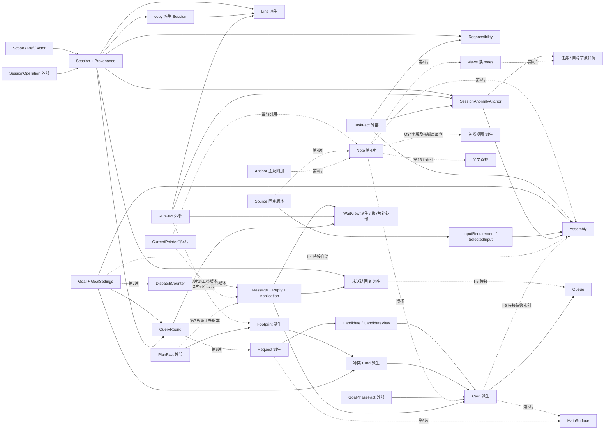

没有 MainSurface → Session 的一对一边。Request、Line、Card 和注记关系视图不落新表。接续与换手的区别依赖 Session 来历，不能按相同职责或任务名称拼线。异常锚点是第 1 片已有的独立事实，不等第 4 片 Note；其提醒已由接线包 1 接入（决定 42、47）。`views → notes` 是原规划的依赖边，第 4 片首次落文件时声明；这里的数据流箭头画作 Note → views（决定 49）。

## 写入权威和提交边界

依据 §2.6、§7.2；决定 47、48 的补记和重放，接线包 2 L10–L12 的两个位置由原写者提交。

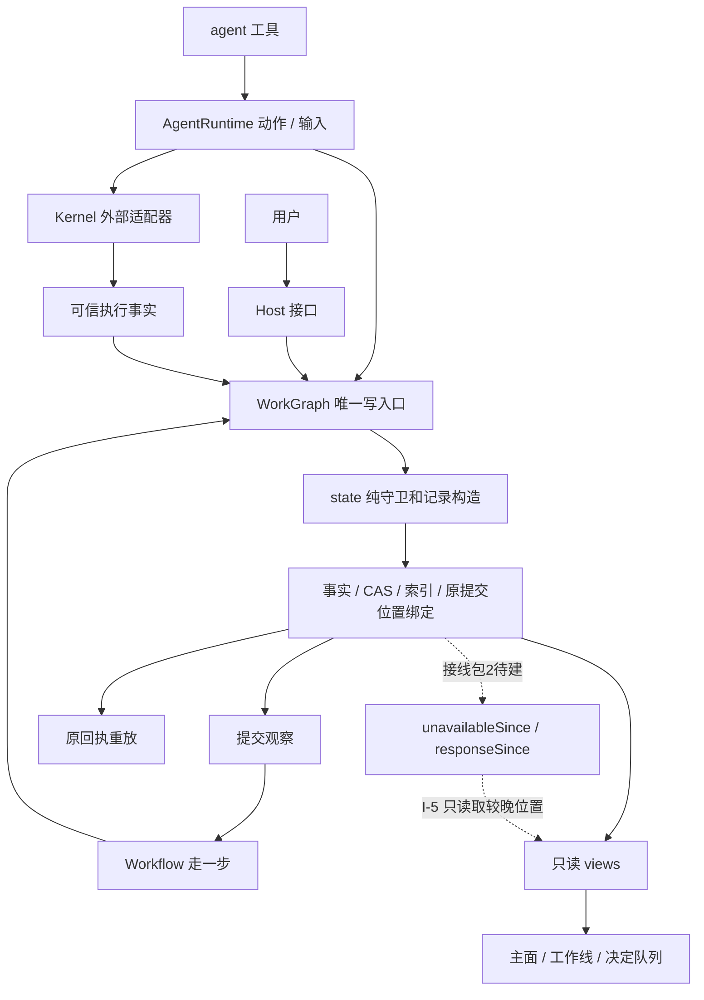

工具不调用 Workflow。任务变更和消息落实分两次提交；补记失败留“已答复，落实未记”，同请求成功重试先重放原回执，不因后来换自治或读失败重做（决定 47、48）。派工消息与 sequence 加一同次提交（决定 49 · 16，第 7 片）。创建接任 Session 与责任转移不是跨 Kernel 原子事务。原机器完成归约继续由原 owner 执行。

接线包 2 L10–L12：state 在每次进入 unavailable 或原 work_run 发信消息首次保存回复时置提交前的 null 槽，原 Session/消息 owner 同事务绑定 commit cursor；恢复时由 state 移除 unavailableSince。RecordStore 只机械绑定，views 不写入；持久记录及对外回执不能残留 null。重放用原 receipt.cursor，读取不补旧数据的位置；L12 只补四处旧完整对象断言的新字段，不改 SES-13 的迁移与守卫。

## Session 与工作线

依据 §1.5、§4.2–4.9；决定 38、42、43、45、47、48、49，SES-13 及接线包 2 L10。归档与 health 是两维；已退役是当下不可用的显示，不能把 active + unavailable 画成永久终态。

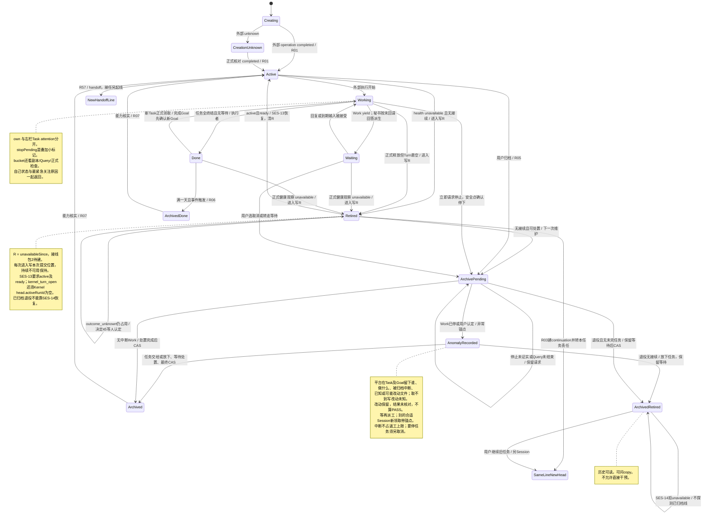

普通 continuation 的责任交接已由接线包 1 做完：旧线只有该任务时一并归档，退役前任由维护归档；技术失败时可暂有新旧两条负责关系，直到重新领取（决定 47、48）。未知结果的退役线自动维护只报 `busy / archive_unknown_confirmation_required:`，对该 Session 零写；人正式认定后才继续（决定 45）。归档中途失败保留已提交处置，并如实显示。

〔决定 51〕K 片之后：经人认定、Turn 还开着的线，维护关闭悬空 Turn，经 SES-13 回到可用，不归档；认定之前的未知占用仍零写入。

〔决定 54〕Host 重启时暂停着的线（RUN-24）不进“马上归档”：保持退役（`kernel_turn_open`）、不归档，左栏显示“已暂停 · 主机重启时已暂停，可继续”；人点“继续”后 K 片关闭悬空 Turn，回到可用并在原 Session 领取。

〔决定 52，K3 草稿〕之后：认定或重启自动收尾（RUN-25）以后，先按工具种类核对结果未知的调用；有跑程序的先跑只读核对轮。核对记录的状态是 `pending_review → resolved`，或 `pending_review → needs_decision →（你答复落实）→ resolved`；只有 `resolved` 以后才照 K 片接着做。状态图等 K3 冻结后补。

DESIGN §1.5 与 MODEL O09、R03/R54 的“退役不能恢复”概括不能覆盖 active Session 的 SES-13；本图按 DESIGN §4.3 和接线包 2 L10 区分“健康恢复”与“已归档退役线重新启用”。MODEL R05/R06 的立即归档概括也须带上决定 45 的未知占用例外，不用旧概括覆盖现有守卫。

## Request 和秘书归属

依据 §1.1、§2.11；决定 42 · 第 3 条、决定 49。请求读法及秘书换手在第 6 片；processing 是四项或，不存状态。

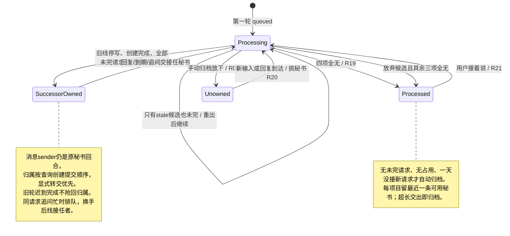

## CandidatePlan

依据 §1.1“候选计划按请求分开”、PLAN-06；决定 42 · 第 3 条、47、48，第 5 片已建。

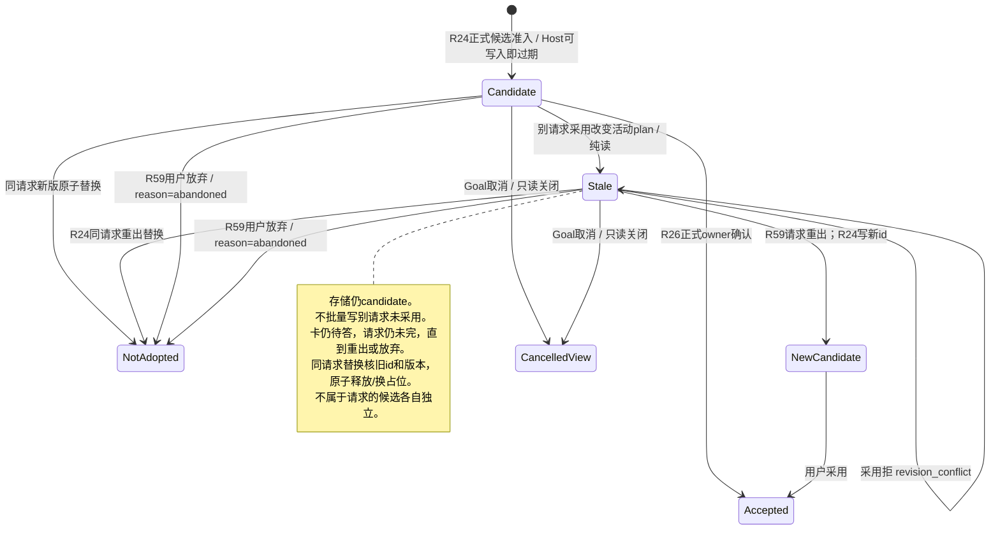

MODEL R59 仍保留“放弃后存成什么未定”的旧说明，与 DESIGN §1.1（决定 42）及 `state/plan-machine.ts:onProposalAbandoned` 不同；本图按后两者画为 `not_adopted / abandoned`，不另造已放弃状态。首方案仍只由用户采用；后续采用走正式 owner 的权限和自治规则，不把成功答复当作已采用（决定 47、48）。

另有尚未对齐的权限表述：DESIGN §2.7、MODEL R26 写 agent 只提议、不采用；代码仍有受委托权限约束的 `apply_future_plan / applyPlanChangeAsAgent`，决定 47、48 的第 5 片收尾还补了其决定出处和重放。本页的自动采用时序沿 DESIGN/MODEL 画用户或 Workflow，不据此改权限或宣称代码已删除该入口。

## DecisionCard

依据 §1.4、§2.6；决定 42、47、48，第 5 片已建。状态名按已建的 `DecisionCardStateV1`；stale 是来源/候选的派生标记，不是独立持久卡状态。

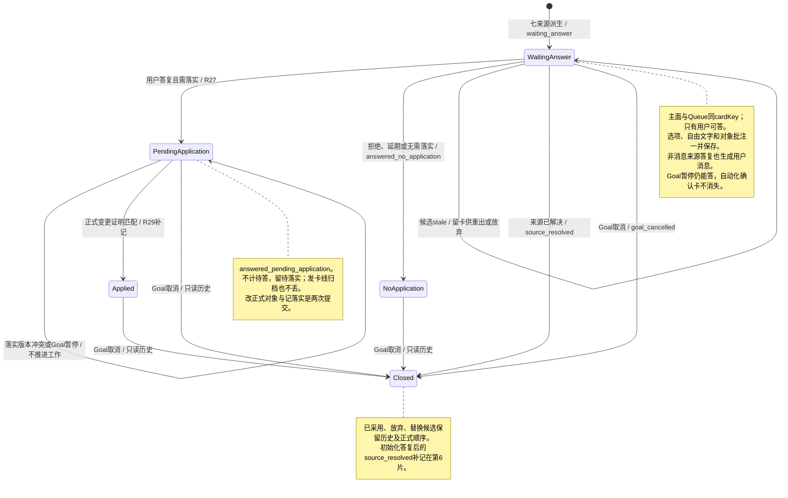

七来源的接口已建，`note_review`、`message_release` 分别等第 4、7 片，缺来源明确 `not_available`，不称全部已接。预算耗尽在每步确认下仍给确认卡（决定 48）。队列分待答、待落实、历史和请知悉；历史保留已关闭请求候选，通知每类别只推进到实际展示过的位置（决定 42、47、48）。

第 2 片要把相关决定、未解决来源改成窄索引并完整分页，不按年龄丢待答/待落实（决定 49 · 28）。当前每源 25 页 × 200 条 = 5,000 的防护，及接线包 2 L6/L7 的 50 页 × 100 条/5,000 聚合防护都是临时的：正好满额且无续页可成功，有续页明确 `capacity`，不能假报完整；第 2 片落地须一起撤换。读取失败和部分来源不可用都不能变成完整空队列。

## MessageWait 和消息处置

依据 §2.7、§2.11、§4.6；决定 42、49 · 16、18、19、29，接线包 2 L10–L12。等待/放行消费仍在第 7 片；未送达读源已有，I-5 通知及两个位置待接。release、delivery、response、expiry、application 是不同维度。

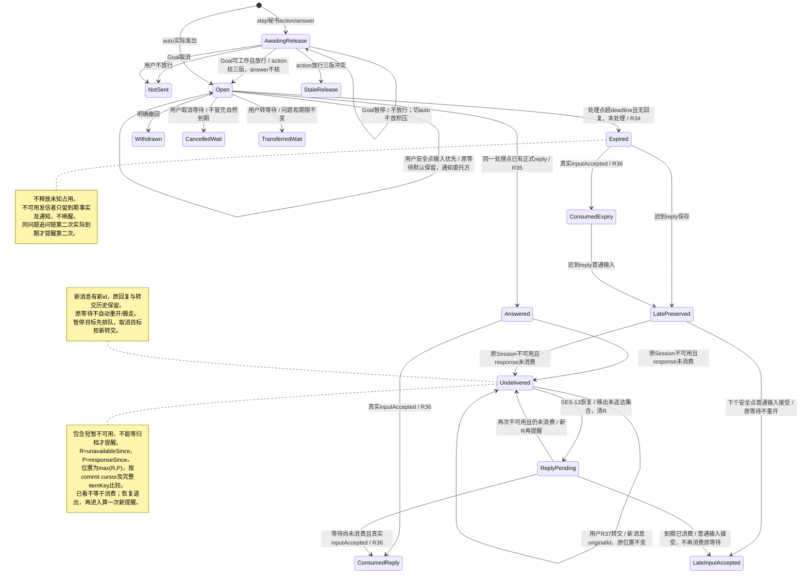

确认通信断开后，把原消息、断开原因、时间和接管情况发回相关等待方、发送方及用户；运行中在安全点收，Host 停机则恢复后告知。普通工具失败不自动等于断开或退役（决定 49 · 18）。用户优先输入通知直接委托方、实际链上仍在等的上游及相关秘书、参谋；其他 agent 的行动排队、咨询走只读副本，不并开第二个改文件的 Run（决定 49 · 19）。


### Message.delivery 与直接干预

这是消息的另一维度。依据 §1.6、R39/R40，决定 49 · 19–21；第 7 片待建。等待结束、送达、落实不是同一件事。拒绝原因写在正式 Reply 里。

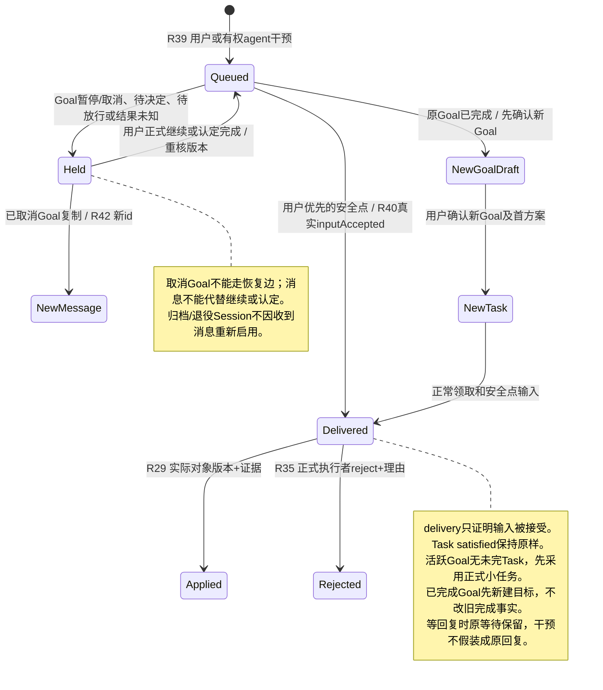

## GoalSettings

依据 §1.2–1.3、§1.6；决定 42、47、48，第 5 片已建；复制及完成后新目标按决定 39、49，等第 6、7 片。这是设置的独立维度和外部状态投影，GoalPhase 仍由原机器拥有。

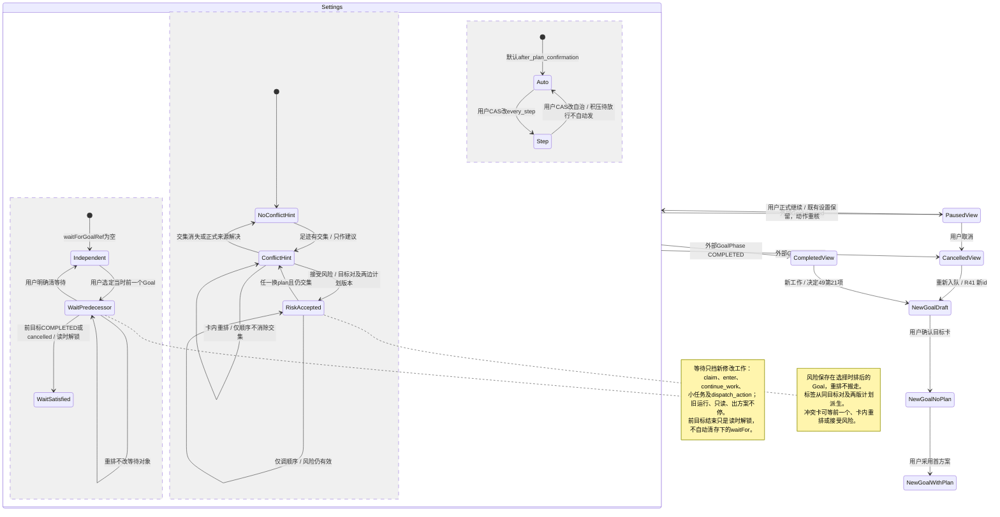

改设置只由用户按 Goal 版本提交；取消目标拒改，等待不成环。顺序只影响以后争同一成员，冲突不是领取门槛。文件先归所属模块再和计划模块比较；第 5 片执行文件来源尚为 `not_available`，不能把“没查到”写成无冲突。自治 owner 已建，装配器展示自治等接线 I-4（决定 47、48；接线包 2）。

I-4 把当前自治显示进新准备的上下文，不改接线包 1 的 G 内容摘要，也不因自治变更重装已绑定输入；实际动作仍由第 5 片 owner 当场检查（接线包 2 §0.3）。

## Note 与 CurrentUnderstanding

依据 §3.3–3.7、O34–36；决定 49 · 04–06、Q8、Q9。第 4 片待建，语义修补的检查/目录生效在第 8 片；现有异常锚点不冒充 Note。

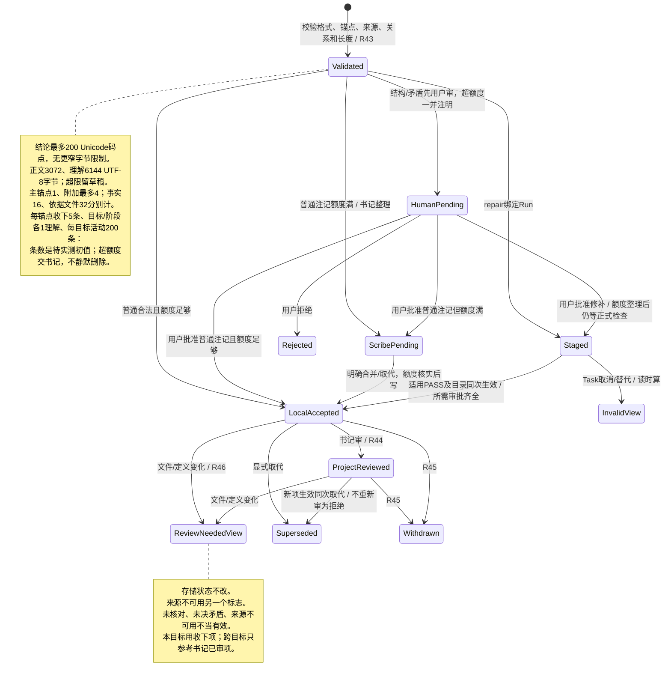

注记关系沿 O34 的 `anchor/extraAnchors`、`facts`、`replaces`、`contradicts` 严格定型；取代和矛盾只允许指向至少共用一个主或附加锚点的注记。反查先合并按锚点索引的候选、去重再核字段；“谁负责、谁参与”仍读任务图和 SessionWorkLink。A 可无损推出关系视图，B（独立关系记录）只作实测不足后的升级路径；必要时先加可重建反查索引，本次不另加关系记录或邻接索引（决定 49 · Q8）。

全文提前到第 4 片，作为附录 C 第 15 个索引：RecordStore 窄端口，内存子串扫描，SQLite FTS5、中文 2 字片段；不加标签、时间/版本、关系邻接这三类索引。agent 仍只用“看”“找”各自的记忆分支，工具确定性读取、不调用模型（决定 49 · Q1、Q2、Q9）。

当前理解读已提交版本及状态，不等写者；撤下或拒绝后当前可用值留空，保留历史引用，不回退旧理解。新理解、旧项取代及指针 CAS 同次提交（决定 49 · 05）。

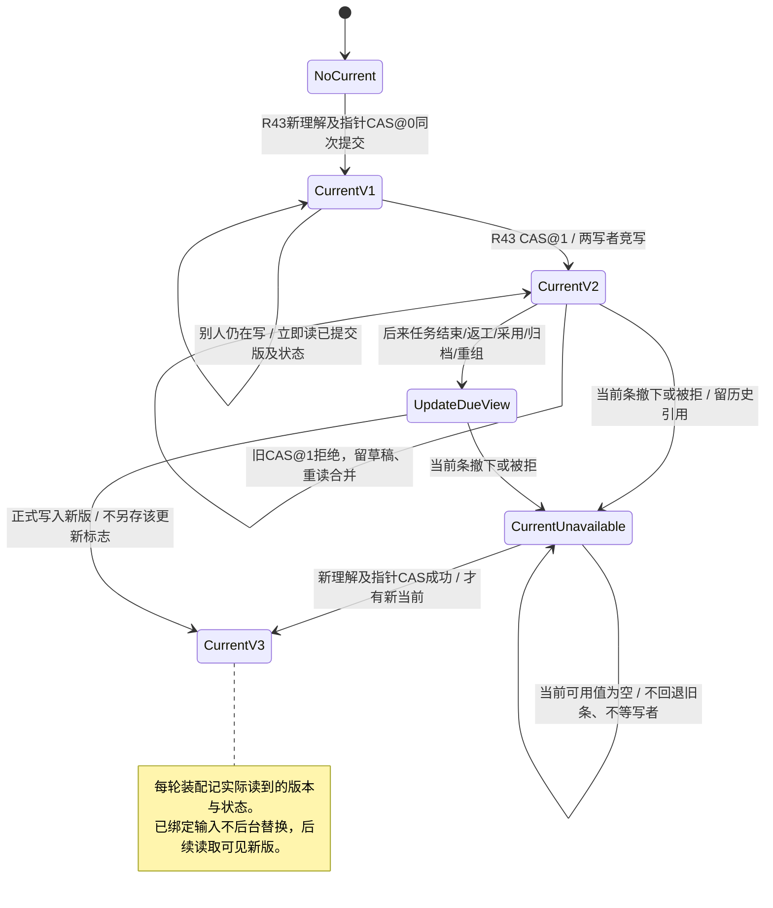

## 十二个组合时序及接线包 2 I-5

### 1. 两个秘书读相同三版后派工（S06；决定 49 · 16、22，第 7 片）

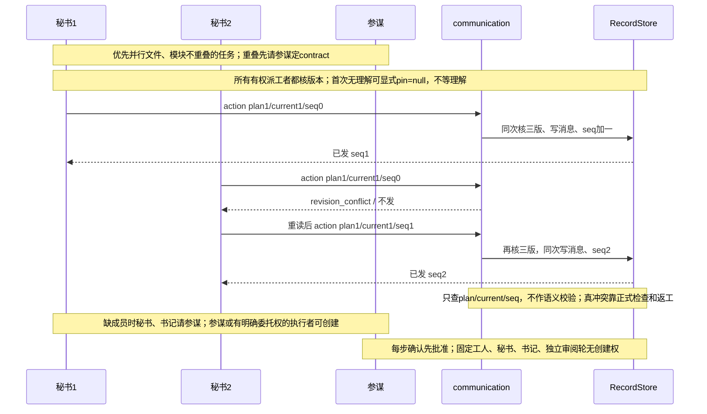

### 2. step待放行遇别人的派工（S06；R18；决定 42 · 第 11 条、49 · 16）

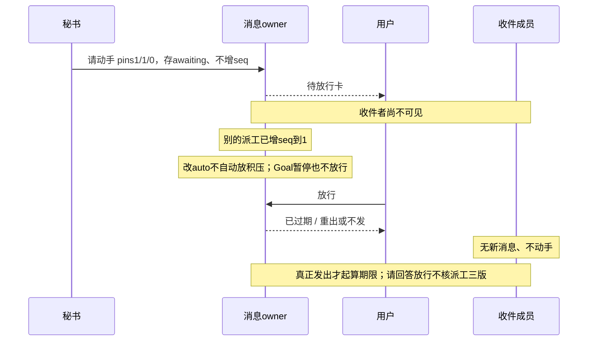

### 3. 请回答未回时秘书换手（S07；决定 49 · 05、10、27，第 6 片）

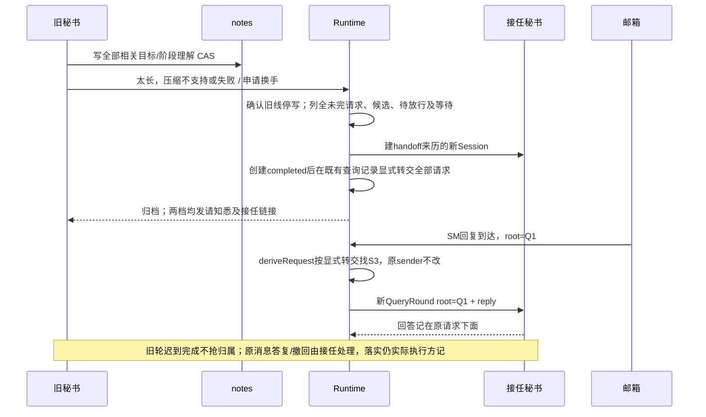

### 4. 退役线放下任务，迟到回复手动转交（S02、S11、S66；决定 42、43、45、49 · 18、29）

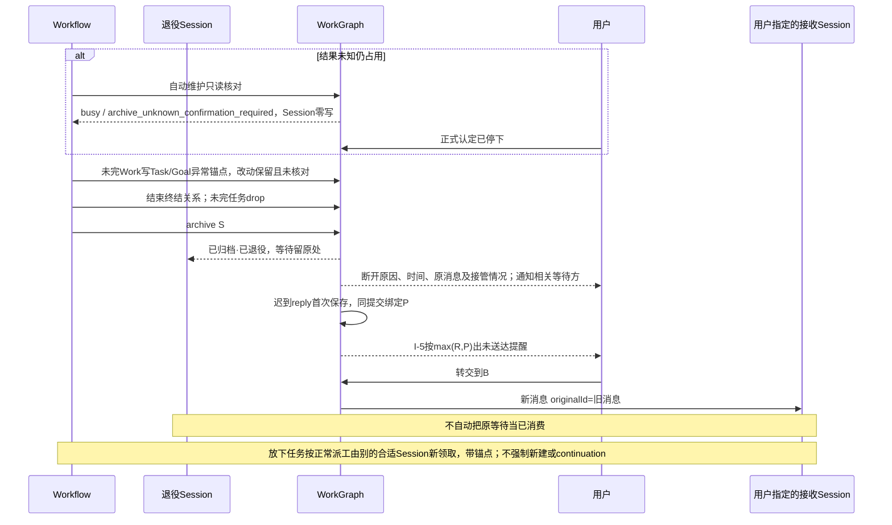

### 5. 别请求采用使候选过期（S08；决定 42 · 第 3 条、47、48）

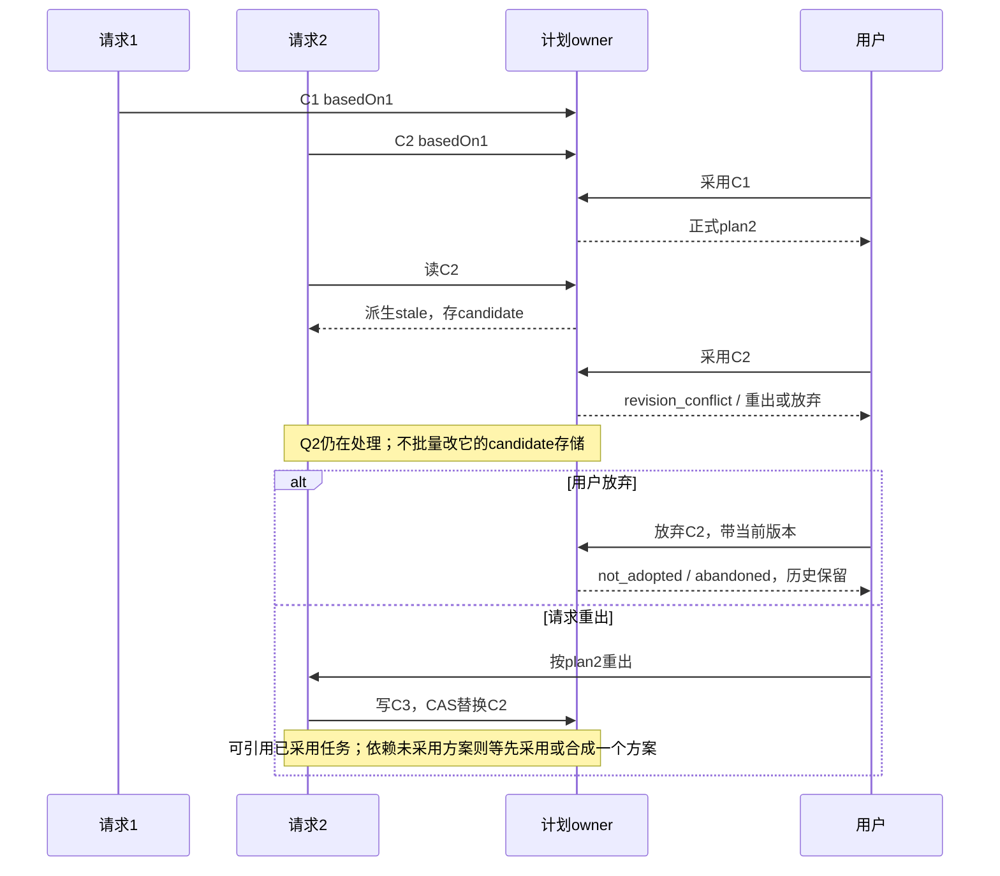

### 6. 已答复、变更成功、补记失败（S10；决定 42 · 第 7 条、47、48）

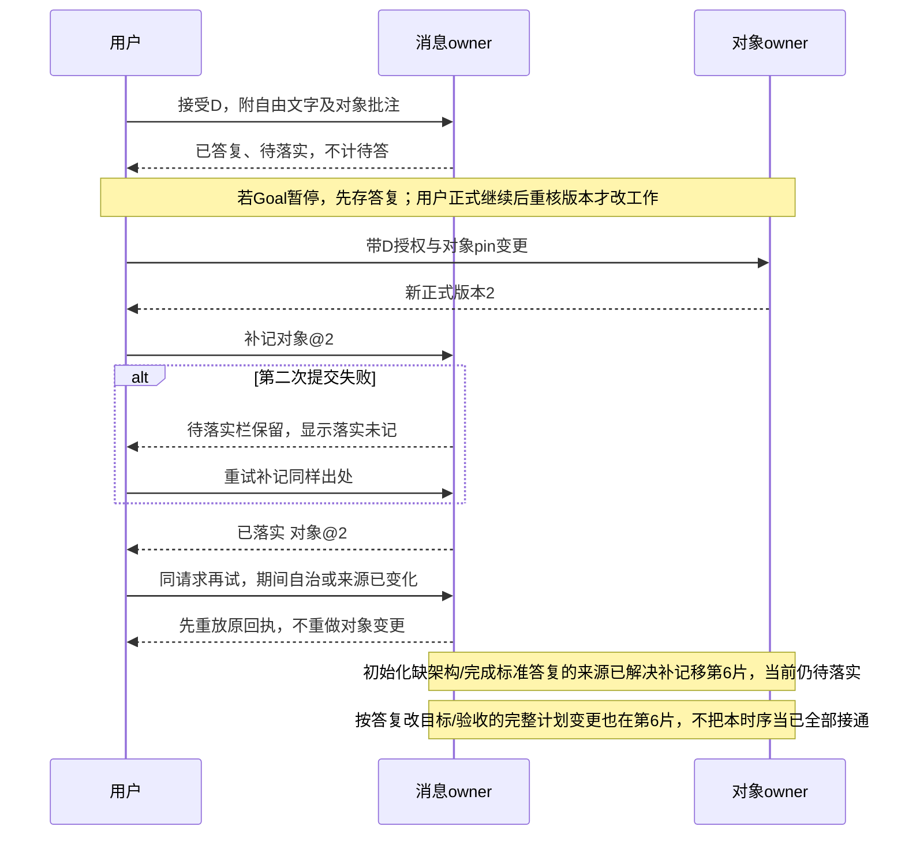

### 7. 到期后消费，迟到回复（S11；决定 49 · 17–19，第 7 片）

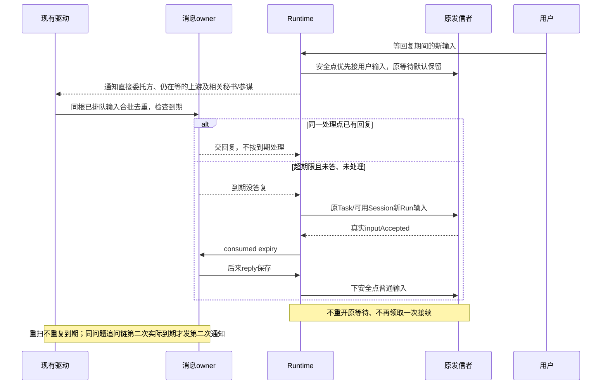

### 8. 取消目标复制，勾选干预（S12；决定 39、49 · 13、20，第 6、7 片）

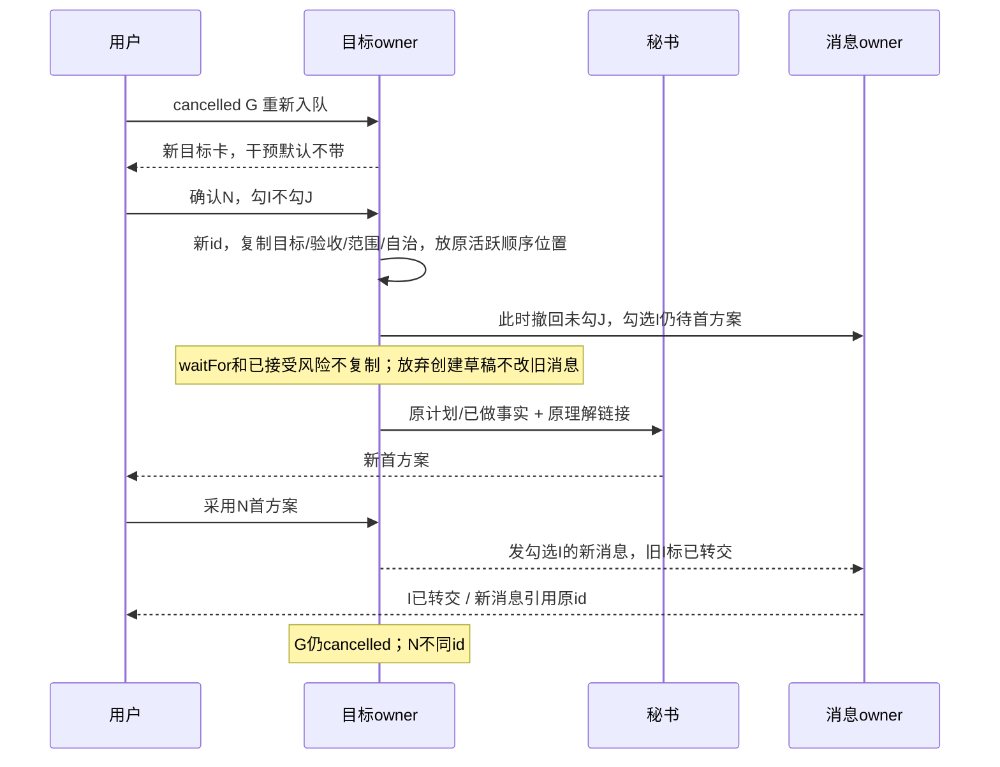

### 9. 当前理解竞写与复查（S09、S74；决定 49 · 05、06、Q8，第 4 片）

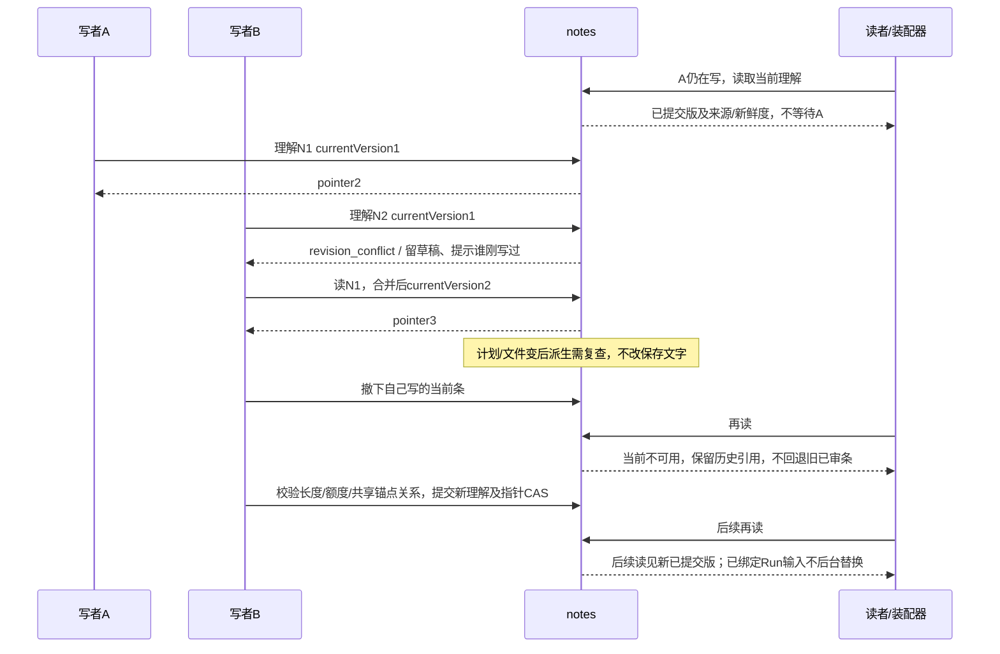

### 10. 已做完线接受干预（S13；决定 38、49 · 21，第 7 片）

```mermaid
sequenceDiagram
  participant U as 用户
  participant M as 邮箱
  participant WF as Workflow
  participant P as 目标/计划owner
  participant A as 已做完执行者
  U->>M: 直接干预A
  alt 原Goal已完成
    WF-->>U: 起草新目标，原完成事实不改
    U->>P: 确认新Goal
    WF->>P: 在新Goal建小任务及首方案
    P-->>U: 首方案两档都待用户采用
    U->>P: 采用新Goal首方案
  else 原Goal仍活跃且无未完任务
    WF->>P: 提正式小任务
    alt step
      P-->>U: 待确认
      U->>P: 确认采用
    else auto
      WF->>P: 范围内自动采用
    end
  end
  WF->>A: 正常新Task领取执行
  Note over P,A: 原satisfied Task不修改
```

### 11. 上游未完成但产物已可用（S15；第 3 片已建，决定 47 接线包 1）

```mermaid
sequenceDiagram
  participant RT as Runtime准备
  participant T as tasks
  participant M as materials
  participant A as 下游agent
  RT->>T: 下游已采用requirement
  T->>T: 对已有产物事实定版本
  T->>M: 核声明后的历史说明读取
  M-->>T: 固定产物@2
  T-->>RT: selected input@2 + 来源
  RT->>RT: 准备任务/义务/输入与提醒，绑定实际来源
  RT->>T: 消费时检查精确输入及实际展示的Goal内容摘要
  alt Goal说明或精确输入变化
    T-->>RT: 拒绝旧装配，重新准备
  else 实际上下文仍适用，含仅不相关计划采纳
    T-->>RT: 不因Goal总版本变化拦住已准备任务
    RT->>A: 正式进入，交已核实的上下文
  end
  Note over T,A: 不等上游整个Task satisfied
  Note over RT,A: 异常锚点提醒已接；自治展示、待答卡索引分别等I-4、I-6，不新增提醒准入守卫
```

### 12. K中断关闭与K2轮间压缩（S20、S21；决定 39、49 · 25、27；接线包 2 L10）

```mermaid
sequenceDiagram
  participant WF as Workflow
  participant RT as Runtime
  participant K as Kernel补丁
  participant S as Session owner
  WF->>RT: active且kernel_turn_open，平台Run已结束，无实际活动执行
  RT->>K: K关闭悬空Turn
  alt 关闭成功
    K-->>RT: interrupted终态 / 活动Run清掉
    RT->>S: 正式健康ready观察，head.activeRunId为空
    S->>S: SES-13恢复available，清unavailableSince
    S-->>WF: 原Session可开新Run，非恢复旧Run
  else 无能力或关闭失败
    RT-->>WF: 另建continuation退路
  end
  Note over RT,K: 半截调用留原历史、未完成Turn不进模型输入；接续说明补足，不重跑副作用工具
  Note over WF,S: 不复活补丁前已归档退役线；未知执行先正式核对
  Note over WF,K: K与K2均待建；K2两阶段已定，仍不算MVP门槛
  WF->>RT: 空闲两轮间达到压缩条件 / 与换手条件分开配置
  RT->>K: 先压缩；运行中请求明确未执行
  K->>K: 旧工具结果换桩，保最近3轮
  Note over RT,K: 调用和结果成对，桩保执行/输出版本及原文入口
  alt 桩还太长
    RT->>K: 再写摘要，核必需内容、大小及来源
    Note over RT,K: 留目标验收、用户原话/决定、未完请求/等待/待放行、尝试和来源
    Note over RT,K: 摘要超限或缺必需段落失败；坏链接标来源不可用
  end
  alt 压缩成功
    K-->>WF: 原Session / 原历史保留 / 已压缩说明
    Note over RT,K: 记忆只留固定引用，不复活撤下项；计划及派工版本重读
  else 不支持或压缩失败
    RT-->>WF: 明确原因，按另配换手条件及原审批规则处理
  end
```

### 13. 回复后不可用、已看、恢复、再进入（接线 I-5；决定 49 · 29；L10–L12，待建）

```mermaid
sequenceDiagram
  participant M as 消息owner
  participant S as Session owner
  participant R as RecordStore
  participant V as 未送达读源/Queue
  participant U as 用户
  participant W as 工作区设置owner
  M->>R: 原work_run发信消息首次保存reply，同提交绑定responseSince=P
  Note over S,V: 原Session active且available，reply未消费，此时不在未送达集合
  S->>R: 正式观察或Work/Query释放进入unavailable，同提交绑定unavailableSince=R1
  U->>V: 读请知悉
  V->>R: 同窗分页，先核消息归属/Goal，再核R1及P
  R-->>V: health=unavailable，未消费reply，两个持久位置
  V-->>U: 一次新提醒，position=max(R1,P)，本例取R1
  Note over V,U: key由完整messageRef+responseRef构造；短暂不可用也提醒
  U->>W: 展示后用displayToken标已看至该类别位置
  W->>R: 保存类别已见位置，不消费reply、不转交
  U->>V: 同一段不可用再次读取
  V-->>U: 位置未变，已看项不再列出
  S->>R: active且ready按SES-13恢复；若曾Turn悬空须head无activeRun
  R-->>S: available，同次移除unavailableSince
  U->>V: 再读未送达
  V-->>U: 原health过滤使该项退出集合，原回复保留
  Note over M,S: 本例恢复期间reply仍未被inputAccepted；若已消费则不会再入集合
  S->>R: 再次进入unavailable，同提交写新的R2
  U->>V: 再读请知悉
  V-->>U: 同key，max(R2,P)晚于已看位置，一次新提醒
  Note over R,V: 先不可用后回复则取P；同段重复/归档/转交/重放保持位置
  Note over R,V: 范围内旧数据缺R或P明确incomplete；不拿时间、本次水位或revision凑位置
```

位置统一由 `compareNoticePositions` 按提交序及完整 itemKey 比较；恢复清除 R，再进入写新 R，不跨次去重。目录分页满足 `atLeastCursor`，`source_stale` 或水位变化丢弃半窗后重读，最多四次；读源零写，不自动转交、不把已看当已消费（接线包 2 L10/L11）。
