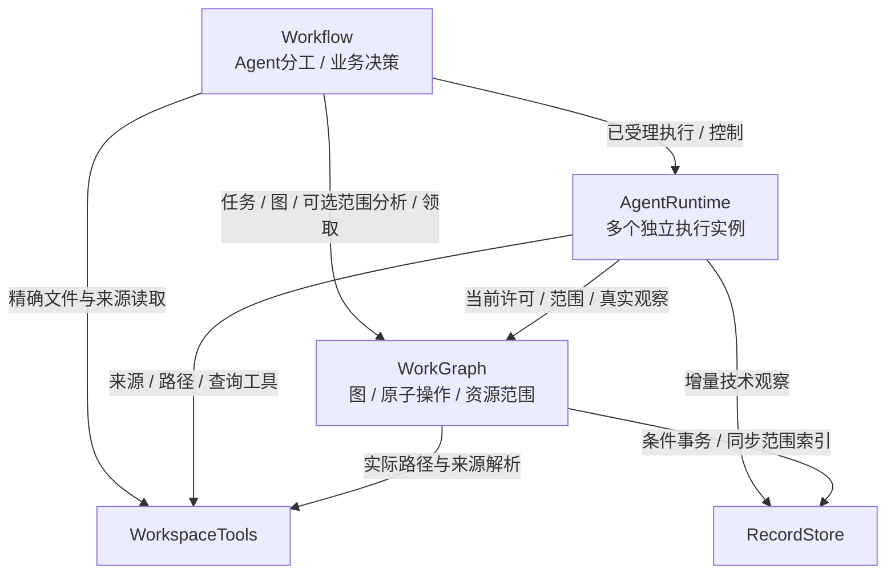
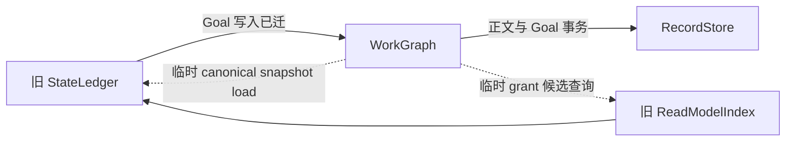

# 模块依赖图：业务策略与核心操作

当前独立仓库的实际装配、静态依赖与代码规模见 2026-09-27 当前模块关系图（已归档：`docs/refactor/reviews/current-module-map-2026-09-27.md`）。下文目标图与历史迁移记录保留原义，不代表当前全部实现状态。

状态：2026-09-24。目标 5 模块/8 条允许边，在独立工程 `coding-platform/next` 按[目标源码门禁](../../scripts/check-boundaries.mjs)检查；实际功能尚为子集，见干净迁移记录（已归档：`docs/refactor/reviews/next-completed-migration-2026-09-24.md`）。原[源码 map](../../coding-platform/scripts/module-map.mjs)描述旧参考工程，不能混计为 next 的模块数。依据：[架构](ARCHITECTURE.md)。

## 1. 目标 DAG

5 个模块、8 条边是职责划分结果，不是性能指标。箭头＝调用者长期消费提供者，包括注入的接口；运行消息往返不是源码依赖。Contracts 不导入实现；Host 装配不消除真实逻辑依赖。

| 调用者 | 提供者 | 消费能力 | 边界 |
| --- | --- | --- | --- |
| Workflow | WorkGraph | 图、任务、Session候选、候选计划、邮箱、证据；受理结构化意图 | 业务不逐表更新索引 |
| Workflow | AgentRuntime | 已受理工作的执行／控制／观察，Kernel Session历史只读桥接 | 已受理不等于已完成；只读历史不创建Run或启模型 |
| Workflow | WorkspaceTools | 人工查询、规划与检查所需精确文件、差异和来源 | 已知路径无需先查询全图 |
| AgentRuntime | WorkGraph | 运行占用、待执行意图、结果入账，执行中的图／历史引用工具 | 不另写正式任务或Session状态 |
| AgentRuntime | WorkspaceTools | 文件／符号／搜索／源码工具和来源核对 | 不建立第二套源码索引 |
| AgentRuntime | RecordStore | 平台自身观察、配置引用和持久适配 | Kernel日志和检查点仍在Kernel；正式业务状态走WorkGraph |
| WorkGraph | WorkspaceTools | 架构来源捕获、比较所需观测、材料来源核对 | 普通观测不强制绑定Run／baseline |
| WorkGraph | RecordStore | 条件事务、正文、事件页和持久索引 | 存储不决定业务策略，关联变更不能部分成功 |

合法拓扑序：Workflow → AgentRuntime → WorkGraph → WorkspaceTools／RecordStore。同层不代表开发必须并行或串行。机器声明见 [module-target.json](module-target.json)。

### 并行审阅时区分三种图

| 图 | 箭头含义 | 是否允许反馈环 / 并行解释 |
| --- | --- | --- |
| 本页源码 DAG | 调用者依赖提供者 | 保持无环；一个 Runtime 模块可以驱动多个 Agent 实例，不因图只有一个框而串行 |
| 运行时协作图（已归档：`docs/refactor/PARALLEL-COLLABORATION.md`） | 图/资源检查→Agent决策与修正→领取→执行→结果 | 允许反馈；同工作区不冲突范围并行，真实冲突交回策略处理 |
| 开发任务依赖图（已归档：`docs/refactor/PARALLEL-COLLABORATION.md`） | 契约及可验收交付的前置 | 公开契约冻结后内部实现并行，生产集成等待真正所需能力，不按层数全局串行 |

注释：架构模块不是排他锁，AST依赖不是一律加锁；核心数据工具解析实际范围与共享资源，由Agent/Workflow修正分工。Session自身对话占用与工作区文件资源分别管理。旧源码的单writer只列为待迁实现，不再成为目标限制。

## 2. 不允许的反向边

- 核心不依赖 Workflow；结果和待决意图由外层业务消费。
- WorkGraph 不依赖 AgentRuntime；只受理／记录，外层驱动Kernel并回报。`findSessions/searchHistory`返回平台关联与引用；`readSessionHistory`实际读取Kernel日志，由AgentRuntime只读适配提供。
- RecordStore 不依赖其他模块；文件来源政策在实际使用处执行，领域判据在WorkGraph。
- WorkspaceTools 不依赖 RecordStore；返回捕获结果，由调用方决定保存和关联。
- 普通查询不依赖生命周期策略；有执行方式／会话处置决定时才进入该流程。

## 3. 旧依赖的处置

| 旧边／切分 | 目标 |
| --- | --- |
| 六类消费者 → ContextCompiler | 拆为Workflow的输入需求、WorkGraph的材料定位和来源读取、AgentRuntime的输入适配；删除总门面 |
| ReadModelIndex → ControlEngine | 解释、资格和完成判据同归WorkGraph内部，不再跨模块传递 |
| ArtifactVault → Ledger／Index／Workspace | 正文存取归RecordStore；适用性归WorkGraph；文件来源通过WorkspaceTools |
| Dispatch → 新增AgentLifecycle | 选择策略归Workflow、机制归AgentRuntime、状态归WorkGraph，不再只加包装 |
| ArchitectureReconciler → Context／Vault／Control | 比较、候选、材料绑定归WorkGraph，消费底层存储与来源 |
| 普通／Reviewer／Handoff多套启动 | 统一执行协议，运行类型保留必要差异 |

## 4. 迁移期检查

目标 JSON 的路径相对 `coding-platform/next`，新工程目录及真实 import 由 `next/scripts/check-boundaries.mjs` 检查；原 map 留作旧工程事实。每批在 next 接通真实调用链和测试，不默认接回旧服务。N0 窄骨架必须返回 unsupported，不能为了边数凑出虚假功能；旧入口在最终产品切换后退役。

文档检查验证ID／目录唯一、依赖存在、无环、所有旧模块都有去向及模块页存在；源码检查验证当前实现。关键文件/Port/内部调用在详细骨架（已归档：`docs/refactor/skeleton/README.md`），外层Host及Kernel边界在贯通流程（已归档：`docs/refactor/skeleton/END-TO-END.md`）。开发批次见实施方案（已归档：`docs/refactor/IMPLEMENTATION-PLAN.md`），与本图分别维护。

### 旧参考工程 R3b 的注入关系（2026-09-24 历史）

下图是迁移现状，不改变上面的五模块目标。`load` 和候选查询即使通过窄类型注入，仍是实际依赖；不能因源码没有 import 旧模块便删掉这两条边。R3b 的功能接线与这项架构收口分别验收。

材料读取的当前实现直接读取同后端 snapshot 或投影，没有沿上述模块关系递归调用 Goal 写入，也不开始嵌套写事务。但模块级依赖已出现环；`check:architecture` 的 import/声明边检查成功，只证明该检查的范围，不能外推为完整逻辑图无环。

退出项：把精确 snapshot 读取、material-access 候选索引的物理读取归 RecordStore，共用现有连接和状态；WorkGraph 保留来源、grant、basis 与撤权规则，旧读入口改为薄适配。随 R3c 的数据/索引迁移先行小批关闭，不新造 DataEngine、不复制 SQL 或双写索引来美化图。R3b 验收报告必须保留此欠账，最终 R6c 不允许带着这两条临时边宣称目标 DAG 收敛。

## 5. 机器可读规则的单一来源（2026-10-02）

`module-target.json`（schemaVersion 2）是模块路径和允许边的唯一来源：`scripts/check-boundaries.mjs` 直接读取它，不再在脚本里另写一份 `MODULES/ALLOWED`。`projectRoot`、`implementationOwnership` 相对该 JSON 所在目录解析，必须分别指向本仓库根与 `scripts/check-boundaries.mjs`；模块 `path` 相对仓库根。检查脚本对以下情况明确报错，并跳过全部源码文件检查（归属、import、symlink、UI 规则；退出码仍为失败）：JSON 不可读、缺字段、模块 id 占用外层名（Contracts/Composition/Host/UI）、路径未规范化、模块/子模块路径不存在或互相重叠、依赖指向未知 id、自依赖、模块或子模块依赖成环。import 违规的报错带 `src` 内相对路径和 1 起算的行号（如 `core/workspace/entry.ts:3: forbidden module edge ...`）。

模块可以声明 `submodules`：每项 `{ id, path, dependencies }`，`path` 相对模块目录，可以是以 `/` 结尾的目录或单个源码文件；声明后模块内每个源码文件必须恰好属于一个子模块，子模块之间（含 type-only import）只允许沿声明的 `dependencies` 方向依赖，且子模块依赖图必须无环；解析不到任何子模块的 import 按失败处理（fail closed）。WorkGraph 的具体子模块分层由任务 D 决定后写入同一 JSON。（2026-10-07：已写入，见 §6。）

Contracts、Composition、Host（`src/app`）和 UI（`src/ui`）是外层，规则仍由脚本内的固定分支实现（UI 仅可 type-only 引用 Host DTO 等），不在 JSON 中重复声明。（2026-10-21 补注：UI 层和它的边界规则已随 `src/ui` 删除（决定 86-2）；其它外层规则仍有效。）

### 旧模块名去向（原 `legacyModules`，已从 JSON 移出）

该段没有代码消费者，2026-10-02 从 `module-target.json` 移到此处保存，仅供追溯；旧 `referenceOwnership`（旧工程 `coding-platform/scripts/module-map.mjs`）同时移除。

| 旧模块 | 现归属模块 |
| --- | --- |
| HumanCollaboration | Workflow |
| PlanCompiler | Workflow、WorkGraph |
| ControlEngine | WorkGraph |
| DispatchEngine | AgentRuntime、Workflow |
| VerificationEngine | Workflow、WorkGraph、AgentRuntime |
| ArchitectureReconciler | WorkGraph |
| AgentLifecycle | Workflow、WorkGraph、AgentRuntime |
| WorkerRuntime | AgentRuntime |
| StateLedger | RecordStore、WorkGraph |
| ArtifactVault | RecordStore、WorkGraph |
| ReadModelIndex | WorkGraph、RecordStore |
| ContextCompiler | WorkGraph、Workflow、AgentRuntime |
| WorkspaceReader | WorkspaceTools |

## 6. WorkGraph 的子模块（2026-10-07，决定 40）

任务 D（0cd45508）把 WorkGraph 的文件搬进了子模块目录。验收后，子模块规则写进了 [module-target.json](module-target.json) 里 WorkGraph 的 `submodules`，内容就是方案 workgraph-split-2026-10-07（已归档：`docs/refactor/reviews/evidence/workgraph-split-2026-10-07/README.md`） 的 `target.json` 里的 `submodules`：13 个子模块，41 条允许的依赖。`check:architecture` 从这时起按它检查。

**方向规则。** 上层可以依赖下层，反过来不行；层号是 [DESIGN §7.2](design/orchestration-2026-10/DESIGN.md#72-workgraph-分层) 的。检查器不读层号，只认每个子模块的 `dependencies`：子模块之间的 import（包括只引用类型的）必须沿声明的方向，子模块依赖图必须无环，解析不到任何子模块的 import 也算违规（§5）。违规报 `src` 内的文件和行，例如 `core/work-graph/tasks/plan-service.ts:30: forbidden submodule edge WorkGraph/tasks -> WorkGraph/evidence`。

**L0 内部的例外。** model 可以依赖 state（L0 内部的例外，决定 40 修法 B）；state 不依赖 WorkGraph 里的任何东西。这是唯一一条不往下走的边，现在只有一处用到它：`model/plan-contracts.ts:19` 以类型引用 `state/goal-machine.ts` 的三个类型（目标显示、恢复接续、控制能力）。反方向一直禁止：state 是纯目录，只能依赖 `src/contracts`，由顶层的 `pureDirectories` 管；它在子模块里也没有声明任何依赖。这条例外在 JSON 里写在 model 条目的 `note` 上（检查器不读 `note`）。

| 子模块 | 层 | 路径（相对 `src/core/work-graph/`） | 允许依赖 | 文件数（2026-10-07） |
| --- | --- | --- | --- | ---: |
| model | L0 | `model/` | state（L0 内部的例外） | 12 |
| state | L0 | `state/` | —（纯目录，只依赖 `src/contracts`） | 13 |
| persistence | L1 | `persistence/` | model | 9 |
| configuration | L2 | `configuration/` | model, persistence | 5 |
| materials | L2 | `materials/` | model, persistence | 5 |
| architecture | L2 | `architecture/` | model, persistence | 8 |
| sessions | L3 | `sessions/` | model, state, persistence, materials, architecture | 9 |
| source-authority-ports | L3 | `source-authority-ports.ts` | materials | 1 |
| queries | L4 | `queries/` | model, state, persistence, materials, sessions | 4 |
| tasks | L5 | `tasks/` | model, state, persistence, materials, architecture, sessions, queries | 31 |
| source-authority-reader | L5 | `source-authority-reader.ts` | source-authority-ports, materials, queries | 1 |
| evidence | L6 | `evidence/` | model, state, persistence, architecture, tasks | 2 |
| communication | L6 | `communication/` | model, state, persistence, materials, sessions, queries, tasks | 1 |

- 41 条允许的依赖里，现在的代码用到 40 条；没用到的是 `tasks → architecture`，它是设计要的（D-PLACEMENT §3），先声明。
- 必须一直禁止的方向（D-PLACEMENT §4，方案 `target.json` 的 `forbidden`）都不在上表里，所以都会被拒：persistence 只依赖 model；sessions 不依赖 tasks、queries、communication、evidence；queries 不依赖 tasks、communication、evidence；tasks 不依赖 evidence、communication；materials 不依赖 tasks；state 不依赖任何子模块；model 除了 state 不依赖别的子模块。D-PLACEMENT §4 里关于 notes、views 的两条，等这两个子模块声明时一起写进去。`persistence → state` 要用户确认后才能加。
- `notes`（L5.5）和 `views`（L7）还没有文件，没有声明；检查器要求声明的路径存在，第一个文件落地时再按 DESIGN §7.2 声明（D-PLACEMENT §3“写入时机”）。
- state 的纯度仍用顶层 `pureDirectories` 声明。规格 §14.4 定了（L-8）任务 D 之后改成 state 子模块条目上的 `pure: true`，这一步还没做：检查器还不认 `pure` 字段，只写上不会被检查；写声明这一步没有改检查器，所以保留 `pureDirectories`，含义相同。留在收尾：先让 `scripts/check-boundaries.mjs` 支持 `pure: true` 并补测试，再换（见 [STATUS](STATUS.md)“剩余”）。
- 文件之间还有两个只靠类型引用才成的环，各在一个子模块内部（model 里 3 个契约文件、state 里两个状态机）。按决定 40 接受：收尾的“无环”按“子模块之间无环、文件之间没有值引用的环”算。检查器只查子模块之间的环。

**2026-10-09 补注（收尾、编排第 0、1、3 片之后）。** 上面的表和几条说明写于 2026-10-07，原文保留；现在的情况：
- **state 的纯度已改用 `pure: true`**（收尾，820817c3）。上面“state 的纯度仍用顶层 `pureDirectories` 声明……这一步还没做”已过期：检查器认子模块条目上的 `"pure": true`，顶层 `pureDirectories` 退役，再写就报错；检查输出 `pure submodules: WorkGraph/state`。“state 是纯目录……由顶层的 `pureDirectories` 管”一句也按这条读。
- **B0（48c8d473，编排第 3、5 片之前）声明了 `views`，并允许 `configuration → state`。** 子模块从 13 个变成 14 个，允许的依赖从 41 条变成 53 条：
  - `views`（L7，路径 `views/`）：只读的读模型，可以依赖除 notes 以外的其余 11 个目录子模块（model、state、persistence、configuration、materials、architecture、sessions、queries、tasks、evidence、communication）；没有任何子模块声明依赖 views，所以 D-PLACEMENT §4“任何子模块依赖 views”这一条由检查器拒绝。第一个文件是第 3 片的 `views/graph-context-reader.ts`。
  - `configuration` 的依赖改为 model、state、persistence：第 5 片的通知位置要用 state 里的状态机（第 5 片规格 §0.2 T03）。第 5 片没有合入，这条边现在还没用到。
  - `notes`（L5.5）仍没有文件，没有声明。
- **现在的检查结果**（e48218a5，`npm run check:architecture`）：WorkGraph 114 个源码文件；用到的子模块边 47 条（原来的 40 条，加 views 用到的 7 条：architecture、materials、model、persistence、queries、sessions、tasks）；没用到的允许边 6 条：`tasks → architecture`、`configuration → state`，以及 views 到 state、configuration、evidence、communication。
- **文件数（2026-10-09）**：model 15、state 16、persistence 9、configuration 5、materials 5、architecture 8、sessions 10、source-authority-ports 1、queries 4、tasks 36、source-authority-reader 1、evidence 2、communication 1、views 1。比上表多出来的都是第 1、3 片新建的：model 3（`session-facts-contracts.ts`、`context-input-contracts.ts`、`graph-context-contracts.ts`）、state 3（`session-anomaly.ts`、`session-responsibility.ts`、`context-input.ts`）、sessions 1（`session-responsibility-service.ts`）、tasks 5（`session-anomaly-codecs.ts`、`session-anomaly-service.ts`、`session-facts.ts`、`session-provenance-facts.ts`、`context-input-service.ts`）、views 1。
- **接线包 1 之后（6180adfc，2026-10-09 晚）**：views 多一个文件 `views/context-extensions.ts`（给图读取器的锚点行，只依赖 model 和 tasks，都是已用到的边），WorkGraph 115 个源码文件；子模块边仍是 47 条，没用到的允许边不变；另一个新文件 `src/composition/session-duty.ts` 在组合层，不属于 WorkGraph。检查通过（74f059b4 上的 `npm run check:architecture`）。
- **第 5 片合入之后（a7cafccc，2026-10-09 夜）**：上面“第 5 片没有合入，这条边现在还没用到”已过期，`configuration → state` 现在用到了（通知位置的状态机）；`views → state` 也用到了。WorkGraph 135 个源码文件（多 20 个：model 1、state 3、persistence 1、configuration 2、tasks 5、communication 3、views 5）；用到的子模块边 49 条，没用到的允许边 4 条：`tasks → architecture`，以及 views 到 configuration、evidence、communication。`module-target.json` 没改。检查通过（a7cafccc 上的 `npm run check:architecture`，纯子模块仍只有 WorkGraph/state）。
- **4A 合入之后（2026-10-16）声明了 `notes`**（L5.5，路径 `notes/`）：允许依赖 model、state、persistence、architecture、sessions、tasks；evidence 和 views 各加一条到 notes 的允许边（注记的依据，节点详情和“看”的注记一栏，4B、4C 用）。上面“`notes`（L5.5）仍没有文件，没有声明”已过期。notes 有 5 个文件（`note-service.ts`、`note-read-model.ts`、`note-anchors.ts`、`note-anchor-facts.ts`、`scribe-scope.ts`）；另有 `model/note-contracts.ts`、`state/note-machine.ts`、`persistence/note-record-codecs.ts`。合并树（2C、资源上限片、4A）的 `check:architecture`：WorkGraph 158 个源码文件，用到的子模块边 54 条（notes 用到 5 条：architecture、model、persistence、state、tasks；`notes → sessions` 和到 notes 的两条还没用到），纯子模块仍只有 WorkGraph/state。
