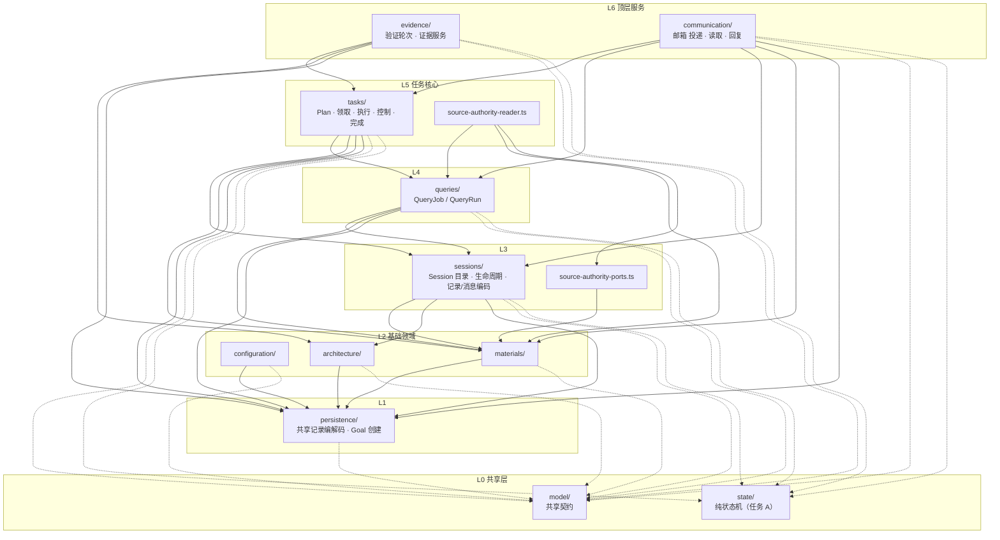

# WorkGraph 目标子模块 DAG（任务 D.2 提案）

> **状态：提案，⏸ 等用户确认后再执行 D.3。** 本稿只描述目标分层和执行计划，没有改动仓库文件。
>
> **依据：** `docs/refactor/reviews/evidence/workgraph-split-2026-10-02/before/import-graph.json` 和同目录的 `import-graph.md`。拆分前共 81 个文件、37,403 行、250 条内部 import 边，其中 109 条是 type-only。文件级没有环；目录级 9 个目录组成一个强连通分量，共 55 个基本环。下文的 C1–C55 就是 `import-graph.md` 中“Group-level elementary cycles”的顺序编号。
>
> **来源：** 本稿综合了三份候选方案（proposal-1/2/3），评分见 §10。

## 0. 结论

- **共 13 个子模块。** 11 个目录，其中新增 `model/` 和 `state/`；另有 2 个根目录下的单文件子模块。
- **第一步纯搬移：**
  - 17 个整文件搬移，导出名都不变；
  - 1 处文件拆分（X1）：把 `decodeRun` 从 `tasks/run-state-service.ts` 拆到 `materials/run-snapshot-decoder.ts`；
  - 端口注入 0 个。
- **持久层：** `persistence` 只依赖 `model`。`persistence → tasks` 消失，`persistence` 不依赖任何领域子模块。
- **原来的 34 条目录边：**
  - 14 条消失；
  - 2 条根文件边改记为单文件子模块边；
  - 其余 18 条保留，并且都顺着新 DAG 的方向。
- **55 个基本环全部断开**，没有遗留的环。
- **检查器结果：**
  - 在拆分前的图上：`problems=[]`，`violationCount=0`，`portCount=1`。这 1 个“端口”就是 X1 拆分，因为检查器只认识现有文件，只能这样标出来。
  - 在模拟 X1 拆分后的图上：`problems=[]`，`violationCount=0`，`portCount=0`。
- **import 改动量：** 共 271 行。
  - work-graph 内部：99 行，47 个文件；
  - 其它 `src`：84 行，22 个文件；
  - `tests`：88 行，44 个文件。

  这是三份候选方案和本稿中最少的（候选方案分别为 305、273、358 行）。

## 1. 分层图

实线表示领域依赖，虚线表示对共享层 `model` 和 `state` 的依赖。箭头从依赖方指向被依赖方，上层可以依赖下层，反过来不行。



## 2. 子模块表

行数是按上述方案搬移之后、拆分大文件之前的统计。`*` 表示搬移进来的文件。

| 子模块 | 目录 | 职责 | 允许依赖 | 文件数/行数 |
|---|---|---|---|---|
| `model` | `model/` | 各子模块共享的端口和数据契约，外加少量纯工具（`task-index` 邻接、`deriveSessionInputId`）。不做 I/O，不做记录编码，不含业务流程 | — | 12 / 1,174 |
| `state` | `state/` | 任务 A 的纯状态机（`transition*`、记录构造），只依赖 `src/contracts`。目录由任务 A 创建 | — | 0 / 0（任务 A 新建） |
| `persistence` | `persistence/` | Goal 创建的编译和仓储；多个子模块共读的记录和事件编解码，包括 Goal、执行入口、执行历史、控制、Plan 和证据 | model | 8 / 3,591 |
| `configuration` | `configuration/` | Project、Workspace、CompletionPolicy 的引导；角色配置；角色记忆 | model, persistence | 5 / 3,081 |
| `materials` | `materials/` | 材料访问、授权、适用性；RunSnapshot、QueryRun、Grant 的只读编码；材料权威读取 | model, persistence | 8 / 2,843（X1 之后为 9 个文件，约 2,888 行） |
| `architecture` | `architecture/` | 架构目录 catalog、基线、架构差异 | model, persistence | 8 / 2,990 |
| `sessions` | `sessions/` | Session 目录、生命周期、工作目标；SessionRecord 和 SessionMessage 的记录编码 | model, state, persistence, materials, architecture | 7 / 4,150 |
| `queries` | `queries/` | QueryJob 和 QueryRun 的提交、执行、答复，以及它们的记录编码 | model, state, persistence, materials, sessions | 4 / 3,445 |
| `tasks` | `tasks/` | Plan 的读、写、校验和采用；领取；执行入口和执行历史；控制；模型调用；运行状态；Task 和 Goal 的完成判定以及证据覆盖折叠 | model, state, persistence, materials, sessions, queries | 24 / 12,495 |
| `evidence` | `evidence/` | 验证轮次和证据写入服务、验证计划 | model, state, persistence, architecture, tasks | 2 / 1,250 |
| `communication` | `communication/` | Session 邮箱：投递、读取、回复 | model, state, persistence, materials, sessions, queries, tasks | 1 / 2,069 |
| `source-authority-ports` | `source-authority-ports.ts` | 对 Runtime 和 Workflow 公开的来源权威读取端口类型（单文件） | materials | 1 / 63 |
| `source-authority-reader` | `source-authority-reader.ts` | 来源权威精确事实的读取适配器（单文件） | source-authority-ports, materials, queries | 1 / 252 |
| **合计** | | | | **81 / 37,403** |

各子模块包含的文件如下，括号内是行数：

- **model**：
  - task-contracts\*(91)、claim-contracts\*(68)、execution-entry-contracts\*(127)、execution-read-contracts\*(64)、execution-history-contracts\*(33)、plan-contracts\*(163)
  - configuration-contracts\*(40)、material-contracts\*(37)、session-contracts\*(60)、communication-contracts\*(273)、evidence-contracts\*(140)
  - task-index\*(78)
- **persistence**：
  - 原有：record-codecs(466)、commit-compiler(285)、graph-repository(345)、execution-entry-codecs(497)、execution-history-codecs(222)、control-record-codecs(475)
  - 搬入：plan-record-codecs\*(838)、evidence-record-codecs\*(463)
- **sessions**：
  - 原有：session-directory(1571)、session-lifecycle(701)、session-record-codecs(788)、session-targets(171)、lifecycle-contracts(68)、lifecycle-record-codecs(266)
  - 搬入：message-record-codecs\*(585)
- **tasks**：
  - 原 tasks/ 中留下的 22 个文件；
  - 搬入：evidence-coverage\*(199)、model-request-codecs\*(248)。
- **evidence**：evidence-service(1118)、verification-plan(132)。
- **communication**：mailbox-service(2069)。
- **queries、configuration、materials、architecture**：文件不变（`configuration/contracts.ts`、`materials/contracts.ts` 已移到 model）。

## 3. 和任务书示例的差别（都由真实依赖决定）

1. **queries 在 tasks 下面，而不是顶层。** 这是唯一一处偏离，理由如下。
   - `tasks/plan-service.ts:73–78` 会读取 QueryJob、QueryRun 和 answer 记录，并引用 `QUERY_MANIFEST_CONTENT_TYPE`。这是 initial-plan 消费方从已答复的 Query 采用候选计划的正式路径，属于真实的业务方向 tasks → queries。
   - 要把 queries 放到顶层，就得把 `query-record-codecs` 下沉到 persistence。但它在 `:51` 有一条值依赖指向 `materials/record-readers`（`QUERY_RUN_RECORD_SCHEMA`），所以还得先拆开 `record-readers` 的编码部分。这样做的代价明显超过收益。
   - queries 本身不依赖任何 tasks 服务，所以 tasks 在上、queries 在下没有逆向压力。
2. **state 是独立的根目录 `state/`，不放在 `tasks/state/`。**
   - 任务 A.2 规定的位置就是 `src/core/work-graph/state/`。
   - `check-boundaries.mjs` 禁止子模块路径互相重叠，`tasks/` 和 `tasks/state/` 不能同时声明。
   - 任务书写的“tasks（含任务 A 的 state/）”在这里解释为：state 和 tasks 同属任务核心，但 state 放在最底层，这样 sessions、queries、tasks、evidence、communication 都能依赖它。
3. **顶层是 evidence 和 communication**，queries 低一层（见第 1 条）。其余顺序与示例一致：
   - 最底层是 persistence 和 model；
   - 往上依次是 configuration、materials、architecture，然后 sessions，再往上是 tasks。
4. **model 不全是类型。** 里面有 2 处纯值：`deriveSessionInputId`（`communication-contracts`）和 `task-index` 的邻接函数。两者都没有 I/O，也不依赖其它子模块。

## 4. 搬移清单（第一步，纯搬移；导出名不变，只改文件位置和文件名）

model/ 里会有 6 个 `contracts.ts`，为避免重名，按领域加前缀。`coverage.ts` 进入 tasks/ 后改名为 `evidence-coverage.ts`，免得名字含义不清。只改文件名，不改导出名。

| # | 原路径 | 新路径 | 原因（迫使它移动的边） | 消除的旧目录边 |
|---|---|---|---|---|
| M1 | tasks/contracts.ts | model/task-contracts.ts | 它是 model 内其它契约的依赖（claim-contracts:15、execution-entry-contracts:24、execution-history-contracts:6、plan-contracts:15），所以必须一起下沉。另外还有 configuration/project-bootstrap-contracts:25、materials/grant-contracts:36、queries/contracts:43 等 type 边指向它 | configuration→tasks、materials→tasks；与 M13 一起消除 queries→tasks |
| M2 | tasks/claim-contracts.ts | model/claim-contracts.ts | persistence/execution-entry-codecs.ts:26 → tasks | 与 M3/M5/M15 一起消除 persistence→tasks；与 M3/M7 一起消除 tasks→configuration |
| M3 | tasks/execution-entry-contracts.ts | model/execution-entry-contracts.ts | persistence/execution-entry-codecs.ts:27 → tasks | 同上 |
| M4 | tasks/execution-read-contracts.ts | model/execution-read-contracts.ts | M3 的依赖（execution-entry-contracts:25）；communication/contracts:33、evidence/contracts:37 也引用它 | 闭包搬移，单独不删边，但 model 自洽需要它 |
| M5 | tasks/execution-history-contracts.ts | model/execution-history-contracts.ts | persistence/execution-history-codecs.ts:35 → tasks | 与 M2/M3/M15 一起消除 persistence→tasks |
| M6 | tasks/plan-contracts.ts | model/plan-contracts.ts | M3 的依赖（execution-entry-contracts:27）；M13 之后 plan-record-codecs:39 也需要它 | 闭包搬移 |
| M7 | configuration/contracts.ts | model/configuration-contracts.ts | claim-contracts:14、execution-entry-contracts:22 依赖它；不搬会出现 model → configuration | tasks→configuration、queries→configuration；与 M10 一起消除 communication→configuration |
| M8 | materials/contracts.ts | model/material-contracts.ts | execution-entry-contracts:23 依赖它；不搬会出现 model → materials | 与 M10 一起消除 communication→materials；与 M11 一起消除 evidence→materials |
| M9 | sessions/contracts.ts | model/session-contracts.ts | communication/contracts:31 依赖它 | 闭包搬移 |
| M10 | communication/contracts.ts | model/communication-contracts.ts | message-record-codecs:31（M17 之后在 sessions）和 queries/contracts:42 都引用它 | 与 M17 一起消除 queries→communication，打掉 queries↔communication 二元环 |
| M11 | evidence/contracts.ts | model/evidence-contracts.ts | evidence-record-codecs:25 需要 `FinalizedChecks`，而 M14 之后它在 persistence | 与 M8 一起消除 evidence→materials |
| M12 | tasks/task-index.ts | model/task-index.ts | architecture/catalog-record-codecs.ts:25 → tasks（纯邻接工具 `hasCycleInEdges`） | architecture→tasks |
| M13 | tasks/plan-record-codecs.ts | persistence/plan-record-codecs.ts | queries/query-execution.ts:40、query-job-service.ts:60 引用它（queries 在 tasks 下面）；coverage:27 也共读 PlanRevision 编码 | 与 M1 一起消除 queries→tasks |
| M14 | evidence/evidence-record-codecs.ts | persistence/evidence-record-codecs.ts | tasks/completion.ts:44 → evidence | 与 M16 一起消除 tasks→evidence |
| M15 | persistence/model-request-codecs.ts | tasks/model-request-codecs.ts | 它的 `:19` 以 type 方式引用 tasks/model-call-contracts（persistence → tasks）。唯一使用方是 tasks/model-call-service:34，所以跟着使用方上移，契约留在 tasks | 与 M2/M3/M5 一起消除 persistence→tasks |
| M16 | evidence/coverage.ts | tasks/evidence-coverage.ts | tasks/completion.ts:47 → evidence。它是纯的证据覆盖折叠，本身依赖 tasks/plan-task-basis，属于完成判定的输入 | 与 M14 一起消除 tasks→evidence |
| M17 | communication/message-record-codecs.ts | sessions/message-record-codecs.ts | tasks/claim-service.ts:50、queries/query-job-service.ts:59 → communication。它的值依赖只有 session-record-codecs | tasks→communication；与 M10 一起消除 queries→communication |

**文件拆分（第一步内完成，不改逻辑）：**

| # | 原文件 | 拆出部分 | 新文件（子模块） | 原因 | 消除的旧目录边 |
|---|---|---|---|---|---|
| X1 | tasks/run-state-service.ts | `decodeRun`、`Decoded<T>`、`RUN_VALIDATE` 的选择逻辑，以及它们用到的私有 `isRecord`/`parseBody`（各复制一份，约 10 行） | materials/run-snapshot-decoder.ts（materials，约 45 行） | sessions/session-directory.ts:58 → tasks。`decodeRun` 只是 RunSnapshot@1 已注册校验器的一层包装，而这个校验器由 materials/record-readers 拥有。要改 import 的地方：session-directory:58、mailbox-service:59、completion:51，以及 run-state-service 自身 | sessions→tasks |

`decodeRun` 在 work-graph 外没有使用方，所以不在旧路径保留 re-export。

## 5. 下沉 / 拆分 / 端口清单

- **共享类型下沉到 model：** M1–M12。
- **共享记录编码下沉到 persistence：** M13、M14。persistence 原来就是放共享编解码的地方，已有 execution-entry、execution-history、control 三类编解码，所以性质不变。
- **跟随唯一使用方上移：** M15。它的契约 `model-call-contracts` 留在 tasks，model 不会因此多一个值函数（`modelRequestPermitIdFor`）。
- **纯折叠并入完成判定所在的层：** M16。
- **消息编码并入 sessions：** M17。sessions 也保留自己的 `session-record-codecs`，因为它不需要下沉。
- **拆分后下沉：** X1。
- **端口注入：无（0 个）。** 检查器的 `ports` 里只有 X1 这一条，标为 `split-sink`。它是第一步的文件拆分，不是运行时注入，`createPlatform` 的装配不变。

评审中比较过、但没有采用的做法：

| 备选 | 结论 |
|---|---|
| 给 `tasks/completion.ts` 注入“证据解码 + coverage 折叠”端口（proposal-1 备选） | 注入的是纯函数，不是反向调用服务，这个端口没有实际意义。不采用 |
| 把 completion、completion-policy、task-service 拆成独立的 `completion/` 子模块，放在 evidence 之上（proposal-2） | 违反“tasks 含完成判定”；任务 A 正在改这几个文件，同时搬移会冲突；而且它自己的 X1 拆分之后，`communication→materials` 和 `completion→materials` 都没有声明，模拟检查出 2 条违规。不采用 |
| 新增 `records/` 层，放所有共享的领域编码，persistence 降为无依赖（proposal-3） | 要多搬 7 个文件，import 改动 358 行；`records/` 容易成为什么都往里放的目录，名字也容易和 RecordStore 混淆；coverage 和 plan-task-basis 进 records 之后不能用 state，而任务 A 明确把 coverage 列为状态写入点。不采用 |
| sessions 放在 tasks 之上，把 session-record-codecs 下沉到 persistence（proposal-1/3） | 能免掉 X1，但要多搬一个扇入很高的文件（外部 23 行 import），sessions 失去自己的记录编码，而且偏离任务书示例。不采用 |

## 6. 每项改动消除了哪些现有目录级环

一条旧边只有在“由哪些变更消除”一列的变更**全部完成**后才会消失。新的子模块图无环，55 个旧环每一个都至少包含一条被消除的边。完整的环清单见附录 A。

| 被消除的旧目录边 | 含这条边的旧环数 | 由哪些变更消除 |
|---|---:|---|
| persistence → tasks | 27 | M2 + M3 + M5 + M15 |
| tasks → communication | 20 | M17 |
| queries → communication | 11 | M10 + M17 |
| architecture → tasks | 6 | M12 |
| materials → tasks | 6 | M1 |
| configuration → tasks | 5 | M1 |
| sessions → tasks | 5 | X1 |
| tasks → evidence | 5 | M14 + M16 |
| communication → configuration | 4 | M7 + M10 |
| communication → materials | 4 | M8 + M10 |
| queries → configuration | 4 | M7 |
| evidence → materials | 2 | M8 + M11 |
| queries → tasks | 2 | M1 + M13 |
| tasks → configuration | 2 | M2 + M3 + M7 |

保留的 18 条旧边都顺着新 DAG 的方向：

- architecture→persistence
- communication→persistence / queries / sessions / tasks
- configuration→persistence
- evidence→architecture / tasks
- materials→persistence
- queries→materials / persistence / sessions
- sessions→architecture / persistence
- tasks→materials / persistence / queries / sessions

两条根文件边 `(root)→materials` 和 `(root)→queries` 现在记为 `source-authority-*` 两个单文件子模块的边。

各改动断开的旧环如下（C 编号对应 `import-graph.md`）：

| 改动 | 断开的旧环数 | 旧环编号 |
|---|---:|---|
| M17 | 31 | C1 C2 C4 C7 C8 C10 C13–C37 |
| M2、M3 | 各 28 | C1–C6 C13 C14 C17 C18 C21 C22 C24 C26 C28 C29 C32 C33 C38–C40 C42 C45 C46 C49–C52 |
| M5、M15 | 各 27 | 同上，不含 C40 |
| M10 | 15 | C4 C10 C13–C20 C22 C23 C33 C35 C37 |
| M1 | 13 | C15 C16 C19 C20 C25 C27 C31 C40 C41 C43 C47 C48 C54 |
| M7 | 10 | C13–C16 C24 C25 C38–C41 |
| M12 | 6 | C7–C12 |
| M8 | 6 | C17–C20 C42 C43 |
| M14、M16 | 各 5 | C3 C9 C42 C43 C44 |
| X1 | 5 | C30 C34 C35 C53 C55 |
| M13 | 2 | C31 C54 |
| M11 | 2 | C42 C43 |
| M4、M6、M9 | 0 | 闭包搬移，单独不删边。没有它们，model 会反向依赖 tasks 或 sessions |

## 7. 超过 1,000 行的文件按职责拆分（D.4，第二步之后）

拆分规则：

- 拆出来的部分留在原子模块里；
- 工厂里的闭包改成接收 `{ deps, records, … }` 上下文的模块函数，逻辑不变；
- 原工厂文件只负责装配，并保持原来导出的工厂名；
- 行数是按现有行号区间加 import 头估算的，目标是每个文件不超过约 800 行。

**tasks/plan-service.ts（2,130 行）——读、写、校验、采用**

| 新文件 | 职责 | 来源（原行号） | 估计行数 |
|---|---|---|---:|
| plan-service.ts | `createPlanService` 装配、Host 写入口绑定 | 1–142, 712–720, 1615–1618, 2108–2130 | ~200 |
| plan-service-support.ts | 输入隔离、身份和指纹、调用方 pins、重放恢复、提交失败映射 | 143–380, 451–535 | ~360 |
| plan-read-model.ts | 读权限（host / work-run / query-run）、任务行和水位、ready 分页游标 | 381–450, 536–707 | ~280 |
| plan-queries.ts | **读**：queryGoal、readPlanProposal、queryTaskGraph、queryReadyTasks、readTaskInput | 1335–1614 | ~320 |
| plan-host-writes.ts | **写**：commitHostPlanProposal、proposePlan、applyPlanChange | 923–1243 | ~360 |
| plan-initial-adoption.ts | **采用**：readInitialPlanAnswerFacts、verifyModelCoordinationDraft、proposeInitialPlanFromAnswer。tasks → queries 的依赖只集中在这个文件 | 721–922, 1244–1334 | ~330 |
| plan-agent-writes.ts | W2 委托 Agent 的写入：准入、future revision、propose/apply as agent | 1619–2107 | ~530 |

**校验**部分已经在 `plan-validation.ts`（513 行）和 `plan-write-admission.ts`（385 行）里，不需要再拆。

**communication/mailbox-service.ts（2,069 行）——投递、读取、回复**

| 新文件 | 职责 | 来源 | 估计行数 |
|---|---|---|---:|
| mailbox-service.ts | `createSessionMailbox` 装配、internalHostContext、cursorSequence | 1–73, 418–446, 2067–2069 | ~150 |
| mailbox-support.ts | 纯工具、可信上下文、请求归一化、身份和指纹、收件/发件游标 | 74–413 | ~380 |
| mailbox-sender-authority.ts | work-run 发件人身份和新动作授权（使用 X1 之后的 `decodeRun`） | 447–744 | ~340 |
| mailbox-store.ts | 消息、正文、Query 记录的加载，正文存储和校验，replay/commit | 745–1039 | ~335 |
| mailbox-deliver.ts | **投递**：sendMessage、recordInputAccepted | 1040–1182, 1947–2066 | ~300 |
| mailbox-read.ts | **读取**：readMessage、readMessageBody、readInbox、readOutbox | 1183–1558 | ~410 |
| mailbox-reply.ts | **回复**：ackMessage、respondMessage、respondFromQueryAnswer、recordConsultationDerivation | 1559–1946 | ~425 |

**tasks/execution-entry-service.ts（1,696 行）——共享准入、入口写入、记录编码**

| 新文件 | 职责 | 来源 | 估计行数 |
|---|---|---|---:|
| execution-entry-support.ts | 小工具和共享导出（isRecord、nonEmpty、sameRef、mapStoreFailure、freshRunControlProblem、mergeGuards、bindTrustedContext、isolateWrite、check*Pin）、身份和指纹 | 64–304, 828–844, 1679 起的 mergeGuards | ~300 |
| execution-admission.ts | 与模型调用共用的准入读取、清单校验、角色准入、外部材料、admitEnteredRun、loadReplayEvent | 305–827 | ~560 |
| execution-entry-records.ts | 记录编码器和附加形状检查（taskEntryPermitProblem 等） | 1481–1678, 1680–1696 | ~240 |
| execution-entry-service.ts | `MANIFEST_CONTENT_TYPE`、`createExecutionEntryService`：authorize、begin、entered、result 及对应的 replay | 845–1480 | ~700 |

外部引用方要改 import 路径：plan-service、evidence-service、completion、control-service、model-call-service、plan-write-admission、mailbox。

**sessions/session-directory.ts（1,571 行）——创建、读取**

| 新文件 | 职责 | 来源 | 估计行数 |
|---|---|---|---:|
| session-directory.ts | `createSessionDirectory` 装配、`SessionDirectoryStores` | 1–66, 559–565, 1569–1571 | ~100 |
| session-directory-support.ts | 运行时守卫、身份和指纹（含 `kernelSessionClaimKey`）、pins、创建输入归一化 | 67–396 | ~370 |
| session-directory-cursors.ts | 目录游标、目标索引游标、查找计划和界限 | 397–554 | ~180 |
| session-creation.ts | **写**：readOriginalOperation、readOriginalSession、admitSessionCreation、recordSessionCreated、getSessionOperation | 566–1026 | ~500 |
| session-directory-reads.ts | **读**：availabilityOf、readSessionLinks、readContext、readWorkRunContext、readSession、fetchLookup、findSessionsByTarget、findSessions | 1027–1568 | ~580 |

任务 A 落地后，`availabilityOf` 会改为调用 `state/session-availability`。

**queries/query-execution.ts（1,494 行）——启动、进度**

| 新文件 | 职责 | 来源 | 估计行数 |
|---|---|---|---:|
| query-execution.ts | `QUERY_MANIFEST_CONTENT_TYPE`（plan-service 引用，留在原文件）、`createQueryExecution` 装配、authorizeCurrent | 1–61, 630–647, 1442–1494 | ~150 |
| query-execution-support.ts | 小工具、commit/replay、原请求 pins、身份和指纹 | 62–160, 397–625 | ~360 |
| query-execution-reads.ts | 精确读取（core、answer、record、initiator、preparation）、manifest 重读 | 161–396 | ~270 |
| query-run-start.ts | claim、bindPrepared、beginEntry | 648–1104 | ~490 |
| query-run-progress.ts | recordUsage、admitRequest、recordObservation | 1105–1441 | ~370 |

**tasks/plan-readers.ts（1,343 行）——schema、规范读取、治理、任务事实**

| 新文件 | 职责 | 来源 | 估计行数 |
|---|---|---|---:|
| plan-record-schemas.ts | 本 reader 注册的 schema：TaskLease、TaskReduction、CompletionPolicy、ArchitectureBaseline 及 active pointer；`PLAN_STATE_RECORD_SCHEMAS`、`PLAN_GOVERNANCE_RECORD_SCHEMAS` | 59–282 | ~250 |
| plan-readers.ts | 规范读取（readBatch、readGoal、readGoalScope、readPlan、readProposal、findPendingProposal）、Goal→Plan 一致窗口 | 1–58, 283–495, 673–719 | ~330 |
| plan-governance-reads.ts | resolveGovernance、tryPolicyContent、readPinnedCompletionPolicy | 496–672 | ~200 |
| task-fact-readers.ts | 规范任务事实（Run、TaskLease、TaskReduction）、readGoalPhase | 720–1218 | ~530 |
| plan-change-reads.ts | W1 future-change 和 origin-Plan 读取 | 1219–1343 | ~150 |

**configuration/project-bootstrap-service.ts（1,162 行）——准入、Project/Workspace、CompletionPolicy**

| 新文件 | 职责 | 来源 | 估计行数 |
|---|---|---|---:|
| project-bootstrap-service.ts | `createProjectBootstrapServices` 装配 | 1–83, 1141–1162 | ~110 |
| bootstrap-admission.ts | 结果和形状工具、Host 绑定、pins、replay/commit、记录读取 | 84–539 | ~490 |
| project-workspace-bootstrap.ts | createProject、registerWorkspace、readWorkspaceRegistration、readProject | 540–710, 984–1063 | ~290 |
| completion-policy-bootstrap.ts | installCompletionPolicy、activateCompletionPolicy、readCurrentCompletionPolicy | 711–983, 1064–1140 | ~390 |

**evidence/evidence-service.ts（1,118 行）——轮次、检查**

| 新文件 | 职责 | 来源 | 估计行数 |
|---|---|---|---:|
| evidence-service.ts | `createEvidenceService` 装配 | 1–71, 271–273 | ~90 |
| evidence-service-support.ts | 纯工具、存储工具、finalize/submit 工具 | 72–266, 1070–1118 | ~280 |
| verification-rounds.ts | storeReport、evaluateSource、openVerification、readVerification、queryOriginalVerification | 274–639 | ~400 |
| verification-checks.ts | beginCheck、recordCheckResult、submitEvidence、finalizeChecks | 640–1069 | ~470 |

以下文件在 800–1,000 行之间，D.4 不要求拆分，只作观察：

- materials/grant-service（969）
- queries/query-job-service（956）
- persistence/plan-record-codecs（838）
- configuration/role-memory-service（809）
- architecture/catalog-service（805）

## 8. 要加入 module-target.json 的片段

在 `modules` 中 WorkGraph 那一项加入 `submodules` 字段，下面给出加入后的完整条目：

```json
{
  "id": "WorkGraph",
  "path": "src/core/work-graph/",
  "document": "modules/core/work-graph.md",
  "dependencies": ["WorkspaceTools", "RecordStore"],
  "submodules": [
    { "id": "model", "path": "model/", "dependencies": [] },
    { "id": "state", "path": "state/", "dependencies": [] },
    { "id": "persistence", "path": "persistence/", "dependencies": ["model"] },
    { "id": "configuration", "path": "configuration/", "dependencies": ["model", "persistence"] },
    { "id": "materials", "path": "materials/", "dependencies": ["model", "persistence"] },
    { "id": "architecture", "path": "architecture/", "dependencies": ["model", "persistence"] },
    { "id": "sessions", "path": "sessions/", "dependencies": ["model", "state", "persistence", "materials", "architecture"] },
    { "id": "queries", "path": "queries/", "dependencies": ["model", "state", "persistence", "materials", "sessions"] },
    { "id": "tasks", "path": "tasks/", "dependencies": ["model", "state", "persistence", "materials", "sessions", "queries"] },
    { "id": "evidence", "path": "evidence/", "dependencies": ["model", "state", "persistence", "architecture", "tasks"] },
    { "id": "communication", "path": "communication/", "dependencies": ["model", "state", "persistence", "materials", "sessions", "queries", "tasks"] },
    { "id": "source-authority-ports", "path": "source-authority-ports.ts", "dependencies": ["materials"] },
    { "id": "source-authority-reader", "path": "source-authority-reader.ts", "dependencies": ["source-authority-ports", "materials", "queries"] }
  ]
}
```

写入时要注意：

- **写入时机。** `check-boundaries.mjs` 要求每个子模块路径都存在，所以：
  - 这个片段要在 M1–M17 搬移完成后才能写入；
  - `state` 一项要等任务 A 建好 `state/` 并放入源码文件后再写，或者与它同一批提交。git 不跟踪空目录。
- **state 的依赖。** `state` 声明为无依赖，对应 A.2 的“只依赖 src/contracts”。如果任务 A 需要 model 中 WorkGraph 内部的类型，可以改成 `["model"]`，图仍然无环。
- **未使用的边会被接受。** 拆分前 `sessions→materials`、`communication→materials` 和所有 `→state` 边都还没有使用，检查器只报告实际出现的边，不会因此报错。
- **新根文件会失败。** 以后在 work-graph 根目录新增文件，会因为找不到所属子模块而失败（fail closed），必须先归入某个子模块。

## 9. 执行顺序与风险

1. **顺序：**
   - 任务 A 合入；
   - 重新生成 import-graph，用检查器复验本方案；
   - D.3 第一步：执行 M1–M17 和 X1，只改 import 路径；
   - 写入 §8 的片段，让 `check:architecture` 通过；
   - D.3 第二步：本方案不需要额外去环，因为不需要运行时端口；
   - D.4：按 §7 拆大文件；
   - 全量测试。
2. **改动面：** 271 行 import 路径。建议用脚本批量改写，不要手改，然后跑 `tsc --noEmit`，再用 `scripts/import-graph.mjs` 复核：纯搬移后边数仍是 250 条；X1 之后是 251 条，因为 run-state-service:44 对 record-readers 的引用会随 `RUN_VALIDATE` 一起移走。文件级仍然必须无环。
3. **不保留旧路径垫片。** 不在旧路径做 re-export：同一个类型会有两条路径，违背“单一事实来源”，子模块检查也会把垫片算进旧目录。
4. **和任务 A 的冲突。** 任务 A 会修改 completion、completion-policy、coverage、session-directory、mailbox、query-execution 等文件。本方案只搬了 coverage，completion 和 completion-policy 留在原处，冲突面最小。A 合入之后，需要再确认一次 `state/` 只依赖 `src/contracts`。
5. **以后加依赖的约束。** 以下方向一律禁止：
   - persistence 依赖任何领域；
   - sessions、queries 调用 tasks 的服务；
   - tasks 调用 evidence、communication 的服务。

   如果以后确实需要，只能把共享部分下沉，或者由组合根注入端口，并同步修改 §8 的规则。

   另外，`persistence → state` 加上后图仍然无环，但它会让持久层依赖领域规则，需要用户确认后再加。
6. **注释和文档里的旧路径。** 需要同步更新的有：
   - `tasks/completion.ts` 文件头提到的 `evidence/coverage.ts`；
   - `src/contracts/core/session-message.ts` 注释里的 `communication/contracts.ts`；
   - `IMPLEMENTED-CAPABILITIES` 和 `modules/core/work-graph.md` 中的路径。

   历史证据和报告保留原文不改。

## 10. 三份候选方案的评分（0–10）

| 维度 | P1 最小改动 | P2 职责优先 | P3 按扇入分层 | 本稿（综合） |
|---|---:|---:|---:|---:|
| 正确性（0 违规） | 10 | 7 | 10 | 10 |
| 任务书符合度 | 6 | 6 | 7 | 8 |
| 职责内聚 | 6 | 7 | 6 | 7 |
| 搬移数（越少越好） | 8 | 8 | 5 | 8 |
| 端口注入数（越少越好） | 10 | 9 | 10 | 9 |
| 适配任务 A 的 state/ | 8 | 8 | 6 | 9 |
| 后续大文件拆分风险 | 8 | 7 | 7 | 8 |
| **合计（满分 70）** | **56** | **52** | **51** | **59** |

各维度的评分依据：

- **正确性。**
  - P1、P3 在拆分前的图上 0 违规、0 端口。
  - P2 在拆分前的图上 0 违规，但依赖一条 split-sink 排除；按它自己的 X1 拆分模拟后，`communication→materials`、`completion→materials` 没有声明，出现 2 条违规。
  - 本稿在拆分前后都是 0 违规。
- **任务书符合度。**
  - P1：architecture 只因一个 78 行的纯工具就放在 tasks 之上，sessions 也在 tasks 之上。
  - P2：completion 不在 tasks 里。
  - P3：sessions 在 tasks 之上，queries 在 tasks 之下。
  - 本稿只有“queries 在 tasks 之下”一处偏离，并给出了理由。
- **职责内聚。**
  - P1：persistence 成了收纳 Session、消息、Plan、证据编码的大杂烩，共 11 个文件、5.2k 行。
  - P2：sessions 保留了自己的编码，evidence 也完整，但 completion 被拆离 tasks。
  - P3：`records/` 是一个混合层，名字还和 RecordStore 冲突。
- **搬移数。**
  - P1：17 个搬移，import 改动 305 行。
  - P2：17 个搬移加 1 处拆分，273 行。
  - P3：24 个搬移，358 行，另有根文件层级变化。
  - 本稿：17 个搬移加 1 处拆分，271 行。
- **端口注入数。** 四者都没有运行时端口；P2 和本稿各有一条 split-sink，被检查器计为端口。
- **适配任务 A 的 state/。**
  - P3 的 coverage 移进 records 之后不能使用 state。
  - P1、P3 声明了 `state→model`，没有严格对应 A.2 的“只依赖 src/contracts”。
  - P2 的 completion 搬移会和 A 的改动冲突。
- **大文件拆分风险。**
  - 四份方案都让大文件留在原子模块里拆分。
  - P2 拆分后规则不一致；P3 的 records 层以后容易继续膨胀。

## 11. 校验与复现

评审时证据 JSON 还没有 `nodes` 字段，评审者从源码按同一规则重算了一份（81 个文件、37,403 行，与证据 totals 一致）。之后 `scripts/import-graph.mjs` 已改为在报告里输出 `nodes`，并重新生成了 `before/import-graph.json`，可以直接复验：

```sh
node scripts/import-graph-check.mjs docs/refactor/reviews/evidence/workgraph-split-2026-10-02/before/import-graph.json \
  docs/refactor/reviews/evidence/workgraph-split-2026-10-02/target-proposal.json
```

| 输入 | problems | violationCount | portCount | 说明 |
|---|---|---:|---:|---|
| `before/import-graph.json` + `target-proposal.json` | [] | 0 | 1 | 唯一的“端口”是 X1 split-sink（2026-10-03 复验） |
| 模拟 X1 拆分后的图 + 对应方案 | [] | 0 | 0 | 评审时在草稿目录模拟；D.3 执行后用真实 after 图复验 |

## 附录 A：55 个旧目录级基本环，以及断开每个环的边

| 环 | 路径（import-graph.md 顺序） | 被消除的边 | 相关变更 |
|---|---|---|---|
| C1 | architecture → persistence → tasks → communication → queries → sessions → architecture | `persistence -> tasks`<br>`tasks -> communication` | M2, M3, M5, M15, M17 |
| C2 | architecture → persistence → tasks → communication → sessions → architecture | `persistence -> tasks`<br>`tasks -> communication` | M2, M3, M5, M15, M17 |
| C3 | architecture → persistence → tasks → evidence → architecture | `persistence -> tasks`<br>`tasks -> evidence` | M2, M3, M5, M15, M14, M16 |
| C4 | architecture → persistence → tasks → queries → communication → sessions → architecture | `persistence -> tasks`<br>`queries -> communication` | M2, M3, M5, M15, M10, M17 |
| C5 | architecture → persistence → tasks → queries → sessions → architecture | `persistence -> tasks` | M2, M3, M5, M15 |
| C6 | architecture → persistence → tasks → sessions → architecture | `persistence -> tasks` | M2, M3, M5, M15 |
| C7 | architecture → tasks → communication → queries → sessions → architecture | `architecture -> tasks`<br>`tasks -> communication` | M12, M17 |
| C8 | architecture → tasks → communication → sessions → architecture | `architecture -> tasks`<br>`tasks -> communication` | M12, M17 |
| C9 | architecture → tasks → evidence → architecture | `architecture -> tasks`<br>`tasks -> evidence` | M12, M14, M16 |
| C10 | architecture → tasks → queries → communication → sessions → architecture | `architecture -> tasks`<br>`queries -> communication` | M12, M10, M17 |
| C11 | architecture → tasks → queries → sessions → architecture | `architecture -> tasks` | M12 |
| C12 | architecture → tasks → sessions → architecture | `architecture -> tasks` | M12 |
| C13 | communication → configuration → persistence → tasks → communication | `communication -> configuration`<br>`persistence -> tasks`<br>`tasks -> communication` | M7, M10, M2, M3, M5, M15, M17 |
| C14 | communication → configuration → persistence → tasks → queries → communication | `communication -> configuration`<br>`persistence -> tasks`<br>`queries -> communication` | M7, M10, M2, M3, M5, M15, M17 |
| C15 | communication → configuration → tasks → communication | `communication -> configuration`<br>`configuration -> tasks`<br>`tasks -> communication` | M7, M10, M1, M17 |
| C16 | communication → configuration → tasks → queries → communication | `communication -> configuration`<br>`configuration -> tasks`<br>`queries -> communication` | M7, M10, M1, M17 |
| C17 | communication → materials → persistence → tasks → communication | `communication -> materials`<br>`persistence -> tasks`<br>`tasks -> communication` | M8, M10, M2, M3, M5, M15, M17 |
| C18 | communication → materials → persistence → tasks → queries → communication | `communication -> materials`<br>`persistence -> tasks`<br>`queries -> communication` | M8, M10, M2, M3, M5, M15, M17 |
| C19 | communication → materials → tasks → communication | `communication -> materials`<br>`materials -> tasks`<br>`tasks -> communication` | M8, M10, M1, M17 |
| C20 | communication → materials → tasks → queries → communication | `communication -> materials`<br>`materials -> tasks`<br>`queries -> communication` | M8, M10, M1, M17 |
| C21 | communication → persistence → tasks → communication | `persistence -> tasks`<br>`tasks -> communication` | M2, M3, M5, M15, M17 |
| C22 | communication → persistence → tasks → queries → communication | `persistence -> tasks`<br>`queries -> communication` | M2, M3, M5, M15, M10, M17 |
| C23 | communication → queries → communication | `queries -> communication` | M10, M17 |
| C24 | communication → queries → configuration → persistence → tasks → communication | `queries -> configuration`<br>`persistence -> tasks`<br>`tasks -> communication` | M7, M2, M3, M5, M15, M17 |
| C25 | communication → queries → configuration → tasks → communication | `queries -> configuration`<br>`configuration -> tasks`<br>`tasks -> communication` | M7, M1, M17 |
| C26 | communication → queries → materials → persistence → tasks → communication | `persistence -> tasks`<br>`tasks -> communication` | M2, M3, M5, M15, M17 |
| C27 | communication → queries → materials → tasks → communication | `materials -> tasks`<br>`tasks -> communication` | M1, M17 |
| C28 | communication → queries → persistence → tasks → communication | `persistence -> tasks`<br>`tasks -> communication` | M2, M3, M5, M15, M17 |
| C29 | communication → queries → sessions → persistence → tasks → communication | `persistence -> tasks`<br>`tasks -> communication` | M2, M3, M5, M15, M17 |
| C30 | communication → queries → sessions → tasks → communication | `sessions -> tasks`<br>`tasks -> communication` | X1, M17 |
| C31 | communication → queries → tasks → communication | `queries -> tasks`<br>`tasks -> communication` | M1, M13, M17 |
| C32 | communication → sessions → persistence → tasks → communication | `persistence -> tasks`<br>`tasks -> communication` | M2, M3, M5, M15, M17 |
| C33 | communication → sessions → persistence → tasks → queries → communication | `persistence -> tasks`<br>`queries -> communication` | M2, M3, M5, M15, M10, M17 |
| C34 | communication → sessions → tasks → communication | `sessions -> tasks`<br>`tasks -> communication` | X1, M17 |
| C35 | communication → sessions → tasks → queries → communication | `sessions -> tasks`<br>`queries -> communication` | X1, M10, M17 |
| C36 | communication → tasks → communication | `tasks -> communication` | M17 |
| C37 | communication → tasks → queries → communication | `queries -> communication` | M10, M17 |
| C38 | configuration → persistence → tasks → configuration | `persistence -> tasks`<br>`tasks -> configuration` | M2, M3, M5, M15, M7 |
| C39 | configuration → persistence → tasks → queries → configuration | `persistence -> tasks`<br>`queries -> configuration` | M2, M3, M5, M15, M7 |
| C40 | configuration → tasks → configuration | `configuration -> tasks`<br>`tasks -> configuration` | M1, M2, M3, M7 |
| C41 | configuration → tasks → queries → configuration | `configuration -> tasks`<br>`queries -> configuration` | M1, M7 |
| C42 | evidence → materials → persistence → tasks → evidence | `evidence -> materials`<br>`persistence -> tasks`<br>`tasks -> evidence` | M8, M11, M2, M3, M5, M15, M14, M16 |
| C43 | evidence → materials → tasks → evidence | `evidence -> materials`<br>`materials -> tasks`<br>`tasks -> evidence` | M8, M11, M1, M14, M16 |
| C44 | evidence → tasks → evidence | `tasks -> evidence` | M14, M16 |
| C45 | materials → persistence → tasks → materials | `persistence -> tasks` | M2, M3, M5, M15 |
| C46 | materials → persistence → tasks → queries → materials | `persistence -> tasks` | M2, M3, M5, M15 |
| C47 | materials → tasks → materials | `materials -> tasks` | M1 |
| C48 | materials → tasks → queries → materials | `materials -> tasks` | M1 |
| C49 | persistence → tasks → persistence | `persistence -> tasks` | M2, M3, M5, M15 |
| C50 | persistence → tasks → queries → persistence | `persistence -> tasks` | M2, M3, M5, M15 |
| C51 | persistence → tasks → queries → sessions → persistence | `persistence -> tasks` | M2, M3, M5, M15 |
| C52 | persistence → tasks → sessions → persistence | `persistence -> tasks` | M2, M3, M5, M15 |
| C53 | queries → sessions → tasks → queries | `sessions -> tasks` | X1 |
| C54 | queries → tasks → queries | `queries -> tasks` | M1, M13 |
| C55 | sessions → tasks → sessions | `sessions -> tasks` | X1 |
